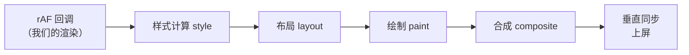
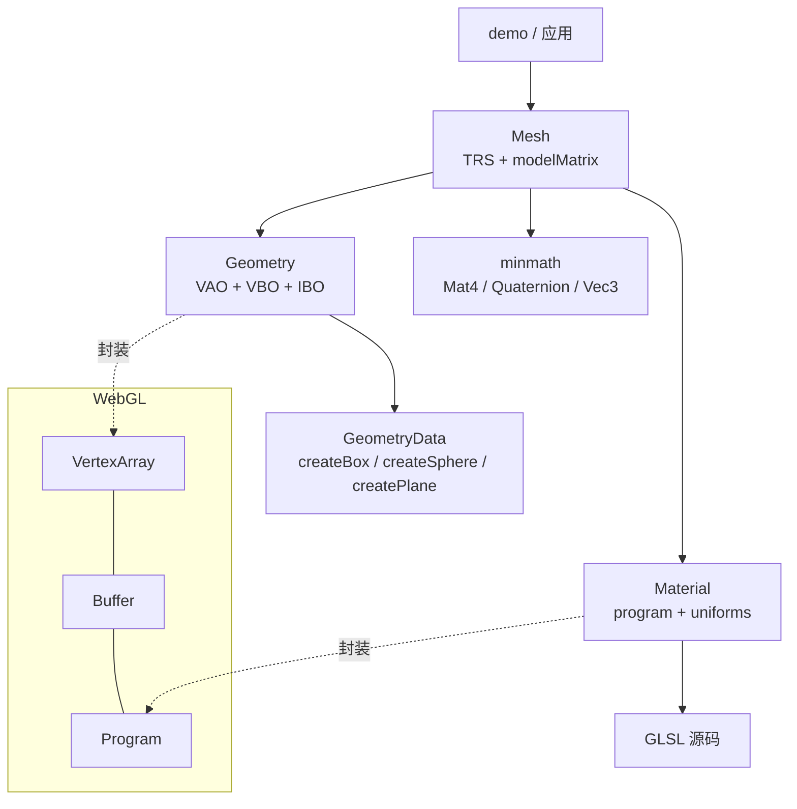

# 引擎最小核心

> [返回：WebGL 与 3D 框架学习大纲](../WebGL与3D框架学习大纲.md)
> 一句话定位：第三阶段第 2 节的完整展开——渲染循环的正确时间步进、PerspectiveCamera 与 OrbitCamera 轨道控制器的完整实现、box/sphere/plane 三个几何生成器的顶点/法线/UV 算法、Mesh = Geometry + Material 的最小抽象与渲染函数。前置：[02-数学库minmath](02-数学库minmath.md) 测试全绿。

## 2.1 渲染循环：requestAnimationFrame 与 deltaTime

### 概念讲解：浏览器的帧是怎么来的

`requestAnimationFrame`（下称 rAF）不是"定时器"，而是"把我的回调挂到浏览器下一次渲染之前"。浏览器每一帧（由显示器垂直同步 vertical synchronization，vsync 驱动，60/120/144Hz 不等）的流水线是：



三个直接推论：

1. **与显示合拍**：在 rAF 里绘制，画完正好赶上这一帧上屏，不产生无效绘制；用 `setTimeout(fn, 16)` 画动画，回调时机与 vsync 无关，轻则跳帧重则撕裂。
2. **标签页隐藏自动暂停**：切走标签页 rAF 停发，省电且不打扰前台——但也埋下"切回来 deltaTime 爆炸"的坑（见下）。
3. **帧率由设备决定**：同一份代码在 60Hz 与 144Hz 屏幕上每秒跑的次数差 2.4 倍——一切"每帧固定增量"的写法都会因此在不同机器上速度不同。

**deltaTime（增量时间）**是解药：它记录"这一帧距离上一帧过去了多少（秒）"，所有动画参数一律用"每秒多少"表达，再乘以 delta。时间步进的正确姿势就这一句：**速度用秒做单位，步进用 delta 乘**。

```typescript
// 错误：144Hz 屏幕上快 2.4 倍
angle += 0.01;

// 正确：任何刷新率下都是每秒 0.6 弧度
angle += 0.6 * delta;
```

### 设计推导：一个可靠的循环要处理四件事

**一、时间从哪来。** rAF 回调的第一个参数 `now` 是 `DOMHighResTimeStamp`（毫秒，与 `performance.now()` 同一时间基准），就用它，别在回调里再调一次 `performance.now()`（多一次系统调用还引入微小时差）。`delta = (now - last) / 1000`——注意**毫秒转秒**，忘了除以 1000 是新手高频事故（速度快 1000 倍）。

**二、clamp。** 标签页隐藏几分钟再切回来，raw delta 可能是几百秒，直接用会发生"物体瞬移 / 物理穿透 / 阻尼瞬间收敛"。设一个单帧上限（0.1s 是常用值）：时间照常流逝，但动画单帧最多前进 0.1s。

**三、首帧。** `last` 必须在 `start()` 时初始化，否则首帧 delta 是相对"上一次 rAF"或 0 的混乱值。

**四、elapsed 用 clamp 后的值累加还是真实时间？** 用 clamp 后的：动画时长与场景状态保持一致（画面走了 3 秒动画，elapsed 就是 3 秒）。代价是动画总时长不再等于真实经过的时间——长时间后台后两者会脱钩，这个取舍在 [01-导览](01-导览.md) 的阶段自测第 5 题回收。

最后补一个本阶段先记住结论、第四阶段动画系统再展开的话题：**可变步长 vs 固定步长（fixed timestep）**。渲染、相机阻尼用可变步长（delta 有多少用多少）；物理模拟与确定性动画需要固定步长（每步恒定 1/60s，用累积器 accumulator 攒真实时间、按固定步消耗），否则步长不同会算出不同的轨迹。

### 完整代码：RenderLoop

```typescript
// src/core/RenderLoop.ts

export type FrameCallback = (delta: number, elapsed: number) => void;

export class RenderLoop {
  private rafId = 0;
  private running = false;
  private lastTime = 0;
  private elapsed = 0;

  constructor(
    private readonly onFrame: FrameCallback,
    /** 单帧 delta 上限（秒）：后台切回时防止时间跳变 */
    private readonly maxDelta = 0.1,
  ) {}

  start(): this {
    if (this.running) return this; // 防重复启动造成双循环、双倍速
    this.running = true;
    this.lastTime = performance.now();
    this.elapsed = 0;
    const tick = (now: number): void => {
      if (!this.running) return;
      const delta = Math.min((now - this.lastTime) / 1000, this.maxDelta);
      this.lastTime = now;
      this.elapsed += delta;
      this.onFrame(delta, this.elapsed);
      this.rafId = requestAnimationFrame(tick);
    };
    this.rafId = requestAnimationFrame(tick);
    return this;
  }

  stop(): void {
    this.running = false;
    cancelAnimationFrame(this.rafId);
  }
}
```

用法（注意三处 delta 的消费方式各不相同：速度积分、阻尼收敛、帧率统计）：

```typescript
let spin = 0;
let fpsSmoothed = 0;

const loop = new RenderLoop((delta) => {
  // 1) 速度积分：每秒 0.15 弧度
  spin += 0.15 * delta;
  earth.rotation.setFromAxisAngle(UP, spin);

  // 2) 阻尼收敛（OrbitControls 内部也是 delta 驱动）
  controls.update(delta);

  // 3) 帧率统计：指数平滑，读数才不会每帧乱跳
  const fps = 1 / delta;
  fpsSmoothed = fpsSmoothed === 0 ? fps : fpsSmoothed * 0.95 + fps * 0.05;

  render();
});
loop.start();
```

## 2.2 PerspectiveCamera 与 OrbitCamera 轨道控制器

### 概念讲解：相机是两个矩阵，不是一个物体

WebGL 里没有"相机"这个 GL 对象。所谓相机，是两个矩阵：

- **view 矩阵（视图矩阵）**：世界空间 → 相机空间。相机"位于 eye、看着 target"，等价于 view = 相机自身世界矩阵的逆。第二阶段手写过：`lookAt(eye, center, up)` 直接产出它（旋转部分取相机姿态的转置，平移部分 `-R^T · eye`——推导见数学库 1.3 的 `Mat4.lookAt` 注释）。
- **projection 矩阵（投影矩阵）**：相机空间 → 裁剪空间。透视相机的形状是四棱台（视锥，frustum），由四个参数完全决定：

| 参数 | 含义 | 常见坑 |
|---|---|---|
| fov | 垂直视场角（field of view），WebGL 惯例取**纵向**角度 | 想控制水平视角应改 aspect，不是直接改 fov 的语义 |
| aspect | 宽高比（aspect ratio）= canvas 宽 / 高 | resize 时必须同步，否则画面拉扁 |
| near | 近裁剪面距离（相机空间，沿 -Z） | 设 0.0001 之类极小值会吃光深度精度，z-fighting 回归 |
| far | 远裁剪面距离 | far/near 比值越大深度分布越差，够用就好 |

水平视场角是被 aspect 推导出来的：`horizontalFov = 2·atan(tan(fovY/2)·aspect)`。宽屏画面"看起来更宽"是 aspect 在起作用，fov 仍是那个纵向角度。

**轨道相机（orbit camera）**是交互方式的选型：相机始终看着一个目标点，位置被约束在以目标为球心的球面上；鼠标拖拽 = 沿球面滑动，滚轮 = 改变半径。它适合"审阅一个物体"（地球、模型展示），不适合第一人称漫游（那是 yaw/pitch 相机，第四阶段交互系统再做）。

### 设计推导：球坐标、指数缩放与帧率无关的阻尼

**球坐标（spherical coordinates）参数化相机位置**：绕目标点用三个量——半径 radius、方位角 theta（azimuth，绕 +Y 轴、从 +Z 方向起算）、极角 phi（polar angle，从 +Y 正上方向下量）。转直角坐标：

```text
position = target + radius * ( sin(phi)·sin(theta),  cos(phi),  sin(phi)·cos(theta) )
```

phi 限制在开区间 (0, π)：phi 到 0 或 π 时相机正对极轴，theta 失去意义且 lookAt 的 up 与视线平行要退化处理——所以**永远 clamp phi 留出余量**（0.05 弧度足够）。

**滚轮缩放用指数而不是线性**：`radius *= exp(deltaY·k)`。线性加减（`radius -= deltaY·0.01`）在 radius 很小时步长相对过大、手感顿挫；指数让"每一格滚轮改变相同的比例"，近处精细、远处粗放，符合直觉。

**阻尼（damping）要帧率无关**。阻尼 = 实际状态（theta/phi/radius）逐帧追赶输入改写的目标值。每帧乘固定系数（`theta += (target - theta) * 0.1`）的问题是收敛速度依赖帧率：60Hz 下每秒收敛 99.9%，144Hz 下变成每秒 99.998%，拖拽手感随屏幕刷新率漂移。正确做法来自连续时间的指数衰减 `x'(t) = -λ·(x - target)`，其解是指数函数，按 delta 离散化：

```text
k = 1 - e^(-λ·delta)        // lambda 越大跟得越紧；delta 是本帧真实秒数
theta += (targetTheta - theta) * k
```

lambda 固定时无论 60Hz 还是 144Hz，"每秒追回相同比例"，手感一致。这是本阶段最重要的一个"帧率无关"范式，2.1 的 FPS 平滑、第五阶段的粒子衰减都是同一个形状。

**事件处理**用 Pointer Events（统一鼠标/触摸/笔）：`pointerdown` 记录起点并 `setPointerCapture`（指针拖出 canvas 也能继续收 move/up）；`wheel` 要显式 `{ passive: false }` 才能 `preventDefault` 阻止页面滚动；右键 `contextmenu` 屏蔽。

**updateProjectionMatrix 与脏标记（dirty flag）**：投影矩阵只依赖 fov/aspect/near/far 四个数，绝大多数帧它们没变，重算是纯浪费。参数一变置脏，`updateProjectionMatrix()` 见脏才算、算完清脏——这是第四阶段"Renderer 状态托管"的第一课：**把"什么变了"记下来，只重算变的部分**。

### 完整代码：PerspectiveCamera

```typescript
// src/core/PerspectiveCamera.ts
import { Mat4, Vec3, DEG2RAD } from '../math';

export class PerspectiveCamera {
  readonly position = new Vec3(0, 0, 5);
  readonly target = new Vec3(0, 0, 0);   // 相机注视点（lookAt 用）
  readonly up = new Vec3(0, 1, 0);       // 大致向上的参考轴

  /** 垂直视场角，弧度存储 */
  fov: number;
  aspect: number;
  near: number;
  far: number;

  readonly projectionMatrix = new Mat4();
  readonly viewMatrix = new Mat4();
  private projectionDirty = true;

  constructor(fovYDegrees = 60, aspect = 1, near = 0.1, far = 100) {
    this.fov = fovYDegrees * DEG2RAD; // 对外收角度（人友好），对内存弧度（Math.* 友好）
    this.aspect = aspect;
    this.near = near;
    this.far = far;
  }

  /** resize 时调用；aspect 未变则不动脏标记 */
  setAspect(aspect: number): void {
    if (aspect === this.aspect) return;
    this.aspect = aspect;
    this.projectionDirty = true;
  }

  /** 脏标记版：参数没变直接复用上次结果 */
  updateProjectionMatrix(): Mat4 {
    if (this.projectionDirty) {
      this.projectionMatrix.perspective(this.fov, this.aspect, this.near, this.far);
      this.projectionDirty = false;
    }
    return this.projectionMatrix;
  }

  lookAt(point: Vec3): void {
    this.target.copy(point);
  }

  /** 世界 -> 相机。position/target/up 变化后调用；实现直接生成 view 矩阵 */
  updateViewMatrix(): Mat4 {
    return this.viewMatrix.lookAt(this.position, this.target, this.up);
  }
}
```

### 完整代码：OrbitControls

```typescript
// src/core/OrbitControls.ts
import type { PerspectiveCamera } from './PerspectiveCamera';
import { Vec3 } from '../math';

const clamp = (v: number, min: number, max: number): number =>
  v < min ? min : v > max ? max : v;

export class OrbitControls {
  /** 轨道中心（世界坐标） */
  readonly target = new Vec3(0, 0, 0);

  minRadius = 1;
  maxRadius = 20;
  /** 极角范围：留出极点余量，phi 触到 0 或 PI 会退化 */
  minPhi = 0.05;
  maxPhi = Math.PI - 0.05;

  /** 旋转灵敏度：每像素弧度 */
  rotateSpeed = 0.005;
  /** 缩放灵敏度：滚轮 delta 的指数系数 */
  zoomSpeed = 0.001;
  /** 阻尼强度 lambda（越大跟得越紧） */
  damping = 8;

  // 实际状态（带阻尼地追赶目标状态）
  private theta = 0.4;   // 方位角：绕 +Y，从 +Z 起算
  private phi = 1.1;     // 极角：从 +Y（正上方）向下量
  private radius = 6;
  // 目标状态（输入事件直接改这里）
  private targetTheta = 0.4;
  private targetPhi = 1.1;
  private targetRadius = 6;

  private dragging = false;
  private lastX = 0;
  private lastY = 0;

  constructor(
    private readonly camera: PerspectiveCamera,
    private readonly element: HTMLElement,
  ) {
    this.bindEvents();
  }

  private bindEvents(): void {
    this.element.addEventListener('pointerdown', this.onPointerDown);
    this.element.addEventListener('pointermove', this.onPointerMove);
    this.element.addEventListener('pointerup', this.onPointerUp);
    this.element.addEventListener('pointercancel', this.onPointerUp);
    // 默认可能按 passive 处理，passive 下 preventDefault 无效，必须显式关闭
    this.element.addEventListener('wheel', this.onWheel, { passive: false });
    this.element.addEventListener('contextmenu', this.onContextMenu);
  }

  dispose(): void {
    this.element.removeEventListener('pointerdown', this.onPointerDown);
    this.element.removeEventListener('pointermove', this.onPointerMove);
    this.element.removeEventListener('pointerup', this.onPointerUp);
    this.element.removeEventListener('pointercancel', this.onPointerUp);
    this.element.removeEventListener('wheel', this.onWheel);
    this.element.removeEventListener('contextmenu', this.onContextMenu);
  }

  private onPointerDown = (e: PointerEvent): void => {
    this.dragging = true;
    this.lastX = e.clientX;
    this.lastY = e.clientY;
    // 捕获指针：拖出元素边界后仍能收到 move / up，不丢拖拽
    this.element.setPointerCapture(e.pointerId);
  };

  private onPointerMove = (e: PointerEvent): void => {
    if (!this.dragging) return;
    const dx = e.clientX - this.lastX;
    const dy = e.clientY - this.lastY;
    this.lastX = e.clientX;
    this.lastY = e.clientY;
    // 约定：向右拖 = 场景向右转 = 相机向左绕（theta 减小）。
    // 手感反了就改这两行的正负号。
    this.targetTheta -= dx * this.rotateSpeed;
    this.targetPhi -= dy * this.rotateSpeed;
    this.targetPhi = clamp(this.targetPhi, this.minPhi, this.maxPhi);
  };

  private onPointerUp = (e: PointerEvent): void => {
    this.dragging = false;
    this.element.releasePointerCapture(e.pointerId);
  };

  private onWheel = (e: WheelEvent): void => {
    e.preventDefault(); // 不阻止的话页面会跟着滚
    // 指数缩放：每格滚轮改变相同的"比例"。deltaY > 0（下滚）= 拉远
    const factor = Math.exp(e.deltaY * this.zoomSpeed);
    this.targetRadius = clamp(this.targetRadius * factor, this.minRadius, this.maxRadius);
  };

  private onContextMenu = (e: Event): void => e.preventDefault();

  /** 每帧、渲染前调用：阻尼收敛 + 球坐标写回相机 position/target */
  update(delta: number): void {
    if (this.damping > 0) {
      // 帧率无关的指数平滑（推导见本册 2.2 设计推导）
      const k = 1 - Math.exp(-this.damping * delta);
      this.theta += (this.targetTheta - this.theta) * k;
      this.phi += (this.targetPhi - this.phi) * k;
      this.radius += (this.targetRadius - this.radius) * k;
    } else {
      this.theta = this.targetTheta;
      this.phi = this.targetPhi;
      this.radius = this.targetRadius;
    }

    const sinPhi = Math.sin(this.phi);
    this.camera.position.set(
      this.target.x + this.radius * sinPhi * Math.sin(this.theta),
      this.target.y + this.radius * Math.cos(this.phi),
      this.target.z + this.radius * sinPhi * Math.cos(this.theta),
    );
    this.camera.lookAt(this.target);
  }
}
```

配套的 resize（相机与 canvas 尺寸联动，2.4 的示例会用到）：

```typescript
function resize(canvas: HTMLCanvasElement, gl: WebGL2RenderingContext, camera: PerspectiveCamera): void {
  const w = canvas.clientWidth || 1;
  const h = canvas.clientHeight || 1;
  // 画布缓冲按物理像素铺满，抗锯齿不发虚
  canvas.width = Math.round(w * devicePixelRatio);
  canvas.height = Math.round(h * devicePixelRatio);
  gl.viewport(0, 0, canvas.width, canvas.height);
  camera.setAspect(canvas.width / canvas.height);
}
```

## 2.3 Geometry 生成器：box / sphere / plane（位置、法线、UV 一次到位）

### 概念讲解：顶点数据的四件套与正面判定

一个几何体（geometry）就是四段数组，第二阶段都见过，这里把它们定成生成器的输出契约：

```typescript
// src/geometry/types.ts

/** 生成的纯数据：不碰 WebGL，上传 GPU 是渲染层 Geometry 类的事（2.4） */
export interface GeometryData {
  /** 顶点位置，每顶点 3 个 float */
  readonly positions: Float32Array;
  /** 顶点法线（normal），每顶点 3 个 float，光照用 */
  readonly normals: Float32Array;
  /** 纹理坐标（UV），每顶点 2 个 float，取值 [0,1] */
  readonly uvs: Float32Array;
  /** 索引（index），每 3 个一组构成一个三角形 */
  readonly indices: Uint16Array;
}
```

生成器输出**纯数据**、不碰 GL 上下文，是刻意的设计：纯函数可测试、可缓存、可在 Worker 里跑。两个贯穿三个生成器的不变量：

1. **缠绕顺序（winding order）**：WebGL 默认正面 = 从外面看顶点逆时针（counter-clockwise，CCW），配合 `cullFace(BACK)` 剔除背面。每个三角形的三个索引必须满足：**从几何体外侧看过去逆时针**。下面的代码在每个生成器里都标注了这一点是怎么保证的。
2. **法线与 UV 一次到位**：位置、法线、UV 是同一轮循环写出来的，不存在"先有位置再补法线"的第二遍——法线大多直接由位置公式导出（球：归一化位置；平面：常量）。

布局选**分离数组**（position/normal/uv 各一个 VBO）而不是交错缓冲（interleaved buffer，如 `[x,y,z,nx,ny,nz,u,v,...]`）：分离更好读好写，属性指针各自独立；交错的显存局部性更好，是第五阶段合批优化的选项，现在不碰。

### 设计推导：从平面网格到球

**plane 是母版。** 三个生成器共享同一个骨架：双重循环铺顶点网格 → 双重循环把每个格子（quad）拆成两个三角形。先把 plane 写透：

```text
(ws+1) x (hs+1) 个顶点，第 (ix, iy) 个的
  position = (ix/ws·width - width/2,  iy/hs·height - height/2,  0)   以中心为原点
  normal   = (0, 0, 1)                                              平面朝 +Z
  uv       = (ix/ws, iy/hs)
每个格子的三角形：a-b-c 与 b-d-c（从 +Z 看逆时针）
      b ---- d          a = (iy,   ix  )   b = (iy,   ix+1)
      |    / |          c = (iy+1, ix  )   d = (iy+1, ix+1)
      |   /  |
      a ---- c
```

**box 为什么是 24 个顶点而不是 8 个。** 立方体只有 8 个角点，但**法线和 UV 是"每个面的属性"不是"每个点的属性"**：同一个角点在相邻三个面上法线不同、UV 也各占一角。若共享 8 个顶点，三个面的法线被平均成一个对角方向，光照直接错误。所以每面独立 4 个顶点（4 x 6 = 24）、36 个索引，用一张"面定义表"驱动，绕 Y 轴的四面与上下两面各写一次角点顺序（顺序按"从外部看逆时针"逐一验证过）。

**sphere 用经纬分段法（UV sphere）。** 想象地球仪：`heightSegments + 1` 个纬度环（含南北极两个极点退化为点）、`widthSegments` 条经线。三个关键决定：

- 顶点公式直接从球坐标来，极角 phi 从北极（+Y）走到南极，方位角 theta 绕一圈；**法线 = 归一化后的位置**（单位球的天然性质：球面上一点的方向就是它的法线）。
- **经度要 ws + 1 列**：第 0 列与第 ws 列位置重合、但 UV 的 u 分别是 0 和 1。这列"缝"是贴图能无缝环绕的关键——若共享一列顶点，同一个顶点的 u 只能取 0 或 1 之一，贴图会在经线 0 度处撕开或挤压整张贴图。
- **极点附近跳过退化三角形**：iy = 0 行所有顶点都挤在北极同一个位置，"三角形"退化成线段；跳过它，每个极点格子只发一个有效三角形。

```text
            北极（iy=0，整行退化为一个点）
           /\
          /  \        每个格子：iy≠0 发上三角 (a,b,d)
         /----\              iy≠hs-1 发下三角 (b,c,d)
        |\    |\       a=(iy,ix+1)  b=(iy,ix)
        | \   | \      c=(iy+1,ix)  d=(iy+1,ix+1)
        |  \  |  \
         \  \  \  \
          \----\--\
           \    | /
            \   |/
             南极（iy=hs，整行退化）
```

选择 UV 球而不是"细分立方体归一化（quad sphere）"的理由：地球 demo 需要等距圆柱投影（equirectangular）贴图，UV 球的 (u, v) 与贴图 (经度, 纬度) 天然对齐；quad sphere 的优势是三角形面积分布均匀（极点不密集），程序化纹理或高度场再考虑它。

### 完整代码：三个生成器

```typescript
// src/geometry/generators.ts
import type { GeometryData } from './types';

/** 平面（朝 +Z，中心在原点，可细分） */
export function createPlane(
  width = 1,
  height = 1,
  widthSegments = 1,
  heightSegments = 1,
): GeometryData {
  const positions: number[] = [];
  const normals: number[] = [];
  const uvs: number[] = [];
  const indices: number[] = [];

  for (let iy = 0; iy <= heightSegments; iy++) {
    const v = iy / heightSegments;
    for (let ix = 0; ix <= widthSegments; ix++) {
      const u = ix / widthSegments;
      positions.push(u * width - width / 2, v * height - height / 2, 0);
      normals.push(0, 0, 1);
      uvs.push(u, v);
    }
  }

  const stride = widthSegments + 1;
  for (let iy = 0; iy < heightSegments; iy++) {
    for (let ix = 0; ix < widthSegments; ix++) {
      const a = iy * stride + ix;
      const b = a + 1;
      const c = a + stride;
      const d = c + 1;
      // 从 +Z 看：b-a 沿 +X，c-a 沿 +Y，叉积朝 +Z，即逆时针正面
      indices.push(a, b, c, b, d, c);
    }
  }

  return pack(positions, normals, uvs, indices);
}

/** 长方体：每面独立 4 顶点（法线/UV 是面属性），6 面 24 顶点 36 索引 */
export function createBox(width = 1, height = 1, depth = 1): GeometryData {
  const x = width / 2;
  const y = height / 2;
  const z = depth / 2;

  // 每面四个角点按"从外部看逆时针"排列（每面法线 = corners 0->1 与 1->2 叉积的方向）
  const faces: Array<{
    normal: [number, number, number];
    corners: Array<[number, number, number]>;
  }> = [
    { normal: [0, 0, 1],  corners: [[-x, -y, z], [x, -y, z], [x, y, z], [-x, y, z]] },        // +Z
    { normal: [0, 0, -1], corners: [[x, -y, -z], [-x, -y, -z], [-x, y, -z], [x, y, -z]] },    // -Z
    { normal: [1, 0, 0],  corners: [[x, -y, z], [x, -y, -z], [x, y, -z], [x, y, z]] },        // +X
    { normal: [-1, 0, 0], corners: [[-x, -y, -z], [-x, -y, z], [-x, y, z], [-x, y, -z]] },    // -X
    { normal: [0, 1, 0],  corners: [[-x, y, z], [x, y, z], [x, y, -z], [-x, y, -z]] },        // +Y
    { normal: [0, -1, 0], corners: [[-x, -y, -z], [x, -y, -z], [x, -y, z], [-x, -y, z]] },    // -Y
  ];

  const positions: number[] = [];
  const normals: number[] = [];
  const uvs: number[] = [];
  const indices: number[] = [];
  const quadUv: Array<[number, number]> = [[0, 0], [1, 0], [1, 1], [0, 1]];

  for (const face of faces) {
    const base = positions.length / 3;
    face.corners.forEach((corner, i) => {
      positions.push(corner[0], corner[1], corner[2]);
      normals.push(face.normal[0], face.normal[1], face.normal[2]);
      uvs.push(quadUv[i][0], quadUv[i][1]);
    });
    // 每面独立四边形：0-1-2 与 0-2-3，与 plane 同款缠绕
    indices.push(base, base + 1, base + 2, base, base + 2, base + 3);
  }

  return pack(positions, normals, uvs, indices);
}

/** UV 球（经纬分段法），法线 = 归一化位置，v=1 在北极 */
export function createSphere(
  radius = 1,
  widthSegments = 32,
  heightSegments = 16,
): GeometryData {
  const positions: number[] = [];
  const normals: number[] = [];
  const uvs: number[] = [];
  const indices: number[] = [];

  // (heightSegments+1) 行 x (widthSegments+1) 列；
  // 第 0 行与最后一行退化为极点，最后一列与第 0 列位置重合（u=1，为贴图留缝）
  for (let iy = 0; iy <= heightSegments; iy++) {
    const v = iy / heightSegments;
    const phi = v * Math.PI;              // 极角：0 = 北极（+Y），PI = 南极
    const sinPhi = Math.sin(phi);
    const cosPhi = Math.cos(phi);
    for (let ix = 0; ix <= widthSegments; ix++) {
      const u = ix / widthSegments;
      const theta = u * Math.PI * 2;      // 方位角：绕 +Y 一圈
      // 单位球坐标（three.js 同款朝向），法线 = 归一化位置
      const nx = -Math.cos(theta) * sinPhi;
      const ny = cosPhi;
      const nz = Math.sin(theta) * sinPhi;
      positions.push(radius * nx, radius * ny, radius * nz);
      normals.push(nx, ny, nz);
      // v 翻转：让 v=1 对应北极，配合加载贴图时的 UNPACK_FLIP_Y，
      // 图片顶部（天极）正好贴到球顶
      uvs.push(u, 1 - v);
    }
  }

  const stride = widthSegments + 1;
  for (let iy = 0; iy < heightSegments; iy++) {
    for (let ix = 0; ix < widthSegments; ix++) {
      const a = iy * stride + ix + 1;       // (iy,   ix+1)
      const b = iy * stride + ix;           // (iy,   ix)
      const c = (iy + 1) * stride + ix;     // (iy+1, ix)
      const d = (iy + 1) * stride + ix + 1; // (iy+1, ix+1)
      // iy=0 行 a、b 同为北极点，上三角退化，跳过
      if (iy !== 0) indices.push(a, b, d);
      // 最后一行 c、d 同为南极点，下三角退化，跳过
      if (iy !== heightSegments - 1) indices.push(b, c, d);
    }
  }

  return pack(positions, normals, uvs, indices);
}

/** 三个生成器共用的收尾：普通数组 -> 类型数组 */
function pack(
  positions: number[],
  normals: number[],
  uvs: number[],
  indices: number[],
): GeometryData {
  if (positions.length / 3 > 65535) {
    throw new Error('顶点数超过 Uint16 索引上限 65535，请降低分段数或升级为 UNSIGNED_INT');
  }
  return {
    positions: new Float32Array(positions),
    normals: new Float32Array(normals),
    uvs: new Float32Array(uvs),
    indices: new Uint16Array(indices),
  };
}
```

数量自检公式（也值得写进测试）：sphere 顶点数 = `(widthSegments + 1) × (heightSegments + 1)`，三角形数 = `2 × widthSegments × heightSegments − 2 × widthSegments`（每格子两三角形，两极各减去 widthSegments 个退化三角形）。用 64 × 32 验证：顶点 65 × 33 = 2145，三角形 2 × 64 × 32 − 128 = 3968，索引 3968 × 3 = 11904 个——顶点数远低于 65535，Uint16 安全。

## 2.4 Mesh = Geometry + Material 的最小抽象

### 概念讲解：正交分解

第二阶段的 demo 里，"一个物体"的信息散落在各处：顶点数据是几个全局数组、shader 是两个字符串、uniform 上传是渲染函数里十来行手写调用。第三阶段的收尾是把它们按**变化方向**拆开重组：

- **Geometry（几何）**：顶点在哪、法线朝哪、UV 怎么分布——回答"什么形状"。它管 GPU 缓冲（VAO/VBO/IBO），创建时一次性上传，绘制时只绑定。
- **Material（材质）**：shader 程序与 uniform 取值——回答"什么外观"。它管 program 编译链接、uniform 位置缓存、每帧的 uniform 字典。
- **Mesh（网格）**：形状 + 外观 + 自己的变换（position/rotation/scale → modelMatrix）——回答"场景里哪个东西"。

三个类各自只有一个变化原因：换贴图不动几何，换形状不动材质，挪位置不动前两者。命名与 three.js 的 `Geometry/Material/Mesh` 一一对应——学完本册再看 three.js 的文档，每个 API 都能对上你亲手写过的东西。



### 设计推导：四个边界决定

**一、attribute 位置用约定固定。** Geometry 只管"第 0 号 attribute 是 3 分量的位置"，Material 的 shader 用 `layout(location = 0)` 声明——两边靠约定对上，绕开"运行时查 program 的 attribute 位置再喂 Geometry"的耦合（那正是第四阶段要优化的点，最小版先立约定）：

```text
location 0 = aPosition (vec3)
location 1 = aNormal   (vec3)
location 2 = aUv       (vec2)
```

**二、VAO 让"绑定点"归零。** 第二阶段每帧要重写 6 行 `bindBuffer + vertexAttribPointer + enableVertexAttribArray`；VAO（vertex array object，WebGL2 核心，WebGL1 需要扩展）把这些绑定状态收进对象，绘制时一句 `bindVertexArray` 全部恢复。Geometry 的构造函数里建好 VAO，从此渲染函数不再关心顶点布局。

**三、uniform 分两半。** 标准相机矩阵（uModel/uView/uProjection/uNormalMatrix）由**渲染函数代管**——每个 Mesh 都一样，不该让每个材质手抄；材质自己的参数（颜色、贴图、光源方向）由 **Material.uniforms 字典声明**，渲染函数遍历上传。类型标签（`'vec3' | 'mat4' | 'texture' | ...`）既是类型信息，也让上传代码对字典通用。第四阶段的"uniform 反射自动上传"就是把这个字典做得更聪明。

**四、渲染先做成函数，不做成类。** `renderMesh(gl, mesh, camera)` 是最小闭环：绑 program、传矩阵、遍历材质 uniform、绑 VAO、drawElements。等第四阶段出现渲染队列、状态缓存、多 pass 时再升级成 Renderer 类——**先函数后类，抽象跟着需求长**。

### 完整代码：Geometry、Material、Mesh、renderMesh

```typescript
// src/render/Geometry.ts
import type { GeometryData } from '../geometry/types';

/**
 * 顶点数据的 GPU 侧宿主：VAO 收纳全部 attribute 绑定，
 * 绘制时只需 bindVertexArray + drawElements。
 * attribute 位置约定：0 = aPosition(3)，1 = aNormal(3)，2 = aUv(2)
 */
export class Geometry {
  readonly vao: WebGLVertexArrayObject;
  readonly indexCount: number;
  private readonly buffers: WebGLBuffer[] = [];

  constructor(
    private readonly gl: WebGL2RenderingContext,
    data: GeometryData,
  ) {
    this.vao = gl.createVertexArray()!;
    gl.bindVertexArray(this.vao);

    this.setAttribute(0, data.positions, 3);
    this.setAttribute(1, data.normals, 3);
    this.setAttribute(2, data.uvs, 2);

    const ibo = gl.createBuffer()!;
    gl.bindBuffer(gl.ELEMENT_ARRAY_BUFFER, ibo);
    gl.bufferData(gl.ELEMENT_ARRAY_BUFFER, data.indices, gl.STATIC_DRAW);
    // 注意：IBO 绑定属于 VAO 状态，必须在 VAO 绑定期间完成

    gl.bindVertexArray(null);
    this.indexCount = data.indices.length;
  }

  private setAttribute(location: number, values: Float32Array, size: number): void {
    const gl = this.gl;
    const vbo = gl.createBuffer()!;
    gl.bindBuffer(gl.ARRAY_BUFFER, vbo);
    gl.bufferData(gl.ARRAY_BUFFER, values, gl.STATIC_DRAW);
    gl.enableVertexAttribArray(location);
    gl.vertexAttribPointer(location, size, gl.FLOAT, false, 0, 0);
    this.buffers.push(vbo);
  }

  dispose(): void {
    for (const buffer of this.buffers) this.gl.deleteBuffer(buffer);
    this.gl.deleteVertexArray(this.vao);
  }
}
```

```typescript
// src/render/Material.ts

/** uniform 的类型标签值对：上传代码据此分发 */
export type UniformValue =
  | { type: 'float'; value: number }
  | { type: 'vec3'; value: Vec3 }
  | { type: 'mat3'; value: Mat3 }
  | { type: 'mat4'; value: Mat4 }
  | { type: 'texture'; value: WebGLTexture };

export class Material {
  readonly program: WebGLProgram;
  /** 材质自己的 uniform（颜色、贴图、光源……），每帧渲染时遍历上传 */
  readonly uniforms: Record<string, UniformValue> = {};

  private readonly uniformCache = new Map<string, WebGLUniformLocation | null>();

  constructor(
    private readonly gl: WebGL2RenderingContext,
    vsSource: string,
    fsSource: string,
  ) {
    this.program = createProgram(gl, vsSource, fsSource);
  }

  /** uniform 位置缓存：getUniformLocation 有查询成本，且绝大多数帧不变 */
  getLocation(name: string): WebGLUniformLocation | null {
    if (!this.uniformCache.has(name)) {
      this.uniformCache.set(name, this.gl.getUniformLocation(this.program, name));
    }
    return this.uniformCache.get(name) ?? null;
  }

  dispose(): void {
    this.gl.deleteProgram(this.program);
  }
}

function compileShader(gl: WebGL2RenderingContext, type: number, source: string): WebGLShader {
  const shader = gl.createShader(type)!;
  gl.shaderSource(shader, source);
  gl.compileShader(shader);
  if (!gl.getShaderParameter(shader, gl.COMPILE_STATUS)) {
    const log = gl.getShaderInfoLog(shader);
    gl.deleteShader(shader);
    throw new Error(`着色器编译失败：\n${log}`);
  }
  return shader;
}

export function createProgram(
  gl: WebGL2RenderingContext,
  vsSource: string,
  fsSource: string,
): WebGLProgram {
  const vs = compileShader(gl, gl.VERTEX_SHADER, vsSource);
  const fs = compileShader(gl, gl.FRAGMENT_SHADER, fsSource);
  const program = gl.createProgram()!;
  gl.attachShader(program, vs);
  gl.attachShader(program, fs);
  gl.linkProgram(program);
  gl.deleteShader(vs); // 链接完成后源码对象即可回收
  gl.deleteShader(fs);
  if (!gl.getProgramParameter(program, gl.LINK_STATUS)) {
    const log = gl.getProgramInfoLog(program);
    gl.deleteProgram(program);
    throw new Error(`程序链接失败：\n${log}`);
  }
  return program;
}
```

```typescript
// src/render/Mesh.ts
import { Mat3, Mat4, Quaternion, Vec3 } from '../math';
import type { Geometry } from './Geometry';
import type { Material } from './Material';

/** 场景中的一个可绘制对象：形状 + 外观 + 变换 */
export class Mesh {
  readonly position = new Vec3();
  readonly rotation = new Quaternion();
  readonly scale = new Vec3(1, 1, 1);
  readonly modelMatrix = new Mat4();

  constructor(
    readonly geometry: Geometry,
    readonly material: Material,
  ) {}

  /** 改完 position/rotation/scale 之后调用：modelMatrix = T · R · S */
  updateMatrix(): this {
    Mat4.compose(this.modelMatrix, this.position, this.rotation, this.scale);
    return this;
  }
}
```

```typescript
// src/render/renderMesh.ts
import { Mat3 } from '../math';
import type { PerspectiveCamera } from '../core/PerspectiveCamera';
import type { Mesh } from './Mesh';
import type { Material, UniformValue } from './Material';

// 循环外常驻的临时对象：渲染热路径不分配（数学库 1.1 的约定在这里兑现）
const TEMP_NORMAL_MATRIX = new Mat3();

export function renderMesh(
  gl: WebGL2RenderingContext,
  mesh: Mesh,
  camera: PerspectiveCamera,
): void {
  const { geometry, material } = mesh;
  gl.useProgram(material.program);

  // 1) 框架代管的标准 uniform（脏标记让投影矩阵多数帧零成本）
  setUniform(gl, material, 'uModel', { type: 'mat4', value: mesh.modelMatrix });
  setUniform(gl, material, 'uView', { type: 'mat4', value: camera.updateViewMatrix() });
  setUniform(
    gl, material, 'uProjection',
    { type: 'mat4', value: camera.updateProjectionMatrix() },
  );
  // 法线矩阵 = transpose(inverse(mat3(model)))，非均匀缩放下光照仍正确（第二阶段 4 节）
  setUniform(gl, material, 'uNormalMatrix', {
    type: 'mat3',
    value: Mat3.normalFromMat4(TEMP_NORMAL_MATRIX, mesh.modelMatrix),
  });

  // 2) 材质自己声明的 uniform
  let unit = 0;
  for (const [name, u] of Object.entries(material.uniforms)) {
    unit = setUniform(gl, material, name, u, unit);
  }

  // 3) 绘制：VAO 恢复全部绑定，只需一句
  gl.bindVertexArray(geometry.vao);
  gl.drawElements(gl.TRIANGLES, geometry.indexCount, gl.UNSIGNED_SHORT, 0);
  gl.bindVertexArray(null);
}

function setUniform(
  gl: WebGL2RenderingContext,
  material: Material,
  name: string,
  u: UniformValue,
  textureUnit = 0,
): number {
  const loc = material.getLocation(name);
  if (!loc) return textureUnit; // uniform 名拼错：WebGL 静默忽略，开发期可在此打警告
  switch (u.type) {
    case 'float':
      gl.uniform1f(loc, u.value);
      break;
    case 'vec3':
      gl.uniform3f(loc, u.value.x, u.value.y, u.value.z);
      break;
    case 'mat3':
      gl.uniformMatrix3fv(loc, false, u.value.elements);
      break;
    case 'mat4':
      gl.uniformMatrix4fv(loc, false, u.value.elements);
      break;
    case 'texture':
      gl.activeTexture(gl.TEXTURE0 + textureUnit);
      gl.bindTexture(gl.TEXTURE_2D, u.value);
      gl.uniform1i(loc, textureUnit);
      return textureUnit + 1; // 下一个纹理用下一个单元
  }
  return textureUnit;
}
```

材质要能贴图，补一个最小纹理加载助手（第二阶段手写过 texImage2D 全流程，这里只是把它函数化）：

```typescript
// src/render/texture.ts
export function createTextureFromUrl(
  gl: WebGL2RenderingContext,
  url: string,
): Promise<WebGLTexture> {
  return new Promise((resolve, reject) => {
    const texture = gl.createTexture()!;
    gl.bindTexture(gl.TEXTURE_2D, texture);
    // 先填 1x1 像素：异步加载完成前采样也有确定结果
    gl.texImage2D(
      gl.TEXTURE_2D, 0, gl.RGBA, 1, 1, 0,
      gl.RGBA, gl.UNSIGNED_BYTE, new Uint8Array([20, 30, 50, 255]),
    );

    const image = new Image();
    image.onload = () => {
      gl.bindTexture(gl.TEXTURE_2D, texture);
      gl.pixelStorei(gl.UNPACK_FLIP_Y_WEBGL, 1);
      gl.texImage2D(gl.TEXTURE_2D, 0, gl.RGBA, gl.RGBA, gl.UNSIGNED_BYTE, image);
      gl.generateMipmap(gl.TEXTURE_2D);
      gl.texParameteri(gl.TEXTURE_2D, gl.TEXTURE_MIN_FILTER, gl.LINEAR_MIPMAP_LINEAR);
      gl.texParameteri(gl.TEXTURE_2D, gl.TEXTURE_MAG_FILTER, gl.LINEAR);
      resolve(texture);
    };
    image.onerror = () => reject(new Error(`纹理加载失败: ${url}`));
    image.src = url;
  });
}
```

### 完整代码：最小可跑示例（旋转的方盒）

着色器（GLSL ES 3.00，`#version` 必须是源码第一行）：

```glsl
// vertex shader
#version 300 es
layout(location = 0) in vec3 aPosition;  // 与 Geometry 的位置约定一一对应
layout(location = 1) in vec3 aNormal;
layout(location = 2) in vec2 aUv;

uniform mat4 uModel;
uniform mat4 uView;
uniform mat4 uProjection;
uniform mat3 uNormalMatrix;   // 非均匀缩放下法线仍正确的关键

out vec3 vWorldNormal;
out vec3 vWorldPos;
out vec2 vUv;

void main() {
  vec4 world = uModel * vec4(aPosition, 1.0);
  vWorldPos = world.xyz;
  vWorldNormal = normalize(uNormalMatrix * aNormal);
  vUv = aUv;
  gl_Position = uProjection * uView * world;  // 列向量约定：越左越后作用
}
```

```glsl
// fragment shader
#version 300 es
precision highp float;

in vec3 vWorldNormal;
in vec3 vWorldPos;
in vec2 vUv;

uniform vec3 uBaseColor;
uniform vec3 uLightDir;     // 指向光源的方向（世界系）

out vec4 fragColor;

void main() {
  vec3 albedo = uBaseColor;   // 需要贴图时声明 sampler2D 并采样即可（见 04 实践）
  vec3 n = normalize(vWorldNormal);
  float ndl = max(dot(n, normalize(uLightDir)), 0.0);
  vec3 color = albedo * (0.15 + 0.85 * ndl);  // 环境光 + 漫反射
  fragColor = vec4(color, 1.0);
}
```

把 2.1 ~ 2.4 的成果全部组装起来——这份 main 就是下一册地球 demo 的模板：

```typescript
// src/demo/main.ts
import { Vec3 } from '../math';
import { RenderLoop } from '../core/RenderLoop';
import { PerspectiveCamera } from '../core/PerspectiveCamera';
import { OrbitControls } from '../core/OrbitControls';
import { createBox } from '../geometry/generators';
import { Geometry } from '../render/Geometry';
import { Material } from '../render/Material';
import { Mesh } from '../render/Mesh';
import { renderMesh } from '../render/renderMesh';
import { VERT_SRC, FRAG_SRC } from './shaders';

const canvas = document.querySelector<HTMLCanvasElement>('#canvas')!;
const gl = canvas.getContext('webgl2')!;

// 相机与控制
const camera = new PerspectiveCamera(60, 1, 0.1, 100);
camera.position.set(0, 1.5, 5);
const controls = new OrbitControls(camera, canvas);

// 几何、材质、网格
const geometry = new Geometry(gl, createBox(1.4, 1.4, 1.4));
const material = new Material(gl, VERT_SRC, FRAG_SRC);
material.uniforms.uBaseColor = { type: 'vec3', value: new Vec3(0.95, 0.75, 0.55) };
material.uniforms.uLightDir = { type: 'vec3', value: new Vec3(1, 1, 0.8).normalize() };
const mesh = new Mesh(geometry, material);

// 全局渲染状态
gl.enable(gl.DEPTH_TEST);
gl.enable(gl.CULL_FACE);

function resize(): void {
  const w = canvas.clientWidth || 1;
  const h = canvas.clientHeight || 1;
  canvas.width = Math.round(w * devicePixelRatio);
  canvas.height = Math.round(h * devicePixelRatio);
  gl.viewport(0, 0, canvas.width, canvas.height);
  camera.setAspect(canvas.width / canvas.height);
}
resize();
window.addEventListener('resize', resize);

const UP = new Vec3(0, 1, 0); // 循环外常驻：热路径零分配
let angle = 0;

const loop = new RenderLoop((delta) => {
  controls.update(delta);
  angle += 0.6 * delta; // 每秒 0.6 弧度，与刷新率无关
  mesh.rotation.setFromAxisAngle(UP, angle);
  mesh.updateMatrix();

  gl.clearColor(0.08, 0.09, 0.12, 1);
  gl.clear(gl.COLOR_BUFFER_BIT | gl.DEPTH_BUFFER_BIT);
  renderMesh(gl, mesh, camera);
});
loop.start();
```

对照第二阶段：同样的画面，手写矩阵、手拼顶点、手动 uniform 上传全部消失，主文件只剩"组装与调度"——这就是"代码量减半"的来源，也是 [04-实践](04-实践-重写地球Demo.md) 要在地球 demo 上完整验收的目标。

## 常见坑

**渲染循环（2.1）**

1. **毫秒当秒用**：rAF 的 timestamp 是毫秒，忘了 `/ 1000`，动画快一千倍、"一秒"变成一毫秒。
2. **忘 clamp delta**：切后台再回来，物体瞬移或物理穿模；表现不稳定、难复现，因为它取决于你离开多久。
3. **setInterval 画动画**：不合 vsync、后台被节流到 1Hz、与 rAF 双跑时节奏打架。渲染一律 rAF。
4. **重复 start 造成双循环**：两份 rAF 链各推进一次角度，速度翻倍还停不下来。RenderLoop 里已做守卫，但两处各建一个 loop 对象守卫不了——一个 canvas 一个 loop。

**相机与轨道控制（2.2）**

5. **resize 后画面拉扁**：改了 canvas 尺寸忘了 `setAspect`（或直接赋 `aspect` 绕过了脏标记方法，投影矩阵没重算）。
6. **wheel 事件 preventDefault 无效**：多数浏览器把 wheel 默认按 passive 处理，passive 监听器里 preventDefault 是空操作；必须 `addEventListener('wheel', fn, { passive: false })`。
7. **phi 不 clamp**：拖过极点瞬间 theta 失去意义、up 与视线平行进入 lookAt 退化分支，画面猛跳。
8. **near 设得过小**：0.001 之类会让深度缓冲精度前移耗尽，远处 z-fighting——复习第二阶段深度测试一节。

**几何生成（2.3）**

9. **从外面看顺时针**：三角形背面朝外，开了 CULL_FACE 后整个几何体"内外翻转"只剩剪影。不确定时先关剔除看两遍。
10. **球体省掉重复列**：贴图在经线 0 度处出现整幅挤压或撕缝；多出的那一列顶点是刻意的。
11. **顶点数超过 65535**：Uint16 索引溢出，drawElements 读出错误三角形；要么降分段要么换 UNSIGNED_INT（WebGL2 支持）。
12. **UV 方向与 FLIP_Y 打架**：本库约定"v=1 在北极 + 加载时 UNPACK_FLIP_Y"，两者配套北极对应图片顶部；只做其中一个，地球的南北半球贴图互换。

**Mesh 抽象（2.4）**

13. **忘 mesh.updateMatrix()**：modelMatrix 停在单位阵，物体纹丝不动；或忘 controls.update(delta)，相机不响应。
14. **uniform 名拼错**：getUniformLocation 返回 null，WebGL 对 null 的 uniform 调用是静默 no-op，不报错——开发期在 getLocation 里打警告能省一小时。
15. **IBO 绑错时机**：ELEMENT_ARRAY_BUFFER 的绑定记录在 VAO 里，必须在 VAO 绑定期间创建绑定；unbind 之后再绑 IBO 会写进"当时绑定的 VAO"（可能是 null，直接丢）。
16. **每帧 new 临时矩阵/向量**：renderMesh 的 TEMP_NORMAL_MATRIX、main 的 UP 都故意放在循环外；热路径分配是数学库 1.1 讨论过的 GC 陷阱的具体兑现。

## 本节自测

1. 推导 `horizontalFov = 2·atan(tan(fovY/2)·aspect)`；一个 fovY = 60°、aspect = 16/9 的相机水平视场角是多少（算出数值）？
2. OrbitControls 里 `theta += (targetTheta - theta) * (1 - e^(-8·delta))`，在 60Hz 与 144Hz 下各跑 1 秒，两种帧率追回的"剩余差距比例"分别是多少？说明为什么固定系数 0.1 做不到这个效果。
3. 写出 createSphere(1, 64, 32) 的顶点数、三角形数与索引数；如果把最后一列顶点去掉改用索引回绕（第 ws 列索引指向第 0 列），贴图会发生什么？
4. renderMesh 里 uNormalMatrix 为什么用 `Mat3.normalFromMat4` 而不是直接传 modelMatrix 的左上 3x3？什么样的变换下两者结果不同、画面表现是什么？
5. Material 的 uniforms 用"类型标签值对"字典而不是每个材质写一个 setupUniforms 回调，好处是什么？这个设计在第四阶段"uniform 反射与自动上传"时怎么自然长出去？
