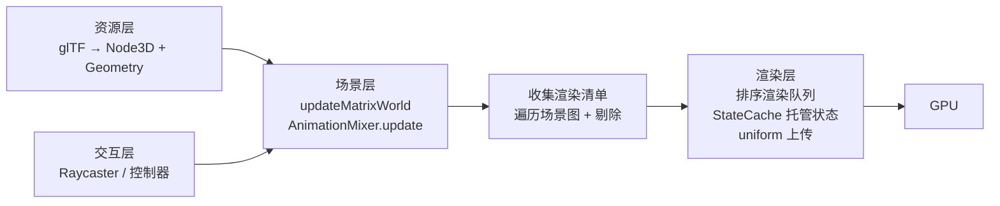

# 框架总体架构

> [返回：WebGL 与 3D 框架学习大纲](../WebGL与3D框架学习大纲.md)
> 本文展开大纲第 1 条：分层设计、Renderer 的 WebGL 状态托管、对象生命周期与显存回收——它是本阶段其余分册的地基，场景图、材质、资源系统都挂在这套骨架上。

# 1. 框架总体架构

先看动机。第二阶段的 demo 代码，典型形态是一个 `render()` 函数里混着：数学计算、shader 源码字符串、状态设置、资源加载回调、事件监听。五十行能跑，五百行就开始互相伤害——这正是框架要解决的"三座墙"：

1. **重复墙**：每个 demo 重写编译 shader、绑缓冲、算矩阵，代码量线性膨胀。
2. **状态墙**：WebGL 状态是全局单例（global state machine），谁改了什么没有记录，渲染顺序一变画面就错，且无谓的状态切换在拖慢每一帧。
3. **泄漏墙**：`deleteBuffer`/`deleteTexture` 没人调用，显存只进不出，页面跑十分钟崩溃。

分层设计拆第一座墙，状态托管拆第二座墙，生命周期管理拆第三座墙。

## 1.1 分层设计：数学层 / 渲染层 / 场景层 / 资源层 / 交互层

### 1.1.1 设计动机与分层图

分层的判据不是"业界都这么分"，而是**变更频率与依赖方向**：越底层越稳定（数学库一年不改一次），越上层越易变（交互逻辑天天调）；依赖只能向下，因为下层不知道上层的存在，上层换掉不影响下层，下层稳定地服务所有上层。对渲染框架来说，还有一个特殊约束：**只有渲染层允许触碰 `gl` 对象**——这条规则一旦守住，`gl` 就被关进了一个笼子，测试、复用、换后端（比如将来换 WebGPU）都只动一层。

```mermaid
flowchart TD
    subgraph L5["交互层 interaction（易变）"]
        RC["Raycaster 拾取"]
        EVT["事件系统 / 控制器 OrbitControls"]
    end
    subgraph L4["资源层 resource"]
        LD["Loader 加载队列 / GLTFLoader"]
        CACHE["AssetCache 资源缓存"]
    end
    subgraph L3["场景层 scene"]
        SG["SceneGraph 场景图 Node3D"]
        OBJ["Mesh / Camera / Light / SkinnedMesh"]
        ANIM["AnimationMixer 动画混合"]
    end
    subgraph L2["渲染层 renderer（唯一触碰 gl 的层）"]
        RDR["Renderer 渲染队列与主流程"]
        ST["StateCache 状态缓存机"]
        PROG["Shader / ProgramCache"]
    end
    subgraph L1["数学层 math（最稳定）"]
        V["Vec2 / Vec3 / Vec4"]
        M["Mat3 / Mat4 / Quaternion"]
    end
    L5 --> L3
    L4 --> L3
    L3 --> L2
    L2 --> L1
    L3 --> L1
    L4 -.-> L2 : "解码后交渲染层建 GPU 对象"
```

各层职责与"不能做什么"：

| 层 | 职责 | 明确不做 | 依赖谁 |
|---|---|---|---|
| 数学层 | 向量/矩阵/四元数纯函数，无任何 DOM/GL 依赖 | 不碰 `gl`、不碰 `document` | 无 |
| 渲染层 | 状态托管、shader 编译、program 池、把 Geometry/Material 画出去 | 不理解"场景"概念，只认渲染清单（render list） | 数学层 |
| 场景层 | 父子层级、worldMatrix、动画、剔除数据 | 不直接调 `gl`，产出的是"待渲染对象集合" | 数学层 |
| 资源层 | URL 到数据的加载、解码、缓存、依赖管理 | 不建 GPU 对象（交给渲染层包装） | 数学层、场景层（构建节点） |
| 交互层 | 拾取、事件、相机控制器 | 不改渲染状态 | 数学层、场景层 |

注意两个箭头的深意：场景层**不依赖**渲染层（虚线方向的资源层也一样）——`Renderer.render(scene, camera)` 是渲染层"取用"场景层的数据，方向是渲染层 import 场景层的类型，场景层对渲染层一无所知。这个方向保证了：不渲染也能更新动画（离线烘焙、测试环境无 canvas），场景层代码可以脱离 WebGL 单测。

### 1.1.2 方案对比：怎么切层

| 方案 | 做法 | 优点 | 缺点 | 判决 |
|---|---|---|---|---|
| 单包不分层 | 全部代码一个目录互相 import | 写得快 | 依赖图变成毛线球，`gl` 引用遍地，无法单测 | demo 可以，框架不行 |
| 按功能垂直切 | 每个 feature（光照/纹理/拾取）一个目录，各自纵穿底到顶 | 加 feature 快 | 每个 feature 都碰 `gl`，状态管理无法集中 | 适合应用，不适合引擎 |
| 水平分层（本方案） | 按"稳定性 + 是否碰 gl"水平切五层 | 依赖单向、`gl` 封锁在一层、每层可独立测试 | 跨层加功能要动多个目录 | 本框架采用 |
| ECS（Entity-Component-System） | 数据与逻辑彻底分离，组件是纯数据 | 缓存友好、组合灵活 | 学习成本高，迷你框架收益撑不起复杂度 | 第六阶段对标时再评估 |

判决理由：迷你框架的第一目标是**把正确的边界立起来**，水平分层用最小复杂度达成这一点；ECS 的优势（海量实体的内存布局）在这个规模下兑现不了。

### 1.1.3 一帧的全链路

分层图落到运行时，一帧的数据流是理解全阶段的地图：



后面各分册就是这条链路逐段展开：03 讲 B 和 C 的前半，04 讲 D 的材质部分，05 讲 F，06 讲 B 的动画部分，07 讲 A。

## 1.2 Renderer 与 WebGL 状态托管：状态缓存为什么能提速

### 1.2.1 设计动机：gl 是一台没有记忆报表的全球状态机

WebGL 的所有状态（深度测试开关、混合函数、绑定的纹理、当前 program……）挂在同一个上下文上，任何代码都能改，改了不通知别人。两个后果：

1. **正确性**：A 模块开了 blend 忘了关，B 模块的物体全部透明——bug 与肇事代码相隔千里。
2. **性能**：每次 `gl.enable`/`gl.bindTexture` 都是一次 native 调用，驱动要校验参数并可能触发 GPU 端流水线刷新。渲染 500 个物体、每个 5 次状态调用，就是每帧 2500 次 native 调用；其中大量调用其实**没有改变任何状态**（比如连画三个同材质物体，重复绑定同一个纹理 3 次）。驱动内部虽有去重，但"JS 到 C++ 的调用成本 + 驱动校验成本"在调用发生时就已经付了。

状态缓存机（state cache）的思路：**框架自己维护一张"当前 GL 状态表"，每次要设置状态先查表，相同就跳过调用**。状态调用从"每物体 N 次"降到"每次真实变化 1 次"。

### 1.2.2 方案对比

| 方案 | 做法 | 优点 | 缺点 |
|---|---|---|---|
| 每帧强制重置 | 每帧开头把用到的状态全部重设一遍 | 绝对正确，实现简单 | 优化量为零，纯自我安慰 |
| 全量缓存机（本方案） | 缓存所有框架用到的状态，setter 全部走缓存 | 去重完全，调用次数最小化 | 需要一条纪律：绕过缓存的外部 gl 调用要显式声明 |
| 脏标记 + 批量提交 | 收集 dirty flag，帧末一次性提交 | 可做全局最优排序 | WebGL API 是立即模式（immediate mode），没有"提交"钩子，伪造成本高 |

选全量缓存机的决定性理由：它把"正确性"和"性能"统一在同一张表上——查表保证不重不漏，debug 时还能把这张表打出来当"状态快照"用。

### 1.2.3 完整核心代码：StateCache 类

```typescript
// renderer/StateCache.ts —— GL 状态缓存机
// 约定：本框架锁 WebGL2，gl 类型固定为 WebGL2RenderingContext

export class StateCache {
  private readonly gl: WebGL2RenderingContext;

  /** 能力开关表（gl.enable / gl.disable 管理的 cap） */
  private caps = new Map<number, boolean>();
  /** 各能力"上次调用"计数，用于调试输出 */
  savedCalls = 0;

  private blendSrc = -1;
  private blendDst = -1;
  private blendEquation = -1;
  private depthMask = true;
  private depthFunc = -1;
  private cullFaceMode = -1;
  private frontFace = -1;
  private clearColor = [-1, -1, -1, -1];
  private viewport = [-1, -1, -1, -1];

  /** 当前活跃纹理单元索引 */
  private activeTextureUnit = -1;
  /** boundTextures[unit][target] = texture 对象 */
  private boundTextures: (Map<number, WebGLTexture | null>)[] = [];
  private currentProgram: WebGLProgram | null = null;
  private boundVAO: WebGLVertexArrayObject | null = null;

  constructor(gl: WebGL2RenderingContext) {
    this.gl = gl;
    for (let unit = 0; unit < 8; unit++) {
      this.boundTextures.push(new Map());
    }
    // 初始化为"未知"：用 null 哨兵强制首次调用必发
    this.forceReset();
  }

  /** 外部代码直接动过 gl（如调试工具、共享上下文）时调用，
   *  使全部缓存失效，下一次设置必然重新下发 */
  forceReset(): void {
    this.caps.clear();
    this.blendSrc = this.blendDst = this.blendEquation = -1;
    this.depthFunc = this.cullFaceMode = this.frontFace = -1;
    this.clearColor = [-1, -1, -1, -1];
    this.viewport = [-1, -1, -1, -1];
    this.activeTextureUnit = -1;
    for (const m of this.boundTextures) m.clear();
    this.currentProgram = null;
    this.boundVAO = null;
  }

  setCapability(cap: number, enabled: boolean): void {
    if (this.caps.get(cap) === enabled) {
      this.savedCalls++;
      return;
    }
    this.caps.set(cap, enabled);
    enabled ? this.gl.enable(cap) : this.gl.disable(cap);
  }

  setBlendFunc(src: number, dst: number): void {
    if (this.blendSrc === src && this.blendDst === dst) {
      this.savedCalls++;
      return;
    }
    this.blendSrc = src;
    this.blendDst = dst;
    this.gl.blendFunc(src, dst);
  }

  setBlendEquation(mode: number): void {
    if (this.blendEquation === mode) {
      this.savedCalls++;
      return;
    }
    this.blendEquation = mode;
    this.gl.blendEquation(mode);
  }

  setDepthMask(mask: boolean): void {
    if (this.depthMask === mask) {
      this.savedCalls++;
      return;
    }
    this.depthMask = mask;
    this.gl.depthMask(mask);
  }

  setDepthFunc(func: number): void {
    if (this.depthFunc === func) {
      this.savedCalls++;
      return;
    }
    this.depthFunc = func;
    this.gl.depthFunc(func);
  }

  setCullFace(mode: number): void {
    if (this.cullFaceMode === mode) {
      this.savedCalls++;
      return;
    }
    this.cullFaceMode = mode;
    this.gl.cullFace(mode);
  }

  setFrontFace(mode: number): void {
    if (this.frontFace === mode) {
      this.savedCalls++;
      return;
    }
    this.frontFace = mode;
    this.gl.frontFace(mode);
  }

  setClearColor(r: number, g: number, b: number, a: number): void {
    const c = this.clearColor;
    if (c[0] === r && c[1] === g && c[2] === b && c[3] === a) {
      this.savedCalls++;
      return;
    }
    this.clearColor = [r, g, b, a];
    this.gl.clearColor(r, g, b, a);
  }

  setViewport(x: number, y: number, w: number, h: number): void {
    const v = this.viewport;
    if (v[0] === x && v[1] === y && v[2] === w && v[3] === h) {
      this.savedCalls++;
      return;
    }
    this.viewport = [x, y, w, h];
    this.gl.viewport(x, y, w, h);
  }

  /** 绑定纹理前先切活跃单元；同单元同目标已绑定则两步都省 */
  bindTexture(unit: number, target: number, texture: WebGLTexture | null): void {
    if (this.activeTextureUnit !== unit) {
      this.activeTextureUnit = unit;
      this.gl.activeTexture(this.gl.TEXTURE0 + unit);
    }
    const slot = this.boundTextures[unit]!;
    if (slot.get(target) === texture) {
      this.savedCalls++;
      return;
    }
    slot.set(target, texture);
    this.gl.bindTexture(target, texture);
  }

  /** 由 UniformBlock 的采样器分配逻辑调用（见 04 册 3.2），
   *  这里只保证"单元切了 + 纹理绑了"这一组合是最优的 */
  useProgram(program: WebGLProgram | null): void {
    if (this.currentProgram === program) {
      this.savedCalls++;
      return;
    }
    this.currentProgram = program;
    this.gl.useProgram(program);
  }

  bindVertexArray(vao: WebGLVertexArrayObject | null): void {
    if (this.boundVAO === vao) {
      this.savedCalls++;
      return;
    }
    this.boundVAO = vao;
    this.gl.bindVertexArray(vao);
  }
}
```

接入渲染主流程的样子（完整主流程在 03 册补齐渲染队列后成形，这里先看状态部分怎么用）：

```typescript
export class Renderer {
  readonly state: StateCache;

  constructor(private gl: WebGL2RenderingContext) {
    this.state = new StateCache(gl);
    // 一次性初始状态
    this.state.setCapability(gl.DEPTH_TEST, true);
    this.state.setCapability(gl.CULL_FACE, true);
    this.state.setDepthFunc(gl.LEQUAL);
    this.state.setFrontFace(gl.CCW);
  }

  private setMaterialState(transparent: boolean): void {
    if (transparent) {
      this.state.setCapability(this.gl.BLEND, true);
      this.state.setBlendFunc(this.gl.SRC_ALPHA, this.gl.ONE_MINUS_SRC_ALPHA);
      this.state.setDepthMask(false); // 透明物体不写深度
    } else {
      this.state.setCapability(this.gl.BLEND, false);
      this.state.setDepthMask(true);
    }
  }
}
```

`savedCalls` 计数器是教学利器：同一场景分别用"直接调 gl"和"走 StateCache"渲染，每帧打印两次计数，优化量立刻可见（P1 实践任务）。

### 1.2.4 常见坑

1. **外部代码绕过缓存改状态**。用户在回调里手写 `gl.disable(gl.DEPTH_TEST)`，StateCache 的表还记着"开着"，之后所有"请开深度测试"的请求都被跳过——画面诡异且难复现。兜底两条：文档声明"外部改状态后必须调 `state.forceReset()`"；更彻底的做法是把 `gl` 从公共 API 里收走，只暴露 `renderer.gl` 并在文档标红。
2. **纹理单元表必须按"单元 × 目标"二维记**。只记"最后绑的纹理"会在"单元 0 绑了 A、单元 1 绑 B、再回单元 0 绑 A"时多发一次无谓绑定。上面代码用 `boundTextures[unit]` 的 Map 按 target 记，正确处理 TEXTURE_2D 与 TEXTURE_CUBE_MAP 共存。
3. **`forceReset` 不是万能复位**。它只是让缓存"忘记"，不会真的把 GL 状态改回去。上下文丢失重建（`webglcontextlost`/`restored`）后要新建全部 GPU 资源并 `forceReset`，而不是只 reset 缓存。
4. **忘记深度写掩码与深度测试是两回事**。透明物体关 `depthMask`（不写深度）但**保留** `DEPTH_TEST`（仍要被已画的不透明物体遮挡），把 DEPTH_TEST 一起关掉是常见笔误，后果是透明物体穿墙。

## 1.3 对象生命周期：create / update / dispose 与显存回收

### 1.3.1 设计动机：JS 垃圾回收管不了显存

JS 侧一个 `Geometry` 对象被 GC 回收时，它背后 `createBuffer` 申请的 VBO、`createTexture` 申请的纹理**不会**跟着消失——GPU 资源的句柄只是几个整数，GC 看不见它们背后的显存。于是经典泄漏：地图上反复"加载新场景、扔掉旧场景"，JS 内存平稳，显存却一路涨到 `CONTEXT_LOST_WEBGL`。框架的解法是把 GPU 资源的**申请与释放显式化**，用统一的接口约束所有资源对象。

### 1.3.2 方案对比

| 方案 | 做法 | 优点 | 缺点 |
|---|---|---|---|
| 手动散调 | 用户自己记着 `gl.deleteBuffer` | 零框架成本 | 一处忘调就泄漏，多资源对象（VAO+VBO+IBO）漏一补二 |
| Disposable 接口 + 渲染层回收（本方案） | 每个持 GPU 资源的对象实现 `dispose(gl)`，删除场景节点时框架代为回收 | 调用点唯一、清单内聚 | 需要"资源被共享"时的引用计数补充 |
| 引用计数全自动 | 资源被几个对象引用记数，归零回收 | 共享资源安全 | 计数维护侵入所有赋值路径，循环引用死锁，复杂度高 |

迷你框架选手动 `dispose` + 明确文档"共享资源由拥有者负责销毁"：引用计数是把 C++ 的苦吃一遍，收益要大型引擎才兑现。

### 1.3.3 完整核心代码：Disposable 协议与生命周期三段

```typescript
// core/Disposable.ts —— 所有持 GPU 资源对象的统一协议
export interface Disposable {
  /** 释放底层 GPU 资源；幂等：重复调用安全 */
  dispose(gl: WebGL2RenderingContext): void;
}

// scene/Geometry.ts —— 生命周期三段示例
export class Geometry implements Disposable {
  private vao: WebGLVertexArrayObject | null = null;
  private buffers: WebGLBuffer[] = [];
  private indexBuffer: WebGLBuffer | null = null;
  private disposed = false;

  /** 1. create：懒创建，首次渲染时才上传 GPU */
  upload(gl: WebGL2RenderingContext): void {
    if (this.vao !== null) return; // 已上传，幂等
    this.vao = gl.createVertexArray();
    gl.bindVertexArray(this.vao);
    for (const attr of this.attributes) {
      const buffer = gl.createBuffer();
      gl.bindBuffer(gl.ARRAY_BUFFER, buffer);
      gl.bufferData(gl.ARRAY_BUFFER, attr.data, gl.STATIC_DRAW);
      this.buffers.push(buffer);
      // attribute 布局在此绑定进 VAO（WebGL2 专属能力，见第二阶段）
    }
    if (this.indices) {
      this.indexBuffer = gl.createBuffer();
      gl.bindBuffer(gl.ELEMENT_ARRAY_BUFFER, this.indexBuffer);
      gl.bufferData(gl.ELEMENT_ARRAY_BUFFER, this.indices, gl.STATIC_DRAW);
    }
    gl.bindVertexArray(null);
  }

  /** 2. update：动态几何（粒子、变形）局部刷新，避免整块重传 */
  updateSubData(gl: WebGL2RenderingContext, name: string, data: Float32Array): void {
    const index = this.attributes.findIndex((a) => a.name === name);
    if (index < 0) throw new Error(`attribute 不存在: ${name}`);
    gl.bindBuffer(gl.ARRAY_BUFFER, this.buffers[index]!);
    // bufferSubData 只覆盖指定区间，比整块 bufferData 便宜
    gl.bufferSubData(gl.ARRAY_BUFFER, 0, data);
  }

  /** 3. dispose：一次清干净，可重复调用 */
  dispose(gl: WebGL2RenderingContext): void {
    if (this.disposed) return;
    for (const buffer of this.buffers) gl.deleteBuffer(buffer);
    if (this.indexBuffer) gl.deleteBuffer(this.indexBuffer);
    if (this.vao) gl.deleteVertexArray(this.vao);
    this.buffers = [];
    this.indexBuffer = null;
    this.vao = null;
    this.disposed = true;
  }
}
```

`dispose` 的幂等性（`disposed` 哨兵）不是洁癖：场景卸载路径常常是"父节点 dispose 时级联 dispose 子节点，用户又手动 dispose 过某个子节点"，幂等让两条路径共存。

Renderer 侧提供级联回收入口，把"从场景里删东西"变成一行：

```typescript
// renderer/Renderer.ts —— 场景卸载的级联回收
export function disposeObject(root: Node3D, gl: WebGL2RenderingContext): void {
  root.traverse((node) => {
    const mesh = node as Partial<Mesh>;
    if (mesh.geometry) mesh.geometry.dispose(gl);
    // 注意：material 与 texture 可能被多个 mesh 共享，默认不级联删除，
    // 由 AssetCache 统一管理（见 07 册 6.2）
  });
}
```

### 1.3.4 显存泄漏场景与清理清单

先看四个典型泄漏场景，再给对照清单：

1. **换贴图不删旧图**。`material.map = newTexture`，旧 texture 对象失去引用但显存还在。清单第 3 条兜底。
2. **删节点不删几何**。`scene.remove(mesh)` 只是把节点从树里摘掉，Geometry/Material 原样活着。
3. **shader 变体无限增长**。宏开关组合不断命中新变体，ProgramCache 只进不出（见 04 册 3.4 的上限策略）。
4. **SPA 路由切换**。页面级框架（React/Vue）销毁组件时只移除了 canvas 元素，GL 上下文与全部资源都在——必须显式调用 `renderer.dispose()` 总出口。

| 资源对象 | 创建调用 | 清理调用 | 泄漏高发原因 |
|---|---|---|---|
| Buffer（VBO/IBO） | createBuffer + bufferData | deleteBuffer | 删节点忘了删几何 |
| Texture | createTexture + texImage2D | deleteTexture | 换图、场景重载 |
| Program | createProgram + link | deleteProgram | 变体缓存无上限 |
| Shader | createShader + compile | deleteShader | 编译后忘删（link 完即可删） |
| VAO | createVertexArray | deleteVertexArray | 只删了 VBO 忘了 VAO |
| Framebuffer | createFramebuffer | deleteFramebuffer | 后处理 pass 反复重建 |
| 整个上下文 | getContext | extension loseContext 或刷新页面 | SPA 不刷新页面 |

验证手段：Chrome 任务管理器开"GPU 内存"列，或 `gl.getParameter(gl.GPU_MEMORY_INFO_CURRENT_POSITION_VIDMEM_NV)`（仅部分实现提供 `WEBGL_debug_renderer_info` 相关扩展时可用）。写一个"反复加载/卸载同一模型 100 次"的压测脚本，显存曲线应该是锯齿而不是爬坡。

### 1.3.5 常见坑

1. **dispose 顺序错**。先 `deleteBuffer` 再 `deleteVertexArray` 是安全的；反过来在某些驱动上 VAO 还攥着已删 buffer 的引用，行为未定义。原则：先删"引用别人资源的容器"（VAO、FBO），再删底层资源。
2. **共享资源被级联销毁**。两个 mesh 共用一个 material，卸载场景 A 把 material 销毁了，场景 B 全黑。本框架约定：`disposeObject` 只回收 geometry（默认私有），material/texture 由 AssetCache 按引用计数或整体卸载策略回收。
3. **上下文丢失后的二次创建**。`webglcontextrestored` 后旧 `gl` 句柄全部失效，需要重跑全部对象的 upload 路径。设计时让每个资源对象保留 CPU 侧数据（`attributes` 数组不删），GPU 侧可整体重建——这也是 `upload` 做成幂等懒创建的第二个理由。
4. **把 dispose 塞进 GC 钩子**。`FinalizationRegistry` 理论上可以兜底，但回调时机不确定（可能在上下文已丢失后触发），只能当日志兜底，不能当正确性依赖。

## 【本节自测】

1. 不看正文，画出五层分层图并标出依赖箭头。场景层为什么不能依赖渲染层？举一个违反后的具体麻烦。
2. 状态缓存为什么能提速？用你自己的话讲清"跳过的那次调用省掉的是哪两段成本"。`savedCalls` 计数器在什么场景下会虚高（提示：首帧）？
3. 用户在你的框架回调里写了 `gl.enable(gl.BLEND)`，随后用你框架的 API 关闭混合却无效。解释原因，并给出框架层与你文档层各一条对策。
4. 从场景移除并销毁一个带贴图、带自定义 shader 的 Mesh，列出全部需要调用的 delete 调用（按安全顺序），并标注哪几项你的 `disposeObject` 会自动完成、哪几项需要用户手动处理。
5. 设计取舍题：你的队友提议给 Geometry 加引用计数，让"最后一个使用者 dispose 时自动 deleteBuffer"。用 1.3.2 的对比表评估这个提议——迷你框架该不该采纳？如果采纳，循环引用（几何 A 的 morph 目标指向几何 B）怎么处理？

下一篇 [03-场景图](03-场景图.md)：把"画一个物体"升级为"按正确顺序画一棵物体树"。
