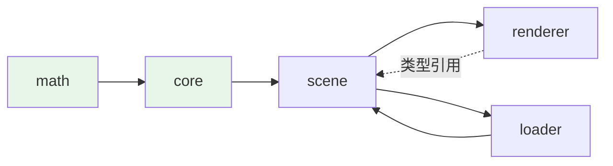

# 工程化

> [返回：WebGL 与 3D 框架学习大纲](../WebGL与3D框架学习大纲.md)
> 本文展开大纲第 7 条：TypeScript 严格模式要点、模块边界与分包、vitest 测试范围、打包发布 npm 库——工程化把"能跑的代码"变成"别人敢用的库"。

# 7. 工程化

## 7.1 TypeScript 严格模式要点

### 7.1.1 设计动机：严格模式是"免费的测试"

渲染框架的数据充满"索引、可空对象、外部输入"——`accessors[index]`、`getUniformLocation` 返回 null、JSON 里的可选字段。宽松模式下这些全是 `any`/隐式通过的坑，运行时才炸。严格模式把一半的运行时错误提前到编译期，对库作者还有额外收益：**类型声明就是 API 文档**，`.d.ts` 直接随包发布。

### 7.1.2 tsconfig：开启什么、为什么

```jsonc
// tsconfig.json
{
  "compilerOptions": {
    /* 严格全家桶：一行等价十余个开关 */
    "strict": true,
    /* 严格模式的两个"进阶补丁"，建议追加 */
    "noUncheckedIndexedAccess": true,   // 索引访问返回 T | undefined
    "exactOptionalPropertyTypes": true, // 区分"缺属性"与"属性为 undefined"
    /* 工程卫生 */
    "noImplicitOverride": true,         // 覆写必须写 override
    "noFallthroughCasesInSwitch": true, // switch 落空报错（GL 类型分派常用）
    "module": "ESNext",
    "moduleResolution": "bundler",      // 按打包器解析（vite/tsup 的现代约定）
    "target": "ES2020",
    "isolatedModules": true             // 单文件可转译（esbuild 前提）
  }
}
```

三个追加项在渲染框架里的实际收益：

- `noUncheckedIndexedAccess`：`joints[i].matrixWorld` 在 06 册代码里会报 `Node3D | undefined`——这正是 5.3.5 坑"骨骼越界"的编译期拦截。
- `exactOptionalPropertyTypes`：材质参数 `map?: Texture` 与 `map: Texture | null` 不再混同，"没这个键"（用 shader 默认值）与"显式传 null"（禁用贴图）语义分开。
- `noFallthroughCasesInSwitch`：04 册 `uniform1f` 的类型分派 switch 漏 `break` 直接编译报错，而不是静默连传。

### 7.1.3 GL 对象的类型收窄

WebGL1/2 上下文类型是常见摩擦点。两个策略：

```typescript
// 策略 A（推荐）：锁 WebGL2，类型唯一
type GL = WebGL2RenderingContext;
// 全框架 import type { GL } from "./types"，将来换 WebGPU 只改一处别名

// 策略 B：兼容两者，用守卫收窄
function isWebGL2(gl: WebGLRenderingContext): gl is WebGL2RenderingContext {
  return typeof (gl as WebGL2RenderingContext).createVertexArray === "function";
}
```

迷你框架用策略 A：第二阶段已定 WebGL2 为基线（VAO、非整数纹理是硬需求），类型收窄成本为零。策略 B 留给"必须兼容旧设备"的库（three.js 的 `WebGLRenderingContext | WebGL2RenderingContext` 交叉类型就是被兼容需求逼出来的复杂度）。

另一个高频收窄：所有 `gl.createXxx()` 返回 `Xxx | null`。与其到处 `!`，在渲染层入口统一断言一次：

```typescript
export function getGL(canvas: HTMLCanvasElement): GL {
  const gl = canvas.getContext("webgl2", { antialias: true, alpha: false });
  if (!gl) throw new Error("当前环境不支持 WebGL2");
  return gl; // 此后全框架拿到的是非空 GL
}
```

## 7.2 模块边界：core / math / scene / renderer / loader 分包

### 7.2.1 设计动机：边界是给"未来的改动"修的路

02 册的分层是逻辑分层，工程上要落成**目录与 import 规则**。模块边界的价值不在"目录好看"，在它约束了依赖方向——将来任何一次改动，"能改哪、会波及哪"由边界决定。没有边界，三个月后 `Loader` 里 import `Renderer`、`Node3D` 里 import `gl` 的循环依赖必然出现。

### 7.2.2 目录结构与依赖规则

```text
src/
  math/        # Vec2/3/4、Mat3/4、Quaternion —— 零依赖
  core/        # Disposable、EventEmitter、时钟、配置类型 —— 最多依赖 math
  scene/       # Node3D、Scene、Mesh、Camera、Material、Skeleton、Animation —— 依赖 math、core
  renderer/    # Renderer、StateCache、ProgramCache、UniformBlock —— 依赖 math、core、scene（类型）
  loader/      # Loader、Scheduler、GLTFLoader —— 依赖 math、core、scene（建节点）
  index.ts     # 公共出口：re-export 公共 API
```

规则（可用 eslint-plugin-boundaries 或 dependency-cruiser 固化为 CI 检查）：

1. **依赖只能向左**：`renderer -> scene -> core -> math`，反向 import 直接 CI 失败；
2. **`gl` 只出现在 `renderer/` 与 `loader/` 的 GPU 包装层**（loader 解码出 CPU 数据，GPU 对象仍由渲染层创建——02 册 1.1.1 表格的"资源层不建 GPU 对象"）；
3. **公共 API 只从 `index.ts` 出**：内部路径（`scene/Node3D`）不承诺稳定，用户深路径导入（deep import）属未定义行为；
4. **循环依赖零容忍**：ESM 循环不报错但运行时 `undefined`（hoisting 顺序问题），`madge --circular` 进 CI。



（虚线表示 renderer 引 scene 的**类型**，运行时 renderer 不持有 scene 实例状态——分层是"知道谁"与"拥有谁"两件事。）

### 7.2.3 入口设计：一个还是多个

```typescript
// src/index.ts
export * from "./math/index";       // 数学库单独有人用（第一优先级用户）
export * from "./core/index";
export * from "./scene/index";
export * from "./renderer/index";
export * from "./loader/index";
```

单入口起步，配合 7.4 的多入口 `exports`（`minigl/math` 可独立引入）。判断是否拆多入口的信号：math 包的发布节奏与主库明显不同（数学库稳定、渲染层频繁迭代）时再拆——过早拆包是给自己加发布负担。

## 7.3 vitest 测试范围

### 7.3.1 设计动机：什么值得测、什么没法在 Node 里测

测试策略的第一问不是"怎么写"，是**测哪里收益最大**。渲染框架的代码分三类，可测性天差地别：

| 代码类别 | 例子 | 可测性 | 策略 |
|---|---|---|---|
| 纯函数 | math 全部、Möller–Trumbore、NDC 换算、uri 解析 | 完全可测（Node 直跑） | 重点覆盖，已知值 + 性质测试 |
| 有状态逻辑 | 场景图脏标记、渲染队列排序、动画混合、Scheduler | 可测（无 DOM/GL 依赖） | 状态机式用例覆盖 |
| GPU 路径 | shader 编译、uniform 上传、draw | Node 无 WebGL | 不强测；分层隔离后剩余逻辑极少，靠浏览器示例站冒烟 |

第三类正是 02 册"gl 关进 renderer 一层"的回报：**架构边界画对了，不可测的代码自然只剩薄薄一层**。给这层做 mock（`headless-gl` 或手写 stub）性价比很低——mock 的 GL 行为是你自己想象的，测试通过不代表驱动一致。浏览器端用示例站（09 册）当集成测试。

### 7.3.2 完整核心代码：三类测试样例

```typescript
// tests/math/mat4.spec.ts —— 第一类：已知值 + 性质测试
import { describe, expect, it } from "vitest";
import { Mat4 } from "../../src/math/Mat4";
import { Vec3 } from "../../src/math/Vec3";

describe("Mat4.invert", () => {
  it("平移矩阵的逆是反向平移", () => {
    const m = Mat4.fromTranslation(new Mat4(), new Vec3(1, 2, 3));
    const inv = Mat4.invert(new Mat4(), m);
    expect(Array.from(inv.subarray(12, 15))).toEqual([-1, -2, -3]);
  });

  it("性质：任何可逆矩阵 A，A × A⁻¹ = 单位阵（性质测试）", () => {
    for (let seed = 1; seed < 50; seed++) {
      const a = randomInvertibleMat4(seed); // 用确定性伪随机
      const product = Mat4.multiply(new Mat4(), a, Mat4.invert(new Mat4(), a));
      expectCloseToIdentity(product, 1e-5);
    }
  });
});

// tests/scene/dirty-flag.spec.ts —— 第二类：状态机
describe("Node3D 脏标记", () => {
  it("未修改的静止场景：二次更新不做任何矩阵乘法", () => {
    const root = buildTree(3, 2);
    root.updateMatrixWorld(true); // 首帧
    Mat4.multiplyCount = 0;       // minmath 暴露的调试计数
    root.updateMatrixWorld();
    expect(Mat4.multiplyCount).toBe(0);
  });

  it("父节点移动：整棵子树 matrixWorld 重算，兄弟枝不动", () => {
    const root = new Node3D();
    const [moving, idle] = [new Node3D(), new Node3D()];
    root.add(moving).add(idle);
    const movingChild = new Node3D();
    moving.add(movingChild);
    root.updateMatrixWorld(true);

    moving.position.x = 10;
    const beforeIdle = Mat4.copy(new Mat4(), idle.matrixWorld);
    root.updateMatrixWorld();

    expect(movingChild.matrixWorld[12]).toBeCloseTo(10, 5);
    expect(idle.matrixWorld).toEqual(beforeIdle); // 兄弟枝未受牵连
  });
});

// tests/interaction/moller-trumbore.spec.ts —— 第一类：几何已知值
describe("intersectTriangle", () => {
  const v0 = new Vec3(0, 0, 0), v1 = new Vec3(1, 0, 0), v2 = new Vec3(0, 1, 0);
  it("垂直入射三角形中心", () => {
    const hit = intersectTriangle(
      new Vec3(0.25, 0.25, 1), new Vec3(0, 0, -1), v0, v1, v2);
    expect(hit).not.toBeNull();
    expect(hit!.t).toBeCloseTo(1, 5);
    expect(hit!.u).toBeCloseTo(0.25, 5);
    expect(hit!.v).toBeCloseTo(0.25, 5);
  });
  it("平行射线：det 为 0，返回 null", () => {
    const hit = intersectTriangle(
      new Vec3(-1, 0.5, 0), new Vec3(1, 0, 0), v0, v1, v2);
    expect(hit).toBeNull();
  });
});

// tests/loader/scheduler.spec.ts —— 第二类：并发与去重
describe("Scheduler", () => {
  it("并发不超过 maxConcurrent", async () => {
    let inFlight = 0, peak = 0;
    const scheduler = new Scheduler(2);
    await Promise.all(
      Array.from({ length: 6 }, () =>
        scheduler.run(async () => {
          inFlight++; peak = Math.max(peak, inFlight);
          await sleep(5);
          inFlight--;
        }),
      ),
    );
    expect(peak).toBe(2);
  });
});
```

两条实践纪律：

1. **确定性**：所有涉及随机的测试用种子随机（`randomInvertibleMat4(seed)`），失败可复现；
2. **浮点比较用容差**（`toBeCloseTo`），渲染数学里 `===` 比较浮点几乎永远是错的断言。

### 7.3.3 覆盖率目标

```jsonc
// vitest.config.ts 的 coverage 配置
import { defineConfig } from "vitest/config";
export default defineConfig({
  test: {
    coverage: {
      provider: "v8",
      include: ["src/math/**", "src/scene/**", "src/loader/**", "src/core/**"],
      // renderer 不进覆盖率统计：GPU 路径 Node 不可测，纳入只会稀释指标
      thresholds: { lines: 85, functions: 80 },
    },
  },
});
```

指标是手段不是目的：85% 行覆盖的意义是"防回归网"，剩下 15%（难测分支）靠示例站手动冒烟。为了凑数写"断言为空"的假测试比没有测试更糟——它给了虚假信心。

## 7.4 打包发布：npm 库

### 7.4.1 方案对比：打包工具

| 工具 | 定位 | d.ts 生成 | 一句话 |
|---|---|---|---|
| tsc 直接出 | 编译即打包 | 原生 | 零依赖，但产物碎（每文件一 js）、无压缩 |
| tsup（本方案） | 基于 esbuild 的零配置打包 | 内置（tsc 旁路） | 库打包最省心，双格式一次出 |
| vite lib mode | 应用构建器的库模式 | 需配 vite-plugin-dts | 顺带要开发服务器/示例站时好用 |
| rollup 手配 | 完全可控 | 插件 | tsup 的底层，需要细粒度控制再上 |

本库用 tsup 打产物、vite 撑示例站（09 册），各取所长。

### 7.4.2 完整配置：tsup 与 package.json

```typescript
// tsup.config.ts
import { defineConfig } from "tsup";

export default defineConfig({
  entry: ["src/index.ts"],           // 主入口（多入口时加 "src/math/index.ts"）
  format: ["esm", "cjs"],            // 双格式：现代工具链吃 esm，老工具吃 cjs
  dts: true,                         // 生成 .d.ts（内部调 tsc，类型检查也跑了）
  sourcemap: true,
  clean: true,                       // 每次清 dist
  target: "es2020",
  splitting: false,                  // 库产物单文件更利于 tree-shaking 诊断
  minify: false,                     // 库不压缩：下游打包器会做，保留可调试性
});
```

```jsonc
// package.json（节选关键字段）
{
  "name": "minigl",                          // 定名后改，先占位；查重见 09 册
  "version": "0.1.0",                        // 0.x：API 不承诺稳定（语义化版本）
  "type": "module",                          // esm 优先
  "main": "./dist/index.cjs",                // cjs 兜底入口
  "module": "./dist/index.js",               // esm 入口
  "types": "./dist/index.d.ts",
  "exports": {                               // 现代解析器只看这里
    ".": {
      "types": "./dist/index.d.ts",
      "import": "./dist/index.js",
      "require": "./dist/index.cjs"
    },
    "./math": {                              // 子路径入口：轻量用户只引数学库
      "types": "./dist/math/index.d.ts",
      "import": "./dist/math/index.js"
    }
  },
  "files": ["dist"],                         // 发布只带 dist（README/LICENSE 自动含）
  "sideEffects": false,                      // 全纯 ESM 模块，允许下游 tree-shaking
  "scripts": {
    "build": "tsup",
    "test": "vitest run",
    "prepublishOnly": "npm run test && npm run build"
  },
  "devDependencies": { "tsup": "^8.0.0", "typescript": "^5.5.0", "vitest": "^2.0.0" }
}
```

四个字段是发布质量的地基：

- **`exports` 的三条件顺序**（types 在前）：TypeScript 的 `moduleResolution: bundler` 要求 types 条件排最前，否则下游解析出 js 类型丢失；
- **`sideEffects: false`** 的承诺：任何模块被 import 仅有取值作用、无副作用，下游打包器敢删未用代码。若框架里有"import 即注册全局"的模块（如内置 shader 库注册），那一个文件要声明 `sideEffects: ["./src/shaderlib.ts"]`——全 false 是承诺，说了就要兑现；
- **`files: ["dist"]`**：防止源码、测试、示例误入包体（npm 包体积直接影响安装体验）；
- **`prepublishOnly`**：发布钩子强绑测试与构建，忘跑测试就 publish 的侥幸心理被物理阻断。

vite lib 模式备选（同等效果的另一条路）：

```typescript
// vite.config.ts（仅当选择 vite 而非 tsup 时）
import { defineConfig } from "vite";
import dts from "vite-plugin-dts";

export default defineConfig({
  plugins: [dts({ rollupTypes: true })],
  build: {
    lib: {
      entry: "src/index.ts",
      formats: ["es", "cjs"],
      name: "MiniGL",          // umd 全局名（如需）
      fileName: (format) => `index.${format === "es" ? "js" : "cjs"}`,
    },
  },
});
```

### 7.4.3 发布流程（与 09 册 checklist 衔接）

```bash
npm login                     # 一次性
npm pack                      # 先打包预览：检查包内容与体积（tar -tzf *.tgz）
npm publish --access public   # 公开发布（scope 包首次必须带 --access public）
```

发布后验证：新建一个空项目 `npm install minigl`，写三行代码（创建 renderer + 画一个三角形）跑通——**用下游视角验证，而不是"在我机器上好好的"**。版本策略：0.x 阶段 minor 号加特性、patch 号修 bug；API 稳定后升 1.0 并开始遵守"major 不破坏"承诺。

### 7.4.4 常见坑

1. **`"type": "module"` 后 cjs 测试文件炸**：vitest 配置文件与既有 `.cjs` 脚本要显式后缀区分。tsup 的 cjs 产物不受影响（打包器内部处理）。
2. **d.ts 里泄漏内部类型**：公共 API 返回了内部类型（如 `UniformBlock`），.d.ts 引用了一个未导出的声明，下游编译报 "has no exported member"。tsup/tsc 会报这个错，修法是 re-export 或改窄公共类型。
3. **`exports` 加了子路径却忘了 `"./package.json"` 条件**：下游工具（很多 bundler 插件）惯例读取包的 package.json，`exports` 封死后 404。补 `"./package.json": "./package.json"`。
4. **发布前忘升版本号**：同版本号 publish 被拒，`npm version patch` 一条命令解决（顺带打 git tag）。
5. **在依赖里打进了 runtime 依赖**：迷你框架零运行时依赖是最好的卖点；一旦 import 了 gl-matrix 之类的库，用户被迫安装传递依赖。tsup 默认不 bundle dependencies，`peerDependencies`/`dependencies` 的选择要 deliberate（本框架：无依赖）。

## 【本节自测】

1. `noUncheckedIndexedAccess` 开启后，`joints[i].matrixWorld` 报什么错？给出"保留严格性"的两种修法（守卫 vs 提前断言）及各自适用场景。
2. 你的分包里 `renderer` 能 import `scene` 的什么（类型/值）？`scene` 能 import `renderer` 吗？用 02 册的分层理由复述一遍。
3. 为什么 shader 编译、uniform 上传不写 Node 单测？这个"不能测"的面积是怎么被架构决策缩小的？
4. 写一个"性质测试"：对任意四元数 q，q 与 -q 表示同一旋转。断言应该比什么？（提示：旋转矩阵逐元素接近。）
5. `exports` 字段里 `types` 条件为什么必须排最前？`sideEffects: false` 对下游 webpack 项目的具体效果是什么，什么情况下要收回这个声明？
6. 操作题：执行 `npm pack`，打开 tgz 检查三件事——有没有 src 泄漏、dist 里 esm/cjs/d.ts 是否齐全、包体积是否合理（本框架期望 < 100KB）。
7. 场景判断：用户反馈 `import { Vec3 } from "minigl"` 在 CommonJS 老项目里 `require` 失败。列出可能原因（exports 条件顺序、main 指向、cjs 产物缺失）与排查命令（`node -e "console.log(require('minigl'))"`）。

下一篇 [09-实践任务](09-实践任务.md)：定名、发布、示例站——给阶段画上句号。
