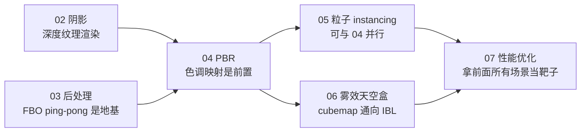

# 第五阶段导览：进阶渲染与性能

> [返回：WebGL 与 3D 框架学习大纲](../WebGL与3D框架学习大纲.md)
> 本文是第五阶段「进阶渲染与性能」的总导览：阶段目标、分册索引、阅读路线、实践任务清单与阶段自测；各分册正文从 [02-阴影与PCF软阴影](02-阴影与PCF软阴影.md) 开始。

## 阶段定位与目标

前四个阶段走完了「画得出来 → 画得正确 → 画得有结构」：管线与数学、核心渲染技术、自研数学库与引擎雏形、框架架构与工程化。第五阶段回答的是另外两个问题：**画得好看**（阴影、后处理、PBR、粒子、天空盒）与**画得快**（性能优化）。这两件事是一枚硬币的两面——本阶段每一个视觉效果分册都附带性能账单，而性能分册里的每一条优化手段都对应前面某个视觉效果的成本。

本阶段结束时你应该能：

1. 独立实现 shadow map 两 pass 渲染，理解并解决 shadow acne，用 PCF 画出软阴影；
2. 用 ping-pong 双 FBO 搭一条后处理效果链，实现 bloom、FXAA、色调映射，并理解 EffectComposer 式的设计为什么长那样；
3. 读懂 PBR 的核心公式（渲染方程、Cook-Torrance 的 D/F/G 三项），能手写直接光照版本，能说清 IBL 的离线预处理流程；
4. 用实例化渲染（Instancing）画出万级粒子，并能对比 CPU/GPU 两种更新策略的成本模型；
5. 实现距离雾/高度雾与 cubemap 天空盒，掌握天空盒与场景深度的配合技巧；
6. 建立 drawcall 成本模型与性能排查流程：合批、显存管理、纹理压缩（KTX2/Basis）、Spector.js 抓帧分析。

## 知识点与分册索引

大纲 6 个小节对应 6 篇分册（编号 02~07）；另有三册增补分册（08 IBL 完整实现、09 SSAO、10 GPU 性能度量），分别把第 3、2、6 条从「懂原理」推进到「能落地」。分册内小节编号与大纲条目号一致（阴影分册是 1.x，后处理是 2.x，以此类推），其他笔记可直接引用「见 1.2」「见 6.5」这类编号。

| 分册 | 对应大纲条目 | 一句话说明 |
|---|---|---|
| [02-阴影与PCF软阴影](02-阴影与PCF软阴影.md) | 第 1 条 | shadow map 完整两 pass 流程、光源正交相机、acne 与 bias 的数学、PCF 软阴影完整 GLSL、WebGL2 深度纹理 |
| [03-后处理管线](03-后处理管线.md) | 第 2 条 | 全屏三角形 + ping-pong 双 FBO、bloom 三步曲、FXAA、Reinhard/ACES 色调映射、效果链 EffectComposer 式设计 |
| [04-PBR入门](04-PBR入门.md) | 第 3 条 | 渲染方程直觉版、Cook-Torrance 的 D/F/G 各自物理意义与公式、金属度/粗糙度工作流、IBL 离线预处理流程 |
| [05-粒子系统与Instancing实战](05-粒子系统与Instancing实战.md) | 第 4 条 | CPU/GPU 两种粒子更新策略、速度存 attribute 在顶点着色器积分的完整实现、状态化纹理 ping-pong、与逐粒子 drawArrays 的性能对比 |
| [06-雾效与天空盒](06-雾效与天空盒.md) | 第 5 条 | 距离雾/高度雾的 GLSL 与推导、cubemap 天空盒生成与采样、天空盒深度技巧、环境反射 |
| [07-性能优化与调试](07-性能优化与调试.md) | 第 6 条 | drawcall 成本模型、静态/动态合批与实例化的适用场景、显存管理、KTX2/Basis 纹理压缩、Spector.js 抓帧与排查决策树 |
| [08-基于图像的光照](08-基于图像的光照.md) | 第 3 条增补 | IBL 从「懂流程」到「全实现」：equirect→cubemap、辐照度卷积、GGX 重要性采样预滤波、BRDF LUT，每步积分近似推导与亮点/接缝/漏光等瑕疵处理 |
| [09-屏幕空间环境光遮蔽](09-屏幕空间环境光遮蔽.md) | 第 2 条增补 | 深度重建位置与法线、采样核与噪声、遮蔽计算、盒滤波去噪、与光照合成，HBAO/GTAO 各修了骨架里的哪一块 |
| [10-GPU性能度量与剖析](10-GPU性能度量与剖析.md) | 第 6 条增补 | EXT_disjoint_timer_query 的正确用法与限制、分阶段帧耗时统计、CPU/GPU 瓶颈归因流程、用 RenderDoc 等原生调试器分析浏览器帧 |

## 阅读路线

推荐顺序即编号顺序，依赖关系如下：

三条说明：

1. **03 必须先于 04**：PBR 产出 HDR 线性颜色，最后一步要靠色调映射（见 2.4）压回显示范围，顺序反了会看到「PBR 为什么过曝」的假问题；
2. **05 相对独立**，只依赖第二阶段的 instancing 基础与第三阶段的引擎雏形，赶时间可以先读；
3. **07 放最后**：它的排查决策树要把前五册的效果当分析对象（粒子场景查 drawcall、天空盒场景查纹理带宽），先有场景再谈优化。
4. **增补册各有挂靠**：08 是 04 的实现续篇（还需要 06 的 cubemap 基础）；09 要先有 03 的全屏 pass 与深度纹理；10 拿 07 的场景当度量对象，读完 07 再动手。

前置要求（来自前四阶段）：FBO 与 render to texture（第二阶段第 5 节）、WebGL2 的 VAO/instancing（第二阶段第 6 节）、自研引擎雏形的渲染循环与 Mesh 抽象（第三、四阶段）。示例代码统一以 WebGL2（GLSL ES 3.00）为基线，API 封装沿用第四阶段自研框架的 TypeScript 风格。

## 实践任务清单

大纲要求「看懂不算数，跑起来才算」，本阶段任务全部要求在自研框架上落地：

| 编号 | 任务 | 验收标准 |
|---|---|---|
| P1 | 阴影：一个带地面与若干物体的场景，平行光投影 | 拉近相机能看到 acne，加 bias + 法线偏移后消失；PCF 3×3 生效、边缘柔和；灯光旋转时阴影跟随 |
| P2 | 后处理：给现有场景加效果链 | bloom 阈值可调；FXAA 前后用条纹三角形对比锯齿；Reinhard 与 ACES 可切换对比 |
| P3 | PBR：金属度/粗糙度两个滑块 | 粗糙度从 0 到 1 时高光从锐利斑点扩散成哑光；金属度 1 时漫反射消失只剩镜面反射 |
| P4 | 粒子：喷泉或烟花 | 10000 粒子稳定 60fps（桌面 Chrome）；用第七章的成本模型解释逐粒子 drawArrays 版本为什么慢 |
| P5 | 环境雾与天空盒 | 距离雾与高度雾可切换；天空盒在场景任意位置观察无接缝；相机移动时天空盒「无限远」 |
| P6 | 性能：抓帧报告 | 用 Spector.js 抓一帧自己的场景，输出 drawcall 数、纹理显存占用清单、一条优化记录（合批/压缩前后对比数据） |

## 第五阶段自测

阶段级自测跨分册综合，各分册末尾另有本节自测。作答方式建议：先合上笔记写结论，再对照分册正文订正。

1. 从「光源看不见这个点」这句话出发，完整推导 shadow map 需要哪两个 pass、各自输出什么；主 pass 里那次「采样对比」具体在比较哪两个数？
2. shadow acne 与 peter-panning 是同一根因的两种表现吗？bias 调大谁消失、谁出现？
3. 为什么后处理链需要 ping-pong 两个 FBO 而不是一个？全屏三角形比全屏四边形省了什么？
4. bloom 的三步（亮度提取 → 高斯模糊 → 叠加）里，高斯模糊为什么拆成水平垂直两趟？推导复杂度从多少降到多少。
5. Cook-Torrance 的 D、F、G 三项各对应什么物理现象？把其中一项改成常数 1，画面会怎么错？
6. 金属度 metallic=1 时，材质的 F0 是多少、漫反射项变成多少？由此解释「金属没有漫反射色，albedo 就是反射色」。
7. IBL 的 split-sum 把渲染方程的积分拆成了哪两块离线预处理产物？为什么不直接在着色器里实时积分环境贴图？
8. 万级粒子为什么必须 instancing？逐粒子 drawArrays 的成本主要烧在 CPU 还是 GPU？
9. 天空盒用 `gl_Position = vec4(pos.xyww, 1.0)` 配合深度测试 LEQUAL 的技巧，原理是什么？不这么做要付出什么代价？
10. 你的场景掉帧了，请按第七章的决策树走一遍：第一步量什么？怎么区分 CPU 瓶颈与 GPU 瓶颈？drawcall 数高时合批方案怎么在静态合批/动态合批/实例化里选？
11. KTX2/Basis 解决的三个问题（下载体积、解码时间、显存占用）分别是怎么解决的？转码（transcode）和解码（decode）的区别是什么？

> 全部跑完 P1~P6 后进入[第六阶段：源码对标与毕业项目](../WebGL与3D框架学习大纲.md)，用 Three.js 源码对照本阶段自研的阴影/后处理/合批实现查漏补缺。
