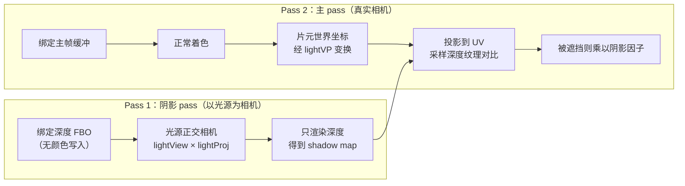

# 阴影与 PCF 软阴影

> [返回：WebGL 与 3D 框架学习大纲](../WebGL与3D框架学习大纲.md)
> 本文是第五阶段第 1 条「阴影：shadow map 深度纹理、光源正交相机、PCF 软阴影」的完整展开：从「光源看不见这个点」推导两 pass 流程，给出 bias 的数学来源与 PCF 完整 GLSL；阶段导览见 [01-导览](01-导览.md)。

## 1.1 原理：从「光源看不见」到两 pass 流程

### 1.1.1 阴影的判定条件

阴影的本质只有一句话：**一个点处于阴影中，当且仅当它无法被光源「看见」**。把这句话翻译成几何问题：从光源位置向该点连一条线段，如果线段在中途撞上了别的几何体，这个点就在阴影里。

直接做线段求交（光线步进式阴影）对三角形网格太贵。阴影贴图（Shadow Map）的洞察是：**渲染本身就是在批量做「光源能看见什么」**——把相机放到光源位置渲染一次场景，得到的就是「光源视线方向上每个像素最近的几何体」。深度（Depth）记录的正是最近距离，于是判定变成一次查表：

- 从光源视角渲染场景，记录每个方向上**最近的深度** d_map；
- 主渲染时，把世界坐标下的片元 p 变换到光源的裁剪空间，得到它**到光源的距离** d_frag；
- 若 d_frag > d_map（该方向上有更近的东西挡着），p 在阴影中。

这是 1978 年 Lance Williams 提出的算法，四十年过去仍是实时渲染的主流方案，因为它对场景没有任何拓扑假设（不像阴影体 Shadow Volume 需要 silhouette 边），代价只是「多渲染一次场景 + 一张深度纹理」。

### 1.1.2 两 pass 流程全景



两个 pass 各自的关键点：

- **Pass 1 不需要片元着色**。深度只需要顶点着色器输出 `gl_Position`，光栅化与深度测试自动完成；片元着色器可以是空的（见 1.1.4 的最小实现）。
- **Pass 2 需要「同一个片元在光源坐标系下的位置」**。做法：顶点着色器额外输出一个 `vShadowCoord = lightVP * worldPos`，片元着色器透视除法后把 NDC 的 [-1,1] 映射到纹理坐标的 [0,1] 再采样。

### 1.1.3 光源正交相机的构建（数学推导）

平行光（Directional Light）没有位置，只有方向。给它造一个「虚拟相机」：

1. **确定视锥中心**：取场景包围盒（或相机视锥覆盖区域的包围盒）的中心 c。平行光阴影要覆盖的正是这一块。
2. **光位（lightPos）**：沿光照反方向把相机拉远一段距离 L（保证包围盒在近平面之后）：`lightPos = c - lightDir * L`。
3. **光视图矩阵（lightView）**：用第三阶段手写的 `lookAt(lightPos, c, up)`。注意 up 不能与 lightDir 平行，通常取 (0,1,0)，光源接近垂直照射时换 (1,0,0)。
4. **光投影矩阵（lightProj）**：平行光用正交投影（Orthographic Projection）。正交投影没有透视缩放，深度沿光方向线性分布，对深度对比的精度友好——这正是平行光阴影用正交、点光阴影用立方体贴图（六次透视）的原因。

正交投影参数（left/right/bottom/top/near/far）由场景包围盒在光源坐标系下的范围决定。不需要精确拟合：把场景 AABB 的 8 个顶点变换到光视图空间，取各轴 min/max 即可：

```javascript
// 拟合光源正交相机的包围范围：把世界 AABB 的 8 个角变换到光视图空间取 min/max
function fitOrthoToBounds(sceneMin, sceneMax, lightView) {
  let minX = Infinity, maxX = -Infinity;
  let minY = Infinity, maxY = -Infinity;
  let minZ = Infinity, maxZ = -Infinity;
  for (let i = 0; i < 8; i++) {
    // 用 (i 的各二进制位) 枚举 8 个角点
    const c = vec3(
      (i & 1) ? sceneMax[0] : sceneMin[0],
      (i & 2) ? sceneMax[1] : sceneMin[1],
      (i & 4) ? sceneMax[2] : sceneMin[2]
    );
    const p = vec3.transformMat4(vec3.create(), c, lightView); // 世界 → 光视图
    minX = Math.min(minX, p[0]); maxX = Math.max(maxX, p[0]);
    minY = Math.min(minY, p[1]); maxY = Math.max(maxY, p[1]);
    minZ = Math.min(minZ, p[2]); maxZ = Math.max(maxZ, p[2]);
  }
  return mat4.ortho(minX, maxX, minY, maxY, -maxZ, -minZ); // 注意 z 取反：光视图空间里相机看向 -z
}
```

一个容易忽略的点：**这个包围盒每帧可能变化**（物体动、相机动导致覆盖区域变）。直接用整场景 AABB 最简单，但分辨率被浪费在看不见的区域；用相机视锥与场景求交更精准，代价是每帧重算。进阶方案是级联阴影贴图（CSM，Cascaded Shadow Map）——按相机距离把视锥切成几段，每段一张 shadow map，近处细分远处粗放。本节先把单张做对，CSM 留作扩展阅读。

### 1.1.4 实现步骤与关键代码

**步骤一：创建深度纹理与 FBO**（WebGL2 原生支持深度纹理，无需扩展）：

```javascript
const SHADOW_SIZE = 2048;
const shadowTex = gl.createTexture();
gl.bindTexture(gl.TEXTURE_2D, shadowTex);
gl.texImage2D(
  gl.TEXTURE_2D, 0,
  gl.DEPTH_COMPONENT24,          // 内部格式：24 位深度
  SHADOW_SIZE, SHADOW_SIZE, 0,
  gl.DEPTH_COMPONENT, gl.UNSIGNED_INT, null
);
gl.texParameteri(gl.TEXTURE_2D, gl.TEXTURE_MIN_FILTER, gl.NEAREST);
gl.texParameteri(gl.TEXTURE_2D, gl.TEXTURE_MAG_FILTER, gl.NEAREST);
gl.texParameteri(gl.TEXTURE_2D, gl.TEXTURE_WRAP_S, gl.CLAMP_TO_EDGE);
gl.texParameteri(gl.TEXTURE_2D, gl.TEXTURE_WRAP_T, gl.CLAMP_TO_EDGE);

const shadowFBO = gl.createFramebuffer();
gl.bindFramebuffer(gl.FRAMEBUFFER, shadowFBO);
gl.framebufferTexture2D(
  gl.FRAMEBUFFER, gl.DEPTH_ATTACHMENT, gl.TEXTURE_2D, shadowTex, 0
);
// 深度纹理也作为普通纹理采样时必须关闭绘制缓冲，避免读写冲突
gl.drawBuffers([gl.NONE]);
gl.readBuffer(gl.NONE);
```

两处细节值得解释：过滤用 `NEAREST` 是因为 ES 3.0 里深度纹理作为普通 `sampler2D` 采样时不保证 `LINEAR` 可用（`LINEAR` 只在比较模式即 1.2 节的 `sampler2DShadow` 下有定义）；`drawBuffers([gl.NONE])` 声明此 FBO 不写颜色——深度 FBO 在 WebGL2 下是完备的，但显式声明更稳。

**步骤二：Pass 1 用光源相机渲染深度**。着色器极简：

```glsl
// shadow.vert —— Pass 1 顶点着色器，只负责变换位置
#version 300 es
layout(location = 0) in vec3 aPosition;
uniform mat4 uLightVP;      // lightProj * lightView
uniform mat4 uModel;
void main() {
  gl_Position = uLightVP * uModel * vec4(aPosition, 1.0);
}
```

```glsl
// shadow.frag —— Pass 1 片元着色器，可为空；WebGL2 要求必须存在
#version 300 es
precision mediump float;
void main() {}
```

**步骤三：Pass 2 里变换、投影、对比**。顶点着色器输出阴影坐标，片元着色器做对比：

```glsl
// main.vert 片段：额外输出阴影坐标
out vec4 vShadowCoord;                 // 保留 w，片元里做透视除法
void main() {
  vec4 worldPos = uModel * vec4(aPosition, 1.0);
  vShadowCoord = uLightVP * worldPos;  // 同一个矩阵，两 pass 各用一次
  gl_Position = uProj * uView * worldPos;
}
```

## 1.2 shadow acne、peter-panning 与 bias

### 1.2.1 acne 从哪来：一次量化误差的推导

跑通两 pass 后拉近看，物体表面会出现黑白相间的条纹（shadow acne，阴影粉刺）。它不是 bug，是算法的固有量化误差。

原因：shadow map 是一张有限分辨率的纹理。Pass 1 里，一个纹素（texel）覆盖了场景中一小片区域——这片区域内所有点的「记录深度」共享同一个值 d_map。但该片区域内不同点到光源的**真实距离**并不相同：表面与光线方向存在夹角 θ 时，纹素覆盖的斜面沿光线方向的跨度约为 `texelSize / cosθ`，也就是说**斜面上的真实深度在 d_map 附近抖动**。

设光源正交投影覆盖的世界宽度为 W，shadow map 分辨率为 R，则一个纹元对应的世界尺寸 s = W / R。深度对比 `d_frag > d_map` 是硬阈值：只要 d_frag 比 d_map 大出哪怕一个浮点误差，片元就被判进阴影。当表面法线与光线夹角大（掠射角）时，同一纹素内 d_frag 的波动范围量级为：

```
depthError ≈ s * tanθ = (W / R) * tanθ
```

θ 接近 90°（掠射）时 tanθ → ∞，误差无界——这就是 acne 集中出现在「表面几乎平行于光线」处的原因。

### 1.2.2 bias：把误差预算垫进比较里

解法是给比较加一个偏移量 bias，把 `d_frag > d_map` 改成 `d_frag > d_map + bias`：

- **常数 bias**：`bias = 0.005`（对 [0,1] 归一化深度）。简单，但只能救浅角度以外的大部分区域，掠射处仍会漏。
- **坡度感知 bias（slope-scaled bias）**：按上面的推导，误差与 tanθ 成正比，θ 由 `dot(N, L)` 反映，于是经典写法：

```glsl
// 坡度感知 bias：角度越掠射，垫得越多
float bias = max(0.05 * (1.0 - dot(normal, lightDir)), 0.005);
```

- **法线偏移（normal offset）**：在 Pass 2 里把采样点沿法线推离表面一小段 `pos + N * texelWorldSize`，等价于在「抬高后的表面」上查询深度，对 acne 和漏光都更稳，工业实现普遍常数 bias + 法线偏移双管齐下。

**bias 的代价是 peter-panning（彼得潘阴影）**：bias 垫得太高，接触点附近的阴影被整体「垫没了」，物体像悬浮在地面之上（脱离自身阴影）。acne 与 peter-panning 是同一根因（量化误差）此消彼长的两种表现：bias 小 → acne 出现；bias 大 → 接触阴影消失。工程上的正解不是继续调大 bias，而是**提高 shadow map 分辨率、收紧光锥范围（减小 W）、配合法线偏移**，把误差预算本身压小。

### 1.2.3 深度对比的另一个坑：范围外

`vShadowCoord` 投影后的 UV 若超出 [0,1]，说明该点在光锥之外（理论上不该被这张 shadow map 判定）。必须显式判出界，否则 CLAMP_TO_EDGE 会让边缘深度被反复采样，画面四周出现大片错误阴影：

```glsl
bool inRange(vec2 uv) { return uv.x >= 0.0 && uv.x <= 1.0 && uv.y >= 0.0 && uv.y <= 1.0; }
```

## 1.3 PCF 软阴影：完整 GLSL

### 1.3.1 为什么硬阴影假、PCF 怎么软

真实世界的阴影边缘是半影（Penumbra）：光源有面积，边缘点只能看见部分光源。shadow map 把光源当点，判定只有 0/1，边缘就是一刀切。

百分比渐近滤波（PCF，Percentage Closer Filtering）的思路：**不是对一个深度值做滤波，而是对多次比较的结果做平均**。在阴影坐标附近取 N 个采样点，各自独立做「在不在阴影里」的比较，再平均得到 [0,1] 之间的阴影因子——边缘处一部分采样被遮挡、一部分没被遮挡，自然过渡成软边。注意顺序不可交换：先滤波深度再比较是错的（两个深度的平均没有物理意义），这正是 PCF 名字里 "Percentage Closer" 的含义。

采样核的选择按效果与成本递增：3×3 均匀网格（9 次）→ 泊松圆盘（Poisson Disk）散点 16 次 → 旋转泊松圆盘（利用随机旋转打破固定模式的条带）。再往上是指数阴影贴图（ESM）、方差阴影贴图（VSM），它们用可滤波的深度统计量替代逐点比较，属于进阶话题。

### 1.3.2 WebGL2 推荐姿势：sampler2DShadow 硬件比较

WebGL2 提供 `sampler2DShadow`：把纹理设为比较模式后，`texture()` 采样会**在硬件里完成「采样 → 比较 → 返回 0~1」**，且此时 `LINEAR` 过滤合法——硬件对比较结果做双线性插值，等于免费送了一次 2×2 PCF。配置：

```javascript
// 与 1.1.4 创建流程相同，差异只在参数：比较模式 + LINEAR
gl.bindTexture(gl.TEXTURE_2D, shadowTex);
gl.texParameteri(gl.TEXTURE_2D, gl.TEXTURE_MIN_FILTER, gl.LINEAR);
gl.texParameteri(gl.TEXTURE_2D, gl.TEXTURE_MAG_FILTER, gl.LINEAR);
gl.texParameteri(gl.TEXTURE_2D, gl.TEXTURE_COMPARE_MODE, gl.COMPARE_REF_TO_TEXTURE);
gl.texParameteri(gl.TEXTURE_2D, gl.TEXTURE_COMPARE_FUNC, gl.LEQUAL); // ref <= 纹理深度 → 1
```

### 1.3.3 完整的阴影着色器

下面是 Pass 2 片元着色器的完整阴影部分（Blinn-Phong 光照 + 坡度 bias + 3×3 PCF），直接可用：

```glsl
// main.frag —— 阴影计算部分（GLSL ES 3.00）
#version 300 es
precision highp float;

in vec4 vShadowCoord;
in vec3 vWorldPos;
in vec3 vNormal;

uniform sampler2DShadow uShadowMap; // 比较模式深度纹理
uniform vec3  uLightDir;            // 指向光源的单位向量
uniform float uShadowTexelSize;     // 1.0 / SHADOW_SIZE

float calcShadow(vec3 normal, vec3 lightDir) {
  // 1) 透视除法 + NDC → [0,1]
  vec3 proj = vShadowCoord.xyz / vShadowCoord.w;
  proj = proj * 0.5 + 0.5;
  // 2) 超出光锥范围：不在本张 shadow map 管辖内，按无阴影处理
  if (proj.z > 1.0 || proj.x < 0.0 || proj.x > 1.0 || proj.y < 0.0 || proj.y > 1.0)
    return 1.0;
  // 3) 坡度感知 bias（1.2.2 的推导结论）
  float bias = max(0.05 * (1.0 - dot(normal, lightDir)), 0.005);
  // 4) 3×3 PCF：9 次硬件比较求平均
  float shadow = 0.0;
  for (int x = -1; x <= 1; ++x) {
    for (int y = -1; y <= 1; ++y) {
      vec2 offset = vec2(float(x), float(y)) * uShadowTexelSize;
      // texture() 对 sampler2DShadow 返回比较结果（0 或 1，LINEAR 下为插值）
      shadow += texture(uShadowMap, vec3(proj.xy + offset, proj.z - bias));
    }
  }
  return shadow / 9.0;
}

void main() {
  vec3 N = normalize(vNormal);
  vec3 L = normalize(uLightDir);
  // ... 常规 Blinn-Phong：ambient + diffuse + specular ...
  float shadow = calcShadow(N, L);
  vec3 color = ambient + (diffuse + specular) * shadow;
  // color 之后再走第四阶段的 gamma 校正（见第二阶段光照一节）
}
```

泊松圆盘版本只改第 4 步，同样成本采样更均匀：

```glsl
// 16 点泊松圆盘 + 随机旋转（打破规则的条带伪影）
const vec2 POISSON[16] = vec2[16](
  vec2(-0.94201624, -0.39906216), vec2( 0.94558609, -0.76890725),
  vec2(-0.09418410, -0.92938870), vec2( 0.34495938,  0.29387760),
  vec2(-0.91588581,  0.45771432), vec2(-0.81544232, -0.87912464),
  vec2(-0.38277543,  0.27676845), vec2( 0.97484398,  0.75648379),
  vec2( 0.44323325, -0.97511554), vec2( 0.53742981, -0.47373420),
  vec2(-0.26496911, -0.41893023), vec2( 0.79197514,  0.19090188),
  vec2(-0.24188840,  0.99706507), vec2(-0.81409955,  0.91437590),
  vec2( 0.19984126,  0.78641367), vec2( 0.14383161, -0.14100790)
);

float shadow = 0.0;
float rot = fract(sin(dot(proj.xy, vec2(12.9898, 78.233))) * 43758.5453) * 6.2831853;
mat2 rotM = mat2(cos(rot), -sin(rot), sin(rot), cos(rot));
for (int i = 0; i < 16; ++i) {
  vec2 offset = rotM * POISSON[i] * uShadowTexelSize * 1.5; // 半径略放大
  shadow += texture(uShadowMap, vec3(proj.xy + offset, proj.z - bias));
}
shadow /= 16.0;
```

## 1.4 WebGL2 深度纹理的工程细节

把散落的工程要点收拢：

1. **格式选择**：`DEPTH_COMPONENT24` 是兼容性与精度的平衡点（16 位在光锥范围大时不够，32F 需要浮点深度支持）。 WebGL1 需要 `WEBGL_depth_texture` 扩展且行为有差异，本阶段直接以 WebGL2 为基线。
2. **分辨率与光锥的配比**：阴影质量由「每个纹素覆盖多少世界单位」决定（1.2.1 的 s = W/R）。分辨率不变时收紧光锥 W 与加分辨率等效；移动端 1024、桌面 2048 是常见起点。
3. **阴影闪烁（shimmer）**：光源相机每帧重建时，光锥边界与纹素格线的相对位置会抖动，静态物体的阴影边缘出现麻点抖动。解法是**纹素对齐**（texel snapping）：把光视图矩阵的平移量对齐到纹素网格上——把光锥中心从世界坐标变换到光源裁剪空间，乘分辨率取整再除回，重新构造矩阵。
4. **渲染顺序**：阴影 pass 在主 pass 之前，且每帧只做一次（光源不动、物体不动时甚至可以降到低频更新）；透明物体通常不写深度、不投影。
5. **与第四阶段框架的衔接**：把 `lightVP`、shadow FBO、采样 uniform 收进一个 `DirectionalLightShadow` 资源对象，Renderer 在主渲染前先执行它的 shadow pass；材质系统用 `#define USE_SHADOW` 宏（uber shader 思路，见第四阶段第 3 节）让无阴影材质零开销。

## 常见坑

1. **acne 调没了，阴影也从接触点消失了**——bias 过大引发 peter-panning。回到 1.2.2 的三条正解：加分辨率、收紧光锥、法线偏移，而不是继续调大 bias。
2. **场景四周边缘一大片黑**——没做 1.2.3 的越界判断，CLAMP_TO_EDGE 把边缘纹素铺开了。
3. **阴影坐标直接用裁剪坐标采样**——忘了透视除法与 [0,1] 映射。正交投影下 w 恒为 1、除法无害，很多人因此漏写，换透视光（点光/聚光）时立刻翻车，养成 `* 0.5 + 0.5` 的肌肉记忆。
4. **Pass 1 忘了绑定 shadow FBO 或忘了恢复 viewport**——深度画到了默认帧缓冲、主 pass 又画到 2048 大小的视口。两个 pass 的 `gl.viewport` 必须各自设置，FBO 绑定与解绑要配对。
5. **光锥太小，走出范围的物体阴影突然消失**——1.2.3 的越界返回 1.0（无阴影）造成「出界即无影」的跳变。光锥应覆盖相机可见范围，或上 CSM。
6. **up 向量与光方向平行**——`lookAt` 退化，阴影矩阵出现 NaN。垂直光源（如正午）必须换 up 轴。
7. **普通 `sampler2D` 采深度纹理配 `LINEAR` 过滤**——部分设备返回黑图或未定义结果。比较模式前用 NEAREST，或按 1.3.2 直接上 `sampler2DShadow`。

## 本节自测

1. 不看正文，从「光源看不见这个点」出发，写出两 pass 各自的输入、输出与相机设置；说明主 pass 里比较的两个数分别是什么坐标系下的什么量。
2. 用 1.2.1 的 `depthError ≈ (W/R) * tanθ` 解释：为什么 acne 集中在掠射角表面？为什么把 shadow map 从 1024 提到 2048 的收益，等价于把光锥宽度 W 减半？
3. bias 从 0.005 调到 0.05 时画面先后发生什么变化？如果此时接触阴影已明显脱节，列出三个比「继续调 bias」更正确的动作。
4. PCF 为什么必须「先比较后平均」，不能「先平均深度再比较」？用一个「2 个采样、深度分别为 0.3 与 0.7、片元深度 0.5」的数值例子算两种顺序的结果差异。
5. `sampler2DShadow` 相比手动采样深度纹理再 `if` 比较，省掉了什么、多出了什么配置？为什么它配 `LINEAR` 是合法的而普通采样不合法？
6. 静态场景下阴影边缘每帧轻微抖动（shimmer），说出根因与纹素对齐修复的思路。
