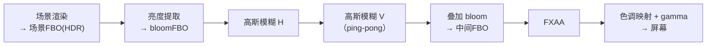

# 后处理管线

> [返回：WebGL 与 3D 框架学习大纲](../WebGL与3D框架学习大纲.md)
> 本文是第五阶段第 2 条「后处理管线：ping-pong 双缓冲、bloom、FXAA、色调映射」的完整展开：从「先画进纹理再整屏加工」的范式出发，给出每个效果的完整 GLSL 与效果链的 TypeScript 设计；阶段导览见 [01-导览](01-导览.md)。

## 2.1 通用范式：离屏渲染 + 全屏三角形 + ping-pong

### 2.1.1 后处理的本质：像素级二次加工

后处理（Post Processing）把渲染拆成两步：**先把整个场景画进一张纹理（离屏渲染，Off-screen Rendering，用第二阶段的 FBO），再对这张纹理做整屏的像素级加工**。模糊、泛光、抗锯齿、色调映射、暗角、景深——它们的共同点是输入输出都是「一幅已渲染好的图」，与场景几何无关，所以能做成一条可自由组合的流水线：



三个前提决定了很多设计细节：

1. **HDR**：场景 FBO 用浮点纹理（`RGBA16F`，需要 `EXT_color_buffer_float` 扩展才能作为渲染目标）保存线性高动态颜色。若先压成 LDR 再加工，bloom 的「高亮溢出」就没了物理来源——详见 2.4。
2. **每 pass 都是全屏绘制**：一个覆盖屏幕的矩形（或三角形），片元着色器里按 UV 采样输入纹理做加工。顶点开销约等于零，成本集中在片元着色器的每像素计算。
3. **效果是链式的**：一步的输出是下一步的输入，链上的每一步都要有地方放中间结果——这就是 ping-pong 存在的原因。

### 2.1.2 全屏三角形：比四边形少一半顶点与一条边

画全屏四边形需要 2 个三角形拼成的 4 个顶点，斜边上的属性插值还依赖 UV 归一化。更省的做法是**一个超出屏幕的大三角形**：三个顶点 (-1,-1)、(3,-1)、(-1,3)，覆盖整个 NDC 平面（NDC 里可见范围是 [-1,1]，这个三角形把它整个包含）。UV 在片元着色器里从 `gl_FragCoord` 反推：

```glsl
// fullscreen.vert —— 全屏三角形：3 个顶点覆盖整个屏幕
#version 300 es
out vec2 vUV;
void main() {
  // 顶点数据硬编码：vec2(-1,-1), vec2(3,-1), vec2(-1,3)
  vec2 pos = vec2((gl_VertexID << 1) & 2, gl_VertexID & 2) * 2.0 - 1.0;
  vUV = pos * 0.5 + 0.5;
  gl_Position = vec4(pos, 0.0, 1.0);
}
```

这个位运算小魔术（`gl_VertexID` 为 0/1/2 时分别算出 (-1,-1)、(3,-1)、(-1,3)）连 VBO 都省了，用 `gl.drawArrays(gl.TRIANGLES, 0, 3)` 直接画。好处不只是省一个顶点：**没有对角线**——四边形在斜边两侧来自不同三角形，某些插值/导数操作（如 FXAA 里靠 `dFdx` 求局部差分）在斜边接缝处可能看到三角形边界。

### 2.1.3 ping-pong 双 FBO：为什么必须两个

链式加工的朴素实现需要 N 个中间纹理（每步一个）。ping-pong 的观察是：**第 i 步读完纹理 A 写进 B，第 i+1 步就可以读 B 写 A**——A 的旧内容在第 i+1 步开始时已经没用了，两个纹理轮换（乒乓）就能承载任意长的链，显存占用从 O(N) 降到 O(2)。

这里藏着 WebGL 的一条硬规则：**同一个纹理同时绑定在 FBO 的颜色附件与纹理单元上属于未定义行为**（读自己写自己）。所以每一步都必须严格遵循「读 A 写 B，然后交换」，绝不能读写同一个。

```typescript
// ping-pong 对：两个等大 RGBA16F FBO 互相轮换
class PingPongPair {
  private fbos: [WebGLFramebuffer, WebGLFramebuffer];
  private textures: [WebGLTexture, WebGLTexture];
  private readIndex = 0; // 当前该读哪个

  constructor(private gl: WebGL2RenderingContext, width: number, height: number) {
    this.textures = [createColorTexture(gl, width, height), createColorTexture(gl, width, height)];
    this.fbos = [createFBO(gl, this.textures[0]), createFBO(gl, this.textures[1])];
  }

  /** 当前读端纹理（作为下一步的输入） */
  get readTexture(): WebGLTexture { return this.textures[this.readIndex]; }

  /** 当前写端 FBO（作为下一步的渲染目标） */
  get writeFBO(): WebGLFramebuffer { return this.fbos[1 - this.readIndex]; }

  /** 一步完成后交换读写 */
  swap(): void { this.readIndex = 1 - this.readIndex; }
}

function createColorTexture(gl: WebGL2RenderingContext, w: number, h: number): WebGLTexture {
  const tex = gl.createTexture()!;
  gl.bindTexture(gl.TEXTURE_2D, tex);
  gl.texImage2D(gl.TEXTURE_2D, 0, gl.RGBA16F, w, h, 0, gl.RGBA, gl.HALF_FLOAT, null);
  gl.texParameteri(gl.TEXTURE_2D, gl.TEXTURE_MIN_FILTER, gl.LINEAR);
  gl.texParameteri(gl.TEXTURE_2D, gl.TEXTURE_MAG_FILTER, gl.LINEAR);
  gl.texParameteri(gl.TEXTURE_2D, gl.TEXTURE_WRAP_S, gl.CLAMP_TO_EDGE);
  gl.texParameteri(gl.TEXTURE_2D, gl.TEXTURE_WRAP_T, gl.CLAMP_TO_EDGE);
  return tex;
}
```

### 2.1.4 管线骨架

把 2.1.1 的流程图落成渲染循环里的伪代码（TypeScript，衔接第四阶段框架的 Renderer）：

```typescript
render(scene: Scene, camera: Camera): void {
  // 1. 场景渲染进 HDR 场景 FBO（不走 ping-pong，它是链的源头）
  this.gl.bindFramebuffer(this.gl.FRAMEBUFFER, this.sceneFBO);
  this.renderer.renderScene(scene, camera);

  // 2. 亮度提取：读 sceneTexture，写 pingPong.writeFBO
  this.runPass(this.brightPass, this.sceneTexture);
  // 3. 高斯模糊 H、V 两趟（中间用半分辨率 bloomFBO 也行，见 2.2.3）
  this.runPass(this.blurHPass, this.pingPong.readTexture);
  this.runPass(this.blurVPass, this.pingPong.readTexture);
  // 4. 叠加 bloom：读 sceneTexture + bloom 纹理，写 pingPong
  this.runPass(this.combinePass, this.sceneTexture, this.pingPong.readTexture);
  // 5. FXAA → 色调映射 → 屏幕
  this.runPass(this.fxaaPass, this.pingPong.readTexture);
  this.runPass(this.toneMapPass, this.pingPong.readTexture, null /* 输出到屏幕 */);
}

private runPass(pass: PostPass, input: WebGLTexture, output: WebGLFramebuffer | null): void {
  const gl = this.gl;
  gl.bindFramebuffer(gl.FRAMEBUFFER, output);
  gl.viewport(0, 0, this.width, this.height);
  gl.useProgram(pass.program);
  gl.activeTexture(gl.TEXTURE0);
  gl.bindTexture(gl.TEXTURE_2D, input);
  gl.uniform1i(pass.inputLocation, 0);
  gl.bindVertexArray(this.fullscreenVAO);
  gl.drawArrays(gl.TRIANGLES, 0, 3);
  if (output !== null) this.pingPong.swap();
}
```

## 2.2 bloom 三步曲：提取 → 模糊 → 叠加

泛光（Bloom）模拟镜头对强光的散射：亮的东西向外「晕开」。三步各有数学。

### 2.2.1 亮度提取：软阈值

朴素做法 `luminance > threshold ? color : black` 是硬阈值，阈值附近产生明显的圈状边界。工程用**软阈值（soft knee）**：在阈值附近用二次曲线过渡。

```glsl
// bright.frag —— 亮度提取：软阈值版
#version 300 es
precision mediump float;
in vec2 vUV;
out vec4 fragColor;
uniform sampler2D uScene;
uniform float uThreshold; // 例如 1.0（HDR 下超过 1 才算"亮"）
uniform float uSoftKnee; // 软拐点比例，0.5~1.0

void main() {
  vec3 color = texture(uScene, vUV).rgb;
  float luma = dot(color, vec3(0.2126, 0.7152, 0.0722)); // Rec.709 亮度
  // 软拐点：阈值下方用二次曲线衰减，避免硬边界圈
  float knee = uThreshold * uSoftKnee;
  float soft = clamp(luma - uThreshold + knee, 0.0, 2.0 * knee);
  soft = soft * soft / (4.0 * knee + 1e-4);
  float contribution = max(soft, luma - uThreshold) / max(luma, 1e-4);
  fragColor = vec4(color * contribution, 1.0);
}
```

注意阈值作用在**HDR 线性空间**的亮度上，典型值 1.0——这正是必须保留浮点中间缓冲的原因：LDR 下亮度封顶 1.0，「比 1 更亮」的物理信息早丢了。

### 2.2.2 高斯模糊：可分离性推导与两趟实现

二维高斯核 $G(x,y)=\frac{1}{2\pi\sigma^2}e^{-\frac{x^2+y^2}{2\sigma^2}}$ 有个关键性质：指数可以拆开：

$$e^{-\frac{x^2+y^2}{2\sigma^2}} = e^{-\frac{x^2}{2\sigma^2}} \cdot e^{-\frac{y^2}{2\sigma^2}}$$

即 **G(x,y) = g(x) · g(y)**，二维核是两个一维核的外积。于是卷积可以分解：

$$\sum_j\sum_i G(i,j) \cdot p_{x+i,y+j} = \sum_j g(j)\Big(\sum_i g(i) \cdot p_{x+i,y+j}\Big)$$

含义：先对每行做一维卷积（水平趟），再对结果每列做一维卷积（垂直趟），结果与二维卷积严格相等。成本从「每像素 w×w 次采样」降到「每像素 2×w 次」——w=9 时 81 → 18，省 4.5 倍；且两个 pass 用的可以是**同一个着色器**，只是模糊方向 uniform 不同。

```glsl
// blur.frag —— 可分离高斯：一趟 9 点，方向由 uDirection 切换（vec2(1,0) 或 (0,1)）
#version 300 es
precision mediump float;
in vec2 vUV;
out vec4 fragColor;
uniform sampler2D uImage;
uniform vec2 uDirection;      // 水平趟 (1,0)；垂直趟 (0,1)
uniform vec2 uTexelSize;      // 1.0 / 分辨率

void main() {
  // 权重由 g(x)=exp(-x²/(2σ²)) 归一化而来（σ≈1.83 的 9 点离散近似）
  float weights[5] = float[5](0.227027, 0.1945946, 0.1216216, 0.054054, 0.016216);
  vec3 result = texture(uImage, vUV).rgb * weights[0];
  for (int i = 1; i < 5; ++i) {
    vec2 offset = uDirection * uTexelSize * float(i);
    result += texture(uImage, vUV + offset).rgb * weights[i];
    result += texture(uImage, vUV - offset).rgb * weights[i]; // 核对称，正负各采一次
  }
  fragColor = vec4(result, 1.0);
}
```

### 2.2.3 迭代降采样：工业级 bloom 的省法

对全屏分辨率做两趟高斯已经不便宜，而 bloom 的结果本来就要被模糊，**精度需求低**。工业做法是金字塔迭代降采样（以 Unity/KinoBloom、Call of Duty 的为代表）：

1. 亮度图降到 1/2 分辨率，模糊；
2. 结果降到 1/4 再模糊；
3. 一路降到 1/16，再把各级**上采样叠加**回 1/2 分辨率得到最终 bloom 纹理。

每降一级，一个纹素覆盖的世界范围翻倍，同样 9 点采样的模糊半径就翻倍——大范围的柔和光晕几乎免费。教学实现（两趟全分辨率）与工业实现的差距就在这里，原理相同、分辨率策略不同。

### 2.2.4 叠加

```glsl
// combine.frag —— 场景 + bloom 线性叠加
#version 300 es
precision mediump float;
in vec2 vUV;
out vec4 fragColor;
uniform sampler2D uScene;
uniform sampler2D uBloom;
uniform float uBloomIntensity; // 0.3~1.0
void main() {
  vec3 scene = texture(uScene, vUV).rgb;
  vec3 bloom = texture(uBloom, vUV).rgb;
  fragColor = vec4(scene + bloom * uBloomIntensity, 1.0); // 仍在 HDR 线性空间
}
```

叠加发生在 HDR 空间（加法是能量叠加的正确语义），压到显示范围是色调映射的活，别在这里做。

### 2.2.5 手工推演：一帧 bloom 的 FBO 状态表

把 2.1.3 的 ping-pong 与 2.2 的三步曲合起来，逐 pass 记账（设 HDR 场景纹理为 S，两个后处理 FBO 为 A、B）：

| 步 | pass | 读 | 写 | pass 结束后 A | pass 结束后 B |
|---|---|---|---|---|---|
| 0 | 场景渲染 | — | S | 空闲 | 空闲 |
| 1 | 亮度提取 | S | A | 仅亮过软阈值的能量 | 空闲 |
| 2 | 高斯·水平 | A | B | 提取结果（未动） | 横向拖尾的亮斑 |
| 3 | 高斯·垂直 | B | A | **一轮完整模糊** | 上一步的废数据 |
| 4′ | （可选）降采样后再来 N 轮 2~3 | A↔B 交替 | 交替 | 逐轮更糊 | 逐轮被覆盖 |
| 5 | 叠加 | S + A | 屏幕或下一 pass | — | — |

四个读法，每个都是一条工程纪律：

1. **步 2→3 为什么必须两个 FBO**：读 A 写 A 是 framebuffer feedback loop（同一纹理同时挂读与写，WebGL 直接 `INVALID_OPERATION`）——A→B→A 的乒乓让「永远读到上一趟的完整结果」变成结构保证，而不是小心不踩的雷（2.1.3 的「为什么必须两个」落到帧上的样子）；
2. **全程没有一次 `clear`**：后处理 pass 每像素无条件全屏写入，上一帧的旧内容天然被覆盖——步 3 结束后 B 里的废数据不需要清理，下一轮水平模糊会整个重写它。对照步 0 的场景渲染必须清屏（几何不保证覆盖每个像素），「要不要 clear」是两种 pass 的分水岭；
3. **省预算的位置在步 4′ 的 FBO 尺寸上**：把模糊 pass 的 FBO 降到 1/4 分辨率（960×540），像素量直接除 16，模糊半径不变时视觉差异极小——2.2.3 的「迭代降采样」在这张表里就是「用更小的 A/B 交替」这一行；
4. **步 5 的两个采样共用同一个 `vUV`**：S 与 A 必须像素对齐（同分辨率同投影），任何一步改了尺寸或视口，叠加就会出现错位重影——后处理链上「全屏对齐」是所有 pass 之间的隐式合同。

一帧 bloom 至此可以脱稿手推：S 进、A/B 乒乓三步、S+A 出。2.3 的 FXAA 与 2.4 的色调映射只是把步 5 之后再加两节车厢——每个新 pass 都回答同样三个问题：读哪张、写哪张、乒乓方向。

## 2.3 FXAA：基于亮度梯度的高速抗锯齿

### 2.3.1 为什么不直接 MSAA

多重采样抗锯齿（MSAA）在几何边缘每像素存多个子采样，质量高、原理正。但本管线的场景是先画进纹理再后处理：MSAA 的多重采样信息在「渲染进单采样 FBO」时就没了，要么用多变体 FBO（memory×N）再做 resolve，要么在后处理阶段用屏幕空间算法补——快速近似抗锯齿（FXAA，Fast Approximate Anti-Aliasing）属于后者：**只看最终图像的亮度（luma）梯度，找到边缘后沿边缘方向混合邻域像素**。它便宜、与任意管线兼容，代价是细节纹理偶尔被误当边缘糊掉。

### 2.3.2 完整 GLSL

下面是 FXAA 3.11 的精简质量档实现（按 console 版裁剪，思路完整）：

```glsl
// fxaa.frag —— FXAA 3.11 精简版
#version 300 es
precision mediump float;
in vec2 vUV;
out vec4 fragColor;
uniform sampler2D uImage;
uniform vec2 uTexelSize; // 1.0 / 分辨率

// RGB 与相对亮度（在 sRGB 近似下用 gamma 2.0 求平方即可）
float luma(vec3 c) { return dot(c, vec3(0.299, 0.587, 0.114)); }

void main() {
  vec3 rgbM  = texture(uImage, vUV).rgb;
  float lumaM  = luma(rgbM);
  // 1) 采十字邻域亮度
  float lumaN  = luma(texture(uImage, vUV + vec2( 0.0, -1.0) * uTexelSize).rgb);
  float lumaS  = luma(texture(uImage, vUV + vec2( 0.0,  1.0) * uTexelSize).rgb);
  float lumaE  = luma(texture(uImage, vUV + vec2( 1.0,  0.0) * uTexelSize).rgb);
  float lumaW  = luma(texture(uImage, vUV + vec2(-1.0,  0.0) * uTexelSize).rgb);
  // 2) 局部最大对比度：小于阈值视为平坦区，直接返回
  float lumaMin = min(lumaM, min(min(lumaN, lumaS), min(lumaE, lumaW)));
  float lumaMax = max(lumaM, max(max(lumaN, lumaS), max(lumaE, lumaW)));
  float lumaRange = lumaMax - lumaMin;
  if (lumaRange < max(0.0312, lumaMax * 0.125)) { fragColor = vec4(rgbM, 1.0); return; }
  // 3) 采四角，用 3×3 加权梯度判断边缘方向（水平 or 垂直）
  float lumaNW = luma(texture(uImage, vUV + vec2(-1.0, -1.0) * uTexelSize).rgb);
  float lumaNE = luma(texture(uImage, vUV + vec2( 1.0, -1.0) * uTexelSize).rgb);
  float lumaSW = luma(texture(uImage, vUV + vec2(-1.0,  1.0) * uTexelSize).rgb);
  float lumaSE = luma(texture(uImage, vUV + vec2( 1.0,  1.0) * uTexelSize).rgb);
  float lumaNS = lumaN + lumaS, lumaWE = lumaW + lumaE;
  float edgeH = abs(-2.0 * lumaW + lumaNS) + abs(-2.0 * lumaM + lumaNE - lumaM + lumaNW) * 0.25; // 简化水平边缘强度
  float edgeV = abs(-2.0 * lumaS + lumaWE) + abs(-2.0 * lumaM + lumaSW - lumaM + lumaSE) * 0.25; // 简化垂直边缘强度
  bool isHorizontal = edgeH >= edgeV;
  // 4) 沿边缘方向找梯度最大的一侧，确定"末端像素"
  float luma1 = isHorizontal ? lumaN : lumaW;
  float luma2 = isHorizontal ? lumaS : lumaE;
  float gradient1 = luma1 - lumaM;
  float gradient2 = luma2 - lumaM;
  bool is1Steepest = abs(gradient1) >= abs(gradient2);
  float gradientScaled = 0.25 * max(abs(gradient1), abs(gradient2));
  // 5) 沿边缘法向（梯度方向）双边步进两端，直到亮度均值明显偏离中点 —— 收缩混合范围
  float stepLength = isHorizontal ? uTexelSize.y : uTexelSize.x;
  float lumaLocalAvg = 0.0;
  if (is1Steepest) { stepLength = -stepLength; lumaLocalAvg = 0.5 * (luma1 + lumaM); }
  else             {                  lumaLocalAvg = 0.5 * (luma2 + lumaM); }
  vec2 currentUv = vUV;
  if (isHorizontal) currentUv.y += stepLength * 0.5;
  else              currentUv.x += stepLength * 0.5;
  vec2 offset = isHorizontal ? vec2(uTexelSize.x, 0.0) : vec2(0.0, uTexelSize.y);
  vec2 uv1 = currentUv - offset;
  vec2 uv2 = currentUv + offset;
  float lumaEnd1 = luma(texture(uImage, uv1).rgb) - lumaLocalAvg;
  float lumaEnd2 = luma(texture(uImage, uv2).rgb) - lumaLocalAvg;
  bool reached1 = abs(lumaEnd1) >= gradientScaled;
  bool reached2 = abs(lumaEnd2) >= gradientScaled;
  bool reachedBoth = reached1 && reached2;
  if (!reached1) uv1 -= offset;
  if (!reached2) uv2 += offset;
  if (!reachedBoth) {
    // 6) 继续沿两端各走一步（迭代次数限 2 次，质量档更多）
    for (int i = 0; i < 2; ++i) {
      if (!reached1) { lumaEnd1 = luma(texture(uImage, uv1).rgb) - lumaLocalAvg; reached1 = abs(lumaEnd1) >= gradientScaled; }
      if (!reached2) { lumaEnd2 = luma(texture(uImage, uv2).rgb) - lumaLocalAvg; reached2 = abs(lumaEnd2) >= gradientScaled; }
      if (reached1 && reached2) break;
      if (!reached1) uv1 -= offset * 1.5;
      if (!reached2) uv2 += offset * 1.5;
    }
  }
  // 7) 用两端距离估计像素在边缘线上的位置，做亚像素混合权重
  float distance1 = isHorizontal ? (vUV.x - uv1.x) / uTexelSize.x : (vUV.y - uv1.y) / uTexelSize.y;
  float distance2 = isHorizontal ? (uv2.x - vUV.x) / uTexelSize.x : (uv2.y - vUV.y) / uTexelSize.y;
  bool isDirection1 = distance1 < distance2;
  float distanceFinal = min(distance1, distance2);
  float edgeThickness = distance1 + distance2;
  float pixelOffset = -distanceFinal / edgeThickness + 0.5;
  bool isLumaMSmaller = lumaM < lumaLocalAvg;
  bool correctVariation = ((isDirection1 ? lumaEnd1 : lumaEnd2) < 0.0) != isLumaMSmaller;
  float finalOffset = correctVariation ? pixelOffset : 0.0;
  // 8) 亚像素抖动（处理细线/高频纹理）
  float lumaAvg = (1.0 / 12.0) * (2.0 * (lumaNS + lumaWE) + lumaNW + lumaNE + lumaSW + lumaSE);
  float subPixelOffset = clamp(abs(lumaAvg - lumaM) / lumaRange, 0.0, 1.0);
  subPixelOffset = 0.5 * subPixelOffset; // 软化系数
  finalOffset = max(finalOffset, subPixelOffset);
  // 9) 沿边缘法向偏移采样，完成混合
  vec2 finalUv = vUV;
  if (isHorizontal) finalUv.y += finalOffset * stepLength;
  else              finalUv.x += finalOffset * stepLength;
  fragColor = vec4(texture(uImage, finalUv).rgb, 1.0);
}
```

读这段代码抓主线即可：**亮度梯度找边 → 定边方向 → 沿法向双边探测边缘宽度 → 亚像素偏移采样**。四步里任何一步砍掉，效果都会明显劣化（常见坑第 4 条）。

## 2.4 色调映射：Reinhard 与 ACES

### 2.4.1 为什么需要：HDR 到 LDR 的压缩

真实场景亮度动态范围可达 10^8:1（阳光下到阴影里），显示设备约 10^2~10^3:1，sRGB 每通道 8 位更是只有 256 级。**色调映射（Tone Mapping）就是把线性 HDR 颜色压缩进 [0,1] 且尽量保住主观亮度顺序与细节的函数**。它必须放在效果链的最后（屏幕输出前）：放在 bloom 之前会把高亮截断、bloom 没有「过亮」可提取；放在 gamma 校正之前是因为它工作在线性空间。

### 2.4.2 Reinhard：一句推导

Reinhard 映射 $L \mapsto \frac{L}{1+L}$ 是最简单的有理压缩：把 $[0,\infty)$ 单调压到 $[0,1)$，暗部近似线性（L 小时 ≈ L），亮部渐近 1。缺点是高亮「永远到不了 1」，整体发灰。扩展版引入白点 W（指定「映射后恰好为 1 的输入」）：

$$L_{out} = \frac{L(1 + L/W^2)}{1 + L}$$

```glsl
// tonemap_reinhard.frag 核心片段：扩展 Reinhard + gamma
vec3 reinhardExtended(vec3 hdr, float whitePoint /* 例如 4.0 */) {
  vec3 numerator = hdr * (1.0 + hdr / (whitePoint * whitePoint));
  return numerator / (1.0 + hdr);
}
void main() {
  vec3 hdr = texture(uImage, vUV).rgb;
  vec3 ldr = reinhardExtended(hdr, 4.0);
  ldr = pow(ldr, vec3(1.0 / 2.2)); // 线性 → sRGB 近似 gamma
  fragColor = vec4(ldr, 1.0);
}
```

### 2.4.3 ACES：电影级曲线的多项式拟合

学院色彩编码系统（ACES，Academy Color Encoding System）是影视工业的色彩管理标准，其完整管线很重，实时渲染普遍用 Krzysztof Narkowicz 的五参数多项式拟合（曲线形状接近官方 ODT）：对比 Reinhard，它对中间调的对比度保持更好、高光滚降更有「胶片感」——暗部不会被压得太灰。

```glsl
// tonemap_aces.frag 核心片段：ACES 拟合 + gamma
vec3 acesFilm(vec3 x) {
  // Narkowicz 2015 拟合：RRT+ODT 的近似
  const float a = 2.51, b = 0.03, c = 2.43, d = 0.59, e = 0.14;
  return clamp((x * (a * x + b)) / (x * (c * x + d) + e), 0.0, 1.0);
}
void main() {
  vec3 hdr = texture(uImage, vUV).rgb;
  hdr *= 0.6;                                  // 曝光系数：ACES 拟合的舒适输入区间约 [0, 2]
  vec3 ldr = acesFilm(hdr);
  ldr = pow(ldr, vec3(1.0 / 2.2));             // gamma。注意 sRGB 严格转换是分段函数，2.2 是常用近似
  fragColor = vec4(ldr, 1.0);
}
```

实践顺序建议：先 Reinhard 跑通管线，再切 ACES 对比同一场景——中间调灰阶与高光滚降的差异一眼可辨（实践任务 P2 的验收点）。

## 2.5 效果链设计：EffectComposer 式架构

### 2.5.1 抽象：Pass 接口与组合

Three.js 的 EffectComposer（效果合成器）设计值得抄：**每个效果是一个 Pass，Composer 持有 ping-pong 对并驱动它们鱼贯执行**。用 TypeScript 表达这个抽象：

```typescript
/** 一个后处理 pass：读输入纹理，渲染到 Composer 给的写端 */
abstract class Pass {
  /** 该 pass 是否真的参与（如开关关闭时返回 false，Composer 跳过并直接透传） */
  enabled = true;
  /** 需要读几个输入纹理（默认 1；叠加类 pass 可能要 2 个） */
  abstract readonly inputs: number;
  /** 把输入渲染到输出 FBO。outputFBO 为 null 表示输出到屏幕 */
  abstract render(
    gl: WebGL2RenderingContext,
    inputs: WebGLTexture[],
    outputFBO: WebGLFramebuffer | null,
    width: number,
    height: number
  ): void;
}

class EffectComposer {
  private pingPong: PingPongPair;
  private passes: Pass[] = [];
  private fullscreenVAO: WebGLVertexArrayObject;

  constructor(private gl: WebGL2RenderingContext, width: number, height: number) {
    this.pingPong = new PingPongPair(gl, width, height);
    this.fullscreenVAO = createFullscreenVAO(gl); // 全屏三角形，无需真实顶点数据
  }

  addPass(pass: Pass): this { this.passes.push(pass); return this; }

  /** 链头：场景纹理进入，逐步加工，最后一步画到屏幕 */
  render(sceneTexture: WebGLTexture): void {
    const gl = this.gl;
    for (let i = 0; i < this.passes.length; i++) {
      const pass = this.passes[i];
      if (!pass.enabled) continue;
      const isLast = this.passes.slice(i + 1).every(p => !p.enabled);
      const output: WebGLFramebuffer | null = isLast ? null : this.pingPong.writeFBO;
      pass.render(gl, [sceneTexture, ...this.extraTextures(pass)], output, this.width, this.height);
      if (output !== null) this.pingPong.swap();
      // 注意：透传写法——被跳过的 pass 不消费 pingPong，下一个 pass 仍读同一纹理
      if (i < this.passes.length - 1) sceneTexture = this.pingPong.readTexture;
    }
  }

  private extraTextures(pass: Pass): WebGLTexture[] { /* 叠加类 pass 的第二输入，如 bloom 纹理 */ return []; }
  private width = 0; private height = 0;
  setSize(w: number, h: number): void { this.width = w; this.height = h; this.pingPong.resize(w, h); }
}
```

设计意图拆解：

1. **Pass 只管「读纹理 → 画全屏三角形」，不持有中间缓冲**。缓冲归 Composer，同尺寸 pass 共享，效果多到十个也不多占一份显存（对比每个 pass 自建 FBO 的写法）。
2. **`render` 接口无返回值、无状态**——pass 之间唯一的通信媒介就是纹理，这让效果的增删、重排是纯配置行为；
3. **最后一步直接输出屏幕**（`null`），省掉一次「拷回默认帧缓冲」的空跑；
4. 尺寸变化走 `setSize` 统一重建，与第四阶段框架的资源生命周期（create/dispose）约定对齐。

### 2.5.2 一个具体 Pass 的样子

```typescript
class BlurPass extends Pass {
  readonly inputs = 1;
  private program: WebGLProgram;
  private directionLoc: WebGLUniformLocation;
  constructor(private gl: WebGL2RenderingContext, direction: [number, number]) {
    super();
    this.program = compile(gl, FULLSCREEN_VERT, BLUR_FRAG); // 2.2.2 的两个着色器
    this.directionLoc = gl.getUniformLocation(this.program, 'uDirection')!;
    gl.useProgram(this.program);
    gl.uniform2f(this.directionLoc, direction[0], direction[1]);
  }
  render(gl: WebGL2RenderingContext, inputs: WebGLTexture[], outputFBO: WebGLFramebuffer | null, w: number, h: number): void {
    gl.bindFramebuffer(gl.FRAMEBUFFER, outputFBO);
    gl.viewport(0, 0, w, h);
    gl.useProgram(this.program);
    gl.uniform2f(gl.getUniformLocation(this.program, 'uTexelSize'), 1 / w, 1 / h);
    gl.activeTexture(gl.TEXTURE0);
    gl.bindTexture(gl.TEXTURE_2D, inputs[0]);
    gl.uniform1i(gl.getUniformLocation(this.program, 'uImage'), 0);
    gl.bindVertexArray(this.fullscreenVAO /* 由基类或工具持有 */);
    gl.drawArrays(gl.TRIANGLES, 0, 3);
  }
  private fullscreenVAO!: WebGLVertexArrayObject; // 实际由 Composer 注入，此处从简
}
```

## 常见坑

1. **同一个纹理同时是 FBO 附件和采样源**——未定义行为，画面闪黑或残影。ping-pong 的 swap 顺序错了必踩；调试时先怀疑这里。
2. **浮点渲染目标没开扩展**——`EXT_color_buffer_float` 不开启时 `RGBA16F` FBO 不完备（`checkFramebufferStatus` 返回不完整），后处理全黑。渲染进浮点纹理与采样浮点纹理是两件事（后者 WebGL2 原生支持）。
3. **在 LDR 空间做 bloom / 色调映射**——先 `gl.RGBA8` 存场景再做后处理，高亮信息在第一帧写入时就截断了，阈值只能调出「平涂光晕」。整条链（场景 FBO → bloom → 叠加）都要保持浮点，最后一步才压 LDR。
4. **FXAA 放在色调映射之前**——FXAA 依赖「边缘两侧亮度差」检测边缘，HDR 空间里 100 和 200 的边与 1 和 2 的边在映射后完全不同，直接在 HDR 上跑 FXAA 效果差且不稳定。正确顺序：色调映射 → gamma → FXAA（Three.js 的做法），或色调映射后 FXAA 再 gamma。
5. **忘了改 viewport**——场景 pass 与后处理 pass 分辨率不同（bloom 半分辨率）时，`gl.viewport` 不跟着切换，整个效果错位或只糊了四分之一。
6. **resize 时只改 canvas 不重建纹理**——`texImage2D` 分配的尺寸不会自动跟 canvas 走，窗口变化后采样越界、画面拉伸。
7. **mipmap 过滤开在不完整的浮点纹理上**——`RGBA16F` + `LINEAR_MIPMAP_LINEAR` 但没 `generateMipmap`，采样返回黑色。后处理中间纹理用 `LINEAR` 即可。

## 本节自测

1. 用「读写不能是同一张纹理」解释 ping-pong 为什么必须存在；如果只有一张中间纹理，链上第 2 个 pass 会发生什么？
2. 推导高斯可分离性：写出 3×3 二维核等于水平一维核卷垂直一维核的完整展开，并算出 w=13 时直接卷积与两趟卷积的采样次数比。
3. bloom 为什么必须工作在 HDR 空间？把亮度提取的输入换成 LDR 纹理，阈值 1.0 会发生什么？
4. Reinhard 公式 L/(1+L) 求导，说明它在暗部的斜率为什么近似 1、亮部为什么渐近 1；白点 W 的扩展式解决了原版的哪个缺陷？
5. FXAA 检测边缘用的是颜色还是亮度？为什么？把色调映射放在 FXAA 之后会出什么问题？
6. EffectComposer 式设计中 Pass 不持有自己的输出纹理，好处和代价各是什么？如果某个 pass 需要特殊格式（如半分辨率、R16F 单通道），架构要怎么扩展？
