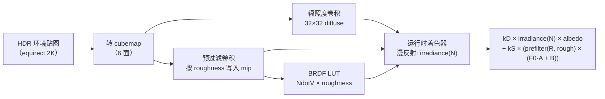
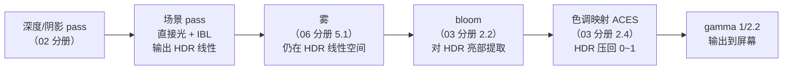

# PBR 入门

> [返回：WebGL 与 3D 框架学习大纲](../WebGL与3D框架学习大纲.md)
> 本文是第五阶段第 3 条「PBR 入门：Cook-Torrance BRDF、金属度/粗糙度工作流、IBL 概念」的完整展开：渲染方程逐项拆直觉、D/F/G 三项各自推导、完整直接光照 GLSL，以及 IBL 离线预处理的全流程图解；阶段导览见 [01-导览](01-导览.md)。

## 3.1 渲染方程：直觉版逐项拆解

基于物理的渲染（PBR，Physically Based Rendering）不是一套 trick 集合，而是**对一个方程的工程近似**——渲染方程（Rendering Equation，Kajiya 1986）：

$$L_o(p, \omega_o) = L_e(p, \omega_o) + \int_{\Omega} f_r(p, \omega_i, \omega_i \to \omega_o)\, L_i(p, \omega_i)\, (n \cdot \omega_i)\, d\omega_i$$

符号先翻译成人话：p 是表面一点，$\omega_o$ 是「你看它的方向」（出射方向），$\omega_i$ 是某个入射方向，n 是法线，$\Omega$ 是以法线为中心的半球（天上所有可能来光的方向）。

逐项直觉：

| 项 | 直觉 |
|---|---|
| $L_o(p, \omega_o)$ | 问：从 $\omega_o$ 方向看 p 点，有多亮？——方程左边就是答案 |
| $L_e$ | 自己发光（自发光）：不用算，直接加 |
| $L_i(p, \omega_i)$ | 从 $\omega_i$ 方向**打过来多少光**（辐亮度，radiance）：光源强度、距离、遮挡都在这里 |
| $f_r$ | 表面把 $\omega_i$ 来的光**拐到 $\omega_o$ 的比例**：双向反射分布函数（BRDF，Bidirectional Reflectance Distribution Function），材质的全部性格都在这个函数里 |
| $n \cdot \omega_i$ | **投影面积**：光斜着打，单位表面积分到的光按 cos 衰减（兰伯特余弦定律） |
| $\int_\Omega$ | **把天上每个方向的贡献加起来**：所有方向来的光，各自乘以材质的反射比例，再乘投影角，求和 |

所以渲染方程一句话：**出射光 = 自发光 + 对「入射光 × 材质反应 × 投影角」在半个天球上的积分**。

前四个阶段我们写的 Blinn-Phong 光照，其实就是这个积分在「点光源有限个」假设下的粗糙版本：每个光源贡献 $L_i \cdot f \cdot cos$，没有积分、没有能量守恒。PBR 做的事是换一个**物理上站得住的 $f_r$**（Cook-Torrance），并老老实实处理积分（直接光照逐个算；环境光用 IBL 离线积分，见 3.4）。

**能量守恒**是 PBR 与经验光照的分水岭：反射出去的总能量不超过吸收进来的。落到实现上是「漫反射 + 镜面反射 ≤ 1」的硬约束（3.2 的 $k_d = (1-k_s)(1-metallic)$），经验模型里高光开多大全凭手感，PBR 里超了就是物理错误。

### 3.1.1 辐亮度：方程里唯一需要新认识的单位

渲染方程里每个 $L$ 都是**辐亮度（radiance）**——单位投影面积、单位立体角上的功率。不需要背量纲，但要接受它的三个推论：

1. **颜色向量就是辐亮度**。着色器里 `uLightColor = vec3(3.0, 2.85, 2.6)` 这类「亮于 1」的值不再是 hack，而是 HDR 辐亮度——太阳、白炽灯金属高光本来就该超过显示器的最大亮度，超出部分交给色调映射（[03-后处理管线](03-后处理管线.md) 2.4）压缩；
2. **点光源的 $L_i$ 含距离衰减**。辐亮度守恒决定了能量随距离平方稀释（1/d²），这就是常见坑第 6 条「光强参数配物理衰减」的出处；
3. **albedo 是比值不是亮度**。它被约束在 0~1（反射比例），「更亮」应该调光照而不是把 albedo 推到 1.5——这是美术侧最常见的违规操作。

### 3.1.2 从 Blinn-Phong 迁移：能留什么、要换什么

PBR 不是推倒重来。对着第二阶段写过的一切做一次资产盘点：

| 旧资产 | 在 PBR 里的命运 |
|---|---|
| 顶点变换、法线插值、`normalize` 纪律 | 原样保留 |
| 纹理管线（采样、mipmap、色彩空间） | 原样保留，但 sRGB 转线性的纪律变成硬要求（3.3.2） |
| `NdotL` 漫反射项 | 换成 $\frac{albedo}{\pi} \cdot L_i \cdot cos\theta$，多除一个 π |
| Blinn 高光 `pow(NdotH, shininess)` | 换成 Cook-Torrance 镜面支（D/F/G 三项） |
| 「环境光 = 全局一个常数」 | 换成 IBL（3.4）或至少辐照度近似 |
| 光照结果直接输出 | 先累加 HDR，链尾统一色调映射 + gamma |

迁移的工程量集中在着色器主函数与材质参数表，管线骨架（FBO、纹理、uniform 上传）全部复用——这也是 examples/09-pbr-ibl 能在同一套 `src/common` 公共层上直接搭出 PBR 场景的原因。

## 3.2 Cook-Torrance BRDF：D、F、G 三项

Cook-Torrance 模型把 BRDF 拆成漫反射与镜面反射两支：

$$f_r = k_d\, f_{lambert} + k_s\, f_{cook-torrance}$$

漫反射沿用兰伯特：$f_{lambert} = \frac{albedo}{\pi}$（除以 π 是能量守恒的归一化——半球立体角积分恰好是 π）。镜面反射是微表面（Microfacet）理论的产物：

$$f_{spec} = \frac{D\,F\,G}{4\,(n \cdot l)(n \cdot v)}$$

分母是**微表面几何的可见性修正**（推导涉及半程向量宏表面与微表面的雅可比变换，记住它是把「微表面亮度」换算回「宏表面辐亮度」的桥即可）。三项分子各管一件事：

### 3.2.1 D 项：法线分布函数（Normal Distribution）

**物理问题：微表面的法线朝向分布有多集中？**

微表面理论把粗糙表面看成无数微小镜面，D(h) 回答「有多少比例的微表面法线恰好对准半程向量 h」（h = normalize(l + v)，只有法线对准 h 的微面才把光从 l 镜面反射到 v）。主流选择 GGX（又叫 Trowbridge-Reitz）：

$$D(h) = \frac{\alpha^2}{\pi\,((n \cdot h)^2(\alpha^2 - 1) + 1)^2}$$

其中 α = roughness²（平方让参数在低粗糙度端的调节更线性，Disney 风格的 remap）。行为验证：roughness → 0 时 α → 0，D 收敛成狄拉克 δ（完美镜面，高光是无穷小的亮点）；roughness → 1 时 D 变平缓（各方向均匀，高光糊成一片）。**D 项决定高光的「大小」**。

两个值得知道的边角：D 的分母在 $NdotH \to 1$ 且 α 极小时趋近常数 $\pi\alpha^2$——峰值约为 $\frac{1}{\pi\alpha^2}$，即粗糙度减半、峰值翻平方倍，这就是低粗糙度端「稍微一调就大变」的数学来源；GGX 之外还有 Beckmann（高斯形，早期 Blinn-Phong 与它同族）与 GTR（多挡位泛化，Pixar 提出），实时渲染里 GGX 凭「高光拖尾（long tail）更接近实测材质」胜出。

### 3.2.2 F 项：菲涅尔方程（Fresnel）

**物理问题：多少比例的光被直接反射（而不是折射进物体内部）？**

菲涅尔效应：观察角越掠射（grazing angle），表面反射率越高——所有材质在 90° 掠射角都趋近全反射，这是人眼「水面远处反光刺眼」的原因。精确菲涅尔方程要解偏振光与复折射率，实时渲染用 Schlick 近似：

$$F(v, h) = F_0 + (1 - F_0)(1 - (v \cdot h))^5$$

$F_0$ 是「垂直入射时的基础反射率」，是材质的指纹：非金属（电介质，dielectric）普遍约 0.04（4%），金属（导体，conductor）高达 0.6~1.0 且带颜色（金色偏暖、铜色偏红）。**F 项决定高光的「强度」与颜色**，也是 3.3 金属度工作流的物理根据。

Schlick 的拟合精度对「常规材质 + 常规角度」足够好，两个已知偏差：极端掠射角下非金属的精确曲线略有不同（实时渲染不纠正，肉眼不敏感）； gems/钻石这类高折射率电介质 $F_0$ 显著高于 0.04，金属度工作流表达不了——那是 specular 工作流的领地（3.3.1）。

### 3.2.3 G 项：几何遮蔽/阴影函数（Geometry/Shadowing）

**物理问题：微表面之间的自遮挡吃掉多少光？**

粗糙表面上，凸起的微面会挡住两段路径：光还没打到微面就被别的微面挡住（shadowing，阴影），反射出去的路上又被挡（masking，遮蔽）。G 项把这些「看不见的微面」从统计上扣掉，roughness 越大扣得越狠——没有 G 项，粗糙表面高光边缘会异常亮（D 项算出了实际上被挡住的光）。主流是 Smith 几何项配 Schlick-GGX 近似：

$$G(n, v, l) = G_1(n, v) \cdot G_1(n, l), \qquad G_1(n, x) = \frac{n \cdot x}{(n \cdot x)(1 - k) + k}$$

直接光照下 $k = \frac{(roughness + 1)^2}{8}$（IBL 下取 $\frac{roughness^2}{2}$，两者是不同的近似拟合）。**G 项决定高光的「边缘变暗」**。

三项速查（把 G 恒置 1、或把 D 换常数，画面哪里先坏——对着 P3 的滑块逐个验证）：

| 项 | 回答的物理问题 | 调大 roughness 时 | 置 1 / 换常数会怎样 |
|---|---|---|---|
| D | 微面法线多集中在 h | 分布变宽，高光变大变糊 | 高光消失或变成无形状亮斑 |
| F | 多少光直接反射 | （配合 F0）掠射更亮 | 掠射角失去增亮，材质「死板」 |
| G | 自遮挡吃掉多少 | 扣得更多，边缘变暗 | 粗糙高光边缘异常亮（能量凭空多出） |

### 3.2.4 完整直接光照着色器

三项合体，一个平行光版本的完整 GLSL（GLSL ES 3.00）：

```glsl
// pbr.frag —— Cook-Torrance 直接光照（单平行光）
#version 300 es
precision highp float;

in vec3 vWorldPos;
in vec3 vNormal;

uniform vec3  uCamPos;
uniform vec3  uLightDir;     // 指向光源
uniform vec3  uLightColor;   // 已带强度（如 vec3(30.0)）
uniform vec3  uAlbedo;       // 固有色（线性空间）
uniform float uMetallic;     // 0 非金属 ~ 1 金属
uniform float uRoughness;    // 0 光滑 ~ 1 粗糙

out vec4 fragColor;

float distributionGGX(vec3 N, vec3 H, float roughness) {
  float a  = roughness * roughness;
  float a2 = a * a;
  float NdotH  = max(dot(N, H), 0.0);
  float NdotH2 = NdotH * NdotH;
  float denom = NdotH2 * (a2 - 1.0) + 1.0;
  return a2 / (3.14159265 * denom * denom);
}

float geometrySchlickGGX(float NdotX, float k) {
  return NdotX / (NdotX * (1.0 - k) + k);
}

float geometrySmith(vec3 N, vec3 V, vec3 L, float roughness) {
  float k = (roughness + 1.0) * (roughness + 1.0) / 8.0; // 直接光照的 k
  return geometrySchlickGGX(max(dot(N, V), 0.0), k)
       * geometrySchlickGGX(max(dot(N, L), 0.0), k);
}

vec3 fresnelSchlick(float HdotV, vec3 F0) {
  return F0 + (1.0 - F0) * pow(1.0 - HdotV, 5.0);
}

void main() {
  vec3 N = normalize(vNormal);
  vec3 V = normalize(uCamPos - vWorldPos);
  vec3 L = normalize(uLightDir);
  vec3 H = normalize(V + L);            // 半程向量：D 与 F 都以它为轴

  vec3 F0 = mix(vec3(0.04), uAlbedo, uMetallic); // 3.3 的工作流参数化

  float NdotL = max(dot(N, L), 0.0);

  // 镜面反射支
  float D = distributionGGX(N, H, uRoughness);
  float G = geometrySmith(N, V, L, uRoughness);
  vec3  F = fresnelSchlick(max(dot(H, V), 0.0), F0);
  vec3 specular = (D * G * F)
    / max(4.0 * max(dot(N, V), 0.0) * NdotL, 1e-4); // 分母加 epsilon 防除零

  // 能量守恒：菲涅尔给出 ks，剩下的能量走漫反射
  vec3 kS = F;
  vec3 kD = (vec3(1.0) - kS) * (1.0 - uMetallic);   // 金属没有漫反射

  vec3 lambert = uAlbedo / 3.14159265;
  vec3 radiance = uLightColor * NdotL;              // Li × cosθ
  vec3 color = (kD * lambert + specular) * radiance;

  // 输出 HDR，交给 2.4 的色调映射；此处不做 gamma（链尾统一做）
  fragColor = vec4(color, 1.0);
}
```

对着三项自测（实践任务 P3 的验收点）：roughness 0 → 1，高光从锐点扩散为哑光（D 在变）；metallic 0 → 1，漫反射支消失、高光带上 albedo 颜色（F0 与 kD 在变）；视角贴地看任何材质都变「镜面」是 F 的掠射行为。

扩到多光源是机械劳动但有一个纪律：**每个光源各自算一遍 F 与 specular，kD 不在光源循环里重复扣**——循环里累计的是 `specular_i` 与 `radiance_i`，能量分配（kD/kS）对整个 BRDF 只做一次。把 kD 乘进每个光源的漫反射项、又用完整 albedo 参与下一处，是「画面越加越暗/越亮」的常见根因（见常见坑第 8 条）。

### 3.2.5 对照 examples/09-pbr-ibl：这段代码在 demo 里的位置

配套工程 `examples/09-pbr-ibl` 把本节全部内容变成了可交互的实物，读它时按下面的地图找：

| demo 里的东西 | 对应本节位置 | 看什么 |
|---|---|---|
| `shaders.ts` 的 `pbrFS` 直接光照段 | 3.2.4 | demo 注释明确写着「04-PBR入门 3.2.4 原样」——D/F/G 三个函数逐行同源，可直接对照改参数 |
| 场景布局（`main.ts` 的 objects 数组） | 3.3 工作流 | 前排 7 颗非金属球、后排 7 颗金属球（金色 albedo），各自按 roughness 0 → 1 排开，再加一块高粗糙度地面——一张「材质两参数」的二维切片表 |
| `uRoughness` 设了 0.05 下限 | 常见坑与 3.4 | 完全 0 的高光在有限采样数的 IBL 下会出亮点（fireflies，见 [08-基于图像的光照](08-基于图像的光照.md) 7.7.1），demo 用下限规避 |
| `uLightColor` 暖白平行光 | 3.1.1 | 辐亮度大于 1 的 HDR 值，与太阳方向共用同一个 `SUN_DIR`（天空生成与直接光照一致，光影才不穿帮） |
| 空格开关 `uIblIntensity` | 3.4 | 一键对比「只有直接光照」与「直接光照 + IBL」，环境光贡献一目了然 |

把 demo 当 3.2/3.3 的活体实验台：改一个参数、刷新、对着公式解释变化——这是 P3 验收「说得出取舍」的练习方式。

## 3.3 金属度/粗糙度工作流

### 3.3.1 参数化：两张贴图决定材质性格

PBR 材质的标准参数集是：

| 参数 | 通道 | 取值 | 物理含义 |
|---|---|---|---|
| albedo（baseColor） | RGB | 线性空间颜色 | 非金属：漫反射色；金属：反射的颜色（F0） |
| metallic | R（或常数） | 0~1 | 0 = 电介质，1 = 导体；中间值是「混合」的工程妥协，物理上并不真实存在 |
| roughness | R（或常数） | 0~1 | 微表面法线离散度，直接进 D/G 的 α |
| （可选 AO） | R | 0~1 | 环境光遮蔽贴图，仅乘环境光项 |

**为什么这样参数化**：把物理量（F0 是光谱三通道、IOR 是折射率）换成美术可画的两个标量，F0 由公式合成：

$$F_0 = mix(0.04,\ albedo,\ metallic)$$

即非金属统一 4% 反射率，金属直接用 albedo 当 F0。这是金属度/粗糙度工作流（Metallic/Roughness Workflow）对**镜面反射工作流（Specular Workflow，直接给 F0 贴图）**的取舍：前者省一张贴图、参数不易调出非法材质（F0 永远物理合理）；后者自由度高（能表达半透明涂层、两层材质），代价是美术容易调出违反能量守恒的值。glTF 采用前者，本阶段跟随。

### 3.3.2 色彩空间纪律

albedo 贴图是 sRGB 的（美术创作空间），采样后必须先转线性再进光照公式；metallic/roughness 是数据（data），保持原样直读。第二阶段讲过的 `UNPACK_COLORSPACE_CONVERSION_WEBGL` 与着色器里 `pow(c, 2.2)` 都能完成转换，纪律是：**颜色走 gamma，数据走线性**，混淆的典型症状是「PBR 灰蒙蒙/高光过曝」。

工程上的完整纪律链有四环，任何一环断掉症状相同，排查时按序检查：贴图文件本身是 sRGB 编码 → 上传时纹理格式与 `SRGB8_ALPHA8`（或着色器手动 pow 2.2）二选一 → 光照计算全程线性 → 输出前统一一次 1/2.2。demo 的做法是着色器链尾统一 `pow(color, vec3(1.0/2.2))`，与 [03-后处理管线](03-后处理管线.md) 的色调映射一节衔接。

### 3.3.3 参数从哪起步：一张校准用的参考表

两个标量没有「标准答案」，但常见材质有公认的起步区间。下表是校准起点（以画面为准，不是规范值）：

| 材质 | metallic | roughness | 备注 |
|---|---|---|---|
| 塑料/漆面 | 0 | 0.3~0.6 | 教科书电介质，F0 = 0.04 |
| 金属（金/铜/铝） | 1 | 0.2~0.5 | albedo 就是反射色，金色偏暖 |
| 玻璃 | 0 | 0~0.1 | 透明走 alpha 混合，反射靠 F 的掠射增亮 |
| 岩石/混凝土 | 0 | 0.8~1.0 | 高粗糙，漫反射主导 |
| 木头 | 0 | 0.5~0.8 | 上漆木头粗糙度取低段 |
| 生锈金属 | 0~1 混合贴图 | 0.5~0.9 | 中间值在这里「合法」：锈是真实混合的两种材质，用贴图逐纹素过渡 |

校准手法：把目标材质的球放进 demo 的球阵里「对答案」——同行 roughness 排布给了现成参照系，比凭空调参快得多。这也是 demo 用球阵而不是单球的原因。

### 3.3.4 与 glTF 的对接点

glTF 2.0 的标准材质就是金属度/粗糙度工作流：`baseColorTexture` / `baseColorFactor`、`metallicRoughnessTexture`（G 通道存 roughness、B 通道存 metallic——同一张贴图两个通道，省下载）、`metallicFactor` / `roughnessFactor` 标量缩放。这套字段与自研材质的 uniform 一一对应，映射关系与加载细节在 [07-资源管理](../04-第四阶段/07-资源管理.md)（第四阶段简版 glTF 加载器）与本阶段 [08-基于图像的光照](08-基于图像的光照.md) 中展开；毕业项目展厅案的「glTF 材质到自研 PBR 材质的映射」缺口（见 [04-毕业项目-需求书](../06-第六阶段/04-毕业项目-需求书.md) 3.3.1）就是把这张对应表写进加载器。

## 3.4 IBL：基于图像的光照

### 3.4.1 问题：环境光的积分怎么算

3.2 只解决了点光源（有限个方向）。渲染方程里环境光照（Image Based Lighting，IBL）意味着 $L_i$ 来自**所有方向**的天空/环境贴图——积分要在半球上对每个方向采样 cubemap。逐像素实时积分（几千个采样方向）不可行，但注意到积分里有两大块与「观察条件无关」的成分可以**离线预处理**：

$$\int_{\Omega} f_r \cdot L_i \cdot cos\, d\omega \;=\; \underbrace{\int_{\Omega} f_{lambert} \cdot L_i \cdot cos\, d\omega}_{漫反射：与视角无关} \;+\; \underbrace{\int_{\Omega} f_{spec} \cdot L_i \cdot cos\, d\omega}_{镜面：拆给 split-sum}$$

**漫反射块**：兰伯特 BRDF 是常数，可以整个卷进环境贴图——对 cubemap 做卷积（convolution），每个纹素存「从这个法线方向看，半球平均来了多少光」。产物叫**辐照度贴图（Irradiance Map）**，运行时一次采样 `texture(irradiance, N)` 拿到全部漫反射环境光。卷积用低分辨率（32×32×6）cubemap 就够，因为结果极度低频（平滑渐变）。

**镜面块**（split-sum 拆分，Karis 2013）：把积分拆成「预过滤环境贴图 × BRDF 积分查找表」两个可离线计算的因子：

$$\int_{\Omega} f_{spec} \cdot L_i \cdot cos\, d\omega \approx \underbrace{\int_{\Omega} L_i \cdot f_{spec}(\alpha, \omega_i)\, d\omega}_{预过滤环境贴图} \cdot \underbrace{\int_{\Omega} f_{spec} \cdot cos\, d\omega}_{BRDF LUT（2D 纹理）}$$

- **预过滤环境贴图（Prefiltered Environment Map）**：对 cubemap 按不同粗糙度各卷积一次，存进 mip 层（mip0 光滑 → 高 mip 粗糙）。运行时用 `textureLod(prefilteredEnv, R, roughness * maxMipLevel)` 采样，粗糙度当 mip 选择器；
- **BRDF LUT**：一张 512×512 的 RG 纹理，x 轴 NdotV、y 轴 roughness，存菲涅尔积分的两个系数（对 F0 的线性组合系数 $F_0 \cdot A + B$）。运行时两次纹理读取替代积分。

拆分为什么站得住：完整积分里 $L_i$（环境长什么样）与 $f_{spec}$（材质什么样）纠缠在一起，精确拆不了；split-sum 做了两次近似——假设观察方向与法线一致（V = R = N），把「环境项」与「BRDF 项」解耦；再用**重要性采样**（把样本集中撒在 GGX 波瓣覆盖的方向上，而不是均匀撒在半球）让每个因子用几百个样本就能收敛。误差在光滑材质与掠射角下可感知，实时渲染普遍接受。推导与 GLSL 在 [08-基于图像的光照](08-基于图像的光照.md) 7.4/7.5 逐步展开。

### 3.4.2 全流程图



预处理是**一次性的**（工具或启动时跑），运行时每像素只花三次采样：漫反射一次、镜面一次、LUT 一次。这就是 PBR 引擎「环境光照几乎免费」的秘密。

注意全流程的输入必须是 **HDR**：太阳这类辐亮度远超 1 的光源只有存进 RGBA16F 浮点纹理才不会在预处理第一步就被截断——demo 的程序化天空把太阳盘写成辐亮度 260 量级，就是为了保住这条链路；对应的硬前提是 `EXT_color_buffer_float` 扩展（渲染到浮点纹理），demo 启动时显式检查并失败即报错。

### 3.4.3 本节的实现边界

本册按大纲定位只讲流程与积分近似。完整实现（equirect→cubemap 转换、辐照度卷积、GGX 重要性采样预滤波、BRDF LUT 生成，含每一步的推导、可抄代码与常见瑕疵处理）已展开为增补分册 [08-基于图像的光照](08-基于图像的光照.md)，动手请直接跟它走。Three.js 的 `PMREMGenerator` 是这套流程的参考实现，第六阶段读源码时对照。

### 3.4.4 对照 examples/09-pbr-ibl：资产管线的代码骨架

demo 把 3.4.2 的流程图逐框落成代码，三份源文件各管一段（读结构即可，不必逐行）：

- **`main.ts`——第 0 步与装配**：先用全屏三角形程序化生成一张 1024×512 的 equirect HDR 天空（RGBA16F，太阳盘高辐亮度），再调 `generateIblFromEquirect` 一次性产出全部 IBL 资产，随后进入常规渲染循环。`SUN_DIR` 在天空生成与场景直接光之间共享，保证「看得见的太阳」与「照得到的光」方向一致；
- **`ibl.ts`——四份资产的生成函数**：`generateIblFromEquirect` 按上文的流程图顺序走——环境 cubemap（默认每面 256）、辐照度（32，存 E/π，运行时省一次乘法）、预过滤（128 起步、5 级 mip，粗糙度 = mip / (级数-1) 逐级渲染）、BRDF LUT（512，RG16F）。六面捕获用 90° 透视投影配 6 组 (forward, up) 朝向（约定表见 [08-基于图像的光照](08-基于图像的光照.md) 7.2.2）；开头一句 `requireFloatColorBuffer` 把浮点渲染目标前提显式化；
- **`shaders.ts`——四个卷积着色器 + 合成着色器**：辐照度是经纬网格求和；预过滤与 LUT 共用一段 Hammersley + GGX 逆 CDF 的重要性采样（`IMPORTANCE_GLSL` 字符串模板复用）；`pbrFS` 里直接光照段（3.2.4）之后拼上 IBL 合成段——环境菲涅尔用的是**带 roughness 修正的 Schlick**（`fresnelSchlickRoughness`：粗糙表面上掠射角凑不满全反射，用 `max(1-roughness, F0)` 压低上限），这是直接光与环境光在 F 项上的一处重要差别。

读源码时带着三个问题：为什么 LUT 用 RG16F 而场景目标用 RGBA16F（答：LUT 只有两个标量；场景要存 RGB 辐亮度）？为什么预过滤贴图要 `LINEAR_MIPMAP_LINEAR`（答：粗糙度落在两级 mip 之间时插值过渡）？为什么辐照度敢用 32×32（答：3.4.1 的低频论证）——三个问题都答得出，这一节就通了。

## 3.5 出口检查：P3 实践任务的验收细则

对照 [01-导览](01-导览.md) 的 P3（金属度/粗糙度两个滑块），把验收标准拆成可操作的走查单：

- [ ] 粗糙度滑杆 0 → 1：高光从锐利斑点扩散成哑光，**过渡连续无跳变**（跳变多半是 α=rough² 忘了平方，或贴图采样精度不够）；
- [ ] 金属度滑杆 0 → 1：漫反射支逐渐消失，金属端只剩镜面反射且**高光带上 albedo 颜色**；
- [ ] 同参数下旋转相机：掠射角所有材质都更「镜面」（F 的行为），高光位置随视角移动（H 在变）；
- [ ] 光强调大 4 倍：画面变亮但**材质关系不变**（各材质相对明暗稳定——能量守恒没被破坏的旁证）；
- [ ] 色彩空间自检：albedo 灰 0.5 的球在均匀白光下应呈中灰，明显偏亮/偏暗即 sRGB 链路断了；
- [ ] 能口述每个现象对应的项（D/F/G/能量守恒/单位）——验收时被问「为什么」能答出。

## 3.6 PBR 在一帧里的位置

PBR 着色器只是帧流水线的一环，位置错了公式再对也白搭。完整顺序（各环节的展开在对应分册）：



三条纪律，每条都对应前面某册的常见坑：

1. **PBR 输出必须停留在 HDR 线性空间直到色调映射之前**——中途任何一步做了 gamma 或 clamp（比如往 LDR 的 FBO 里画），后面的 bloom 提取与雾混合都在错误的数据上工作；
2. **雾在光照后、色调映射前**（[06-雾效与天空盒](06-雾效与天空盒.md) 5.1.2 的两个位置纪律）——雾色是辐亮度世界里的一份光，顺序错了颜色发闷；
3. **色调映射与 gamma 全链只做一次**——demo（examples/09-pbr-ibl）为了不引入后处理链，在 `pbrFS` 链尾内联了 ACES + 1/2.2；一旦接入完整的后处理链，这段内联必须删掉，否则二次压缩。这是「先跑通着色器、再接管线」演进路径上最容易踩的重复环节。

## 常见坑

1. **在非金属上把 metallic 调成中间值找「半金属质感」**——物理上不存在，正确做法是调低 roughness 或用镜面工作流/清漆层。中间值只是插值的妥协，滥用会让材质在 IBL 下发暗（F0 抬高但 albedo 仍被乘进漫反射）。
2. **albedo 没转线性空间**——sRGB 直读会让漫反射偏亮、对比异常，「PBR 看起来像塑料」一半怪它。
3. **D 项直接用 roughness 而不是 α=roughness²**——高光在高 roughness 端收缩异常，不同实现间的「同参数不同效果」多源于此（有的引擎把平方这步烘进贴图导出，两边只准做一次）。
4. **能量守恒丢了 kS**——镜面用 F、漫反射还用完整 albedo，总反射能量凭空多出一份，画面「高光和漫反射都很亮」。必须 `kD = (1 - F) * (1 - metallic)`。
5. **specular 分母除零**——NdotL 为 0（背面）时 4·NdotV·NdotL = 0，不加 epsilon 会出现 NaN 黑点沿边缘扩散。
6. **点光源强度没随距离平方衰减**——PBR 的光照单位是辐亮度，物理衰减（1/d²）+ 光强参数（如 30）才得到正确曝光；延用第二阶段 Phong 的「不衰减」习惯会让近处光源严重欠曝或过曝。
7. **IBL 采样 cubemap 用了 mipmap 线性过滤但没生成 mip**——预过滤贴图的 `textureLod` 依赖 mip 链存在，漏 `generateMipmap` 会采样到黑。
8. **多光源循环里每个光源都扣一次 kD**——能量分配对整个 BRDF 只做一次，循环内只累计各光源的 specular/radiance 贡献；重复扣 kD 会随光源数增多越来越暗。
9. **非统一缩放下用 mat3(model) 变换法线**——`mat3(uModel) * aNormal` 只在统一缩放下安全（缩放因子会改变法线长度但不改方向，归一化即可）；非统一缩放必须用法线矩阵（逆转置的 3×3）。demo 全场景统一缩放，所以能直接乘——抄出去用在有拉伸变换的场景就会光照错向。
10. **HDR 中间结果被 LDR 渲染目标截断**——直接光+IBL 的合成值经常超过 1，中间 FBO 若是 RGBA8 会被 clamp，bloom 阈值再高也提不出东西；浮点目标（RGBA16F）与 `EXT_color_buffer_float` 是 PBR 管线的硬前提（见 [08-基于图像的光照](08-基于图像的光照.md) 7.1.2 的格式事实清单）。

## 本节自测

1. 渲染方程右边四项（Le、fr、Li、cos）各对应画面里的什么现象？Blinn-Phong 光照公式是它的什么近似？
2. D、F、G 三项各自回答什么物理问题？把 G 恒置 1，画面上最先露馅的是什么？
3. 写出 Schlick 菲涅尔公式，说明 F0 的物理含义；非金属与金属的 F0 各来自哪里（对应 3.3 工作流的哪条公式）？
4. 金属度 1 时 kD 是多少？由此解释「金属的 albedo 是反射色而不是漫反射色」。
5. split-sum 把镜面环境积分拆成了哪两个离线产物？运行时每像素的环境光照成本是多少次采样？
6. 辐照度贴图为什么 32×32 就够，而预过滤贴图需要完整 mip 链？（提示：漫反射 BRDF 与镜面 BRDF 谁的积分结果频率高？）
7. 手推一遍能量守恒：为什么 kD=(1-F)(1-metallic) 而不是 (1-F)？金属少乘的那一项去哪了？
8. demo（examples/09-pbr-ibl）里 `uRoughness` 为什么要压一个 0.05 的下限？这保护的是直接光照还是 IBL 的数值稳定？
9. 环境光的菲涅尔为什么要用带 roughness 修正的 `fresnelSchlickRoughness`，而直接光照用普通 Schlick 就够？（提示：两种积分里「能凑到掠射角的完美镜面」假设分别有多强？）
10. 为什么说 bloom 与色调映射「不是 BRDF 的一部分但必须和 PBR 一起上线」？用 3.1.1 的辐亮度观点回答。
