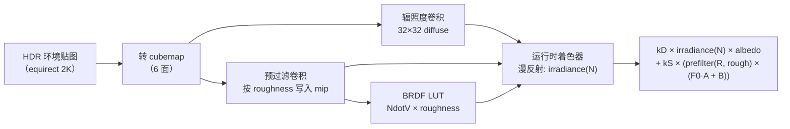

# PBR 入门

> [返回：WebGL 与 3D 框架学习大纲](../WebGL与3D框架学习大纲.md)
> 本文是第五阶段第 3 条「PBR 入门：Cook-Torrance BRDF、金属度/粗糙度工作流、IBL 概念」的完整展开：渲染方程逐项拆直觉、D/F/G 三项各自推导、完整直接光照 GLSL，以及 IBL 离线预处理的全流程图解；阶段导览见 [01-导览](01-导览.md)。

## 3.1 渲染方程：直觉版逐项拆解

基于物理的渲染（PBR，Physically Based Rendering）不是一套 trick 集合，而是**对一个方程的工程近似**——渲染方程（Rendering Equation，Kajiya 1986）：

$$L_o(p, \omega_o) = L_e(p, \omega_o) + \int_{\Omega} f_r(p, \omega_i, \omega_i \to \omega_o)\, L_i(p, \omega_i)\, (n \cdot \omega_i)\, d\omega_i$$

符号先翻译成人话：p 是表面一点，$\omega_o$ 是「你看它的方向」（出射方向），$\omega_i$ 是某个入射方向，n 是法线，$\Omega$ 是以法线为中心的半球（天上所有可能来光的方向）。

逐项直觉：

| 项 | 直觉 |
|---|---|
| $L_o(p, \omega_o)$ | 问：从 $\omega_o$ 方向看 p 点，有多亮？——方程左边就是答案 |
| $L_e$ | 自己发光（自发光）：不用算，直接加 |
| $L_i(p, \omega_i)$ | 从 $\omega_i$ 方向**打过来多少光**（辐亮度，radiance）：光源强度、距离、遮挡都在这里 |
| $f_r$ | 表面把 $\omega_i$ 来的光**拐到 $\omega_o$ 的比例**：双向反射分布函数（BRDF，Bidirectional Reflectance Distribution Function），材质的全部性格都在这个函数里 |
| $n \cdot \omega_i$ | **投影面积**：光斜着打，单位表面积分到的光按 cos 衰减（兰伯特余弦定律） |
| $\int_\Omega$ | **把天上每个方向的贡献加起来**：所有方向来的光，各自乘以材质的反射比例，再乘投影角，求和 |

所以渲染方程一句话：**出射光 = 自发光 + 对「入射光 × 材质反应 × 投影角」在半个天球上的积分**。

前四个阶段我们写的 Blinn-Phong 光照，其实就是这个积分在「点光源有限个」假设下的粗糙版本：每个光源贡献 $L_i \cdot f \cdot cos$，没有积分、没有能量守恒。PBR 做的事是换一个**物理上站得住的 $f_r$**（Cook-Torrance），并老老实实处理积分（直接光照逐个算；环境光用 IBL 离线积分，见 3.4）。

**能量守恒**是 PBR 与经验光照的分水岭：反射出去的总能量不超过吸收进来的。落到实现上是「漫反射 + 镜面反射 ≤ 1」的硬约束（3.2 的 $k_d = (1-k_s)(1-metallic)$），经验模型里高光开多大全凭手感，PBR 里超了就是物理错误。

## 3.2 Cook-Torrance BRDF：D、F、G 三项

Cook-Torrance 模型把 BRDF 拆成漫反射与镜面反射两支：

$$f_r = k_d\, f_{lambert} + k_s\, f_{cook-torrance}$$

漫反射沿用兰伯特：$f_{lambert} = \frac{albedo}{\pi}$（除以 π 是能量守恒的归一化——半球立体角积分恰好是 π）。镜面反射是微表面（Microfacet）理论的产物：

$$f_{spec} = \frac{D\,F\,G}{4\,(n \cdot l)(n \cdot v)}$$

分母是**微表面几何的可见性修正**（推导涉及半程向量宏表面与微表面的雅可比变换，记住它是把「微表面亮度」换算回「宏表面辐亮度」的桥即可）。三项分子各管一件事：

### 3.2.1 D 项：法线分布函数（Normal Distribution）

**物理问题：微表面的法线朝向分布有多集中？**

微表面理论把粗糙表面看成无数微小镜面，D(h) 回答「有多少比例的微表面法线恰好对准半程向量 h」（h = normalize(l + v)，只有法线对准 h 的微面才把光从 l 镜面反射到 v）。主流选择 GGX（又叫 Trowbridge-Reitz）：

$$D(h) = \frac{\alpha^2}{\pi\,((n \cdot h)^2(\alpha^2 - 1) + 1)^2}$$

其中 α = roughness²（平方让参数在低粗糙度端的调节更线性，Disney 风格的 remap）。行为验证：roughness → 0 时 α → 0，D 收敛成狄拉克 δ（完美镜面，高光是无穷小的亮点）；roughness → 1 时 D 变平缓（各方向均匀，高光糊成一片）。**D 项决定高光的「大小」**。

### 3.2.2 F 项：菲涅尔方程（Fresnel）

**物理问题：多少比例的光被直接反射（而不是折射进物体内部）？**

菲涅尔效应：观察角越掠射（grazing angle），表面反射率越高——所有材质在 90° 掠射角都趋近全反射，这是人眼「水面远处反光刺眼」的原因。精确菲涅尔方程要解偏振光与复折射率，实时渲染用 Schlick 近似：

$$F(v, h) = F_0 + (1 - F_0)(1 - (v \cdot h))^5$$

$F_0$ 是「垂直入射时的基础反射率」，是材质的指纹：非金属（电介质，dielectric）普遍约 0.04（4%），金属（导体，conductor）高达 0.6~1.0 且带颜色（金色偏暖、铜色偏红）。**F 项决定高光的「强度」与颜色**，也是 3.3 金属度工作流的物理根据。

### 3.2.3 G 项：几何遮蔽/阴影函数（Geometry/Shadowing）

**物理问题：微表面之间的自遮挡吃掉多少光？**

粗糙表面上，凸起的微面会挡住两段路径：光还没打到微面就被别的微面挡住（shadowing，阴影），反射出去的路上又被挡（masking，遮蔽）。G 项把这些「看不见的微面」从统计上扣掉，roughness 越大扣得越狠——没有 G 项，粗糙表面高光边缘会异常亮（D 项算出了实际上被挡住的光）。主流是 Smith 几何项配 Schlick-GGX 近似：

$$G(n, v, l) = G_1(n, v) \cdot G_1(n, l), \qquad G_1(n, x) = \frac{n \cdot x}{(n \cdot x)(1 - k) + k}$$

直接光照下 $k = \frac{(roughness + 1)^2}{8}$（IBL 下取 $\frac{roughness^2}{2}$，两者是不同的近似拟合）。**G 项决定高光的「边缘变暗」**。

### 3.2.4 完整直接光照着色器

三项合体，一个平行光版本的完整 GLSL（GLSL ES 3.00）：

```glsl
// pbr.frag —— Cook-Torrance 直接光照（单平行光）
#version 300 es
precision highp float;

in vec3 vWorldPos;
in vec3 vNormal;

uniform vec3  uCamPos;
uniform vec3  uLightDir;     // 指向光源
uniform vec3  uLightColor;   // 已带强度（如 vec3(30.0)）
uniform vec3  uAlbedo;       // 固有色（线性空间）
uniform float uMetallic;     // 0 非金属 ~ 1 金属
uniform float uRoughness;    // 0 光滑 ~ 1 粗糙

out vec4 fragColor;

float distributionGGX(vec3 N, vec3 H, float roughness) {
  float a  = roughness * roughness;
  float a2 = a * a;
  float NdotH  = max(dot(N, H), 0.0);
  float NdotH2 = NdotH * NdotH;
  float denom = NdotH2 * (a2 - 1.0) + 1.0;
  return a2 / (3.14159265 * denom * denom);
}

float geometrySchlickGGX(float NdotX, float k) {
  return NdotX / (NdotX * (1.0 - k) + k);
}

float geometrySmith(vec3 N, vec3 V, vec3 L, float roughness) {
  float k = (roughness + 1.0) * (roughness + 1.0) / 8.0; // 直接光照的 k
  return geometrySchlickGGX(max(dot(N, V), 0.0), k)
       * geometrySchlickGGX(max(dot(N, L), 0.0), k);
}

vec3 fresnelSchlick(float HdotV, vec3 F0) {
  return F0 + (1.0 - F0) * pow(1.0 - HdotV, 5.0);
}

void main() {
  vec3 N = normalize(vNormal);
  vec3 V = normalize(uCamPos - vWorldPos);
  vec3 L = normalize(uLightDir);
  vec3 H = normalize(V + L);            // 半程向量：D 与 F 都以它为轴

  vec3 F0 = mix(vec3(0.04), uAlbedo, uMetallic); // 3.3 的工作流参数化

  float NdotL = max(dot(N, L), 0.0);

  // 镜面反射支
  float D = distributionGGX(N, H, uRoughness);
  float G = geometrySmith(N, V, L, uRoughness);
  vec3  F = fresnelSchlick(max(dot(H, V), 0.0), F0);
  vec3 specular = (D * G * F)
    / max(4.0 * max(dot(N, V), 0.0) * NdotL, 1e-4); // 分母加 epsilon 防除零

  // 能量守恒：菲涅尔给出 ks，剩下的能量走漫反射
  vec3 kS = F;
  vec3 kD = (vec3(1.0) - kS) * (1.0 - uMetallic);   // 金属没有漫反射

  vec3 lambert = uAlbedo / 3.14159265;
  vec3 radiance = uLightColor * NdotL;              // Li × cosθ
  vec3 color = (kD * lambert + specular) * radiance;

  // 输出 HDR，交给 2.4 的色调映射；此处不做 gamma（链尾统一做）
  fragColor = vec4(color, 1.0);
}
```

对着三项自测（实践任务 P3 的验收点）：roughness 0 → 1，高光从锐点扩散为哑光（D 在变）；metallic 0 → 1，漫反射支消失、高光带上 albedo 颜色（F0 与 kD 在变）；视角贴地看任何材质都变「镜面」是 F 的掠射行为。

## 3.3 金属度/粗糙度工作流

### 3.3.1 参数化：两张贴图决定材质性格

PBR 材质的标准参数集是：

| 参数 | 通道 | 取值 | 物理含义 |
|---|---|---|---|
| albedo（baseColor） | RGB | 线性空间颜色 | 非金属：漫反射色；金属：反射的颜色（F0） |
| metallic | R（或常数） | 0~1 | 0 = 电介质，1 = 导体；中间值是「混合」的工程妥协，物理上并不真实存在 |
| roughness | R（或常数） | 0~1 | 微表面法线离散度，直接进 D/G 的 α |
| （可选 AO） | R | 0~1 | 环境光遮蔽贴图，仅乘环境光项 |

**为什么这样参数化**：把物理量（F0 是光谱三通道、IOR 是折射率）换成美术可画的两个标量，F0 由公式合成：

$$F_0 = mix(0.04,\ albedo,\ metallic)$$

即非金属统一 4% 反射率，金属直接用 albedo 当 F0。这是金属度/粗糙度工作流（Metallic/Roughness Workflow）对**镜面反射工作流（Specular Workflow，直接给 F0 贴图）**的取舍：前者省一张贴图、参数不易调出非法材质（F0 永远物理合理）；后者自由度高（能表达半透明涂层、两层材质），代价是美术容易调出违反能量守恒的值。glTF 采用前者，本阶段跟随。

### 3.3.2 色彩空间纪律

albedo 贴图是 sRGB 的（美术创作空间），采样后必须先转线性再进光照公式；metallic/roughness 是数据（data），保持原样直读。第二阶段讲过的 `UNPACK_COLORSPACE_CONVERSION_WEBGL` 与着色器里 `pow(c, 2.2)` 都能完成转换，纪律是：**颜色走 gamma，数据走线性**，混淆的典型症状是「PBR 灰蒙蒙/高光过曝」。

## 3.4 IBL：基于图像的光照

### 3.4.1 问题：环境光的积分怎么算

3.2 只解决了点光源（有限个方向）。渲染方程里环境光照（Image Based Lighting，IBL）意味着 $L_i$ 来自**所有方向**的天空/环境贴图——积分要在半球上对每个方向采样 cubemap。逐像素实时积分（几千个采样方向）不可行，但注意到积分里有两大块与「观察条件无关」的成分可以**离线预处理**：

$$\int_{\Omega} f_r \cdot L_i \cdot cos\, d\omega \;=\; \underbrace{\int_{\Omega} f_{lambert} \cdot L_i \cdot cos\, d\omega}_{漫反射：与视角无关} \;+\; \underbrace{\int_{\Omega} f_{spec} \cdot L_i \cdot cos\, d\omega}_{镜面：拆给 split-sum}$$

**漫反射块**：兰伯特 BRDF 是常数，可以整个卷进环境贴图——对 cubemap 做卷积（convolution），每个纹素存「从这个法线方向看，半球平均来了多少光」。产物叫**辐照度贴图（Irradiance Map）**，运行时一次采样 `texture(irradiance, N)` 拿到全部漫反射环境光。卷积用低分辨率（32×32×6）cubemap 就够，因为结果极度低频（平滑渐变）。

**镜面块**（split-sum 拆分，Karis 2013）：把积分拆成「预过滤环境贴图 × BRDF 积分查找表」两个可离线计算的因子：

$$\int_{\Omega} f_{spec} \cdot L_i \cdot cos\, d\omega \approx \underbrace{\int_{\Omega} L_i \cdot f_{spec}(\alpha, \omega_i)\, d\omega}_{预过滤环境贴图} \cdot \underbrace{\int_{\Omega} f_{spec} \cdot cos\, d\omega}_{BRDF LUT（2D 纹理）}$$

- **预过滤环境贴图（Prefiltered Environment Map）**：对 cubemap 按不同粗糙度各卷积一次，存进 mip 层（mip0 光滑 → 高 mip 粗糙）。运行时用 `textureLod(prefilteredEnv, R, roughness * maxMipLevel)` 采样，粗糙度当 mip 选择器；
- **BRDF LUT**：一张 512×512 的 RG 纹理，x 轴 NdotV、y 轴 roughness，存菲涅尔积分的两个系数（对 F0 的线性组合系数 $F_0 \cdot A + B$）。运行时两次纹理读取替代积分。

### 3.4.2 全流程图



预处理是**一次性的**（工具或启动时跑），运行时每像素只花三次采样：漫反射一次、镜面一次、LUT 一次。这就是 PBR 引擎「环境光照几乎免费」的秘密。

### 3.4.3 本节的实现边界

按大纲要求，IBL 理解流程即可、不必全实现。若要动手，建议顺序：先做辐照度卷积（一个 32×32 的离屏 FBO，片元着色器里按均匀半球采样 ~64 方向平均，30 行 GLSL 就能出效果——粗糙材质立即获得正确的环境渐变），再做预过滤（把 GGX 重要性采样写进卷积着色器、结果分级写入 mip），BRDF LUT 有公开实现可直接验证。Three.js 的 `PMREMGenerator` 是这套流程的参考实现，第六阶段读源码时对照。

## 常见坑

1. **在非金属上把 metallic 调成中间值找「半金属质感」**——物理上不存在，正确做法是调低 roughness 或用镜面工作流/清漆层。中间值只是插值的妥协，滥用会让材质在 IBL 下发暗（F0 抬高但 albedo 仍被乘进漫反射）。
2. **albedo 没转线性空间**——sRGB 直读会让漫反射偏亮、对比异常，「PBR 看起来像塑料」一半怪它。
3. **D 项直接用 roughness 而不是 α=roughness²**——高光在高 roughness 端收缩异常，不同实现间的「同参数不同效果」多源于此（有的引擎把平方这步烘进贴图导出，两边只准做一次）。
4. **能量守恒丢了 kS**——镜面用 F、漫反射还用完整 albedo，总反射能量凭空多出一份，画面「高光和漫反射都很亮」。必须 `kD = (1 - F) * (1 - metallic)`。
5. **specular 分母除零**——NdotL 为 0（背面）时 4·NdotV·NdotL = 0，不加 epsilon 会出现 NaN 黑点沿边缘扩散。
6. **点光源强度没随距离平方衰减**——PBR 的光照单位是辐亮度，物理衰减（1/d²）+ 光强参数（如 30）才得到正确曝光；延用第二阶段 Phong 的「不衰减」习惯会让近处光源严重欠曝或过曝。
7. **IBL 采样 cubemap 用了 mipmap 线性过滤但没生成 mip**——预过滤贴图的 `textureLod` 依赖 mip 链存在，漏 `generateMipmap` 会采样到黑。

## 本节自测

1. 渲染方程右边四项（Le、fr、Li、cos）各对应画面里的什么现象？Blinn-Phong 光照公式是它的什么近似？
2. D、F、G 三项各自回答什么物理问题？把 G 恒置 1，画面上最先露馅的是什么？
3. 写出 Schlick 菲涅尔公式，说明 F0 的物理含义；非金属与金属的 F0 各来自哪里（对应 3.3 工作流的哪条公式）？
4. 金属度 1 时 kD 是多少？由此解释「金属的 albedo 是反射色而不是漫反射色」。
5. split-sum 把镜面环境积分拆成了哪两个离线产物？运行时每像素的环境光照成本是多少次采样？
6. 辐照度贴图为什么 32×32 就够，而预过滤贴图需要完整 mip 链？（提示：漫反射 BRDF 与镜面 BRDF 谁的积分结果频率高？）
7. 手推一遍能量守恒：为什么 kD=(1-F)(1-metallic) 而不是 (1-F)？金属少乘的那一项去哪了？
