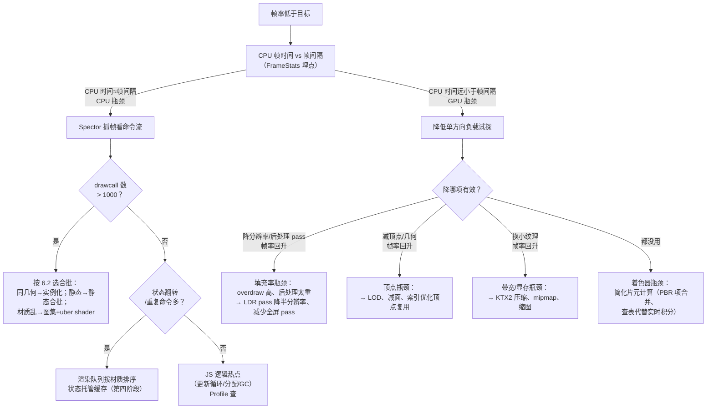

# 性能优化与调试

> [返回：WebGL 与 3D 框架学习大纲](../WebGL与3D框架学习大纲.md)
> 本文是第五阶段第 6 条「性能优化：drawcall 与合批、显存管理、纹理压缩（KTX2/Basis）、Spector.js 抓帧分析与性能埋点」的完整展开：先建成本模型再谈优化，附性能排查决策树；阶段导览见 [01-导览](01-导览.md)。

## 6.1 drawcall 成本模型：为什么它这么贵

绘制调用（Draw Call）是 CPU 向 GPU 提交绘制命令的动作（`gl.drawArrays` / `gl.drawElements` 及其变体）。它的开销藏在 CPU 侧一条很长的路上：


四个环节逐层看：

1. **JS 层**：每次调用的函数本身不贵，但一次绘制通常伴随一串 uniform 上传、纹理绑定、状态切换——这些 API 调用都要过同一条路；
2. **浏览器进程**：WebGL 是沙箱化的，每个 GL 命令要跨进程校验参数合法性（防止恶意命令破坏 GPU 状态），再写入命令缓冲；
3. **驱动层**：驱动对每个 draw 做状态验证（绑定的 FBO 是否完备、shader 输入是否匹配）、组装硬件命令包。**这一段与物体大小无关**——画 3 个顶点和画 3 万个顶点，CPU 侧成本一样；
4. **GPU 执行**：真正光栅化。GPU 吞吐量巨大，但每个 draw 之间有管线排空/重启的小空隙（pipeline bubble），draw 越碎空隙占比越高。

量级感受（桌面 Chrome 经验数字）：一次简单 drawcall 的 CPU 侧成本约 **1~10 微秒**，60fps 的帧预算 16.6ms——**CPU 大约在几千次 drawcall 时被打满，GPU 可能还在空转**。这就是「drawcall 贵」的本质：**贵的不是画，是「说一声要画」**。它解释了第四阶段的粒子对比（见 4.5）：一万次 drawElements 每帧烧几十毫秒 CPU，换成一次 `drawElementsInstanced` 后同样的像素输出几乎免费。

配套的两个推论：

- **drawcall 数是 WebGL 场景最重要的单一指标**。Spector.js 抓一帧先看它（见 6.5）；
- **drawcall 之间的状态切换常常比 draw 本身更贵**。其中最贵的是 shader 程序切换（`useProgram` 后驱动要重排 uniform/重验证管线），其次是纹理绑定与混合/深度状态翻转——这也是渲染队列按材质排序（第四阶段场景图）的直接依据。

## 6.2 合批：静态合批、动态合批与实例化

合批（Batching）的目标只有一个：**把 N 次 drawcall 变成 1 次**。前提是 GPU 需要的数据都在一份缓冲里，且中途不能换 shader/纹理状态。三条路线各有适用面：

| 方案 | 做法 | 每帧 CPU 成本 | 显存成本 | 适用场景 | 不适用 |
|---|---|---|---|---|---|
| 静态合批 | 构建时把多个网格的顶点烘焙进一个大 VBO，顶点数据预乘模型矩阵 | 零 | 顶点翻倍（合并后无法共享顶点） | 永不移动的墙体、地面、装饰物 | 会动的物体（动了就得重烘或回退） |
| 动态合批 | 每帧在 CPU 把小网格变换后拼进一个可复用 VBO，一次提交 | 每帧 O(顶点数) 的矩阵乘法与拷贝 | 一个大 VBO 常驻 | 少量低模且频繁移动的小物件 | 高模（CPU 变换成本超过省下的 drawcall） |
| 实例化（instancing） | 一份几何 + 每实例 attribute（或实例 buffer 存变换） | O(1) | 一份几何 + 实例数据 | **同几何同材质**大量重复：树、草、粒子（第 4 册）、碎块 | 几何互不相同的物体 |

选型三问（按顺序过滤）：

1. **几何相同吗？** 相同 → 直接实例化，这是 WebGL2 原生能力，成本最低；
2. **会动吗？** 不动 → 静态合批一劳永逸；动 → 动态合批或退回独立绘制；
3. **材质相同吗？** 三个方案都要求一次绘制内不换 shader/纹理，材质不同先做**纹理图集（Texture Atlas）**把多张小图拼成一张（UV 重映射），或用 **uber shader + #define/实例数据区分分支**（第四阶段材质系统）把多种材质塞进同一 shader。

反面清单同样重要：合批不是免费的——静态合批让视锥剔除（Culling）失效（一个巨块要么全画要么全不画），几千个静态物体合批前先确认剔除省的比合批多；动态合批在 JS 里做矩阵乘法，1000 顶点以上的模型 CPU 成本就反超收益。**合批的正确姿势是「先测 drawcall 分布，再对着热点合」**，无脑全场景合批是常见反模式。

## 6.3 显存管理

### 6.3.1 显存账本

GPU 显存的大头是纹理与缓冲，先会算账再谈管理：

- **纹理**：宽 × 高 × 通道字节数。RGBA8 的 4096×4096 = 64MB；**完整 mipmap 链再乘 4/3**（1 + 1/4 + 1/16 + ... ≈ 4/3）；
- **顶点缓冲**：顶点数 × 每顶点字节数。一个 12 字节 position + 12 字节 normal + 8 字节 UV 的 10 万顶点网格 ≈ 3.2MB；
- **渲染目标**：后处理链的每个 FBO 都占一份全屏 RGBA16F（见 2.1），4K 分辨率下每张 64MB，链上五六个 pass 就是几百 MB——**这是移动端后处理先降分辨率的依据**（场景渲染半分辨率，FXAA/色调映射在全分辨率）。

### 6.3.2 生命周期纪律

第四阶段定下的 create/update/dispose 约定，在显存上兑现成三条：

1. **谁创建谁释放**：纹理、buffer、FBO、program 用完必须 `deleteTexture/deleteBuffer/deleteFramebuffer/deleteProgram`。**GC 不会替你回收显存**——JS 对象被回收后 GL 对象仍占着显存，直到上下文丢失。页面长时间运行越来越卡，九成是显存泄漏；
2. **重复创建是隐式泄漏**：每帧 `createTexture`（哪怕立刻删掉）会反复向驱动要显存，驱动侧分配是毫秒级的。资源创建必须移出渲染循环；
3. **动态数据用对更新方式**：每帧全量变化用 `bufferData`（重新分配，驱动可并行旧拷贝）或「孤儿化」（orphaning：先 `bufferData(null)` 丢弃旧存储再写）；局部变化用 `bufferSubData` 只传变化区间。粒子的 CPU 更新方案（4.1.1）每帧 `bufferSubData` 全量上传就是这个决策。

排查工具：Chrome 任务管理器（「GPU 内存」列）看总量趋势；Spector.js 抓帧看纹理清单（6.5）；`gl.getError` 与 `WEBGL_lose_context`（主动丢弃上下文测恢复逻辑）辅助。

## 6.4 纹理压缩：KTX2 与 Basis

### 6.4.1 为什么 JPEG/PNG 不够用

普通图片格式解决的是「**下载体积**」，但 GPU 不能直接采样 JPEG——必须整张解码成未压缩位图再上传。一张 2MB 的 JPEG 展开后可能是 64MB 的 RGBA 位图（解码慢 + 显存爆）。GPU 原生块压缩格式（Block Compression）同时解决三个问题：**显存占用降 4~8 倍、解码为零（GPU 硬件直接采样）、下载体积小**。

原理：把纹理切成 4×4 的块，每块只存少数基色 + 每纹素的索引。例如 BC1（桌面）每块 4 字节 = 每纹素 4 bit（对比 RGBA8 的 32 bit，**8 倍压缩**）。代价是有损与格式分裂：桌面 BCn、移动 ETC2/ASTC，跨平台要按设备分发不同文件。

### 6.4.2 KTX2 与 Basis Universal：一次打包，处处转码

Khronos 的组合拳解决了「格式分裂」：

- **Basis Universal** 是一种**中间压缩格式**：素材先压成 ETC1S（高压缩、有损）或 UASTC（高质量）的 Basis 数据；加载时在 CPU 上快速**转码（Transcode）**成当前 GPU 的原生块格式（桌面转 BC1/BC3/BC5/BC7，移动转 ETC2/ASTC）——转码是轻量的块级重排，不是完整解码；
- **KTX2**（Khronos Texture v2）是容器格式：把 Basis 数据与元数据（mipmap、色彩空间、适配格式清单）打包成一个 .ktx2 文件，glTF 2.0 的官方纹理传输格式。

注意区分两个词：**转码（transcode）在加载时做，产出 GPU 可直接采样的块压缩数据；解码（decode）是 GPU 采样时硬件自动完成的块展开**。Basis 的聪明之处在于让最贵的完整解码发生在 GPU 硬件里，CPU 只做廉价转码。

| 方案 | 下载 | 加载时 | 显存（4096² 含 mip） |
|---|---|---|---|
| PNG（2048² 示例放大） | 小 | 慢解码 | 85MB（RGBA8 × 4/3） |
| 未压缩 KTX2 | 巨大 | 快 | 85MB |
| KTX2 + Basis (ETC1S) | 小 | 快转码 | ~11MB（4bit/纹素 × 4/3） |

实践入口：`toktx`（Khronos 官方命令行工具，`toktx --bcmp` 产出 Basis 压缩的 KTX2）、Three.js 的 `KTX2Loader`（内嵌 Basis 转码器，transcoder 目标按设备自动选择）——第六阶段读源码时对照。法线贴图压缩要选法线专用格式（BC5/3DC，双通道重构造 z），用通用 RGB 压缩会把法线方向压歪、光照出现杂斑。

## 6.5 Spector.js 抓帧分析与性能排查流程

### 6.5.1 Spector 是什么、怎么看

Spector.js 是 WebGL 的「抓帧器」（帧分析器，Frame Debugger）：浏览器插件形式拦截一帧内**所有** GL 命令，记录每条命令的参数、当时的完整状态、以及每个 drawcall 的输入输出（顶点缓冲预览、绑定的纹理缩略图、FBO 结果预览）。它回答的不是「帧率多少」而是「**这一帧到底发生了什么**」。

抓一帧后按顺序看四件事：

1. **命令流总览**：drawcall 总数、命令总数。一眼看出「500 个物体画了 3000 次 draw」还是「状态翻转多达上万次」；
2. **相邻 drawcall 间的状态 diff**：Spector 会标出两次绘制之间改了什么。大量重复的 `bindTexture/useProgram/viewport` 翻转 = 渲染队列排序没做好（6.1 的推论二）；
3. **drawcall 输入**：点开某个 draw，看它画的顶点数、索引、纹理尺寸——发现「一个 2048² 贴图只贴在一个小物件上」「蒙皮网格每帧重传顶点」这类浪费；
4. **FBO 与纹理清单**：全帧所有渲染目标与纹理的尺寸列表，对着 6.3 的账本算显存。

### 6.5.2 性能埋点：先测量，再优化

Spector 看单帧结构，帧率归因还要自己埋点（性能埋点，Instrumentation）：

```typescript
// 渲染循环埋点：CPU 帧时间 + 各 pass 耗时
class FrameStats {
  private marks: [string, number][] = [];
  mark(name: string): void { this.marks.push([name, performance.now()]); }
  report(): string {
    const total = this.marks[this.marks.length - 1][1] - this.marks[0][1];
    const lines = this.marks.slice(1).map(([n, t], i) =>
      `${n}: ${(t - this.marks[i][1]).toFixed(2)}ms`);
    return `CPU 总计 ${total.toFixed(2)}ms | ${lines.join(' | ')}`;
  }
}
// 用法：render() 里对 shadowPass / scenePass / postPass 各 mark 一次
// GPU 时间可用 EXT_disjoint_timer_query_webgl2（支持有限）测单个 draw 的真实 GPU 耗时
```

统计口径：取数百帧的**平均与最差**（P95/P99），单帧数字没有意义；`requestAnimationFrame` 的回调间隔 ≈ 帧间隔，`performance.now()` 差值 ≈ CPU 帧时间。

### 6.5.3 性能排查决策树



决策树的用法纪律：**每一层都是「假设 → 测量 → 验证」**，先量化 CPU/GPU 归因（第二层），再按 Spector 证据选优化手段，改完必须复测同一指标。跳过测量的「优化」（比如不分青红皂白上合批）经常把 CPU 瓶颈搬到 CPU 更重的方案上，帧率反而下降。

## 常见坑

1. **只看 FPS 不分 CPU/GPU 归因**——drawcall 优化（合批）对 GPU 瓶颈场景无效，白忙一场。决策树第二层必须先过。
2. **静态合批吞了剔除收益**——整场景合一个巨块后视锥剔除失效，全场景顶点每帧都进管线，drawcall 降了、顶点成本爆了。
3. **动态合批用在高中模上**——JS 里每帧矩阵乘法的成本超过省下的 drawcall；动态合批的安全区是「低模 + 小批量」。
4. **delete 缺失导致显存泄漏，怪到「浏览器占用高」**——GC 不回收显存（6.3.2），用 Chrome 任务管理器的 GPU 内存曲线确认单调增长后，回头查 dispose 链路。
5. **KTX2 用通用模式压法线贴图**——方向被压歪，光照出现块状杂斑；法线要走 BC5 类双通道格式。
6. **埋点只看平均值**——被平均掩盖的 P99 卡顿才是掉帧体感的来源；至少记录 P95。
7. **Spector 在生产环境常开**——抓帧本身有可观开销（序列化整帧状态），只在排查时开启。

## 本节自测

1. 一次 drawcall 的 CPU 侧成本发生在哪四层？为什么「画 3 个顶点与画 3 万个顶点」在这一侧几乎一样贵？
2. 静态/动态合批与实例化各自的每帧 CPU 成本与显存代价是什么？给你「1000 棵会随风摆动的树」与「1000 块静止的砖」，分别选哪条路线、依据是什么？
3. 纹理图集与 uber shader 解决的是合批三问里的哪一问？为什么说它们是合批的前提而不是优化本身？
4. 一张 2048×2048 的 RGBA8 纹理带完整 mipmap 占多少显存？列出算式。
5. 转码与解码的区别是什么？Basis Universal 靠什么做到「一份文件支持所有 GPU」？
6. Spector.js 抓帧后，你按什么顺序读它给出的信息？「相邻 drawcall 的状态 diff 很长」说明什么问题、对应哪条优化？
7. 沿决策树走一遍：某场景 CPU 帧时间 8ms、帧间隔 16.6ms 但帧率只有 40fps，下一步测什么？若降半分辨率后帧率恢复 60，结论是什么、有哪些不改分辨率的替代优化？
