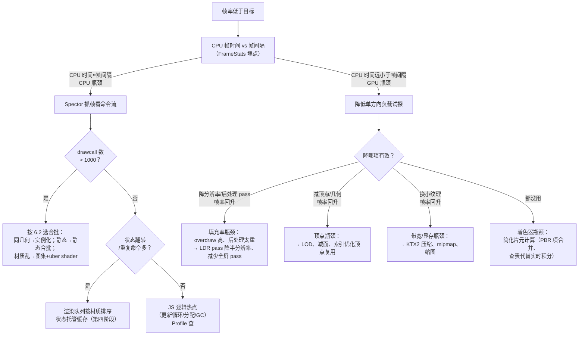

# 性能优化与调试

> [返回：WebGL 与 3D 框架学习大纲](../WebGL与3D框架学习大纲.md)
> 本文是第五阶段第 6 条「性能优化：drawcall 与合批、显存管理、纹理压缩（KTX2/Basis）、Spector.js 抓帧分析与性能埋点」的完整展开：先建成本模型再谈优化，附性能排查决策树；阶段导览见 [01-导览](01-导览.md)。

## 6.1 drawcall 成本模型：为什么它这么贵

绘制调用（Draw Call）是 CPU 向 GPU 提交绘制命令的动作（`gl.drawArrays` / `gl.drawElements` 及其变体）。它的开销藏在 CPU 侧一条很长的路上：


四个环节逐层看：

1. **JS 层**：每次调用的函数本身不贵，但一次绘制通常伴随一串 uniform 上传、纹理绑定、状态切换——这些 API 调用都要过同一条路；
2. **浏览器进程**：WebGL 是沙箱化的，每个 GL 命令要跨进程校验参数合法性（防止恶意命令破坏 GPU 状态），再写入命令缓冲；
3. **驱动层**：驱动对每个 draw 做状态验证（绑定的 FBO 是否完备、shader 输入是否匹配）、组装硬件命令包。**这一段与物体大小无关**——画 3 个顶点和画 3 万个顶点，CPU 侧成本一样；
4. **GPU 执行**：真正光栅化。GPU 吞吐量巨大，但每个 draw 之间有管线排空/重启的小空隙（pipeline bubble），draw 越碎空隙占比越高。

量级感受（桌面 Chrome 经验数字）：一次简单 drawcall 的 CPU 侧成本约 **1~10 微秒**，60fps 的帧预算 16.6ms——**CPU 大约在几千次 drawcall 时被打满，GPU 可能还在空转**。这就是「drawcall 贵」的本质：**贵的不是画，是「说一声要画」**。它解释了第四阶段的粒子对比（见 4.5）：一万次 drawElements 每帧烧几十毫秒 CPU，换成一次 `drawElementsInstanced` 后同样的像素输出几乎免费。

配套的两个推论：

- **drawcall 数是 WebGL 场景最重要的单一指标**。Spector.js 抓一帧先看它（见 6.5）；
- **drawcall 之间的状态切换常常比 draw 本身更贵**。其中最贵的是 shader 程序切换（`useProgram` 后驱动要重排 uniform/重验证管线），其次是纹理绑定与混合/深度状态翻转——这也是渲染队列按材质排序（第四阶段场景图）的直接依据。

### 6.1.1 把成本模型变成预算制

成本模型的价值不是知道「贵」，而是能**倒推预算**。帧预算是硬算术：60fps = 每帧 16.6ms，30fps = 每帧 33.3ms；CPU 侧按「drawcall 数 × 单次成本 + 状态切换 + JS 逻辑」分账。落到项目上就是三档预算表（毕业项目的硬指标正是从这里来的，见 [04-毕业项目-需求书](../06-第六阶段/04-毕业项目-需求书.md) 3.1）：

| 预算项 | 宽松（桌面独占） | 常规（桌面 + 移动可跑） | 严格（移动端流畅） |
|---|---|---|---|
| drawcall / 帧 | 数千 | ≤ 500 | ≤ 150 |
| 帧预算 | 16.6ms | 16.6ms | 33.3ms 也可接受 |
| 纹理显存 | 数百 MB | ~100MB | 几十 MB（压缩纹理） |
| 后处理 pass | 任意 | 3~5 个 | 1~2 个或关闭 |

预算制的用法：**开工先定档，按档倒推每个系统的配额**（行星 10 个 drawcall、小行星带 1 个、天空盒 1 个……），而不是做完再「看看卡不卡」。配额超了，当场就知道该砍谁——这比上线后拿着帧率曲线猜要便宜一个数量级。

### 6.1.2 状态切换的贵贱排序

同样是一次 API 调用，代价差几个数量级（定性排序，具体倍数因驱动而异，别背数字记顺序）：

| 排序 | 切换 | 为什么贵/便宜 |
|---|---|---|
| 最贵 | `useProgram`（shader 程序切换） | 驱动重验证管线、uniform 重绑定，部分驱动还会触发微码 patch |
| 次 | 首次 `bindTexture` 到新纹理单元 | 纹理 residency 管理、可能的显存换入换出；同一纹理反复绑不触发实际切换（状态托管的价值，见第四阶段 StateCache） |
| 中 | FBO 切换（后处理链每个 pass 一次） | 渲染目标重绑定，驱动侧的 surface 状态重建 |
| 中 | 混合/深度状态翻转 | 便宜的寄存器写，但高频翻转会打断驱动的状态分批优化 |
| 最便宜 | `uniform` 上传 | 只是内存拷贝到命令缓冲，几纳秒级 |

这条排序就是渲染队列排序键的依据：**先按 program，再按材质/纹理，最后按距离**（[04-第四阶段/03-场景图](../04-第四阶段/03-场景图.md) 2.3 的排序键设计、[02-Three.js源码研读](../06-第六阶段/02-Three.js源码研读.md) 1.3 的 Three 对照）。Spector 抓帧时「相邻 drawcall 间 diff」很长，优先怀疑排序键少了哪一级。

### 6.1.3 drawcall 怎么数：口径先于数字

「drawcall ≤ 150」这条预算要能执行，先得说清**什么算一次**，否则数字没法对比：

1. **计数范围**：所有 `drawArrays` / `drawElements` / `drawArraysInstanced` / `drawElementsInstanced` 变体都算，**包括 shadow pass**（光源视角重画一遍场景，drawcall 常常直接翻倍——两盏投影灯的展厅就是 ×3）、后处理的全屏三角形（每个 pass 一次）、天空盒与调试线框。Spector 命令流里数 draw 类命令即可；
2. **口径一致性**：同一个场景「固定相机」与「自由漫游」的 drawcall 可以差数倍（剔除在起作用）——记录数字必须带上相机位置/剔除开关状态，与 6.5.1 的「固定场景状态」是同一条纪律；
3. **别把命令数当 drawcall 数**：Spector 的命令总数包含所有状态调用，通常比 drawcall 高一个数量级；预算制只管后者，前者是 6.1.2 排序问题的证据。

三个口径问题都想清楚，才能解释「同一个 demo，昨天 80 个 drawcall 今天 120」——多半是阴影 pass 数变了或相机动了，而不是代码退步。

## 6.2 合批：静态合批、动态合批与实例化

合批（Batching）的目标只有一个：**把 N 次 drawcall 变成 1 次**。前提是 GPU 需要的数据都在一份缓冲里，且中途不能换 shader/纹理状态。三条路线各有适用面：

| 方案 | 做法 | 每帧 CPU 成本 | 显存成本 | 适用场景 | 不适用 |
|---|---|---|---|---|---|
| 静态合批 | 构建时把多个网格的顶点烘焙进一个大 VBO，顶点数据预乘模型矩阵 | 零 | 顶点翻倍（合并后无法共享顶点） | 永不移动的墙体、地面、装饰物 | 会动的物体（动了就得重烘或回退） |
| 动态合批 | 每帧在 CPU 把小网格变换后拼进一个可复用 VBO，一次提交 | 每帧 O(顶点数) 的矩阵乘法与拷贝 | 一个大 VBO 常驻 | 少量低模且频繁移动的小物件 | 高模（CPU 变换成本超过省下的 drawcall） |
| 实例化（instancing） | 一份几何 + 每实例 attribute（或实例 buffer 存变换） | O(1) | 一份几何 + 实例数据 | **同几何同材质**大量重复：树、草、粒子（第 4 册）、碎块 | 几何互不相同的物体 |

选型三问（按顺序过滤）：

1. **几何相同吗？** 相同 → 直接实例化，这是 WebGL2 原生能力，成本最低；
2. **会动吗？** 不动 → 静态合批一劳永逸；动 → 动态合批或退回独立绘制；
3. **材质相同吗？** 三个方案都要求一次绘制内不换 shader/纹理，材质不同先做**纹理图集（Texture Atlas）**把多张小图拼成一张（UV 重映射），或用 **uber shader + #define/实例数据区分分支**（第四阶段材质系统）把多种材质塞进同一 shader。

反面清单同样重要：合批不是免费的——静态合批让视锥剔除（Culling）失效（一个巨块要么全画要么全不画），几千个静态物体合批前先确认剔除省的比合批多；动态合批在 JS 里做矩阵乘法，1000 顶点以上的模型 CPU 成本就反超收益。**合批的正确姿势是「先测 drawcall 分布，再对着热点合」**，无脑全场景合批是常见反模式。

### 6.2.1 案例推演：拿毕业项目的两个场景练选型

用 [04-毕业项目-需求书](../06-第六阶段/04-毕业项目-需求书.md) 两案的真实元素过一遍三问，选型就不再是背表：

| 场景元素 | 几何相同？ | 会动？ | 材质一致？ | 结论 |
|---|---|---|---|---|
| 太阳系·小行星带（约一万颗碎石） | 是（同一低模球/石） | 是（各自轨道） | 是（同纹理或纯色） | **实例化**：变换进实例 buffer，每帧 CPU 只更新 buffer，1 次 drawcall（[05-粒子系统与Instancing实战](05-粒子系统与Instancing实战.md) 4.5 的成本模型原样适用） |
| 太阳系·八大行星 | 否（半径不同可缩放，但贴图各异） | 是 | 否（每颗一张纹理） | **不合批**：8~10 次 drawcall 在预算内（6.1.1 的常规档），为省个位数 drawcall 上图集得不偿失 |
| 展厅·墙体地板天花板 | 可拼成同材质盒件 | 否 | 可统一 | **静态合批或干脆独立绘制**——静态物体若做了 `matrixAutoUpdate = false` 与视锥剔除，独立绘制未必是瓶颈；先测再说 |
| 展厅·展品（glTF 低模若干） | 否 | 缓慢自转 | PBR 各异 | **不合批**：drawcall 主要来自 glTF 内部 mesh 数，重点在「每展品 mesh 数控制」而非跨展品合批 |
| 两案·星空/天空盒 | —— | 否 | —— | 天空盒恒 1 个 drawcall（[06-雾效与天空盒](06-雾效与天空盒.md) 5.3），无需处理 |

推演的规律：**合批的收益与「数量 × 同质性」成正比**——一万颗同构碎石是完美靶子，十个异构行星不是。drawcall 预算（150）远没到时，合批是过早优化；预算吃紧时，先找 Spector 证据里 drawcall 数最多的同类物体下手。

### 6.2.2 纹理图集与 uber shader 的边界

两个「让材质相同」的药方各有副作用，用之前要知道边界：

- **纹理图集**：把多张小图拼进一张大图，UV 各自偏移。边界一是 **mip 渗色**——mip 高级别把相邻图块的纹素平均到一起，远处物体采样到「隔壁图块的颜色」；工程解法是图块之间留 padding（隔几个纹素），代价是图集利用率下降。边界二是 **wrap/repeat 失效**——图块内不能再用 REPEAT 寻址（一重复就采到隔壁），需要平铺的贴图要么shader 里做 fract 重映射，要么单独成图；
- **uber shader**：一个大 shader 用 `#define`/uniform 分支覆盖多种材质，配合程序缓存键管理变体（[04-第四阶段/04-材质与着色器系统](../04-第四阶段/04-材质与着色器系统.md) 3.4）。边界是**变体爆炸**——N 个开关理论 2^N 个变体，必须靠缓存键控制实际编译数量；以及**寄存器压力**——「什么都装得下」的 shader 在 GPU 里占用的寄存器按最坏分支分配，即使运行时走的是便宜分支，占用也不会降。Three.js 的宏组合进缓存键（第六阶段 1.5）就是对这个边界的管理。

## 6.3 显存管理

### 6.3.1 显存账本

GPU 显存的大头是纹理与缓冲，先会算账再谈管理：

- **纹理**：宽 × 高 × 通道字节数。RGBA8 的 4096×4096 = 64MB；**完整 mipmap 链再乘 4/3**（1 + 1/4 + 1/16 + ... ≈ 4/3）；
- **顶点缓冲**：顶点数 × 每顶点字节数。一个 12 字节 position + 12 字节 normal + 8 字节 UV 的 10 万顶点网格 ≈ 3.2MB；
- **渲染目标**：后处理链的每个 FBO 都占一份全屏 RGBA16F（见 2.1），4K 分辨率下每张 64MB，链上五六个 pass 就是几百 MB——**这是移动端后处理先降分辨率的依据**（场景渲染半分辨率，FXAA/色调映射在全分辨率）。

算账的两个应用：给 6.1.1 的预算表填「纹理显存」一列时，把贴图清单逐张乘出来（2048² RGBA8 + mip ≈ 11MB，10 张就过百）；给 IBL 管线算账时记得四份资产各占一份（环境 cubemap、辐照度、预过滤 mip 链、LUT，尺寸见 [08-基于图像的光照](08-基于图像的光照.md) 7.1）。

### 6.3.2 生命周期纪律

第四阶段定下的 create/update/dispose 约定，在显存上兑现成三条：

1. **谁创建谁释放**：纹理、buffer、FBO、program 用完必须 `deleteTexture/deleteBuffer/deleteFramebuffer/deleteProgram`。**GC 不会替你回收显存**——JS 对象被回收后 GL 对象仍占着显存，直到上下文丢失。页面长时间运行越来越卡，九成是显存泄漏；
2. **重复创建是隐式泄漏**：每帧 `createTexture`（哪怕立刻删掉）会反复向驱动要显存，驱动侧分配是毫秒级的。资源创建必须移出渲染循环；
3. **动态数据用对更新方式**：每帧全量变化用 `bufferData`（重新分配，驱动可并行旧拷贝）或「孤儿化」（orphaning：先 `bufferData(null)` 丢弃旧存储再写）；局部变化用 `bufferSubData` 只传变化区间。粒子的 CPU 更新方案（4.1.1）每帧 `bufferSubData` 全量上传就是这个决策。

排查工具：Chrome 任务管理器（「GPU 内存」列）看总量趋势；Spector.js 抓帧看纹理清单（6.5）；`gl.getError` 与 `WEBGL_lose_context`（主动丢弃上下文测恢复逻辑）辅助。

### 6.3.3 一张算例对账单：显存要「先算后买」

拿一个假想但典型的展厅场景做算例（纯算术，不是实测——数字会因格式与 dpr 变化，方法才是重点）：

| 资源 | 规格 | 单件 | 数量 | 小计 |
|---|---|---|---|---|
| 展品贴图 | 2048² RGBA8 + mip | 16MB × 4/3 ≈ 21.3MB | 8 | ≈ 171MB |
| 展品贴图（改 KTX2 ETC1S） | 2048² 4bit + mip | ≈ 2.7MB | 8 | ≈ 21MB |
| 展品几何 | 5 万顶点 × 32B/顶点 | 1.6MB | 8 | ≈ 13MB |
| 阴影贴图 | 2048² 深度 24bit | 8MB | 2 盏 | 16MB |
| 后处理中间目标 | 1920×1080 RGBA16F | ≈ 16MB | 4 个 pass | ≈ 64MB |
| IBL 三件套 | 见 [08-基于图像的光照](08-基于图像的光照.md) 7.1 | —— | 1 套 | 数 MB 量级 |

对账单的两个读法：**未压缩时纹理一项（171MB）就是其余全部的近两倍**——「先压纹理」在算之前就是可预判的结论，这正是 6.4.3 决策第 1 条的算术来源；**后处理 4 个 pass 占 64MB 且随分辨率线性放大**——dpr = 2 的retina 屏上直接翻四倍（宽高各 ×2），移动端先降分辨率的依据在这里而不在「感觉」。把这张表挂进项目 README，验收「性能组」时它就是显存预算的证据。

### 6.3.4 上下文丢失：生命周期纪律的终点考试

显存泄漏的「清算日」是上下文丢失（context lost）——GPU 驱动重置、系统内存压力、或多个标签页争抢 GPU 时，浏览器会丢弃 WebGL 上下文，**所有 GL 对象（纹理/buffer/FBO/program）瞬间全部失效**。WebGL 给了两个事件把它纳入生命周期管理：

- `webglcontextlost`：默认行为是后续 GL 调用全部变成 no-op。处理清单：`event.preventDefault()`（阻止默认，允许恢复）、停掉渲染循环、把「哪些资源需要重建」标记出来；
- `webglcontextrestored`：上下文已换新（`getContext` 返回同一对象但内部状态清零），此刻起所有 `createTexture/createBuffer` 必须从头走一遍——这正是「资源创建代码要能重复执行」的验收时刻：如果初始化逻辑散落在各处、依赖一次性闭包，恢复就会缺资源。

工程上把「创建」做成幂等的 `initGLResources(gl)` 函数、把「描述」与「GL 对象」分开存（数据结构在，GL 对象可重建），是第四阶段资源系统该有的形状。测试手段就是 6.3.2 提到的 `WEBGL_lose_context` 扩展：主动触发 `loseContext()`/`restoreContext()`，验证页面能活回来——毕业项目「不白屏」底线的一部分。

## 6.4 纹理压缩：KTX2 与 Basis

### 6.4.1 为什么 JPEG/PNG 不够用

普通图片格式解决的是「**下载体积**」，但 GPU 不能直接采样 JPEG——必须整张解码成未压缩位图再上传。一张 2MB 的 JPEG 展开后可能是 64MB 的 RGBA 位图（解码慢 + 显存爆）。GPU 原生块压缩格式（Block Compression）同时解决三个问题：**显存占用降 4~8 倍、解码为零（GPU 硬件直接采样）、下载体积小**。

原理：把纹理切成 4×4 的块，每块只存少数基色 + 每纹素的索引。例如 BC1（桌面）每块 4 字节 = 每纹素 4 bit（对比 RGBA8 的 32 bit，**8 倍压缩**）。代价是有损与格式分裂：桌面 BCn、移动 ETC2/ASTC，跨平台要按设备分发不同文件。

### 6.4.2 KTX2 与 Basis Universal：一次打包，处处转码

Khronos 的组合拳解决了「格式分裂」：

- **Basis Universal** 是一种**中间压缩格式**：素材先压成 ETC1S（高压缩、有损）或 UASTC（高质量）的 Basis 数据；加载时在 CPU 上快速**转码（Transcode）**成当前 GPU 的原生块格式（桌面转 BC1/BC3/BC5/BC7，移动转 ETC2/ASTC）——转码是轻量的块级重排，不是完整解码；
- **KTX2**（Khronos Texture v2）是容器格式：把 Basis 数据与元数据（mipmap、色彩空间、适配格式清单）打包成一个 .ktx2 文件，glTF 2.0 的官方纹理传输格式。

注意区分两个词：**转码（transcode）在加载时做，产出 GPU 可直接采样的块压缩数据；解码（decode）是 GPU 采样时硬件自动完成的块展开**。Basis 的聪明之处在于让最贵的完整解码发生在 GPU 硬件里，CPU 只做廉价转码。

| 方案 | 下载 | 加载时 | 显存（4096² 含 mip） |
|---|---|---|---|
| PNG（2048² 示例放大） | 小 | 慢解码 | 85MB（RGBA8 × 4/3） |
| 未压缩 KTX2 | 巨大 | 快 | 85MB |
| KTX2 + Basis (ETC1S) | 小 | 快转码 | ~11MB（4bit/纹素 × 4/3） |

实践入口：`toktx`（Khronos 官方命令行工具，`toktx --bcmp` 产出 Basis 压缩的 KTX2）、Three.js 的 `KTX2Loader`（内嵌 Basis 转码器，transcoder 目标按设备自动选择）——第六阶段读源码时对照。法线贴图压缩要选法线专用格式（BC5/3DC，双通道重构造 z），用通用 RGB 压缩会把法线方向压歪、光照出现杂斑。

### 6.4.3 决策：什么时候值得上压缩纹理

压缩纹理不是默认选项，它是一笔「工具链成本换运行时收益」的交易，触发条件按优先级：

1. **显存账超了**（6.3.1 算出来过百 MB）——最硬的理由，块压缩直接把纹理项砍到 1/4~1/8；
2. **移动端是目标平台**——移动 GPU 的显存与带宽预算天然紧张，且 ETC2/ASTC 是其原生路径；
3. **首屏体积吃紧**——大量贴图的下载时间挤占首屏可交互指标，KTX2+ETC1S 的下载体积显著小于等价 PNG；
4. 反之，桌面 demo、贴图总量几十 MB 以内、离线加载场景——**不值得**：引入 toktx 构建步骤与转码运行时的复杂度，换不到可感知的收益。毕业项目里程碑（[05-毕业项目-里程碑计划](../06-第六阶段/05-毕业项目-里程碑计划.md) 3.8 第 2 步）把「若第五阶段接过 KTX2 则用」写成条件句，就是这个决策的落地。

## 6.5 Spector.js 抓帧分析与性能排查流程

### 6.5.1 Spector 是什么、怎么看

Spector.js 是 WebGL 的「抓帧器」（帧分析器，Frame Debugger）：浏览器插件形式拦截一帧内**所有** GL 命令，记录每条命令的参数、当时的完整状态、以及每个 drawcall 的输入输出（顶点缓冲预览、绑定的纹理缩略图、FBO 结果预览）。它回答的不是「帧率多少」而是「**这一帧到底发生了什么**」。

抓一帧后按顺序看四件事：

1. **命令流总览**：drawcall 总数、命令总数。一眼看出「500 个物体画了 3000 次 draw」还是「状态翻转多达上万次」；
2. **相邻 drawcall 间的状态 diff**：Spector 会标出两次绘制之间改了什么。大量重复的 `bindTexture/useProgram/viewport` 翻转 = 渲染队列排序没做好（6.1 的推论二）；
3. **drawcall 输入**：点开某个 draw，看它画的顶点数、索引、纹理尺寸——发现「一个 2048² 贴图只贴在一个小物件上」「蒙皮网格每帧重传顶点」这类浪费；
4. **FBO 与纹理清单**：全帧所有渲染目标与纹理的尺寸列表，对着 6.3 的账本算显存。

抓帧前的两个准备动作，让证据可复现：**固定场景状态**（暂停动画/固定相机位置，同一帧可反复抓）与**记录抓帧环境**（分辨率、设备、是否开了 dpr 缩放——同一场景在 2x dpr 下的填充率翻倍，证据不可比）。排查结束后关闭 Spector（见常见坑第 7 条）。

### 6.5.2 性能埋点：先测量，再优化

Spector 看单帧结构，帧率归因还要自己埋点（性能埋点，Instrumentation）：

```typescript
// 渲染循环埋点：CPU 帧时间 + 各 pass 耗时
class FrameStats {
  private marks: [string, number][] = [];
  mark(name: string): void { this.marks.push([name, performance.now()]); }
  report(): string {
    const total = this.marks[this.marks.length - 1][1] - this.marks[0][1];
    const lines = this.marks.slice(1).map(([n, t], i) =>
      `${n}: ${(t - this.marks[i][1]).toFixed(2)}ms`);
    return `CPU 总计 ${total.toFixed(2)}ms | ${lines.join(' | ')}`;
  }
}
// 用法：render() 里对 shadowPass / scenePass / postPass 各 mark 一次
// GPU 时间可用 EXT_disjoint_timer_query_webgl2（支持有限）测单个 draw 的真实 GPU 耗时
```

统计口径：取数百帧的**平均与最差**（P95/P99），单帧数字没有意义；`requestAnimationFrame` 的回调间隔 ≈ 帧间隔，`performance.now()` 差值 ≈ CPU 帧时间。

CPU 帧时间之外，**GPU 各 pass 的真实耗时**要靠 `EXT_disjoint_timer_query_webgl2` 扩展。配套工程 examples/11-gpu-timer 是它的完整可运行样本，核心封装 `GpuFrameTimer`（完整实现与限制见 [10-GPU性能度量与剖析](10-GPU性能度量与剖析.md) 9.2）的用法骨架：

```typescript
const timer = new GpuFrameTimer(gl);
if (!timer.available) showFallbackHint();   // 扩展不可用（部分浏览器/移动端）：整体降级
// 渲染循环里，begin/end 像括号一样包住每个 pass：
timer.beginFrame();
timer.begin('shadow'); drawShadowPass(); timer.end();
timer.begin('scene');  drawScenePass();   timer.end();
timer.begin('post');   drawPostPass();    timer.end();
timer.endFrame();
const sections = timer.poll(); // 异步：通常几帧后才返回 [{name, ms, frame}]
```

demo 里刻意设计了三个 GPU 段（shadow 深度 pass / scene 带「片元负载旋钮」的盒子方阵 / post 全屏模糊），按 ↑/↓ 加大旋钮（片元着色器里一个可调循环），能直接观察到**GPU 时间随负载爬升、CPU 帧时间几乎不动**——这正是决策树里「GPU 瓶颈」形态的活教材。用它的三条协议纪律（照抄 10 分册 9.2 的结论）：

1. **结果是异步的**：查询提交后要隔几帧，先查 `QUERY_RESULT_AVAILABLE` 再读数，别在下一帧立刻取；
2. **每次都要查 `GPU_DISJOINT`**：为真表示这段测量期间 GPU 状态异常（时钟变更等），本次数据全部作废丢弃——不查就可能把垃圾数字当证据；
3. **查询对象要池化复用**：createQuery/deleteQuery 有驱动成本，池化后稳态零分配（与 6.3.2 的显存纪律同源）。

### 6.5.3 性能排查决策树



决策树的用法纪律：**每一层都是「假设 → 测量 → 验证」**，先量化 CPU/GPU 归因（第二层），再按 Spector 证据选优化手段，改完必须复测同一指标。跳过测量的「优化」（比如不分青红皂白上合批）经常把 CPU 瓶颈搬到 CPU 更重的方案上，帧率反而下降。

### 6.5.4 优化记录的四段式模板

决策树走完一次，结论必须落档——它是 README「性能数据」与毕业项目「发现问题→定位→优化」记录（[04-毕业项目-需求书](../06-第六阶段/04-毕业项目-需求书.md) 3.4 评分维度）的素材。四段式：

```markdown
## 优化记录 #N：<一句话现象>
- 发现：<指标名 + 数字 + 统计口径>（例：P95 帧时间 24ms，500 帧，桌面 Chrome）
- 定位：<决策树路径 + 关键证据>（例：CPU 8ms < 帧间隔 → GPU 瓶颈；降半分辨率帧率恢复 → 填充率）
- 优化：<手段 + 预期成本>（例：bloom 降半分辨率；代价：辉光边缘略糊）
- 复测：<同一口径的新数字>（例：P95 帧时间 14ms，同场景同帧数）
```

模板的纪律在三处：**指标名与口径前后一致**（换口径的对比无效）；**定位必须有证据链**（决策树哪一层、什么实验证实）；**复测不过等于没优化**——数字没改善就回滚或换路，把「做了但没用」也记下来，这是比成功记录更值钱的经验。

### 6.5.5 排查演练：一次从证据到行动的完整走查

下面是一次虚构但流程完整的演练（数字为示意，重点在每一步「测了什么、证据指向哪」）：

1. **现象**：展厅场景在桌面 Chrome 帧率 45fps，目标 60。先量化口径——录 500 帧，平均 21ms、P95 28ms（埋点，6.5.2）；
2. **归因**：CPU 帧时间 7ms，远小于帧间隔 21ms → 不是 CPU 瓶颈（决策树第二层右支）。装 Spector 抓一帧（固定相机后抓，6.5.1 的准备动作）；
3. **证据**：drawcall 只有 90（预算内），但命令流里 5 个全屏 pass，且地面材质的片元着色器包含完整 PBR + IBL 三次采样；HUD 场景里地面占屏幕一半以上；
4. **假设**：填充率瓶颈（大画幅 × 重复着色 = overdraw）。验证实验：把后处理降到 2 个 pass，帧率明显回升——假设成立；
5. **优化**：按性价比排序三选一——bloom 降半分辨率（改动最小）、地面材质减采样（效果有损）、场景 LDR pass 降分辨率（影响最大）。先做第一个；
6. **复测**：同口径 500 帧，平均回到 16ms 以内、P95 18ms——达标，按 6.5.4 模板落档。未采纳的另两个方案也记一句「留作降级开关」（对应毕业项目 W3 的降级链）。

演练的价值在步骤 4：**瓶颈定位不是「看到了什么」，而是「改动 X 后指标 Y 恢复」的可逆实验**——这就是决策树每一层「假设→测量→验证」的具体形状。

## 6.6 剔除：降 drawcall 的另一条主路

合批是「合并提交」，剔除（Culling）是「**根本不提交**」——两者是 drawcall 预算的两条腿，且互补到可以互相补救：

- **视锥剔除**：Gribb–Hartmann 从投影矩阵提取六个平面，场景图节点带包围盒（AABB/包围球）自上而下测试，整棵子树在视锥外就一次剪枝——**每个被剔除的物体都是零成本 drawcall**；
- **遮挡排序（front-to-back）**：不透明物体按「离相机从近到远」排序，近处先画、远处被 early-z 拒绝（[06-雾效与天空盒](06-雾效与天空盒.md) 5.3.1 的同一机制），overdraw 显著下降；
- **与合批的冲突**：静态合批把空间上分散的物体焊成巨块，剔除粒度随之消失（6.2 的反面清单）——剔除收益大的开放场景，宁可保留独立物体 + 剔除，也不合批。

完整推导（六平面提取的数值手算、p-vertex 测试、层次剪枝、剔除统计 HUD）在增补分册 [12-视锥剔除与场景管理](12-视锥剔除与场景管理.md)；配套 demo examples/13-frustum-culling 把「每帧测试/剪枝/剔除数」直接显示在 HUD 上——**优化必须可见**，这正是本册 6.5 埋点思想在剔除上的应用。

两条主路的分工对照（选错主路是最大的浪费）：

| | 合批（6.2） | 剔除（12 分册） |
|---|---|---|
| 省什么 | CPU 提交成本 | CPU 提交 + GPU 绘制都省 |
| 前提 | 物体同构/同材质/静态 | 物体空间可分、有包围体 |
| 敌人 | drawcall 数 | 视野外物体 + overdraw |
| 副作用 | 剔除粒度下降（静态合批） | 每帧测试成本（层次剪枝摊薄） |
| 什么时候赢 | 视锥内物体全都要画 | 大量物体在视野外（开放场景） |

典型组合拳：**先剔除（视野外的不画），再合批（剩下要画的合并提交）**——顺序反了（先合批把空间信息焊死）剔除就无处下手。

本册与两本增补册的分工：[10-GPU性能度量与剖析](10-GPU性能度量与剖析.md) 把 6.5.2 的 GPU 计时一路讲到原生调试器（RenderDoc 分析浏览器帧），[12-视锥剔除与场景管理](12-视锥剔除与场景管理.md) 把 6.6 的剔除展开成完整实现——本册的决策树是入口，两册是深水区，排查流程里遇到对应层再回去精读。

## 常见坑

1. **只看 FPS 不分 CPU/GPU 归因**——drawcall 优化（合批）对 GPU 瓶颈场景无效，白忙一场。决策树第二层必须先过。
2. **静态合批吞了剔除收益**——整场景合一个巨块后视锥剔除失效，全场景顶点每帧都进管线，drawcall 降了、顶点成本爆了。
3. **动态合批用在高中模上**——JS 里每帧矩阵乘法的成本超过省下的 drawcall；动态合批的安全区是「低模 + 小批量」。
4. **delete 缺失导致显存泄漏，怪到「浏览器占用高」**——GC 不回收显存（6.3.2），用 Chrome 任务管理器的 GPU 内存曲线确认单调增长后，回头查 dispose 链路。
5. **KTX2 用通用模式压法线贴图**——方向被压歪，光照出现块状杂斑；法线要走 BC5 类双通道格式。
6. **埋点只看平均值**——被平均掩盖的 P99 卡顿才是掉帧体感的来源；至少记录 P95。
7. **Spector 在生产环境常开**——抓帧本身有可观开销（序列化整帧状态），只在排查时开启。
8. **GPU timer 的结果当帧就取**——查询是异步的，下一帧立刻 `getQueryParameter` 大概率拿不到数，还可能频繁触发驱动同步 stall；等 `QUERY_RESULT_AVAILABLE`，并每次检查 `GPU_DISJOINT`（6.5.2 三纪律）。
9. **优化后不复测同一口径**——换了分辨率/dpr/后台标签页节能状态测出来的「变快了」是错觉；复测必须同设备同口径，且看 P95 而不是单帧。
10. **上下文丢失当成「玄学崩溃」**——`webglcontextlost` 是可监听、可恢复的事件（6.3.4），不做恢复逻辑，长驻页面（展厅一体机、大屏）迟早白屏。

## 本节自测

1. 一次 drawcall 的 CPU 侧成本发生在哪四层？为什么「画 3 个顶点与画 3 万个顶点」在这一侧几乎一样贵？
2. 静态/动态合批与实例化各自的每帧 CPU 成本与显存代价是什么？给你「1000 棵会随风摆动的树」与「1000 块静止的砖」，分别选哪条路线、依据是什么？
3. 纹理图集与 uber shader 解决的是合批三问里的哪一问？为什么说它们是合批的前提而不是优化本身？
4. 一张 2048×2048 的 RGBA8 纹理带完整 mipmap 占多少显存？列出算式。
5. 转码与解码的区别是什么？Basis Universal 靠什么做到「一份文件支持所有 GPU」？
6. Spector.js 抓帧后，你按什么顺序读它给出的信息？「相邻 drawcall 的状态 diff 很长」说明什么问题、对应哪条优化？
7. 沿决策树走一遍：某场景 CPU 帧时间 8ms、帧间隔 16.6ms 但帧率只有 40fps，下一步测什么？若降半分辨率后帧率恢复 60，结论是什么、有哪些不改分辨率的替代优化？
8. examples/11-gpu-timer 里按 ↑/↓ 调的是哪种负载？观察到的「GPU 时间涨、CPU 时间不动」对应决策树的哪条分支、哪种瓶颈？
9. `webglcontextlost` 发生时哪些东西失效了？`event.preventDefault()` 阻止的默认行为是什么、为什么必须阻止它才能恢复？
10. 用 6.5.4 的四段式模板，给自己最近的一次性能排查（哪怕是失败的）补一条记录——四段里最难写诚实的是哪一段？
11. 「先剔除、再合批」的顺序为什么不能反过来？用一个被静态合批焊死的展厅场景说明剔除失去了什么。
12. 6.3.3 的对账单里，哪一项在 dpr=2 的屏幕上会翻 4 倍、哪一项不受影响？这决定了移动端优化先动谁。
