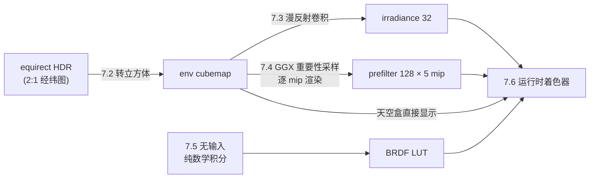

# 基于图像的光照

> [返回：WebGL 与 3D 框架学习大纲](../WebGL与3D框架学习大纲.md)
> 本文是第五阶段第 7 条「基于图像的光照（IBL）完整实现」的完整展开：从一张等距柱状 HDR 环境图出发，逐步生成环境立方体贴图、漫反射辐照度贴图、按粗糙度分级的镜面预过滤贴图、BRDF 积分查找表，最后在着色器里把它们合起来——每一步给出完整 GLSL 与 TypeScript，并讲清积分近似怎么来、采样数与分辨率怎么取舍、亮点/接缝/漏光怎么处理。它是 [04-PBR入门](04-PBR入门.md) 3.4 的实现篇，读之前先把 3.4 的 split-sum 拆分看懂；阶段导览见 [01-导览](01-导览.md)。

## 7.1 全景：四份资产与 WebGL2 的格式事实

### 7.1.1 我们要生产什么

回顾 3.4 的结论：环境光照积分被拆成两个「与观察条件无关」的离线块。展开成实现，一共是四份 GPU 资产：

| 资产 | 内容 | 格式建议 | 分辨率 | 运行时怎么用 |
|---|---|---|---|---|
| 环境立方体贴图（env cubemap） | equirect 转出的原始环境（HDR 辐亮度） | RGBA16F | 每面 256~512 | 天空盒显示（[06-雾效与天空盒](06-雾效与天空盒.md)）、卷积的输入 |
| 辐照度贴图（irradiance map） | 漫反射半球卷积，存 E/π（见 7.3） | RGBA16F | 每面 32 | `texture(irradiance, N)` 一次采样 |
| 预过滤贴图（prefiltered env map） | 按粗糙度分级的 GGX 卷积，粗糙度写进 mip | RGBA16F | 每面 128 × 5 级 mip | `textureLod(prefilter, R, roughness * maxLod)` |
| BRDF 积分查找表（BRDF LUT） | F0 的两个线性组合系数 A、B | RG16F | 512×512 | `texture(brdfLut, vec2(NdotV, roughness)).rg` |



前三步共用同一套「渲染到 cubemap」的机制（7.2 的捕获相机），最后一步只是一张 2D 纹理。全部工作在启动时跑一次（大约几十毫秒量级，取决于分辨率与采样数），运行时每像素的环境光照成本是三次纹理采样。

### 7.1.2 WebGL2 的格式与扩展事实清单

这一册大量操作浮点纹理，先把事实钉死（写错任何一条，症状都是黑屏或黑块，见常见坑）：

1. **采样浮点纹理 vs 渲染到浮点纹理是两件事**。WebGL2 核心**采样** RGBA16F/RGBA32F 都合法，且 **RGBA16F 是可过滤的**（LINEAR 双线性可用）；但**渲染**到任何浮点格式都需要 `EXT_color_buffer_float` 扩展（调用 `getExtension` 启用之后浮点 FBO 才完备）。RGBA32F 的 LINEAR 过滤还需要 `OES_texture_float_linear`——所以本册一律用 RGBA16F：半精度范围约 ±65504，存环境辐亮度绰绰有余，且过滤免费。
2. **渲染到 cubemap 的单个面**用 `framebufferTexture2D`，face target 取 `gl.TEXTURE_CUBE_MAP_POSITIVE_X + i`（不能把 `TEXTURE_CUBE_MAP` 整体当附件）。**渲染到某一级 mip** 是同一个调用的最后一个 level 参数——这是预过滤贴图按粗糙度分级写入的唯一手段。
3. **逐级渲染要求各级显存已分配**。推荐 `texStorage2D`（不可变分配，一次把所有面、所有 mip 建好），再逐面逐级渲染填内容；不要用 `generateMipmap` 生成预过滤 mip——它做的是盒式滤波，不是 GGX 卷积。
4. **`textureLod` 显式选 mip**（GLSL ES 3.00 内置），配合预过滤贴图把「粗糙度」当「mip 选择器」。要让 `LINEAR_MIPMAP_LINEAR` 在 mip 之间插值合法，每一级都必须已填上内容（texStorage2D 分配了但没渲染的级是未定义内容）。
5. **cubemap 的无缝采样**（seamless filtering）在 WebGL2/ES 3.0 是规范保证的，面边界双线性会参考相邻面（[06-雾效与天空盒](06-雾效与天空盒.md) 5.2.3）。
6. **equirect 源纹理的环绕参数**：经度方向周期，`WRAP_S = REPEAT` 让 u=0/u=1 接缝处双线性正确跨界；纬度方向 `WRAP_T = CLAMP_TO_EDGE`。

启动自检（缺了扩展就别硬跑，给用户降级路径）：

```typescript
const gl = canvas.getContext('webgl2', { antialias: false, alpha: false })!;
const colorBufferFloat = gl.getExtension('EXT_color_buffer_float');
if (!colorBufferFloat) {
  // 降级方案：环境光改用解析近似（天空色常量 + 菲涅尔环境项），或提示更换浏览器
  throw new Error('EXT_color_buffer_float 不可用：无法渲染到浮点纹理，IBL 预处理不可用');
}
```

`EXT_color_buffer_float` 在桌面与移动端 WebGL2 上覆盖率都非常高；真正要留退路的是一些旧 WebView。

## 7.2 第一步：equirect → cubemap

### 7.2.1 为什么先做这一步

[06-雾效与天空盒](06-雾效与天空盒.md) 5.2.1 已经给了答案：equirect 在两极过度采样、经度有接缝，而 cubemap 采样密度均匀、硬件路径有优化。对 IBL 还有第三个理由：**后续所有卷积都按「方向」采样**（`samplerCube` + 三维方向），以 cubemap 为中介，卷积着色器完全不用关心面朝向，接缝由硬件无缝处理。

### 7.2.2 捕获相机：六个面的视图矩阵

把一个单位立方体的角点当「方向」用：对每个面架一个 90° 视角的相机看向对应轴向，渲染时顶点着色器把角点原样传出当采样方向。六个面的 forward/up 必须遵循 GL cubemap 面朝向约定（s/t 轴定义在规范里），抄这张表即可：

| 面 | forward | up |
|---|---|---|
| +X | ( 1, 0, 0) | (0, -1, 0) |
| -X | (-1, 0, 0) | (0, -1, 0) |
| +Y | ( 0, 1, 0) | (0, 0, 1) |
| -Y | ( 0,-1, 0) | (0, 0,-1) |
| +Z | ( 0, 0, 1) | (0, -1, 0) |
| -Z | ( 0, 0,-1) | (0, -1, 0) |

```typescript
// 捕获相机：6 个面各一个 lookAt（eye 在原点，center 是面朝向）
const FACE_VIEWS: Array<[forward: Vec3, up: Vec3]> = [
  [new Vec3( 1, 0, 0), new Vec3(0, -1, 0)],
  [new Vec3(-1, 0, 0), new Vec3(0, -1, 0)],
  [new Vec3( 0, 1, 0), new Vec3(0, 0, 1)],
  [new Vec3( 0,-1, 0), new Vec3(0, 0,-1)],
  [new Vec3( 0, 0, 1), new Vec3(0, -1, 0)],
  [new Vec3( 0, 0,-1), new Vec3(0, -1, 0)],
];
const faceViews = FACE_VIEWS.map(([fwd, up]) => new Mat4().lookAt(new Vec3(0, 0, 0), fwd, up));
const captureProj = new Mat4().perspective(Math.PI / 2, 1, 0.1, 10); // 90° × 正方形
```

（`Mat4`/`Vec3` 来自第三阶段 minmath，`lookAt(eye, center, up)`、`perspective(fovY, aspect, near, far)` 签名一致。）

### 7.2.3 着色器：方向 → 经纬 UV

捕获 pass 的顶点着色器三个卷积 pass 共用：

```glsl
// capture.vert —— 立方体角点即采样方向；uView 是当前面的捕获视图矩阵
#version 300 es
layout(location = 0) in vec3 aPosition;
uniform mat4 uProjection;
uniform mat4 uView;
out vec3 vDirection;
void main() {
  vDirection = aPosition;                                  // 角点 = 该像素的方向
  gl_Position = uProjection * uView * vec4(aPosition, 1.0);
}
```

```glsl
// equirect_to_cubemap.frag —— 方向转经纬 UV，采 equirect 原图
#version 300 es
precision highp float;
in vec3 vDirection;
out vec4 fragColor;
uniform sampler2D uEquirect;
const vec2 INV_ATAN = vec2(0.15915494, 0.31830989);  // 1/(2π), 1/π
void main() {
  vec3 d = normalize(vDirection);
  vec2 lonlat = vec2(atan(d.z, d.x), asin(d.y));     // 方向 → 经度/纬度
  vec2 uv = lonlat * INV_ATAN + 0.5;                 // [-π,π]×[-π/2,π/2] → [0,1]²
  fragColor = vec4(texture(uEquirect, uv).rgb, 1.0);
}
```

顶点在立方体表面上、相机在原点，插值出的 `vDirection` 归一化后就是该像素的视线方向——透视除法不会破坏这一点（立方体表面点本来就在视线上）。

### 7.2.4 完整 TypeScript：逐面渲染

```typescript
export function equirectToCubemap(
  gl: WebGL2RenderingContext,
  equirect: WebGLTexture,
  program: WebGLProgram,
  cubeVao: WebGLVertexArrayObject,  // 单位立方体（createBox(2,2,2)），只用 aPosition
  faceViews: Mat4[],
  captureProj: Mat4,
  faceSize = 256,
): WebGLTexture {
  const cube = gl.createTexture()!;
  gl.bindTexture(gl.TEXTURE_CUBE_MAP, cube);
  gl.texStorage2D(gl.TEXTURE_CUBE_MAP, 1, gl.RGBA16F, faceSize, faceSize);
  gl.texParameteri(gl.TEXTURE_CUBE_MAP, gl.TEXTURE_MIN_FILTER, gl.LINEAR); // 只用 mip0
  gl.texParameteri(gl.TEXTURE_CUBE_MAP, gl.TEXTURE_MAG_FILTER, gl.LINEAR);
  gl.texParameteri(gl.TEXTURE_CUBE_MAP, gl.TEXTURE_WRAP_S, gl.CLAMP_TO_EDGE);
  gl.texParameteri(gl.TEXTURE_CUBE_MAP, gl.TEXTURE_WRAP_T, gl.CLAMP_TO_EDGE);

  const fbo = gl.createFramebuffer()!;
  gl.bindFramebuffer(gl.FRAMEBUFFER, fbo);
  gl.disable(gl.DEPTH_TEST); // 捕获 pass 不需要深度

  gl.useProgram(program);
  gl.uniformMatrix4fv(gl.getUniformLocation(program, 'uProjection'), false, captureProj.elements);
  gl.activeTexture(gl.TEXTURE0);
  gl.bindTexture(gl.TEXTURE_2D, equirect);
  gl.uniform1i(gl.getUniformLocation(program, 'uEquirect'), 0);
  for (let face = 0; face < 6; face++) {
    gl.uniformMatrix4fv(gl.getUniformLocation(program, 'uView'), false, faceViews[face].elements);
    gl.framebufferTexture2D(
      gl.FRAMEBUFFER, gl.COLOR_ATTACHMENT0,
      gl.TEXTURE_CUBE_MAP_POSITIVE_X + face, cube, 0,
    );
    gl.viewport(0, 0, faceSize, faceSize);
    gl.bindVertexArray(cubeVao);
    gl.drawElements(gl.TRIANGLES, 36, gl.UNSIGNED_SHORT, 0);
  }

  gl.bindFramebuffer(gl.FRAMEBUFFER, null);
  gl.bindTexture(gl.TEXTURE_CUBE_MAP, null);
  return cube;
}
```

### 7.2.5 从哪拿到 equirect：RGBE（.hdr）加载器

真实环境图通常以 Radiance RGBE 格式（.hdr）分发：每个像素 4 字节（RGB 各 1 字节尾数 + 1 字节共享指数），是紧凑的 HDR 编码。解码成 `Float32Array` 后上传：

```typescript
// loadHdr.ts —— 最小 RGBE 解析器：只处理新式逐行 RLE（实际文件几乎全是这种布局）
export interface HdrImage { width: number; height: number; pixelsRGBA: Float32Array }

export function parseHdr(buffer: ArrayBuffer): HdrImage {
  const view = new DataView(buffer);
  let offset = 0;
  const readLine = (): string => {
    let s = '';
    while (offset < view.byteLength) {
      const c = String.fromCharCode(view.getUint8(offset++));
      if (c === '\n') break;
      s += c;
    }
    return s;
  };
  if (!readLine().startsWith('#?')) throw new Error('不是 Radiance .hdr 文件');
  let format = '';
  for (let line = readLine(); line !== ''; line = readLine()) {
    if (line.startsWith('FORMAT')) format = line;
  }
  if (!format.includes('32-bit_rle_rgbe')) throw new Error(`不支持的 hdr 布局: ${format}`);

  const res = readLine().split(/\s+/);            // "-Y height +X width"
  const height = parseInt(res[1], 10);
  const width = parseInt(res[3], 10);
  const rgbe = new Uint8Array(width * height * 4);

  // 逐行 RLE：每行 4 个通道，各自按"计数 + 数据"编码
  for (let y = 0; y < height; y++) {
    for (let x = 0; x < 4; x++) {                 // 每行 4 个通道依次解码
      if (view.getUint8(offset) !== 2 || view.getUint8(offset + 1) !== 2 ||
          view.getUint16(offset + 2) !== width) {
        throw new Error('旧式（未 RLE）hdr 布局，本加载器不支持');
      }
      offset += 4;
      let i = 0;
      while (i < width) {
        const count = view.getUint8(offset++);
        if (count > 128) {                        // 游程：重复下一字节 (count-128) 次
          const value = view.getUint8(offset++);
          for (let k = count - 128; k > 0; k--) rgbe[(y * width + i++) * 4 + x] = value;
        } else {                                  // 字面量：后跟 count 个不同字节
          for (let k = count; k > 0; k--) rgbe[(y * width + i++) * 4 + x] = view.getUint8(offset++);
        }
      }
    }
  }

  // RGBE → 线性浮点：value = (m + 0.5) / 256 * 2^(e-128)
  const pixels = new Float32Array(width * height * 4);
  for (let i = 0; i < width * height; i++) {
    const e = rgbe[i * 4 + 3];
    const scale = e === 0 ? 0 : Math.pow(2, e - 128) / 256;
    pixels[i * 4]     = (rgbe[i * 4]     + 0.5) * scale;
    pixels[i * 4 + 1] = (rgbe[i * 4 + 1] + 0.5) * scale;
    pixels[i * 4 + 2] = (rgbe[i * 4 + 2] + 0.5) * scale;
    pixels[i * 4 + 3] = 1.0;
  }
  return { width, height, pixelsRGBA: pixels };
}
```

上传时两条路：直接 `texImage2D(..., gl.RGBA32F, ..., gl.FLOAT, pixels)`（32F 过滤要 `OES_texture_float_linear`，没有就 NEAREST，卷积结果略带块感）；或者先把 equirect **渲染进一张 RGBA16F 纹理**（画一个全屏 pass 原样拷贝），之后全部按 16F 处理——本站示例走后者，管线格式统一（见 `examples/09-pbr-ibl`）。注意 `.hdr` 文件行序是自上而下，上传记得 `UNPACK_FLIP_Y_WEBGL = true` 对齐 GL 的 v 向上约定（[02-纹理](../02-第二阶段/03-纹理.md) 的像素存储参数）。

**分辨率取舍**：equirect 2K（2048×1024）是常见起点；env cubemap 每面 256（移动端）~512（桌面）已经够卷积用——卷积产物是低频的，源图再大也会被卷掉。天空盒直接显示才吃得到更高分辨率，两者可以用同一份转换流程各出一张不同尺寸的 cube。

## 7.3 第二步：漫反射辐照度贴图

### 7.3.1 积分怎么变成求和

漫反射环境光是把 3.2 的兰伯特 BRDF 代回渲染方程：

$$E(N) = \int_{\Omega_n} L_i(\omega)\,(n \cdot \omega)\, d\omega, \qquad 漫反射贡献 = \frac{albedo}{\pi}\, E(N)$$

球坐标下立体角微元是 $d\omega = \sin\theta\, d\theta\, d\varphi$（[数学专题/05-采样卷积与频域](../数学专题/05-采样卷积与频域.md)），于是：

$$E(N) = \int_0^{2\pi}\!\!\int_0^{\pi/2} L_i(\theta, \varphi)\, \cos\theta \sin\theta \, d\theta\, d\varphi$$

被积函数里的 $\cos\theta$ 是兰伯特投影，$\sin\theta$ 来自立体角微元——两个都出现，卷积权重是 $\cos\theta \sin\theta$。这个积分与视角无关、只随 N 变化，而它的结果极其低频（平滑渐变），所以可以**预先对每个方向 N 算好，存成 32×32 的 cubemap**：每个纹素 = 以该方向为法线的半球平均。

两种离散化（数学上是同一件事的两种表述）：

- **均匀半球采样（蒙特卡洛）**：随机取 N 个半球方向，$E \approx \frac{2\pi}{N}\sum L_i(\omega_k)\cos\theta_k$（半球立体角 2π 是均分布的归一化因子，见 [数学专题/06-概率与蒙特卡洛](../数学专题/06-概率与蒙特卡洛.md)）；
- **经纬网格（黎曼和）**：φ、θ 各按固定步长遍历，直接对 $\cos\theta\sin\theta$ 求和。方向布满整个网格、无随机方差，低采样密度也不出噪声——教学与实作都推荐这种。

### 7.3.2 完整 GLSL

```glsl
// irradiance.frag —— 漫反射辐照度卷积：经纬网格版
#version 300 es
precision highp float;
in vec3 vDirection;
out vec4 fragColor;
uniform samplerCube uEnvironment;
const float PI = 3.14159265359;
const float SAMPLE_DELTA = 0.025;  // φ/θ 步长（弧度），约 2.5 万个采样方向

void main() {
  vec3 N = normalize(vDirection);                       // 本纹素对应的法线方向
  // 以 N 为 z 轴搭切线基（up 与 N 平行时换参考轴，防退化）
  vec3 up    = abs(N.y) < 0.999 ? vec3(0.0, 1.0, 0.0) : vec3(1.0, 0.0, 0.0);
  vec3 right = normalize(cross(up, N));
  vec3 newUp = cross(N, right);

  vec3 sum = vec3(0.0);
  float count = 0.0;
  for (float phi = 0.0; phi < 2.0 * PI; phi += SAMPLE_DELTA) {
    for (float theta = 0.0; theta < 0.5 * PI; theta += SAMPLE_DELTA) {
      // 切线空间样本 → 世界方向
      vec3 tangent = vec3(sin(theta) * cos(phi), sin(theta) * sin(phi), cos(theta));
      vec3 dir = right * tangent.x + newUp * tangent.y + N * tangent.z;
      sum += texture(uEnvironment, dir).rgb * cos(theta) * sin(theta);
      count += 1.0;
    }
  }
  // 存的是 E/π（真辐照度除以 π）：运行时 irradiance(N) * albedo 即漫反射
  fragColor = vec4(PI * sum / count, 1.0);
}
```

渲染方式与 7.2.4 完全一样（6 面 × 捕获相机），只是目标换成 32×32 的 cubemap、输入换成 env cubemap、着色器换成 irradiance——不再重复代码。

**存 E 还是存 E/π**：本站约定贴图里存 **E/π**，运行时直接乘 albedo。两种约定都对，但必须全链路一致——有的实现贴图存 E、着色器里乘 albedo/π，混抄两边会整体偏亮 π 倍（自测第 4 题会考这个）。

### 7.3.3 分辨率与采样数的账

| 参数 | 取值 | 降多少会怎样 |
|---|---|---|
| 贴图分辨率 | 32×32×6 | 16 以下渐变出现马赛克；64 以上纯属浪费（结果本来就低频） |
| SAMPLE_DELTA | 0.025 | 增大到 0.1（采样数约 ÷16）后高频环境（窗格天光）开始出现条带；纯平滑天空可以放宽 |
| 格式 | RGBA16F | 用 RGBA8 会把 HDR 环境的亮度截断在 1.0，太阳的漫反射贡献直接消失 |

## 7.4 第三步：镜面预过滤贴图

### 7.4.1 为什么镜面不能像漫反射一样卷成一张

漫反射能整张贴图卷掉，靠的是 $f_{lambert}$ 是常数。镜面 BRDF 依赖 **观察方向 V 和粗糙度 α**——同一个法线方向，从不同角度看、不同粗糙度的表面，需要的「环境平均」完全不同。Karis 的 split-sum（3.4.1）把积分拆开：

$$\int_{\Omega} L_i(\omega_i)\, f_{spec}(\omega_o, \omega_i)\, \cos\theta_i\, d\omega_i
\;\approx\; \underbrace{\int_{\Omega} L_i(\omega_i)\, \tilde{f}_{spec}\, d\omega_i}_{\text{第一因子：预过滤贴图（本节）}} \;\times\; \underbrace{\int_{\Omega} f_{spec} \cos\theta_i\, d\omega_i}_{\text{第二因子：BRDF LUT（7.5）}}$$

近似的关键假设：**环境辐亮度在镜面波瓣覆盖的范围内近似常量**（或者说可以把 BRDF 对 L 的相关性拆成两个 marginal）。它成立的条件是波瓣不要太窄地罩住一张对比强烈的源图——低粗糙度 + 小太阳的场景是它的最坏情况（7.7 的亮点瑕疵正是这里漏的气）。

第一因子里放进去的 $\tilde{f}_{spec}$ 是「GGX 分布 D 决定采样方向 + 余弦权重」的简化 BRDF（F 与 G 挪到第二因子）：**每个 (反射方向 R, 粗糙度 α) 组合一张波瓣平均图**。两个维度里 α 是离散的——存进 mip 链，粗糙度当 mip 选择器：

$$lod = roughness \times maxLod, \qquad maxLod = 级数 - 1$$

### 7.4.2 重要性采样：把样本撒在波瓣里

按 D 的重要性采样（[数学专题/06-概率与蒙特卡洛](../数学专题/06-概率与蒙特卡洛.md)）：样本方向 $\omega_h$ 从 GGX 法线分布里抽，估计量除以 pdf。GGX 的逆 CDF 有闭式解，采样三步：

1. **Hammersley 序列**产生低差异 (u₁, u₂)：比纯随机更均匀地覆盖 [0,1)²，同样样本数方差更小；
2. **逆 CDF** 把 u₂ 变成 GGX 分布的 $\cos\theta_h$：$\cos\theta_h = \sqrt{\frac{1-u_2}{1+(a^2-1)\,u_2}}$（a = roughness²）；
3. 绕 N 构造正交基，把球坐标样本旋到 N 的半球。

```glsl
// ---- importance.glsl —— 预过滤与 LUT 共用的采样函数（#version 300 es）----
// Van der Corput 根号逆序：把 i 的二进制位镜像后归一化，构成低差异序列
float radicalInverseVdC(uint bits) {
  bits = (bits << 16u) | (bits >> 16u);
  bits = ((bits & 0x55555555u) << 1u) | ((bits & 0xAAAAAAAAu) >> 1u);
  bits = ((bits & 0x33333333u) << 2u) | ((bits & 0xCCCCCCCCu) >> 2u);
  bits = ((bits & 0x0F0F0F0Fu) << 4u) | ((bits & 0xF0F0F0F0u) >> 4u);
  bits = ((bits & 0x00FF00FFu) << 8u) | ((bits & 0xFF00FF00u) >> 8u);
  return float(bits) * 2.3283064365386963e-10;  // / 2^32
}
vec2 hammersley(uint i, uint N) {
  return vec2(float(i) / float(N), radicalInverseVdC(i));
}
// GGX 逆 CDF 采样：返回微表面半程向量 H（球坐标样本绕 N 旋转）
vec3 importanceSampleGGX(vec2 xi, vec3 N, float roughness) {
  float a = roughness * roughness;
  float phi = 2.0 * 3.14159265359 * xi.x;
  float cosTheta = sqrt((1.0 - xi.y) / (1.0 + (a * a - 1.0) * xi.y));
  float sinTheta = sqrt(1.0 - cosTheta * cosTheta);
  vec3 h = vec3(cos(phi) * sinTheta, sin(phi) * sinTheta, cosTheta); // 绕 +Z 的样本
  vec3 up = abs(N.z) < 0.999 ? vec3(0.0, 0.0, 1.0) : vec3(1.0, 0.0, 0.0);
  vec3 tangent = normalize(cross(up, N));
  vec3 bitangent = cross(N, tangent);
  return normalize(tangent * h.x + bitangent * h.y + N * h.z);
}
```

逆 CDF 一行验证：u₂=0 → cosθ=1（正对 N）；u₂=1 → cosθ=1/a=1/α（α→0 时波瓣收紧成一条线，符合 3.2.1 的「D 收敛成 δ」）。

### 7.4.3 完整预过滤着色器

```glsl
// prefilter.frag —— 镜面预过滤：GGX 重要性采样卷积，逐 mip 渲染（uRoughness = mip/maxLod）
#version 300 es
precision highp float;
in vec3 vDirection;
out vec4 fragColor;
uniform samplerCube uEnvironment;
uniform float uRoughness;
const uint SAMPLE_COUNT = 128u;

// （此处内联 7.4.2 的 radicalInverseVdC / hammersley / importanceSampleGGX 三个函数）

void main() {
  vec3 N = normalize(vDirection);
  vec3 V = N;                        // split-sum 假设：V = R = N（视角项归入第二因子）
  vec3 prefiltered = vec3(0.0);
  float totalWeight = 0.0;
  for (uint i = 0u; i < SAMPLE_COUNT; ++i) {
    vec2 xi = hammersley(i, SAMPLE_COUNT);
    vec3 H = importanceSampleGGX(xi, N, uRoughness);
    vec3 L = normalize(2.0 * dot(V, H) * H - V);   // H 关于 V 镜面反射出入射方向
    float NdotL = max(dot(N, L), 0.0);
    if (NdotL > 0.0) {
      // 样本按 NdotL 加权、按总权重归一：波瓣内余弦加权平均的近似
      prefiltered += textureLod(uEnvironment, L, 0.0).rgb * NdotL;
      totalWeight += NdotL;
    }
  }
  fragColor = vec4(prefiltered / max(totalWeight, 1e-4), 1.0);
}
```

诚实说明这版近似的两个取舍（抄实现前要心里有数）：

1. 严格的估计量是 $\frac{1}{N}\sum \frac{L(\omega_i)\,\cos\theta_i}{pdf(\omega_i)}$。上面代码按 NdotL 加权再归一化，等价于假设采样分布与余弦权重近似成比例、pdf 约掉——这是 Karis 原文的实用写法，误差在第二因子里部分被吸收；
2. 卷积时假设 V=R=N，掠射角的真实波瓣行为由第二因子（NdotV 入参）补偿。

### 7.4.4 逐 mip 渲染的 TypeScript

```typescript
const PREFILTER_SIZE = 128;
const MAX_MIP = 5; // mip 0..4：粗糙度 0.0 → 1.0

const prefilter = gl.createTexture()!;
gl.bindTexture(gl.TEXTURE_CUBE_MAP, prefilter);
gl.texStorage2D(gl.TEXTURE_CUBE_MAP, MAX_MIP, gl.RGBA16F, PREFILTER_SIZE, PREFILTER_SIZE);
gl.texParameteri(gl.TEXTURE_CUBE_MAP, gl.TEXTURE_MIN_FILTER, gl.LINEAR_MIPMAP_LINEAR);
gl.texParameteri(gl.TEXTURE_CUBE_MAP, gl.TEXTURE_MAG_FILTER, gl.LINEAR);
// 省略 WRAP 两个 CLAMP_TO_EDGE（同 7.2.4）

gl.useProgram(prefilterProgram);
gl.activeTexture(gl.TEXTURE0);
gl.bindTexture(gl.TEXTURE_CUBE_MAP, envCube);      // 输入是 7.2 的环境 cube
gl.uniform1i(gl.getUniformLocation(prefilterProgram, 'uEnvironment'), 0);
gl.uniformMatrix4fv(gl.getUniformLocation(prefilterProgram, 'uProjection'), false, captureProj.elements);

for (let mip = 0; mip < MAX_MIP; mip++) {
  const mipSize = PREFILTER_SIZE >> mip;
  const roughness = mip / (MAX_MIP - 1);           // 0 → 1 线性映射
  gl.uniform1f(gl.getUniformLocation(prefilterProgram, 'uRoughness'), roughness);
  for (let face = 0; face < 6; face++) {
    gl.uniformMatrix4fv(gl.getUniformLocation(prefilterProgram, 'uView'), false, faceViews[face].elements);
    gl.framebufferTexture2D(
      gl.FRAMEBUFFER, gl.COLOR_ATTACHMENT0,
      gl.TEXTURE_CUBE_MAP_POSITIVE_X + face, prefilter, mip,   // 注意最后一个参数：mip 级号
    );
    gl.viewport(0, 0, mipSize, mipSize);
    gl.bindVertexArray(cubeVao);
    gl.drawElements(gl.TRIANGLES, 36, gl.UNSIGNED_SHORT, 0);
  }
}
```

**分辨率与级数的账**：128×5 级是常见配置。级数多一级，粗糙度采样更细，但每级分辨率减半（128→8），高 mip 很快糊到没有结构——5 级够把 roughness ∈ [0,1] 映射完。若想省显存，128 降到 64 视觉差异主要在光滑材质的天空反射边缘。

## 7.5 第四步：BRDF 积分查找表

### 7.5.1 把 F0 从积分里提出来

第二因子 $\int f_{spec}\cos\theta\, d\omega$ 依赖三个量：NdotV、roughness、F0。救星是 Schlick 菲涅尔对 F0 恰好是**线性**的：

$$F(v,h) = F_0 + (1-F_0)(1-v \cdot h)^5 = F_0 \underbrace{\big(1-(1-v \cdot h)^5\big)}_{系数 A 的来源} + \underbrace{(1-v \cdot h)^5}_{系数 B 的来源}$$

代回积分，F0 可以提出积分号外：

$$\int f_{spec}(\omega_i, \alpha)\, F\, \cos\theta_i\, d\omega_i = F_0 \cdot A(NdotV, \alpha) + B(NdotV, \alpha)$$

两个二维函数 A、B——存成一张 512×512 的 **RG16F** 纹理，x 轴 NdotV、y 轴 roughness，运行时一次采样拿到组合系数。这就是 3.4.1 说「两次纹理读取替代积分」的其中一次。

### 7.5.2 完整 GLSL

```glsl
// brdf_lut.vert —— 全屏三角形（03-后处理管线 2.1.2 的 gl_VertexID 技巧）
#version 300 es
out vec2 vUV;
void main() {
  vec2 pos = vec2((gl_VertexID << 1) & 2, gl_VertexID & 2) * 2.0 - 1.0;
  vUV = pos * 0.5 + 0.5;
  gl_Position = vec4(pos, 0.0, 1.0);
}
```

```glsl
// brdf_lut.frag —— 积分 A、B 两个系数：x 轴 NdotV，y 轴 roughness
#version 300 es
precision highp float;
in vec2 vUV;
out vec4 fragColor;
const float PI = 3.14159265359;
const uint SAMPLE_COUNT = 1024u;

// （此处内联 7.4.2 的 radicalInverseVdC / hammersley / importanceSampleGGX 三个函数）

float geometrySchlickGGX(float NdotX, float k) {
  return NdotX / (NdotX * (1.0 - k) + k);
}
float geometrySmith(float NdotV, float NdotL, float roughness) {
  float k = (roughness * roughness) / 2.0;   // IBL 版的 k（直接光照是 (r+1)²/8，见 3.2.3）
  return geometrySchlickGGX(NdotV, k) * geometrySchlickGGX(NdotL, k);
}

void main() {
  float NdotV = vUV.x;
  float roughness = vUV.y;
  // 相机在 N 的 xz 平面上，与 N 夹角由 NdotV 决定：V = (√(1-NdotV²), 0, NdotV)
  vec3 V = vec3(sqrt(1.0 - NdotV * NdotV), 0.0, NdotV);
  vec3 N = vec3(0.0, 0.0, 1.0);

  float A = 0.0; // F0 的系数：∫ f cos (1 - c)
  float B = 0.0; // 常数项：    ∫ f cos (c)，其中 c = (1 - VdotH)^5
  for (uint i = 0u; i < SAMPLE_COUNT; ++i) {
    vec2 xi = hammersley(i, SAMPLE_COUNT);
    vec3 H = importanceSampleGGX(xi, N, roughness);
    vec3 L = normalize(2.0 * dot(V, H) * H - V);
    float NdotL = max(L.z, 0.0);
    float NdotH = max(H.z, 0.0);
    float VdotH = max(dot(V, H), 0.0);
    if (NdotL > 0.0) {
      float G = geometrySmith(NdotV, NdotL, roughness);
      // 可见性项 G / (4 NdotV NdotL) 与 4·VdotH 的雅可比合并后的形式
      float GVis = (G * VdotH) / max(NdotH * NdotV, 1e-4);
      float Fc = pow(1.0 - VdotH, 5.0);      // Schlick 的非线性部分
      A += (1.0 - Fc) * GVis;
      B += Fc * GVis;
    }
  }
  fragColor = vec4(A, B, 0.0, 1.0) / float(SAMPLE_COUNT);  // RG16F：R=A, G=B
}
```

渲染目标是一张 512×512 的 **RG16F** 2D 纹理（同样需要 `EXT_color_buffer_float`），一次 `drawArrays(gl.TRIANGLES, 0, 3)` 完成。LUT 不依赖任何环境图——同一张 LUT 通用于所有场景，甚至可以直接用一份工具离线生成好的贴图（Three.js 的做法）。**512×512 与 1024 采样**基本无瑕疵；降到 256×256 + 256 采样，肉眼差异集中在高光滑金属的掠射边缘。

## 7.6 运行时：把四份资产合进 PBR 着色器

### 7.6.1 完整着色器

在 3.2.4 的直接光照版本上叠加环境项（两处新东西都标了注释）：

```glsl
// pbr_ibl.frag —— Cook-Torrance 直接光照 + IBL 环境光照（GLSL ES 3.00）
#version 300 es
precision highp float;

in vec3 vWorldPos;
in vec3 vNormal;

uniform vec3  uCamPos;
uniform vec3  uLightDir;      // 指向光源
uniform vec3  uLightColor;    // 已带强度
uniform vec3  uAlbedo;        // 线性空间
uniform float uMetallic;
uniform float uRoughness;

// ---- 7.6 新增：四份 IBL 资产 ----
uniform samplerCube uIrradiance;   // 7.3 漫反射辐照度（存 E/π）
uniform samplerCube uPrefilter;    // 7.4 镜面预过滤（mip = 粗糙度）
uniform sampler2D   uBrdfLut;      // 7.5 BRDF 积分 LUT
uniform float uMaxPrefilterLod;    // 预过滤 mip 链最大级号（4.0）
uniform float uIblIntensity;       // 环境光倍率（0 = 关闭 IBL，做对比开关）
uniform float uAo;                 // 遮蔽系数：AO 贴图或 SSAO（第 9 册），只乘环境光

out vec4 fragColor;
const float PI = 3.14159265359;

// ---- D/F/G 三项与 3.2.4 逐行相同，此处不再重复（distributionGGX / geometrySchlickGGX /
//      geometrySmith / fresnelSchlick 四个函数原样复制过来）----

// IBL 专用：粗糙度感知的菲涅尔——roughness 大时 F0 下限抬高，避免粗糙漫反射面
// 在掠射角「闪」出过强的镜面环境反射（3.2.3 的能量守恒在积分意义下的修补）
vec3 fresnelSchlickRoughness(float cosTheta, vec3 F0, float roughness) {
  return F0 + (max(vec3(1.0 - roughness), F0) - F0) * pow(1.0 - cosTheta, 5.0);
}

void main() {
  vec3 N = normalize(vNormal);
  vec3 V = normalize(uCamPos - vWorldPos);
  vec3 L = normalize(uLightDir);
  vec3 H = normalize(V + L);
  float NdotV = max(dot(N, V), 1e-4);
  vec3 F0 = mix(vec3(0.04), uAlbedo, uMetallic);

  // ========== 直接光照（3.2.4 原样） ==========
  float NdotL = max(dot(N, L), 0.0);
  float D = distributionGGX(N, H, uRoughness);
  float G = geometrySmith(N, V, L, uRoughness);
  vec3  F = fresnelSchlick(max(dot(H, V), 0.0), F0);
  vec3 specular = (D * G * F) / max(4.0 * NdotV * NdotL, 1e-4);
  vec3 kD = (vec3(1.0) - F) * (1.0 - uMetallic);
  vec3 lambert = uAlbedo / PI;
  vec3 direct = (kD * lambert + specular) * uLightColor * NdotL;

  // ========== 环境光照（本册新增） ==========
  // 菲涅尔用 NdotV（不是 H）：环境项没有单一半程向量，用观察角的 Schlick
  vec3 Fenv = fresnelSchlickRoughness(NdotV, F0, uRoughness);
  vec3 kS = Fenv;
  vec3 kDenv = (vec3(1.0) - kS) * (1.0 - uMetallic);

  vec3 irradiance = texture(uIrradiance, N).rgb;              // 漫反射：一次采样
  vec3 diffuseIBL = irradiance * uAlbedo;                      // 贴图存 E/π，直接乘

  vec3 R = reflect(-V, N);
  vec3 prefiltered = textureLod(uPrefilter, R, uRoughness * uMaxPrefilterLod).rgb; // 镜面：粗糙度选 mip
  vec2 brdf = texture(uBrdfLut, vec2(NdotV, uRoughness)).rg;  // LUT：一次采样
  vec3 specularIBL = prefiltered * (F0 * brdf.x + brdf.y);    // F0·A + B

  vec3 ambient = (kDenv * diffuseIBL + specularIBL) * uAo * uIblIntensity;

  vec3 color = direct + ambient;
  // 输出 HDR，交给 03-后处理管线 2.4 的 ACES + gamma（本册示例里就地做同样两步）
  fragColor = vec4(color, 1.0);
}
```

四个纹理单元的绑定表（TS 侧照抄即可）：

| unit | 纹理 | 采样器 uniform |
|---|---|---|
| 0 | irradiance cubemap | `uIrradiance` |
| 1 | prefilter cubemap | `uPrefilter` |
| 2 | BRDF LUT | `uBrdfLut` |
| 3 | env cubemap（天空盒 pass 用） | 天空盒着色器的 `uSkybox` |

### 7.6.2 与管线其他部分的组装

- **天空盒**直接显示 env cubemap（[06-雾效与天空盒](06-雾效与天空盒.md) 5.2/5.3 的 xyww 技巧），它和 IBL 用的是同一份数据——环境反射、天空背景、IBL 三层用法（5.3.3）至此全部落地；
- **输出是 HDR**：环境光与太阳直射在同一量纲（辐亮度）下相加，最后统一 ACES 色调映射 + gamma，别在中间做 gamma（3.3.2 的纪律）；
- **AO 只乘环境光**：直射光的遮蔽属于阴影（第 2 册 shadow map），环境光的遮蔽属于 AO——`uAo` 接一张烘焙 AO 贴图，或接第 9 册的 SSAO 结果，语义都是「环境几何遮蔽比例」。

### 7.6.3 对照 examples/09-pbr-ibl：四份资产与运行时的组装时序

配套 demo（`examples/09-pbr-ibl`）把 7.2~7.6 全部内容做成了可运行的实物。它与「每帧重画」的普通 demo 有一个本质区别——**四份环境资产是「一次性预计算」，运行时只做查询**，这正是 7.3~7.5 三节积分预算能付得起的架构前提。时序对照：

| 时序 | demo 里的阶段 | 对应小节 | 频率 |
|---|---|---|---|
| 初始化 ① | 加载 `.hdr`（RGBE 解码）→ equirect 纹理 | 7.2.5 | 一次 |
| 初始化 ② | equirect → cubemap 六面捕获 | 7.2 | 一次 |
| 初始化 ③ | 卷积出漫反射辐照度贴图（低分辨率） | 7.3 | 一次 |
| 初始化 ④ | 逐 mip 预过滤（逐级渲染 mip 链） | 7.4 | 一次 |
| 初始化 ⑤ | BRDF LUT（一张 RG 半屏 FBO） | 7.5 | 一次 |
| 每帧 | 组装着色器查三张图 + 加直射光 | 7.6.1 | 每帧 |

对着这张时序表把 demo 跑一遍，有三个值得追问的观察点：

1. **为什么初始化能容忍慢、每帧不能**：③ 的球面均匀采样循环、④ 的数百次重要性采样，全部只付一次——工业引擎（如 three.js 的 PMREMGenerator）做的是同一件事；如果你把预计算误放进每帧，成本瞬间放大 60 倍以上，这是 IBL 移植到自研管线时最常见的性能事故；
2. **④ 的 mip 链为什么逐级单独渲染**：`roughness` 与 mip level 是一一映射（7.4.4 的循环变量），一次 clear 整链再逐级画会浪费——demo 的循环里每级绑定对应 mip 后直接画，这是「FBO 只 attach 一层 mip」的实操（初学者常见卡点）；
3. **换一张 HDR 环境贴图 = 重跑初始化 ①~⑤、每帧路径零改动**——资产与运行时通过 7.6.1 的三个 uniform 解耦，这是本册架构上最值得抄走的一刀：环境是数据，PBR 是程序。

跑 demo 时顺手做两个对照实验：把 roughness 滑块从 0 拉到 1，观察镜面从「锐利反射」滑向「漫反射般的糊」——你调的就是 7.4.4 那条 mip 映射；把 `uAo` 输入临时置 1，看环境遮蔽消失后金属与墙角的差异——AO 与 IBL 的分工（7.6.2 第三条）从「概念」变成「看得见的两个画面」。

## 7.7 瑕疵清单：亮点、接缝、漏光

### 7.7.1 亮点/雪花（fireflies）

**症状**：光滑金属表面出现白色小亮点，或粗糙表面出现一闪一闪的亮斑。
**成因**：HDR 环境里太阳等极端亮源（量级可以是背景的成百上千倍）进入卷积——预过滤只有 128 个样本，个别样本恰好命中太阳，按波瓣平均后成为一个过亮纹素；运行时 LINEAR_MIPMAP_LINEAR 再把这个亮点抹开成小亮斑。
**对策**（按工程代价递增）：

1. **加样本数**：SAMPLE_COUNT 128→1024，方差 ÷8，生成时间仍在一次性可接受范围；
2. **卷积时降级采样源**：预过滤里 `textureLod(uEnvironment, L, 0.0)` 改为带 roughness 偏置（如 `uRoughness * 4.0`），高粗糙度时先读更模糊的 mip，等价于「先粗滤再卷积」，直接压掉单样本方差（需要给 env cube 先 `generateMipmap`）；
3. **样本 clamp**：对超出中位数若干倍的样本做截断（实现麻烦，通常前两条就够）。

### 7.7.2 接缝（seams）

**症状**：cubemap 面与面交界处颜色/亮度跳变。
**成因排查顺序**：

1. equirect 源的 `WRAP_S` 不是 REPEAT——u=0/u=1 处双线性采到 clamp 的边缘，转换后所有「经度 ±180°」方向都错；
2. 手动改过捕获相机的六个视图矩阵——面朝向约定（7.2.2 的表）抄错一格，内容整体错位/镜像；
3. 用 `generateMipmap` 试图生成预过滤 mip——盒式滤波不是 GGX 卷积，mip 之间亮度跳变看起来像接缝；
4. WebGL1 路径——ES 1.0 没有 seamless cubemap，需要手动 padding（本站基线 WebGL2，仅提醒）。

ES 3.0 保证的面边界无缝插值只解决「采样正确时边界不跳」，源数据错了它救不了。

### 7.7.3 漏光（light leaking）

**症状**：墙角、凹腔、物体背光处的环境漫反射偏亮，像「漏了环境光进来」。
**成因是模型级而非算法 bug**：环境贴图记录的是「采集点」的全景光照，不含场景几何的遮挡——物体内部、遮挡处的表面照样被整个半球的环境照亮。这是 IBL 的根本性近似。
**对策**：

1. 乘 **AO**（烘焙 AO 贴图 / 第 9 册的 SSAO）：漫反射环境光 × 遮蔽系数，最通用；
2. **局部环境探头**（local probes）+ 插值：室内室外各采一张环境图，比单一全景图准确，代价是资产与混合逻辑；
3. 定向遮蔽类方案（bent normal）：不只压暗，还把采样方向偏向未被遮挡的半球——效果最好、实现最贵，本站定位为了解即可。

另一个「小漏光」：掠射角的 `fresnelSchlickRoughness` 不加 roughness 下限时，粗糙表面在侧视线方向会漏出过强天空反射（7.6.1 已用 `max(vec3(1.0 - roughness), F0)` 修掉）。

### 7.7.4 半精度与量纲

- 太阳辐亮度给到几百上千时，16F 的 65504 上限仍很宽裕；但如果手工叠光强（比如乘个曝光 1000），留意半精度上溢成 inf，症状是卷积结果整块异常；
- 环境贴图存的是**辐亮度**，与 3.2.4 的 `uLightColor` 同量纲；如果把 LDR 图片（值域 [0,1]）直接当环境，IBL 会整体欠曝且没有高光——这就是 7.1.1 坚持 HDR 输入的原因。

## 常见坑

1. **没调 `getExtension('EXT_color_buffer_float')` 就渲染到 RGBA16F**——调用本身是「启用」动作，不调则 FBO 不完备、全黑（与「能不能采样浮点纹理」无关，7.1.2 第 1 条）。
2. **equirect 上传忘了 FLIP_Y 或 WRAP_S 没设 REPEAT**——转换出的 cube 两极颠倒（v 约定反了）或经度 ±180° 有一条竖直错位缝（7.7.2）。
3. **辐照度贴图与着色器的 π 约定混抄**——贴图存 E/π、着色器又除一次 π，漫反射环境光整体偏暗 π 倍；两个实现对接时先对齐这条约定（7.3.2）。
4. **预过滤 mip 没逐级渲染就开 LINEAR_MIPMAP_LINEAR**——texStorage2D 分配的未写内容是未定义的，粗糙表面采到垃圾或黑色。每一级都要走到 7.4.4 的循环。
5. **`textureLod` 用在 MIN_FILTER 为 LINEAR 的预过滤贴图上还想要 mip 插值**——MIN_FILTER 决定 mip 间行为：预过滤贴图必须 LINEAR_MIPMAP_LINEAR，仅传 lod 整数也能正确取级；env cube（无 mip）则要 LINEAR。
6. **捕获 pass 复用了主循环的深度状态**——卷积对着色不需要深度测试，忘关 DEPTH_TEST 时立方体自遮挡裁掉一半三角形，某几个面全黑。
7. **预过滤与 LUT 里用了直接光照版的 k**——G 项的 k 有两套（直接光 (r+1)²/8、IBL r²/2），抄错高光滑金属的边缘反射明显偏亮/偏暗（7.5.2 注释）。
8. **对着「太阳不亮」调参数**——程序化天空或手调 HDR 里太阳强度太低，预过滤的光滑镜面看不到反射太阳。先确认 env cube 里太阳像素的量级（读回一个纹素）再谈其他。
9. **把 IBL 的镜面项也乘了 uAo**——AO 只该乘漫反射环境光；镜面环境反射的遮蔽需要定向信息（bent normal），简单乘 AO 会把金属高光压死。教学实现里常见妥协是 `pow(ao, ...) `衰减或干脆不乘，明确记录取舍。

## 本节自测

1. 不看正文写出四份资产的名字、格式、分辨率与运行时各自的采样次数；哪一份不依赖环境图？
2. 为什么辐照度卷积的采样权重是 cosθ·sinθ 两项相乘？各自来自渲染方程的哪一项和坐标变换的哪一步？
3. 本站约定辐照度贴图存 E/π。若另一份实现存 E，着色器该怎么改？两边混着抄，画面亮/暗多少倍？
4. GGX 重要性采样的逆 CDF 里，u₂=1 时 cosθ_h 等于多少？由此说明为什么低粗糙度必须靠预过滤（而不是运行时几次采样）拿到镜面环境光。
5. split-sum 第一因子做了哪两个关键假设（观察方向？BRDF 的哪些项被挪走）？它最不成立的场景是什么？
6. BRDF LUT 为什么能是二维的？F0 是怎么从积分里提出来的——写出 Schlick 公式的线性分解。
7. 预过滤贴图的 mip 级数从 5 改成 3，运行时 `uMaxPrefilterLod` 要跟着改吗？roughness=0.5 时采到哪一级？
8. 光滑金属上出现白色小亮点（7.7.1），给出至少两条成因分析与对应修复。
9. IBL 场景里墙角「漏光」的根本原因是什么？为什么说这不是 bug 而是模型近似？列出三种对策并排序性价比。
10. `EXT_color_buffer_float`、`OES_texture_float_linear`、无缝 cubemap 三件事分别解决什么问题？哪件不需要任何扩展？
