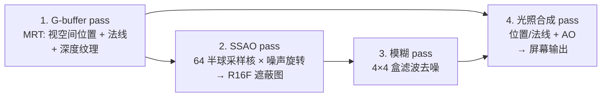

# 屏幕空间环境光遮蔽

> [返回：WebGL 与 3D 框架学习大纲](../WebGL与3D框架学习大纲.md)
> 本文是第五阶段第 8 条「屏幕空间环境光遮蔽（SSAO）」的完整展开：从深度重建位置与法线、构造半球采样核与旋转噪声、计算遮蔽、模糊去噪、到与光照合成，给出每个 pass 的完整 GLSL 与 TypeScript，并讲清每一步近似背后的几何与参数怎么调。它填补 [08-基于图像的光照](08-基于图像的光照.md) 7.7.3 指出的缺口——IBL 的环境光不知道几何遮挡，AO 正是那块拼图；阶段导览见 [01-导览](01-导览.md)。

## 8.1 问题：环境光缺一块「被挡住」的信息

### 8.1.1 遮蔽的物理：渲染方程里的可见性

看 [04-PBR入门](04-PBR入门.md) 3.4 的辐照度积分：$\int_\Omega L_i(\omega)\cos\theta\, d\omega$ 用的是**整个半球的环境光**。但真实场景里，墙角、凹腔、物体接触处的表面，半个天球都被周围几何挡住——把遮挡算进来，积分要乘一个**可见性函数** V(p, ω)（方向 ω 上有没有东西挡着 p）：

$$E(p) = \int_\Omega L_i(\omega)\, V(p, \omega)\, \cos\theta\, d\omega$$

离线渲染老实算 V；实时渲染付不起。**环境光遮蔽（Ambient Occlusion）** 是它的经典近似：假设环境光各向均匀（$L_i$ 是常量，可以提出积分号），定义一个标量：

$$AO(p) = \frac{1}{\pi}\int_\Omega V(p, \omega)\cos\theta\, d\omega \;\in\; [0, 1]$$

几何直觉：以 p 为球心放一个半球，看「天空被周围几何遮住的比例」——墙角里天空只剩一小块，AO 小；平地上天空全开，AO = 1。运行时把 AO 乘在环境漫反射项上（7.6.1 的 `uAo`），就补上了这块缺失。

### 8.1.2 为什么在屏幕空间做

算 V(p, ω) 需要场景几何。烘焙 AO 贴图（资产管线）只对静态物体有效；动态场景的廉价替代是**只看这一帧已经画出来的东西**：深度缓冲记录了每个像素最前面的表面，它就是「屏幕空间里可见的全部几何」。屏幕空间环境光遮蔽（SSAO，Screen Space Ambient Occlusion，Crytek 2007）在这个信息上估计 AO——快、无需几何预处理、对动态场景即时生效；代价是屏幕外的遮挡物不知道（7.7 的「漏光」反过来：**屏幕内看不见的几何也不知道**），这是它与烘焙 AO 的根本差别。

### 8.1.3 流水线总览

五个 pass，前三步是 [03-后处理管线](03-后处理管线.md) 的标准套路（FBO、全屏三角形、ping-pong）：



前置事实（同 7.1.2）：渲染到 `RGBA16F`/`R16F` 需要 `EXT_color_buffer_float`；WebGL2 的 MRT（多渲染目标）是核心能力，着色器里用 `layout(location = N) out` 声明多个输出，TS 侧用 `drawBuffers` 指定附件顺序。

## 8.2 第一步：G-buffer——视空间位置与法线

### 8.2.1 存位置还是存深度

重建「每个像素表面在哪」，两条路线：

| 路线 | G-buffer 占用 | 重建成本 | 备注 |
|---|---|---|---|
| 直接存视空间位置（本册） | 一张 RGBA16F | 零（采样即得） | 逻辑最直白，教学首选 |
| 只存深度，位置在着色器里逆投影重建 | 一张深度纹理（本来就有） | 每个 pass 每像素一次 `inverse(uProjection)` 或 CPU 预传的逆矩阵乘法 | 省一张 MRT；法线还能用 `cross(dFdx, dFdy)` 从深度现场算（8.7.1），最省 |

生产管线多走第二条（G-buffer 带宽是Deferred Shading 的命门），本册走第一条把几何讲清楚，第二条作为 8.7 的变体。

**为什么用视空间（view space）而不是世界空间**：SSAO 的采样点要投影回屏幕比较深度，视空间到裁剪空间只差一个投影矩阵；且相机移动时视空间表示自动稳定。法线与位置必须同一空间。

### 8.2.2 G-buffer pass 完整 GLSL

```glsl
// gbuffer.vert —— 输出视空间位置与法线（GLSL ES 3.00）
#version 300 es
layout(location = 0) in vec3 aPosition;
layout(location = 1) in vec3 aNormal;
uniform mat4 uModel;
uniform mat4 uView;
uniform mat4 uViewProjection;
out vec3 vViewPos;
out vec3 vViewNormal;
void main() {
  vec4 world = uModel * vec4(aPosition, 1.0);
  vec4 view = uView * world;
  vViewPos = view.xyz;
  // 纯旋转等比缩放下 mat3(uView * uModel) 够用；非均匀缩放须用 normalFromMat4
  // （第二阶段光照一册与数学专题二 2.2 的法线矩阵）
  vViewNormal = mat3(uView) * mat3(uModel) * aNormal;
  gl_Position = uViewProjection * world;
}
```

```glsl
// gbuffer.frag —— MRT 双输出：附件 0 位置、附件 1 法线
#version 300 es
precision highp float;
in vec3 vViewPos;
in vec3 vViewNormal;
layout(location = 0) out vec4 oViewPos;
layout(location = 1) out vec4 oViewNormal;
void main() {
  oViewPos = vec4(vViewPos, 1.0);
  oViewNormal = vec4(normalize(vViewNormal), 1.0);
}
```

### 8.2.3 FBO 组装（TypeScript）

```typescript
export interface GBuffer {
  fbo: WebGLFramebuffer;
  position: WebGLTexture;   // RGBA16F
  normal: WebGLTexture;     // RGBA16F
  depth: WebGLTexture;      // DEPTH_COMPONENT24（SSAO 用不到，光照合成/阴影扩展用）
  width: number;
  height: number;
}

export function createGBuffer(gl: WebGL2RenderingContext, width: number, height: number): GBuffer {
  const mkTex = (internalFormat: number, format: number, type: number): WebGLTexture => {
    const tex = gl.createTexture()!;
    gl.bindTexture(gl.TEXTURE_2D, tex);
    gl.texImage2D(gl.TEXTURE_2D, 0, internalFormat, width, height, 0, format, type, null);
    gl.texParameteri(gl.TEXTURE_2D, gl.TEXTURE_MIN_FILTER, gl.LINEAR);
    gl.texParameteri(gl.TEXTURE_2D, gl.TEXTURE_MAG_FILTER, gl.LINEAR);
    gl.texParameteri(gl.TEXTURE_2D, gl.TEXTURE_WRAP_S, gl.CLAMP_TO_EDGE);
    gl.texParameteri(gl.TEXTURE_2D, gl.TEXTURE_WRAP_T, gl.CLAMP_TO_EDGE);
    return tex;
  };

  const position = mkTex(gl.RGBA16F, gl.RGBA, gl.HALF_FLOAT);
  const normal = mkTex(gl.RGBA16F, gl.RGBA, gl.HALF_FLOAT);
  const depth = gl.createTexture()!;
  gl.bindTexture(gl.TEXTURE_2D, depth);
  gl.texImage2D(gl.TEXTURE_2D, 0, gl.DEPTH_COMPONENT24, width, height, 0,
                gl.DEPTH_COMPONENT, gl.UNSIGNED_INT, null);

  const fbo = gl.createFramebuffer()!;
  gl.bindFramebuffer(gl.FRAMEBUFFER, fbo);
  gl.framebufferTexture2D(gl.FRAMEBUFFER, gl.COLOR_ATTACHMENT0, gl.TEXTURE_2D, position, 0);
  gl.framebufferTexture2D(gl.FRAMEBUFFER, gl.COLOR_ATTACHMENT1, gl.TEXTURE_2D, normal, 0);
  gl.framebufferTexture2D(gl.FRAMEBUFFER, gl.DEPTH_ATTACHMENT, gl.TEXTURE_2D, depth, 0);
  gl.drawBuffers([gl.COLOR_ATTACHMENT0, gl.COLOR_ATTACHMENT1]); // location 0/1 ↔ 附件顺序

  if (gl.checkFramebufferStatus(gl.FRAMEBUFFER) !== gl.FRAMEBUFFER_COMPLETE) {
    throw new Error('G-buffer FBO 不完备：多半是 EXT_color_buffer_float 没启用');
  }
  gl.bindFramebuffer(gl.FRAMEBUFFER, null);
  return { fbo, position, normal, depth, width, height };
}
```

法线存 RGBA16F（浪费了一个通道）是刻意的：不用处理编码，教学直白；8.7.1 给出八面体编码的省法。

## 8.3 第二步：采样核与噪声

### 8.3.1 半球采样核：64 个「探针」方向

SSAO 估计 8.1.1 的 AO 积分：在像素的法线半球内撒 N 个方向，每个方向走一小段半径 r，看落点在不在几何里面（在 = 被遮挡）。采样核在**视空间**里生成（法线约定朝 +Z），每个样本是一个三维向量：

```typescript
// 生成 64 个半球采样方向：单位方向 × 距离加权
export function createSsaoKernel(size = 64): Float32Array {
  const kernel = new Float32Array(size * 3);
  for (let i = 0; i < size; i++) {
    // 单位半球内的随机方向：x/y 在圆盘内，z 只取正半轴
    const v = new Vec3(
      Math.random() * 2 - 1,
      Math.random() * 2 - 1,
      Math.random(),
    ).normalize();
    // 距离分布：靠近圆心的样本多（二次曲线把 [0,1] 推向 0）
    // —— 近处遮挡贡献大、远处多为背景，权重前移减少 banding
    const t = i / size;
    const scale = 0.1 + t * t * 0.9;            // lerp(0.1, 1.0, t²)
    v.multiplyScalar(scale);
    kernel[i * 3] = v.x;
    kernel[i * 3 + 1] = v.y;
    kernel[i * 3 + 2] = v.z;
  }
  return kernel;
}
```

两点设计依据：

- **z 只取正半轴**：样本只往法线一侧探——表面「另一侧」的几何不该遮挡它（8.7.2 讲被 bias 咬掉的自阴影）；
- **距离按 t² 偏向圆心**：遮挡贡献集中在半径小的一段，把样本往近处压，同样 64 个样本对「近遮挡」的分辨率更高。这不是严格的蒙特卡洛（[数学专题/06-概率与蒙特卡洛](../数学专题/06-概率与蒙特卡洛.md) 会要求除以 pdf），SSAO 是工程近似，衡量标准是画面而不是无偏。

### 8.3.2 噪声：用 4×4 旋转把 64 个样本当 64×16 用

64 个固定样本在屏幕上是同一套方向 → 遮蔽图出现一圈一圈的规则条纹（banding）。解法是**每个像素给采样核一个随机旋转**：一张 4×4 的噪声纹理（每纹素是一个绕视空间 z 轴的随机旋转向量），平铺整个屏幕。相邻 16 个像素各自拿到不同旋转的采样核——单像素噪声大，但噪声是高频、结构是低频，后面一个便宜的模糊就能抹平（8.5）。等效效果 ≈ 每像素 64×16 = 1024 个方向，实际只算 64 次。

```typescript
// 4×4 旋转噪声：xy 是随机旋转方向（z=0，绕视空间 Z 轴旋转）
export function createSsaoNoiseData(): Float32Array {
  const data = new Float32Array(16 * 4);
  for (let i = 0; i < 16; i++) {
    data[i * 4] = Math.random() * 2 - 1;
    data[i * 4 + 1] = Math.random() * 2 - 1;
    data[i * 4 + 2] = 0;
    data[i * 4 + 3] = 0;
  }
  return data;
}
// 上传为 4×4 RGBA16F、REPEAT 平铺（LINEAR 不需要）：
// gl.texImage2D(gl.TEXTURE_2D, 0, gl.RGBA16F, 4, 4, 0, gl.RGBA, gl.HALF_FLOAT, data);
// WRAP_S/T = REPEAT —— 噪声要平铺，CLAMP 会让每 4 像素格重复成条纹
```

噪声旋转的数学在片元着色器里完成（8.4）：噪声向量与法线做 Gram-Schmidt 正交化得到切线，搭出该像素专属的 TBN 基。

## 8.4 第三步：遮蔽计算（完整 GLSL）

```glsl
// ssao.frag —— 视空间 SSAO：64 采样 × 每像素随机旋转
#version 300 es
precision highp float;
in vec2 vUV;                       // 全屏三角形的 UV（03-后处理管线 2.1.2）
out vec4 fragColor;

uniform sampler2D uPosition;       // G-buffer：视空间位置
uniform sampler2D uNormal;         // G-buffer：视空间法线
uniform sampler2D uNoise;          // 4×4 旋转噪声
uniform vec2  uNoiseScale;         // 屏幕尺寸 / 4.0
uniform vec3  uSamples[64];        // 8.3.1 的采样核（视空间，法线朝 +Z）
uniform mat4  uProjection;         // 视空间 → 裁剪空间（采样点投影回屏幕用）
uniform float uRadius;             // 遮蔽半径（世界单位，跟场景尺度走）
uniform float uBias;               // 深度比较的容差（防自遮挡）

void main() {
  vec3 fragPos = texture(uPosition, vUV).xyz;
  vec3 normal = normalize(texture(uNormal, vUV).xyz);

  // 1) 该像素的随机 TBN：噪声向量对法线正交化
  vec3 rvec = texture(uNoise, vUV * uNoiseScale).xyz;
  vec3 tangent = normalize(rvec - normal * dot(rvec, normal)); // Gram-Schmidt
  vec3 bitangent = cross(normal, tangent);
  mat3 TBN = mat3(tangent, bitangent, normal);

  // 2) 半球采样：样本经 TBN 旋到法线朝向，沿半径步进
  float occlusion = 0.0;
  for (int i = 0; i < 64; i++) {
    vec3 samplePos = TBN * uSamples[i];              // 视空间样本方向
    samplePos = fragPos + samplePos * uRadius;       // 探到表面外一段

    // 3) 样本投影回屏幕：视空间 → 裁剪空间 → [0,1] UV
    vec4 offset = uProjection * vec4(samplePos, 1.0);
    offset.xy /= offset.w;
    offset.xy = offset.xy * 0.5 + 0.5;

    // 4) 比深度：屏幕上这一点已有的表面比样本更近 ⇒ 样本被「挡住」
    float sampleDepth = texture(uPosition, offset.xy).z;
    // rangeCheck：深度差超过半径的算背景，不计入（否则远处物体造成幻影遮挡）
    float rangeCheck = smoothstep(0.0, 1.0, uRadius / abs(fragPos.z - sampleDepth));
    occlusion += step(samplePos.z + uBias, sampleDepth) * rangeCheck;
  }
  occlusion = 1.0 - occlusion / 64.0;   // 遮蔽比例 → 遮蔽系数

  fragColor = vec4(vec3(occlusion), 1.0);
}
```

四个细节值得逐条理解：

1. **比较方向**：视空间相机在原点看向 -Z，眼前的表面 z 为负、绝对值越大离相机越远。把样本沿法线半球步进到 `samplePos` 再投影回屏幕，读出该屏幕方向上**最近表面**的深度 `sampleDepth`：若 `sampleDepth > samplePos.z`（最近表面比样本更靠近相机，即样本落在这片表面**后方**），样本被挡住，计入遮蔽。所以遮挡条件写作 `sampleDepth >= samplePos.z + uBias`，即 `step(samplePos.z + uBias, sampleDepth)`。bias 垫掉浮点误差与斜面深度抖动，防止表面「遮挡自己」——自遮挡与 [02-阴影](02-阴影与PCF软阴影.md) 1.2 的 shadow acne 同源，解法同款：小 bias。
2. **rangeCheck 的必要性**：没有它，一个远处的墙会让整个屏幕区域内的所有样本都「被遮挡」——屏幕上每一点都能投影出这堵墙的深度，但它根本不在半径范围内。`uRadius / |深度差|` 的 smoothstep 把半径外的贡献滚降为 0，代价是远处遮挡整体偏弱（对大范围软 AO 的近似）。
3. **uRadius 的量纲**：跟场景尺度走。场景包络 10 个单位时半径 0.5 合理；改成 100 个单位的城市，0.5 的采样球只有蚂蚁大，AO 消失。调参先量场景。
4. **性能账**：每像素 64 次纹理采样 + 投影，是全屏 pass；1080p 下约 1.3 亿次采样。桌面 GPU 一次完成不难，移动端先降半分辨率（8.7.3）。

## 8.5 第四步：模糊去噪

遮蔽图的结构（凹腔轮廓）是低频，噪声（每像素随机旋转）是高频——一个**不认边缘**的 4×4 盒滤波就能把噪声抹掉而不糊掉结构：

```glsl
// ssao_blur.frag —— 4×4 邻域平均（R16F 单通道）
#version 300 es
precision mediump float;
in vec2 vUV;
out vec4 fragColor;
uniform sampler2D uOcclusion;
uniform vec2 uTexelSize;      // 1.0 / 屏幕尺寸
void main() {
  float result = 0.0;
  vec2 offset = uTexelSize * 2.0;   // 步进 2 个纹素：覆盖 4×4 邻域
  for (int x = -2; x < 2; ++x) {
    for (int y = -2; y < 2; ++y) {
      result += texture(uOcclusion, vUV + vec2(float(x), float(y)) * offset).r;
    }
  }
  fragColor = vec4(vec3(result / 16.0), 1.0);
}
```

遮蔽图用 **R16F**（单通道够用）：`texImage2D(..., gl.R16F, ..., gl.RED, gl.HALF_FLOAT, null)`，同样依赖 `EXT_color_buffer_float`。要更好的质量，把盒滤波换成**边缘感知**的版本（采样时比较深度差，跳过跨轮廓的样本）——轮廓不再被拖灰边，实现多十几行，思路与 [02-阴影](02-阴影与PCF软阴影.md) 1.3「先比较后平均」同宗：只有同一深度的邻居才参与平均。

## 8.6 第五步：与光照合成

```glsl
// ssao_lighting.frag —— G-buffer 重着色：Blinn-Phong + AO 只乘环境光
#version 300 es
precision highp float;
in vec2 vUV;
out vec4 fragColor;

uniform sampler2D uPosition;
uniform sampler2D uNormal;
uniform sampler2D uAo;            // 模糊后的遮蔽图
uniform vec3 uLightDirView;       // 平行光方向（视空间，CPU 端 transformDirection 变换）
uniform vec3 uLightColor;
uniform vec3 uBaseColor;

void main() {
  vec3 fragPos = texture(uPosition, vUV).xyz;
  vec3 normal = normalize(texture(uNormal, vUV).rgb);
  float ao = texture(uAo, vUV).r;

  // 视空间里相机在原点
  vec3 viewDir = normalize(-fragPos);
  vec3 lightDir = normalize(uLightDirView);
  vec3 halfDir = normalize(lightDir + viewDir);

  float ndl = max(dot(normal, lightDir), 0.0);
  float ndh = max(dot(normal, halfDir), 0.0);

  float ambientStrength = 0.35;
  vec3 ambient = uBaseColor * ambientStrength * ao;   // ← AO 只乘环境光
  vec3 diffuse = uBaseColor * ndl;
  vec3 specular = vec3(0.25) * pow(ndh, 32.0);

  vec3 color = ambient + (diffuse + specular) * uLightColor;
  fragColor = vec4(pow(color, vec3(1.0 / 2.2)), 1.0); // 示例直接 gamma；完整管线交给色调映射
}
```

两条纪律：

1. **AO 只乘环境光**（直射光的遮蔽是 shadow map 的职责，[02-阴影](02-阴影与PCF软阴影.md)）。把 ambient 里的 ao 挪去乘 diffuse，物体背光面会出现「AO 当影子画」的错误暗块。
2. 与 [08-基于图像的光照](08-基于图像的光照.md) 7.6 组装时，`uAo` 接这张模糊后的遮蔽图即可——7.6 的着色器已经把 uAo 乘在环境漫反射项上。注意 7.7.3 说过的取舍：镜面环境光不乘 AO（或乘衰减过的），否则金属高光被压死。

### 参数速查表

| 参数 | 默认 | 调大 | 调小 | 症状对照 |
|---|---|---|---|---|
| uRadius | 0.5（场景尺度 10） | 遮蔽范围大而糊、白边重 | AO 细碎只贴接触面、消失 | 先量场景包络再定 |
| uBias | 0.025 | 自遮挡少、接触阴影脱开 | 表面出现噪点状自阴影 | 与半径同量级地调 |
| kernelSize | 64 | 噪声少、更贵 | 噪声重、条纹 | 配合模糊半径 |
| blur 半径 | 4×4 | 更平滑、糊轮廓 | 噪声残留 | 固定 4×4 起步 |
| 输出 power | 无（线性） | —— | —— | 想要更戏剧化的角落可 `pow(ao, k)`，代价是物理感下降 |

## 8.7 变体、边界与升级路线

### 8.7.1 省带宽变体：只存深度，法线现场重建

G-buffer 只留深度纹理：位置在着色器里由 `gl_FragCoord.xy` + 深度逆投影重建（CPU 预传逆投影矩阵，或按 [数学专题/02-仿射几何与齐次坐标](../数学专题/02-仿射几何与齐次坐标.md) 的方向协向量直接构造射线）；法线用深度的一阶差分叉积：

```glsl
// 从深度重建法线：相邻纹素的世界/视空间位移叉积
vec3 pos  = viewPosFromDepth(vUV);
vec3 ddx = viewPosFromDepth(vUV + vec2(uTexel.x, 0)) - pos;
vec3 ddy = viewPosFromDepth(vUV + vec2(0, uTexel.y)) - pos;
vec3 normal = normalize(cross(ddx, ddy));   // 平面近似：边缘与高曲率处会钝化
```

省一张 RGBA16F 的带宽，代价是差分法线在斜坡上被平均、细节法线贴图信息完全丢失（SSAO 里通常可接受）。八面体编码（octahedral encoding）则把法线压进 RG16 两通道，精度够 SSAO 用。

### 8.7.2 SSAO 的边界：屏幕内看不见的都不存在

- **遮挡物在屏幕外**：画面前有一根柱子，柱子本身在画面外，它本该在墙上投下环境遮蔽——SSAO 看不见它，墙角亮得像没有柱子；
- **遮挡物被前景盖住**：更深处的几何信息在深度缓冲里已被覆盖；
- **自阴影缺失**：z 只取正半轴 + bias，物体**自身**的接触阴影很弱——接触处的暗线更多由相邻表面贡献；
- **白色轮廓（halo）**：rangeCheck 消掉了大半，剩下的来自模糊跨轮廓涂抹——边缘感知模糊（8.5）是对症药。

这一族算法的演进就是逐条补这些洞：HBAO 限制在屏幕水平面内积分（物理正确的半球遮挡，去掉了「天空方向也算遮挡」的过度变暗）、GTAO（Ground-Truth AO）给出与路径追踪对齐的解析解并出**方向性**输出（bent normal，能接着做镜面遮蔽）、MSAA/时间抖动积累把 64 采样分摊到多帧。它们都建立在 8.4 的同一套「屏幕空间几何 + 半球采样」骨架上——把本册的骨架吃透，读那些论文只是换积分公式。

### 8.7.3 性能与半分辨率

SSAO pass 是本册唯一贵的步骤。三个档位：

| 档位 | 做法 | 质量 | 成本 |
|---|---|---|---|
| 全分辨率 | 本册实现 | 基准 | 64 采样/像素 |
| 半分辨率 | SSAO+模糊在半分辨率跑，合成时 LINEAR 上采样 | 轻微闪轮廓（相机移动时） | ÷4 |
| 时间累积 | 每帧 16 采样 + 上一帧结果混合（halo/鬼影需深度剔除） | 高 | ÷4 且更平滑 |

半分辨率是移动端的默认选择；时间累积是现代管线的标配（与 [TAA 抗锯齿](03-后处理管线.md) 的思路同源）。

## 常见坑

1. **噪声纹理 WRAP 没设 REPEAT**——CLAMP_TO_EDGE 下 4×4 噪声只在左下角「旋转」，其余区域同一朝向，条纹依旧。噪声必须平铺。
2. **uNoiseScale 算错**——是 `屏幕尺寸 / 4`（噪声纹理尺寸），传反成 `4 / 屏幕尺寸` 时噪声被放大成大块色斑。调试期直接把噪声纹理打到屏幕上看平铺。
3. **位置与法线不同空间**——G-buffer 存世界空间、SSAO 却当视空间投影，遮蔽图完全乱掉且很难从画面反推。全链路固定视空间，或统一世界空间（投影矩阵换 viewProjection）。
4. **忘了 rangeCheck**——屏幕上出现大片跟随相机的幻影暗区（远处物体的深度被当成了遮挡）。8.4 第 2 条。
5. **bias 取 0**——表面自遮挡噪点（每个像素在浮点误差里抖动），跟 shadow acne 一个机理一个解法。
6. **AO 乘到了直射光上**——物体亮面跟着墙角一起变暗，光感「闷」。回看 8.6 的两条纪律。
7. **blur 之后才 rangeCheck**（顺序写反）——噪声已混进深度比较，rangeCheck 拦不住白边。比较、累计、归一都在 SSAO pass 内完成，模糊只碰结果。
8. **R16F 目标忘了开 EXT_color_buffer_float**——R16F 同样是浮点渲染目标，FBO 不完备；16F 系（R/ RG/ RGBA）全归这个扩展管。
9. **半分辨率版直接下采样深度**——位置纹理 LINEAR 插值跨轮廓产生悬浮点，采样时应取点采样（NEAREST）或深度感知下采样。

## 本节自测

1. 写出 AO 的定义积分；它对环境光做了什么假设才把 $L_i$ 提出积分号？这个假设在 IBL（非均匀环境图）下还成立吗——[08 册](08-基于图像的光照.md) 的 irradiance 贴图时代 AO 应该怎么用？
2. SSAO 为什么用视空间而不是世界空间做全部计算？位置和法线空间不一致时症状是什么？
3. 采样核的 z 为什么只取正半轴？距离分布为什么用 t² 压向圆心？两条都不是严格蒙特卡洛，判断它们好坏的标准是什么？
4. 4×4 噪声旋转的「等效 1024 采样」是怎么算出来的？前提条件（噪声与结构频率的关系）是什么？
5. 逐步解释 8.4 着色器里 `step(samplePos.z + uBias, sampleDepth)` 的比较方向：视空间 z 轴朝哪？两边各是什么深度？为什么加 bias？
6. rangeCheck 防的是什么瑕疵？把 uRadius 调大 10 倍，rangeCheck 的行为怎么变、画面怎么变？
7. 为什么 4×4 盒滤波就够去噪，而不用高斯？什么情况下必须换边缘感知模糊？
8. 列出 SSAO 的四条边界（8.7.2），各对应画面上什么症状；HBAO/GTAO 分别修了骨架里的哪一块？
9. 把本册 AO 接进 08 册 7.6 的着色器：改哪个 uniform、乘哪一项？为什么镜面环境光不直接乘 AO？
