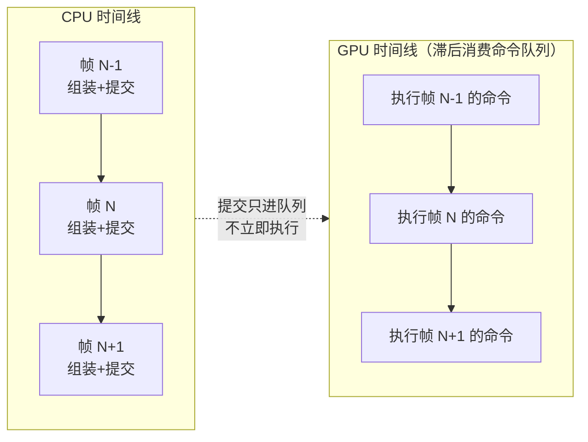
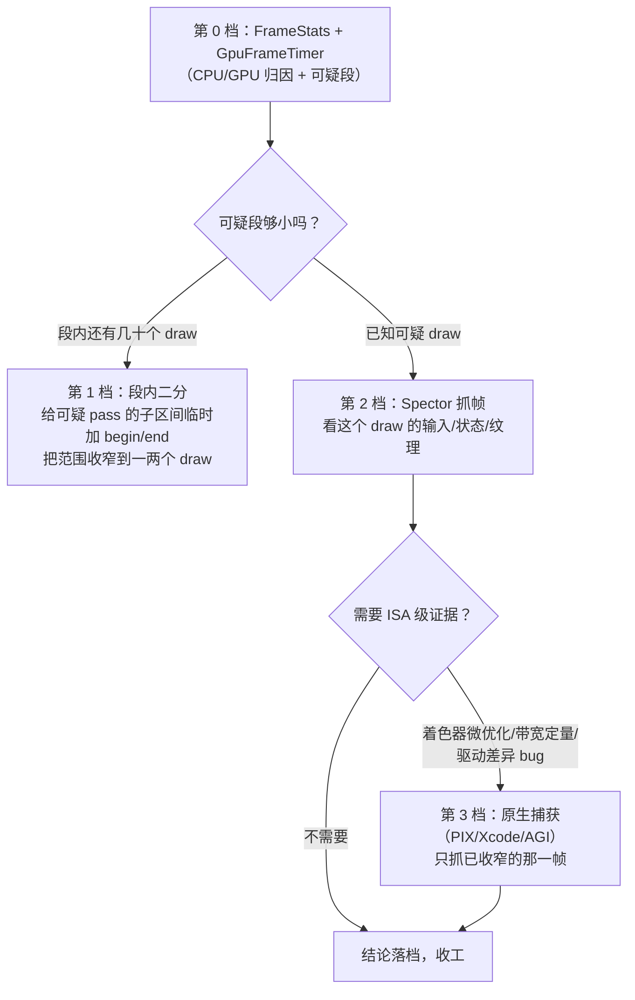

# GPU 性能度量与剖析

> [返回：WebGL 与 3D 框架学习大纲](../WebGL与3D框架学习大纲.md)
> 本文是第五阶段第 9 条「GPU 性能度量与剖析」的完整展开：WebGL 里测量 GPU 耗时的扩展怎么用、它的限制与可用性现状、怎样搭一个分阶段的帧耗时统计、怎样判断瓶颈在 CPU 还是 GPU、在顶点还是片元还是带宽，以及怎样借助原生图形调试器分析浏览器里的 WebGL 内容。它把 [07-性能优化与调试](07-性能优化与调试.md) 6.5.3 决策树里「靠试探间接推断 GPU」的那一层换成直接测量；阶段导览见 [01-导览](01-导览.md)。

## 9.1 CPU 帧时间不等于 GPU 时间

### 9.1.1 WebGL 是异步提交管线

[07 册](07-性能优化与调试.md) 6.1 画过那条命令链：JS 调用 → 浏览器校验序列化 → 驱动命令缓冲 → GPU 异步执行。关键在「异步」二字：**`drawElements` 返回时，GPU 还没开始画这个物体**——你的 JS 已经跑去做下一件事了。于是有三个彼此不同的时间：

| 量 | 测法 | 含义 |
|---|---|---|
| CPU 帧时间 | `performance.now()` 帧首尾差（07 册 FrameStats） | JS 组装并提交一帧命令的成本 |
| GPU 帧时间 | 本章的 timer query | GPU 实际执行这帧命令的时长 |
| 帧间隔（帧率倒数） | rAF 回调时间差 | 呈现节流（vsync、浏览器合成）+ 前两者的最大值 |

掉帧的原因只能是三类之一：**CPU 瓶颈**（提交太慢，GPU 在等饭吃）、**GPU 瓶颈**（执行太慢，CPU 早就交卷了）、**呈现/合成节流**（都不满，但 rAF 被浏览器按 vsync 节流，或合成器排队）。07 册 6.5.3 的决策树在第二层用「CPU 时间 vs 帧间隔 + 试探降负载」间接区分——那是因为当时还没有直接测 GPU 的工具。本章补上它。

一个常被忽略的细节：**帧间隔也不能当 GPU 时间**。GPU 命令队列有深度，浏览器合成器还要排队（标签页被切走时 rAF 直接停，但 GPU 时间不受影响）；反过来 GPU 跑完一帧后可能空等 vsync。判断归因必须同时看 CPU 时间与 GPU 时间两个独立测量。

### 9.1.2 本章要搭的东西

一个分阶段的统计：每帧对 shadow / scene / post 等 pass 各测一段 GPU 耗时，CPU 侧继续用 FrameStats，两组数字并排显示。效果是一张「本帧预算花在哪」的表格，9.4 讲怎么读它。

### 9.1.3 流水线视角：三帧为什么互相重叠

9.1.1 的三个量各自独立，根源在于 CPU 与 GPU 之间隔着一条**至少深一帧的命令流水线**。把连续三帧的时间轴画出来（CPU 在第 N 帧提交命令时，GPU 往往还在执行第 N−1 帧的）：



稳态下三个量的关系（每条都是四象限判定表的底层依据）：

1. **帧间隔 ≈ max(CPU 帧时间, GPU 帧时间, vsync 节拍)**——流水线两侧各自满负荷时互不等待，较慢的一侧决定节奏；都不满时 vsync 兜底。所以「CPU 6ms + GPU 8ms ≠ 14ms」是常态：两者是并行段，不是串联段，不能相加，只能各自与帧间隔比较；
2. **GPU 计时读数天然滞后**：timer query 要等 GPU 真正消费到那段命令才开始计时，而提交与执行之间隔着一帧队列——「结果落后 1~3 帧」不是实现瑕疵，是测量点在流水线上的物理位置决定的（9.2.4 限制清单第 4 条的机制来源）；
3. **归因要用「同一帧」配对**：帧 N 的 GPU 命令过重，掉帧会顶到帧 N+2 才呈现；帧 N 的 JS 卡住，命令提交晚了，GPU 反而在帧 N+1 空转。把「同一时刻看到的 CPU 读数」和「同一时刻看到的 GPU 读数」放一起下结论，可能把两侧的时间张冠李戴——GpuFrameTimer 的返回值带 frame 编号，就是为了这个对齐。

## 9.2 EXT_disjoint_timer_query_webgl2：语义与完整用法

### 9.2.1 查询对象与两种姿势

WebGL2 核心已经有查询对象（`createQuery`/`beginQuery`/`endQuery`/`getQueryParameter`，用于遮挡查询）；扩展 `EXT_disjoint_timer_query_webgl2` 在此之上加了**计时**语义：

- **区间耗时**：`gl.beginQuery(ext.TIME_ELAPSED_EXT, q)` … `gl.endQuery(ext.TIME_ELAPSED_EXT)`，q 的结果是这段命令在 GPU 上的纳秒数。**同一 target 同时只能有一个活动查询**，区间必须严格配对、不能嵌套；
- **时间戳**：`ext.queryCounterEXT(q, ext.TIMESTAMP_EXT)` 给 q 盖一个「当前 GPU 时间戳」，两个时间戳相减得到区间。适合跨多次提交测量；支持与否要看 `QUERY_COUNTER_BITS_EXT`（可能返回 0，表示时间戳不可用）。

### 9.2.2 异步协议：AVAILABLE 与 DISJOINT

查询结果是**异步**出来的——endQuery 之后这帧甚至后面几帧，结果才可用。读取协议（Khronos 扩展规范的标准示例就是这么写的）：

```typescript
// 伪代码：对每个已结束的查询
const available = gl.getQueryParameter(query, gl.QUERY_RESULT_AVAILABLE);
const disjoint = gl.getParameter(ext.GPU_DISJOINT_EXT);  // 每次读结果前查
if (available && !disjoint) {
  const nanoseconds = gl.getQueryParameter(query, gl.QUERY_RESULT); // GLuint64，纳秒
  // ...
}
if (available || disjoint) gl.deleteQuery(query); // 用完即删
```

两个纪律：

1. **先查 AVAILABLE 再读 RESULT**。结果没就绪就读 QUERY_RESULT 会强制同步等待（把整条流水线抽干），性能测量本身把性能测坏了；
2. **DISJOINT 为真时，此前所有计时结果作废**。GPU 时钟源失效（驱动复位、频率切换跨时钟域等）时计数器不可信，规范用 disjoint 标志通知你丢弃——这正是扩展名字里 "disjoint" 的含义。忽视它的症状是：偶尔蹦出一个离谱的读数（比如 3ms 的 pass 突然显示 40ms），污染统计。

结果的量纲是**纳秒**，64 位。JS 拿到的是 number（WebGL 会安全转换），除以 1e6 得毫秒。

### 9.2.3 完整实现：GpuFrameTimer

```typescript
// src/renderer/GpuFrameTimer.ts —— 分阶段 GPU 计时：查询池 + 帧延迟回收 + disjoint 处理

/** TS 内置 DOM 类型不含此扩展接口，按规范 IDL 手工声明 */
interface EXTDisjointTimerQueryWebGL2 {
  readonly TIME_ELAPSED_EXT: 0x88bf;   // 34919
  readonly TIMESTAMP_EXT: 0x8e28;      // 36424
  readonly GPU_DISJOINT_EXT: 0x8fbb;   // 36795
  readonly QUERY_COUNTER_BITS_EXT: 0x8864;
  queryCounterEXT(query: WebGLQuery, target: GLenum): void;
}

export interface GpuSectionTime { name: string; ms: number; frame: number }

export class GpuFrameTimer {
  /** 扩展不可用时整个模块退化为 no-op（调用方据此显示降级提示） */
  readonly available: boolean;
  disjointCount = 0;

  private readonly ext: EXTDisjointTimerQueryWebGL2 | null;
  private readonly pool: WebGLQuery[] = [];
  /** 本帧已 begin 的 section（endFrame 时转挂到 pending） */
  private current: { name: string; query: WebGLQuery }[] = [];
  /** 等待结果的查询，按帧归组 */
  private pending: { name: string; query: WebGLQuery; frame: number }[] = [];
  private frame = 0;

  constructor(private readonly gl: WebGL2RenderingContext) {
    this.ext = gl.getExtension('EXT_disjoint_timer_query_webgl2') as EXTDisjointTimerQueryWebGL2 | null;
    this.available = this.ext !== null;
  }

  beginFrame(): void {
    this.frame++;
    this.current.length = 0;
  }

  /** 在 pass 的绘制调用之前调用；名称相同时按出现顺序合并展示 */
  begin(name: string): void {
    if (!this.ext) return;
    const gl = this.gl;
    const query = this.pool.pop() ?? gl.createQuery()!;
    gl.beginQuery(this.ext.TIME_ELAPSED_EXT, query);
    this.current.push({ name, query });
  }

  /** 与 begin 严格配对（同一 target 不能嵌套/交叉） */
  end(): void {
    if (!this.ext) return;
    this.gl.endQuery(this.ext.TIME_ELAPSED_EXT);
  }

  /** 帧提交完成后调用：本帧查询转入待回收队列 */
  endFrame(): void {
    if (!this.ext) return;
    for (const s of this.current) this.pending.push({ ...s, frame: this.frame });
    this.current.length = 0;
  }

  /** 每帧调用一次：收割已完成的测量（毫秒）。disjoint 时丢弃全部并返回 null */
  poll(): GpuSectionTime[] | null {
    if (!this.ext) return null;
    const gl = this.gl;
    if (gl.getParameter(this.ext.GPU_DISJOINT_EXT)) {
      this.disjointCount++;
      for (const p of this.pending) this.pool.push(p.query); // 查询对象可复用
      this.pending.length = 0;
      return null;
    }
    const done: GpuSectionTime[] = [];
    const waiting: typeof this.pending = [];
    for (const p of this.pending) {
      if (gl.getQueryParameter(p.query, gl.QUERY_RESULT_AVAILABLE)) {
        const ns = gl.getQueryParameter(p.query, gl.QUERY_RESULT) as number;
        done.push({ name: p.name, ms: ns / 1e6, frame: p.frame });
        this.pool.push(p.query);
      } else {
        waiting.push(p);
      }
    }
    this.pending = waiting;
    return done.length > 0 ? done : null;
  }
}
```

挂进渲染循环（与 07 册 FrameStats 并排）：

```typescript
const gpuTimer = new GpuFrameTimer(gl);
if (!gpuTimer.available) console.warn('EXT_disjoint_timer_query_webgl2 不可用，GPU 段计时已禁用');

function frame(now: number) {
  // ... update ...
  gpuTimer.beginFrame();
  gpuTimer.begin('shadow');  renderShadowPass();  gpuTimer.end();
  gpuTimer.begin('scene');   renderScenePass();   gpuTimer.end();
  gpuTimer.begin('post');    renderPostPass();    gpuTimer.end();
  gpuTimer.endFrame();
  const done = gpuTimer.poll();      // 收割的通常是 1~2 帧前的结果
  if (done) hud.updateGpu(done);
  requestAnimationFrame(frame);
}
```

上面这段骨架的完整可运行样本是配套 demo `examples/11-gpu-timer`，读它时按这张地图对号（demo 的 GpuFrameTimer 与 9.2.3 的清单几乎逐行同源）：

| demo 里的东西 | 对应本节 | 走读时看什么 |
|---|---|---|
| `gpu-timer.ts` 全文件 | 9.2.3 | 池化（`pool.pop() ?? createQuery()`）、pending 队列按帧归组、poll 里先查 DISJOINT 再逐个查 AVAILABLE——9.2.2 协议的落地顺序 |
| 三个 GPU 段的括号配对 | 9.2.3 | `begin('shadow')…end()` → `begin('scene')…end()` → `begin('post')…end()` 顺序排布、零交叉（限制清单第 2 条） |
| 场景内容 | —— | 地面 + 10×10 盒子方阵（共 101 个物体），每个物体在 shadow 与 scene 两个 pass 各画一次——一帧 202 次 drawcall 的来源 |
| sceneFS 的 `uWorkload` 循环 | 9.4.3 | 片元里的可调 ALU 负载（累加 sin），循环结果乘进输出颜色——注释写明「不写进输出会被编译器整段删除」，这是所有负载实验的通用纪律 |
| postFS 的 3×3 模糊 | —— | 一个便宜但真实的全屏 pass（9 个权重和为 1），给 post 段一个基线负载 |
| HUD 的统计窗口 | 9.4 读法 | 每 0.5s 汇总一次：每段 avg/last/max 并排、disjoint 丢弃计数、CPU avg/max——「滑动平均 + 极值同显」的最小实现 |
| 扩展不可用的分支 | 9.3 | HUD 直接显示降级文案、归因退回 07 册试探法——「不可用即 no-op」的产品形态 |

一个值得注意的细节：demo 的 `calcShadow` 只做一次比较采样（08 册 demo 的 3×3 PCF 循环被刻意删掉了）——负载旋钮要独占 scene 段的变量，其余片元开销必须压到最低，否则旋钮拧出来的时间变化会混入别的因子。**做控制变量实验时，被测因子之外的一切都要尽量静默**，这与 9.4.3 实验表是同一条纪律。

### 9.2.4 限制清单（使用前必读）

1. **粒度与开销**：begin/end 之间是「这段命令的总时长」，包含 GPU 内部的空泡与状态切换，**拿不到单个 drawcall 的独立耗时**（可以给重点 draw 单独包一段，但段数多了，每个查询本身也有 µs 级开销，且堆积的查询拖慢提交）；
2. **同时只能一个活动查询**（同 target）：A 的区间没 end 就 begin B 是 `INVALID_OPERATION`；
3. **动态调频（DVFS）**：GPU 会随负载变频率，纳秒数在「发热降频」前后不可直接比较——绝对值只做本机相对分析，跨机器、跨时间段的对比看趋势不看数字；
4. **结果时延**：通常落后 1~3 帧，实时 HUD 要做滑动平均，别拿单帧数字调参；
5. **粒度上限**：时间戳查询可能不支持（`QUERY_COUNTER_BITS_EXT === 0`），区间查询一般可用但精度仍由驱动决定；
6. **它测的是 GPU 侧命令执行**，不含浏览器合成、页面 raster、上传数据的 CPU 时间——那些归 CPU 帧时间与 DevTools Performance 面板管。

## 9.3 可用性现状与降级策略

截至撰写时（2026-11，依据 caniuse 对该 API 的支持数据），`EXT_disjoint_timer_query_webgl2` 的支持面是：

| 浏览器 | 状态 |
|---|---|
| Chrome / Chromium 桌面版 | 支持（70 起） |
| Edge（Chromium） | 支持（80 起） |
| Firefox | 不支持 |
| Safari（含 iOS 上所有 WKWebView 系浏览器） | 不支持 |
| Android Chrome / 三星浏览器等移动端 | 不支持 |

这段历史的来龙去脉值得知道：WebGL1 时代的 `EXT_disjoint_timer_query` 曾在 Chrome 56~61 短暂提供，62~69 区间被移除，70 起以**仅限 WebGL2** 的 `EXT_disjoint_timer_query_webgl2` 形式恢复至今。移除与收紧的公开背景是安全权衡——高精度 GPU 计时器可以被当作计时侧信道的计时源（精确计时是此类攻击的原料，同期浏览器也普遍收紧了 `performance.now()` 的精度）。这也解释了为什么它至今只覆盖桌面 Chromium：这不是「没写完」，而是被有意限制的安全面。

工程含义三条：

1. **它是开发期工具，不是运行时依赖**。GpuFrameTimer 已经按「不可用即 no-op」设计，生产环境约七成用户拿不到 GPU 数据（覆盖率与上表一致）——线上性能监控仍要靠 CPU 侧指标 + 用户端帧率采样；
2. **开发流程里指定桌面 Chrome/Edge 跑性能基线**，CI 里 `chrome --headless` 同样能拿到该扩展；
3. **降级路径**：扩展缺失时回到 07 册 6.5.3 的试探法（降负载看帧率反应）；WebGPU 的 `timestamp-query` 是同一能力的继任者，见 [技术专题/04-WebGPU迁移指南](../技术专题/04-WebGPU迁移指南.md)。

## 9.4 分阶段帧耗时与瓶颈四象限

### 9.4.1 示意读数

把 GpuFrameTimer 与 FrameStats 并排，典型的一张表长这样（**数字是示意，用于说明读法**，不是任何实测）：

```text
            CPU(ms)   GPU(ms)
shadow        0.8      1.9
scene         6.1      8.4
post          1.2      5.7
─────────────────────────────
合计          8.1     16.0    帧间隔 16.9ms（59fps）
```

读法：GPU 合计 16.0ms 贴着帧间隔、CPU 只有 8.1ms——**GPU 瓶颈**；GPU 预算里 post 占 5.7ms，与 scene 的 8.4ms 几乎同量级——后处理链是首要优化对象（半分辨率 bloom、砍 pass），其次才是场景 pass。如果反过来 CPU 15ms、GPU 6ms，优化清单会完全不同（合批、剔除、JS 热点）。

### 9.4.2 四象限判定

| | GPU 时间低 | GPU 时间高 |
|---|---|---|
| **CPU 时间高** | CPU 瓶颈：合批、剔除、上传（07 册 6.1~6.3） | 双侧饱和：先砍最贵的一侧，再看另一侧是否滑入瓶颈（优化是接力赛） |
| **CPU 时间低** | 都不满还掉帧 → 呈现/合成问题：vsync 节流、标签页节流、合成器排队；查 `requestAnimationFrame` 间隔的抖动与 `document.visibilityState` | GPU 瓶颈：进入 9.4.3 的对照实验 |

两个提醒：四象限的阈值不是绝对数（60fps 预算 16.6ms，但 GPU 时间还要给合成器留量）；GPU 瓶颈判定要看**趋势稳定**的读数（DVFS 前几帧频率没爬上来，数字会骗人，取滑动平均）。

### 9.4.3 GPU 瓶颈之内：顶点 / 片元 / 带宽的对照实验

判定矩阵回答「是不是 GPU」，粒度到此为止——timer query 按段计时，不区分段内是顶点贵还是片元贵。往下拆靠**控制变量实验**：一次只改一个因子，看 GPU 段时间怎么动：

| 实验 | 改什么 | GPU 时间显著下降 ⇒ | 混淆因素 |
|---|---|---|---|
| 降分辨率 | 渲染目标减半（片元数 ÷4） | 片元/填充率瓶颈（overdraw、片元着色器 ALU） | 也会少一半纹理带宽，若同时下降更多，两项都有 |
| 换低模 | 顶点数/三角形数减半 | 顶点瓶颈（顶点着色器、图元装配） | 注意 drawcall 数别同时变 |
| 换小纹理 | 纹理尺寸减半或改 KTX2 压缩 | 带宽瓶颈 | 顺便降显存，不影响计算量——纯带宽实验 |
| 简化着色器 | 片元着色器删一段 ALU（如 PBR 简化） | 着色器 ALU 瓶颈 | 与「降分辨率」交叉验证：片元数不变时纯看每片元成本 |

这套实验与 07 册 6.5.3 决策树的 D 分支一一对应，差别是：**决策树用帧率当指示剂，这里用 GPU 段时间当指示剂**——后者灵敏得多（帧率有 vsync 天花板，16ms 之内的时间变化在帧率上看不出来）。

### 9.4.4 一次完整的旋钮实验：在 demo 里走通「假设→测量→验证」

examples/11-gpu-timer 的 ↑/↓ 旋钮（uWorkload，0~96、步进 8）就是一张可以亲手拧的 9.4.3 实验表。完整的实验流程与预期读法：

1. **基线**：旋钮归 0，录 10 秒 HUD（20 个 0.5s 窗口），记下三段的 avg 与 max——这是你的本机基线，DVFS 纪律（9.2.4 第 3 条）意味着别拿去和别人的机器比；
2. **单因子加载**：按 ↑ 逐步加大 workload（每次 +8），每档等 2~3 秒再读数（等滑动平均稳定，也等 GPU 频率爬到稳态）。预期形态：**scene 段 avg 随档位近似线性爬升，shadow 与 post 两段纹丝不动，CPU avg 不动**——负载只加在 scene 的片元 ALU 上，其余段没有理由变化；任何「无关段」跟着动，都说明有别的变量混进来了（比如分辨率变了、窗口被遮挡触发了合成器行为）；
3. **读数验证**：scene 段涨、其他段不动 ⇒ 单位片元成本瓶颈（9.4.3 表第 4 行「着色器 ALU」列的活体证据）；同时帧率只在 GPU 总时间越过 vsync 线后才掉——「16ms 之内的变化帧率看不见」这句话的亲手验证；
4. **反向验证**：旋钮从高档快速归 0，GPU 时间应立即回落（1~3 帧延迟之后）——读数的因果方向确认无误；
5. **记录**：按 07 册 6.5.4 的四段式写一条（发现/定位/优化/复测）。这次实验没有「优化」，但它训练的是决策树最难的那一层——**用可控的单因子实验把「GPU 瓶颈」拆到「片元 ALU」粒度**，毕业项目性能组验收时会反复用到这个手法。

把旋钮换成别的因子，同一套流程就是任何瓶颈实验的模板：改分辨率（验证填充率）、换低模（验证顶点）、换小纹理（验证带宽）——demo 只内置了 ALU 一个旋钮，其余三个因子要你在自己的场景里造同样的「旋钮」（uniform 开关、几何开关、纹理开关各留一个调试入口）。

## 9.5 借助原生图形调试器分析浏览器里的 WebGL

### 9.5.1 为什么可以：ANGLE 翻译层

浏览器的 WebGL 实现几乎都经 **ANGLE**（Almost Native Graphics Layer Engine）：WebGL/GLES 命令被翻译成当前平台的原生 API——Windows 上默认 D3D11、macOS 上 Metal、Linux 上 Vulkan/GL、Android 上 GLES/Vulkan。这意味着**原生图形调试器看到的浏览器帧，是 ANGLE 翻译后的原生命令**：drawcall 语义一一对应（仍能对上你的 JS 调用序列），但资源编号、着色器已变成 HLSL/MSL/SPIR-V。这层翻译正是原生工具能附着浏览器的原因，也是读帧时要心里有数的地方。

### 9.5.2 各平台路线

原生工具能给出 timer query 给不了的东西：**逐事件 GPU 耗时、显存带宽估算、着色器 ISA 反汇编**。路线按平台：

| 平台 | 工具 | 附着浏览器的方式 | 状态说明 |
|---|---|---|---|
| Windows | PIX / Visual Studio 图形调试器（D3D） | Chrome/Edge 走 ANGLE D3D11；需以调试参数启动浏览器（关闭 GPU 沙箱等），具体开关随版本变化 | 老牌路线，可行性最高 |
| macOS | Xcode 的 Metal GPU 帧捕获 | Chrome 走 ANGLE Metal 后端，Xcode 附着 Chrome 进程后捕获 | Chromium 官方 GPU 调试文档有专门章节，参数与版本强相关，动手前先查当前文档 |
| Android | Android GPU Inspector（AGI） | AGI 帧捕获面向 GLES/Vulkan 应用，可捕获 Chrome 的 WebGL 内容（官方文档有 WebGL 追踪说明） | 分析真机驱动的唯一正路；需要可调试的设备配置 |
| 跨平台 | RenderDoc | 官方 FAQ 未提供桌面 Chrome 捕获支持——GPU 进程沙箱使注入式抓帧不可靠；其 GLES 捕获层面向原生 Android 应用 | 桌面浏览器路线**不推荐**，别在这上面浪费时间 |

三条务实建议：

1. **先 Spector + GpuFrameTimer，再上原生工具**。API 层能回答的问题（画了什么、状态对不对、哪个段贵）不需要 ISA 级证据；原生工具是为「着色器微优化、带宽定量、驱动差异 bug」准备的；
2. **抓帧在精不在多**：原生捕获文件巨大（一帧几百 MB 不稀奇），先用 timer query 把可疑 pass 收窄到一两个 draw，再抓那一帧；
3. **版本敏感**：浏览器的调试开关与后端默认值随版本变（例如 ANGLE 后端可用 `--use-angle=...` 显式指定），动手前查 Chromium 的 GPU 调试文档与 `chrome://gpu`（能看到当前 ANGLE 后端）——本文不锁死具体参数，避免过时。

### 9.5.3 接力流程：从 timer query 到原生捕获

三档工具不是并列选项，而是一条**逐级收窄的接力链**——每一档的产出都是下一档的输入，反过来跳级是常见的浪费：



接力的纪律有三条：

1. **降档取证永远先于升档**：跳过第 0/1 档直接抓原生帧，等于在几百 MB 的捕获文件里大海捞针——9.5.2 建议 2「抓帧在精不在多」的操作形态就是这张图的左半边；
2. **第 1 档的二分是临时插桩**：给嫌疑区间临时包 begin/end，定位完立刻拆掉——段数多了查询本身的开销会污染测量（9.2.4 限制清单第 1 条）；
3. **每档的结论都写四段式记录**（07 册 6.5.4）：接力链上任何一档回答了问题就停，别为了「证据更硬」多跑一档——工具链的深度是成本，答案够用就收工。

## 常见坑

1. **QUERY_RESULT 不查 AVAILABLE 就读**——强制同步、抽干流水线；测量工具本身把被测对象拖慢，读数全废。协议永远是 AVAILABLE → DISJOINT → RESULT。
2. **无视 GPU_DISJOINT_EXT**——偶发的离谱读数（时钟源失效）混进滑动平均，你会上调错误的参数。disjoint 期间全部丢弃并计数。
3. **每帧 createQuery/deleteQuery**——查询对象免费但也不无限，规范允许驱动限额；用池（9.2.3 的 pool）。
4. **两个 section 嵌套 begin**——同 target 活动查询只能有一个，嵌套直接 `INVALID_OPERATION`，后一个 begin 被忽略、你的区间从此错位。begin/end 必须像括号一样配对。
5. **拿纳秒绝对值跨机器比较**——DVFS、驱动、时钟粒度全不同；绝对值只在本机做相对分析，跨机器只比「相对占比」。
6. **生产环境依赖该扩展**——覆盖率约三成（9.3），线上必须能整体退化；把它当 DevTools 的延伸而不是产品功能。
7. **把帧间隔当 GPU 时间**——合成器节流、vsync、标签页省电策略都会污染帧间隔；GPU 归因只能用 timer query 的读数。
8. **期待 queryCounterEXT 时间戳**——`QUERY_COUNTER_BITS_EXT` 可能为 0（不支持），区间式 begin/end 才是保底姿势。
9. **只在有扩展的机器上做性能验收**——基线机器要固定（桌面 Chromium），但结论要在无扩展环境用试探法复核一遍，防止「只在能测的机器上测」造成盲区。
10. **把三段 GPU 时间相加当成总 GPU 占用**——begin/end 只覆盖区间内部，段与段之间的 clear、状态切换、FBO 切换、空闲缝隙**不属于任何一段**，sum 通常略小于真实 GPU 占用；demo HUD 里写的「合计 ≈」带着约等号就是这个原因。需要精确总量时给整帧包一层 begin/end（两层区间测总量、内层测占比），或接受这个系统性低估。
11. **统计窗口太短、只看 last**——单帧读数被 DVFS 频率爬坡、异步测量延迟、偶发 disjoint 污染；demo 的 0.5s 窗口（约 30 帧样本）是最低配置，avg 看趋势、max 看尖峰、last 只用来确认「新读数还在来」。

## 本节自测

1. 一次 `drawElements` 从 JS 返回到像素出现在屏幕上，经过哪几段异步环节？由此解释 CPU 帧时间、GPU 帧时间、帧间隔三个量为什么可能相差很大。
2. 写出读取 timer query 结果的三步协议（AVAILABLE → DISJOINT → RESULT），并说明跳过第二步会出现什么现象、跳过第一步会出现什么现象。
3. GPU_DISJOINT_EXT 的语义是什么？「disjoint」这个词指的是谁和谁 disjoint？
4. 为什么这个扩展能测「一段命令」却测不了「单个 drawcall」？给重点 drawcall 计时的正确姿势是什么、代价是什么？
5. 某帧 CPU 6ms、GPU 15.2ms、帧间隔 33ms（30fps）：掉帧的原因是什么？下一步查什么？（提示：三个量都对不上号的那种情况。）
6. 设计一个实验区分「片元着色器 ALU 瓶颈」与「纹理带宽瓶颈」，要求控制变量并说明读数怎么解读。
7. DVFS 为什么会让你的 GPU 时间读数前后不可比？工程上怎么对付（两个手段）？
8. ANGLE 在这条工具链里扮演什么角色？为什么 RenderDoc 抓不了桌面 Chrome 的帧，而 Xcode/PIX/AGI 能附着各自的浏览器？
9. 该扩展的浏览器支持现状如何（截至撰写时）？为什么说它是「有意受限的安全面」而不是「实现没跟上」？生产环境的降级策略是什么？
10. 用 9.1.3 的流水线视角解释两件事：为什么 GPU 计时结果落后 1~3 帧是工具的固有属性？为什么「CPU 6ms + GPU 8ms」的帧率可能仍然是 60fps？
11. 三段 GPU 时间之和为什么通常小于整帧真实 GPU 占用？被漏掉的时间藏在哪些操作里？要拿到更接近总量的数字有哪两种做法？
12. 在 examples/11-gpu-timer 里把 workload 逐步调大：预期哪一段变化、哪几段不变、CPU 读数怎么动？如果 shadow 段也跟着涨了，说明实验混入了什么，下一步怎么排查？
