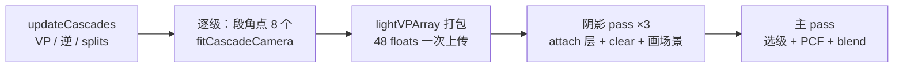

# 级联阴影 CSM

> [返回：WebGL 与 3D 框架学习大纲](../WebGL与3D框架学习大纲.md)
> 本文是第五阶段第 10 条「级联阴影 CSM」的完整展开：从单张 shadow map 的精度天花板推导出级联的必要性（texel 世界尺寸随视深变化的数学），给出 practical split scheme 的分割公式与直观解释，逐级讲光正交相机的 tight fitting 与 texel snapping 稳定化、随级缩放的 bias 与级间 blend band，最后落在 WebGL2 的深度纹理数组实现——选级与 PCF 采样的着色器逐行讲解，并给出条纹/漏光/peter-panning/seam 的成因对照表。它是 [02-阴影与PCF软阴影](02-阴影与PCF软阴影.md) 的实现续篇（该册常见坑 5 里那句「光锥应覆盖相机可见范围，或上 CSM」正是本文）；配套示例 `examples/12-csm`（λ 调整、纹素对齐开关、按级染色、光锥线框）；阶段导览见 [01-导览](01-导览.md)。

## 10.1 为什么需要级联：单张 shadow map 的精度天花板

### 10.1.1 texel 世界尺寸随视深变化的数学

[02 册](02-阴影与PCF软阴影.md) 1.4 第 2 条给过结论：阴影质量由「每个纹素覆盖多少世界单位」决定，$s = W / R$（W 是光锥宽度，R 是分辨率）。当时场景小，把光锥收紧就够了。把相机视程一拉长，问题就回来——**透视相机的可见范围随视深线性膨胀**：

- 视深 z 处的视锥竖直高度 $h(z) = 2z\tan\frac{fov}{2}$，水平宽度再乘 aspect；
- 单张 shadow map 想罩住整段视程，光锥就得按远端口径取宽。

用 demo 的相机算一笔账（fov 55°、near 0.5、far 100，取 aspect = 1 按竖直方向估）：$\tan 27.5° \approx 0.52$，$h(100) \approx 104$ m，加余量后 W ≈ 105+。于是 2048² 的单张图：

| 观察距离 z | 该处视锥竖直宽度 | 单张 texel 世界尺寸 | 0.5 m 物体的影子宽度 |
|---|---|---|---|
| 1 m | 1.04 m | ≈ 5 cm | ≈ 10 texel |
| 100 m | 104 m | ≈ 5 cm | ≈ 10 texel |

近处 0.5 m 的小物体只有约 10 个纹素宽的影子：边缘台阶肉眼可见，bias 稍小就 acne；而它在屏幕上可能占几百个像素。**矛盾的本质：透视相机在世界空间的信息密度按 1/z 衰减，而单张正交 shadow map 的世界采样密度是个常数**。两者天然错配——加分辨率只能把常数变小，错配依旧。

demo 的 HUD 第四行把这场对比打成实况：三级各自的 texel 世界尺寸 + 括号里「单张罩全程」的对照值（宽高比、光方向不同数字会浮动，量级差稳定在一个数量级附近）。

### 10.1.2 两条老路的极限

1. **加分辨率 R**：texel 尺寸减半要 R×4。`DEPTH_COMPONENT24` 每纹素 3 B：2048² = 12.6 MB、4096² = 50 MB、8192² = 201 MB——移动端直接出局，桌面也疼在带宽；深度 pass 的绘制成本还一点没省。
2. **收紧光锥 W**：02 册的正解。但 W 必须覆盖「玩家看得到的范围」，把 far 从 100 砍到 20 是策划问题不是工程问题。

第三条路：**别用一张图伺候整段视程**。把视锥沿视深切成 N 段，每段单独拟合一个小光锥、单独渲染一张深度图——近段锥小 texel 细，远段锥大 texel 粗，但远处在屏幕上本来就没几个像素，粗一点看不出来。这就是级联阴影（Cascaded Shadow Maps，CSM）。级联的意义就写在 demo `csm.ts` 的 `CascadeCamera` 注释里：`texelWorldSize` 这个数**逐级变小**。

## 10.2 级联划分：分割面怎么定

把视程 $[n, f]$ 切成 N 段，分割面 $0 < z_1 < z_2 < \dots < z_N = f$（z 取视深，正数；$z_0 = n$）。三个方案，从直觉到工业。

### 10.2.1 均匀分割：$uni_i = n + (f-n)\cdot i/N$

最直观的等距切分。问题：透视下「远处 33 m 长的一段视锥」在屏幕上可能只占十几行像素，却在深度轴上吃掉了 $(f-n)/N$ 的预算；近处段还是太长、texel 还不够细。demo 按 `[` 键把 λ 调到 0 就是它——分割深度变成 0.5 → 33.7 → 66.8 → 100，第一级要管到 33.7 m，HUD 里近级 texel 尺寸立刻恶化一截。

### 10.2.2 对数分割：$log_i = n\cdot(f/n)^{i/N}$

分割面按几何级数排：每段末端深度是前一段的 $(f/n)^{1/N}$ 倍。直觉来源：透视投影里一个屏幕像素对应的世界尺寸 ∝ z（[数学专题/02-仿射几何与齐次坐标](../数学专题/02-仿射几何与齐次坐标.md) 的透视压缩）；若想让「每级 texel 世界尺寸 / 该级平均视深处的像素世界尺寸」逐级一致（等相对误差），每段段长就应当 ∝ 该段深度——等比数列恰好如此。极限行为正确：近处切得极细，远处段落极长。缺点有二：纯对数时第一段可能小到装不下近处的大物体（近处也有墙）；远处段太长，远处的 acne 与 bias 又回来了。

### 10.2.3 practical split scheme：两者线性混合

Zhang et al. 2006（*Practical Split Scheme for Cascaded Shadow Maps*）给出工程答案：

$$z_i = \lambda \cdot log_i + (1-\lambda)\cdot uni_i$$

λ ∈ [0,1]：λ = 1 纯对数、λ = 0 纯均匀。λ 是「理论最优」与「工程保守」之间的手感旋钮，工业常用 0.5~0.95，demo 默认 0.85。贴 `csm.ts` 的实现：

```typescript
export function practicalSplits(
  near: number, far: number, count: number, lambda: number,
): number[] {
  const splits: number[] = [];
  for (let i = 1; i <= count; i++) {
    const log = near * Math.pow(far / near, i / count);
    const uni = near + ((far - near) * i) / count;
    splits.push(Math.min(lambda * log + (1 - lambda) * uni, far));
  }
  return splits;
}
```

四行分别是：对数面、均匀面、混合、clamp 到 far。注意 i = N 时 $log_N = uni_N = f$ 恒成立，clamp 只是防御浮点误差——不是逻辑分支。

demo 的数值（n = 0.5、f = 100、N = 3、λ = 0.85）：

| i | $log_i$ | $uni_i$ | $z_i$ |
|---|---|---|---|
| 1 | 2.92 | 33.67 | 7.54 |
| 2 | 17.10 | 66.83 | 24.56 |
| 3 | 100 | 100 | 100 |

近景小物（demo 里 0.3~1.8 m 那几个盒子与球）全落在第一级 7.5 m 内，中景柱阵归第二级，远景高塔归第三级——demo 场景就是按这三段布置的。按 `[` / `]` 调 λ 观察 HUD 的分割深度：λ → 1 时近级边界收缩到约 2.9 m（更细但覆盖变小，近处的物体被推给第二级）、λ → 0 时扩到 33.7 m（覆盖大但变粗）。**λ 换的是「近级质量」与「近级覆盖」**。

两个实务点：

1. N 的选择：3 是教学与移动端的起点，桌面常用 4（UE 默认 4）。每加一级 = 阴影 pass 多画一遍场景 + 约 12.6 MB（2048²）显存；
2. 分割面定义在**视深**上，选级时着色器拿到的必须是同一个量（10.5.2），混用 gl_FragCoord.z 这类非线性深度会把 seam 推到错误位置。

## 10.3 每级光正交相机：tight fitting 与稳定化

### 10.3.1 光对齐基：为什么 eye 放在原点

08 示例 `shadow.ts` 的 `fitLightCamera` 用 `lookAt(lightPos, center, up)`——eye 从场景中心沿光的反方向拉出一个对角线长度，视图矩阵**含平移**。CSM 不这么干：

```typescript
export function createLightBasis(lightDir: Vec3): Mat4 {
  return new Mat4().lookAt(
    new Vec3(0, 0, 0), new Vec3(lightDir.x, lightDir.y, lightDir.z), new Vec3(0, 1, 0),
  );
}
```

eye 放在原点、center 是单位光方向：**光视图只剩旋转，平移分量恒为零**。方向固定的平行光下这个基逐帧不变。它是 10.3.3 纹素格线能锚定在世界原点的前提。平移去哪了？塞进 ortho 的参数里（10.3.2 最后一步），随每帧拟合结果变。up 与光方向接近平行时 lookAt 退化，`src/common/math.ts` 的实现会自动换参考轴（02 册常见坑 6 的同款保护）。

### 10.3.2 视锥段角点与 tight fitting

第 i 级要罩住的空间是视锥段 $[z_{i-1}, z_i]$。拟合三步。

**第一步：段的 8 个角点。** 直接逆投影远面角点要处理 w（远面 w = z），demo 用射线缩放法绕开了：

```typescript
const kNear = depthNear / cameraNear;
const kFar = depthFar / cameraNear;
for (let i = 0; i < 4; i++) {
  const ndcX = i & 1 ? 1 : -1;
  const ndcY = i & 2 ? 1 : -1;
  const h = transformHomogeneous(inverseVP, ndcX, ndcY, -1, 1); // 近平面 4 角之一
  const w = h.w === 0 ? 1 : h.w;
  const dx = h.x / w - cameraPosition.x;   // 相机 -> 锥角 的方向（未归一化）
  const dy = h.y / w - cameraPosition.y;
  const dz = h.z / w - cameraPosition.z;
  out[i * 2].set(cameraPosition.x + dx * kNear, ..., cameraPosition.z + dz * kNear);
  out[i * 2 + 1].set(cameraPosition.x + dx * kFar, ..., cameraPosition.z + dz * kFar);
}
```

NDC 的 $(\pm1, \pm1, -1)$ 逆投影出**近平面**的 4 个角，得到「相机 → 锥角」方向 d（长度恰为 near 的几何倍数）。透视投影沿射线是线性的：射线上 $-z_{view} = k \cdot near$ 当且仅当缩放系数是 k——所以 `d * (depth / near)` 精确落在给定视深处。一次逆投影 + 8 次标量乘，完全不碰 w。

**第二步：角点变换到光对齐空间取三轴 min/max。**

```typescript
const x = e[0] * p.x + e[4] * p.y + e[8] * p.z;  // 光基第 0 行 · 点
```

光基无平移，光空间坐标就是基矩阵三个行向量与点的点积（列主序 elements 里 e[0], e[4], e[8] 正是第一行）。8 点取 min/max——**正交投影下 AABB 就是精确包围**，一丁点不浪费。02 册 1.1.3 对「场景 AABB」做过同样的事，这里对象换成了「视锥段」：不再问「场景有多大」，改问「这一段里相机看得见什么」——这就是 tight fitting 的含义。

**第三步：加余量、（可选）纹素对齐、交给 ortho。**

```typescript
minX -= FIT_MARGIN; maxX += FIT_MARGIN;   // 三轴同理
if (snapTexels) { /* 10.3.3 */ }
out.lightVP.ortho(minX, maxX, minY, maxY, -maxZ, -minZ).multiply(lightBasis);
out.texelWorldSize = (maxX - minX) / shadowSize;
out.depthRange = maxZ - minZ;
```

`ortho(...).multiply(lightBasis)`：列主序下矩阵连乘作用于列向量，顶点先过光基（世界 → 光对齐）再过正交投影。z 参数取反传入（`-maxZ, -minZ`）：光对齐空间里「靠近光源」在 -z 侧——与 08 示例 `shadow.ts` 的约定一字不差。FIT_MARGIN = 3（世界单位）有三个用途：容纳视锥外但会把影子投进本段的投射物（站在你身后、影子伸到眼前的柱子）、3×3 PCF 的采样半径、法线偏移量。

顺带产出两个派生量：`texelWorldSize = (maxX - minX) / shadowSize`——HUD 打印、bias 换算都吃它；`depthRange = maxZ - minZ`——该级沿光方向的深度跨度，bias 归一化用（10.4.2）。

### 10.3.3 texel snapping：消 shimmer

02 册 1.4 第 3 条描述过 shimmer：光锥每帧重拟合，锥边界与纹素格线的相对位置亚纹素地漂移，静态物体的阴影边缘逐帧「冒麻点」。当时的解法是把光视图的平移量化到纹素网格。CSM 里每级都要做，demo 用了个更顺手的写法——**量化范围而不是反解平移**：

```typescript
if (snapTexels) {
  const tx = (maxX - minX) / shadowSize;   // 一个纹素的世界尺寸
  const ty = (maxY - minY) / shadowSize;
  const tz = (maxZ - minZ) / shadowSize;
  minX = Math.floor(minX / tx) * tx; maxX = Math.ceil(maxX / tx) * tx;
  minY = Math.floor(minY / ty) * ty; maxY = Math.ceil(maxY / ty) * ty;
  minZ = Math.floor(minZ / tz) * tz; maxZ = Math.ceil(maxZ / tz) * tz;
}
```

把三个轴的 [min, max] **向外**取整到纹素尺寸的整数倍（floor 收 min、ceil 放 max，只放大不缩小）。为什么这能稳定：光基锚在世界原点（10.3.1），纹素格线因此在世界空间是一组固定的平面（过原点、间距一个纹素世界尺寸）；范围量化后，光锥边界永远落在格线上——相机的亚纹素移动不再带动「采样点在物体表面上的落点」漂移，shimmer 消失。它与 02 册「量化平移」版本数学上等价（格线动锥不动 vs 锥动格线不动），但不用从矩阵里反解平移再重组矩阵，直接在拟合参数上做，少一次矩阵往返、也不怕实现细节不一致。

z 轴也 snap 有个额外好处：`depthRange` 量化后逐帧稳定，`uBiasTexelNdc = texelWorldSize / depthRange` 不再抖——否则 bias 本身会成为阴影闪烁源。

demo 按 S 关掉 snapping 再缓慢拖拽相机：阴影边缘开始「沸腾」。同一物体、同一光源，唯一变量是格线对齐——这是理解该技术价值的最快实验。

## 10.4 级联下的 bias：失效、随级缩放与接缝

### 10.4.1 单张时代的 bias 为什么失效

02 册 1.2 推导过：深度量化误差在斜面上放大，误差 ≈ texel 世界尺寸 × tanθ，bias 的职责是垫掉这个量。级联带来三个新事实：

1. **常量 bias（深度坐标单位）失效**：同一深度偏移在第 0 级与第 2 级对应的世界偏移差一个量级（两级 depthRange 不同）——近级不够（acne），远级过量（peter-panning），一个数伺候不了两级；
2. **slope-scaled bias 的量纲要换算**：误差正比于「该级的 texel 世界尺寸」，公式里的系数必须逐级传入；
3. **normal offset 的量纲是世界单位**：把采样点沿法线抬离表面那段距离，单张时一个全局值；级联下近级 texel 4 mm、远级 5 cm——同一个 offset 近级过量（漏光、接触阴影脱节）、远级不够（acne）。

结论一句话：**bias 家族的所有参数都要以「纹素」为单位随级缩放**。

### 10.4.2 demo 的三件套

主循环每帧按级上传（贴 `main.ts`）：

```typescript
gl.uniform1fv(gl.getUniformLocation(mainProgram, 'uNormalOffset[0]'),
  cascades.map((c) => c.texelWorldSize * 1.5));           // 法线偏移 = 1.5 纹素
gl.uniform1fv(gl.getUniformLocation(mainProgram, 'uBiasTexelNdc[0]'),
  cascades.map((c) => c.texelWorldSize / c.depthRange));  // 一个纹素折算的深度坐标
```

着色器里消费第二个：

```glsl
float texelNdc = uBiasTexelNdc[c];
float bias = max(2.0 * texelNdc * (1.0 - dot(N, L)), 0.25 * texelNdc);
```

slope-scaled 项：正对光的平面（N·L → 1）bias 收到下限 0.25 纹素；掠射面（N·L → 0）放大到 2 纹素——tanθ 的线性近似。注意 `uBiasTexelNdc` 的分母是 depthRange 而**不是** 2·depthRange：采样用的深度 `proj.z = sc.z * 0.5 + 0.5` 已经在 [0,1] 窗口深度里，一个纹素的世界尺寸折算过去就是 texelWorldSize / depthRange（uniform 名字里带 Ndc 是口误，量纲其实是窗口深度——读代码时别被名字带偏）。

normal offset 与 depth bias 双管齐下是工业标配：前者治「采样点钻进表面下」（把采样点搬到表面上方，光锥里看到的是抬起来的位置），后者治「PCF 邻域跨越表面」（比较前先把参考深度垫高）。两者都过量的症状是接触阴影脱节（peter-panning）——demo 里近景小物的影子根部如果悬空，先把 1.5 这个系数往下调，而不是先动 slope 公式。

### 10.4.3 seam 与 blend band

选级是硬切换：vViewDepth 落在分割面另一侧就换一张图。两级的光锥不同、texel 尺寸不同、PCF 模糊半径（换算回世界单位）不同——同一条阴影边在分割面两侧的亮度与软硬不一致，画面上呈现为一条沿等视深线的阶跃（seam）。demo 的解法是级间过渡带：

```glsl
// calcShadow 内：本级结果 s 已算好
if (c < 2) {
  float segNear = uNearDepth;
  if (c > 0) segNear = uSplitFar[c - 1];
  float t = (uSplitFar[c] - vViewDepth) / (uSplitFar[c] - segNear); // 1=段首 0=段尾
  if (t < uBlendBand) {
    float w = smoothstep(0.0, uBlendBand, t);   // 段尾处 w=0
    s = mix(sampleCascade(c + 1, N, L), s, w);
  }
}
```

逐行读：先恢复本段首尾（首级的段首是相机 near，其余级是上一级分割面）；t 是段内归一化位置（段首 1、段尾 0）；在段尾 `uBlendBand` 比例范围内（demo 取 0.15，即该级深度区间的 15%），用 smoothstep 把「本级结果」滑向「下一级结果」，且恰好在分割面上 w = 0——与硬切换到 c+1 级连续，不存在亮度跳变。带内两级各采一次（成本翻倍，但只发生在 15% 的带里）。

边界情形：末级（c = 2）段尾没有下一级可混——无所谓，视锥 far 之外没有像素；首级段首 t = 1 永远进不了带。

一个联动细节：带内两级结果能平滑混合的前提是两级参数本身连续——10.4.2 的参数随 texelWorldSize 缩放，而 texelWorldSize 逐级按分段幂函数平滑增长，所以带内混合的两个结果天然接近。若你手工把某级的 bias 调得离谱，blend band 也救不回来。

## 10.5 WebGL2 实现路线：深度纹理数组、选级与 PCF

### 10.5.1 三张 TEXTURE_2D vs 一张 TEXTURE_2D_ARRAY

两条实现路线：

| 方案 | 资源占用 | 选级方式 | 代价 |
|---|---|---|---|
| N 张 TEXTURE_2D + N 个 sampler2DShadow | N 纹理、N 个纹理单元 | ES 3.00 里采样器数组**不能动态索引**，只能 if 链逐级分支 | 状态切换多、着色器啰嗦 |
| 1 张 TEXTURE_2D_ARRAY + sampler2DArrayShadow | 1 纹理、1 个单元 | 层号是采样坐标的第 3 分量，动态合法 | 需要逐层挂 FBO 附件 |

demo 用数组纹理。创建（`csm.ts` 的 `createCascadeShadowTarget`）：

```typescript
gl.bindTexture(gl.TEXTURE_2D_ARRAY, texture);
// texStorage3D 不可变分配：一次建好全部层，比逐层 texImage3D 少驱动往返
gl.texStorage3D(gl.TEXTURE_2D_ARRAY, 1, gl.DEPTH_COMPONENT24, size, size, layers);
gl.texParameteri(gl.TEXTURE_2D_ARRAY, gl.TEXTURE_MIN_FILTER, gl.LINEAR);
gl.texParameteri(gl.TEXTURE_2D_ARRAY, gl.TEXTURE_MAG_FILTER, gl.LINEAR);
gl.texParameteri(gl.TEXTURE_2D_ARRAY, gl.TEXTURE_COMPARE_MODE, gl.COMPARE_REF_TO_TEXTURE);
gl.texParameteri(gl.TEXTURE_2D_ARRAY, gl.TEXTURE_COMPARE_FUNC, gl.LEQUAL);

const fbo = gl.createFramebuffer();
gl.bindFramebuffer(gl.FRAMEBUFFER, fbo);
gl.framebufferTextureLayer(gl.FRAMEBUFFER, gl.DEPTH_ATTACHMENT, texture, 0, 0);
gl.drawBuffers([gl.NONE]);
gl.readBuffer(gl.NONE);
```

要点逐条：

- `texStorage3D` 做不可变分配：层数、尺寸、格式一次敲定，之后整层整层往里渲染；
- 深度附件**不能把整张数组挂上去**——FRAMEBUFFER 的 DEPTH_ATTACHMENT 只认单层。所以 FBO 只建一个，渲染前用 `framebufferTextureLayer(..., layer)` 逐级切层（demo 的 `attachCascadeLayer`，在每级渲染循环开头调用）；
- `drawBuffers([NONE]) + readBuffer(NONE)`：深度 pass 不碰颜色，显式声明（08 示例同款）；
- 比较模式开在**纹理对象**上（COMPARE_REF_TO_TEXTURE + LEQUAL），采样端配 `sampler2DArrayShadow` 才有「采样即比较」语义；LINEAR 过滤在比较模式下合法且等于免费送一次 2×2 PCF（02 册 1.3.2 的结论原样适用）；
- 一个必须知道的坑：texStorage3D 分配但**未渲染**的层内容未定义——三级必须逐层渲染（或至少 clear），否则选级读到垃圾。

### 10.5.2 着色器：选级与采样逐行讲

主 pass 顶点只比 08 示例多输出一个量：

```glsl
out float vViewDepth;   // -(view.z)：到相机的前向距离，恒为正
void main() {
  vec4 world = uModel * vec4(aPosition, 1.0);
  ...
  vViewDepth = -(uView * world).z;
}
```

为什么用 view z 而不是 gl_FragCoord.z：10.2 的分割面定义在视深上，两个量必须同源；gl_FragCoord.z 是非线性 NDC 深度，换算回来还得除以 w。选级三行：

```glsl
int pickCascade() {
  if (vViewDepth < uSplitFar[0]) return 0;
  if (vViewDepth < uSplitFar[1]) return 1;
  return 2;
}
```

`uSplitFar` 就是 CPU 端 `practicalSplits` 的返回值，`uniform1fv` 直传——分割公式与选级比较之间没有任何中间变换，这是「不跑偏」的保证。采样核心（编号对应讲解）：

```glsl
float sampleCascade(int c, vec3 N, vec3 L) {
  vec3 pos = vWorldPos + N * uNormalOffset[c];        // ① 法线偏移（随级缩放）
  vec4 sc = uLightVP[c] * vec4(pos, 1.0);
  vec3 proj = sc.xyz * 0.5 + 0.5;                     // ② 裁剪空间 -> [0,1]
  if (proj.x < 0.0 || proj.x > 1.0 || proj.y < 0.0
      || proj.y > 1.0 || proj.z > 1.0)
    return 1.0;                                       // ③ 越本级光锥 = 无阴影
  float texelNdc = uBiasTexelNdc[c];                  // ④ 随级 bias（10.4.2）
  float bias = max(2.0 * texelNdc * (1.0 - dot(N, L)), 0.25 * texelNdc);
  float shadow = 0.0;
  for (int x = -1; x <= 1; ++x) {
    for (int y = -1; y <= 1; ++y) {
      vec2 offset = vec2(float(x), float(y)) * uTexelSize;
      shadow += texture(uShadowMap, vec4(proj.xy + offset, float(c), proj.z - bias));
    }
  }
  return shadow / 9.0;                                // ⑤ 先比较后平均
}
```

① 把采样点抬离表面，治自阴影；注意偏移方向是 N（法线）不是 L（光方向）；② 正交投影 w ≡ 1，`* 0.5 + 0.5` 把 x/y/z 映到 [0,1]（透视除法省了但留着无害——换成点光投影时不翻车，02 册常见坑 3 的肌肉记忆）；③ 本级管不着的地方返回 1.0（lit）——不判的话 CLAMP_TO_EDGE 把边缘纹素铺开，画面上是光锥边缘一圈黑边（02 册 1.2.3 的越界坑在级联里逐级都会遇到一遍）；④ ⑤ 3×3 PCF：9 次 `sampler2DArrayShadow` 采样求平均，第 3 个分量 `float(c)` 就是**层号——动态选级在这里发生**，对比三张独立纹理的 if 链版本，这是数组纹理最大的语法红利；参考深度 `proj.z - bias` 先垫掉量化误差再进硬件比较（先比较后平均，顺序不能反，02 册 1.3.1 讲过为什么）。

外层 `calcShadow` = pickCascade + blend band（10.4.3 已逐行），调试染色（C 键）在同一函数外按级乘 tint——红近/绿中/蓝远，直接把三级的覆盖带画在屏幕上。

### 10.5.3 CPU 侧每帧流程



`updateCascades`（贴 `main.ts`，略去对照量）：

```typescript
function updateCascades(): void {
  vp.copy(camera.updateProjectionMatrix()).multiply(camera.updateViewMatrix());
  if (!Mat4.invert(invVP, vp)) throw new Error('相机矩阵不可逆');
  const splits = practicalSplits(camera.near, camera.far, CASCADE_COUNT, lambda);
  let depthNear = camera.near;
  for (let i = 0; i < CASCADE_COUNT; i++) {
    frustumSegmentCorners(invVP, camera.position, camera.near, depthNear, splits[i], corners);
    fitCascadeCamera(corners, lightBasis, SHADOW_SIZE, snapTexels, cascades[i]);
    splitFars[i] = splits[i];
    depthNear = splits[i];                       // 下一段的段首 = 这一段的段尾
    lightVPArray.set(cascades[i].lightVP.elements, i * 16);
  }
  // （demo 此处还用同样的流程给"单张罩全程"算一个对照 texelWorldSize 供 HUD 显示）
}
```

三份 lightVP 拼进一个 `Float32Array(48)`，主 pass 用 `getUniformLocation(mainProgram, 'uLightVP[0]')` 一次 `uniformMatrix4fv` 上传整个数组（location 必须取 `[0]` 元素）。阴影 pass 逐级：`attachCascadeLayer` 切层 → `gl.clear(DEPTH_BUFFER_BIT)` → 全场景画深度。主 pass 的 uniform 清单：`uLightVP[3]`、`uSplitFar[3]`、`uNearDepth`（首级段首）、`uNormalOffset[3]`、`uBiasTexelNdc[3]`、`uTexelSize = 1/2048`、`uBlendBand = 0.15`、纹理单元 0 绑数组纹理。

一个刻意的简化：**阴影 pass 每级都画全部物体**。正确做法是逐级做光锥剔除——物体不在该级光锥（一个世界空间 AABB）内就不必画，测试极便宜，工具正是 [12-视锥剔除与场景管理](12-视锥剔除与场景管理.md) 11.2 的 AABB–平面测试（把 6 个视锥平面换成光锥 6 个面即可，甚至更简单：直接判物体 AABB 与光锥 AABB 相交）。demo 场景只有 14 个物体，省不出几个 drawcall，先保流程清晰。

## 10.6 artifact 对照表

| 症状 | 出现在哪 | 成因 | 修法（demo 对照） |
|---|---|---|---|
| 条纹 acne | 掠射面、远景物体 | 该级 texel 尺寸 × tanθ 超出 bias 预算 | 随级 slope bias + normal offset（10.4.2）；λ 调大让近级段更短更细 |
| 漏光 light leaking | 分割面附近、该有影的地方变亮 | 投射物不在该级光锥内（FIT_MARGIN 不足）；或越界分支放过了本该有影的点 | 加大 FIT_MARGIN；核对 10.5.2 的 ③ 是否把「下级才管得着」的点放成了 lit |
| peter-panning | 接触阴影处，影子根部悬空 | bias / normal offset 过量 | 减 uNormalOffset 系数（1.5 往下试）；近级提分辨率 |
| seam 阶跃 | 沿等视深线的亮度/软硬跳变 | 两级 texel 与 PCF 半径不连续 | blend band（uBlendBand 0.15）；调 λ 缩小级间质量差 |
| shimmer | 相机移动时静态阴影边缘抖动 | 光锥亚纹素漂移 | texel snapping 开（S 键 A/B 最直观） |
| 光锥边缘黑边 | 远级四边 | CLAMP_TO_EDGE 铺开边缘纹素 | sampleCascade 的越界 return 1.0 |
| 近级反而粗 | 第一级覆盖太长 | λ 太小（趋近均匀分割） | `[` / `]` 把 λ 往上拨，看 HUD 分割深度收缩 |

这张表的前六行都能在 demo 里用单个开关复现——排查真实项目时，先定位「出现在哪」（哪一级、什么几何条件），再对号入座。

## 10.7 衔接、Three.js 对照与性能账单

### 10.7.1 与 02 册的衔接、Three.js 概念对照

从 02 册（单张）到本册的升级清单：光源相机从「场景 AABB 拟合一次」变成「视锥段逐级逐帧拟合」；bias 从「全局一套」变成「每级一套、以纹素为单位」；采样从「一张 sampler2DShadow」变成「数组纹理 + 选级 + blend band」。单张时代的一切坑——acne、越界、shimmer、CLAMP 黑边——在每一级里原样存在，只是多了一个「级」维度。这就是先学 02 册再学 CSM 的原因。

Three.js 对照：

- 核心的 `DirectionalLight.shadow` 仍是**单张**：`shadow.camera.left/right/top/bottom` 手调光锥、`shadow.mapSize`、`PCFSoftShadowMap`——对应本站 02 册全部内容，不含级联；
- 级联要上官方 examples 里的 `three/examples/jsm/csm/CSM.js`（社区方案，npm 包 three-csm 同源）：`cascades`（级数 ↔ CASCADE_COUNT）、`mode: 'practical' | 'logarithmic' | 'uniform'`（↔ λ 的混合与两个极限，practical 模式内部就是 10.2.3 的公式）、`maxFar`（↔ far）、`lightMargin`（↔ FIT_MARGIN）、`shadowMapSize`（↔ SHADOW_SIZE）、`cameraNear`——学完本册再读它的源码，每个参数都对得上号；
- 它通过 `onBeforeCompile` 往材质着色器里注入选级与混合代码，思路与 10.5.2 相同——会了裸 WebGL，Three.js 的 shader patch 不再是黑盒。

### 10.7.2 性能账单

| 项 | 单张 2048² | demo（3 × 2048²） | 说明 |
|---|---|---|---|
| 深度图显存 | 12.6 MB | 37.7 MB | DEPTH_COMPONENT24，3 B/texel |
| 阴影 pass 场景绘制 | 1 遍 | 3 遍 | 顶点/填充近似线性乘级数——CSM 的主要开销 |
| 主 pass 阴影采样 | 9 tap | 9 tap（blend band 内 18） | 选级本身只是两次比较 |
| CPU 每帧拟合 | 1 次 | 逆投影 8 点 + 拟合 3 次 + uniform 打包 | 微秒级，可忽略 |

降档路径按性价比排序：① 远级降到 1024²（远处屏幕像素少，省 3/4 带宽）；② 级数 4 → 3；③ 光源方向与场景都静态时远级低频更新（近级仍每帧——相机在动，视锥段就跟着变）；④ 阴影 pass 逐级剔除投射物（10.5.3 末）。要定量验证收益，把 `examples/11-gpu-timer` 的 GpuFrameTimer 按级包住阴影 pass——`begin('cascade0') … end()` ×3，GPU 段时间直接告诉你每级花了多少、降档省了多少（用法与限制见 [10-GPU性能度量与剖析](10-GPU性能度量与剖析.md) 9.2/9.4）。

## 验收清单

- [ ] HUD 三级 texel 世界尺寸递增，近级显著小于「单张罩全程」对照值
- [ ] `[` / `]` 调 λ：分割深度联动，λ → 1 近级变细、λ → 0 变粗
- [ ] S 关掉纹素对齐后转动相机，阴影边缘抖动；开回后稳定
- [ ] C 染色的红/绿/蓝三带边界与 HUD 分割深度一致；B 线框与染色范围对齐
- [ ] 近景 0.5 m 物体阴影干净无 acne，接触点不悬浮
- [ ] 分割面处无可见阶跃（blend band 生效）
- [ ] 空格开关阴影：阴影项关干净，环境光/高光不受影响
- [ ] 浮动球在各级行驶时阴影连续正确（动态物体验证）

## 常见坑

1. **每级忘了 clear 深度**——第 2 级起画在第 1 级残影上，出现错位鬼影。attachCascadeLayer 的循环里 `gl.clear(gl.DEPTH_BUFFER_BIT)` 每级一次。
2. **framebufferTextureLayer 切层漏掉或层号写错**——三级内容全写进第 0 层，选级采样 1/2 层读到未定义内容（未渲染的层不是「空」是「垃圾」）。
3. **uniform 数组只传了第一份**——location 要取 `'uLightVP[0]'` 且 count 传 3 × 16；demo 用一个 Float32Array 拼三份一次上传，照抄最稳。
4. **选级深度与分割面不同源**——CPU 用视深算分割、着色器拿 gl_FragCoord.z（非线性）比较，seam 整体跑偏。两头统一用 `-(view.z)`。
5. **blend band 的段首取错**——首级段首是 near 不是 uSplitFar[-1]；t 算成负数会让整段都混下一级，画质性能双输。
6. **normal offset 沿光方向而不是法线**——对背光斜面无效甚至加重。offset 向量是 N。
7. **三张独立纹理路线漏设某张的比较模式**——那一级采出原始深度当布尔用，画面半边全影/全亮。比较模式是逐纹理状态。
8. **光源换成点光还沿用「w ≡ 1」**——透视光必须真做透视除法（02 册常见坑 3 的级联版）；本册全部正交。

## 本节自测

1. fov 60°、near 0.5、far 200、aspect 1.78：单张 2048² 罩全程时，z = 2 处一个 1 m 物体的影子约多少 texel 宽？第一级 [0.5, 8] 后呢（估到量级即可）？
2. practical split 的 λ 取 0 和 1 各退化成什么？为什么工业值落在 0.5~0.95 而不取端点？
3. 「光基 eye 放原点」与 texel snapping 的关系是什么？如果光基含平移且逐帧变，量化范围还能稳定格线吗？
4. 为什么 uBiasTexelNdc 的分母是 depthRange 而不是 2·depthRange？比较发生在哪个坐标空间？
5. blend band 里 mix 的两个采样各用哪一级的 bias 与 normal offset？为什么本 demo 的两级结果天然接近？
6. sampler2DArrayShadow 相比 N 张 sampler2DShadow 的 if 链，语法与工程各赢在哪？ES 3.00 对采样器数组的动态索引有什么限制？
7. 阴影 pass 逐级画全场景的浪费是什么量？怎么用 [12 册](12-视锥剔除与场景管理.md)的 AABB–平面测试按级裁掉？
8. 用 GpuFrameTimer 测得三级阴影 pass 分别 0.9 / 1.0 / 1.1 ms、场景 pass 3 ms、GPU 合计贴满预算：按 10.7.2 的降档路径给出处置顺序，并说明为什么「减级数」排在「远级降分辨率」之后。
