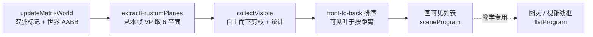

# 视锥剔除与场景管理

> [返回：WebGL 与 3D 框架学习大纲](../WebGL与3D框架学习大纲.md)
> 本文是第五阶段第 11 条「视锥剔除与场景管理」的完整展开：Gribb–Hartmann 从 VP 矩阵提取视锥 6 平面的推导与实现、包围球与 AABB（p-vertex）测试、旋转后 AABB 为什么要保守放大、场景图上的层次剪枝及其语义细节（父不剔除时子怎么处理）、均匀网格与八叉树的选择、front-to-back 排序减 overdraw、SoA 数据布局的缓存友好性，以及 demo 剔除统计 HUD 的统计口径。它把 [07-性能优化与调试](07-性能优化与调试.md) 第 6 条里「剔除」这个词从口号变成代码——drawcall 降一半以上的第一杠杆；配套示例 `examples/13-frustum-culling`（5×5 街区 263 叶子、剔除统计 HUD、幽灵标记、视锥线框）；阶段导览见 [01-导览](01-导览.md)。

## 11.1 视锥 6 平面提取：Gribb–Hartmann

### 11.1.1 从裁剪不等式到齐次平面

顶点经过 view-projection 进裁剪空间后，可见当且仅当 $-w \le x, y, z \le w$（六个联立不等式）。关键观察：**每个不等式都是一个四维半空间**，而裁剪坐标是 VP 矩阵作用于齐次坐标的结果——$x' = m_{0}x + m_{4}y + m_{8}z + m_{12}$ 正是 VP 第 0 行与 $(x,y,z,1)$ 的点积。于是「$x' + w' \ge 0$」直接展开成：

$$(row_3 + row_0)\cdot(x,y,z,1) \ge 0$$

六个平面 = w 行（row3）与 x / y / z 行（row0 / row1 / row2）的加减组合——这就是 Gribb–Hartmann（1996，*Fast Extraction of Viewing Frustum Planes from the World-View-Projection Matrix*）。不需要逆投影、不需要构造 8 个角点，VP 矩阵算完顺手就取。贴 demo `frustum.ts`：

```typescript
export function extractFrustumPlanes(vp: Float32Array): Plane[] {
  const row = (r: number): Plane => [vp[r], vp[4 + r], vp[8 + r], vp[12 + r]];
  const r0 = row(0), r1 = row(1), r2 = row(2), r3 = row(3);
  const planes: Plane[] = [
    [r3[0] + r0[0], r3[1] + r0[1], r3[2] + r0[2], r3[3] + r0[3]], // left   x ≥ -w
    [r3[0] - r0[0], r3[1] - r0[1], r3[2] - r0[2], r3[3] - r0[3]], // right  x ≤ +w
    [r3[0] + r1[0], r3[1] + r1[1], r3[2] + r1[2], r3[3] + r1[3]], // bottom y ≥ -w
    [r3[0] - r1[0], r3[1] - r1[1], r3[2] - r1[2], r3[3] - r1[3]], // top    y ≤ +w
    [r3[0] + r2[0], r3[1] + r2[1], r3[2] + r2[2], r3[3] + r2[3]], // near   z ≥ -w
    [r3[0] - r2[0], r3[1] - r2[1], r3[2] - r2[2], r3[3] - r2[3]], // far    z ≤ +w
  ];
  for (const p of planes) { /* 归一化，见 11.1.2 */ }
  return planes;
}
```

两个读码要点：

- **列主序取行**：WebGL 的 `Float32Array` 按列存矩阵，第 r 行是 `[vp[r], vp[4+r], vp[8+r], vp[12+r]]`——`row` 帮助函数就干这一件事，行/列搞反是这类代码的头号 bug（症状：六个平面全是废数据，剔除结果随机）；
- **± 的配对方向**：left 是 row3 **加** row0（对应 $x \ge -w$）。记不住就验证：把相机正前方一点 $(0, 0, -d)$ 代入 left 平面，结果应为正。

为什么可以在四维空间直接判符号：点在视锥内 ⇔ 裁剪坐标满足六个不等式 ⇔（w > 0 时）透视除法后落在 NDC 立方体内。齐次平面把「除以 w」这一步吸收进了符号判断——这正是 [数学专题/02-仿射几何与齐次坐标](../数学专题/02-仿射几何与齐次坐标.md) 2.5 的同一套约定：π = (a, b, c, d)，π·x ≥ 0 表示在锥内侧（demo 文件头注释明确对齐了它）。

### 11.1.2 归一化：让点积变成带符号距离

提取出的平面四元组长度任意（差一个正缩放因子），点积值没有量纲。demo 对每个平面除以 $\sqrt{a^2+b^2+c^2}$：

```typescript
const inv = 1 / Math.hypot(p[0], p[1], p[2]);
p[0] *= inv; p[1] *= inv; p[2] *= inv; p[3] *= inv;
```

归一化后 π·p 是 p 到平面的**带符号距离**（内侧正、外侧负）。两个用处：包围球测试可以直接与半径比大小（11.2.1）；调试时能打印「离哪个面多远」。顺序固定 [l, r, b, t, near, far]——测试循环不关心顺序，打印与单测关心。

提取时机也有一条纪律：必须在**本帧 VP 定型之后**（demo 里 `vp.copy(projection).multiply(view)` 紧跟着就取），且只做一次、全程复用同一份平面数组。每帧提取的成本是 24 次加减 + 6 次 hypot，亚微秒——但放在循环里对每个物体各提一遍，或用了上一帧的 VP（相机已经转过去），前者是浪费、后者是剔除结果与画面错位（物体在屏幕边缘突然消失/出现的位置系统性偏一帧）。

### 11.1.3 数值手算：一条能拿笔验证的链

拿最小透视矩阵走一遍（fovy = 90°、aspect = 1、near = 1、far = 10、view = I，与 [数学专题/02](../数学专题/02-仿射几何与齐次坐标.md) 2.5 的手算例同款）。列主序 elements：

```text
        [ 1  0    0      0   ]
  VP  = [ 0  1    0      0   ]     行视图（方便读）：
        [ 0  0  -11/9  -20/9 ]     row0 = (1, 0, 0, 0)
        [ 0  0   -1      0   ]     row2 = (0, 0, -11/9, -20/9)
                                   row3 = (0, 0, -1, 0)
```

按 11.1.1 的组合与归一化：

| 平面 | 组合 | 结果（归一化后） | 几何含义 |
|---|---|---|---|
| left | row3 + row0 | (0.707, 0, -0.707, 0) | 45° 斜壁：x ≥ z |
| right | row3 - row0 | (-0.707, 0, -0.707, 0) | x ≤ -z |
| near | row3 + row2 | (0, 0, -1, -1) | z ≤ -1（near = 1） |
| far | row3 - row2 | (0, 0, 1, 10) | z ≥ -10（far = 10） |

三个测试点验证：轴上点 (0, 0, -3) 对六平面全正（在锥内）；(0, 0, -0.5) 在近平面前——near 平面给 $-(-0.5)-1 = -0.5 < 0$，判外；(6, 0, -5) 超出右壁 $x \le -z = 5$——right 平面给 $-0.707 \times 6 + 0.707 \times 5 < 0$，判外。整条链「矩阵 → 行组合 → 归一化 → 点积符号」五分钟能在纸上复现，实现完先跑这组数再上场景。

### 11.1.4 验证工具：逆投影角点

`frustum.ts` 还提供 `frustumCorners`——把 NDC 立方体 8 角逆投影回世界空间。它不参与剔除，是**验证与可视化工具**：demo 按 F 画的绿色线框就是这 8 点连的 12 条边；肉眼对照「被剔除的幽灵（V 键）是否恰好落在线框外」。手算验证也用它：任取一个锥角点，对过该点的两个平面算 π·p 应为 0（浮点容差内）。

## 11.2 包围体测试

### 11.2.1 包围球：一次点积判一面

```typescript
export function sphereIntersectsFrustum(
  planes: Plane[], center: Vec3, radius: number,
): boolean {
  for (const p of planes) {
    if (p[0] * center.x + p[1] * center.y + p[2] * center.z + p[3] < -radius) return false;
  }
  return true;
}
```

带符号距离 < -radius ⇔ 球心在平面外侧且离平面超过半径 ⇔ 整球在外。前提正是 11.1.2 的归一化（否则距离和半径不可比）。六个面最坏 6 次乘加链——所有包围体测试里最便宜的。球的来源：AABB 的外接球（中心取盒中心、半径取半对角线），或长期跟踪的动态包围球。球对旋转天然免疫（旋转不变性）是它对盒体的根本优势；代价是对细长物体（柱子、走廊）空得厉害。

### 11.2.2 AABB：p-vertex 优化

盒有 8 个角，朴素测试 8 角 × 6 面 = 48 次点积。p-vertex（positive vertex）法压到 6 次：

```typescript
export function aabbIntersectsFrustum(planes: Plane[], box: Aabb): boolean {
  for (const p of planes) {
    const px = p[0] >= 0 ? box.max.x : box.min.x;
    const py = p[1] >= 0 ? box.max.y : box.min.y;
    const pz = p[2] >= 0 ? box.max.z : box.min.z;
    if (p[0] * px + p[1] * py + p[2] * pz + p[3] < 0) return false;
  }
  return true;
}
```

原理：对平面法线的每个分量选「最靠正方向」的角分量（法线 x 分量 ≥ 0 取 max.x，否则 min.x）——拼出的那个角是整盒在平面正方向上的极值点（p-vertex），它到平面的距离是 8 角中最大的。**p-vertex 都在负侧 ⇒ 全部 8 角都在负侧 ⇒ 整盒在锥外**，一次点积下结论。反过来 p-vertex 在正侧不能说明「相交」，只说明这个面裁不掉它，继续测下一个面。

循环的提前退出还有一档免费优化：**把最常「杀人」的平面排在前面**。典型视角下 far 与四个侧壁杀掉的盒子最多（near 几乎杀不掉东西——盒在相机后面的情形早被侧壁判死了），按 far → 左右 → 上下 → near 的顺序测，平均比较次数下降。demo 按固定顺序 [l, r, b, t, near, far] 已足够快（每面只是一次乘加链），这个重排在大场景的叶子级测试里才值得做——而且顺序是经验参数，拿真实场景的剔除统计（11.3.3 的口径）喂出来才有意义。

保守性的方向必须说清：这个测试**只在盒确实全外时返回 false**——绝不会误杀与视锥相交或在锥内的盒；但会放行一些实际全外的盒（大而空的盒斜跨过视锥角部的情形）。剔除器的铁律：**宁可放行，不可误杀**——误杀是画面上的洞（物体凭空消失），放行只是少省一点 drawcall。demo 的地面就是常客：78×78 的大扁盒几乎总与视锥相交，剔除它没戏，但它作为叶子照常参与统计口径。

### 11.2.3 旋转后 AABB 的保守放大

场景图节点的局部 AABB 是轴对齐的，但 matrixWorld 带旋转——旋转后的盒子是个 OBB，而 11.2.2 的管线只认 AABB。demo 的变换法：

```typescript
export function transformAabb(m: Mat4, local: Aabb, out: Aabb): Aabb {
  // 8 个角点过 matrixWorld 后取三轴 min/max（略）
}
```

8 角变换取 min/max——数学上等于「给旋转后的 OBB 再包一层 AABB」。代价看得见：45° 旋转的正方形，AABB 边长 ×√2（面积 ×2）；三维斜向旋转最坏到 ×√3 量级。demo HUD 第四行实时打印旋转群组的世界 AABB 三维尺寸与局部尺寸的对照，群组转起来世界盒肉眼可见地「胖」一圈。

为什么不去算「旋转后几何的紧 AABB」？那要对网格顶点重算 min/max，每个动态物体每帧来一遍，太贵；保守放大是 O(8) 次矩阵乘。另一条 O(1) 的等价做法是**绝对值矩阵法**：世界半尺寸 = |R|·halfExtents（把旋转矩阵元素取绝对值后乘局部半尺寸向量）——与 8 角法结果完全一致，省几次乘法，demo 选 8 角法因为直观可讲。注意两者**同样保守**：旋转一旦发生，「哪根轴最远」的信息就丢了，任何不重算几何的方法都只能放大。

这个保守放大还会沿场景图**向上累积**：孩子的盒变胖 → 组盒（孩子盒的并集）跟着胖 → 层次越深、旋转越多，顶层的盒越松，剪枝效率越低——但正确性永远无损。这是层次剔除效率的头号泄漏点，11.4 的空间索引与「组盒定期重建」都是对它的回应。

### 11.2.4 选球还是选盒

| | 包围球 | AABB |
|---|---|---|
| 构建 | 中心 + 最大半径，O(n) | min/max 扫一遍，O(n) |
| 测试成本 | 6 次点积（最便宜） | 6 次 p-vertex 点积（同量级） |
| 紧度（一般物体） | 差：细长物体空得厉害 | 好：多数物体近似盒状 |
| 紧度（旋转） | **不变**——根本优势 | 保守放大（11.2.3） |
| 动态维护 | 中心跟着走即可 | 每次变换后重算（保守变换） |
| 典型用法 | 粗筛、动态实体、粒子系统 | 层次剔除的内节点、静态几何 |

实践惯例：**外层用球、内层用盒**——树的浅层节点挂球（测试最便宜、旋转免疫），叶子挂 AABB（紧）；或者每个节点两种都存，先球后盒做两级测试（球在外面就不用碰盒）。demo 统一用 AABB 是为了让 11.2.2/11.2.3 两条主线干净；把 `sphereIntersectsFrustum` 挂进 collectVisible 做第一级是留作练习的好题目。

## 11.3 场景图上的层次剔除

前两节是「数学零件」，这一节把它们装进场景结构。demo 的每帧管线：



前三步是剔除的本体（A 是 [03-场景图](../04-第四阶段/03-场景图.md) 的既有机制顺带产出包围盒，B/C 是本册新增），最后两步里幽灵与线框是教学可视化——**测性能时要意识到它们把被剔除的物体画了回来**（11.7 的 A/B 实验特别标注了这一点）。

### 11.3.1 组节点包围盒：子树的并集

demo 的 `CullNode` 是 06 示例 Node3D（[03-场景图](../04-第四阶段/03-场景图.md) 的最小复活版）加两个包围盒字段：

- 叶子：`localAabb` = 几何本身的包围盒（`addBox` 里按位置 ± 尺寸/2 直接写）；
- 组节点：构建时用 `enclose` 把每个孩子的盒并进来——**组盒 = 构建时刻的子树并集**。

（贴 `main.ts` 的构建侧，一眼看懂即可：）

```typescript
function addBox(parent, name, x, y, z, sx, sy, sz, color): CullNode {
  const n = new CullNode(name);
  n.position.set(x, y, z);
  n.scale.set(sx, sy, sz);
  n.geo = boxGeo;
  n.localAabb.min.set(x - sx / 2, y - sy / 2, z - sz / 2);
  n.localAabb.max.set(x + sx / 2, y + sy / 2, z + sz / 2);
  parent.add(n);
  parent.enclose(n.localAabb.min, n.localAabb.max);  // 组盒吃进孩子的盒
  return n;
}
```

「组盒 ⊇ 子树」是 11.3.2 剪枝语义的**全部前提**——它一旦被破坏（孩子运行时跑出组盒），唯一合法的剪枝方向就会误杀（常见坑 5）。

### 11.3.2 collectVisible：自上而下剪枝

```typescript
export function collectVisible(
  node: CullNode, planes: Plane[], out: CullNode[], stats: CullStats,
): void {
  stats.testedNodes += 1;
  if (!aabbIntersectsFrustum(planes, node.worldAabb)) {
    stats.prunedNodes += node.subtreeNodes - 1; // 本节点已测，免测的是后代
    stats.culledLeaves += node.leafCount;
    return;
  }
  if (node.geo) out.push(node);
  for (const c of node.children) collectVisible(c, planes, out, stats);
}
```

语义三句话：

1. **节点盒全外 → 剪整棵子树**。「后代的盒再大也必然在外」不是近似而是集合事实：组盒包含子树，组盒在外 ⇒ 子树在外。省掉的不只是渲染，是后代的测试本身（计入 prunedNodes）；
2. **盒相交或在锥内 → 叶子入列、孩子逐个再测**。父不剔除 ≠ 子可见：demo 的测试只排除「全外」，区分不了「相交」与「完全在锥内」——组盒与锥**相交**时（视锥从组的角落擦过；保守放大又让组盒更容易蹭到锥），孩子可能整批在外。只有「完全在锥内」才保证子树全可见（下表第三行），而 demo 没有这个测试，只能老老实实递归；
3. 唯一能短路的方向是「父全外」。理论上还有第二个：「父盒**完全在锥内** ⇒ 子树全可见、免测」——组盒包含于锥 ⇔ 8 角对 6 面全为正。demo 没实现：判断「完全在内」要 8×6 次符号测试，比相交测试贵得多，对三层浅树不划算；深树/大场景里它才是常见优化。

整理成三分法表格（层次剔除的全部合法转移）：

| 节点盒 vs 视锥 | 判据 | 动作 | demo |
|---|---|---|---|
| 全外 | p-vertex 对某面 < 0 | 剪整棵子树（合法且必胜） | `collectVisible` 的 early return |
| 相交 | p-vertex 全 ≥ 0 但非全内 | 叶子入列，孩子逐个再测 | 递归分支 |
| 完全在锥内 | 8 角对 6 面全 > 0 | 可免测整棵子树直接入列 | 未实现（判断成本高） |

注意第一行的判据正是 11.2.2 的返回 false 条件；第三行需要**另一个方向**的测试（所有角都在内侧），这是它贵的根源——剔除测试天然是「找理由出去」，证明「全在里面」要把 8 个角都验一遍。

### 11.3.3 每帧剔除统计：HUD 是怎么数的

`CullStats` 四个计数器，每帧开头清零、`collectVisible` 内累计、HUD 以 0.25 s 节流刷新：

| 计数器 | 含义 | 累计点 |
|---|---|---|
| testedNodes | 实际做了 AABB–视锥测试的节点数 | 进入函数就 +1（含被剪的根/组自身） |
| prunedNodes | 因祖先被剪而**连测试都免了**的节点数 | 按 `subtreeNodes - 1` 计——本节点已测，免掉的是后代 |
| drawnLeaves | 本帧入列渲染的叶子 | 收集完按 `visible.length` 回填 |
| culledLeaves | 本帧剔除的叶子 | 两级来源：祖先被剪时按 `leafCount` 整树累计；叶子自身测试失败 |

口径自洽的两条恒等式（HUD 可当场验证）：`testedNodes + prunedNodes ≤ 总节点数`（demo：291）；`drawnLeaves + culledLeaves = 总叶子数`（demo：263——25 街区 × 10 叶 + 地面 + 2 旋转群组 × 6 叶）。第二条成立依赖「组盒 ⊇ 子树」：每个叶子要么入列要么被某个祖先的剪枝或自己的测试判死，不重不漏。

demo 场景的两种典型模式值得盯 HUD 看：镜头拉远高空俯视时，整街区组被剪（prunedNodes 一跳几十，testedNodes 很小）；凑近看一条街时，街区组与锥相交，剪枝发生在叶子级（testedNodes 逼近总结点数、prunedNodes 归零）。**层次剔除的收益高度依赖「组盒紧 + 视锥窄」的对齐程度**——这正是 11.2.3 说的效率泄漏。

一条典型的 HUD 读数（数字随视角与群组相位浮动，形态如下）：

```text
13 视锥剔除：层次 AABB 剔除 + front-to-back（剔除开）
节点 291（叶子 263）| 本帧 AABB 测试 61 | 子树剪枝免测 230
叶子：画 33 / 剔 230（87%）（剔除关 = 263 draw）
旋转群组世界 AABB 12.4x2.8x12.4（局部 8.8x2.8x8.8，旋转保守放大）
C 剔除开关 | V 被剔除幽灵: 开 | F 视锥线框: 关 | 拖拽/滚轮 = 轨道相机
```

第二行 61 + 230 = 291、第三行 33 + 230 = 263——两条恒等式当场成立；「剔 230」在两个口径里各出现一次不是巧合：这一帧恰好所有剔除都来自子树剪枝（叶子级一个没剩），凑近街区时这个重合就会散开（culledLeaves 里出现叶子级贡献）。第四行是 11.2.3 的实况：局部 8.8 宽的群组转到 45° 相位时世界盒放大到 12.4（≈ ×√2）。

### 11.3.4 变换更新与包围盒维护的成本

`updateMatrixWorld`（与 06 册同款双脏标记：局部矩阵脏 / 世界矩阵脏，父变则整枝 force）在 demo 里对**每个节点**顺带做 `transformAabb`——即使子树没动。291 节点的 O(N) 无感；十万节点时要做「世界盒脏标记」：局部盒与 matrixWorld 都没变 ⇒ 世界盒免算。另一个口径要分清：构建期 `enclose` 聚合的组盒**不会在运行时自动长大**——demo 旋转群组的世界盒每帧变大是因为 matrixWorld 在变、`transformAabb` 每帧重算（局部盒没变）；若孩子在运行时**移出**了组盒范围（不只是旋转，还有平移/缩放），必须手动向上传播重算，否则「组盒 ⊇ 子树」被破坏、剪枝开始误杀。引擎里这叫包围盒传播（bounds propagation），是动态场景剔除最常见的 bug 源。

## 11.4 空间索引：均匀网格 vs 八叉树

demo 的「root → 25 个街区组 → 楼」其实是一层手工空间划分。真实引擎的剔除挂在真正的空间索引上，两种经典选择：

| | 均匀网格 | 八叉树 |
|---|---|---|
| 结构 | 世界切成等大单元，实体登记进所在单元 | 递归八分空间，自适应深浅 |
| 构建成本 | O(n)，插入 O(1) | 贵（要决定分割面与归属） |
| 查询 | 遍历视锥覆盖的单元（单元盒先测 6 平面） | 自上而下剪枝，O(log n) 量级 |
| 内存 | 密度不均时炸（郊区空单元、市中心挤）或单元过大 | 紧凑、自适应 |
| 动态实体 | 跨单元时旧删新插；跨界物体登记多份 | 移动后判断是否仍在当前（松散）盒内，否则上溯重插 |
| 适用 | 均匀分布、无界世界配哈希网格 | 一般场景的默认答案 |

两个实务要点：

1. **松散八叉树**（loose octree）：节点盒各方向放宽 ×2——边界上的物体不必在两个节点间来回横跳，插入时「放得进松散盒就不再下放」，跨界的抖动消失。代价是查询时邻居节点也要看（松散盒有重叠）；
2. **选择经验**：静态地形建筑 → 均匀网格或 BVH（构建一次用到天荒地老）；大量动态实体 → 松散八叉树或空间哈希；混合场景 → 分层混合（demo 的「街区组 + 楼」就是粗网格 + 组的两层版）。BVH 是第三条路：按物体集合递归二分，动态场景要 refit（矩阵变了重算节点盒，快但越用越松）或定期 rebuild——现代引擎的可见性系统多走 BVH + 分簇（cluster）路线。

### 11.4.1 动态实体的维护成本

空间索引的静态查询都很快，**动态维护才是选型的真正考点**。三种典型节奏：

- **网格**：实体跨单元边界时，从旧单元的登记表里删掉、往新单元插——两次链表/数组操作，O(1)。跨界物体（大盒子压在 4 个单元上）要登记多份，查询端去重（按实体 id）；
- **八叉树**：每帧判断「当前矩阵下还在祖先节点的（松散）盒内吗」——在就什么都不做（零成本，绝大多数帧都走这条路）；不在就向上找能容纳的祖先再重新下插。松散因子 ×2 的意义就在这：把「跨界的频率」压低一个数量级；
- **BVH**：refit 是自底向上重算节点盒，O(n) 但常数小；物体大规模流动后结构退化（节点盒越来越松），要按帧摊销地 rebuild（每帧重建一小片，或空闲时全量重建）。

一个常被忽略的配套设计：**迟滞**（hysteresis）。实体 A 缓慢滑过单元边界，若「一跨界就换登记」会在边界上来回横跳（查询结果每帧抖动）。网格/八叉树都值得加一档「出界距离」——完全出界才迁移，只擦边时留在原单元（查询端靠保守的单元范围兜底）。demo 的旋转群组不涉及这个问题（层次由场景图拓扑固定，盒每帧重算），但如果把街区改成随玩家游走的动态分区，迟滞就是必做题。

## 11.5 front-to-back 排序减 overdraw

剔除解决「锥外的不画」，不解决「锥内互相遮挡的重复着色」（overdraw）。不透明物体按**由近到远**提交，GPU 的 early-z 会在片元着色**之前**比较深度，被挡的片元直接裁掉——近处先写进深度缓冲，远处被遮部分的着色成本全省（[07-性能优化与调试](07-性能优化与调试.md) 6.1 的 overdraw 账）。demo 在收集后排序：

```typescript
const cam = camera.position;
const distSq = (n: CullNode): number => {
  const e = n.matrixWorld.elements;
  const dx = e[12] - cam.x, dy = e[13] - cam.y, dz = e[14] - cam.z;
  return dx * dx + dy * dy + dz * dz;
};
visible.sort((a, b) => distSq(a) - distSq(b));
```

三个细节：距离取 `matrixWorld` 的平移分量（e[12..14]，即节点原点），不另存「中心」字段；不开方（平方保序，省 sqrt）；排序只发生在**剔除后的可见列表**上——263 叶先被 11.3 压到几十，再 O(k log k)，k 已经很小。透明物体方向相反要 back-to-front（混合顺序即正确性），demo 全不透明不涉及——这是第二/四阶段透明渲染的老规矩，别在这里「顺手统一」。

early-z 生效有条件，值得把账算细：

1. **深度测试与深度写入都开着**。关了深度写入（透明混合的惯例）就没有「先写深度挡后人」一说；
2. **片元着色器不 discard、不写 gl_FragCoord.z**。着色器里有这些副作用时驱动必须保守地推迟深度测试到着色之后（late-z），early-z 失效——这就是为什么全屏后处理的第一个 pass 常特意保持朴素；
3. 收益与 overdraw 倍数成正比。一堵墙后面叠 3 层几何：乱序提交最坏每像素着色 4 次；front-to-back 后近的先占坑，远的片元在 early-z 就被裁——每像素着色 1 次，片元着色成本降到 1/4。剔除对这个数字毫无贡献：4 层全在视锥内。

两份收益要分清账本：**剔除省的是 drawcall 与顶点阶段**（CPU 提交成本 + GPU 顶点/图元装配），**front-to-back 省的是片元着色**。前者对应 07 册 6.1 的固定成本模型；后者在高 overdraw 场景（粒子、植被、后处理叠加）才是大头——但注意 [05-粒子系统与Instancing实战](05-粒子系统与Instancing实战.md) 的加法混合粒子不开深度写入，排序对它们的意义是混合正确性而不是 early-z，两件事别混。

两份收益要分清账本：**剔除省的是 drawcall 与顶点阶段**（CPU 提交成本 + GPU 顶点/图元装配），**front-to-back 省的是片元着色**。前者对应 07 册 6.1 的固定成本模型；后者在高 overdraw 场景（粒子、植被、后处理叠加）才是大头——但注意 [05-粒子系统与Instancing实战](05-粒子系统与Instancing实战.md) 的加法混合粒子不开深度写入，排序对它们的意义是混合正确性而不是 early-z，两件事别混。

## 11.6 缓存友好：SoA 打平对比对象图

demo 的 `CullNode` 是教科书式对象图：每个节点挂一堆 Vec3 / Mat4 / children 数组对象，遍历 = 指针追逐。291 个节点无所谓，十万节点时三个代价浮出来：

1. **内存局部性**：对象散落堆上，`traverse` 每一步都可能 cache miss；连 `Vec3` 字段本身都是引用（demo 的 Vec3 是 class 实例），读个坐标要间接一层；
2. **多态访问点**：JS 引擎按对象形状（hidden class）优化属性访问，children 数组里组节点与叶节点混放（geo 一空一非空、字段访问路径分化），热点循环容易掉进慢路径；
3. **GC 压力**：遍历回调、每帧新建的临时对象（demo 已尽量避免：`visible.length = 0` 复用数组、`corners` 复用）都是垃圾制造点。

SoA（structure of arrays）路线把变换数据打平进 `Float32Array`：

```typescript
// 索引 i 即「节点」，数据按列连续
const px = new Float32Array(N), py = new Float32Array(N), pz = new Float32Array(N);
const matrixWorld = new Float32Array(16 * N);   // 世界矩阵连续排布
const visibleMask = new Uint8Array(N);          // 剔除结果：位标记
const drawOrder = new Uint32Array(N);           // front-to-back 对索引排
```

遍历变成线性扫描（预取友好），剔除写位掩码，排序对索引数组排（间接一层但数据连续）。两种布局并排对比：

| | 对象图（demo 的 CullNode） | SoA（Float32Array 打平） |
|---|---|---|
| 遍历访问模式 | 指针追逐，cache miss 频繁 | 线性扫描，预取友好 |
| 单个字段读取 | 对象头 + 属性偏移（可能间接多层） | base + i × stride，一次寻址 |
| 形状多态 | 组/叶混放，访问点分化 | 无——索引就是身份 |
| GC | 每帧产生垃圾（复用可缓解） | 零分配（复用同一个 buffer） |
| 与 GPU 的接口 | 逐对象取 elements 再拼 | **整段就是上传格式** |
| 可读性/调试 | 树形直观，断点友好 | 索引算术，要配查看工具 |

最后一行是隐形红利：SoA 的 `matrixWorld` 数组**本身就是 `uniformMatrix4fv` / `bufferSubData` 想要的内存布局**——[11-级联阴影CSM](11-级联阴影CSM.md) 10.5.3 里把三份 lightVP 拼进一个 `Float32Array(48)` 一次上传，就是 SoA 思维的微缩应用；粒子系统（[05 册](05-粒子系统与Instancing实战.md)）的位置/速度存 attribute buffer 是它的 GPU 版；第四阶段讨论 ECS 时把「组件连续存储」列为第一条设计动机，还是同一件事。教学 demo 保留对象图是可读性优先；工业引擎的变换/剔除系统几乎都是 SoA + 索引（Unity DOTS、bevy 的 archetype 存储是极端化的版本）。

什么时候值得把对象图改成 SoA？给三条判断线，别为了数据取向而数据取向：

1. **规模**：节点上千、且每帧全量遍历（变换传播或剔除）时，缓存收益开始能测出来；几百节点以下的场景，改造成本（树形调试体验、增量更新的索引管理）大于收益；
2. **访问模式**：只有「批量扫全部」的热点才吃 SoA 红利——如果你的遍历是稀疏的（只碰脏节点、只碰可见集），局部性收益打折，先用 11.3 的层次剪枝把访问量压下来再说；
3. **上传频率**：每帧要把变换喂给 GPU（instancing、GPU skinning）时，SoA 几乎是必选——对象图得先拼一遍再上传，那一步拼装就是白白丢掉的优势。

## 11.7 边界与延伸：剔除不是终点

- **保守性上限**：p-vertex 与保守变换都「只放行不误杀」，drawcall 的下界受包围体松紧限制。要再压：更紧的包围体（多盒/凸包/分簇盒）、或按 LOD 粗粒度合并测试；
- **视锥剔除不处理遮挡**：锥内但被楼挡住的楼后空间照画。遮挡剔除一瞥：GPU 遮挡查询（WebGL2 核心的 `createQuery`/`beginQuery` 家族，[10-GPU性能度量与剖析](10-GPU性能度量与剖析.md) 9.2 用同一 API 计时）、hi-z 层级深度的屏幕空间剔除、离线预计算的 PVS。开销都显著大于视锥测试，只在大场景值得；
- **增量剔除**：静态实体不动结果不变——把静态/动态分开，静态实体的剔除结果缓存成位掩码，只有视锥变了（相机动了）才重算，且可按视锥变化量分块延迟；
- **GPU 剔除**：WebGPU 的 compute pass 里对 SoA buffer 做 p-vertex 测试、写 indirect draw 参数，CPU 全程不摸数据（[技术专题/04-WebGPU迁移指南](../技术专题/04-WebGPU迁移指南.md)）；
- **结构复用**：07 示例的射线拾取遍历同一棵树（把 6 平面测试换成射线–AABB 测试），11 册 CSM 的逐级光锥剔除复用 AABB 测试——场景管理结构是渲染、拾取、阴影、音频共同的基础设施。

## 性能账单

| 项 | 成本 | demo 量级 |
|---|---|---|
| 平面提取 | 6×4 次加减 + 6 次归一化 | 每帧一次，亚微秒 |
| 单节点 AABB 测试 | ≤ 6 次 p-vertex 点积 | ~20 ns |
| 层次遍历 | testedNodes × 单测 | 典型视角 ~100 次 / 291 节点 |
| front-to-back 排序 | O(k log k) | k = 可见叶子（几十~百余） |
| 收益 | drawcall 263 → 数十（视角相关） | 每省一个 drawcall 省 07 册 6.1 的固定成本 |

CPU 侧读数怎么看：剔除是典型的「CPU 省出 GPU 也省」——drawcall 少了，`uniformMatrix4fv`/`drawGeometry` 的 JS 调用次数、驱动校验、GPU 命令流一起缩。07 册 FrameStats 的 CPU 帧时间应当随剔除率同步下降；若 CPU 时间不降反升（排序或统计代码进了热点），先查 11.6 的分配问题再查排序的 k。

A/B 实验设计（把账坐实）：HUD 的 C 键关掉剔除 = 全量 263 draw；用 `examples/11-gpu-timer` 的分段计时包住场景 pass，两个模式的 GPU 段时间差即剔除净收益。**一个 demo 特有的陷阱**：幽灵标记（V）开着时被剔除的物体被画了回来——测性能前必须先关 V，否则收益被幽灵 pass 吃回去甚至倒挂。

## 验收清单

- [ ] C 开关对比：HUD「画 N / 剔 M」与「剔除关 = 263 draw」切换，画面不变（幽灵关掉时）
- [ ] V 幽灵 + F 线框：红色幽灵全部落在绿色视锥线框之外
- [ ] HUD 恒等式：tested + pruned ≤ 291，drawn + culled = 263
- [ ] 旋转群组的世界 AABB 三维尺寸大于局部（HUD 第四行对照）
- [ ] 凑近街区：prunedNodes 下降、testedNodes 上升；拉远俯视：相反
- [ ] 画面无「凭空消失的物体」（误杀检查：任何视角下锥内物体都在）
- [ ] 转动相机时无卡顿（排序与遍历不在热点上）
- [ ] 用 11.1.3 的手算例对拍过一次 extractFrustumPlanes（六个平面的归一化结果）

## 常见坑

1. **平面没归一化就和半径比较**——距离没有量纲，物体在离奇位置消失。归一化是 11.2.1 的前提，不是可选项。
2. **行/列取反**——列主序数组按行取要跨 4 步（`row` 帮助函数）；取成列后六个平面全是废数据。症状：剔除结果与视锥无关地随机。
3. **left/right 的 ± 记反**——一半场景被剔。验证法：相机正前方一点对所有平面应为正（11.1.1）。
4. **拿局部 AABB 直接测世界视锥**——物体移出原点附近就集体消失。必须 `transformAabb` 之后测世界盒。
5. **运行时孩子跑出组盒不传播**——「组盒 ⊇ 子树」被破坏后，组盒在锥外 ⇒ 子树在外不再是事实，剪枝开始误杀：孩子明明可见却消失。这是唯一能让剔除**出错**（而非只是浪费）的路径。
6. **以为「父相交就跳过子测试」是优化**——父盒与锥相交时孩子可能整批在外，跳过只是浪费不是错误；真正合法的第二个短路是「父盒完全在锥内」（demo 未实现，判断成本高）。想清楚这两者的区别再动手。
7. **front-to-back 把透明物体一起排**——透明必须 back-to-front，排反混合错序。两份列表分开处理。
8. **遍历回调里 new 数组/闭包**——GC 抖动。可见列表复用（`visible.length = 0`）、热路径零分配（demo 的 distSq 读现成矩阵元素）。
9. **测剔除收益时忘了关幽灵/调试 pass**——被剔除的物体又被画回来，收益数据被污染（11.7 的 A/B 实验注意事项）。
10. **把 VP 传成了 projection 或 view（少了另一半）**——六个平面全错，但透视矩阵的对称性让症状时隐时现（某些角度正常、转个身就漏剔/误剔）。用 11.1.3 的手算例对拍最容易定位。

## 本节自测

1. 写出六个平面的行组合与对应的裁剪不等式；left 为什么是 row3 + row0？用「相机正前方一点」给出验证法。
2. p-vertex 法为什么一次点积就能判「全盒在外」？它在什么情形下放行实际全外的盒——这为什么是可接受的？
3. 45° 旋转的正方形保守放大到多少倍？放大的根本原因是丢失了什么信息？绝对值矩阵法和 8 角法哪个更紧？
4. 层次剔除唯一不会出错的剪枝方向是哪个？「父盒完全在锥内 ⇒ 子树全可见」为什么也成立，demo 为什么不实现？
5. tested + pruned 与总结点数、drawn + culled 与总叶子数——两条恒等式哪条任何实现都成立？哪条依赖「组盒 ⊇ 子树」？
6. 松散八叉树的「松散」解决什么问题？代价是什么？均匀网格在什么分布下失效？
7. front-to-back 省的是哪个阶段的成本？为什么对 05 册的加法混合粒子没有这项收益？
8. 把 demo 的对象图改成 SoA，最少需要哪几个数组？front-to-back 排序改为对什么排序？
9. 设计一个用 `examples/11-gpu-timer` 量化本 demo 剔除收益的 A/B 实验：变量怎么控制、幽灵标记为什么必须关、CPU 侧还要看哪个数？
10. 用 11.1.3 的手算矩阵（fovy 90°、near 1、far 10）验证：left 平面归一化前是 (1, 0, -1, 0) 吗？写出四个侧壁的归一化结果，并判断点 (3, 0, -2) 在不在锥内、被哪个平面判死。
