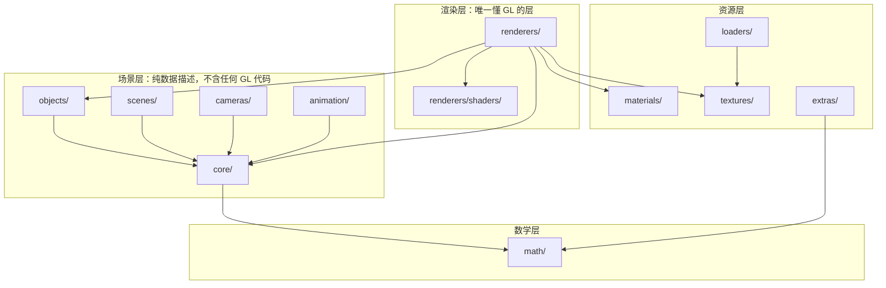
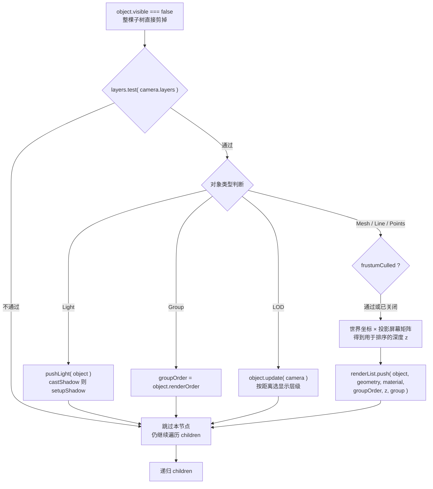
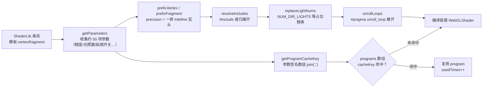

# Three.js 源码研读：对照自研框架查漏补缺

> [返回：WebGL 与 3D 框架学习大纲](../WebGL与3D框架学习大纲.md)
> 本文对应大纲第六阶段第 1 条，小节编号 1.x；每节按"Three 怎么做 → 自研怎么做 → 差距与跟进"收束。源码引用以 r160 标签为准，路径均相对 `src/`；阶段导览见 [01-导览](01-导览.md)。

## 1.0 版本先行：读哪个 tag

Three.js 的渲染器在近两年经历了一次大重构：**r163 起只支持 WebGL2，且渲染层逐步拆成 Backend 架构**（`src/renderers/common/` 存放跨后端的公共代码，WebGL 细节移入 `src/renderers/webgl/WebGLBackend.js`），为 WebGPU 与 WebGL 双后端铺路。这对源码研读意味着：

- **经典单体架构**（一个 `WebGLRenderer.js` 讲完整个渲染流程）在 **r150~r162** 标签下最完整，本文全部引用以此为准；
- 建议本地 `git clone https://github.com/mrdoob/three.js && git checkout r160`，配合编辑器跳转阅读；
- 读完经典实现后，可以第二遍对照新架构看"它为什么这样拆"——那是一次现成的架构演进案例，类似把第四阶段的渲染层再切一刀。

## 1.1 src/ 目录结构地图



箭头从依赖方指向被依赖方。三个一眼可读的规律：

1. **依赖严格单向**：math ← core ← objects/scenes/cameras ← renderers。`core/Object3D.js` 里找不到一行 GL 调用——渲染器依赖场景层，反过来绝不成立。这与第四阶段"数学层 / 渲染层 / 场景层 / 资源层 / 交互层"的分层约定同构，可以直接对照检验自研框架有没有漏依赖。
2. **GL 资源与逻辑对象分离**：`Material`、`Texture`、`BufferGeometry` 只是数据描述对象，真正的 GL 句柄（program、texture、buffer）全部存在渲染器侧的一张 WeakMap 里（`renderers/webgl/WebGLProperties.js`）——渲染器给对象"附加"私有属性，不污染对象本身。这对应第四阶段"create / update / dispose 生命周期"的另一半：**逻辑对象可以随时创建销毁，GL 资源按需惰性创建、引用计数回收**。
3. **生态边界画在 src/ 之外**：glTF 加载器不在 `src/loaders/` 而在 `examples/jsm/loaders/GLTFLoader.js`——src/ 只放渲染核心需要的最小加载器（`Loader` 基类、`FileLoader`、`TextureLoader` 等），领域性强的全部外移。这是 Three"组装式"生态的边界宣言，03 分册会展开。

各目录职责与自研框架对应物：

| 目录 | 职责 | 代表文件 | 自研框架对应 |
|---|---|---|---|
| `core/` | 与渲染后端无关的内核对象 | `Object3D.js`、`BufferGeometry.js`、`BufferAttribute.js`、`Layers.js` | 场景层基类 + Geometry |
| `math/` | 纯数学库，零依赖 | `Vector3.js`、`Matrix4.js`、`Quaternion.js`、`Frustum.js` | minmath |
| `scenes/` | 场景容器与氛围 | `Scene.js`、`Fog.js` | Scene |
| `cameras/` | 相机抽象 | `Camera.js`、`PerspectiveCamera.js`、`OrthographicCamera.js` | PerspectiveCamera / OrbitCamera |
| `objects/` | 可挂载可渲染对象 | `Mesh.js`、`SkinnedMesh.js`、`Points.js`、`Line.js`、`Sprite.js`、`LOD.js` | Mesh |
| `materials/` | 材质参数对象（不含 GL 资源） | `Material.js`、`MeshStandardMaterial.js`、`MeshBasicMaterial.js` | Material 家族 |
| `textures/` | 纹理数据对象 | `Texture.js`、`DataTexture.js`、`CompressedTexture.js` | Texture |
| `loaders/` | 渲染核心所需的最小加载器 | `Loader.js`、`FileLoader.js`、`TextureLoader.js` | 第四阶段加载队列 |
| `animation/` | 关键帧动画 | `AnimationMixer.js`、`AnimationClip.js`、`KeyframeTrack.js` | 第四阶段动画混合 |
| `renderers/` | 渲染器与全部 GL 细节 | `WebGLRenderer.js` + `webgl/` 子目录约 20 个协作类 | Renderer + StateCache |
| `extras/` | 曲线与造型工具 | `Curve.js`、`Shape.js`、`curves/` | Geometry 生成器（算半个） |

`renderers/webgl/` 子目录值得单独点名，本阶段会反复进出：`WebGLState.js`（状态托管）、`WebGLRenderLists.js`（渲染队列）、`WebGLPrograms.js` + `WebGLProgram.js`（着色器程序与缓存）、`WebGLProperties.js`（对象→GL 资源映射）、`WebGLGeometries.js`（顶点缓冲）、`WebGLTextures.js`（纹理上传）、`WebGLBindingStates.js`（VAO 管理）、`WebGLShadowMap.js`（阴影，对照第五阶段）。

## 1.2 WebGLRenderer 的状态机：State 如何托管 GL 状态

**问题背景**：WebGL 是一台全局状态机（global state machine）——所有 `gl.draw*` 都作用在"当前绑定的 buffer / texture / program / 当前启用的 depth-test、blend"上。状态切换是 drawcall 之间最大的隐性开销，而且"上一个物体留下了什么状态"极易出错。第四阶段自研的 StateCache 用一张缓存表解决了 enable/depth/blend 的记账问题；Three 把这件事做到了什么程度，是本节对照的重点。

核心文件：`renderers/webgl/WebGLState.js`（r160 里是一个工厂函数 `WebGLState( gl, extensions, capabilities )`，返回几十个方法的对象）。四层设计：

**第一层：能力开关记账。** `enabledCapabilities` 按 capability id 记布尔值，`enable( id )` 只有当 `enabledCapabilities[ id ] !== true` 时才真正调 `gl.enable( id )`，`disable` 对称。自研 StateCache 的 enable/disable 与此同源，问题通常不在有没有，而在覆盖面。

**第二层：每类状态一份"当前值镜像"。** `currentCullFace`、`currentBlending` 及整套 blend 方程/因子、`currentProgram`、viewport/scissor，甚至**纹理单元绑定**（`currentTextureSlot` + `currentBoundTextures`）——切纹理时如果目标已绑在同一单元，连 `gl.bindTexture` 都省掉。这一条是自研框架最常见的缺口：多数自研实现只记账深度/混合/剔除，不管纹理单元。

**第三层：三大缓冲状态子对象与"锁"。** `state.buffers = { color, depth, stencil }`，各自管理写掩码、测试函数；关键是它们带 `setLocked( boolean )`——渲染阴影贴图这类内部 pass 时（`renderers/webgl/WebGLShadowMap.js`）锁住颜色写入与深度配置，防止内部流程打脏外层状态，pass 结束再解锁。**锁机制的本质：渲染器内部的"子管线"也要遵守状态隔离**，自研框架做阴影/反射 pass 时如果没有这层保护，排障会非常痛苦。

**第四层：一站式材质切换入口。** `setMaterial( material, frontFaceCW )` 在每次渲染新材质前被调用，一次配置完：`side` 决定剔除与 `flipSided`（`frontFaceCW` 参数来自渲染器侧 `object.matrixWorld.determinant() < 0` 的检测——负缩放即镜像，会翻转三角形绕序 winding order）；混合模式（不透明的 NormalBlending 直接按 NoBlending 处理，省一次状态切换）；深度写掩码；模板；polygonOffset；alphaToCoverage。

`setBlending` 的缓存分档也值得看一眼：内置混合模式只在 `blending !== currentBlending || premultipliedAlpha !== currentPremultipledAlpha` 时才重发 blendFunc/blendEquation，并顺手把自定义混合的缓存置空（`currentBlendSrc = null`）；CustomBlending 则对 equation/func/color 逐项比对、只发差异。

两条设计哲学，直接可迁移到自研框架：

1. **只记账、不回读**：Three 从不调 `gl.getParameter` / `gl.isEnabled` 去"查询当前状态"——这类回读极慢且可能触发管线 flush（把还没画完的命令清空）。正确姿势是 JS 侧永远持有一份镜像，写之前先比镜像。
2. **悲观重设优于漏设**：`setMaterial` 每个物体都调一遍，宁可多做几次"其实没变"的 JS 比较，也不依赖外部约定"上个物体留下了干净状态"。JS 侧比较是纳秒级，GL 调用是微秒级，这笔账永远划算。

对照表：

| 维度 | Three WebGLState | 自研 StateCache（第四阶段） | 差距与跟进 |
|---|---|---|---|
| 托管范围 | 能力开关、混合全套、深度/模板/颜色掩码、视口、program、**纹理单元绑定** | 通常 depth / blend / cull / enable | 跟进：纹理单元记账，多纹理材质场景收益明显 |
| 缓存粒度 | 每类状态独立字段，比较 O(1) | 常见一个大 map 或散落判断 | 跟进：拆字段，顺带把"比较不过就跳过"统一成一个高阶函数 |
| 锁机制 | `buffers.*.setLocked`，阴影等内部 pass 使用 | 无 | 跟进：自研阴影 pass 前后加 lock/unlock |
| 材质切换入口 | `setMaterial` 一站式 | 状态设置散落在 renderer 各处 | 跟进：收敛为单一入口，渲染循环只剩"队列 + setMaterial + draw" |
| 失效处理 | 上下文丢失后 `reset()` | 手动处理 | 记录在案即可 |

### 1.2.1 把"镜像 + 跳过"落进自研 StateCache：一段可直接抄的骨架

对照表里"跟进"的第一项（纹理单元记账）值得给出可落地的代码形状——Three 的思路翻译成自研框架的一个高阶函数：

```typescript
// 自研 StateCache 的通用记账模板：镜像 + 比对 + 只发差异
class StateCache {
  private boundTextures = new Map<number, WebGLTexture>(); // 纹理单元 -> 纹理
  private currentProgram: WebGLProgram | null = null;

  bindTexture(unit: number, tex: WebGLTexture): void {
    if (this.boundTextures.get(unit) === tex) return;  // 镜像命中：连 bindTexture 都省掉
    gl.activeTexture(gl.TEXTURE0 + unit);
    gl.bindTexture(gl.TEXTURE_2D, tex);
    this.boundTextures.set(unit, tex);
  }

  useProgram(prog: WebGLProgram): void {
    if (this.currentProgram === prog) return;         // 同一 program 的重复 use 是纯浪费
    gl.useProgram(prog);
    this.currentProgram = prog;
  }
}
```

读 Three 源码前先写这个模板有个额外的好处：写完再去看 `WebGLState.js`，你会发现自己独立推出的形状与它"第一层/第二层"的设计几乎重合——剩下的部分（锁机制、setMaterial 的收口）才是真正值得敬畏的增量。**"先自研答案垫底，再对照"**正是 1.6 原则二的操作化。

## 1.3 渲染队列与 projectObject 遍历流程

先看 `renderers/WebGLRenderer.js` 中 `render()` 的主干（约 200 行，值得逐行读的唯一函数）：

1. `scene.matrixWorldAutoUpdate === true` 时 `scene.updateMatrixWorld()`——整棵树的世界矩阵在这里一次算完；相机常常**不在**场景图里，所以单独一句 `camera.parent === null && camera.updateMatrixWorld()`。新手"怎么改相机都没反应"的高频原因就是漏了后者。
2. `projectObject( scene, camera, 0, sortObjects )`：一次深度优先遍历，把可见的可渲染物体收集进当前渲染列表（`renderLists.get( scene, camera )`，按场景与相机维度缓存）。
3. `currentRenderList.finish()`：对内部三条队列排序。
4. 依序渲染：若存在透射（transmission）物体先走 `renderTransmissionPass`，然后 opaque → transmissive → transparent。

`projectObject` 的完整决策流（源码即此形状）：



三个容易看漏的细节：

- **视锥剔除（frustum culling）在遍历内逐物体做，不是逐三角形**：`src/math/Frustum.js` 的 `intersectsObject` 用 `geometry.boundingSphere`（惰性计算一次，缓存在 `src/core/BufferGeometry.js`）经 `matrixWorld` 变换后测试六个裁剪平面。包围球是"够用就好"的粗判——比它更精细的 BVH 之类，Three 核心并不做。
- **排序用的 z 是"投影后的深度"**：物体世界坐标经 `投影矩阵 × 视图矩阵` 变换，得到的 z 直接可比较远近——不需要算真实距离，省一次开方。
- **r160 的 `projectObject` 第 4 参是 `renderer.sortObjects`（默认 true）**：关掉后跳过 z 计算，排序退化为稳定插入序。这是一个留给特殊场景（全不透明 + 显式 renderOrder）的性能开关。

**分组与排序**在 `renderers/webgl/WebGLRenderLists.js`。`push( object, geometry, material, groupOrder, z, group )` 按材质分流：

```
material.transmission > 0.0   → transmissive（透射队列，玻璃类）
material.transparent === true → transparent（透明队列）
否则                           → opaque（不透明队列）
```

排序比较器逐字段进行（引用自该文件）：

- `painterSortStable`（opaque）：`groupOrder` → `renderOrder` → `material.id` → **z 升序** → `id`
- `reversePainterSortStable`（transparent 与 transmissive）：`groupOrder` → `renderOrder` → **z 降序** → `id`
- 允许外部传 `customOpaqueSort / customTransparentSort` 覆盖。

三条设计判断，每条都对着自研框架：

1. **不透明 front-to-back 是为了 early-z**：近处先画，远处片元在深度测试就被丢弃，省的是片元着色成本。但注意 `material.id` 排在 z **前面**——Three 的选择是"状态切换收益优先于深度收益"：同材质聚堆，program/uniform/纹理重绑最少；z 只在同材质内部继续优化。自研第四阶段的队列只有"不透明先、透明按距离"，**可以低成本吸收的升级**：距离分档内再按 material 分组。
2. **末位 id 兜底 = 稳定排序**：同字段完全相同的两项保持相对次序，帧间不闪。透明物体排序抖动（两帧间次序互换导致的闪烁）是经典 bug，稳定排序 + 中心 z 是够用的工程解。
3. **renderOrder / groupOrder 是显式逃生舱**：任何自动排序都会有错的一天（大透明物体的中心点距离误导排序），Three 的答案是留一个用户可显式指定的最高优先级字段。自研框架如果还没有 renderOrder，毕业项目的透明物体（土星环 / 玻璃展柜）会直接把它逼出来。

已知局限（读源码要连局限一起读）：排序 z 取**物体中心**而非"离相机最近的点"，大尺寸透明物体会穿帮——解法就是 renderOrder 或几何切割，Three 自己也这么做。

### 1.3.1 手工推演：六个物体过一遍两个排序器

比较器规则读着容易、用着容易漏。构造一个玩具场景手工推演（字段：groupOrder g / renderOrder r / material.id m / z）：

| 物体 | g | r | m | z |
|---|---|---|---|---|
| A（地板，不透明） | 0 | 0 | 5 | 10.0 |
| B（砖墙，不透明） | 0 | 0 | 5 | 4.0 |
| C（雕像，不透明） | 0 | 0 | 3 | 2.0 |
| D（近处玻璃，透明） | 0 | 0 | 8 | 1.0 |
| E（远处玻璃，透明） | 0 | 0 | 8 | 9.0 |
| F（标记环，透明） | 0 | 2 | 1 | 3.0 |

**opaque 队列**（painterSortStable：g → r → m → z 升序 → id）：

1. 第一键 g 全 0，第二键 r 全 0；
2. 第三键 m 分组：C（m=3）单独一组；A、B（m=5）一组；
3. m=3 组先出队（m 升序）：**C**；
4. m=5 组内按 z 升序：**B（z=4）→ A（z=10）**；
5. opaque 最终序：**C → B → A**。

注意这个结果里 z 的角色被 m 压制了：最先画的不是最近的 C 吗？——是的，C 恰好也是 m 最小的，纯属巧合；若 A（m=5，z=10 最远）与一个 m=9 的近物同场，**远物先画**（因为 material 分组优先），early-z 的收益在这个物上让位给了状态切换收益——这正是 1.3 设计判断一说的取舍，在数字上看得见。

**transparent 队列**（reversePainterSortStable：g → r → z 降序 → id）：

1. g、r 全 0 除外——F 的 r=2 最高，**F 最后画**（renderOrder 是显式逃生舱，压过距离）；
2. D、E 的 r=0：按 z 降序——**E（z=9）→ D（z=1）**；
3. transparent 最终序：**E → D → F**。

推演的三个读法：透明队列 m 完全不参与（材质切换让位给混合顺序的正确性）；F 展示了"自动排序错了怎么办"；D/E 展示了"远的先画"是透明正确的充要方向（混合不可交换，顺序即结果）。把这张表抄进自研框架的渲染队列单测——两个比较器的行为就锁死在测试里了。

## 1.4 Object3D 变换链：matrixAutoUpdate 与 matrixWorldNeedsUpdate

文件：`src/core/Object3D.js`。三个关键字段（构造默认值）：`matrixAutoUpdate = true`、`matrixWorldNeedsUpdate = false`，另有 `matrixWorldAutoUpdate`（默认 true，允许把某棵子树从自动更新里摘出去）。

三个方法构成完整链条：

- **`updateMatrix()`**：`matrix.compose( position, quaternion, scale )`，随后置 `matrixWorldNeedsUpdate = true`。注意 local TRS 与 matrix 是**双轨**——用户改 position/quaternion/scale 后必须经过 compose 才进 matrix，而 compose 顺手就标了脏。
- **`updateMatrixWorld( force )`**：若 `matrixAutoUpdate` 先 `updateMatrix()`；若 `matrixWorldNeedsUpdate || force`，则 `matrixWorld = parent ? parent.matrixWorld × matrix : matrix`（无父直接拷贝），**清掉脏标记并把 force 置 true**；最后遍历 children，`child.matrixWorldAutoUpdate === true || force === true` 才递归。
- **`updateWorldMatrix( updateParents, updateChildren )`**：手动挡——可先沿父链向上补算（解决"父没在场景图里或父未更新"），再算自己，可选向下。相机这种"游离于场景图之外"的对象就靠它。

调用时机收敛为一处：`render()` 每帧开头一次 `scene.updateMatrixWorld()`，全树遍历但**只在脏时做矩阵乘法**。

最值得咀嚼的一行设计：**脏标记"向下传染"，而不是"向上收集"**。本节点重算世界矩阵后 force 置 true 传给所有子节点——因为世界矩阵 = 祖先链矩阵连乘，祖先动了，整棵子树必脏。反过来"子动父不动"天然正确：子的 matrixWorld 变了，父的 matrixWorld 不依赖子，无需标脏。自研框架如果在这点上犹豫过（"子节点变了要不要通知父"），源码给出了数学层面的否决票。

对照表（自研脏标记是第四阶段场景图的产物）：

| 维度 | Three | 自研常见做法 | 备注 |
|---|---|---|---|
| 触发入口 | render 前一次 `scene.updateMatrixWorld()` 全树 | 每帧遍历，或 getter 惰性求值 | 收敛单入口更容易插桩统计 |
| 传播方向 | force 向下传染 | 子节点版本号 / 每节点独立标志均有 | 向下传染实现最简且不会错 |
| 双轨同步 | compose/decompose 维护 TRS 与 matrix | 同 | 用户直接写 matrix 的，自己负责 updateMatrix |
| 静态优化 | `matrixAutoUpdate = false` + 手动 `updateMatrix()/updateWorldMatrix()` | 通常没做 | 展厅类静态场景收益立竿见影 |
| 子树冻结 | `matrixWorldAutoUpdate = false` | 无 | 大静态场景（展厅墙体）可借鉴 |

两个陷阱（自研框架对着检查）：直接写 `matrixWorld` 下一帧会被覆盖（那是推导值，不是源头）；只调 `updateMatrix()` 不会传播到子树——传染靠的是 `updateMatrixWorld` 里的 force 链，绕过它就断了。

## 1.5 材质与 shader chunk 体系

Three 的材质到着色器分四件套 + 一条流水线。

**四件套**：

1. **ShaderChunk**（`renderers/shaders/ShaderChunk/`，约百个 `*.glsl.js` 片段文件，如 `fog_fragment.glsl.js`、`lights_fragment_begin.glsl.js`、`skinning_vertex.glsl.js`、`shadowmap_pars_fragment.glsl.js`；`ShaderChunk.js` 是聚合索引）——GLSL 版的组件库，每个 chunk 只做一件小事。
2. **ShaderLib**（`renderers/shaders/ShaderLib/*.js`）：`basic` / `lambert` / `phong` / `standard` / `physical` / `points` / `sprite` 等条目，每个 = uniforms（从 UniformsLib 克隆）+ vertexShader + fragmentShader 模板，模板里大量 `#include <chunk名>`。
3. **UniformsLib / UniformsUtils**（`renderers/shaders/UniformsLib.js`、`UniformsUtils.js`）：fog / lights / shadowmap 等公共 uniform 块与深拷贝工具——**克隆而非共享**，防止两个材质互相污染 uniform 值。
4. **WebGLProgram**（`renderers/webgl/WebGLProgram.js`）：把模板变成可编译的最终字符串，管理 program 生命周期。

**流水线**（跨 `WebGLPrograms.js` 与 `WebGLProgram.js` 两个文件）：



逐点拆开：

- **include 解析**：正则 `/^[ \t]*#include +<([\w\d./]+)>/gm`（`WebGLProgram.js`），命中的 chunk 名直接字符串替换，且 `resolveIncludes` **递归执行**——chunk 里还可以 include 别的 chunk；找不到就抛错，还有一张旧名映射表（如 `encodings_fragment` → `colorspace_fragment`）做迁移警告。
- **光照数替换**：`replaceLightNums` 把模板里的 `NUM_DIR_LIGHTS` / `NUM_SPOT_LIGHT_SHADOWS` 等占位符替换成 `getParameters` 收集来的实数——这就是"灯多了不加 if，而是换一个 program"的实现基础。
- **循环展开**：`#pragma unroll_loop_start ... #pragma unroll_loop_end` 标记的循环在 JS 侧展开成定长代码，避免 GLSL 循环开销。
- **onBeforeCompile**（钩子挂在 `src/materials/Material.js`）：program 构建前的最后一刀，入参 `{ vertexShader, fragmentShader, uniforms, defines }`，直接改字符串。这是官方推荐的材质定制点——比"整段复制 ShaderLib 改一份"优雅得多（后者会在升级时失同步）。**配套陷阱**：改了着色器内容，缓存键必须感知到——`Material.customProgramCacheKey()` 默认返回 `onBeforeCompile.toString()`（函数源码字符串）；若钩子内部有运行时分支（不同条件产出不同 shader），默认键就失效了，必须覆写 `customProgramCacheKey`。
- **缓存键**（`WebGLPrograms.js` 的 `getProgramCacheKey`）：依次收集——shaderID（注意 `MeshStandardMaterial` 映射到的 shaderID 是 `'physical'`）、defines 键值对、几十个标量参数（precision、每张贴图的 UV 通道、光照与阴影计数、toneMapping、输出色彩空间……）、两段**布尔位掩码**（`_programLayers.enable( 2 )` 表示 instancing 这类布尔开关，几十个布尔压成一个整数）、`customProgramCacheKey()` 返回值——最后 `array.join()` 成键。**缓存键的设计标准只有一条：它必须是"完整决定最终着色器文本"的参数闭包**——多一项浪费，少一项错误共享。
- **复用与释放**：`acquireProgram` 拿 cacheKey 在 programs 数组里线性查找，命中 `usedTimes++`；未命中才 `new WebGLProgram` 编译。`releaseProgram` 引用计数归零即销毁。材质侧的触发器是 `material.needsUpdate = true` → `version++`，渲染时发现 `materialProperties.__version` 不一致即重走取 program 流程。

**对照自研（第四阶段：编译缓存 + uniform 反射 + #define 宏开关）**：

- 自研的"#define 宏开关"就是 Three 的 prefix 宏头，uber shader（超级着色器）思路同源。Three 的增量在于：**宏组合本身进入缓存键**——同一份模板按参数裂变成多个 program 实例并全部缓存复用，宏开关与程序缓存是配套设计，不是两个孤立特性。
- 跟进建议：把自研 Shader 封装的缓存键从"顶点/片元字符串哈希"升级为"模板 id + 宏与参数签名"。收益有二：字符串相同但精度/宏不同的材质不再错误共享 program；同模板同参数的材质不再重复编译。

## 1.6 研读方法：带着自研框架的问题清单读源码

原则三条：

1. **不通读**。`WebGLRenderer.js` 四千余行，本阶段只需要其中 10%；读源码的目标是对照查漏，不是背实现。
2. **对照读**。每进入一个模块，先在笔记里写下"自研框架这一块我是怎么做的"，再去源码找 Three 的答案——没有自研答案垫底，读源码只剩敬畏，没有收获。
3. **产出驱动**。每个模块读完只留三行记录（模板见本节末），阶段结束时汇总成"查漏补缺清单"。

推荐路线（顺序即依赖顺序，前面的读懂了再进下一步）：

| 步 | 读什么 | 具体文件 | 对照自研 |
|---|---|---|---|
| 1 | 地图与词汇表 | `src/Three.js`（export 清单就是 API 地图）、`src/constants.js`（枚举值总表） | 框架入口的 export 设计 |
| 2 | 场景层 | `core/Object3D.js`、`core/BufferGeometry.js`、`core/BufferAttribute.js`、`scenes/Scene.js`、`cameras/Camera.js` 与 `PerspectiveCamera.js` | 场景图 / Geometry / 相机 |
| 3 | 渲染主干 | `renderers/WebGLRenderer.js` **只读 `render()` 与 `projectObject` 两个函数** | Renderer.render 主循环 |
| 4 | 队列与状态 | `webgl/WebGLRenderLists.js`（短小，先读）、`webgl/WebGLState.js` | renderQueue / StateCache |
| 5 | 程序与材质 | `webgl/WebGLPrograms.js`、`webgl/WebGLProgram.js`、`renderers/shaders/ShaderLib/meshphysical.js`、`materials/Material.js` | Shader 封装 / 材质 |
| 6 | 按需支线 | `webgl/WebGLShadowMap.js`（对照第五阶段阴影）、`webgl/WebGLTextures.js`、`webgl/WebGLBindingStates.js`（VAO）、`webgl/WebGLGeometries.js` | 阴影 / 纹理 / VAO |

**先跳过**（毕业项目用不到，第二遍再说）：`objects/SkinnedMesh.js` 的蒙皮矩阵细节与 morph targets（项目不做骨骼动画）；`webgl/WebGLCubeUVMaps.js`（PMREM/IBL 数学重）；WebGPU 与 `renderers/common/`（新架构，读新架构前先读旧架构才看得出取舍）；`animation/` 全目录（项目若不用关键帧动画）；`loaders/` 细节；`examples/jsm/` 全部。

**问题清单**——带着这些问题去源码里找答案，每条已标注答案所在文件：

| 编号 | 问题（左半句是自研框架的痒处） | 去哪里找答案 |
|---|---|---|
| Q1 | 我的透明排序在"相机贴近大透明物体"时会不会错？ | `WebGLRenderLists.js`：z 取物体中心，大物体天然会错——解法是 renderOrder |
| Q2 | 状态缓存要不要管纹理单元绑定？ | `WebGLState.js`：`currentTextureSlot` / `currentBoundTextures`，管了就少 bindTexture |
| Q3 | 阴影 pass 怎么不打脏主 pass 的深度/颜色状态？ | `WebGLState.js` 的 `buffers.*.setLocked` + `WebGLShadowMap.js` 的用法 |
| Q4 | 脏标记只标子不标父，结果对吗？ | `core/Object3D.js` 的 `updateMatrixWorld`：对，世界矩阵只依赖祖先链 |
| Q5 | 两个材质着色器字符串一样但精度要求不同，会错误共享 program 吗？ | `WebGLPrograms.js`：不会，precision 在缓存键里 |
| Q6 | onBeforeCompile 里按运行时条件改 shader，为什么没生效或串了？ | `materials/Material.js`：默认 customProgramCacheKey 是钩子函数源码字符串，需覆写 |
| Q7 | 视锥剔除发生在哪一步、什么粒度？ | `WebGLRenderer.js` 的 `projectObject` + `math/Frustum.js`：遍历中逐物体、包围球粒度 |
| Q8 | 负缩放（镜像变换）会把三角形绕序翻掉，渲染器怎么兜？ | `WebGLRenderer.js` 逐物体路径的 `determinant() < 0` 检测 → `WebGLState.js` 的 `setMaterial( material, frontFaceCW )` |
| Q9 | 静态大场景（几百个不动的大物体）每帧白算矩阵吗？ | `core/Object3D.js`：`matrixAutoUpdate = false` + 一次手动更新；`matrixWorldAutoUpdate = false` 冻结子树 |
| Q10 | 灯光数量变化会重编译 shader 吗？ | `WebGLPrograms.js`：光照数在 getParameters 与缓存键里，数量变了就是新 program |

**产出模板**（每模块一份，控制在五行内）：

```markdown
## 机制：渲染队列排序
- three：opaque 按 groupOrder→renderOrder→material.id→z 升序→id；transparent/transmissive 按 z 降序；比较器可外部覆盖
- 自研：不透明按提交序，透明按中心距离降序
- 差距：同距离档缺材质聚堆；缺稳定 id 兜底；缺 renderOrder 逃生舱
- 是否跟进：跟进（W3 之前完成，毕业项目透明物体直接受益）
```

收尾动作：清单按**跟进 / 放弃 / 记录在案**三分类——"跟进"项排进毕业项目 W3 或框架 v1.1，"放弃"项必须写一句放弃理由（成本或场景不适配），"记录在案"项留给未来。这份清单同时就是毕业项目复盘文档的素材（见 [04 分册](04-毕业项目-需求书.md) 3.4 节提交物）。

## 常见坑

1. **把"读源码"做成"抄源码"**——整段复制 Three 的类进自研框架，License 合规之外更大的问题是架构失配：Three 的类彼此咬合（Properties/Geometries/BindingStates 互相引用），抠出一块进不了自研的生命周期约定，升级时还会失同步。正确姿势只有 1.6 那条：读机制、写自己的。
2. **分层学成目录形式**——照着 1.1 建了 math/ core/ renderers/ 的目录，但 core 里偷偷 import 了 GL 调用——目录只是表象，**依赖方向单向**才是要抄的实质。验证办法很便宜：在 core/ 目录里 grep 一遍 GL 相关关键字，一条都不该出现。
3. **状态回读替代镜像**——图省事用 `gl.getParameter` / `gl.isEnabled` 查当前状态再决定设不设（1.2 哲学一的违反项）。回读可能触发管线 flush，"查询是否需要状态切换"本身比状态切换更贵；镜像永远在 JS 侧。
4. **负缩放模型"隐身"**——自研框架没有做 `determinant < 0` 检测（Q8 的答案），镜像变换翻掉绕序后被背面剔除整块剔除，症状是"这个物体旋转到某个朝向就消失"。查到这类 bug 前先读 1.2 第四层的 frontFaceCW。
5. **宏进缓存键、精度没进**——自研缓存键只哈希着色器字符串或宏组合，漏了 precision/光照数这类参数（1.5 缓存键的"参数闭包"标准）。症状极其迷惑："改了这个材质的参数，另一个不相干材质也变了"——两者错误共享了同一个 program。
6. **onBeforeCompile 式钩子改了着色器不进缓存键**——自研框架若提供"材质级着色器注入"钩子，钩子的输出必须反映进缓存键（Three 用 `customProgramCacheKey()` 默认取钩子函数源码字符串兜底，Q6）。否则两个"钩子不同、模板相同"的材质共享 program，注入悄悄失效。
7. **脏标记方向做反**——自研场景图实现"子动通知父标脏"的向上收集（1.4 的数学否决项）：既做了不必要的传播，又会漏"父动未通知子"的真实脏况。世界矩阵只依赖祖先链，**向下传染**是数学决定的形状，不是风格选择。
8. **透明排序没有稳定兜底**——比较器只用距离且比较函数不满足全序，两帧间次序互换导致透明物体闪烁（1.3 设计判断二）。末位 id 兜底 + 中心 z 是最小修复；再留 renderOrder 逃生舱给"排序必然错"的特例。

## 本节自测

1. 为什么本文读 r150~r162 的经典单体架构而不是最新 main？r163 之后的 Backend 拆分对"读旧代码"这件事反而有什么帮助？
2. 1.1 的三条依赖规律里，哪条可以直接用 grep 在自研框架上验收？写出你打算怎么查。
3. WebGLState 的四层各解决什么问题？对照自研 StateCache，你缺的是第几层、跟进的第一刀切在哪里（1.2.1 的模板够不够、还差什么）？
4. "只记账、不回读"的两条理由分别是什么？写出一个会用 `gl.getParameter` 的反例代码，说明它贵在哪。
5. 把 1.3.1 推演表里的 A/B/C 三个不透明物体换一下：给 A 改 m=3、z=10，C 改 m=5、z=2——重新手推 opaque 最终序，并指出 early-z 收益在哪个物上让位。
6. material.id 排在 z 前面的取舍，什么场景吃亏、什么场景赚？如果场景全是同材质物体，这个排序退化了什么形状？
7. 脏标记为什么必须"向下传染"？"子动父不动天然正确"的数学依据是哪一句？静态大场景用哪两个字段把更新成本摘出去？
8. 缓存键的"完整决定最终着色器文本的参数闭包"标准，"少一项"与"多一项"各是什么代价？各举一个症状。
9. 问题清单 Q3（阴影 pass 不打脏主状态）与 Q9（静态场景免矩阵）的答案分别在哪个文件的什么机制里？各用一句话复述。
10. 查漏补缺清单的三分类怎么用？"放弃"项为什么必须写理由——不写会发生什么？
