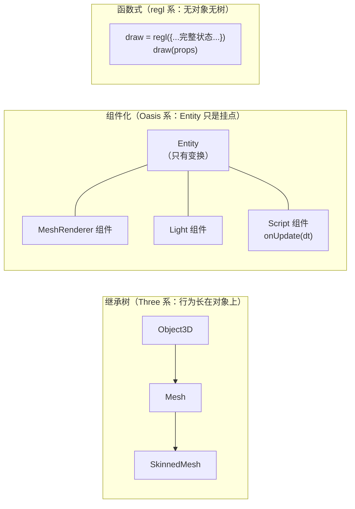

# 生态横向一瞥：Babylon、regl 与 Oasis 的设计取舍

> [返回：WebGL 与 3D 框架学习大纲](../WebGL与3D框架学习大纲.md)
> 本文对应大纲第六阶段第 2 条，小节编号 2.x；不追求覆盖全部生态，只取三个风格差异最大的样本，回答一个问题——**每种设计用什么换走了什么，自研框架在这张坐标系里站在哪**。前置阅读 [02-Three.js源码研读](02-Three.js源码研读.md)。

## 2.1 为什么要横向看

写完自研框架再看别人的引擎，最大的风险是"只见树木"——以为 Three 的做法就是唯一做法。实际上 Three 只是"便利—可控—简单"三角上的一个点：Babylon 用体积换便利，regl 用便利换可控，Oasis 用概念换扩展性。横向看完三个样本，能收获三件东西：

1. **坐标系**：知道每个设计决策都在做交换，没有免费的先进；
2. **定位**：说清自研框架当前像谁、想像谁、为什么；
3. **可搬运的具体设计**：每个框架挑一条低成本吸收进自研框架，本节末尾汇总。

## 2.2 Babylon.js：全家桶

**出身与形态**：微软工程师 David Catuhe 主导，TypeScript 优先，单仓库大版本演进，官方对 API 向下兼容有明确承诺（升级成本低的历史包袱是：老 API 背着走）。与 Three"核心 + examples/jsm 生态自组装"相对，Babylon 把从 demo 到成品的工具链全部收进官方包：引擎（Engine/Scene）、场景调试器 Inspector、节点材质编辑器（Node Material Editor）、Playground 在线试验场、Sandbox 模型查看器、Babylon.GUI 界面系统、粒子/音频/物理（Cannon、Ammo、Havok 等以插件接入）。

**架构取向**：以 Engine / Scene 为中心的强封装。场景内一切（相机、灯、网格、GUI）都由引擎统一托管，PBR 材质子系统、光照与后处理链开箱即用，几乎不需要理解底层 GL 就能出成品。

**取舍**：上手快——文档、工具链、示例一体化，三天能交付一个可交互 B 端场景；代价是核心体量大，想改渲染管线细节（比如自造渲染队列策略）要穿透较厚的封装层。适合团队快速交付；不适合想练底层的人当教材。

**对自研框架的启发**：**调试工具是框架的一部分，不是外挂**。Inspector 这种"场景树 + 逐对象属性面板 + 实时性能统计"的官方调试器，是 Babylon 体验好的重要原因。自研框架第五阶段已做过性能埋点，距离一个丐版调试面板（DOM overlay：fps / drawcall / 对象树 / 选中对象的材质与变换）只差一步组装——毕业项目 W3 顺手做掉，它同时就是验收演示的"工程面"素材。

## 2.3 regl：函数式无状态

**定位**：自我描述是 "functional WebGL"——它不打算做框架，而是做一层更好的 WebGL 绑定。没有场景图、没有对象模型、没有内置光照。

**核心抽象**：绘制命令（draw command）。`regl({ vert, frag, attributes, uniforms, elements, count, depth: { enable, func }, blend, viewport, ... })` 传入一次绘制所需的**完整状态声明**，返回一个可反复调用的命令函数；调用时通过 props（uniform 值、缓冲内容增量）传数据，regl 内部 diff 后只把差异下发到 GL。配合 `regl.frame(回调)` 驱动循环，`regl.prop` / `regl.context` 做参数直通。

**取舍**：状态全部显式传参，没有隐藏全局状态——同一个命令配同一份 props 必然得到同一帧画面，心智负担低、可测试性极好（对着"提交了什么参数"断言即可，不必开 GL 上下文）；代价是框架层的一切便利（剔除、排序、矩阵链、动画、资源生命周期）为零，全部自己搭或再引上层库。适合着色器实验、特效、科研可视化与教学。

**对自研框架的启发**：**渲染器 API 的"形状"**。自研 Renderer 若在分层内部保留一个 `draw(params)` 式的命令层（上层场景图把 Mesh 归约成参数对象再提交），渲染层的单元测试就从"必须开浏览器看效果"变成"断言提交序列"——第四阶段欠的渲染层测试可以走这条路补上。注意 regl 证明了这条路可行，也证明了它的尽头：只有命令层没有场景图，就是 regl 本身；自研框架要的是"场景图之下、GL 之上"多垫这一层。

## 2.4 Oasis（Galacean）：ECS 取向

**出身与形态**：蚂蚁集团的 Oasis Engine，2023 年起更名 Galacean。引擎 + 在线编辑器 + 周边包（粒子、Spine、补间等）整套交付，定位偏"互动内容创作平台"而非纯渲染库。

**架构取向**：实体-组件-系统（Entity-Component-System，ECS）——Entity 只是变换挂点与容器；相机、灯光、网格渲染器都是 Component（组件），挂在 Entity 上；行为逻辑写在 Script 组件里，通过 `onAwake / onStart / onUpdate / onDestroy` 等生命周期钩子被引擎的 System 统一遍历驱动。数据（组件）与逻辑（系统）分离，组合优于继承。

**与 Three 继承树的对照**：Three 是 `Object3D → Mesh → SkinnedMesh` 一路的胖对象继承树，行为内聚在对象方法里；ECS 把"是什么"（数据组件）与"怎么动"（逻辑系统）拆开。下图是两种组织方式的最小示意：

**取舍**：数据驱动的组件结构天然适配编辑器（组件即配置面板）与系统级批处理（同类组件连续迭代，缓存友好）；代价是概念税——实体、组件、系统、生命周期，写一个三物体的 demo 也要先接受这套词汇，纯代码党会觉得啰嗦。

**对自研框架的启发**：**不必整套 ECS，最小切口是把"行为"从 Mesh 里拆出去**。给自研框架加一个可挂载的 Behavior/Script 组件（统一 `update( deltaTime )` 接口），场景图只管变换与层级——毕业项目里"行星自转公转""展品缓慢旋转"就应当写成组件挂在节点上，而不是散落在主循环里的一串 if。这一步不引入 ECS 的概念税，却拿到了"逻辑可插拔、可复用"的主要收益。

## 2.5 四框架对照表与自研框架的定位

| 维度 | Three.js | Babylon.js | regl | Oasis/Galacean | 自研框架（当前） |
|---|---|---|---|---|---|
| 定位 | 组装式渲染库 | 全家桶引擎 | 函数式 GL 绑定层 | 编辑器导向互动引擎 | 学习型迷你框架 |
| 架构风格 | 核心小，生态松耦合（examples/jsm） | 大一统单仓库 | 无架构，状态即参数 | ECS 组件化 | 分层 + 胖 Mesh |
| 场景组织 | 继承树（Object3D 家族） | 强封装 Scene | 无 | Entity + Component | 场景图（胖节点） |
| 状态管理 | WebGLState 记账（见 02 分册 1.2） | 引擎内部托管 | 每次绘制显式传入 | 渲染系统托管 | StateCache |
| 材质/着色器 | ShaderChunk 模板 + 程序缓存键 | 内置 PBR + 节点材质编辑器 | 原始 GLSL 自己管 | 内置材质 + 编辑器配置 | #define 宏开关 |
| 扩展方式 | jsm 插件生态 | 官方包 + 插件 | 函数组合 | 组件/系统注册 | 继承 + 手动挂载 |
| 工具链 | 社区第三方（Spector 等） | 官方 Inspector/NME/Playground | 几乎没有 | 官方编辑器 | 第五阶段性能埋点 |
| 学习曲线 | 中（文档全但概念隐式） | 低（一体化引导） | 低（就是 WebGL） | 中高（先学 ECS 词汇） | —— |
| 对自研最重要的一条启发 | 程序缓存键设计（1.5 节） | 调试面板是框架一部分 | draw(params) 的可测试形状 | 行为组件化 |

**三条结论**：

1. **自研框架当前最接近"Three 的胖节点 + 分层"**，这对学习型项目是正确的起点——先内聚跑通，再谈拆分；不要因为 ECS 听起来先进就推倒重来。
2. **三个可低成本吸收的设计**已经就位：程序缓存键（来自 Three，02 分册 1.5 给了做法）、丐版调试面板（来自 Babylon，性能埋点加一层 DOM overlay）、行为组件化（来自 Oasis，毕业项目直接实践）——三者互不冲突，都排进了里程碑。
3. **"要不要上 ECS"不是先进与否，是有没有编辑器与批处理需求**——没有这个需求就别交概念税。判断依据与架构学习里"决策看约束"一脉相承：先问需求，再问方案。

> 下一站：带着这份定位去读 [04-毕业项目-需求书](04-毕业项目-需求书.md)——毕业项目就是检验"这三条借鉴 + 前五阶段成果"能否撑起完整场景的实验场。
