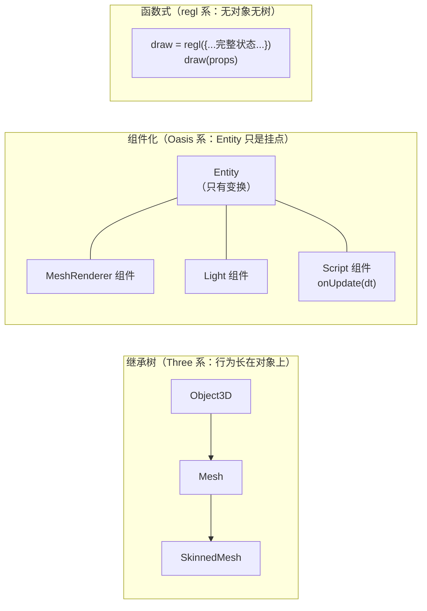
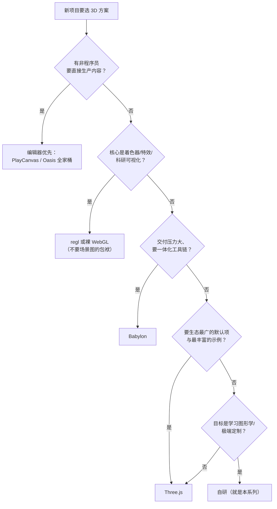

# 生态横向一瞥：Babylon、regl 与 Oasis 的设计取舍

> [返回：WebGL 与 3D 框架学习大纲](../WebGL与3D框架学习大纲.md)
> 本文对应大纲第六阶段第 2 条，小节编号 2.x；不追求覆盖全部生态，只取三个风格差异最大的样本，回答一个问题——**每种设计用什么换走了什么，自研框架在这张坐标系里站在哪**。前置阅读 [02-Three.js源码研读](02-Three.js源码研读.md)。

## 2.1 为什么要横向看

写完自研框架再看别人的引擎，最大的风险是"只见树木"——以为 Three 的做法就是唯一做法。实际上 Three 只是"便利—可控—简单"三角上的一个点：Babylon 用体积换便利，regl 用便利换可控，Oasis 用概念换扩展性。横向看完三个样本，能收获三件东西：

1. **坐标系**：知道每个设计决策都在做交换，没有免费的先进；
2. **定位**：说清自研框架当前像谁、想像谁、为什么；
3. **可搬运的具体设计**：每个框架挑一条低成本吸收进自研框架，本节末尾汇总。

怎么看才能看出"交换"而不是"排行榜"？带着三个问题读每个样本：**它把什么做成了"开箱即用"**（这是它卖的东西）；**它把什么暴露成了"用户的责任"**（这是它不卖的东西，也是代价）；**如果我的项目恰好重它不卖的那块，我会多难受**。三个问题问下来，"哪个框架好"自动退化成"哪种项目适合哪个框架"——后者才是选型问题的正确形态。

还有一个阅读纪律：本册只写**定性事实**（架构定位、设计取向、公开可查的项目形态），不写版本号与"谁更快"的结论——前者随手会过期，后者离开具体场景就是误导。带数字的性能对比只在两种情况下可信：官方 benchmark 且注明场景，或自己照 [07-性能优化与调试](../05-第五阶段/07-性能优化与调试.md) 6.5 的口径复测。

**样本怎么选的**：三个样本分别占据"便利（Babylon）—可控（regl）—结构（Oasis）"三个方向的最远端，加上 2.5 表里的 Three（自研框架最近的亲戚），四个点足以撑起一张坐标系；2.6 再补一个"编辑器优先"的 PlayCanvas 校准另一个轴。刻意不选"中间态"的框架——横向阅读要的是方向的极值，不是大全。

**同一件事的三种写法**（创建一个带光照的网格，伪代码示意风格差异）：

```javascript
// Three：组装式——对象各自创建，靠 add() 拼装，渲染交给 renderer
const mesh = new THREE.Mesh(geometry, material); scene.add(mesh);

// Babylon：托管式——一切从 engine/scene 出发，参数即配置
const mesh = BABYLON.MeshBuilder.CreateSphere('s', { segments: 16 }, scene);

// regl：声明式——没有 mesh，一次绘制就是一份完整状态
const drawSphere = regl({ vert, frag, attributes, uniforms, elements });
```

三种写法不是语法糖差异，是**责任边界的差异**：Three 要你懂组装（对象从哪来、谁更新谁渲染）；Babylon 把组装藏进工厂与场景托管；regl 干脆取消"对象"这个概念。后文每个框架的取舍分析，都是这一行代码差异的展开。

时间预算与读法建议：本册对应的学习量是"半天的阅读 + 对照笔记"，比 02 分册的源码研读轻得多——但每个框架都值得花十分钟去官网跑一下它的最小示例（Playground/在线 demo 都是一条链接的事），亲手跑过与只读文字，对"上手成本"那一列的体感完全不同。读完做一遍 [01-导览](01-导览.md) 阶段自测第 6 题（"三者各自牺牲了什么换来了什么"），答不顺的框架回来重读对应小节。

## 2.2 Babylon.js：全家桶

**出身与形态**：微软工程师 David Catuhe 主导，TypeScript 优先，单仓库大版本演进，官方对 API 向下兼容有明确承诺（升级成本低的历史包袱是：老 API 背着走）。与 Three"核心 + examples/jsm 生态自组装"相对，Babylon 把从 demo 到成品的工具链全部收进官方包：引擎（Engine/Scene）、场景调试器 Inspector、节点材质编辑器（Node Material Editor）、Playground 在线试验场、Sandbox 模型查看器、Babylon.GUI 界面系统、粒子/音频/物理（Cannon、Ammo、Havok 等以插件接入）。

**架构取向**：以 Engine / Scene 为中心的强封装。场景内一切（相机、灯、网格、GUI）都由引擎统一托管，PBR 材质子系统、光照与后处理链开箱即用，几乎不需要理解底层 GL 就能出成品。

**取舍**：上手快——文档、工具链、示例一体化，三天能交付一个可交互 B 端场景；代价是核心体量大，想改渲染管线细节（比如自造渲染队列策略）要穿透较厚的封装层。适合团队快速交付；不适合想练底层的人当教材。

**对自研框架的启发**：**调试工具是框架的一部分，不是外挂**。Inspector 这种"场景树 + 逐对象属性面板 + 实时性能统计"的官方调试器，是 Babylon 体验好的重要原因。自研框架第五阶段已做过性能埋点，距离一个丐版调试面板（DOM overlay：fps / drawcall / 对象树 / 选中对象的材质与变换）只差一步组装——毕业项目 W3 顺手做掉，它同时就是验收演示的"工程面"素材。

**工具链逐项看**，每个工具都在挡一类具体问题（这也是"全家桶"三个字的实际内容）：

| 官方工具 | 挡掉的问题 | 没有它时的替代品 |
|---|---|---|
| Playground 在线试验场 | "复现 bug 要不要发完整工程"——一段可分享 URL 的最小复现 | CodeSandbox 手搭 |
| Inspector 场景调试器 | "画面不对，是矩阵、材质还是灯光"——树上逐对象实时查看改参 | Spector 抓帧 + console.log |
| Node Material Editor | "非程序员想调材质"——节点连线生成 shader | 手写 GLSL |
| Sandbox 模型查看器 | "模型有问题还是我的加载器有问题"——官方通道加载对照 | 自写 viewer |
| Babylon.GUI | 3D 场景里的 HUD/面板布局 | DOM overlay（自研路线的选择） |
| 物理插件（Cannon/Ammo/Havok 等） | 刚体碰撞要自己接物理引擎 | 自接或不用物理 |

注意最后一行的模式：Babylon 对"非核心能力"（物理、音频）的态度是**集成多个可插拔后端**而不是只押一个——与 Three"examples/jsm 生态自组装"殊途同归，差别只在 Babylon 提供了统一的接入层。自研框架对这种东西的正确姿势是定义接口不定实现（比如灯光阴影只约定 pass 协议，具体的 CSM 实现可替换）。

把"丐版 Inspector"拆成可施工的字段清单（每个字段的数据来源都是现成的）：

| 面板字段 | 数据来源 | 前置成果 |
|---|---|---|
| fps / P95 帧时间 | FrameStats 埋点 | 第五阶段性能埋点 |
| drawcall 数 / pass 耗时 | 渲染器计数器（可加 GPU 计时） | 渲染队列改造 + [10-GPU性能度量与剖析](../05-第五阶段/10-GPU性能度量与剖析.md) |
| 对象树（层级 + 可见性） | 场景图遍历（复用 collectVisible 的骨架） | [12-视锥剔除与场景管理](../05-第五阶段/12-视锥剔除与场景管理.md) 的剔除统计 |
| 选中对象的变换/材质 | Raycaster 拾取 + 节点属性直读 | 第四阶段 [05-交互系统](../04-第四阶段/05-交互系统.md) |

注意这个清单的每一行都在"复用旧成果"，新写的只有 DOM 组装——这正是"借鉴 Babylon"的成本控制：搬它的**形态**（面板长什么样），不搬它的**实现**（整套 Inspector）。

从 Inspector 还能学一条交互设计：它的属性面板是**实时可改的**（拖一个数字，画面立即变化）——这把"调参"从"改代码→刷新→看效果"的三步循环变成一步。自研面板哪怕只对"选中对象的旋转角度"做这一件事（input 拖动 → 直接写 node.rotation），调试体验也会质变——因为旋转相机找角度这种事，在调参循环里一天要做几十次。

## 2.3 regl：函数式无状态

**定位**：自我描述是 "functional WebGL"——它不打算做框架，而是做一层更好的 WebGL 绑定。没有场景图、没有对象模型、没有内置光照。

**核心抽象**：绘制命令（draw command）。`regl({ vert, frag, attributes, uniforms, elements, count, depth: { enable, func }, blend, viewport, ... })` 传入一次绘制所需的**完整状态声明**，返回一个可反复调用的命令函数；调用时通过 props（uniform 值、缓冲内容增量）传数据，regl 内部 diff 后只把差异下发到 GL。配合 `regl.frame(回调)` 驱动循环，`regl.prop` / `regl.context` 做参数直通。

命令的"形状"值得看一眼（示意，不是可运行代码）——注意它与"配置对象"的区别：**返回值是函数**，状态声明在创建时一次性给定：

```javascript
const drawSphere = regl({
  vert, frag,
  attributes: { position: sphereBuffer, normal: normalBuffer },
  uniforms: { uModel: regl.prop('model'), uColor: regl.prop('color') },
  elements: sphereIndices,
  depth: { enable: true, func: 'less' },
});
// 每帧：只传"变的部分"，regl 内部 diff 出最小状态变更
drawSphere({ model: planetMatrix, color: gold });
drawSphere({ model: ringMatrix, color: silver });
```

**取舍**：状态全部显式传参，没有隐藏全局状态——同一个命令配同一份 props 必然得到同一帧画面，心智负担低、可测试性极好（对着"提交了什么参数"断言即可，不必开 GL 上下文）；代价是框架层的一切便利（剔除、排序、矩阵链、动画、资源生命周期）为零，全部自己搭或再引上层库。适合着色器实验、特效、科研可视化与教学。

它特别适合教学的另一个理由：**regl 的知识不会过期**。学 Three 要追它的 API 演进，学 regl 学的是 WebGL 本身（它的文档几乎就是按 GL 概念组织的）——这与本系列"手写一遍管线"的立场天然一致。事实上可以把 regl 当作"学完自研框架后的对照组"：如果你的 StateCache、编译缓存、VAO 管理写得够好，regl 能帮你做的事你已经都会了——这时读 regl 源码就不再是学新东西，而是检验自己重发明的东西质量如何。

**对自研框架的启发**：**渲染器 API 的"形状"**。自研 Renderer 若在分层内部保留一个 `draw(params)` 式的命令层（上层场景图把 Mesh 归约成参数对象再提交），渲染层的单元测试就从"必须开浏览器看效果"变成"断言提交序列"——第四阶段欠的渲染层测试可以走这条路补上。注意 regl 证明了这条路可行，也证明了它的尽头：只有命令层没有场景图，就是 regl 本身；自研框架要的是"场景图之下、GL 之上"多垫这一层。

**"绑定层"到底省了什么**——对着裸 WebGL 写一遍同样的绘制，差异就具体了：

```javascript
// 裸 WebGL：每个状态都是一次全局调用，顺序与遗漏都是你的责任
gl.useProgram(prog);
gl.bindBuffer(gl.ARRAY_BUFFER, posBuf);
gl.enableVertexAttribArray(0);
gl.vertexAttribPointer(0, 3, gl.FLOAT, false, 0, 0);
gl.bindBuffer(gl.ELEMENT_ARRAY_BUFFER, idxBuf);
gl.uniformMatrix4fv(loc.model, false, m);
gl.uniform3fv(loc.color, c);
gl.drawElements(gl.TRIANGLES, n, gl.UNSIGNED_SHORT, 0);
// 第二个物体：上面哪些要重设、哪些不用？凭记忆与经验

// regl：状态是声明的一部分，diff 交给库
drawSphere({ model: m1, color: c1 });   // 内部只下发与上次不同的部分
drawSphere({ model: m2, color: c2 });
```

省掉的不是代码行数，是**"谁负责记住当前状态"这份心智负担**——裸 WebGL 里这份记忆由程序员承担（第四阶段 StateCache 就是把它移进框架的记账本，见 [02-Three.js源码研读](02-Three.js源码研读.md) 1.2 的 Three 同款机制）；regl 把它进一步推进到"每次绘制自带完整声明，框架算差异"。同一个问题的三种答案强度：记账（Three/自研）→ 托管（Babylon，你根本看不到状态）→ 声明式重算（regl）。

**diff 与 context 的定性说明**：regl 在两次调用之间比较声明对象，纹理没换就不发 bindTexture、program 没换就不发 useProgram——这与渲染队列按材质排序是同一件事的两种实现路径（队列排序让"相同状态相邻"，diff 让"相同状态跳过"，工程上常两者并用）；`regl.context` 则把每帧恒定的量（画布宽高、相机矩阵、elapsed time）注入回调，避免每次手传。理解到这个层面就够用——自研框架不需要重写 regl，需要的是它的可测试形状。

可测试性具体长什么样，值得展开一句：假设渲染一帧后，命令层留下 `[{programId, meshId, uniforms, order}, ...]` 的提交记录，那么"透明物体排在最后""材质相同的物体相邻提交""阴影 pass 先于主 pass"这些渲染队列性质（[02-Three.js源码研读](02-Three.js源码研读.md) 1.3 对照过的三条队列策略）全部可以变成纯 JS 断言——不开浏览器、不渲染一像素，回归测试毫秒级跑完。这是 regl 设计哲学里最值得偷走的东西，比它的 diff 实现重要得多。

## 2.4 Oasis（Galacean）：ECS 取向

**出身与形态**：蚂蚁集团的 Oasis Engine，2023 年起更名 Galacean。引擎 + 在线编辑器 + 周边包（粒子、Spine、补间等）整套交付，定位偏"互动内容创作平台"而非纯渲染库。

**架构取向**：实体-组件-系统（Entity-Component-System，ECS）——Entity 只是变换挂点与容器；相机、灯光、网格渲染器都是 Component（组件），挂在 Entity 上；行为逻辑写在 Script 组件里，通过 `onAwake / onStart / onUpdate / onDestroy` 等生命周期钩子被引擎的 System 统一遍历驱动。数据（组件）与逻辑（系统）分离，组合优于继承。

**与 Three 继承树的对照**：Three 是 `Object3D → Mesh → SkinnedMesh` 一路的胖对象继承树，行为内聚在对象方法里；ECS 把"是什么"（数据组件）与"怎么动"（逻辑系统）拆开。下图是两种组织方式的最小示意：



**取舍**：数据驱动的组件结构天然适配编辑器（组件即配置面板）与系统级批处理（同类组件连续迭代，缓存友好）；代价是概念税——实体、组件、系统、生命周期，写一个三物体的 demo 也要先接受这套词汇，纯代码党会觉得啰嗦。

顺带澄清一个常见误会：Three 的 `Group` 不是组件化——Group 仍然是继承树上的一环（"更纯的容器节点"），它解决的是"变换挂点"，而 ECS 的 Component 解决的是"能力的自由拼装"（一个 Entity 同时挂 MeshRenderer + Light + Script，不需要任何一种"多继承"）。判断一个引擎是否组件化，看"给一个东西加灯光能力"是挂组件还是换类型（`light.enabled` vs `new PointLightMesh`）。

**对自研框架的启发**：**不必整套 ECS，最小切口是把"行为"从 Mesh 里拆出去**。给自研框架加一个可挂载的 Behavior/Script 组件（统一 `update( deltaTime )` 接口），场景图只管变换与层级——毕业项目里"行星自转公转""展品缓慢旋转"就应当写成组件挂在节点上，而不是散落在主循环里的一串 if。这一步不引入 ECS 的概念税，却拿到了"逻辑可插拔、可复用"的主要收益。

**概念税的账单**——完整 ECS 要为收益付出多少词汇成本，值得列出来（判断"要不要交"的依据）：

| ECS 概念 | 一句话职责 | 自研框架对应物 |
|---|---|---|
| Entity | 变换挂点与容器（无行为） | Node3D（已存在） |
| Component | 纯数据（位置/网格引用/材质参数） | Node3D 的字段（目前数据与节点一体） |
| System | 遍历同类组件的逻辑（动画系统/渲染系统） | 主循环里的各阶段 |
| Script 组件 | 带生命周期的用户行为 | Behavior（本册建议新增的最小件） |
| 组件注册表 | 组件类型 ↔ 编辑器面板/序列化 | 无（没有编辑器，暂不需要） |

账单的读法：前四行自研框架"事实上已有"，只是没按 ECS 词汇组织；最后一行（注册表）才是真正为编辑器多付的成本——没有编辑器就不必付。这也是 2.5 结论 3 的展开：**ECS 的概念税主要交给了编辑器与批处理，你的项目没有这两样，就只该买最便宜的 Script 组件这一件**。

至于"缓存友好"（同类组件在内存里连续排布，System 顺序迭代少 cache miss）：这是把组件数据从对象里拆到连续数组的收益（SoA 布局，[12-视锥剔除与场景管理](../05-第五阶段/12-视锥剔除与场景管理.md) 11.6 有展开）——真实收益要在万级实体时才显著，学习型框架不必追求，知道方向即可。

最小 Behavior 组件的接口约定（毕业项目要写的全部——大约几十行，主循环只多一次遍历）：

```typescript
interface Behavior {
  /** 每帧由主循环统一调用；返回 false 可自行摘除 */
  update(deltaTime: number): boolean | void;
}
// 主循环里：for (const b of behaviors) b.update(dt);
// 用法：new OrbitBehavior(planetPivot, angularSpeed) 挂上即生效，摘下即停
```

毕业项目里它长这样（示意）——自转与公转是两个独立组件，挂在不同的节点上：

```typescript
class SpinBehavior {          // 自转：挂在天体本体上
  constructor(private node: Node3D, private radPerSec: number) {}
  update(dt: number): void { this.node.rotation.y += this.radPerSec * dt; }
}
class OrbitBehavior {         // 公转：挂在 pivot 锚点上
  constructor(private pivot: Node3D, private radPerSec: number) {}
  update(dt: number): void { this.pivot.rotation.y += this.radPerSec * dt; }
}
// 组装：moonPivot 挂公转、moon 本体挂自转；时间暂停 = 主循环不调 update，天然成立
```

对比一下散在主循环里的写法（`if (聚焦模式) { ... } if (暂停) { ... } 行星A.angle += ...`）：组件化后主循环恒定三行（更新组件 → 更新场景图 → 渲染），每类行为独立成文件可单测——这正是毕业项目"动画全部组件化"验收项（[04-毕业项目-需求书](04-毕业项目-需求书.md) 3.2.2）的技术依据。

## 2.5 四框架对照表与自研框架的定位

| 维度 | Three.js | Babylon.js | regl | Oasis/Galacean | 自研框架（当前） |
|---|---|---|---|---|---|
| 定位 | 组装式渲染库 | 全家桶引擎 | 函数式 GL 绑定层 | 编辑器导向互动引擎 | 学习型迷你框架 |
| 架构风格 | 核心小，生态松耦合（examples/jsm） | 大一统单仓库 | 无架构，状态即参数 | ECS 组件化 | 分层 + 胖 Mesh |
| 场景组织 | 继承树（Object3D 家族） | 强封装 Scene | 无 | Entity + Component | 场景图（胖节点） |
| 状态管理 | WebGLState 记账（见 02 分册 1.2） | 引擎内部托管 | 每次绘制显式传入 | 渲染系统托管 | StateCache |
| 材质/着色器 | ShaderChunk 模板 + 程序缓存键 | 内置 PBR + 节点材质编辑器 | 原始 GLSL 自己管 | 内置材质 + 编辑器配置 | #define 宏开关 |
| 扩展方式 | jsm 插件生态 | 官方包 + 插件 | 函数组合 | 组件/系统注册 | 继承 + 手动挂载 |
| 工具链 | 社区第三方（Spector 等） | 官方 Inspector/NME/Playground | 几乎没有 | 官方编辑器 | 第五阶段性能埋点 |
| 学习曲线 | 中（文档全但概念隐式） | 低（一体化引导） | 低（就是 WebGL） | 中高（先学 ECS 词汇） | —— |
| 对自研最重要的一条启发 | 程序缓存键设计（1.5 节） | 调试面板是框架一部分 | draw(params) 的可测试形状 | 行为组件化 |

**三条结论**：

1. **自研框架当前最接近"Three 的胖节点 + 分层"**，这对学习型项目是正确的起点——先内聚跑通，再谈拆分；不要因为 ECS 听起来先进就推倒重来。
2. **三个可低成本吸收的设计**已经就位：程序缓存键（来自 Three，02 分册 1.5 给了做法）、丐版调试面板（来自 Babylon，性能埋点加一层 DOM overlay）、行为组件化（来自 Oasis，毕业项目直接实践）——三者互不冲突，都排进了里程碑。
3. **"要不要上 ECS"不是先进与否，是有没有编辑器与批处理需求**——没有这个需求就别交概念税。判断依据与架构学习里"决策看约束"一脉相承：先问需求，再问方案。

**这张表的读法**有三种入口，各取所需：按行读是"某个维度上谁强谁弱"（选型时按项目的痛点行读）；按列读是"一个框架的性格"（面试或技术分享时按列讲）；最后一行单独读——它是本册的结论行，前面所有格子都是它的论据。读表时警惕一个陷阱：**格子里的评语都是相对的**（"体量大"是相对 Web 生态的体量级，不是相对原生引擎），脱离参照系引用评语会失真。

**定位演练**：拿三个虚构但典型的项目需求，看自研框架在坐标系里该怎么站（练习"说清当前像谁、想像谁、为什么"）：

| 项目 | 自研框架当前够不够 | 缺口是什么 | 决策 |
|---|---|---|---|
| 数据可视化大屏（十万级点云，交互简单） | 渲染核心够（instancing 已具备） | 大规模点云的缓冲管理与拾取优化 | v1.1 内可承载，借鉴 draw(params) 补测试后放心改渲染层 |
| 互动营销页（一周交付，视觉华丽） | 不够——后处理链与材质库太薄 | 时间盒内补不齐 | 换 Three/Babylon，自研框架沉淀的经验直接迁移（分层与状态托管的概念通用） |
| 教学 demo 站（本仓库 examples 这样的） | 正好——每个系统都透明可讲 | 无 | 继续自研，这就是它的主场 |

演练的收获不是三个答案，是那个反复出现的判断模式：**"够不够"取决于项目的核心复杂度落在哪个子系统，而自研框架的子系统强弱是不均匀的**（渲染与场景图强、材质与工具链弱）——说清这个不均匀，定位才算说清了。

## 2.6 PlayCanvas：编辑器优先的另一极

三个样本看完还差一个方向：前三个都是"写给程序员"，PlayCanvas 代表"**写给团队里的非程序员**"。

**出身与形态**：英国 PlayCanvas 公司主导。引擎运行时开源，而**可视化编辑器是托管在官网的在线商业产品**——这与 Babylon"引擎带工具"又不同：编辑器不是引擎的配件，而是产品中心，引擎是编辑器的运行时。典型工作流是在浏览器里协作编辑场景、调灯光摆物件，一键发布 WebGL 应用；面向交互营销、轻量游戏等"内容迭代快、团队角色混合"的场景。

**架构取向**：场景的真源（source of truth）是**编辑器资产**而非代码——场景图、实体组件、材质参数都序列化为资产格式，运行时加载执行；脚本以组件形式挂在实体上，与编辑器面板双向可见。这带来与 2.4 Oasis 相似的组件化运行时（Oasis 同样有编辑器，两家在"编辑器导向"上是一路人，差别在商业化形态与生态重心）。

运行时与编辑器的关系值得多看一眼：引擎运行时开源（可审查、可自托管构建），编辑器闭源托管（按席位订阅的商业模式）——**开源的是"消费资产的那一半"，商业化的是"生产资产的那一半"**。这个切法把"产品跑起来了"与"内容怎么做出来"拆成两种生意，也解释了为什么它的运行时体量控制得好：轻运行时是内容分发成本的直接优化目标。

**取舍**：编辑器带来的生产力是真实的——策划调场景不用碰代码、所见即所得的迭代速度是纯代码工作流比不了的；代价是**场景的可版本化性与可迁移性变弱**——资产格式由工具链掌控，diff 评审、程序化生成、批量重构这些"代码即场景"路线的日常操作，在"编辑器即场景"路线里都要绕路。引擎本体相对轻量，加载体积在同类引擎中口碑较好（定性印象，具体数字以自家场景实测为准）。

**对自研框架的启发**：**"场景即数据"的最小实践**。自研框架当然做不了编辑器，但毕业项目的"数据表驱动场景组装"（[04-毕业项目-需求书](04-毕业项目-需求书.md) 3.1：行星数据外置 JSON，新增一颗行星不改代码）正是这条路线的微缩版——场景的"真源"从代码挪到数据。做完毕业项目回看 PlayCanvas，就能理解它为什么把编辑器当产品中心：**一旦场景是真数据，编辑器只是"改数据的最顺手 UI"**。

**编辑器流 vs 代码流**，同一步迭代在两条路线里的完整链路对照：

| 迭代动作 | 编辑器流（PlayCanvas/Oasis 编辑器） | 代码流（Three/自研） |
|---|---|---|
| 挪一个物件 | 面板拖拽，即时预览 | 改坐标常量/JSON，刷新页面 |
| 调一个材质 | 拖滑杆，所见即所得 | 改 uniform，刷新（或自建 GUI） |
| 版本管理 | 资产文件二进制/专用格式，diff 困难 | 纯文本，diff/branch/review 全套 |
| 程序化生成 | 受限（编辑器操作为主） | 天然支持（代码生成场景） |
| 批量重构（改 100 个物体的组织方式） | 手动或写编辑器脚本 | 一次改代码 |
| 团队协作 | 非程序员直接参与 | 都要会一点代码 |

两个方向都真实存在没有优劣——**迭代以"视觉微调"为主的项目吃编辑器红利，以"结构重组"为主的项目吃代码红利**。毕业项目两案恰好都是代码流（行星数据表、展品清单 JSON），这是练习的重点放对了地方的旁证。

**选 PlayCanvas 的三个信号**（满足两条以上再认真评估）：团队里有不写代码的内容生产者；内容迭代频率远高于结构迭代（营销活动页这类"周更"节奏）；发布目标是轻量互动而不是重游戏（重游戏优先考虑原生引擎的 Web 导出，2.7）。

## 2.7 更远的地平线：原生引擎 Web 导出与 WebGPU

两个不必深入、但选型时要"知道存在"的方向（同样只说定性）：

- **原生游戏引擎的 Web 导出**（Unity、Godot 等导出 WebGL/WASM）：生态与工具链成熟度是 Web 原生框架比不了的，但导出产物普遍**体量大、首载慢**，且调试链路在"引擎导出层"而非浏览器 DevTools——适合重内容的游戏项目，不适合轻量互动与产品嵌入。选它等于接受"Web 是分发渠道，不是开发范式"；
- **WebGPU**：下一代 Web 图形 API（接替 WebGL 的定位），计算着色器、更贴近现代硬件的 API 形状。主流框架（Three、Babylon 等）已提供或正在推进各自的 WebGPU 后端，新项目"押注 WebGPU"尚早、"关注框架的 WebGPU 进展"正合适。对本系列的意义在于：前五阶段建立的分层观念（谁懂 GL、谁管场景）在换图形 API 时**只有渲染层要重写**——分层的红利在技术换代时最明显。

这两个方向放进 2.8 的问卷里对应两个新格子："内容重度吗（美术资产、关卡逻辑）"——重度则原生导出进入备选；"要 compute shader 吗（GPU 粒子物理、大规模模拟）"——要则关注 WebGPU 与对应框架后端的成熟度。格子本身不用现在答，知道问卷还能扩，横向阅读的坐标系就立住了。

## 2.8 选型维度：把取舍变成问卷

把 2.2~2.7 的观察收编成一张选型问卷——每行是一个维度，右列是"这个问题该问谁"。选型时按项目逐行打勾，得分自然指向答案：

| 维度 | 关键问题 | 倾向 Babylon/PlayCanvas | 倾向 Three | 倾向 regl/自研 |
|---|---|---|---|---|
| 交付压力 | 三周内要给客户可交互 demo？ | 强（一体化引导） | 中 | 弱（一切自己搭） |
| 团队构成 | 有策划/美术要直接改场景？ | 强（编辑器/Inspector） | 中（需配工具） | 弱 |
| 定制深度 | 要改渲染管线内部（自定义队列/pass）？ | 弱（封装厚） | 中（可绕） | 强（本来就没封装） |
| 学习目标 | 项目本身是学图形学？ | 不适合（学不到底层） | 适合读源码 | 最适合（就是 GL） |
| 体量预算 | 首屏对加载体积敏感？ | 体量大是已知代价 | 核心小、按需引 | 极小 |
| 工具链诉求 | 需要官方调试器/材质编辑器？ | 强 | 靠社区（Spector 等） | 自己写 |
| 长期演进 | 引擎锁定的风险能接受吗？ | 编辑器资产绑定 | 生态广、迁移路径多 | 无锁定（也无扶持） |

三条使用纪律：**先问需求再翻问卷**（带着答案找论据是选型翻车的标准姿势）；**允许组合**（regl 做特效层 + 简单场景管理自搭，是可视化项目的常见混合）；**自研永远是一个选项但仅当"学习"或"极端定制"在需求前列**——为省 license 费自研、为性能自研，在成熟开源引擎面前都站不住。

问卷收敛成一张决策图（问的是需求特征，答的是"先看谁"）：



注意图里没有一条边写着"性能"——**性能不是选型维度，是选型后的工程纪律**：任何一条路线的性能上限都足够高，瓶颈几乎总在怎么用（drawcall、合批、剔除，见 [07-性能优化与调试](../05-第五阶段/07-性能优化与调试.md)）。把"性能"当框架选型第一标准，是新手最常见的问卷错题。

问卷还有一条隐含规则：**维度有权重，且权重因团队而异**。同样一张表，外包团队会把"交付压力"读到最高，研究组会把"学习目标/定制深度"读到最高，没有统一的打分公式——这也是为什么本册只给问卷不给评分器：权重是你的项目事实，不是本册的判断。实践中有效的做法是把问卷拿给团队里"最反对换框架的那个人"一起填，分歧最大的那行往往就是真正的决策变量。

## 2.9 借鉴落地清单：从"启发"到"排期"

本册开头承诺的"可搬运设计"最终汇总。四条借鉴按优先级排进毕业项目里程碑（[05-毕业项目-里程碑计划](05-毕业项目-里程碑计划.md)），每条都有明确验收物——启发没有排期与验收，就只是读后感：

| 借鉴 | 来源 | 落点 | 验收物 |
|---|---|---|---|
| 程序缓存键升级（模板 id + 参数签名） | Three（02 分册 1.5） | W2 材质升级时顺手 | 同参数材质不重复编译的测试记录 |
| 行为组件化（Behavior + update(dt)） | Oasis（本册 2.4） | W1 骨架周定型 | 公转/自转/巡游全部组件化，主循环无逐物体 if |
| 丐版调试面板（DOM overlay） | Babylon（本册 2.2） | W3 打磨周 | 演示脚本"工程面"环节直接用它 |
| draw(params) 命令层 | regl（本册 2.3） | 毕业项目后（v1.1） | 渲染队列性质的纯 JS 断言测试 |

四条的顺序也有讲究：前三条服务毕业项目的验收（缓存键→性能、组件化→工程质量、面板→演示），第四条是"项目后还愿"——它与验收无关，与框架的长期健康有关。这样的分层也是横向阅读的方法论输出：**别人的设计要么换成项目里的验收物，要么明确标成"以后"，不要停在"学到了"**。

这份清单同时就是自研框架 v1.1 的雏形：02 分册"查漏补缺清单"里"记录在案"的一栏（源码对标产出）与本册的借鉴清单（生态横向产出）在毕业项目收尾时合并——前者是"别人有我没有的机制"，后者是"别人有我也想要的机制"，两者去重后按成本排序，就是 v1.1 的 roadmap。框架的演进路线从此不再是"想到什么做什么"，而是有两份外部坐标系背书的清单。

## 2.10 自查：读完本册应能回答的问题

合上笔记作答，答不顺的回到对应小节（这组问题与 [01-导览](01-导览.md) 阶段自测第 6 题互相覆盖）：

1. Babylon 全家桶"全"在哪些工具上？每个工具各自挡掉什么问题？（2.2 工具链逐项表）
2. regl 的"无状态"是什么意思？同一命令配同一 props 为什么必然得到同一画面？（2.3）
3. "draw(params) 的可测试形状"能把哪些渲染队列性质变成纯 JS 断言？举出三条。（2.3 末段）
4. Entity / Component / System 各自的职责一句话？Behavior 组件为什么是最小切口而不是整套 ECS？（2.4）
5. "概念税"主要交给了谁？什么项目该交、什么项目不该交？（2.4 概念税账单与 2.5 结论 3）
6. PlayCanvas 的"场景真源"是什么？编辑器流与代码流各自的强项迭代动作是什么？（2.6 对照表）
7. 四条可借鉴设计各自的落点与验收物是什么？哪条排在毕业项目之后、为什么？（2.9 清单）
8. 为什么说"性能不是选型维度，是选型后的工程纪律"？（2.8 决策图下的注）
9. PlayCanvas 与 Babylon 都"带工具"，两家的工具在定位上差在哪一格？（2.2 与 2.6 的架构取向段对照）

## 2.11 本册的边界：没有回答的问题

横向一瞥的目的在于建立坐标系，不是产出百科。明确列出本册**不**回答的问题，防止过度引申：

1. **不做性能横评**——"哪个框架快"没有脱离场景的答案，且结论随版本漂移；需要时按 [10-GPU性能度量与剖析](../05-第五阶段/10-GPU性能度量与剖析.md) 的口径自己测；
2. **不追踪版本与 API 细节**——本册所有判断都基于各项目长期稳定的公开形态（架构取向、产品结构），具体 API 请以各官方文档为准；
3. **不构成完整生态目录**——WebGL/WebGPU 生态里还有许多体量更小或更垂直的库（数据可视化、地图、粒子特效各有专门方案），本册选样本的原则是"方向极值"而非"覆盖度"；真实选型遇到垂直场景，先搜该场景的专门库再回来对照本册的维度；
4. **不替代动手验证**——问卷与决策图只是"先看谁"的排序，最终决定前用候选框架各搭一个最小 demo（半天量级），问卷的抽象判断要向具体手感投降。

> 下一站：带着这份定位去读 [04-毕业项目-需求书](04-毕业项目-需求书.md)——毕业项目就是检验"这三条借鉴 + 前五阶段成果"能否撑起完整场景的实验场。
