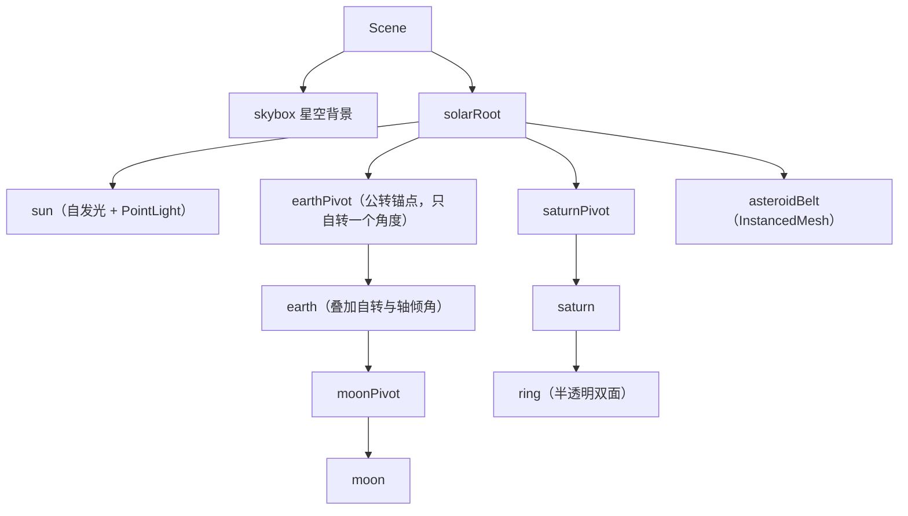

# 毕业项目需求书：太阳系模拟 与 3D 展厅

> [返回：WebGL 与 3D 框架学习大纲](../WebGL与3D框架学习大纲.md)
> 本文对应大纲第六阶段第 3 条（上篇），小节编号 3.1~3.4；太阳系与 3D 展厅两份需求**全部写全**，通读后再任选其一实施。里程碑与风险见下篇 [05-毕业项目-里程碑计划](05-毕业项目-里程碑计划.md)。

## 3.1 选题说明与公共约定

两案共享同一组必选技术点与验收流程，差异只在场景形态、风险点与工作量分布。公共硬性约定：

1. **必须用自研框架**（第四阶段定名发布的那套），不得引入 three / babylon 等成品引擎；允许引 vite、TypeScript、测试框架等工程依赖；
2. TypeScript 严格模式，模块边界遵守第四阶段的分层约定；
3. 桌面 Chrome / Edge 全功能；移动端可运行即可（允许降级：关后处理、降阴影）。

**必选技术点与前五阶段成果的映射**（这是"毕业"二字的含义——每个技术点都是旧成果的再利用）：

| 大纲必选点 | 前五阶段来源 | 太阳系中的落位 | 3D 展厅中的落位 |
|---|---|---|---|
| 场景图 | 第三/四阶段（场景图 + 脏标记） | 恒星 → 行星 → 卫星/环 的多级父子 | 展厅 → 展区 → 展台 → 展品 |
| 光照阴影 | 第二/五阶段（光照模型、shadow map/PCF） | 太阳点光源；自 eclipsing 阴影为加分项 | 每展位射灯（spotlight）+ PCF 阴影 |
| 后处理 | 第五阶段（ping-pong、bloom、FXAA、色调映射） | bloom 太阳辉光 + ACES 色调映射 | FXAA + 轻量 bloom + 色调映射 |
| 拾取交互 | 第四阶段（Raycaster：屏幕 → NDC → 世界射线） | 点击行星聚焦 + 信息面板 | 点击展品出详情卡片、点击热点跳转 |
| 动画 | 第四阶段（关键帧插值与混合） | 公转/自转 + 相机飞行 | 开场巡游 + 展品自转 |

**公共非功能需求**：目标帧率桌面 60fps、底线 30fps；drawcall 预算 ≤ 150（Spector 抓帧核对）；首屏可交互 ≤ 5 秒（展厅案含模型加载，需进度反馈）；WebGL2 不可用时显示友好提示页而非白屏；控制台无报错。

## 3.2 方案 A：太阳系模拟（需求全案）

**一句话**：一个时间流速可调、天体可点击聚焦的太阳系沙盘——场景图深度优先，透明与 instancing 是技术主角。

### 3.2.1 场景构成

| 场景元素 | 构成方式 | 验证的技术点 |
|---|---|---|
| 太阳 | 程序化球体 + 自发光材质（无光照参与）+ 点光源；bloom 的主要贡献者 | 材质系统、后处理 |
| 八大行星 | 球体 Geometry（第三阶段生成器）+ 纹理贴图（第二阶段纹理管线）；半径/轨道半径/公转周期/自转周期/轴倾角**全部数据表驱动**（外置 JSON） | 场景图、数据驱动 |
| 月球 | 挂在地球之下的卫星层 | **多级**场景图（三级以上父子） |
| 土星环 | 双面半透明环面 | 透明排序（renderOrder 逃生舱，见 02 分册 1.3） |
| 小行星带 | instancing（第五阶段）渲染约一万颗碎石 | instancing、性能预算 |
| 星空背景 | 大球体内表面贴星图纹理，或 cubemap 天空盒（第五阶段） | 天空盒/纹理参数 |

场景图结构（数据表驱动后由代码组装）：

要点：**公转锚点（pivot）与天体本体分离**——锚点只负责绕太阳转，本体只负责自转与轴倾角，卫星挂在地球本体之下即可"免费"获得公转叠加。这正是场景图父子变换链的教学价值所在。

### 3.2.2 交互与动画需求

- **漫游**：OrbitCamera（第三阶段）拖拽旋转 / 滚轮缩放 / 右键平移；
- **聚焦**：点击行星 → 相机缓动飞至该行星附近并**跟随其公转**（相机每帧 lookAt 目标，或挂为目标子节点后补偿旋转——两种做法都要试，写进复盘）；同时右侧信息面板显示名称与数据表字段；
- **时间控制**：流速滑杆（0 ~ 100 倍）+ 暂停按钮；公转角速度 `ω = 2π / T` 按流速缩放；
- **动画实现**：公转/自转写成 Behavior 组件挂在 pivot 与本体上（03 分册 2.4 的实践），主循环只遍历组件不写 if；相机飞行用两关键帧 + easeInOutCubic 缓动的迷你 tween 工具（约百行，列入缺口清单）。

### 3.2.3 后处理需求

链路顺序：场景渲染 → bloom（阈值只让太阳与亮部溢出）→ ACES 色调映射 → 输出。FXAA 可选（球体高光边缘若有锯齿再开）。

### 3.2.4 验收标准 checklist

功能组：

- [ ] 八大行星 + 月球 + 土星环按数据表公转/自转，轴倾角正确呈现
- [ ] 时间流速可调可暂停，暂停时相机交互仍可用
- [ ] 点击行星能正确拾取（Raycaster），相机平滑飞行并跟随目标公转
- [ ] 信息面板内容与数据表一致，点击空白或"返回"可退出聚焦
- [ ] 土星环与行星本体无透明穿插闪烁（必要时用 renderOrder 显式控制并能说明理由）
- [ ] 小行星带用 instancing 单次（或极少量）drawcall 渲染

性能组：

- [ ] 桌面 60fps：性能面板录 30 秒无长任务（> 50ms）卡顿
- [ ] drawcall ≤ 150（Spector 抓帧核对，重点看行星是否合批预期外）
- [ ] 首屏可交互 ≤ 3 秒（纹理按需加载，星空先出）

工程组：

- [ ] 行星数据外置 JSON：新增一颗行星（含纹理与参数）**不改核心代码**
- [ ] WebGL2 不可用显示友好提示页
- [ ] README 含操作说明、截图、性能数据、在线地址

加分项（时间盒外）：行星轨迹线、始终面向相机的名称标签（billboard）、彗星与粒子彗尾、月食时刻的阴影投射、移动端触控适配。

## 3.3 方案 B：3D 展厅（需求全案）

**一句话**：一个可漫游或可跳转、展品可点击查看详情的线上展厅——glTF 加载、PBR 材质与阴影质量是技术主角。

### 3.3.1 场景构成

| 场景元素 | 构成方式 | 验证的技术点 |
|---|---|---|
| 展厅空间 | 地板 + 墙体 + 天花板的盒式空间，程序化 Geometry 拼装（或简单 glTF） | 场景图、静态优化（matrixAutoUpdate = false） |
| 展台与展品 | 6~10 个展位；2~3 件 glTF 展品（第四阶段简版加载器）+ 其余用 Geometry 生成器兜底低模 | glTF 加载、资源队列 |
| 展品材质 | PBR（第五阶段 metallic-roughness 工作流），glTF 材质到自研材质的映射 | PBR、材质系统 |
| 灯光 | 低强度环境光 + 每展位一盏射灯；**2~3 盏**投影视阴影（阴影贴图预算） | 光照、PCF 阴影 |
| 动线引导 | 地面热点（发光圆环，可点击）；地面材质略反光 | 拾取、材质参数 |

### 3.3.2 交互与动画需求

- **导航二选一或都做**（推荐先做热点跳转，工作量可控）：①热点跳转——点击地面热点，相机 tween 飞至预设机位；②WASD 漫游 + 简化碰撞（展台包围盒推挤）；
- **展品详情**：点击展品 → 详情卡片（名称/描述/图片，DOM overlay）+ 展品高亮；点击空白处关闭；
- **hover 反馈**：鼠标悬停展品时 emissive 提亮（拾取结果 → 材质参数，不用换 program）；
- **开场动画**：10 秒相机巡游（关键帧插值，第四阶段动画系统），可随时点击打断进入自由导航；
- **展品动画**：展品缓慢自转（Behavior 组件），详情打开时短暂加速旋转作为反馈。

### 3.3.3 后处理需求

FXAA（几何边缘锯齿）→ 轻量 bloom（射灯光晕）→ 色调映射。注意：FXAA 与 bloom 的先后顺序要在实现时实验并记录结论（先 FXAA 后 bloom 可减少辉光边缘锯齿，但会柔化亮边——两帧对比图写进 README）。

### 3.3.4 验收标准 checklist

功能组：

- [ ] 开场巡游可被交互打断，打断后相机状态自然衔接
- [ ] 至少一种导航可用，且不穿墙、不穿展台
- [ ] 点击展品弹出正确详情卡片；点击空白关闭；hover 有高亮反馈
- [ ] 射灯阴影方向与强度合理，无明显 shadow acne（bias 参数有调优记录）
- [ ] 展品自转与详情反馈动画正常

性能组：

- [ ] 桌面 60fps；单件 glTF 展品 ≤ 5 万三角形
- [ ] 首屏可交互 ≤ 5 秒，加载进度可见（资源队列的 Promise 化在这里兑现）
- [ ] drawcall ≤ 150（注意 glTF 每展品可能多个 mesh，必要时合并）

工程组：

- [ ] 展品清单外置 JSON（名称/描述/模型路径/展位坐标/卡片图）：换一批展品不改核心代码
- [ ] 模型加载失败有兜底低模与提示，不白屏
- [ ] README 同太阳系案要求

加分项：展品 outline 描边（后处理法线/深度边缘检测）、小地图、背景音效、待机 30 秒自动巡游、移动端虚拟摇杆。

## 3.4 通用验收流程与提交物

**三分钟演示脚本**（验收即按此走查）：

1. 0:00~0:30 打开页面：加载反馈 → 开场动画/星空入场；
2. 0:30~2:00 核心交互：拾取与详情、导航/时间控制、透明物体近观、动画打断；
3. 2:00~3:00 工程面：打开调试面板（fps / drawcall）、展示数据驱动配置改一处立即生效、（可选）展示降级开关。

**评分维度**（自评 + 可请他人按此打分）：

| 维度 | 权重 | 说明 |
|---|---|---|
| 功能完整度 | 40 | 功能组 checklist 全勾为满 |
| 必选技术点覆盖 | 30 | 五项各 6 分：未覆盖得 0，覆盖但理解浮于表面（说不出取舍）扣半 |
| 性能与优化 | 15 | 性能组 checklist + 至少一条"发现问题→定位→优化"的记录 |
| 工程质量 | 15 | 工程组 checklist + README 完整度 + 代码结构 |

**提交物清单**：

1. 仓库：源码、构建配置、数据 JSON、README；
2. GitHub Pages 在线地址（发布步骤见 [05 分册](05-毕业项目-里程碑计划.md) 3.8 节）；
3. 性能记录：fps 曲线截图 + Spector 抓帧结论；
4. 项目复盘：对照 02 分册的"查漏补缺清单"——哪些跟进项真的落地了、落地后效果如何；哪些放弃了、为什么。这份复盘与代码同等重要，它是"源码对标"这半个阶段的成绩单。
