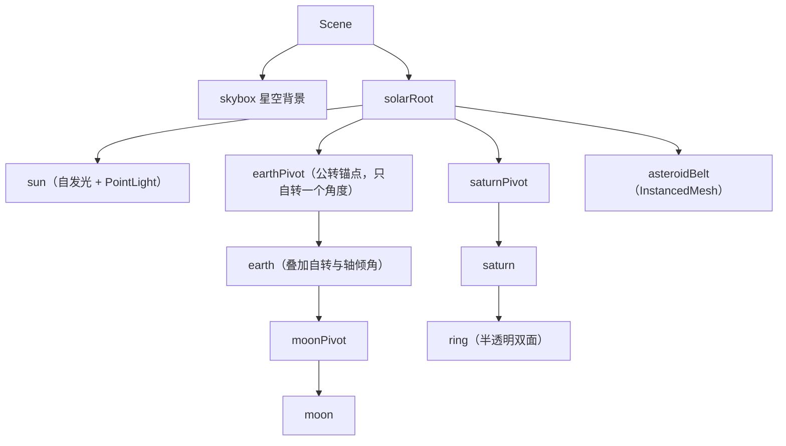

# 毕业项目需求书：太阳系模拟 与 3D 展厅

> [返回：WebGL 与 3D 框架学习大纲](../WebGL与3D框架学习大纲.md)
> 本文对应大纲第六阶段第 3 条（上篇），小节编号 3.1~3.4；太阳系与 3D 展厅两份需求**全部写全**，通读后再任选其一实施。里程碑与风险见下篇 [05-毕业项目-里程碑计划](05-毕业项目-里程碑计划.md)。

## 3.1 选题说明与公共约定

两案共享同一组必选技术点与验收流程，差异只在场景形态、风险点与工作量分布。公共硬性约定：

1. **必须用自研框架**（第四阶段定名发布的那套），不得引入 three / babylon 等成品引擎；允许引 vite、TypeScript、测试框架等工程依赖；
2. TypeScript 严格模式，模块边界遵守第四阶段的分层约定；
3. 桌面 Chrome / Edge 全功能；移动端可运行即可（允许降级：关后处理、降阴影）。

**每条约定的理由**（约定不是姿态，是验收的推论）：

- **禁成品引擎**：毕业项目的被验收对象是"自研框架 + 前五阶段的积累"，成品引擎会让所有技术点验收失去意义（shadow map 变成"会调参数"而不是"会写两 pass"）。允许工程依赖是因为构建工具不是考察对象；
- **TS 严格模式与分层**：这是第四阶段工程化（[08-工程化](../04-第四阶段/08-工程化.md) 7.1/7.2）的延续验收——项目代码是框架质量的直接证据，严格模式开洞、跨层 import 这类问题在毕业项目里出现，扣的是框架设计的分；
- **移动端"可运行即可"**：明确放弃移动端体验的高分争夺，换取桌面端把五项技术点做深。降级开关（W3 任务）是这条约定的工程化表达——不是"移动端另外写一版"，而是"同一版本里可配置地关掉贵的东西"。

第 1 条里"工程依赖"的边界值得划清，防止误伤：**判据是"它是否替你渲染/管理场景"**。vite/TypeScript/vitest/tsup（构建与测试）、tween 类纯数学工具（如果不自己写）都算工程依赖——它们不碰渲染管线；任何带 Scene/Mesh/Material 概念的包（three、babylon，以及 @react-three/fiber 这类包装层）都是成品引擎，引入即违反约定。灰色地带（如第三方 glTF 校验器、纹理编解码库）按"替你做了必选技术点里的哪一项"判断：做了就不行，没做（如仅解析 JSON 结构）就可以。拿不准的记进周记，W1 内定案。

**必选技术点与前五阶段成果的映射**（这是"毕业"二字的含义——每个技术点都是旧成果的再利用）：

| 大纲必选点 | 前五阶段来源 | 太阳系中的落位 | 3D 展厅中的落位 |
|---|---|---|---|
| 场景图 | 第三/四阶段（场景图 + 脏标记） | 恒星 → 行星 → 卫星/环 的多级父子 | 展厅 → 展区 → 展台 → 展品 |
| 光照阴影 | 第二/五阶段（光照模型、shadow map/PCF） | 太阳点光源；自 eclipsing 阴影为加分项 | 每展位射灯（spotlight）+ PCF 阴影 |
| 后处理 | 第五阶段（ping-pong、bloom、FXAA、色调映射） | bloom 太阳辉光 + ACES 色调映射 | FXAA + 轻量 bloom + 色调映射 |
| 拾取交互 | 第四阶段（Raycaster：屏幕 → NDC → 世界射线） | 点击行星聚焦 + 信息面板 | 点击展品出详情卡片、点击热点跳转 |
| 动画 | 第四阶段（关键帧插值与混合） | 公转/自转 + 相机飞行 | 开场巡游 + 展品自转 |

映射表的使用方式：**每个技术点开工前，先回去把对应分册的"本节自测"做一遍**（比如做阴影前做 [02-阴影与PCF软阴影](../05-第五阶段/02-阴影与PCF软阴影.md) 的自测）——旧成果"当下还能复述"比"当时做过"重要，W1 的前五阶段盘点（[05 分册](05-毕业项目-里程碑计划.md) 3.5）会把这件事固化成检查项。

**公共非功能需求**：目标帧率桌面 60fps、底线 30fps；drawcall 预算 ≤ 150（Spector 抓帧核对）；首屏可交互 ≤ 5 秒（展厅案含模型加载，需进度反馈）；WebGL2 不可用时显示友好提示页而非白屏；控制台无报错。

非功能需求的**测量方法**先于数字说清（否则验收时各说各话）：

| 指标 | 测量方法 | 记录要求 |
|---|---|---|
| 帧率 / 帧时间 | DevTools 性能面板录 30 秒 + 自建埋点（[07-性能优化与调试](../05-第五阶段/07-性能优化与调试.md) 6.5.2 的 FrameStats，取平均与 P95） | 截图 + 数字表进 README |
| drawcall 数 | Spector.js 抓一帧数 draw 类命令（口径见 6.1.3：含阴影 pass 与后处理全屏 pass） | 固定相机的抓帧截图 |
| 首屏可交互 | `performance.now()` 埋点：页面加载起点 → 首帧可交互（主循环跑起来且首帧提交） | 三次取中位 |
| WebGL2 缺失提示 | 本地手动模拟（改代码临时禁用 WebGL2 或用 `WEBGL_lose_context`） | 录屏或截图 |
| 控制台无报错 | 走完整验收脚本期间保持 DevTools 开着 | 验收当天截图 |

### 3.1.1 技术选型依据：每个必选点为什么这样落位

需求不是拍脑袋——每个落位都能在前五阶段找到"讲过什么、比过什么"的依据。这张表是映射表的展开，也是"技术点覆盖 30 分"里两级"为什么"的答案索引：

| 必选点 | 本项目的选型 | 站内依据（讲过的对比与结论） |
|---|---|---|
| 场景组织 | pivot 锚点与本体分离、数据驱动组装 | [03-场景图](../04-第四阶段/03-场景图.md) 2.1 父子变换链（组合优于逐帧算矩阵）；examples/06-scene-graph 的"空轨道节点带动公转"就是本方案的最小版 |
| 阴影方案 | shadow map + PCF 3×3，射灯预算 2~3 盏 | [02-阴影与PCF软阴影](../05-第五阶段/02-阴影与PCF软阴影.md) 1.2/1.3：bias 的误差推导与硬件比较采样；不做 CSM（[11-级联阴影CSM](../05-第五阶段/11-级联阴影CSM.md) 是大场景方案，本项目尺度用不上，这个"不做"本身是选型结论） |
| 后处理链 | ping-pong 双 FBO + bloom + ACES | [03-后处理管线](../05-第五阶段/03-后处理管线.md) 2.1/2.2/2.4：为什么必须两个 FBO、bloom 三步曲、ACES 与 Reinhard 的取舍（ACES 暗部层次与高光滚降更合适展示场景） |
| 拾取 | Raycaster + 包围体先粗后细 | [05-交互系统](../04-第四阶段/05-交互系统.md) 4.3：先包围球/AABB 再三角形，万级三角形的展品不能逐三角求交 |
| 动画 | 关键帧 + 缓动的 tween；行为组件化承载循环动画 | [06-动画系统](../04-第四阶段/06-动画系统.md) 5.1（轨道采样）+ [03-生态横向一瞥](03-生态横向一瞥.md) 2.4（Behavior 最小切口） |
| 环境光照 | 太阳系用自发光太阳 + 星空天空盒；展厅可选 IBL | [06-雾效与天空盒](../05-第五阶段/06-雾效与天空盒.md) 5.3.3：天空盒的三层用法；上 IBL（[08-基于图像的光照](../05-第五阶段/08-基于图像的光照.md)）是展厅案的加分空间 |
| 透明物体 | 排序 + renderOrder 逃生舱 | 02 分册 1.3 的结论：z 取物心的大透明体天然会错，renderOrder 是官方解法 |

选型依据表的第二用途：**答辩素材**。验收被问"为什么不用 X"时，答案应该是一句站内结论 + 一个本项目特有的约束（"CSM 解决的是大范围视深的分辨率矛盾，展厅最远 30 米用不上"），而不是临时想的理由。每个"不做"都能这样讲清楚，技术点覆盖的分才拿得满。

## 3.2 方案 A：太阳系模拟（需求全案）

**一句话**：一个时间流速可调、天体可点击聚焦的太阳系沙盘——场景图深度优先，透明与 instancing 是技术主角。

### 3.2.1 场景构成

| 场景元素 | 构成方式 | 验证的技术点 |
|---|---|---|
| 太阳 | 程序化球体 + 自发光材质（无光照参与）+ 点光源；bloom 的主要贡献者 | 材质系统、后处理 |
| 八大行星 | 球体 Geometry（第三阶段生成器）+ 纹理贴图（第二阶段纹理管线）；半径/轨道半径/公转周期/自转周期/轴倾角**全部数据表驱动**（外置 JSON） | 场景图、数据驱动 |
| 月球 | 挂在地球之下的卫星层 | **多级**场景图（三级以上父子） |
| 土星环 | 双面半透明环面 | 透明排序（renderOrder 逃生舱，见 02 分册 1.3） |
| 小行星带 | instancing（第五阶段）渲染约一万颗碎石 | instancing、性能预算 |
| 星空背景 | 大球体内表面贴星图纹理，或 cubemap 天空盒（第五阶段） | 天空盒/纹理参数 |

场景图结构（数据表驱动后由代码组装）：



要点：**公转锚点（pivot）与天体本体分离**——锚点只负责绕太阳转，本体只负责自转与轴倾角，卫星挂在地球本体之下即可"免费"获得公转叠加。这正是场景图父子变换链的教学价值所在。

结构上还有三个约定俗成但值得写明的细节：pivot 是**空节点**（不带几何、不参与渲染，只是变换挂点——第四阶段场景图里"空轨道节点带动公转"的原样复用）；轴倾角加在本体上而不是 pivot 上（不然倾角会跟着公转进动，天王星就会"躺着滚"变成"歪着摆"，两者在天文上是不一样的）；星空背景挂在 Scene 直下而不是 solarRoot 下（它不随任何 pivot 转，否则全宇宙跟着行星公转就穿帮了）。

### 3.2.2 交互与动画需求

- **漫游**：OrbitCamera（第三阶段）拖拽旋转 / 滚轮缩放 / 右键平移；
- **聚焦**：点击行星 → 相机缓动飞至该行星附近并**跟随其公转**（相机每帧 lookAt 目标，或挂为目标子节点后补偿旋转——两种做法都要试，写进复盘）；同时右侧信息面板显示名称与数据表字段；
- **时间控制**：流速滑杆（0 ~ 100 倍）+ 暂停按钮；公转角速度 `ω = 2π / T` 按流速缩放；
- **动画实现**：公转/自转写成 Behavior 组件挂在 pivot 与本体上（03 分册 2.4 的实践），主循环只遍历组件不写 if；相机飞行用两关键帧 + easeInOutCubic 缓动的迷你 tween 工具（约百行，列入缺口清单）。

聚焦的两种做法先在这里把预期差异写清（复盘素材的提纲）：**lookAt 方案**——相机仍在世界空间，每帧 `lookAt(目标)`，代码直白，但行星移动快时相机姿态有轻微滞后感；**父子挂载方案**——把相机挂为目标子节点，公转自动带动相机，稳但相机自身的轨道操作（拖拽旋转）要改在局部空间做，控制器需要适配。两案都试过才有资格在复盘里说"我选了 X 因为 Y"。

时间控制有一个隐藏验收点：**暂停时动画停、交互不停**（相机漫游/聚焦仍可用）——它检验 Behavior 遍历与相机更新是否真的解耦（03 分册行为组件化的直接受益处）；如果暂停是"停掉整个主循环"，相机也会冻住，这算实现偷懒不算通过。

时间推进的实现约定一行就够（但要写对——`ω·dt·speed` 而不是 `每帧加固定角`）：

```typescript
// 主循环内：simTime 只被流速驱动；Behavior 读它算角度
simTime += dt * speedFactor;            // speedFactor 0 = 暂停
const angle = (2 * Math.PI / periodSec) * simTime;  // ω·t，角度是时间的函数
```

好处有两层：流速滑杆只改一个乘数（0~100 倍平滑可调）；角度由 simTime 直接算出而不是逐帧累加（行星位置是时间的纯函数——跳帧/暂停恢复都不产生累计误差，这与 [05-粒子系统与Instancing实战](../05-第五阶段/05-粒子系统与Instancing实战.md) 4.3.1"无状态弹道"是同一个设计思想）。

### 3.2.3 后处理需求

链路顺序：场景渲染 → bloom（阈值只让太阳与亮部溢出）→ ACES 色调映射 → 输出。FXAA 可选（球体高光边缘若有锯齿再开）。

链路里两个可调参数的验收口径：bloom 阈值要调到"只有太阳与高光溢出、行星夜半球不糊"（对着阈值滑杆录一段调参记录）；ACES 前后对比截图留档（同一帧开关色调映射各截一张，README 用）。太阳的自发光值与 bloom 阈值是一对参数——太阳不够亮（HDR 值不够高）阈值就提不出东西，这是 [04-PBR入门](../05-第五阶段/04-PBR入门.md) 3.1.1 辐亮度观点的直接应用。

### 3.2.4 验收标准 checklist

功能组：

- [ ] 八大行星 + 月球 + 土星环按数据表公转/自转，轴倾角正确呈现
- [ ] 时间流速可调可暂停，暂停时相机交互仍可用
- [ ] 点击行星能正确拾取（Raycaster），相机平滑飞行并跟随目标公转
- [ ] 信息面板内容与数据表一致，点击空白或"返回"可退出聚焦
- [ ] 土星环与行星本体无透明穿插闪烁（必要时用 renderOrder 显式控制并能说明理由）
- [ ] 小行星带用 instancing 单次（或极少量）drawcall 渲染

性能组：

- [ ] 桌面 60fps：性能面板录 30 秒无长任务（> 50ms）卡顿
- [ ] drawcall ≤ 150（Spector 抓帧核对，重点看行星是否合批预期外）
- [ ] 首屏可交互 ≤ 3 秒（纹理按需加载，星空先出）

工程组：

- [ ] 行星数据外置 JSON：新增一颗行星（含纹理与参数）**不改核心代码**
- [ ] WebGL2 不可用显示友好提示页
- [ ] README 含操作说明、截图、性能数据、在线地址

加分项（时间盒外）：行星轨迹线、始终面向相机的名称标签（billboard）、彗星与粒子彗尾、月食时刻的阴影投射、移动端触控适配。

加分项的纪律写在需求书里（而不是做完才发现）：**加分项不计分，除非功能组全绿**——评分维度表里没有"加分"一栏，它的真实作用是演示时的谈资与复盘素材。每项都标了对应的前置分册（轨迹线→第三阶段曲线、billboard→第四阶段变换、彗尾→第五阶段粒子），挑"离已完成功能最近"的做（比如已有粒子系统，彗尾是顺手；billboard 要新写朝向逻辑，成本更高）。

### 3.2.5 数据表 schema 与扩展性验收

"数据表驱动"要可验收，schema 先写死（字段可加，语义不可改）：

```json
{
  "scale": "1 单位 = 100 万公里（展示用非真实比例）",
  "planets": [
    {
      "name": "earth",
      "radius": 0.5,
      "orbitRadius": 12,
      "orbitPeriodDays": 365.25,
      "rotationHours": 23.93,
      "axialTiltDeg": 23.4,
      "texture": "assets/earth.jpg",
      "albedoFallback": [0.2, 0.35, 0.6],
      "info": { "label": "地球", "blurb": "……" }
    }
  ]
}
```

三个设计意图：`orbitPeriodDays` 存**天文量纲**（天/小时）而不是每帧角速度——单位换算（`ω = 2π / T`）是代码的事，数据表保持"人能读懂"；`albedoFallback` 让纹理加载失败时仍有可看的颜色（兜底策略从数据层生效）；`scale` 写在表头自说明（太阳系的真实比例会让内行星挤成一粒像素，展示比例是刻意的美术决策，不是错误）。

扩展性验收的操作步骤（演示脚本"工程面"环节照此走）：复制 earth 那段 JSON → 改 name/orbitRadius/texture → 放一张新纹理进 assets → 刷新页面 → 新行星出现在轨道上且公转周期正确。**全程不碰任何 .ts 文件**——如果做不到，说明组装逻辑里藏了硬编码，回去重构。

### 3.2.6 验收细则：每条怎么测

checklist 的条目是"什么算过"，这张表补"怎么证明"（工具与操作对应 3.1 的测量方法）：

| 验收条目 | 操作与证据 |
|---|---|
| 公转/自转按数据表 | 抽两颗行星：用 JSON 里的周期心算 100 倍速下转一圈的秒数，录屏对照 |
| 轴倾角正确 | 相机移到黄道面侧方，对比土星环倾斜形态与 axialTiltDeg |
| 拾取与飞行 | 依次点击最内与最远行星 + 点击空白三次，录屏看飞行连贯性与退出 |
| 无透明穿插 | 相机贴近土星环边缘缓慢移动 10 秒，观察环与本体交界 |
| instancing 生效 | Spector 抓帧：belt 只占 1~2 个 draw；HUD（若 W3 已做）显示总 drawcall |
| 60fps / 无长任务 | 性能面板录 30 秒（含聚焦飞行的高负载瞬间），导出截图 |
| drawcall ≤ 150 | 固定相机抓一帧，数 draw 类命令并截图（口径：含阴影与后处理） |
| 数据驱动 | 按 3.2.5 的五步操作现场演示 |

**太阳系案的风险画像**（完整风险表与回退方案见 [05 分册](05-毕业项目-里程碑计划.md) 3.7，这里只列选型时该预知的部分）：本案的高风险集中在**视觉正确性与性能上限**——土星环的透明排序（W2 专项）、一万颗小行星的填充率（相机拉平看带内时最重）、bloom 与太阳亮度的参数耦合；低风险是**加载**（纹理按需、无重型模型），首屏 3 秒的指标因此比展厅案宽松。选它等于"用确定性换上限"：不会在加载上翻车，但性能组 checklist 要靠 W3 实打实调出来。

## 3.3 方案 B：3D 展厅（需求全案）

**一句话**：一个可漫游或可跳转、展品可点击查看详情的线上展厅——glTF 加载、PBR 材质与阴影质量是技术主角。

### 3.3.1 场景构成

| 场景元素 | 构成方式 | 验证的技术点 |
|---|---|---|
| 展厅空间 | 地板 + 墙体 + 天花板的盒式空间，程序化 Geometry 拼装（或简单 glTF） | 场景图、静态优化（matrixAutoUpdate = false） |
| 展台与展品 | 6~10 个展位；2~3 件 glTF 展品（第四阶段简版加载器）+ 其余用 Geometry 生成器兜底低模 | glTF 加载、资源队列 |
| 展品材质 | PBR（第五阶段 metallic-roughness 工作流），glTF 材质到自研材质的映射 | PBR、材质系统 |
| 灯光 | 低强度环境光 + 每展位一盏射灯；**2~3 盏**投影视阴影（阴影贴图预算） | 光照、PCF 阴影 |
| 动线引导 | 地面热点（发光圆环，可点击）；地面材质略反光 | 拾取、材质参数 |

场景构成里的预算思维：射灯"每展位一盏"但投影视阴影的"只有 2~3 盏"——每盏投影灯是一张 shadow map 的显存与一次深度 pass 的 drawcall（[07-性能优化与调试](../05-第五阶段/07-性能优化与调试.md) 6.1.3 的口径提醒），"灯可以多、影子要预算"是这条需求的实质。同理"2~3 件 glTF + 其余低模兜底"是首屏时间的对赌：glTF 展品是加载器与 PBR 映射的验收载体，不必贪多。

### 3.3.2 交互与动画需求

- **导航二选一或都做**（推荐先做热点跳转，工作量可控）：①热点跳转——点击地面热点，相机 tween 飞至预设机位；②WASD 漫游 + 简化碰撞（展台包围盒推挤）；
- **展品详情**：点击展品 → 详情卡片（名称/描述/图片，DOM overlay）+ 展品高亮；点击空白处关闭；
- **hover 反馈**：鼠标悬停展品时 emissive 提亮（拾取结果 → 材质参数，不用换 program）；
- **开场动画**：10 秒相机巡游（关键帧插值，第四阶段动画系统），可随时点击打断进入自由导航；
- **展品动画**：展品缓慢自转（Behavior 组件），详情打开时短暂加速旋转作为反馈。

导航选型的依据写明白：热点跳转是"有限机位 + tween"，复用相机飞行（与太阳系案同一个 tween 缺口），交互可控、移动端也友好；WASD 漫游要解决碰撞、穿墙、机身高度与相机同步三件事，工作量约为前者数倍。推荐路线是**热点跳转做满、WASD 列为加分项**——这与评分维度"功能完整度优先于功能数量"一致。

| | 热点跳转 | WASD 漫游 |
|---|---|---|
| 复用 | 与聚焦飞行同一个 tween | 相机控制器要加平移模式 + 碰撞 |
| 新写 | 机位数据（进展品清单 JSON） | 包围盒碰撞、墙体约束、步进平滑 |
| 验收风险 | 低（机位固定可逐一走查） | 中（穿墙类 bug 藏在角落） |
| 移动端 | 天然可用（点击即跳） | 需要虚拟摇杆（加分项才做） |

hover 反馈里那句"不用换 program"是刻意的技术约束：emissive 提亮只是 uniform 值变化（材质参数直改），若实现里为了高亮换了一套 shader/材质实例，就同时踩了 6.1.2 的状态切换成本与 uber shader 设计初衷（[04-材质与着色器系统](../04-第四阶段/04-材质与着色器系统.md) 3.4）。

### 3.3.3 后处理需求

FXAA（几何边缘锯齿）→ 轻量 bloom（射灯光晕）→ 色调映射。注意：FXAA 与 bloom 的先后顺序要在实现时实验并记录结论（先 FXAA 后 bloom 可减少辉光边缘锯齿，但会柔化亮边——两帧对比图写进 README）。

这条"实验并记录"的要求不是走过场：它是评分维度"性能与优化"里"发现问题→定位→优化"记录的最小入口——哪怕结论与预期一致（先 FXAA 更好），对比图与一句取舍说明就是合格的记录。链路三 pass 的成本意识参照 [03-后处理管线](../05-第五阶段/03-后处理管线.md) 2.2.3（迭代降采样）与 6.1.1 的 pass 预算。

### 3.3.4 验收标准 checklist

功能组：

- [ ] 开场巡游可被交互打断，打断后相机状态自然衔接
- [ ] 至少一种导航可用，且不穿墙、不穿展台
- [ ] 点击展品弹出正确详情卡片；点击空白关闭；hover 有高亮反馈
- [ ] 射灯阴影方向与强度合理，无明显 shadow acne（bias 参数有调优记录）
- [ ] 展品自转与详情反馈动画正常

性能组：

- [ ] 桌面 60fps；单件 glTF 展品 ≤ 5 万三角形
- [ ] 首屏可交互 ≤ 5 秒，加载进度可见（资源队列的 Promise 化在这里兑现）
- [ ] drawcall ≤ 150（注意 glTF 每展品可能多个 mesh，必要时合并）

工程组：

- [ ] 展品清单外置 JSON（名称/描述/模型路径/展位坐标/卡片图）：换一批展品不改核心代码
- [ ] 模型加载失败有兜底低模与提示，不白屏
- [ ] README 同太阳系案要求

加分项：展品 outline 描边（后处理法线/深度边缘检测）、小地图、背景音效、待机 30 秒自动巡游、移动端虚拟摇杆。

### 3.3.5 展品清单 schema 与验收细则

```json
{
  "exhibits": [
    {
      "id": "exhibit-01",
      "name": "十二面体装置",
      "model": "assets/artifact.glb",
      "fallback": "dodecahedron",
      "position": [3, 1.2, -4], "rotationY": 30,
      "material": { "metallic": 0.9, "roughness": 0.35, "albedo": [0.85, 0.7, 0.4] },
      "card": { "title": "装置 · 其一", "body": "……", "image": "assets/cards/1.jpg" }
    }
  ]
}
```

schema 的两个要点：`fallback` 字段声明兜底形态（Geometry 生成器名或参数），加载失败时组装脚本直接按它生成低模——兜底是数据驱动的，不是代码里 if/else 的例外路径；`material` 可选覆盖 glTF 内嵌材质（简版加载器未必映射全材质属性时，外置参数保底）。

验收细则（对照 3.2.6 的格式）：

| 验收条目 | 操作与证据 |
|---|---|
| 巡游可打断 | 开场 3 秒内点击画面与点击热点各一次，录屏看衔接 |
| 不穿墙/展台 | 沿墙根走一圈 + 朝展台直行（漫游案）；热点机位逐一到达（跳转案） |
| 详情/hover | 每件展品点开一次卡片；hover 截图对比提亮前后 |
| 阴影无 acne | 相机贴近展台底盘观察接触阴影；bias 调优记录（初值→终值→现象） |
| 60fps / 三角形 | 性能面板录制 + Spector 抓帧看单展品顶点数 |
| 首屏 ≤ 5 秒 | 三次冷加载（DevTools Network 禁缓存）取中位，进度条截图 |
| 加载失败兜底 | DevTools 把某模型 URL 改成 404，刷新：该展位出现低模与提示 |
| 换展品不改代码 | 复制一段 exhibit JSON 改路径与坐标，刷新 |

**展厅案的风险画像**（对照 3.2 尾的风险画像）：本案的高风险集中在**外部依赖与首屏**——glTF 加载器的成熟度（W1 末就要真实模型试加载，这是 05 分册 3.6 W1 的"本周末必做"）、材质映射的完整性（简版加载器没映射到的字段要在清单 JSON 里兜底）、首屏 5 秒与模型体积的对赌；低风险是**渲染负载**（静态场景、灯光预算写死），60fps 通常比太阳系案好拿。选它等于"用下限换不确定性"：性能稳但加载链路要把 W1 的试加载当真。

## 3.4 通用验收流程与提交物

**三分钟演示脚本**（验收即按此走查）：

1. 0:00~0:30 打开页面：加载反馈 → 开场动画/星空入场；
2. 0:30~2:00 核心交互：拾取与详情、导航/时间控制、透明物体近观、动画打断；
3. 2:00~3:00 工程面：打开调试面板（fps / drawcall）、展示数据驱动配置改一处立即生效、（可选）展示降级开关。

演示脚本的三条纪律：**排练至少两遍**（限时演练会暴露"现场找功能"的慌乱，第二遍只走脚本不解释）；**录一版屏幕备份**（现场网络/环境风险由录屏兜底，评委看录屏不扣分）；**工程面不放最后假装存在**——W3 没做调试面板就改演示"数据驱动五步"（3.2.5/3.3.5），验收前按实际有的东西改脚本，不要演示不存在的东西。

**评分维度**（自评 + 可请他人按此打分）：

| 维度 | 权重 | 说明 |
|---|---|---|
| 功能完整度 | 40 | 功能组 checklist 全勾为满 |
| 必选技术点覆盖 | 30 | 五项各 6 分：未覆盖得 0，覆盖但理解浮于表面（说不出取舍）扣半 |
| 性能与优化 | 15 | 性能组 checklist + 至少一条"发现问题→定位→优化"的记录 |
| 工程质量 | 15 | 工程组 checklist + README 完整度 + 代码结构 |

每个维度的打分细则展开（自评时逐条对照，别给自己留模糊地带）：

- **功能完整度 40** = 功能组条目数 × (40 / 条目总数)。部分完成的条目不得分——"差一点"与"没做"在验收里同价，这是刻意的：逼范围决策在 W2 结束前做完，而不是验收现场讨价；
- **技术点覆盖 30**（5 × 6 分/项）：覆盖 = 该技术点在场景里有可指认的落位 + 能答出两级"为什么"（为什么用这个方案 / 放弃的方案为什么放弃——3.2.2 聚焦两案、3.3.2 导航选型这些"都试过/比较过"的记录就是答两级问题的素材）；只答出一级按半分计；
- **性能与优化 15** = 性能组 checklist（12）+ 优化记录（3，按 [07-性能优化与调试](../05-第五阶段/07-性能优化与调试.md) 6.5.4 四段式的完整度给 1~3 分）；
- **工程质量 15** = 工程组 checklist（9）+ README（4：操作说明/截图/性能数据/复盘各 1）+ 代码结构（2：分层无越界 import、无 console 残留）。

**提交物清单**：

1. 仓库：源码、构建配置、数据 JSON、README；
2. GitHub Pages 在线地址（发布步骤见 [05 分册](05-毕业项目-里程碑计划.md) 3.8 节）；
3. 性能记录：fps 曲线截图 + Spector 抓帧结论；
4. 项目复盘：对照 02 分册的"查漏补缺清单"——哪些跟进项真的落地了、落地后效果如何；哪些放弃了、为什么。这份复盘与代码同等重要，它是"源码对标"这半个阶段的成绩单。

提交物的齐套自查（打勾后才开始 3 分钟演示）：

- [ ] 在线地址可访问（且提前一天在另一台设备/网络试过）；
- [ ] 仓库 README 首屏即见在线地址与操作说明；
- [ ] 性能截图齐三样：fps 录制、Spector 抓帧、首屏计时；
- [ ] 复盘文档已提交（不是"验收后补"）；
- [ ] 数据 JSON 与最终场景一致（演示时改数据要基于提交的版本）；
- [ ] 录屏备份已完成且时长不超过 3 分钟。

复盘的推荐结构（提交物 4 的展开，A4 两页以内）：**落地篇**——查漏补缺清单里"跟进"项逐条：做了什么、效果如何（有对比数字更好）、毕业项目里哪段代码是它；**放弃篇**——没做的每条一句实话（时间不够/试了不划算/判断错了），"判断错了"最值钱，它说明坐标系需要修正；**v1.1 篇**——剩下的"记录在案"项 + [03 分册](03-生态横向一瞥.md) 2.9 的借鉴清单，合并成下个版本的 roadmap。对照 05 分册 3.8 第 9 步的"复盘三问"，这份结构就是三问的书面化。

**选题决策辅助**（两案通读后最后一步）：若你前三阶段最顺的是场景图与动画、且想练 instancing 与透明排序 → 太阳系；若你更想闭环 glTF/PBR/资源队列、且接受首屏优化的不确定性 → 展厅。两案工作量整体相当，风险分布不同（太阳系的风险在透明与性能上限，展厅的风险在加载器与首屏）——用 [05 分册](05-毕业项目-里程碑计划.md) 3.7 的风险表对着自己的短板选，别用"哪个更好玩"选。
