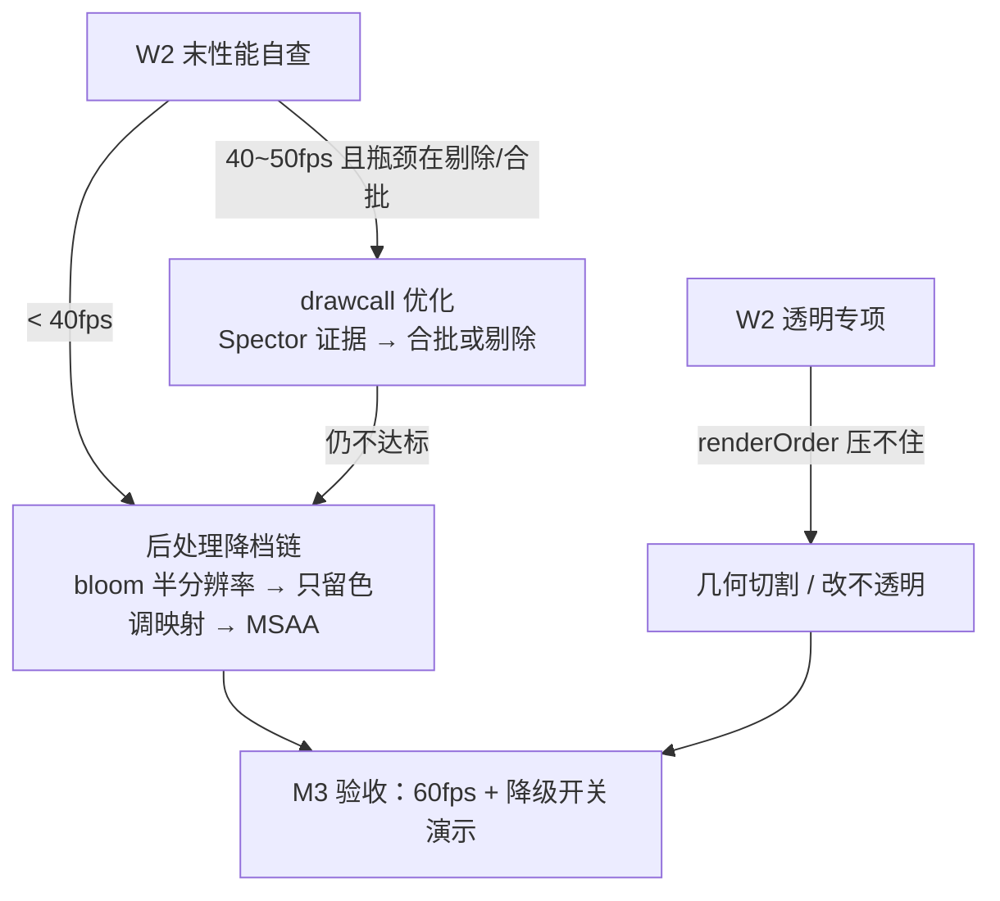

# 毕业项目里程碑计划：三周拆解与发布收尾

> [返回：WebGL 与 3D 框架学习大纲](../WebGL与3D框架学习大纲.md)
> 本文对应大纲第六阶段第 3 条（下篇），小节编号 3.5~3.8；需求见上篇 [04-毕业项目-需求书](04-毕业项目-需求书.md)。原则一句话：**源码研读与项目并行，每周有出口判据，宁可砍加分项、不欠硬指标**。

## 3.5 总体节奏与前置盘点

三周节奏（示例日期以周一开工对齐，实际按开工日平移）：


对应里程碑：M1 灰盒可漫游（W1 周五）、M2 功能全通（W2 周五）、M3 性能达标（W3 周三）、M4 上线交付（W3 周五），定义见 [01-导览](01-导览.md)。

里程碑展开成可核对的证据表（每个 M 的"判据"都落到能截图/能运行的东西上）：

| 里程碑 | 时点 | 判据（01-导览的定义） | 证据形态 |
|---|---|---|---|
| M0 选定方案 | W1 周一 | 04 分册两案通读后锁定其一，列出技术点缺口 | 周记里的一节（方案 + 三个风险 + 缺口） |
| M1 灰盒可漫游 | W1 周五 | 数据表驱动的灰盒场景 + OrbitCamera，60fps | 录屏 + "改 JSON 刷新生效"演示 |
| M2 功能全通 | W2 周五 | 五项必选技术点全部打通，验收 checklist 功能组全绿 | checklist 打勾版 + 各任务验收物（W2 表） |
| M3 性能达标 | W3 周三 | 桌面 60fps、drawcall 预算内、降级开关就绪 | 性能面板录制 + Spector 抓帧 + 切档录屏 |
| M4 上线交付 | W3 周五 | GitHub Pages 可访问 + 全勾 checklist + 复盘文档 | 在线地址 + 3.8.3 归档清单全勾 |

**计划的弹性在哪里**：三周表没有留显式缓冲，缓冲藏在三处——W2 的"性能允许 30~45fps"（把性能债合法地推迟到 W3）、W3 周四整天（README/复盘日，若 W3 前面塌了它就是救援日）、以及风险表的回退链（每条都能把工作量砍一档）。反过来，**两个不可压缩点**要心里有数：W2 周五的功能组全绿（M2 之后没有"补功能"的时间）与 W3 周三的首次发布（链路问题需要至少一天余量修）。计划赶不上变化时，先动缓冲、后动回退、最后才动这两个点。

**前五阶段成果复用盘点**（开工前先过一遍这张表，确认每项都能跑起来）：

| 来源阶段 | 可复用成果 | 在毕业项目中的落点 | 需要补的缺口 |
|---|---|---|---|
| 一 / 二 | 手写着色器、光照与纹理 demo | 材质与贴图的起点参照 | 无（纯参考） |
| 三 | minmath、Geometry 生成器、OrbitCamera、Mesh 抽象 | 全项目数学基础、灰盒模型、基础交互 | 相机飞行动画（补迷你 tween，约百行） |
| 四 | 场景图 + 脏标记、StateCache、渲染队列、Shader 封装、Raycaster、动画混合、简版 glTF 加载器 | 项目主体——五项必选技术点里四项直接来自本阶段 | 透明排序升级与 renderOrder（借 02 分册 1.3）；行为组件化（借 03 分册 2.4） |
| 五 | shadow map / PCF、后处理 ping-pong 链、PBR、instancing、天空盒、性能埋点 | 视觉核心与性能武器 | glTF 的 metallic-roughness 材质到自研 PBR 材质的映射（展厅案） |

**缺口清单**（三周里真正"新写"的东西，提前列出以免临时发现）：相机 tween 工具、DOM 信息面板/详情卡片、数据表驱动的场景组装脚本、调试面板（性能埋点 + 对象树 overlay）、GitHub Pages 构建链路。除此之外应当全是旧成果组装——如果发现还要大写别的，先回到需求书砍范围。

缺口清单展开成施工卡（规模是自估量级，用来排期不是承诺）：

| 缺口 | 规模估计 | 依赖谁 | 先写什么 |
|---|---|---|---|
| 相机 tween | 约百行 | 无（纯数学） | 两关键帧 + easeInOutCubic 先跑通，曲线控制点后补 |
| DOM 面板/卡片 | 100~200 行（含样式） | 拾取结果的数据结构 | 先做纯函数 `renderCard(data)`，DOM 结构后再美化 |
| 场景组装脚本 | 100 行级 | 数据 schema（04 分册 3.2.5/3.3.5 已定） | 组装函数对一份最小 JSON 跑通再加字段 |
| 调试面板 | 100~200 行 | 性能埋点接口 + 场景图遍历 | 先 fps + drawcall 两个数字，对象树后补 |
| Pages 构建链路 | 配置为主 | 构建产物 | W3 周三"丑但在线"预演时首次验证 |

五个缺口的共同点：**都不碰渲染内核**（DOM、配置、组装逻辑为主）——这是"框架已就绪、项目是组装"的验证。如果某个缺口写着写着开始改 Renderer/StateCache，说明框架有没还完的债，当场评估：小债当场还（记进周记），大债回需求书砍范围（它超出三周的容量了）。

### 3.5.3 研读与项目怎么并行：抢时间的预案

甘特图里研读与项目是两条并行的线，实际执行时它们抢的是同一段晚间精力。三条编排规则防止"并行"变"串行"（项目挤掉研读，或研读拖住项目）：

1. **研读切成 45 分钟块**：02 分册 1.1~1.6 每节都给了具体文件清单，一块正好读一小节 + 写三条笔记（1.6 模板）；不安排"周末读一下午源码"这种大块——实践证明大块阅读在项目期必然被征用；
2. **抢时间时研读让路、笔记不让**：项目吃紧的晚上可以砍研读块，但当天的三条笔记不能断（读慢一点也行）——笔记是源码研读的验收物，断了就补不回来；
3. **研读产出直接喂项目**：读 1.3（渲染队列）当天，顺手检查自研渲染队列的排序键；读 1.4（变换链）当天，检查场景图的脏标记传播——研读的价值以"当天改了一处自研代码或确认了一处不用改"兑现，而不是攒到期末。

### 3.5.4 每日节律建议（可调，但要先有）

三周是短跑，节律比意志力可靠。一个被验证可行的默认节律（按自己作息平移，但**每个时段的用途要固定**）：

| 时段 | 用途 | 说明 |
|---|---|---|
| 精力最好的 2 小时 | 当日主线任务（写代码） | 新代码要趁清醒写；不要用来回消息/调样式 |
| 精力中等的 1 小时 | 调参与联调（手感类工作） | 调 bias、调相机阻尼这类不需要峰值脑力 |
| 疲劳的 45 分钟 | 源码研读块（3.5.3） | 读源码是被动吸收，疲劳时段性价比反而高 |
| 睡前 10 分钟 | 明日清单（三个具体动作） | 写下来，第二天不用靠记忆启动 |

节律的真正作用在**坏日子**：状态差的那天，"至少把中段和研读块走完"的底线让人不掉队；状态好的那天照常执行（不要临时加倍——透支的第二天更贵）。三周项目的崩溃大多不是能力问题，是节律散了之后连续三天零产出。

### 3.5.1 W0：开工前检查（半天，别跳过）

| 检查项 | 怎么算过 |
|---|---|
| 两份需求书通读并选定方案（对应导览 M0） | 能向别人用三句话讲清自己的方案与三个风险 |
| 复用盘点表逐项"跑"一遍 | 每项打开对应工程/示例跑通（见 3.5.2 的对照），不是"记得写过" |
| 自研框架可被新工程引用 | `npm i` 本地包或 monorepo 内部模块，在一个空 vite 工程里画出三角形 |
| 仓库与分支就绪 | 项目仓库建立、README 骨架、每日提交习惯从第一天开始 |
| 甘特日期平移到真实开工日 | 三周里的每周五（出口判据日）在日历上圈出来 |

W0 的产出物只有一样：**一份填了真实日期的周计划**（把 3.6 的每周任务抄进日历/待办）。仪式感不是目的——日期落到日历上，"周五出口判据"才有约束力。

W0 的时间预算是**半个工作日**——超过半天说明复用盘点翻出了大问题（某项成果跑不起来且修不动），这时不要硬开工：要么把该成果从复用表降级为重做（重新评估三周容量），要么推迟开工几天先修——带着跑不起来的地基开工，W1 的每一天都在还这笔债。

### 3.5.2 盘点怎么盘点：每项都要"当下能跑"

复用盘点的合格线不是"记得当时做出来了"，是**此刻能运行**。站内 examples 工程就是盘点的对照物：第四阶段的成果对应 `06-scene-graph`（场景图）、`07-picking`（拾取）等示例，第五阶段的成果对应 `08-shadows`（阴影）、`09-pbr-ibl`（IBL/PBR）、`11-gpu-timer`（性能度量）、`13-frustum-culling`（剔除）等示例——盘点的动作就是把这些示例逐个跑一遍，跑不起来的项当场修或当场从复用表里降级（改列"需重做"，并在 3.7 风险表加一行）。

盘点中顺手做一件事：给每个复用成果记一行"接口签名"（比如 OrbitCamera 的构造参数、Raycaster 的返回结构）。毕业项目组装时最贵的不是写新代码，是**回忆旧代码的形状**——这半行备注能省 W1 里来回翻笔记的时间。

## 3.6 按周拆解

### W1 骨架周（并行：02 分册 1.1~1.3）

- **目标**：灰盒场景可漫游，项目骨架与数据驱动结构定型。灰盒 = 一切用 Geometry 生成器的无纹理低模，先证明结构再堆内容。
- **任务**：工程搭建（vite + TS 严格模式 + 自研框架以 npm 包/内部模块方式引入）；场景组装脚本读数据 JSON 生成层级（行星 pivot / 展位坐标）；OrbitCamera 接入与手感调参；基础光照（太阳点光或展厅环境光 + 一盏射灯）；主循环 deltaTime 与 Behavior 组件雏形。
- **交付物**：可交互灰盒（在线或录屏）+ 数据 JSON 首版 + 周记（含源码研读笔记至少三条，格式见 02 分册 1.6 模板）。
- **出口判据**：灰盒 60fps；改数据 JSON 里一个坐标，页面刷新后场景对应变化（数据驱动成立的标志）；相机拖拽/缩放无卡顿感。
- **本周末必做**：展厅案用真实 glTF 模型试加载一次——这是最早暴露加载器缺口的机会（对应 3.7 风险表第 3 条）。

W1 的逐日参考（周一到周五；并行线：每天 1~1.5 小时源码研读 1.1~1.3）：

| 日 | 主线任务 | 当日可验收的产物 |
|---|---|---|
| 一 | 工程搭建 + 框架引入（W0 已验证的路径） | 空画布 + 三角形（框架在跑） |
| 二 | 场景组装脚本 + 数据 JSON 首版 | 改 JSON 坐标 → 刷新生效 |
| 三 | OrbitCamera 接入与手感（阻尼、缩放限制） | 可漫游的灰盒全景 |
| 四 | 基础光照 + Behavior 雏形（一个自转组件） | 灰盒有明暗、至少一个物体在动 |
| 五 | 打磨 + 录屏 + 周记；（展厅案）glTF 试加载 | M1 出口判据三项全过 |

W1 的关键技术卡——**场景组装脚本**（周二的活，别小看它）：

- 输入是 04 分册 3.2.5/3.3.5 定死的 schema，输出是场景图节点树；核心是一个递归或表驱动的 `buildFromData(scene, data)`；
- 陷阱在 pivot 的语义：JSON 里没有"pivot"字段，组装脚本要按"有 orbitRadius 的天体自动包一层锚点节点"生成层级——**这个规则写错，W2 的公转全错**，所以周二当天就用"改 JSON 坐标看变化"验证它；
- 组装脚本同时要消费 `albedoFallback`/`fallback` 字段（纹理/模型失败时的兜底）——兜底路径 W1 就接上，比 W3 再补便宜得多。

### W1 的时间盒纪律

W1 每个任务都有隐性上限（工程搭建半天、组装脚本一天、相机手感半天……），超时的处理规则提前写死：**超时 1 小时内**——继续但砍打磨（手感"能用"即停）；**超时半天**——换最简实现（相机阻尼不要了，先能转）；**超时一天**——这是 3.7 风险表的活人版，启动对应回退并记周记。时间盒的意义不是赶工，是**强迫"完成比完美优先"的决策提前发生**——W1 的灰盒本来就是用来扔的，在它身上打磨手感是三周里最贵的时间错误。

### W2 内容周（并行：02 分册 1.4~1.6 与 03 分册）

- **目标**：五项必选技术点全部打通（允许未调优）。
- **任务**：材质升级（贴图 / PBR）；阴影接入与调参（bias、法线偏移）；后处理链（注意 3.2.3 / 3.3.3 的链路顺序）；Raycaster 拾取 + 面板/卡片；动画（公转/巡游/tween/展品自转，全部组件化）；透明物体专项（土星环或玻璃展柜，必要时上 renderOrder）。
- **交付物**：功能全通版本 + 验收 checklist 首轮自查（功能组逐项打勾或标注缺口）。
- **出口判据**：checklist 功能组全绿；无阻断性 bug；性能允许暂居 30~45fps（W3 解决）。
- **提醒**：本周是范围蔓延（scope creep）高发期——每想加一个"顺手的小功能"，先问它在不在这两份需求书里，不在就记进 v1.1 备忘。

W2 的任务到验收物对照（顺序即建议施工序；"验收物"直接对应需求书 checklist 条目）：

| 任务 | 验收物 | 对应需求书条目 |
|---|---|---|
| 贴图/PBR 材质 | 前(后)排球材质对照截图（参数自证） | 3.3.1 材质 / 3.2.1 太阳 |
| 阴影接入与调参 | bias 调优记录（初值→终值→现象） | 3.3.4 / 3.2.4 功能组 |
| 后处理链 | 链路开关对比帧（FXAA/bloom 顺序结论） | 3.3.3 实验记录 / 3.2.3 |
| 拾取 + 面板 | 点击-飞行-跟随的录屏 | 3.2.2 / 3.3.2 |
| 动画组件化 | 主循环代码（无逐物体 if）+ 巡游打断录屏 | 3.2.2 / 3.3.2 |
| 透明专项 | 土星环近观 10 秒录屏（无闪烁） | 3.2.4 功能组第 5 条 |

W2 的两个硬任务卡（其余任务是"旧成果接线"，这两个要动脑）：

**后处理链任务卡**：施工序按"先通再美"——色调映射先上（PBR 输出是 HDR，没有它一切偏灰，[04-PBR入门](../05-第五阶段/04-PBR入门.md) 3.6 的顺序图）；bloom 第二（阈值从太阳/射灯的亮度倒推）；FXAA 最后（先看球体边缘有没有锯齿再决定开不开）。每接一个 pass 就做一次开关对比帧（同一相机同一帧，pass 开/关各截一张）——这批截图直接就是 3.3.3 要求的实验记录，不要留到 W3 补拍。链路的工程形状照抄第五阶段 ping-pong 骨架（两个 FBO 轮换），别在毕业项目里发明新的 pass 框架。

**透明专项任务卡**：先复现问题（把土星环/玻璃柜的透明开着、相机绕一圈录下闪烁帧），再按 [02-Three.js源码研读](02-Three.js源码研读.md) 1.3 的结论上 renderOrder——**修复前后的对比录屏就是验收物**。如果 renderOrder 也压不住（几何互相穿插的半透明体是排序的天生盲区），按风险表第 5 行继续降级，别恋战：透明专项的时间盒是一天半，超过就执行回退（几何切割或改不透明），这在需求书里是明确允许的。

W2 并行线里的 03 分册（生态横向阅读，甘特图周二起两天）排法建议：它比 02 分册轻得多（定性阅读，无源码），放在**晚间疲劳时段或通勤**正合适；它的产出（03 分册 2.9 的借鉴清单）里有两条要在项目里兑现——行为组件化（W1 已动手）与调试面板（W3 做），阅读时带着"哪条我落了、哪条我放弃了"的问题，读完顺手把 2.9 表格里的验收物抄进自己的周记。

### W3 打磨发布周

- **目标**：性能达标 + 边界兜底 + 上线交付。
- **任务**：Spector 抓帧分析 drawcall（重点：纹理重复绑定、instancing 是否生效、glTF 多 mesh）；按分析结果做降级开关（阴影分辨率减半 → bloom 半分辨率 → 只留色调映射）；边界处理（WebGL2 缺失提示、模型 404 兜底低模、resize）；GitHub Pages 发布（见 3.8）；README 与复盘撰写；按 3.4 演示脚本走一遍全流程。

抓帧分析的具体动作（周一上午，照 [07-性能优化与调试](../05-第五阶段/07-性能优化与调试.md) 6.5.1 的"四件事"顺序）：固定相机抓一帧，先看 drawcall 总数与预算的差距；再扫相邻 draw 间的状态 diff（重复 bindTexture 就是排序键问题）；再点开可疑 draw 看输入（glTF 展品的 mesh 数在这里现形）；最后对着纹理清单算显存。**每个发现都当场写进优化记录的四段式模板**（同分册 6.5.4）——周一结束时应有两三条完整记录，它们既是 W3 的验收物，也是 README 性能小节的全部素材。
- **交付物**：在线地址 + 全勾的验收 checklist + 复盘文档；自研框架仓库打 v1.0.0 tag。
- **出口判据**：[04 分册](04-毕业项目-需求书.md) 3.4 验收流程完整走通；查漏补缺清单中"跟进"项要么落地、要么在复盘里说明改期原因。

W3 的三天焦点（周三 M3、周五 M4 两个硬点）：

| 日 | 焦点 | 完成标志 |
|---|---|---|
| 一 | 性能归因与优化（决策树 + 优化记录两条） | 性能组 checklist 全绿 |
| 二 | 降级开关 + 边界兜底 + 调试面板收尾 | 开关演示可走；边界三项有截图 |
| 三 | 首次发布上线（M3 日，"丑但在线"） | Pages 地址可访问 |
| 四 | README/复盘撰写 + 演示脚本排练两遍 | 齐套自查（04 分册）全勾 |
| 五 | 验收演示 + 归档（M4） | tag 打完、大纲勾选、复盘提交 |

W3 的关键技术卡——**降级开关**（周二的活，W2 末若已掉帧，周一就并进来做）：

- 形状是一个贯穿配置（`quality: 'high' | 'medium' | 'low'` 或独立的几个布尔），**在初始化时读一次、各系统按档位取参数**（阴影贴图尺寸、bloom 分辨率、后处理 pass 开关），不是散落各处的 if——这本身是第四阶段 uber shader 参数化思想在系统层的复用；
- 档位内容对着风险表第 1 行的降档链写：high = 全开；medium = bloom 半分辨率 + 阴影减半；low = 只留色调映射 + MSAA 替代 FXAA；
- 验收方式：演示脚本"工程面"环节现场切档录屏——切到 low 帧率应可感知回升，切回 high 恢复（证明开关真的接到了各系统，而不是摆设）。

### 每周的收口动作

三个动作固定在每周五晚（合计约 45 分钟，是三周节奏里投入产出比最高的时间）：

1. **对照出口判据逐条打勾**（本节各周的"出口判据"行）——过就是过，不过就当场启动 3.7 对应的回退，不带病进下周；
2. **周记三段式**：本周做了什么（对着计划表勾）/ 卡在哪（哪个任务超时、为什么）/ 下周第一个动作是什么（具体到文件名级）；
3. **风险表过一遍**（3.7 末尾的 15 分钟仪式）：每条风险问一句"预警信号这周出现了吗"，出现的当天处理。

周记的固定模板（贴在仓库 `docs/journal/W1.md` 这类路径，周五 30 分钟填完）：

```markdown
# W1 周记（M1 目标：灰盒可漫游）
## 做了什么
- [x] 工程搭建（比计划多花 2h：……原因）
- [ ] glTF 试加载（挪到周六上午）
## 出口判据
- 灰盒 60fps：过 / 不过 + 一句原因
- 数据驱动生效：过（演示：改 earth.orbitRadius 12→16）
## 研读笔记（02 分册 1.1~1.3，至少三条）
- 1.2 状态托管：自研 StateCache 少了纹理单元记账，已记入查漏清单
## 风险信号
- 风险表第 3 条：glTF 试加载未做（挪期一天，周六必须闭合）
## 下周第一个动作
- 周一先写 tween 工具的 easing 函数（src/anim/tween.ts）
```

模板的强制项只有两处：**出口判据必须写"过/不过"**（不许写"基本完成"）与**下周第一个动作具体到文件**（周一开工不靠回忆）。其余自由发挥——周记是写给三天后的自己看的，写清楚比写好看重要。

## 3.7 风险点与回退方案

每条回退方案都是"验收 checklist 里仍然能勾"的降级，不是砍验收项——这是底线原则。

| 风险 | 预警信号（何时暴露） | 回退方案 |
|---|---|---|
| 后处理组合后掉帧严重 | W2 末性能自查 < 40fps | 降档链：bloom 半分辨率 → 只留色调映射 → FXAA 换 WebGL2 MSAA（renderbuffer 层面，不经后处理） |
| 阴影 acne / 漏光调不平 | W2 调参超过半天 | bias 与法线偏移参数化记档；仍不行则只保留 1~2 盏投影灯，其余无影（需求书已按此预算写） |
| glTF 模型加载或渲染异常 | W1 末真实模型试加载 | 换官方低面数样例模型验证加载器；最终兜底 Geometry 生成低模 + 程序化纹理（checklist 的"兜底低模"项本来就要求） |
| 相机飞行动画手感差、耗时超预期 | W2 中 | 砍曲线控制点，退化为"起点 + 终点 + easeInOutCubic"两关键帧；手感问题记入 v1.1 |
| 透明排序穿插（土星环 / 玻璃展柜） | W2 | renderOrder 显式指定（02 分册 1.3 的逃生舱）；仍不行则几何切割或改不透明 |
| W2 末功能未全通 | 出口判据不过 | 砍加分项与第二导航模式；时间流速降为固定档；详情卡降为静态文本——保住五项必选点的最低覆盖 |
| GitHub Pages 资源 404 | W3 发布日 | 依次检查 3.8 的第 1 步（base 路径）与第 6 步（大小写敏感）——两个最高频肇因 |
| 整体超期 | 任意周末复盘 | 启动保底版定义：灰盒 + 光照阴影 + 拾取 + 一种动画，即满足必选点的最低覆盖，先保交付再补内容 |

每周日晚花 15 分钟对照本表过一遍：哪条风险的预警信号出现了，就当天启动回退，不带病进下周。

两条最大的风险链画成图（视觉/性能双链，W2 末是它们的共同检查点）：



读懂这张图的要点：降档链的每一级**都保住"色调映射在"**（PBR 没有它就是灰片，这是不可再降的底）；drawcall 优化（合批/剔除）在降档**之前**尝试——它是"不牺牲画质的降负"，顺序反了会把画质先砍掉而性能问题依旧。

### 3.7.1 回退的执行纪律

回退不是"认输"，是项目管理的正常动作——但要有纪律，否则回退本身会变成新的混乱源：

1. **回退当天执行**：预警信号出现后 24 小时内做决定（执行或明确拒绝并写理由），拖过周末的回退通常会连坐下周计划；
2. **回退也要留验收物**：降级后的功能按降级形态重新过一遍对应 checklist 条目（比如"bloom 半分辨率"要重新确认辉光仍可见），确保降级版本是**完整的**而不是"坏了一半的完整版"；
3. **回退记录进周记与复盘**：什么信号触发的、回退到哪一级、省下的时间花哪了——复盘的"放弃篇"里这些记录比成功记录更有信息量；
4. **一条不许回退**：五项必选技术点的覆盖（需求书 3.1 映射表）。风险表最后一行"整体超期"的保底版，正是把一切回退让位给这五项的表述。

一个容易忽略的回退副作用：**降级后的参数要回归调**。比如 bloom 降到半分辨率后，之前的阈值可能突然"过亮"（同样阈值下模糊半径相对变大）——回退执行完顺手把相关参数重过一遍，否则 W3 的优化记录里会出现"降级了但效果更怪"这类半吊子结论。

### 3.7.2 保底版覆盖矩阵

把"保底版"（风险表最后一行）展开成五项必选点的落位——它是三周内任何时刻"最坏情况"的完整描述：

| 必选点 | 保底版形态 | 砍掉了什么 |
|---|---|---|
| 场景图 | 灰盒层级（数据驱动保留——它是工程组验收项，砍不动） | 纹理与视觉细节 |
| 光照阴影 | 一盏投影灯 + PCF | 多灯、自 eclipsing 阴影（加分项） |
| 后处理 | 只留 ACES 色调映射 | bloom / FXAA（降级开关的最后一档） |
| 拾取交互 | 点击聚焦/卡片可用 | hover 反馈、部分热点 |
| 动画 | 公转/自转组件 + 两关键帧飞行 | 巡游开场、加减速反馈 |

矩阵的用法：W2 周日晚若功能未全通，对照这张表逐格确认"保底版已就位"——已就位的格子不再动，时间全部投给未就位的格子。**保底版不是失败形态**：它满足全部五项必选点的最低覆盖与大部分 checklist，分数上依然是"功能完整度过线 + 技术点覆盖满配"的交付。

从任意当前状态滑到保底版的**触发线**也提前写死，避免临场纠结：W2 周五功能组还有 2 条以上未绿 → 当晚启动保底版评估；W3 周一性能组仍有 2 条未过 → 直接按保底版的后处理形态发布；W3 周三发布被链路问题卡住超过一天 → 保底版（更少的资源、更少的 pass）先上线再修。触发线的原则只有一条：**越晚决策，可选项越少**——周三才决定砍，连砍的时间都没有了。

## 3.8 发布到 GitHub Pages 与收尾

发布不是最后一天才碰的事——W3 周三就先发一版"丑但在线"的，把链路问题提前暴露。步骤：

1. **构建基础路径**：vite 配置里 `base: '/<仓库名>/'`（若用自定义域名则为 `'/'`）；代码与样式里不写任何绝对路径的资源引用，全部交给打包器。
2. **大资源检查**：确认模型与纹理原样输出到 dist（调低 `assetsInlineLimit`，避免被 base64 内联把 JS 撑爆）；纹理压到 1024 或 2048；若第五阶段接过 KTX2 则用压缩纹理。
3. **本地验证子路径**：`npm run build` 后 `npx vite preview`（或任意静态服务器）以 `/仓库名/` 前缀访问，先在本地复现 Pages 的路径环境。
4. **推送产物**：三选一——`git subtree push --prefix dist origin gh-pages`、`gh-pages` npm 工具、GitHub Actions（push 到 main 自动 build + 官方 `actions/deploy-pages`，一劳永逸）。
5. **开启 Pages**：仓库 Settings → Pages → Source 选 `gh-pages` 分支（或选 GitHub Actions 作为来源）。
6. **线上核对**：打开 `https://<user>.github.io/<repo>/`，控制台确认无 404、无混用 http 资源。**大小写敏感**是经典翻车点：Pages 运行在 Linux，Mac 本地文件系统大小写不敏感，`Earth.jpg` 与 `earth.jpg` 在本地都能跑、上线必 404。
7. **性能终检**：加载与运行各记录一次（fps、首屏可交互时间），数据进 README——这正是验收"性能组"的证据。
8. **README 收尾**：在线地址置顶；操作说明；截图或 GIF；技术点清单（对照 04 分册 3.1 映射表逐项自证）；性能数据；查漏补缺清单的落地情况。
9. **归档**：回大纲勾选第六阶段全部条目；自研框架打 v1.0.0 tag；复盘三问——哪三项借鉴（缓存键 / 调试面板 / 行为组件化）落地了？哪一项放弃了、为什么？框架 v1.1 做什么（就是查漏补缺清单里"记录在案"的那一栏）？
10. **资产超限预案**：若模型等静态资产总量超过 50MB，改用外链 CDN 或图床；Git LFS 在 Pages 上有带宽限制，优先压缩而不是 LFS。

**周三预演的验收线**（"丑但在线"也是一次发布，有它自己的过关标准）：

- [ ] dist 构建成功且 `vite preview` 子路径本地可访问（第 3 步）；
- [ ] 线上地址在手机网络/热点下打开不白屏（换网络是最快的"陌生环境"模拟）；
- [ ] 控制台除已知的待办项外无报错；
- [ ] 把 3.8.2 速查表的五行各花一分钟主动核一遍——预演的目的就是让翻车发生在这里。

预演翻车是**计划内的收益**：周三暴露的每个 404 都是一个不会发生在周五演示现场的错误。预演顺利则周四的 README/复盘按部就班——两条路都是好结局。

### 3.8.1 发布渠道三选一

第 4 步的三个选项按"维护成本 ↔ 便利性"排开：

| 方案 | 优点 | 代价 | 适合 |
|---|---|---|---|
| `git subtree push` | 零依赖、无配置 | 每次手敲一条长命令；subtree 偶发需要清理 | 只发一两次的毕业项目 |
| `gh-pages` npm 工具 | 一条 npm script 搞定 | 仍是手动触发；多一个 devDependency | 想省命令但不想要 CI |
| GitHub Actions | push 即发布，一劳永逸 | 要写一次 workflow（模板见第四阶段 [09-实践任务](../04-第四阶段/09-实践任务.md) 的 deploy-examples.yml） | 任何会持续迭代的项目 |

三档都合法；选 Actions 的额外收益是"发布链路也有版本管理"——workflow 文件坏了能 diff 出哪次改坏的。

给犹豫者一个默认答案：**第一次发布就选 Actions**。理由有三：workflow 模板是现成的（第四阶段示例站的部署文件直接改仓库名就能用）；它把"发布"从"记得做的手工动作"变成"push 的自动结果"——三周里最容易漏的就是这类动作；Actions 的失败日志本身就是排查工具（哪个 step 红了一眼可见），比"本地是好的、线上是坏的"式手动排查省一半时间。 subtree 与 gh-pages 工具留给"不想碰 CI"的一次性场景。

### 3.8.2 高频翻车点速查

发布出问题时按命中症状查（前三条覆盖绝大多数案例）：

| 症状 | 肇因 | 一步验证 |
|---|---|---|
| 页面白屏、控制台一堆 404（`/assets/...`） | `base` 没配或配错 | 看请求 URL 有没有仓库名前缀 |
| 本地好的，线上某几个资源 404 | 文件名大小写 | 比对仓库里实际文件名与引用 |
| 模型/纹理变成 base64 巨串、JS 奇大 | `assetsInlineLimit` 没调 | 看 dist 里资源是独立文件还是内联 |
| 画面全黑但控制台无错 | 资源路径相对化错误（加载器按绝对路径取） | Network 面板看模型请求路径 |
| HTTP/HTTPS 混用被拦 | README/页面里写了 `http://` 资源链接 | 控制台的 mixed content 警告 |

速查表之外的兜底排查顺序：F12 的 Network 面板按 Status 排序（404/_blocked 一目了然）→ 本地 `vite preview` 复现（能复现就是构建问题，不能复现就是环境问题）→ 对比 dist 里的实际文件名与请求路径。三步走完仍无头绪时，把失败的请求 URL 原样贴进周记求助——精确的 URL 比一句"发布失败了"有效十倍。

### 3.8.3 收尾归档清单（M4 当天）

- [ ] 在线地址在第二台设备/网络实测可访问；
- [ ] v1.0.0 tag 已打（自研框架仓库）；
- [ ] 大纲第六阶段条目全部勾选；
- [ ] 复盘文档提交（结构见 04 分册 3.4 的复盘推荐结构）；
- [ ] v1.1 备忘就位：查漏补缺清单"记录在案"栏 + [03 分册](03-生态横向一瞥.md) 2.9 借鉴清单合并；
- [ ] 周记三篇归档（W1~W3，研读笔记在其中的位置可见）。

**演示彩排的两遍怎么排**（周四）：第一遍"照稿走"——严格按 04 分册 3.4 脚本计时，超过三分半就砍讲解词（不是砍环节）；第二遍"破坏性走"——故意在每段交互间乱点（先点最远的展品再立刻暂停时间、巡游开场 1 秒就打断），确认没有脚本外的死路。第二遍发现的边界问题，能在当晚修的修，不能修的写进复盘（演示时避开即可）——**彩排的目的不是表演完美，是把"现场会慌的点"提前慌完**。

**归档之后**：v1.1 备忘不要当天开工会——歇几天再回头看，优先级会自然浮出来（当时觉得"必须马上做"的，隔一周再看常常排到第五位）。真正的下一步决策留给了本文最后一句话。

最后一项收尾容易忘：**把 W0~M4 的全部时间记录（周记里的超时/提前数据）汇总成半页"估算偏差"**——哪些任务实际用时是估计的两倍、哪些不到一半。这份偏差数据是下一轮项目（v1.1 或新的练手项目）排期的校准器，也是"三周计划"这份文档对未来的你最有价值的部分。

> 毕业不是终点。三个月后回看，你会用完全不同的眼光重读 `renderers/WebGLRenderer.js` 里 `render()` 那 200 行——那时再决定：是继续深挖渲染（体积光、GPU 剔除、集群光源），还是把这套"分层 + 数据驱动"的思路带去下一个领域。查漏补缺清单还在，路就还在。
