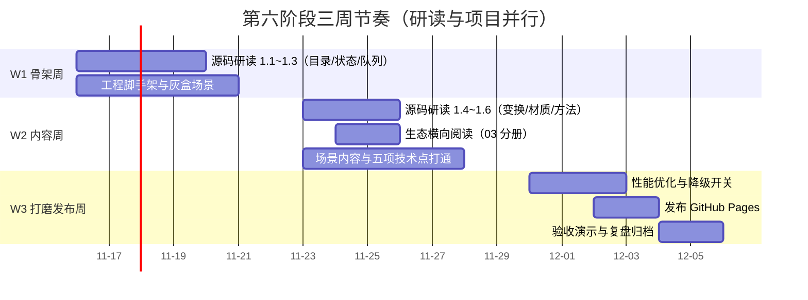

# 毕业项目里程碑计划：三周拆解与发布收尾

> [返回：WebGL 与 3D 框架学习大纲](../WebGL与3D框架学习大纲.md)
> 本文对应大纲第六阶段第 3 条（下篇），小节编号 3.5~3.8；需求见上篇 [04-毕业项目-需求书](04-毕业项目-需求书.md)。原则一句话：**源码研读与项目并行，每周有出口判据，宁可砍加分项、不欠硬指标**。

## 3.5 总体节奏与前置盘点

三周节奏（示例日期以周一开工对齐，实际按开工日平移）：

对应里程碑：M1 灰盒可漫游（W1 周五）、M2 功能全通（W2 周五）、M3 性能达标（W3 周三）、M4 上线交付（W3 周五），定义见 [01-导览](01-导览.md)。

**前五阶段成果复用盘点**（开工前先过一遍这张表，确认每项都能跑起来）：

| 来源阶段 | 可复用成果 | 在毕业项目中的落点 | 需要补的缺口 |
|---|---|---|---|
| 一 / 二 | 手写着色器、光照与纹理 demo | 材质与贴图的起点参照 | 无（纯参考） |
| 三 | minmath、Geometry 生成器、OrbitCamera、Mesh 抽象 | 全项目数学基础、灰盒模型、基础交互 | 相机飞行动画（补迷你 tween，约百行） |
| 四 | 场景图 + 脏标记、StateCache、渲染队列、Shader 封装、Raycaster、动画混合、简版 glTF 加载器 | 项目主体——五项必选技术点里四项直接来自本阶段 | 透明排序升级与 renderOrder（借 02 分册 1.3）；行为组件化（借 03 分册 2.4） |
| 五 | shadow map / PCF、后处理 ping-pong 链、PBR、instancing、天空盒、性能埋点 | 视觉核心与性能武器 | glTF 的 metallic-roughness 材质到自研 PBR 材质的映射（展厅案） |

**缺口清单**（三周里真正"新写"的东西，提前列出以免临时发现）：相机 tween 工具、DOM 信息面板/详情卡片、数据表驱动的场景组装脚本、调试面板（性能埋点 + 对象树 overlay）、GitHub Pages 构建链路。除此之外应当全是旧成果组装——如果发现还要大写别的，先回到需求书砍范围。

## 3.6 按周拆解

### W1 骨架周（并行：02 分册 1.1~1.3）

- **目标**：灰盒场景可漫游，项目骨架与数据驱动结构定型。灰盒 = 一切用 Geometry 生成器的无纹理低模，先证明结构再堆内容。
- **任务**：工程搭建（vite + TS 严格模式 + 自研框架以 npm 包/内部模块方式引入）；场景组装脚本读数据 JSON 生成层级（行星 pivot / 展位坐标）；OrbitCamera 接入与手感调参；基础光照（太阳点光或展厅环境光 + 一盏射灯）；主循环 deltaTime 与 Behavior 组件雏形。
- **交付物**：可交互灰盒（在线或录屏）+ 数据 JSON 首版 + 周记（含源码研读笔记至少三条，格式见 02 分册 1.6 模板）。
- **出口判据**：灰盒 60fps；改数据 JSON 里一个坐标，页面刷新后场景对应变化（数据驱动成立的标志）；相机拖拽/缩放无卡顿感。
- **本周末必做**：展厅案用真实 glTF 模型试加载一次——这是最早暴露加载器缺口的机会（对应 3.7 风险表第 3 条）。

### W2 内容周（并行：02 分册 1.4~1.6 与 03 分册）

- **目标**：五项必选技术点全部打通（允许未调优）。
- **任务**：材质升级（贴图 / PBR）；阴影接入与调参（bias、法线偏移）；后处理链（注意 3.2.3 / 3.3.3 的链路顺序）；Raycaster 拾取 + 面板/卡片；动画（公转/巡游/tween/展品自转，全部组件化）；透明物体专项（土星环或玻璃展柜，必要时上 renderOrder）。
- **交付物**：功能全通版本 + 验收 checklist 首轮自查（功能组逐项打勾或标注缺口）。
- **出口判据**：checklist 功能组全绿；无阻断性 bug；性能允许暂居 30~45fps（W3 解决）。
- **提醒**：本周是范围蔓延（scope creep）高发期——每想加一个"顺手的小功能"，先问它在不在这两份需求书里，不在就记进 v1.1 备忘。

### W3 打磨发布周

- **目标**：性能达标 + 边界兜底 + 上线交付。
- **任务**：Spector 抓帧分析 drawcall（重点：纹理重复绑定、instancing 是否生效、glTF 多 mesh）；按分析结果做降级开关（阴影分辨率减半 → bloom 半分辨率 → 只留色调映射）；边界处理（WebGL2 缺失提示、模型 404 兜底低模、resize）；GitHub Pages 发布（见 3.8）；README 与复盘撰写；按 3.4 演示脚本走一遍全流程。
- **交付物**：在线地址 + 全勾的验收 checklist + 复盘文档；自研框架仓库打 v1.0.0 tag。
- **出口判据**：[04 分册](04-毕业项目-需求书.md) 3.4 验收流程完整走通；查漏补缺清单中"跟进"项要么落地、要么在复盘里说明改期原因。

## 3.7 风险点与回退方案

每条回退方案都是"验收 checklist 里仍然能勾"的降级，不是砍验收项——这是底线原则。

| 风险 | 预警信号（何时暴露） | 回退方案 |
|---|---|---|
| 后处理组合后掉帧严重 | W2 末性能自查 < 40fps | 降档链：bloom 半分辨率 → 只留色调映射 → FXAA 换 WebGL2 MSAA（renderbuffer 层面，不经后处理） |
| 阴影 acne / 漏光调不平 | W2 调参超过半天 | bias 与法线偏移参数化记档；仍不行则只保留 1~2 盏投影灯，其余无影（需求书已按此预算写） |
| glTF 模型加载或渲染异常 | W1 末真实模型试加载 | 换官方低面数样例模型验证加载器；最终兜底 Geometry 生成低模 + 程序化纹理（checklist 的"兜底低模"项本来就要求） |
| 相机飞行动画手感差、耗时超预期 | W2 中 | 砍曲线控制点，退化为"起点 + 终点 + easeInOutCubic"两关键帧；手感问题记入 v1.1 |
| 透明排序穿插（土星环 / 玻璃展柜） | W2 | renderOrder 显式指定（02 分册 1.3 的逃生舱）；仍不行则几何切割或改不透明 |
| W2 末功能未全通 | 出口判据不过 | 砍加分项与第二导航模式；时间流速降为固定档；详情卡降为静态文本——保住五项必选点的最低覆盖 |
| GitHub Pages 资源 404 | W3 发布日 | 依次检查 3.8 的第 1 步（base 路径）与第 6 步（大小写敏感）——两个最高频肇因 |
| 整体超期 | 任意周末复盘 | 启动保底版定义：灰盒 + 光照阴影 + 拾取 + 一种动画，即满足必选点的最低覆盖，先保交付再补内容 |

每周日晚花 15 分钟对照本表过一遍：哪条风险的预警信号出现了，就当天启动回退，不带病进下周。

## 3.8 发布到 GitHub Pages 与收尾

发布不是最后一天才碰的事——W3 周三就先发一版"丑但在线"的，把链路问题提前暴露。步骤：

1. **构建基础路径**：vite 配置里 `base: '/<仓库名>/'`（若用自定义域名则为 `'/'`）；代码与样式里不写任何绝对路径的资源引用，全部交给打包器。
2. **大资源检查**：确认模型与纹理原样输出到 dist（调低 `assetsInlineLimit`，避免被 base64 内联把 JS 撑爆）；纹理压到 1024 或 2048；若第五阶段接过 KTX2 则用压缩纹理。
3. **本地验证子路径**：`npm run build` 后 `npx vite preview`（或任意静态服务器）以 `/仓库名/` 前缀访问，先在本地复现 Pages 的路径环境。
4. **推送产物**：三选一——`git subtree push --prefix dist origin gh-pages`、`gh-pages` npm 工具、GitHub Actions（push 到 main 自动 build + 官方 `actions/deploy-pages`，一劳永逸）。
5. **开启 Pages**：仓库 Settings → Pages → Source 选 `gh-pages` 分支（或选 GitHub Actions 作为来源）。
6. **线上核对**：打开 `https://<user>.github.io/<repo>/`，控制台确认无 404、无混用 http 资源。**大小写敏感**是经典翻车点：Pages 运行在 Linux，Mac 本地文件系统大小写不敏感，`Earth.jpg` 与 `earth.jpg` 在本地都能跑、上线必 404。
7. **性能终检**：加载与运行各记录一次（fps、首屏可交互时间），数据进 README——这正是验收"性能组"的证据。
8. **README 收尾**：在线地址置顶；操作说明；截图或 GIF；技术点清单（对照 04 分册 3.1 映射表逐项自证）；性能数据；查漏补缺清单的落地情况。
9. **归档**：回大纲勾选第六阶段全部条目；自研框架打 v1.0.0 tag；复盘三问——哪三项借鉴（缓存键 / 调试面板 / 行为组件化）落地了？哪一项放弃了、为什么？框架 v1.1 做什么（就是查漏补缺清单里"记录在案"的那一栏）？
10. **资产超限预案**：若模型等静态资产总量超过 50MB，改用外链 CDN 或图床；Git LFS 在 Pages 上有带宽限制，优先压缩而不是 LFS。

> 毕业不是终点。三个月后回看，你会用完全不同的眼光重读 `renderers/WebGLRenderer.js` 里 `render()` 那 200 行——那时再决定：是继续深挖渲染（体积光、GPU 剔除、集群光源），还是把这套"分层 + 数据驱动"的思路带去下一个领域。查漏补缺清单还在，路就还在。
