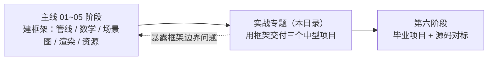

# 实战专题导览：用自研框架交付东西

> [返回：WebGL 与 3D 框架学习大纲](../WebGL与3D框架学习大纲.md)
> 本文是实战专题的总导览：定位与边界、三个项目的索引与建议顺序、跨项目的通用约定；项目正文见本目录各分册。

## 定位：项目驱动练手层

六阶段主线（[第四阶段导览](../04-第四阶段/01-导览.md)）走完前五个阶段，你手里有一套自己写的框架：minmath、场景图、渲染队列、材质系统、Raycaster、glTF 加载器、阴影与后处理。但它至今只在"每册的验证 demo"里出现过。**主线教你怎么"建框架"，实战专题教你怎么"用框架交付东西"**——差距不在 API 熟练度，而在三件主线不教的事：

1. **需求拆解**：把"一个模型查看器"翻译成可验收的功能清单，而不是想到哪写到哪；
2. **旧件组装**：九成功能应当来自前五阶段的旧代码，新写的只有胶水与 UI——如果组装不出来，说明框架边界有问题，这本身就是最有价值的反馈；
3. **完成度打磨**：加载进度、错误态、截图、URL 分享这些"demo 不用做、产品必须做"的尾巴，恰是工程肌肉的来源。

## 与毕业项目的分工

| | 实战专题（本目录） | 第六阶段毕业项目（[需求书](../06-第六阶段/04-毕业项目-需求书.md) / [里程碑](../06-第六阶段/05-毕业项目-里程碑计划.md)） |
|---|---|---|
| 体量 | 三个中型项目，每个 3~7 天 | 一个综合大项目，三周节奏 |
| 目标 | 单点练手：每个项目逼真用一个子系统 | 五项必选技术点综合运用 + 性能验收 |
| 验收 | 分册内 checklist，做完即止 | 三分钟演示脚本 + 评分维度 |
| 时机 | 第五阶段之后、毕业项目之前 | 第六阶段，与 Three.js 源码研读并行 |

一句话：**实战专题是毕业项目的前哨**。毕业项目里程碑里的"缺口清单"（迷你 tween、DOM 面板、数据驱动组装、调试面板）在这里提前造好，毕业项目就只剩组装。

注意虚线：实战专题里每次"框架不顺手、绕着写"的时刻，都是给框架记 v1.1 需求的机会——项目做完回框架补一轮，再进毕业项目。

## 三个项目索引

| 分册 | 项目 | 难度 | 主要用到的前五阶段成果 | 产出物 |
|---|---|---|---|---|
| [01-项目一-模型查看器](01-项目一-模型查看器.md) | 类 sketchfab 最小查看器 | 中 | 04 资源管理（glTF 加载）、04 场景图遍历、05 shadow map、数学专题 PCA 包围盒 | 加载/轨道相机/三灯布光/法线 UV 线框调试视图/自动取景/截图/URL 分享 |
| [02-项目二-3D数据可视化](02-项目二-3D数据可视化.md) | 三维图表与数据场景 | 中高 | 03 几何生成器、04 拾取与事件、05 instancing 与粒子、技术专题文本与 billboard | 柱状/散点/轨迹三类图元 + hover 详情 + 换数据源不改代码 |
| [03-项目三-全景查看器](03-项目三-全景查看器.md) | 全景图浏览器 | 中 | 02 纹理采样、05 cubemap 天空盒与后处理、数学专题球面坐标 | equirect/cubemap 全景浏览 + 视角控制 + 热点跳转 |

**建议顺序 01 → 02 → 03**：项目一的"加载 + 场景遍历 + 相机适配"是三个项目的公共底座；02 在底座上练 instancing 与数据映射（第一次撞上真正的性能预算）；03 最独立，可随时穿插当调剂。三个全做完再进毕业项目最稳；时间紧则 01 必做——它几乎就是毕业项目展厅案的"展品查看"子模块。

## 通用约定

### 项目骨架：04 框架 + examples 的 controls

1. **主体用第四阶段框架**：Renderer / Scene / Node3D / Mesh / Geometry / Material / Raycaster / GLTFLoader 一律来自你在 [04-第四阶段/09-实践任务](../04-第四阶段/09-实践任务.md) 定名发布的包（分册示例以 `minigl` 代称，按自己的包名替换）。实战专题练的就是"用自己的框架"，不是 Three.js 教程。
2. **相机控制器搬 examples 公共层**：`webgl/examples/src/common/controls.ts` 的 `PerspectiveCamera + OrbitControls`（球坐标 + 帧率无关阻尼，用法见仓库 `webgl/examples/README.md`）。它比框架里的控制器抽象更短、更好改——项目一要加"双击聚焦"，直接在这份上动刀。
3. **特效按需从专题与五阶段搬**：阴影 GLSL 链 [05-第五阶段/02-阴影与PCF软阴影](../05-第五阶段/02-阴影与PCF软阴影.md)，天空盒链 [05-第五阶段/06](../05-第五阶段/06-雾效与天空盒.md)，标签 billboard 链[技术专题 02-文本与2D渲染](../技术专题/02-文本与2D渲染.md)。
4. **工程形态**：每个项目一个独立 Vite + TypeScript 严格模式工程，vite alias 指向框架源码（04-09 `vite.examples.config.ts` 的做法，改库即时生效）；除 vite/TS 外不引入运行时三方依赖，禁止 three 等成品引擎。

### 验收 checklist 文化

每个项目分册的第一节都是"需求与验收清单"，分功能/性能/工程三组。规则：

- **全勾才算完成**——差一项就补，或明确砍掉并在复盘里记原因（毕业项目风险表的同款纪律）；
- 性能组两项打底：桌面 60fps（性能埋点）、drawcall 数符合预期（Spector 抓帧，链 [05-第五阶段/07](../05-第五阶段/07-性能优化与调试.md)）；
- 工程组两项打底：错误态不白屏、README 含操作说明与在线地址。

### 分册结构

沿用主线约定：目标 → 实现要点 → 关键代码（TypeScript/GLSL）→ 自检点 → 常见坑 → 自测。项目分册按"步"推进，**每步结束都有可运行的中间产物**——不要一口气抄完全部代码才第一次运行。

### 写作与代码约定

1. 全中文、不用 emoji；术语首现标注英文（如：包围球 Bounding Sphere、自动取景 Auto Framing）；
2. 代码示例中 `minigl` 一律指"第四阶段定名发布的自研框架"，按自己的包名替换；examples 公共层以相对路径引用；
3. 代码是"可直接抄走的骨架"而非全量实现：注释里标略的地方（`flatNormals` 之类）都是分册正文讲过的旧知识，不重复展开；
4. 分册内交叉引用格式：`04-07` 指第四阶段第 7 篇分册，`05-02 1.2` 指第五阶段阴影分册的第 1.2 节。

## 从哪里开始

直接进 [01-项目一-模型查看器](01-项目一-模型查看器.md)。开工前确认两件事：第四阶段框架 `npm run build` 能过；examples 工程 `npm run dev` 能起（其中 08-shadows 示例尤其要能跑——项目一的地面阴影直接在它基础上改）。
