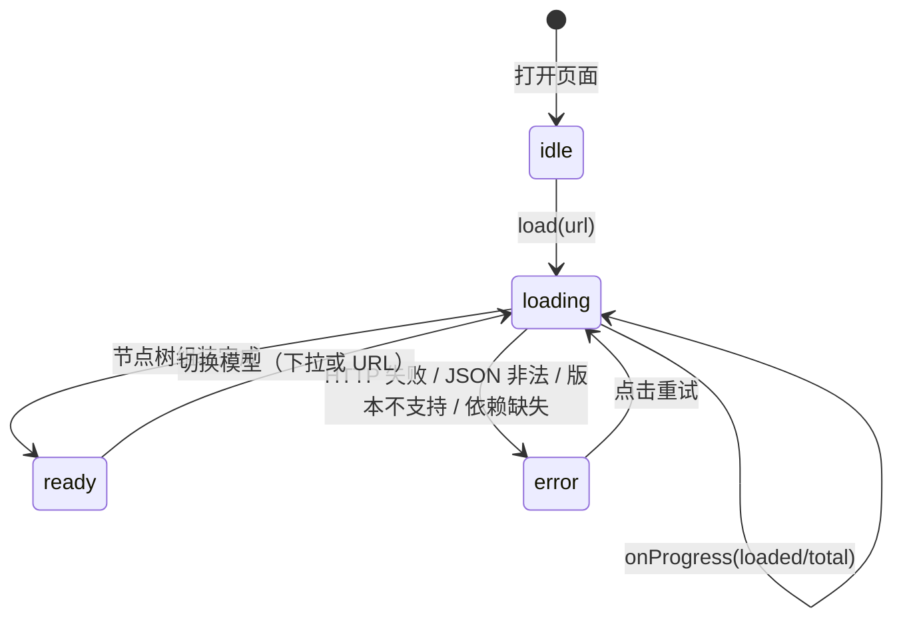

# 项目一：模型查看器

> [返回：WebGL 与 3D 框架学习大纲](../WebGL与3D框架学习大纲.md)
> 本文是实战专题第一篇：用第四阶段的自研框架做一个类 sketchfab 的最小模型查看器（Model Viewer）——按五步交付（骨架加载、相机适配、灯光地面、调试视图、打磨），每步给出目标、要点、关键代码与自检点。

## 1.1 需求与验收清单

### 1.1.1 需求定义

一句话：**打开就能拖转、能看清、能诊断、能带走的网页模型查看器**。"带走"指截图与 URL 分享——这三件事正是 sketchfab 这类产品体验的下限。功能拆解：

| 功能 | 说明 | 优先级 |
|---|---|---|
| 模型加载 | `.gltf`（+ `.bin` + 贴图）主路径；`.obj` 兜底（无材质按灰模） | P0 |
| 轨道相机 | 拖拽旋转、滚轮缩放、帧率无关阻尼（examples 公共层直接复用） | P0 |
| 灯光与地面阴影 | 三灯布光（Three-Point Lighting）+ 地面接触阴影（Contact Shadow）+ 网格地面 | P0 |
| 自动取景 | 包围球计算 + 相机距离适配（Auto Framing），任意尺寸模型开箱即满屏 | P0 |
| 加载反馈 | 进度条 + 错误态：网络失败、格式错的用户可见反馈，不白屏 | P0 |
| 调试视图 | 法线 / UV / 线框（Wireframe）三视图切换 | P1 |
| 截图导出 | PNG 下载，所见即所得（Screenshot Export） | P1 |
| 双击聚焦 | 拾取命中点 + 相机过渡动画（Double-Click Focus） | P2 |
| URL 分享 | 模型/视图/相机参数进 URL，发给朋友刷新还原 | P2 |

### 1.1.2 验收 checklist

功能组：

- [ ] 白名单内任一 `.gltf` 加载成功渲染，控制台零报错；`.obj` 兜底路径可用
- [ ] 拖拽/滚轮手感顺滑（阻尼生效），拖出窗口不丢事件
- [ ] 任意模型加载完成后自动满屏取景：模型完整可见、留约 20% 边距、无"半截在天上"
- [ ] 地面阴影方向与三灯关系合理，无明显 shadow acne（条纹）与漏光
- [ ] 法线/UV/线框三视图可切换，切回 shaded 状态正确恢复
- [ ] 截图下载的 PNG 与屏幕画面一致（非全黑/全透明）
- [ ] 断网或改错 URL 时出现错误面板（含原因与重试按钮），页面不白屏

性能组：

- [ ] ≤ 50 万三角形模型稳定 60fps（性能埋点记录）
- [ ] drawcall 数 = mesh 数 + 地面 + 阴影 pass，无预期外翻倍（Spector 抓帧核对）
- [ ] 本地模型首屏可交互 ≤ 2 秒

工程组：

- [ ] Vite + TS 严格模式零 error；框架以 alias 源码方式引入
- [ ] README：操作说明、截图、在线地址（GitHub Pages，发布步骤同 04-09）

## 1.2 第一步：骨架与加载

#### 目标

工程骨架跑起来；`.gltf` 能加载成节点树并摊平成 mesh 清单；加载过程有进度，失败有错误态。

#### 实现要点

1. **骨架三件套**：Renderer + Scene + PerspectiveCamera/OrbitControls。前两样来自框架（`minigl`，即你在 04-09 定名发布的自研框架，下同）；相机与控制器搬 `webgl/examples/src/common/controls.ts`（导览的约定 2）。vite alias 把 `minigl` 指到框架源码：`resolve: { alias: { minigl: <框架>/src/index.ts } }`。
2. **加载器不重写，做加法**：[04-第四阶段/07-资源管理](../04-第四阶段/07-资源管理.md) 的 GLTFLoader 已经完成 JSON 校验、buffers/贴图加载、材质映射、节点树组装（6.3.2 九步清单）。查看器补的是**应用层**：多 mesh/多材质的节点树遍历统计、进度 UI、错误态分类。
3. **简版加载器的已知边界**（07 册自测第 7 题的设计）：不拆 GLB、不含动画播放。前者用 `.gltf + .bin` 的样例模型绕开；后者不阻塞查看器（动画是 1.8 的扩展挑战）。
4. **错误态是需求不是装饰**：HTTP 失败、JSON 非法、glTF 版本不支持是三种不同的用户提示。UI 走状态机，不散落 if。

加载 UI 的状态机：



#### 关键代码

```typescript
// loader.ts —— 加载编排：glTF 主路径 + OBJ 兜底 + 进度/错误反馈
import { GLTFLoader, Node3D, Mesh, MeshPhongMaterial } from 'minigl';
import { parseOBJ } from './objLoader';

export type LoadPhase = 'idle' | 'loading' | 'ready' | 'error';
export interface ViewerUI { setPhase(p: LoadPhase, msg?: string): void; setProgress(r: number): void; }

export async function loadModel(url: string, ui: ViewerUI): Promise<Node3D> {
  ui.setPhase('loading');
  try {
    if (url.endsWith('.gltf')) {
      const loader = new GLTFLoader();                 // 07 册 6.3：Loader 基类自带去重队列
      loader.onProgress = (l, t) => ui.setProgress(t > 0 ? l / t : 0);  // bin/贴图逐个到货都推进
      return await loader.load(url);
    }
    if (url.endsWith('.obj')) {                        // 兜底：无材质，统一灰模
      const resp = await fetch(url);
      if (!resp.ok) throw new Error(`HTTP ${resp.status}`);
      const root = new Node3D('obj');
      root.add(new Mesh(parseOBJ(await resp.text()), new MeshPhongMaterial({ color: 0xcccccc })));
      ui.setProgress(1);
      return root;
    }
    throw new Error(`不支持的格式：${url}（仅 .gltf / .obj）`);
  } catch (err) {
    ui.setPhase('error', (err as Error).message);      // 网络失败/格式错统一进错误态
    throw err;                                         // 上层 main 再兜一次（1.7）
  }
}
```

错误分类表（`setPhase('error', msg)` 前把原始错误翻译成人话）：

| 原始错误 | 用户提示 | 备注 |
|---|---|---|
| `HTTP 404/5xx` | "模型文件不存在或服务器故障" + 重试按钮 | 07 册 Loader 已带 `加载失败 ${url}` 前缀 |
| `JSON.parse` 抛错 | "不是合法的 glTF 文件（JSON 解析失败）" | 下载到 HTML 错误页时最常见 |
| `仅支持 glTF 2.x` | "模型是 glTF 1.0，请重新导出为 2.0" | 07 册的版本闸门 |

贴图 404 不进错误态：可选依赖降级纯色 + console.warn（07 册 6.2.3），一张装饰图不该挂掉整个模型。

```typescript
// stats.ts —— 多 mesh/多材质的节点树遍历：加载器返回整棵 Node3D，先摊平成清单
import { Material, Mesh, Node3D } from 'minigl';

export interface SceneStats {
  meshes: Mesh[]; materials: Material[]; vertexCount: number; triangleCount: number;
}

export function collectSceneStats(root: Node3D): SceneStats {
  const meshes: Mesh[] = [];
  const materials = new Set<Material>();
  let vertexCount = 0, triangleCount = 0;
  root.traverse((node) => {                    // 04-03 场景图的深度优先遍历
    if (!(node instanceof Mesh)) return;       // 简版加载器每个 primitive 产出一个 Mesh
    meshes.push(node);
    if (node.material) materials.add(node.material);
    vertexCount += node.geometry.attributes.position.count;
    triangleCount += (node.geometry.indices?.count ?? vertexCount) / 3;   // 无索引：3 顶点 = 1 三角形
  });
  return { meshes, materials: [...materials], vertexCount, triangleCount };
}
// 若你的 Node3D 还没有 traverse：15 行递归即可（children 逐个进、先序访问）。
// 这份清单后续处处要用：包围盒（1.3）、调试视图（1.5）、双击拾取目标集（1.6）。
```

```typescript
// objLoader.ts —— OBJ 兜底解析：v / vn / vt / f 四个指令，f 顶点格式 v/vt/vn（后两段可缺省）
import type { GeometryData } from 'minigl';

export function parseOBJ(text: string): GeometryData {
  const pos: number[] = [], nor: number[] = [], uv: number[] = [];
  const outPos: number[] = [], outNor: number[] = [], outUv: number[] = [], outIdx: number[] = [];
  const cache = new Map<string, number>();    // 同一 v/vt/vn 组合只展开一次
  let next = 0;
  const vertex = (spec: string): number => {  // "31/1/31" → 展开后的输出下标
    const hit = cache.get(spec);
    if (hit !== undefined) return hit;
    const [vi, ti, ni] = spec.split('/');
    const fix = (i: string | undefined, len: number) =>            // OBJ 索引从 1 起，负数相对
      i ? (Number(i) > 0 ? Number(i) - 1 : len + Number(i)) : -1;
    const v = fix(vi, pos.length / 3), t = fix(ti, uv.length / 2), n = fix(ni, nor.length / 3);
    outPos.push(pos[v * 3]!, pos[v * 3 + 1]!, pos[v * 3 + 2]!);
    if (t >= 0) outUv.push(uv[t * 2]!, uv[t * 2 + 1]!);
    if (n >= 0) outNor.push(nor[n * 3]!, nor[n * 3 + 1]!, nor[n * 3 + 2]!);
    cache.set(spec, next);
    return next++;
  };
  for (const p of text.split('\n').map((l) => l.trim().split(/\s+/))) {
    if (p[0] === 'v') pos.push(+p[1]!, +p[2]!, +p[3]!);
    else if (p[0] === 'vt') uv.push(+p[1]!, +p[2]!);
    else if (p[0] === 'vn') nor.push(+p[1]!, +p[2]!, +p[3]!);
    else if (p[0] === 'f') {
      const idx = p.slice(1).map(vertex);
      for (let i = 2; i < idx.length; i++) outIdx.push(idx[0]!, idx[i - 1]!, idx[i]!); // 扇形三角化
    }
  }
  return {                                     // 文件缺 vn：面法线叉积兜底；缺 vt：uv 补零（细节略）
    position: new Float32Array(outPos),
    normal: new Float32Array(outNor.length === outPos.length ? outNor : flatNormals(outPos, outIdx)),
    uv: new Float32Array(outUv.length === outPos.length / 3 * 2 ? outUv : new Array(outPos.length / 3 * 2).fill(0)),
    indices: new Uint32Array(outIdx),
  };
}
```

#### 自检点

- [ ] HUD 上能看到进度从 0 走到 1（`.gltf` + `.bin` + 多张贴图的模型才会体现分步进度）
- [ ] 断网重试：错误面板出现，点重试恢复加载
- [ ] `collectSceneStats` 输出的 mesh 数与模型里 primitive 总数一致（Khronos 样例模型的 README 一般会写）

## 1.3 第二步：相机适配

#### 目标

任意尺寸（毫米级零件到米级建筑）、任意原点位置的模型，加载完成后自动出现在视野中央、大小合适、可转可缩。

#### 实现要点

**"自动居中"选"动相机，不动模型"**：把轨道中心（controls.target）设到模型包围球球心，而不是把模型平移到原点。两个理由：一是 glTF 蒙皮动画可能驱动根节点，外层平移会与动画数据打架；二是模型坐标保持原样，调试视图里的世界坐标与 DCC 软件（Blender 等）能对得上。地面放在 `bounds.min.y` 而不是 y=0，同理。

包围计算两级走：先世界 AABB（逐 mesh 局部盒 8 角乘 matrixWorld 取并），再从 AABB 导出包围球（Bounding Sphere）。注意 AABB 的外接球不是最小包围球——细长物体（旗杆、刀）会偏松；更紧的 OBB 用协方差特征分解求主轴，推导与完整代码见[数学专题 01](../数学专题/01-线性代数深化.md) 1.3 的 PCA 包围盒，查看器用 AABB 版已够用。

#### 关键代码与推导

相机距离公式：设包围球半径 r、相机到球心距离 d、垂直半视角 α = fov/2。过相机与球心作剖面，球与视角边缘视线相切，得到直角三角形——切点处半径垂直于视线：

```text
        C（相机）
        │╲
        │ ╲   视线边缘（与球相切于 P）
     d  │  ╲    直角三角形 C-O-P：∠C = α（半视角），对边 OP = r，斜边 CO = d
        │ α  ╲   ∠CPO = 90°（切线垂直半径）
        ├─────P  ⇒ sin α = r / d  ⇒  d = r / sin α
        │  r  ╲
        O（球心）
```

宽屏时水平方向更宽、不用担心；**竖屏（aspect < 1）时水平半视角更小，装不装得下由它决定**。水平半视角由 `tan α_h = aspect · tan α_v` 换算，最终取两者较小：

`α = min(α_v, α_h)`，`d = r / sin(α) · margin`（margin 约 1.25：20% 边距 + HUD 面板遮挡补偿）。

手算例子：r = 2 m，fovV = 45°，aspect = 16/9。`tan 22.5° = 0.4142`；`α_h = atan(0.4142 × 1.778) = atan(0.7364) ≈ 36.4°`；`α = min(22.5°, 36.4°) = 22.5°`；`d = 2 / sin 22.5° = 2 / 0.38268 ≈ 5.23`；乘 margin 1.25 得 **6.53 m**。相机 near/far 同步收紧：`near = max((d − r)/20, 0.01) ≈ 0.23`、`far = (d + r) × 4 ≈ 34`（near 尽量大保深度精度，第二阶段 z-fighting 的教训）。

```typescript
// framing.ts —— 世界包围盒 → 包围球 → 自动取景
import { Mesh, Node3D, Vec3 } from 'minigl';

export interface Bounds { min: Vec3; max: Vec3; }

export function computeWorldBounds(root: Node3D): Bounds {
  const min = new Vec3(Infinity, Infinity, Infinity);
  const max = new Vec3(-Infinity, -Infinity, -Infinity);
  root.traverse((node) => {
    if (!(node instanceof Mesh)) return;
    const bb = node.geometry.boundingBox;        // 加载器 buildMesh 时算好的局部 AABB
    if (!bb) return;                             // 生成器产出可能没算：现场遍历 position 求一遍
    for (let i = 0; i < 8; i++) {
      const corner = new Vec3(
        i & 1 ? bb.max.x : bb.min.x,
        i & 2 ? bb.max.y : bb.min.y,
        i & 4 ? bb.max.z : bb.min.z,
      );
      Vec3.transformMat4(corner, corner, node.matrixWorld);   // 场景图更新过的世界矩阵
      Vec3.min(min, min, corner);
      Vec3.max(max, max, corner);
    }
  });
  return { min, max };
}

export function boundingSphereFromBounds(b: Bounds): { center: Vec3; radius: number } {
  const center = new Vec3(
    (b.min.x + b.max.x) / 2, (b.min.y + b.max.y) / 2, (b.min.z + b.max.z) / 2,
  );
  let r2 = 0;
  for (let i = 0; i < 8; i++) {                 // 球心到 8 个角的最远距离即半径
    const dx = (i & 1 ? b.max.x : b.min.x) - center.x;
    const dy = (i & 2 ? b.max.y : b.min.y) - center.y;
    const dz = (i & 4 ? b.max.z : b.min.z) - center.z;
    r2 = Math.max(r2, dx * dx + dy * dy + dz * dz);
  }
  return { center, radius: Math.sqrt(r2) };
}

export function frameCamera(
  camera: PerspectiveCamera, controls: OrbitControls,
  sphere: { center: Vec3; radius: number }, margin = 1.25,
): void {
  const halfV = camera.fov / 2;                              // fov 按弧度存（examples 约定）
  const halfH = Math.atan(Math.tan(halfV) * camera.aspect);
  const alpha = Math.min(halfV, halfH);
  const dist = (sphere.radius / Math.sin(alpha)) * margin;

  controls.target.copy(sphere.center);
  controls.setOrbit(0.70, 1.13, dist, true);    // 方位 40°、仰角 25° 的四分之三经典机位
  // 单位不明的模型（毫米/米）全靠这三行兜住缩放手感：
  controls.minRadius = sphere.radius * 0.3;
  controls.maxRadius = dist * 4;
  camera.near = Math.max((dist - sphere.radius) / 20, 0.01);
  camera.far = (dist + sphere.radius) * 4;
}
```

`setOrbit` 是给 examples 的 OrbitControls 补的公开方法（它把 theta/phi/radius 藏成了 private，本项目的取景与 1.6 的飞行都要从外部写半径）：

```typescript
// 追加到 examples/src/common/controls.ts 的 OrbitControls（约 15 行）
getOrbit(): { theta: number; phi: number; radius: number } {
  return { theta: this.theta, phi: this.phi, radius: this.radius };
}
setOrbit(theta?: number, phi?: number, radius?: number, immediate = false): void {
  if (theta !== undefined) this.targetTheta = theta;
  if (phi !== undefined) this.targetPhi = Math.min(Math.max(phi, this.minPhi), this.maxPhi);
  if (radius !== undefined) this.targetRadius = Math.min(Math.max(radius, this.minRadius), this.maxRadius);
  if (immediate) {           // 初帧取景：当前值与目标值一起写，跳过阻尼追赶
    this.theta = this.targetTheta; this.phi = this.targetPhi; this.radius = this.targetRadius;
  }
}
```

#### 自检点

- [ ] 换三个尺度差很大的模型（如 0.1m / 2m / 100m）：都能自动满屏，滚轮手感正常（不"一滚就没"或"纹丝不动"）
- [ ] 窗口拉成竖条：模型仍完整可见（验证 min(α_v, α_h) 那一行）
- [ ] 模型一半陷进地面的情况没有出现（地面 y = bounds.min.y）

## 1.4 第三步：灯光与地面

#### 目标

三灯布光把模型"托"出来；地面接住接触阴影；网格地面给尺度感。

#### 实现要点

**三灯布光（Key / Fill / Rim）参数速查**（方位角绕 +Y 从 +Z 起算、仰角向上为正；位置 = 球心 + 单位方向 × 3r）：

| 灯位 | 方位 / 仰角 | 强度 | 投影 | 作用 |
|---|---|---|---|---|
| 主光 Key | -45° / 45° | 1.0 | 是（2048 shadow map） | 定调明暗与影子方向 |
| 补光 Fill | 40° / 20° | 0.3~0.4 | 否 | 提亮暗部；再强会出现第二影子，视觉上说谎 |
| 轮廓光 Rim | 170° / 30° | 0.6~0.8 | 否 | 把主体从背景里剥出来 |
| 环境光 Ambient | — | 0.25 | 否 | 抬整体，避免死黑 |

**接触阴影**是"信噪比"问题，不是"有没有"问题：shadow map 的正交范围越贴模型，每像素分到的深度分辨率越高、acne 越少。[05-第五阶段/02-阴影与PCF软阴影](../05-第五阶段/02-阴影与PCF软阴影.md) 的两 pass 流程、光源正交相机按 AABB 拟合（1.1.3）与 bias 推导（1.2）是全部理论；`webgl/examples` 的 08-shadows 示例（`shadow.ts`：深度 FBO + 光源相机 + 坡度 bias + 3×3 PCF）是可运行样板——起步参数直接抄它，再按本模型包围盒改两处：正交范围用模型 AABB 外扩 10%，near/far 覆盖"光源到地面再留一截"。

**网格地面（grid）材质**自己写：世界 XZ 平面上用 `fwidth` 做像素级抗锯齿的格线，细格 + 粗格双层，随距离淡出。范围取模型半径的同量级（如 5r），地面 plane 尺寸再大也靠淡出遮住。

#### 关键代码

```typescript
// lights.ts —— 三灯布光：方向由"方位角/仰角"参数化，模型多大灯就摆多远
import { AmbientLight, DirectionalLight, Scene, Vec3 } from 'minigl';
import type { Bounds } from './framing';

/** 球坐标 → 单位方向：az 方位角（绕 +Y，从 +Z 起算），el 仰角 */
export function dirFromAzEl(azDeg: number, elDeg: number): Vec3 {
  const az = azDeg * Math.PI / 180, el = elDeg * Math.PI / 180;
  return new Vec3(
    Math.sin(az) * Math.cos(el),
    Math.sin(el),
    Math.cos(az) * Math.cos(el),
  );
}

export function setupLights(
  scene: Scene, sphere: { center: Vec3; radius: number }, bounds: Bounds,
): DirectionalLight {
  const r = sphere.radius;
  const place = (az: number, el: number, d: number): Vec3 =>
    new Vec3().copy(dirFromAzEl(az, el)).scale(d * r).add(sphere.center);

  scene.add(new AmbientLight(0xffffff, 0.25));

  const key = new DirectionalLight(0xffffff, 1.0);           // 主光
  key.position.copy(place(-45, 45, 3));
  key.castShadow = true;
  key.shadow.mapSize = 2048;
  fitShadowCamera(key, bounds);                              // 见下：范围贴合 = 阴影质量
  scene.add(key);

  const fill = new DirectionalLight(0xffffff, 0.35);         // 补光：不投影
  fill.position.copy(place(40, 20, 3));
  scene.add(fill);

  const rim = new DirectionalLight(0xffffff, 0.7);           // 轮廓光：不投影
  rim.position.copy(place(170, 30, 3));
  scene.add(rim);
  return key;
}

/** 光源正交范围：模型 AABB 外扩 10%、深度覆盖到地面之下（05-02 1.1.3 的 fitOrthoToBounds 改） */
function fitShadowCamera(light: DirectionalLight, b: Bounds): void {
  const pad = 1.1;
  const w = Math.max(b.max.x - b.min.x, b.max.z - b.min.z) * pad;
  const h = (b.max.y - b.min.y) * pad;
  light.shadow.camera.setOrtho(-w / 2, w / 2, -h / 2, h / 2);   // 左右上下
  light.shadow.camera.setNearFar(0.1, (b.max.y - b.min.y) * 6); // 光在 3r 处，far 留足光程
  light.shadow.camera.centerOn((b.min.x + b.max.x) / 2, (b.max.y + b.min.y) / 2, (b.min.z + b.max.z) / 2);
  // bias 组合（坡度偏置 + 常量偏置）起步值抄 examples 08-shadows；
  // 正交范围改过后按比例缩放常量偏置——范围越大，同 bias 越容易 acne（05-02 1.2 的量化推导）。
}
// 若框架的灯对象还没有 shadow 字段：不改框架也能做——08-shadows 的 shadow.ts
// 本来就是"框架外挂"式深度 pass，把它接进渲染循环、主材质并入 05-02 1.3.3 的采样函数即可。
```

```glsl
// grid.frag —— 抗锯齿网格：线宽恒为像素级，细格/粗格双层 + 距离淡出 + 接住阴影
// （fwidth 是 GLSL ES 3.00 内建，WebGL2 直接用；GLSL ES 1.00 需 OES_standard_derivatives）
in vec3 vWorldPos;
out vec4 fragColor;
uniform vec3 uGridColor;
uniform vec3 uGridCenter;       // 取模型包围球球心的 XZ（中心对齐网格）
uniform float uGridExtent;      // 网格半径（世界单位，取 5 × 模型半径量级）

float gridFactor(vec2 p, float cell) {
  vec2 c = p / cell;
  vec2 a = abs(fract(c - 0.5) - 0.5) / fwidth(c);   // 到最近格线的距离，换算成像素
  return 1.0 - min(min(a.x, a.y), 1.0);             // 线上为 1，一像素内平滑过渡到 0
}
void main() {
  float minor = gridFactor(vWorldPos.xz, uGridExtent / 10.0) * 0.30;  // 细格
  float major = gridFactor(vWorldPos.xz, uGridExtent)        * 0.55;  // 粗格
  float dist  = length(vWorldPos.xz - uGridCenter.xz);
  float fade  = 1.0 - smoothstep(uGridExtent * 0.5, uGridExtent, dist);
  float g = max(minor, major) * fade;
  vec3 col = mix(vec3(0.16), uGridColor, g);
  col *= 1.0 - getShadowFactor(vWorldPos) * 0.75;   // 接触阴影：05-02 1.3.3 的采样函数原样并入
  fragColor = vec4(col, 1.0);
}
```

地面本体：`createPlane` 生成（examples 公共层 `geometry.ts`），尺寸取 `uGridExtent × 4`，y = `bounds.min.y`，材质用上面的 grid shader；地面 mesh 记 `receiveShadow`（或如上直接在 grid shader 里采样阴影贴图）。

#### 自检点

- [ ] 只有一盏灯产生影子（补光/轮廓光投影关闭）
- [ ] 把模型缩小十倍再加载：阴影依然清晰无条纹（正交范围跟随包围盒收紧）
- [ ] 网格线在近处细、远处淡出，无摩尔纹（摩尔纹 = fwidth 抗锯齿没生效，先查 WebGL2 上下文）

## 1.5 第四步：调试视图

#### 目标

法线、UV、线框三个视图一键切换——排查贴图错位、法线翻转、拓扑问题时不用再回 DCC 软件看。

#### 实现要点

法线/UV 视图走**材质宏变体**：与正常渲染共用同一份 uber shader 源码，`#define` 切换片元末尾的输出分支——这正是[着色器语言专题 02](../着色器语言专题/02-预处理与变体管理.md) 2.2.3"宏做分支调试"的标准姿势（`FW_DEBUG_VIEW`）。变体由 [04-第四阶段/04-材质与着色器系统](../04-第四阶段/04-材质与着色器系统.md) 的 program 缓存管理：首次切换编译一次，之后零成本互切。渲染结果不对时先切调试视图确认数据层（法线/UV）是否正确，再怀疑光照——这条排查顺序来自[工程专题 01](../工程专题/01-调试与诊断.md) 的"症状速查表"思路。

线框有两种做法，**先给结论：默认用 gl.LINES 重建法（零内存压力、即开即关）；要"线框 + 半透明填充"的展示效果再上重心坐标法**。

| | 重心坐标面片着色法 | gl.LINES 索引重建法 |
|---|---|---|
| 额外数据 | 顶点展开约 ×3 + bary attribute | 仅一份边索引（约为原索引量级） |
| 线宽 | 像素级可控（fwidth） | 恒 1px（多数平台 gl.lineWidth 只支持 1） |
| 填充叠加 | 可，同一 draw 画"线 + 半透明面" | 否，需要第二遍绘制 |
| 管线侵入 | 要新 attribute 与专属材质分支 | 只要一个 EBO + `gl.LINES`，任何材质可用 |
| 适用 | 截图展示、需要线宽与填充 | 调试期快速看拓扑 |

#### 关键代码

```glsl
// 调试视图：挂在 uber shader 片元输出之前（链接着色器语言专题 02 的 FW_DEBUG_VIEW 模板）
#if FW_DEBUG_VIEW == 1          // 法线视图："蓝天红地"说明朝向正确；局部偏色 = 法线有问题
  vec3 n = normalize(vWorldNormal);
  fragColor = vec4(n * 0.5 + 0.5, 1.0);        // [-1,1] → [0,1]：*0.5 压进正半轴，+0.5 抬进显示域
#elif FW_DEBUG_VIEW == 2        // UV 视图：左下绿黑、右上红黄 → u/v 方向与翻转一眼可辨
  #ifdef HAS_UV
    fragColor = vec4(vUv, 0.0, 1.0);           // u 进红通道、v 进绿通道
  #else
    fragColor = vec4(1.0, 0.0, 1.0, 1.0);      // 无 UV 通道：品红哨兵色，别当 bug 排查
  #endif
#endif
```

配套两处要点：其一，`vWorldNormal = mat3(uNormalMatrix) * aNormal`，法线矩阵是**模型矩阵逆转置的 3×3**——examples 公共层为省事用 `mat3(uModel)` 的精简只对纯旋转/均匀缩放成立，查看器要加载任意模型，必须用完整的 `normalFromMat4`（第二阶段光照讲过原因）。其二，`HAS_UV` 由几何是否含 uv attribute 决定，与 `FW_DEBUG_VIEW` 一样走 defines 注入。

```typescript
// debugViews.ts —— 视图切换：改 defines，变体缓存负责取/建 program
import { Mesh } from 'minigl';

export type ViewMode = 'shaded' | 'normal' | 'uv' | 'wireframe';
const DEBUG_VALUE: Partial<Record<ViewMode, number>> = { normal: 1, uv: 2 };

export function applyViewMode(meshes: Mesh[], mode: ViewMode): void {
  for (const mesh of meshes) {
    if (mode === 'wireframe') { ensureWireframe(mesh); continue; }   // 线框走 1.5 末尾的独立路径
    const value = DEBUG_VALUE[mode] ?? 0;
    mesh.material.defines.FW_DEBUG_VIEW = value;   // defines 变 → program 缓存键变 → 自动换变体
  }
}
```

```typescript
// wireframe.ts —— 线框两法。方法一：重心坐标（Barycentric Coordinates）面片着色
import { Geometry } from 'minigl';

export function toBarycentricWireframe(geo: Geometry): Geometry {
  const src = geo.indices ? expandIndexed(geo) : geo;  // 展开索引：position/normal/uv 按 indices 重排
  const n = src.attributes.position.count;
  const bary = new Float32Array(n * 3);
  for (let i = 0; i < n; i++) bary[i * 3 + (i % 3)] = 1;  // 每三角形三顶点轮流 (1,0,0)(0,1,0)(0,0,1)
  return src.setAttribute('barycentric', bary);
}
```

```glsl
// 方法一的片元：三重心坐标各自到 0 的距离，最近的边就是片元到三角形边缘的距离
in vec3 vBarycentric;
uniform float uLineWidth;      // 像素单位，通常 1.0~1.5
float edgeFactor() {
  vec3 d = fwidth(vBarycentric);                                // 重心坐标在屏幕空间的变化率
  vec3 a = smoothstep(vec3(0.0), d * uLineWidth, vBarycentric); // 每条边一个 0(边上)→1(内部) 的过渡
  return min(min(a.x, a.y), a.z);                               // 三者取最小 = 离最近的边最近
}
void main() {
  float e = edgeFactor();
  fragColor = vec4(mix(uLineColor, uFillColor, e), mix(0.9, uFillAlpha, e)); // 边不透明、填充半透明
}
```

```typescript
// 方法二：gl.LINES 索引重建 —— 从三角形索引生成去重后的边索引
const EDGE_STRIDE = 1 << 22;    // 假设顶点数 < 4M；u * STRIDE + v 编码无向边（u < v）

export function buildEdgeIndices(indices: Uint32Array): Uint32Array {
  const edges = new Set<number>();
  for (let i = 0; i < indices.length; i += 3) {
    const tri = [indices[i]!, indices[i + 1]!, indices[i + 2]!];
    for (const [a, b] of [[0, 1], [1, 2], [2, 0]] as const) {
      const u = tri[a]!, v = tri[b]!;
      edges.add(u < v ? u * EDGE_STRIDE + v : v * EDGE_STRIDE + u);   // 规范化：无向边只存一次
    }
  }
  const out = new Uint32Array(edges.size * 2);
  let k = 0;
  for (const e of edges) { out[k++] = Math.floor(e / EDGE_STRIDE); out[k++] = e % EDGE_STRIDE; }
  return out;
}
// 画法：同一个 VAO，边索引上传为第二个 EBO；
// 切换时 bindBuffer(ELEMENT_ARRAY_BUFFER, edgeEbo) 后 drawElements(gl.LINES, edgeCount, ...)。
```

#### 自检点

- [ ] 法线视图：封闭模型外侧应整体偏蓝（+Y 法线朝上）且随转动稳定变色；出现大片纯色或"闪烁噪点"先查 1.2 的 stride 处理与法线矩阵
- [ ] UV 视图：贴图模型与 shaded 视图对照，肉眼找得到贴图错位对应的那块颜色异常
- [ ] 线框两法各开一次：三角形数一致；重心法在大模型上明显更卡（顶点×3），切回 shaded 无状态残留

## 1.6 第五步：打磨

#### 目标

三个"锦上添花但决定成色"的功能：双击聚焦、截图导出、URL 分享。

#### 实现要点与关键代码

**双击聚焦** = 拾取 + 相机过渡动画。拾取用 [04-第四阶段/05-交互系统](../04-第四阶段/05-交互系统.md) 的 Raycaster 全链路（屏幕 → NDC → 世界射线 → 先包围体后 Möller–Trumbore）；过渡动画用自写的迷你 tween（约百行，正是毕业项目缺口清单里那件，这里先造出来）。

```typescript
// focus.ts —— 双击聚焦：命中点的世界包围球决定新距离，tween 平滑过去
canvas.addEventListener('dblclick', (e) => {
  const ray = Raycaster.fromScreen(e, camera, canvas);       // 04-05 4.1（y 翻转与 dpr 都在里头）
  const hit = ray.intersectMeshes(stats.meshes)[0];          // 04-05 4.3：先球/AABB 后逐面
  if (!hit) return;
  const sphere = boundingSphereFromBounds(computeWorldBounds(hit.object)); // 复用 1.3 的两步
  flyTo(controls, { target: hit.point.clone(), radius: sphere.radius * 2.5 }, 600);
});
```

```typescript
// tween.ts —— 迷你 tween + easeInOutCubic。直线插值目标点已够用；想"绕物体弧线飞"
// 再上 Catmull-Rom 给 target 与半径各配曲线（数学专题 04——先做弧长参数化，否则速度不匀）。
export type Ease = (t: number) => number;
export const easeInOutCubic: Ease = (t) =>
  t < 0.5 ? 4 * t * t * t : 1 - Math.pow(-2 * t + 2, 3) / 2;

export function tween(
  durMs: number, ease: Ease, onUpdate: (k: number) => void, onDone?: () => void,
): () => void {
  const t0 = performance.now();
  const step = (now: number) => {
    const k = Math.min((now - t0) / durMs, 1);
    onUpdate(ease(k));
    if (k < 1) requestAnimationFrame(step);
    else onDone?.();
  };
  requestAnimationFrame(step);
  return () => cancelAnimationFrame(step);    // 取消句柄：新飞行打断旧飞行
}

let currentFlight: (() => void) | null = null;
const lerp = (a: number, b: number, t: number): number => a + (b - a) * t;

export function flyTo(controls: OrbitControls, to: { target: Vec3; radius: number },
                      durMs = 600): void {
  currentFlight?.();                          // 打断上一段
  const from = { target: controls.target.clone(), radius: controls.getOrbit().radius };
  controls.enabled = false;                   // 挂起输入：飞行中拖拽会与插值打架
  currentFlight = tween(durMs, easeInOutCubic, (k) => {
    Vec3.lerp(controls.target, from.target, to.target, k);
    controls.setOrbit(undefined, undefined, lerp(from.radius, to.radius, k));
  }, () => { controls.enabled = true; });      // 走阻尼通道，动画结束自然衔接
}
// enabled 是给 controls 补的开关（事件监听开头 if (!this.enabled) return，两行）。
```

**截图导出**的核心是时序。默认 `preserveDrawingBuffer: false` 下，浏览器每次合成后就清空绘图缓冲；按钮的 click 回调发生在两帧之间，那时缓冲已失效，直接 `toBlob` 只能得到黑图。三条路：**A 帧内捕获（推荐，零代价）**——事件里只立旗，渲染循环在 `render()` 之后同帧读 `toBlob`；**B `preserveDrawingBuffer: true`**——一行配置，代价是每帧合成策略变保守、移动端可感知掉帧；**C 渲染进 FBO + readPixels**——代码量最大，但截图分辨率可与 canvas 解耦。`toBlob` 的位图按规范在**调用时刻**捕获，所以回调本身异步无所谓，关键是调用时点在清屏之前：

```typescript
// screenshot.ts —— 方案 A：帧内捕获。时序：click 立旗 → 下一帧 render() → 同帧 toBlob → 下载
let pendingShot: ((blob: Blob) => void) | null = null;

export function requestScreenshot(cb: (blob: Blob) => void): void {
  pendingShot = cb;                       // 只立旗。注意：连点两次只截一次（需求如此就先到先得）
}

export function captureAfterRender(canvas: HTMLCanvasElement): void {
  if (!pendingShot) return;               // main 循环在 render() 之后调用（1.7 的 frame 函数）
  const done = pendingShot;
  pendingShot = null;
  canvas.toBlob((blob) => blob && done(blob), 'image/png');   // 此刻位图仍有效
}

export function downloadBlob(blob: Blob, name: string): void {
  const url = URL.createObjectURL(blob);
  const a = document.createElement('a');
  a.href = url; a.download = name; a.click();
  setTimeout(() => URL.revokeObjectURL(url), 1000);
}
```

**URL 分享参数**：`?model=…&view=…&camera=theta,phi,radius`。读取在启动时，写入在相机停下后（防抖）。`model` 必须**白名单**校验——否则你的页面会变成"任意 URL 的资源代理"，被人拿来探测内网或耗 CDN 流量。用 `history.replaceState`（不产生历史记录，刷新即还原），别用 pushState（用户按返回键会在"同一个页面"里打转）。

```typescript
// urlState.ts —— URL 分享参数
import type { ViewMode } from './debugViews';

const MODEL_WHITELIST = ['assets/duck.gltf', 'assets/two-sided-box.gltf', 'assets/lantern.obj'];

export interface ViewerParams { model: string; view: ViewMode; camera?: [number, number, number]; }

export function parseViewerURL(search: string): ViewerParams {
  const q = new URLSearchParams(search);
  const model = q.get('model') ?? '';
  const cam = q.get('camera')?.split(',').map(Number);
  return {
    model: MODEL_WHITELIST.includes(model) ? model : MODEL_WHITELIST[0]!,
    view: (q.get('view') as ViewMode) ?? 'shaded',
    camera: cam?.length === 3 && cam.every(Number.isFinite)
      ? (cam as [number, number, number]) : undefined,
  };
}

let timer = 0;
export function syncViewerURL(getState: () => string): void {
  clearTimeout(timer);                    // 拖拽一停会连发几十次 change，防抖 500ms
  timer = setTimeout(() => history.replaceState(null, '', getState()), 500);
}
// 接线：controls 的 change 事件 → syncViewerURL；view 切换与模型切换处直接调一次。
```

#### 自检点

- [ ] 双击模型不同部位：相机分别飞过去，动画中途再双击能改道不抖动；飞行期间拖拽无响应（输入挂起生效），结束后立即恢复
- [ ] 截图 PNG 在相册软件里打开与页面画面一致；连点两次不崩
- [ ] 调好一个机位 → 复制 URL 到新标签页：模型、视图、机位全部还原

## 1.7 完整骨架代码与目录结构

```text
model-viewer/
├── index.html              # canvas + HUD：进度条、错误面板、视图切换条、截图按钮
├── package.json            # 仅 devDependencies：vite + typescript（框架走 alias 不进依赖）
├── vite.config.ts          # resolve.alias: { minigl: <框架>/src/index.ts }（04-09 做法）
├── src/
│   ├── main.ts             # 主流程编排（见下）
│   ├── app.ts              # createApp：Renderer/Scene/Camera/Controls 组装与渲染循环
│   ├── loader.ts           # glTF 主路径 + OBJ 兜底 + 进度/错误态（1.2）
│   ├── objLoader.ts        # OBJ 解析器；stats.ts —— 节点树遍历统计（1.2）
│   ├── framing.ts          # 包围盒/包围球 + 自动取景（1.3）
│   ├── lights.ts           # 三灯布光 + 阴影参数适配；grid.ts —— 网格地面材质（1.4）
│   ├── debugViews.ts       # 法线/UV 视图切换；wireframe.ts —— 线框两法（1.5）
│   ├── tween.ts            # 迷你 tween；focus.ts —— 双击聚焦 flyTo（1.6）
│   ├── screenshot.ts       # 帧内截图；urlState.ts —— URL 参数读写（1.6）
└── assets/                 # 白名单模型：.gltf + .bin + 贴图 / .obj
```

`main.ts` 把五步串成一条带兜底的主流程——各函数体就是前文各节的关键代码，此处只看编排：

```typescript
// main.ts —— 模型查看器主流程
async function main(): Promise<void> {
  // 0. URL 参数（1.6）：决定加载哪个模型、什么视图、什么机位
  const params = parseViewerURL(location.search);
  // 1. 骨架（1.2）：Renderer + Scene + 相机 + controls（examples 公共层）
  const app = createApp(canvas);
  applyControlsPatch();                       // setOrbit/getOrbit/enabled 三个补丁（1.3/1.6）
  // 2. 加载（1.2）：进度与错误态都在 loadModel 内部驱动 UI
  const ui = createHUD();
  const root = await loadModel(params.model, ui);
  app.scene.add(root);
  const stats = collectSceneStats(root);      // mesh 清单：后面每步的输入
  // 3. 相机适配（1.3）：先算包围，再取景，再按 URL 机位覆盖
  const bounds = computeWorldBounds(root);
  const sphere = boundingSphereFromBounds(bounds);
  frameCamera(app.camera, app.controls, sphere);
  if (params.camera) app.controls.setOrbit(...params.camera, true);
  // 4. 灯光与地面（1.4）
  setupLights(app.scene, sphere, bounds);
  setupGround(app.scene, bounds, sphere.radius);
  // 5. 调试视图（1.5）：按 URL 恢复视图，绑 UI 切换
  applyViewMode(stats.meshes, params.view);
  bindViewSwitcher(stats.meshes);
  // 6. 打磨（1.6）：双击聚焦、截图、URL 同步
  bindFocus(app, stats.meshes);
  bindScreenshot(app);
  bindURLSync(app);
  // 7. 渲染循环：captureAfterRender 必须紧跟 render（1.6 的时序方案）
  ui.setPhase('ready');
  app.start((canvas) => captureAfterRender(canvas));
}

main().catch((err) => createHUD().setPhase('error', String(err)));  // 顶层兜底：任何一步挂都进错误态
```

装配顺序有讲究：**先加载、再取景、后灯光**——灯光位置与阴影范围都依赖包围盒；反过来灯会摆在原点附近，第一帧阴影全黑。

## 1.8 扩展挑战与踩坑表

做完验收清单还有余力，按性价比排序的扩展挑战见下表一；表二是按症状速查的踩坑表（与下一节"讲机理"的常见坑互补）：

| 方向 | 内容 | 依赖 |
|---|---|---|
| GLB 支持 | 12 字节头 + JSON/BIN chunk 解析（07 册自测第 7 题的设计题落地） | [04-07](../04-第四阶段/07-资源管理.md) |
| 动画播放 | 骨骼动画的播放/暂停/进度条（crossfade 就不必了，查看器单动作） | [04-06 动画系统](../04-第四阶段/06-动画系统.md) |
| 环境反射 | cubemap 环境光 + 反射，金属材质立刻"贵"起来 | [05-06 天空盒](../05-第五阶段/06-雾效与天空盒.md) |
| 压缩资源 | Draco 几何解压 / KTX2 纹理，加载时间砍半 | [05-07 性能优化](../05-第五阶段/07-性能优化与调试.md) |
| 测量工具 | 两点测距标注（拾取 + 数学专题 07 的最近点家族） | 04-05 |

| 症状 | 多半肇因 | 解法 |
|---|---|---|
| 模型一半在地下面 | glTF 无"脚底在 y=0"约定 | 地面取 `bounds.min.y`，别拍脑袋写 0 |
| 竖屏窗口模型溢出 | framing 只算了垂直 fov | `α = min(α_v, α_h)`（1.3） |
| 一开线框就卡死/OOM | 百万顶点 ×3 展开重心 attribute | 默认 LINES 法，重心法做成可选项 |
| 截图全黑 | toBlob 写在 click 回调里 | 帧内立旗方案（1.6） |
| 法线视图整体偏绿 | normalMatrix 没用逆转置 | `normalFromMat4`，非均匀缩放必炸 |
| 阴影一层条纹 | bias 不随正交范围缩放 | bias 与范围同比例调（05-02 1.2 的量化推导） |
| URL 给别人打开白屏 | model 参数没白名单 + 大小写不一致 | 白名单校验；Pages 在 Linux，文件名大小写敏感 |
| 加载大模型页面假死 | 主线程一次性 parse + 无并发限制 | 走 07 册 Scheduler（并发 4）；parse 分帧是进阶 |

## 常见坑

1. **贴图上下颠倒**：glTF 的 v 轴与图片上下相反，07 册的约定是**不开** `UNPACK_FLIP_Y`、shader 里 `1.0 - v`。若你顺手开了 FLIP_Y 又翻 shader，就是双重翻转——比不翻还难排查（UV 调试图里颜色对调，先切 1.5 的 UV 视图确认）。
2. **法线显示成噪点**：POSITION/NORMAL 交错打包在同一 bufferView，accessor 处理漏了 `byteStride`（07 册 6.3.4 坑 2 的症状在本项目复现率最高）。位置大体对、法线乱，九成是它。
3. **near/far 一刀切**：写死 `near=0.1, far=100`，加载毫米模型深度全糊（z-fighting）、加载百米模型整个被裁掉。near/far 必须随包围球推导（1.3），这也是第二阶段深度精度结论的第一次实战。
4. **tween 与阻尼打架**：飞行中用户拖拽，控制器的阻尼追赶与 tween 插值同时写 radius，相机来回抽搐。飞行期间挂起输入（`enabled = false`），或把 tween 目标只写给"目标状态"让阻尼消化——两方案都行，混用不行。
5. **截图尺寸与所见不符**：canvas 缓冲尺寸 = CSS 尺寸 × devicePixelRatio，toBlob 出的是**缓冲尺寸**（Retina 上是显示大小的两倍边长，更清晰）。这不是 bug，README 里说明即可；要固定 1080p 截图就走方案 C（FBO 离屏渲染）。
6. **`traverse` 里改场景**：遍历回调里 add/remove 节点会边遍历边改 children 数组，跳节点甚至死循环。统计、取包围都只读；要改先收集再统一改（04-03 场景图的老纪律）。

## 本节自测

1. "自动居中"你选了"动相机不动模型"，说出两个理由。哪种模型会让"平移模型到原点"的方案出问题？
2. 默写取景距离公式并说明 α 为什么取垂直/水平半角较小者。fov 60°、aspect 1（正方形画布）、r = 3、margin 1.2，手算 d。
3. 补光强度为什么远低于主光且不投影？画面里出现两个影子，视觉上说明了什么配置错误？
4. 阴影正交范围为什么按模型 AABB 外扩 10% 而不是给个固定大范围？范围过大具体牺牲什么？（链 [05-02](../05-第五阶段/02-阴影与PCF软阴影.md) 1.1.3/1.2）
5. 法线视图里 `n * 0.5 + 0.5` 的两个 0.5 各自干什么？直接输出 `vec4(n, 1.0)` 会看到什么？
6. 线框两法各牺牲了什么？"线框 + 半透明填充同屏"必须选哪个，为什么？
7. 截图方案 A 为什么必须"立旗 + 下一帧 render 之后读"？`preserveDrawingBuffer: true` 的代价是什么？什么场景值得付这个代价？
8. URL 的 model 参数为什么必须白名单？`replaceState` 与 `pushState` 在这里怎么选、为什么？双击聚焦的 tween 期间为什么要挂起 controls 输入、不挂会看到什么现象？

> 项目一收尾：对照 1.1.2 的三组 checklist 逐项打勾或记缺口，然后进 [00-导览](00-导览.md) 看下一个项目。三个项目做完，毕业项目（[需求书](../06-第六阶段/04-毕业项目-需求书.md)）的缺口清单里就只剩"场景内容"了。
