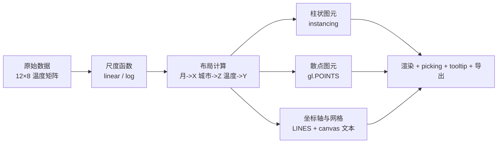
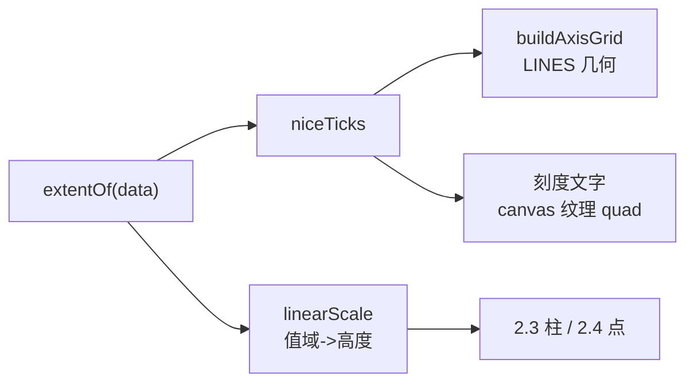

# 项目二：3D 数据可视化

> [返回：WebGL 与 3D 框架学习大纲](../WebGL与3D框架学习大纲.md)
> 本文是实战专题第 2 篇：用自研框架做一个"12 个月 × 8 城市温度矩阵"的 3D 柱状/散点混合可视化——数据空间到世界空间的尺度映射、instancing 柱阵与点精灵散点、GPU picking 悬浮拾取、从千级到十万级的数据量渲染选型。相机/几何/渲染循环全部复用主线成果，本文只写"可视化层"的新代码；项目骨架与通用约定见 [00-导览](00-导览.md)，示例 import 以 `minigl` 代称你的框架包。

数据可视化（data visualization）是 WebGL 最常见的严肃应用场景之一：柱状图（bar chart）画聚合对比，散点图（scatter plot）画分布与离群。3D 图表在"两个分类维度 + 一个数值维度"的数据上有天然优势——温度矩阵（月份 × 城市 × 温度）正好是这个形状。本项目的真正目标不是画得好看，而是打通**数据 → 尺度 → 几何 → 交互**这条链，并让它换一份数据源不用改代码（验收清单的工程组要求）。



## 2.1 需求与数据集

### 目标

先定数据再定功能：数据集内嵌生成函数，零外部素材、确定性可复现（回归对比截图时不漂）。功能上要求两种视图、悬浮读数、图例、入场动画、PNG 导出——每一项都对应下文一个具体小节。

### 数据集：12 个月 × 8 城市的温度矩阵

生成模型是"年均温基准 + 季节正弦 + 有界扰动"三段叠加。`base` 与 `swing`（季节振幅）按真实气候量级取值：哈尔滨冬夏悬殊（swing 大）、昆明四季如春（swing 小）——这样柱阵天然有"城市指纹"，一眼能读出故事。

```typescript
// data.ts —— 12 个月 × 8 城市的月均温矩阵（确定性生成，可复现）
export const MONTHS = ['1月', '2月', '3月', '4月', '5月', '6月',
                       '7月', '8月', '9月', '10月', '11月', '12月'];

interface CitySpec { name: string; base: number; swing: number; noise: number }

const CITIES: CitySpec[] = [
  { name: '哈尔滨',   base: 5,  swing: 20, noise: 1.5 },
  { name: '乌鲁木齐', base: 7,  swing: 17, noise: 1.5 },
  { name: '北京',     base: 13, swing: 15, noise: 1.2 },
  { name: '拉萨',     base: 9,  swing: 11, noise: 1.5 },
  { name: '成都',     base: 17, swing: 10, noise: 1.0 },
  { name: '上海',     base: 18, swing: 11, noise: 1.2 },
  { name: '广州',     base: 23, swing: 7,  noise: 1.0 },
  { name: '昆明',     base: 16, swing: 4,  noise: 1.0 },
];
export const CITY_NAMES = CITIES.map((c) => c.name);

/** mulberry32：种子里生出可复现的伪随机序列（Math.random 做不到"同种子同序列"） */
function mulberry32(seed: number): () => number {
  let a = seed >>> 0;
  return () => {
    a |= 0; a = (a + 0x6d2b79f5) | 0;
    let t = Math.imul(a ^ (a >>> 15), 1 | a);
    t = (t + Math.imul(t ^ (t >>> 7), 61 | t)) ^ t;
    return ((t ^ (t >>> 14)) >>> 0) / 4294967296;
  };
}

/** 返回 12×8 矩阵：行 = 月（0..11），列 = 城市（0..7），单位摄氏度 */
export function generateTemperatureMatrix(seed = 42): Float32Array {
  const rand = mulberry32(seed);
  const m = new Float32Array(12 * CITIES.length);
  for (let c = 0; c < CITIES.length; c++) {
    const { base, swing, noise } = CITIES[c];
    for (let mo = 0; mo < 12; mo++) {
      // 季节项：北半球 7 月最热。mo=6（7 月）取到正弦峰值，mo=0（1 月）取到谷值
      const seasonal = Math.sin(((mo - 3) / 12) * Math.PI * 2);
      m[mo * CITIES.length + c] = base + swing * seasonal + (rand() - 0.5) * 2 * noise;
    }
  }
  return m;
}

/** 值域：轴刻度与尺度函数的 domain 都从数据推导，换数据源不改代码的关键 */
export function extentOf(data: Float32Array): [number, number] {
  let min = Infinity, max = -Infinity;
  for (const v of data) { if (v < min) min = v; if (v > max) max = v; }
  return [min, max];
}
```

### 验收清单

按导览的 checklist 文化分三组，全勾才算完成：

**功能组**

- [ ] 柱状视图：96 根柱（12 月 × 8 城）按网格排布，高度编码温度；
- [ ] 散点视图：同一份数据以散点呈现，位置编码（月，城市，温度），大小与颜色冗余编码温度；
- [ ] 视图切换：两种视图同一数据源一键切换；
- [ ] hover：悬浮柱/点时显示 tooltip（城市、月份、温度数值），选中图元高亮；
- [ ] 图例：城市分类色 + 温度连续色带，与渲染同源；
- [ ] 入场动画：柱高度从 0 平滑生长（错峰），无卡顿无跳变；
- [ ] 导出 PNG：一键导出当前画布为图片。

**性能组**

- [ ] 桌面 60fps（性能埋点读数，帧率统计见 [03-引擎最小核心](../03-第三阶段/03-引擎最小核心.md) 2.1 的指数平滑写法）；
- [ ] drawcall 数符合预期：柱阵 1 次、散点 1 次、轴网格 1 次、文字与图例为 DOM/少量 quad（Spector 抓帧核对，链 [05-性能优化与调试](../05-第五阶段/07-性能优化与调试.md)）。

**工程组**

- [ ] 换数据源不改渲染代码：`extentOf` + 尺度函数吃任意矩阵；
- [ ] hover 高频路径无每帧 GC 分配（临时向量循环外常驻，同引擎核心 2.4 的纪律）；
- [ ] WebGL 不可用时页面给出错误提示，不白屏（导览通用约定）。

轨迹视图（某城市 12 个月连成折线带）不在本期验收内，放在 2.7 扩展挑战。

## 2.2 坐标系与尺度：数据空间到世界空间

### 目标

可视化的一切错位都从"数据单位"与"世界单位"的混淆开始。本节立一个中间层：**尺度函数（scale function）**——数据空间（data space，摄氏度、月份序号）进，世界空间（world space，引擎的单位）出。轴、网格、柱、点全部经过它，谁也不许直连。

### 归一化与对数尺度

线性尺度把 domain 区间仿射映射到 range 区间；对数尺度先取对数再做线性映射，专治长尾数据（人口、GDP、播放量）。注意对数尺度的 domain 必须 > 0，零值要钳到一个小正数。

```typescript
// scale.ts —— 数据空间 -> 世界空间
export type Scale = (v: number) => number;

/** 线性尺度：domain -> range 的仿射映射 */
export function linearScale(
  domain: readonly [number, number],
  range: readonly [number, number],
): Scale {
  const [d0, d1] = domain, [r0, r1] = range;
  const k = (r1 - r0) / (d1 - d0 || 1);      // 常数域防除零
  return (v) => r0 + (v - d0) * k;
}

/** 对数尺度：domain 必须 > 0；零/负值被钳到 1e-12（先与业务确认钳法） */
export function logScale(
  domain: readonly [number, number],
  range: readonly [number, number],
): Scale {
  const lg = (v: number) => Math.log10(Math.max(v, 1e-12));
  const inner = linearScale([lg(domain[0]), lg(domain[1])], range);
  return (v) => inner(lg(v));
}
```

温度是区间量（interval scale），用线性；对数尺度在这里给全是因为 2.7 的扩展挑战要换 GDP 数据源。

### 轴刻度生成："好看"的数字是有算法的

刻度不是把值域等分就完事——人只认 1/2/5 × 10^k 这类"整饬数"。经典算法（D3 的 `ticks` 同思路）：由目标刻度数估原始步长，把步长吸附到最近的整饬数，再从第一个不小于 min 的整饬倍数起枚举。

```typescript
// ticks.ts —— nice ticks：步长只取 1/2/5 × 10^k
export function niceTicks(min: number, max: number, target = 6): number[] {
  const rawStep = (max - min) / Math.max(1, target);
  const mag = Math.pow(10, Math.floor(Math.log10(rawStep)));  // 步长的数量级
  const norm = rawStep / mag;                                 // 归一化到 [1, 10)
  let nice: number;
  if (norm < 1.5)      nice = 1;    // 1.3 -> 1
  else if (norm < 3.5) nice = 2;    // 2.6 -> 2
  else if (norm < 7.5) nice = 5;    // 6.0 -> 5
  else                 nice = 10;   // 8.9 -> 10
  const step = nice * mag;
  const ticks: number[] = [];
  for (let t = Math.ceil(min / step) * step; t <= max + step * 1e-6; t += step) {
    ticks.push(Object.is(t, -0) ? 0 : t);     // 洗掉 -0，否则标签显示"-0"
  }
  return ticks;
}
```

温度域约 [-25, 43]，`niceTicks(-25, 43, 6)`：rawStep ≈ 11.3 → 吸附到 10 → 刻度 -20, -10, 0, 10, 20, 30, 40——比等分的 -25, -13.3, -1.7 可读得多。

### 坐标轴与网格的绘制

轴与网格用**线段几何（line segment geometry）**一次画完：每段线两个顶点，颜色塞进每顶点属性，一个 VAO、一次 `drawArrays(gl.LINES)`。不逐线 drawcall——那是把 2.6 的性能教训提前犯错。

```typescript
// axisGrid.ts —— 坐标轴 + 网格：一个 buffer，一次 LINES
export function buildAxisGrid(
  width: number, depth: number, yMax: number,   // 图幅与最大柱高（世界单位）
  xTicks: number[], zTicks: number[], yTicks: number[],
): { positions: Float32Array; colors: Float32Array; count: number } {
  const pos: number[] = [], col: number[] = [];
  const line = (a: number[], b: number[], rgb: number[]) => {
    pos.push(...a, ...b);
    for (let i = 0; i < 2; i++) col.push(...rgb);
  };
  const hx = width / 2, hz = depth / 2;
  const GRID = [0.30, 0.34, 0.40], AXIS = [0.85, 0.87, 0.92];
  for (const t of xTicks) line([t, 0, -hz], [t, 0, hz], GRID);   // 底面纵向网格
  for (const t of zTicks) line([-hx, 0, t], [hx, 0, t], GRID);   // 底面横向网格
  line([-hx, 0, -hz], [hx, 0, -hz], AXIS);                       // X 轴
  line([-hx, 0, -hz], [-hx, 0, hz], AXIS);                       // Z 轴
  line([-hx, 0, -hz], [-hx, yMax, -hz], AXIS);                   // Y 轴
  for (const t of yTicks) line([-hx, t, -hz], [-hx, t, -hz + 0.05], AXIS);
  return {
    positions: new Float32Array(pos),
    colors: new Float32Array(col),
    count: pos.length / 3,
  };
}
```

线宽注意：`gl.lineWidth` 大于 1 在多数实现里无效（WebGL 规范只保证 1），要粗线得用三角形条带拼——本项目 1px 线够用，不做。

刻度文字走 [技术专题/02-文本与2D渲染](../技术专题/02-文本与2D渲染.md) 2.2 的 canvas 纹理路线：`createTextTexture` 原样复用，每刻度一个小面片（30 个以内，不必上图集）；dpr 放大栅格化与 NPOT 过滤纪律都在那篇的常见坑里。**图例（legend）反而是 DOM**：城市名 + 色块是纯 UI、数量固定、不需要被场景遮挡——正落在技术专题 2.1 的 DOM overlay 适用边界内。温度色带图例复用 2.4 的 colormap canvas（`toDataURL` 直接当 ``），渲染与图例天然同源。



**本步产物**：空场景里出现轴、网格、刻度数字，鼠标可环绕查看（OrbitControls 来自 examples 公共层，见导览通用约定 2）。

## 2.3 柱状图实现：instancing 复用与高度动画

### 目标

96 根柱，一个 drawcall。思路与 [05-粒子系统与Instancing实战](../05-第五阶段/05-粒子系统与Instancing实战.md) 4.2 完全同构：**几何只有一份单位盒**（引擎核心 2.3 的 `createBox`），"一个数据格一个实例"，每实例的网格坐标与数值走 divisor=1 的 instanced attribute。

### 布局与实例数据

X 轴放月份、Z 轴放城市、Y 轴放温度。三个尺度函数：月份序号 0..11 → X 均匀铺开；城市序号 0..7 → Z 均匀铺开；温度域 → [0.05, H]（H 取 2.4 个世界单位，域内最小值也留一点可见高度）。

```typescript
// bars.ts —— 96 根柱的实例数据（一列数据一个实例 attribute）
export function createBarInstances(
  matrix: Float32Array,                 // 12×8
  xScale: Scale, zScale: Scale, vScale: Scale,
): { offsets: Float32Array; values: Float32Array; count: number } {
  const months = 12, cities = matrix.length / months;
  const offsets = new Float32Array(months * cities * 2);   // 每实例 vec2
  const values = new Float32Array(months * cities);        // 每实例 float
  let i = 0;
  for (let mo = 0; mo < months; mo++) {
    for (let c = 0; c < cities; c++, i++) {
      offsets[i * 2]     = xScale(mo);
      offsets[i * 2 + 1] = zScale(c);
      values[i]          = vScale(matrix[mo * cities + c]);
    }
  }
  return { offsets, values, count: i };
}
```

VAO 组装与五阶段 4.2 的 `bindAttributeInstanced` 一样：location 0..2 是单位盒的引擎约定位置，location 3 起（aOffset、aValue、aColor）每实例一份，`vertexAttribDivisor(loc, 1)` 必须在该 VAO 绑定期间设置（ divisor 是 VAO 状态，五阶段常见坑第 1 条）。

### 高度动画：缓动在着色器里做

入场动画（柱从 0 长到目标高度）不逐柱更新 buffer——把时间传进去，**缓动与错峰全部在顶点着色器完成**，CPU 每帧只改一个 uniform。这是"动画在着色器"范式的第二次复用（第一次是五阶段 4.3 的无状态粒子）。

```glsl
// bar.vert —— 高度 = 值 × 缓动(时间 - 错峰延迟)
#version 300 es
layout(location = 0) in vec3 aPosition;   // 单位盒 [-0.5, 0.5]^3
layout(location = 1) in vec3 aNormal;
layout(location = 3) in vec2 aOffset;     // 每实例：柱脚 XZ
layout(location = 4) in float aHeight;    // 每实例：目标高度（世界单位）
layout(location = 5) in vec3 aColor;      // 每实例：城市分类色

uniform mat4 uView, uProjection;
uniform float uTime, uDuration, uStagger, uBarWidth;
uniform int uHoverId;                     // 2.5 的 hover 高亮，-1 = 无

out vec3 vNormal;
out vec3 vColor;
out float vHover;

float easeOutCubic(float t) { float f = 1.0 - t; return 1.0 - f * f * f; }

void main() {
  // 错峰：第 i 根柱在 i*uStagger 秒后开始生长
  float t = clamp((uTime - float(gl_InstanceID) * uStagger) / uDuration, 0.0, 1.0);
  float h = max(aHeight * easeOutCubic(t), 1e-4);        // 防零高度退化成平面
  // 单位盒底面落到 y=0：aPosition.y ∈ [-0.5,0.5] -> [0,1] 再乘高度
  vec3 local = vec3(aPosition.x * uBarWidth, aPosition.y + 0.5, aPosition.z * uBarWidth);
  local.y *= h;
  vec3 world = local + vec3(aOffset.x, 0.0, aOffset.y);
  // 盒子法线是轴对齐的：对角缩放不改变轴向法线方向，归一化即可（省掉 normal matrix）
  vNormal = aNormal;
  vColor = aColor;
  vHover = (gl_InstanceID == uHoverId) ? 1.0 : 0.0;
  gl_Position = uProjection * uView * vec4(world, 1.0);
}
```

```glsl
// bar.frag —— 平面光照 + hover 高亮（着色越朴素，数据越醒目）
#version 300 es
precision mediump float;
in vec3 vNormal; in vec3 vColor; in float vHover;
out vec4 fragColor;
void main() {
  float ndl = max(dot(normalize(vNormal), normalize(vec3(0.4, 0.8, 0.45))), 0.0);
  vec3 color = vColor * (0.35 + 0.65 * ndl);
  fragColor = vec4(mix(color, vec3(1.0, 0.85, 0.3), vHover), 1.0);
}
```

绘制一次 `gl.drawElementsInstanced(gl.TRIANGLES, 36, gl.UNSIGNED_SHORT, 0, instanceCount)`。深度测试开、柱是不透明物体先画；散点是透明物体后画（渲染队列纪律，[02-渲染状态与测试](../02-第二阶段/04-渲染状态与测试.md) 3.2）。

### 缓动函数速查表

| 缓动 | 公式（t ∈ [0,1]） | 曲线特征 | 适用场景 |
|---|---|---|---|
| linear | t | 匀速直线 | 进度条、与数据同步的滚动 |
| easeOutQuad | 1 − (1−t)² | 快出缓收 | 通用位移 |
| easeOutCubic | 1 − (1−t)³ | 更快出、长尾收 | 数据入场默认款 |
| easeOutQuart | 1 − (1−t)⁴ | 极快出、几乎瞬间到位 | 大量元素同场入场（整体干脆） |
| easeInOutCubic | 4t³（前半）/ 1 − (−2t+2)³/2（后半） | 对称 S 形 | 相机与视角过渡（引擎核心 2.2 的阻尼是它的指数亲戚） |
| easeOutBack | 1 + c₃(t−1)³ + c₁(t−1)² | 过冲后回弹 | 选中反馈、弹出面板 |
| easeOutElastic | 2^(−10t)·sin((10t−0.75)·2π/3) + 1 | 多次震荡衰减 | 游戏化动效 |

GLSL 版（其余按表替换）：

```glsl
float easeOutCubic(float t) { float f = 1.0 - t; return 1.0 - f * f * f; }
float easeOutBack(float t) {
  const float c1 = 1.70158, c3 = c1 + 1.0;
  float u = t - 1.0;
  return 1.0 + c3 * u * u * u + c1 * u * u;
}
```

**数据诚实性（data honesty）是选型红线**：easeOutCubic 单调不减，柱高任何时刻不超过目标值；easeOutBack 与 elastic 会瞬间"长过头"再回落——数值被视觉夸大，在图表里等于画错数据。过冲类只用于 UI 反馈，不用于数值编码。更系统的动画组织（时间轴、混合）见 [04-动画系统](../04-第四阶段/06-动画系统.md) 5.1 的轨道采样。

**本步产物**：柱阵错峰生长入场，OrbitControls 环视，帧率 60。

## 2.4 散点图实现：大小编码与颜色映射

### 目标

同一份矩阵换一种编码：位置（月，城市，温度）→（X, Z, Y），大小与颜色再冗余编码温度——冗余编码（redundant encoding）让单一通道（色觉障碍、灰度打印）失效时信息仍在。

### 点大小编码：像素到世界尺寸的换算推导

目标是"值 v 编码为**参考深度处直径 px 像素**的点"。推导三步：

1. 透视相机在视深 d 处的视锥半高是 `h = d · tan(fovY/2)`（fovY 纵向视场角，引擎核心 2.2 的参数表）；
2. 画布高 H 像素对应世界高 `2h`，于是直径 px 像素对应世界尺寸：

```text
s_world = px · 2 · d · tan(fovY / 2) / H
```

3. 渲染时顶点着色器反算 `gl_PointSize = s_world · H / (2 · w · tan(fovY/2))`，其中 `gl_Position.w` 恰是视深 d（[数学专题/02](../数学专题/02-仿射几何与齐次坐标.md)）——代入后两项相消，得到**补偿公式**：

```text
gl_PointSize = px · d_ref / gl_Position.w
```

含义：在参考深度 `d_ref`（取数据域中心到相机的距离）处点直径恰为 px，近处自动放大、远处自动缩小，透视一致性免费获得。技术专题/02 2.6 的 `aSize * uProjScale / w` 是同一公式的正向用法，这里反过来"先定像素、再换算世界"。

```glsl
// scatter.vert —— 点精灵：位置 + 大小编码 + 入场
#version 300 es
layout(location = 0) in vec3 aPosition;   // (月->X, 温度->Y, 城市->Z)
layout(location = 1) in float aValue01;   // 归一化温度 [0,1]

uniform mat4 uView, uProjection;
uniform float uSizeMin, uSizeMax;         // 参考深度处的像素直径范围
uniform float uRefDepth;
uniform float uProgress;

out float vValue;

float easeOutCubic(float t) { float f = 1.0 - t; return 1.0 - f * f * f; }

void main() {
  vValue = aValue01;
  gl_Position = uProjection * uView * vec4(aPosition, 1.0);
  float px = mix(uSizeMin, uSizeMax, aValue01) * easeOutCubic(uProgress);
  gl_PointSize = px * uRefDepth / gl_Position.w;   // 2.4 推导的补偿公式
}
```

```glsl
// scatter.frag —— 圆形软点 + colormap
#version 300 es
precision mediump float;
in float vValue;
uniform sampler2D uColormap;
out vec4 fragColor;
void main() {
  vec2 c = gl_PointCoord * 2.0 - 1.0;
  float r = length(c);
  if (r > 1.0) discard;                        // 方点裁圆
  vec3 color = texture(uColormap, vec2(vValue, 0.5)).rgb;
  fragColor = vec4(color, smoothstep(1.0, 0.7, r));   // 边缘软化抗锯齿
}
```

点精灵两条规范级限制照旧：`ALIASED_POINT_SIZE_RANGE` 上限要查询（个别实现只有 64 甚至 1）、点中心出视口整点消失——本项目点径 ≤ 20px 且不贴边，安全；超限场景换 instancing quad（五阶段 4.2），技术专题/02 2.6 末尾有完整论证。混合状态：`SRC_ALPHA, ONE_MINUS_SRC_ALPHA` + `depthMask(false)`，透明纪律。

### 颜色映射 colorMap：解析近似与 LUT 纹理两条路

连续数值 → 颜色用顺序色带（sequential colormap），首推 viridis（感知均匀、色觉障碍友好、灰度可辨）。两种实现：

**路线一：GLSL 多项式近似**。viridis 每个通道可用六阶多项式拟合（Matt Zucker 公开的拟合系数），零纹理、一次求值：

```glsl
// viridis(t)：六阶多项式拟合，t ∈ [0,1]，最大误差约 0.03（肉眼难辨）
vec3 viridis(float t) {
  t = clamp(t, 0.0, 1.0);
  const vec3 c0 = vec3( 0.277727, 0.005407,  0.334099);
  const vec3 c1 = vec3( 0.105093, 1.404613,  1.384590);
  const vec3 c2 = vec3(-0.330861, 0.214847,  0.095095);
  const vec3 c3 = vec3(-4.634230, -5.799100,-19.332400);
  const vec3 c4 = vec3( 6.228260,14.179900, 56.690500);
  const vec3 c5 = vec3( 4.776384,-13.745100, 65.353100);
  const vec3 c6 = vec3(-5.435450, 4.645850,-26.279900);
  return c0 + t * (c1 + t * (c2 + t * (c3 + t * (c4 + t * (c5 + t * c6)))));
}
```

**路线二：LUT 纹理（look-up table）**。canvas 画 256×1 渐变条上传为纹理，着色器一次采样；换色带只换 canvas，锚点颜色精确：

```typescript
// colormap.ts —— LUT 纹理法（图例色带与渲染同源）
const VIRIDIS_STOPS: Array<[number, string]> = [
  [0.00, '#440154'], [0.25, '#3b528b'], [0.50, '#21918c'],
  [0.75, '#5ec962'], [1.00, '#fde725'],
];

export function createColormapTexture(
  gl: WebGL2RenderingContext, stops = VIRIDIS_STOPS,
): { texture: WebGLTexture; canvas: HTMLCanvasElement } {
  const canvas = document.createElement('canvas');
  canvas.width = 256; canvas.height = 1;
  const ctx = canvas.getContext('2d')!;
  const grad = ctx.createLinearGradient(0, 0, 256, 0);
  for (const [pos, color] of stops) grad.addColorStop(pos, color);
  ctx.fillStyle = grad;
  ctx.fillRect(0, 0, 256, 1);

  const texture = gl.createTexture()!;
  gl.bindTexture(gl.TEXTURE_2D, texture);
  gl.pixelStorei(gl.UNPACK_FLIP_Y_WEBGL, 0);
  gl.texImage2D(gl.TEXTURE_2D, 0, gl.RGBA, gl.RGBA, gl.UNSIGNED_BYTE, canvas);
  // 1D 用途：LINEAR + CLAMP 恰好是分段线性插值
  gl.texParameteri(gl.TEXTURE_2D, gl.TEXTURE_MIN_FILTER, gl.LINEAR);
  gl.texParameteri(gl.TEXTURE_2D, gl.TEXTURE_MAG_FILTER, gl.LINEAR);
  gl.texParameteri(gl.TEXTURE_2D, gl.TEXTURE_WRAP_S, gl.CLAMP_TO_EDGE);
  gl.texParameteri(gl.TEXTURE_2D, gl.TEXTURE_WRAP_T, gl.CLAMP_TO_EDGE);
  return { texture, canvas };   // canvas.toDataURL() 直接做图例 
}
```

| 维度 | 多项式近似 | LUT 纹理 |
|---|---|---|
| 着色器成本 | 十几次乘加 | 一次采样 |
| 换色带 | 重拟合系数（离线） | 换一张 canvas |
| 颜色精度 | 拟合误差 ~3% | 锚点精确 |
| 依赖 | 无 | 一个纹理单元 |

色彩空间提醒：色带十六进制是 sRGB 值，本项目不做光照合成、直接输出到画布，无需转换；一旦色带参与 HDR 光照管线，就要过 [数学专题/08-色彩数学](../数学专题/08-色彩数学.md) 的线性化。

**本步产物**：散点视图完成，点径随温度变化、颜色随温度渐变，可与柱状视图切换。

## 2.5 交互：GPU picking 拾取与 tooltip 跟随

### 目标

96 个图元、且散点是 `gl.POINTS`（无独立包围体），逐物体 CPU 射线求交（[04-交互系统](../04-第四阶段/05-交互系统.md) 4.1~4.3）不划算——这正是 **GPU picking** 的教科书场景：把"哪个像素属于谁"这个本来就在光栅化里算过的问题，还给 GPU 答。

### 方案：ID 编码进颜色，渲到 FBO，readPixels 一个像素

流程：额外一个低成本的 picking pass——同一几何、换成"输出实例 ID 颜色"的着色器，渲进离屏 FBO（[02-帧缓冲与离屏渲染](../02-第二阶段/06-帧缓冲与离屏渲染.md) 5.2 的 createFBO 复用）；鼠标移动时读回指针处 1 像素，解码出 ID。

```glsl
// pick-bar.frag —— ID 编码：id = gl_InstanceID + 1 拆进 RGB 三通道（24 位够用）
// 顶点着色器与 bar.vert 的位置计算完全一致（拾取几何必须与显示几何同源），
// 仅把 aColor 换成 vIdColor 输出：
//   int id = gl_InstanceID + 1;                     // 0 留给"背景"
//   vIdColor = vec3( float(id & 255)        / 255.0,
//                    float((id >> 8) & 255) / 255.0,
//                    float((id >> 16) & 255)/ 255.0 );
#version 300 es
precision mediump float;
in vec3 vIdColor;
out vec4 fragColor;
void main() { fragColor = vec4(vIdColor, 1.0); }
```

散点同理，`id` 换成 `gl_VertexID + 1`。背景清成 (0,0,0)，ID 从 1 编起，读回 0 即"没点到东西"。

```typescript
// picking.ts —— 1 像素读回（只在 pointermove 触发的帧调用，不进每帧热路径）
export class GpuPicker {
  private tex: WebGLTexture;
  private fbo: WebGLFramebuffer;
  constructor(
    private gl: WebGL2RenderingContext,
    public width: number, public height: number,   // 尺寸 = 绘图缓冲（物理像素）
  ) {
    const gl = this.gl;
    this.tex = gl.createTexture()!;
    gl.bindTexture(gl.TEXTURE_2D, this.tex);
    gl.texImage2D(gl.TEXTURE_2D, 0, gl.RGBA8, width, height, 0, gl.RGBA, gl.UNSIGNED_BYTE, null);
    gl.texParameteri(gl.TEXTURE_2D, gl.TEXTURE_MIN_FILTER, gl.NEAREST);
    gl.texParameteri(gl.TEXTURE_2D, gl.TEXTURE_MAG_FILTER, gl.NEAREST);
    this.fbo = gl.createFramebuffer()!;
    gl.bindFramebuffer(gl.FRAMEBUFFER, this.fbo);
    gl.framebufferTexture2D(gl.FRAMEBUFFER, gl.COLOR_ATTACHMENT0, gl.TEXTURE_2D, this.tex, 0);
    gl.bindFramebuffer(gl.FRAMEBUFFER, null);
  }

  /** 渲 pick pass 并读回 (x, y) 处 ID；坐标须为物理像素 */
  pick(x: number, y: number, drawPickPass: () => void): number {
    const gl = this.gl;
    gl.bindFramebuffer(gl.FRAMEBUFFER, this.fbo);
    gl.viewport(0, 0, this.width, this.height);
    gl.clearColor(0, 0, 0, 1);
    gl.clear(gl.COLOR_BUFFER_BIT);
    drawPickPass();
    const px = new Uint8Array(4);
    // Y 翻转：readPixels 原点在左下，鼠标事件坐标原点在左上
    gl.readPixels(x, this.height - 1 - y, 1, 1, gl.RGBA, gl.UNSIGNED_BYTE, px);
    gl.bindFramebuffer(gl.FRAMEBUFFER, null);
    const id = px[0] + px[1] * 256 + px[2] * 65536;
    return id - 1;   // -1 = 背景
  }
}
```

三个工程纪律：pick pass 前显式 `gl.disable(gl.BLEND)` 与 `gl.disable(gl.DITHER)`——混合会把 ID 平均出不存在的结果，抖动会扰动 8bit 精确色；`readPixels` 是 GPU→CPU 同步停顿（[技术专题/03-GPGPU与计算](../技术专题/03-GPGPU与计算.md) 3.6 的性能悬崖），只在鼠标移动的那一帧做；指针坐标是 CSS 像素，乘 `devicePixelRatio` 换物理像素再拾取（四阶段 05 4.1 的同款坑）。

### GPU picking 与 raycast 的成本/精度对比

| 维度 | GPU picking | CPU raycast（[04-交互系统](../04-第四阶段/05-交互系统.md)） |
|---|---|---|
| 每次成本 | 一次离屏 drawcall + 1px readPixels（毫秒级同步停顿） | 包围体粗测 + 三角形精测，O(图元数) |
| 精度 | 像素级，所见即所得（与深度测试一致） | 数学精确，附赠交点、法线、距离 |
| 重叠/遮挡 | 深度测试天然裁决 | 需自己取最近命中 |
| 透明物体 | 需要单独约定（透明层各自渲一遍） | 按 alpha 阈值自行处理 |
| instancing/点精灵 | 天然支持（gl_InstanceID/gl_VertexID 就是 ID） | 无独立包围体，基本不可用 |
| 依赖 | FBO + 第二套着色器 | 纯 CPU，可脱离渲染测试 |
| 适用 | 海量实例、点云、图表 | 少量 Mesh、需要交点做后续交互 |

### tooltip 跟随：3D 到 2D 的投影换算

tooltip 不跟鼠标跟数据点（更稳、不抖）。每帧把命中图元的世界坐标投影到屏幕：`clip = P·V·(world, 1)`，齐次除法 `ndc = clip.xyz / clip.w`，视口映射回 CSS 像素：

```typescript
// tooltip.ts —— 世界 -> 屏幕（CSS 像素），柱的锚点取柱顶中心 (x, h, z)
export function worldToScreen(
  world: Vec3, view: Mat4, proj: Mat4, cssW: number, cssH: number,
): { x: number; y: number; behind: boolean } {
  const clip = proj.multiply(view).transformPoint(world);   // minmath 列主序
  const behind = clip.w <= 1e-6;                            // 在相机背后
  const ndcX = clip.x / clip.w, ndcY = clip.y / clip.w;
  return {
    x: (ndcX * 0.5 + 0.5) * cssW,
    y: (0.5 - ndcY * 0.5) * cssH,    // NDC y 向上、屏幕 y 向下
    behind,
  };
}
```

DOM tooltip 绝对定位到 `(x, y)` 偏移十几像素，内容 `城市 · 月份 · 23.4°C`。面板是少量纯 UI，DOM 合理（技术专题/02 2.1 的边界）。

### 导出 PNG

不开 `preserveDrawingBuffer`（它让每帧合成变贵），用"**渲染后立即取**"：浏览器只在合成后清空绘图缓冲，同一任务里先手动渲一帧再调 `toBlob`，快照在调用瞬间同步完成：

```typescript
function exportPNG(renderFrame: () => void): void {
  renderFrame();                          // 保证 backbuffer 是完整最新帧
  const canvas = document.querySelector('canvas')!;
  canvas.toBlob((blob) => {
    if (!blob) return;
    const a = document.createElement('a');
    a.href = URL.createObjectURL(blob);
    a.download = 'temperature-3d.png';
    a.click();
    URL.revokeObjectURL(a.href);
  }, 'image/png');
}
```

导出尺寸即绘图缓冲（物理像素），天然高清；若要指定尺寸，渲进离屏 FBO 再读回拼装。

**本步产物**：hover 出 tooltip 与高亮、点击导出 PNG——功能组验收全勾。

## 2.6 性能与大数据：千级、万级、十万级

### 目标

96 个数据点怎么写都够快，本项目真正练的是**选型肌肉**：同一套可视化代码，数据从 12×8 换成 1 百万行时哪层必须换。决策表：

| 数据规模 | 推荐方案 | drawcall | 每帧上传 | 关键约束 |
|---|---|---|---|---|
| ≤ 500 | 每图元一个 Mesh（引擎核心 2.4 的 Mesh/renderMesh） | n | 0 | 代码最直白；状态切换千级才成瓶颈 |
| 500 ~ 5 万 | instancing（本文 2.3） | 1 | 0（动画在着色器） | 换数据用 bufferSubData |
| 1 万 ~ 50 万 | gl.POINTS 点精灵（本文 2.4） | 1 | O(变化数) | 点径上限与中心裁剪（技术专题/02 2.6） |
| > 10 万且逐帧物理 | GPGPU 状态纹理 + texelFetch 渲染（技术专题/03 3.2/3.3） | 2~3 | O(1) | 调试成本高，先确认真需要 |

分界线不是教条，是两个机制的成本：drawcall 的 CPU 侧驱动开销在几千次就吃满帧预算（五阶段 4.5 的成本模型），所以"每图元一次绘制"最先出局；CPU 逐点更新的 JS 循环在 5 万级掉帧（五阶段 4.1），所以更新要么进着色器、要么进状态纹理。

### 数据更新：bufferSubData 局部更新

动态数据（每秒刷新的温度流、播放量）不该整块重传。关键在**布局先行**：把"同批更新的点"排进相邻内存，更新就是一次连续区段上传：

```typescript
// 散点按"月"分行存储：更新某个月的一行 = 一次连续 bufferSubData
const FLOATS_PER_POINT = 4;                     // x, y, z, value01

function updateMonthRow(
  gl: WebGL2RenderingContext, vbo: WebGLBuffer,
  month: number, rowData: Float32Array,
): void {
  gl.bindBuffer(gl.ARRAY_BUFFER, vbo);
  gl.bufferSubData(
    gl.ARRAY_BUFFER,
    month * rowData.length * 4,                 // byteOffset = 行号 × 行字节长
    rowData,                                    // 只传这一行的 FLOATS_PER_POINT×8 个 float
  );
}

// 建缓冲时给出动态用途提示，驱动好安排显存位置：
// gl.bufferData(gl.ARRAY_BUFFER, totalBytes, gl.DYNAMIC_DRAW);
```

若更新模式是"窗口滑动"（新增一行、挤掉最旧一行），`TypedArray.copyWithin` 先在 CPU 侧平移，再 `bufferSubData` 只写尾部新行——比整块上传少一个数量级带宽。散点与柱两套图元的 buffer 布局不同（点按行、柱按格），**没有一种布局对所有更新模式都最优，布局跟着数据更新节奏走**。

**本步产物**：一个"数据量"滑块把矩阵从 96 点复制成 10 万点（同分布采样），帧率不塌——验证选型表第三行。

## 2.7 扩展挑战与踩坑表

### 扩展挑战（按难度递进）

1. **轨迹视图**：某城市 12 个月连成折线带（导览产出物里的第三类图元）——`gl.LINE_STRIP` + 端点圆帽，或用 [数学专题/04-曲线与样条](../数学专题/04-曲线与样条.md) 的 Catmull-Rom 把月度点平滑成曲线；
2. **对数尺度切换**：换 GDP 数据源，尺度切 log。动画正确姿势是"插值两个尺度函数的**输出**"（`mix(scaleA(v), scaleB(v), t)`），不是插值 domain 参数——后者在中途会输出无意义的尺度；轴刻度与网格随 t 重生成；
3. **选中描边**：stencil 两遍放大描边（[02-渲染状态与测试](../02-第二阶段/04-渲染状态与测试.md) 3.3 的模板技巧），或后处理法线/ID 边缘检测（[05-后处理管线](../05-第五阶段/03-后处理管线.md)）；
4. **曲面视图**：12×8 矩阵双线性插值到细分 plane（引擎核心 2.3 的 `createPlane`），顶点高度 = 插值温度，法线用邻格差分；
5. **十万级流式更新**：温度场每帧全量演化，上 GPGPU 状态纹理（技术专题/03 3.3 的湍流场换成你的热扩散）。

### 踩坑表

| 症状 | 原因 | 修法 |
|---|---|---|
| 拾取位置整体偏半屏 | readPixels 的 Y 轴没翻转 | `y' = height - 1 - y`（原点左下 vs 左上） |
| 高 DPI 屏拾取错位 | 鼠标是 CSS 像素、FBO 是物理像素 | 坐标乘 `devicePixelRatio` 再拾取 |
| 偶尔拾取到随机 ID | pick pass 沿用了主 pass 的 BLEND/DITHER | pick 前显式 disable 两个状态 |
| 柱半透明闪烁错乱 | 透明散点与不透明柱同 pass 画 | 不透明先画、透明后画 + `depthMask(false)` |
| 点忽大忽小或整片消失 | `gl_PointSize` 超设备上限 | 查询 `ALIASED_POINT_SIZE_RANGE` 并 clamp |
| 严冬的柱子穿到地底下 | 尺度域没含负数、负高度直接乘 | domain 用 `extentOf` 全域，映射到 [ε, H] |
| 轴刻度文字糊 | 文本纹理没按 dpr 放大栅格化 | 技术专题/02 2.2 的 dpr 做法 |
| 导出 PNG 全黑 | `toBlob` 在浏览器合成之后才调 | 渲一帧后同一任务内立即调用（2.5） |
| 动画速度随刷新率漂移 | 每帧固定步进推进 t | t 由 elapsed 归一化，缓动吃 [0,1]（引擎核心 2.1） |
| 所有柱叠在一个格子 | divisor 没设或设到了别的 VAO | 绑定该 VAO 时 `vertexAttribDivisor(loc, 1)` |

## 本节自测

1. `linearScale` 与 `logScale` 各适合什么类型的数据？温度为什么必须线性？对数尺度下零值怎么处理、为什么要和业务确认？
2. 手算 `niceTicks(-25, 43, 6)`：rawStep、吸附后的 step、最终刻度数组各是什么？target 改成 3 呢？
3. 推导 2.4 的补偿公式 `gl_PointSize = px · d_ref / w`，说明 px、d_ref、w 各自的含义，以及为什么消掉了 `tan(fovY/2)` 与画布高度。
4. GPU picking 与 CPU raycast 的成本结构差异是什么？哪三类场景几乎只能用 GPU picking？
5. 柱高入场动画为什么选 easeOutCubic 而不选 easeOutBack？从数据诚实性角度给出原则性回答，并说明该原则对 UI 反馈动效是否同样适用。
6. 数据从 96 点涨到 10 万点，渲染与更新路径各要换哪几层（对照 2.6 决策表）？`bufferSubData` 局部更新为什么要求"布局先行"？
