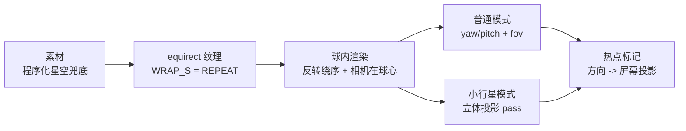

# 项目三：全景查看器

> [返回：WebGL 与 3D 框架学习大纲](../WebGL与3D框架学习大纲.md)
> 本文是实战专题第 3 篇：做一个 360° 全景图查看器——反转法线的球内 equirect 渲染、yaw/pitch 视角控制与 fov 变焦、立体投影的小行星模式、方向热点标记，以及视频全景的扩展思路。全景渲染与 [05-雾效与天空盒](../05-第五阶段/06-雾效与天空盒.md) 的天空盒是同一件事的两种拍法，本文大量复用那里的结论；项目骨架与通用约定见 [00-导览](00-导览.md)，import 以 `minigl` 代称你的框架包。

全景（panorama）= 把相机固定在一点、向所有方向拍下的图像。查看器做的是它的逆过程：**把相机放回拍摄点，让用户环视**。手机相机的"全景模式"、街景、房产看房都是这个模型。技术上有两条主线：equirect（等距圆柱贴图，一张 2:1 的图贴在球内）与 cubemap（六面盒，[05-雾效与天空盒](../05-第五阶段/06-雾效与天空盒.md) 5.2 的主角）——本项目以 equirect 为主线实现（一张纹理、零转换成本），cubemap 作为对比与升级路线。



## 3.1 需求与素材

### 目标

零外部素材可跑：没有全景图时程序化生成一张星空全景兜底；有真图（手机全景、街景导出、HDRI 站的 2:1 图）直接换 URL。功能覆盖环视、变焦、小行星切换、热点标记；陀螺仪作为可选增强。

### equirect 素材：程序化星空兜底

equirectangular（等距圆柱投影）把经度映射到横轴（0 ~ 2π）、纬度映射到纵轴（-π/2 ~ π/2），宽高比恒为 2:1。生成器三件事：天空底色渐变、银河亮带、均匀分布的星。**星星要用均匀球面采样**（`asin(2u-1)` 取纬度）而不是均匀画布采样——画布均匀采样在极区行会过密，贴到球上北极星比赤道星稠好几倍。

```typescript
// starfield.ts —— 程序化星空全景（2048×1024，一次性生成）
export function createStarfieldPanorama(width = 2048): HTMLCanvasElement {
  const height = width / 2;
  const canvas = document.createElement('canvas');
  canvas.width = width; canvas.height = height;
  const ctx = canvas.getContext('2d')!;

  // 1) 底色：天顶深蓝 -> 地平线微亮 -> 地面近黑
  const sky = ctx.createLinearGradient(0, 0, 0, height);
  sky.addColorStop(0.00, '#050510');
  sky.addColorStop(0.42, '#0a0f2a');
  sky.addColorStop(0.50, '#1a2340');
  sky.addColorStop(0.56, '#050508');
  sky.addColorStop(1.00, '#020204');
  ctx.fillStyle = sky;
  ctx.fillRect(0, 0, width, height);

  // 2) 银河带：中心线沿正弦起伏（周期 = 画布宽，经度接缝天然连续）
  const bandH = height * 0.09, amp = height * 0.10;
  for (let x = 0; x < width; x += 4) {
    const cy = height * 0.40 + Math.sin((x / width) * Math.PI * 2) * amp;
    const g = ctx.createLinearGradient(0, cy - bandH, 0, cy + bandH);
    g.addColorStop(0.0, 'rgba(140,160,255,0)');
    g.addColorStop(0.5, 'rgba(170,190,255,0.18)');
    g.addColorStop(1.0, 'rgba(140,160,255,0)');
    ctx.fillStyle = g;
    ctx.fillRect(x, cy - bandH, 4, bandH * 2);
  }

  // 3) 星：均匀球面采样（v = sin(纬度) 均匀取，不是画布 y 均匀取）
  for (let i = 0; i < 2400; i++) {
    const phi = Math.asin(Math.random() * 2 - 1);       // 纬度
    const theta = Math.random() * Math.PI * 2;          // 经度
    const x = (theta / (Math.PI * 2)) * width;
    const y = (0.5 - phi / Math.PI) * height;
    const mag = Math.pow(Math.random(), 2.5);           // 暗星多亮星少
    const r = 0.4 + mag * 1.4;
    ctx.fillStyle = `rgba(255,255,240,${0.35 + mag * 0.65})`;
    ctx.beginPath();
    ctx.arc(x, y, r, 0, Math.PI * 2);
    ctx.fill();
    if (x > width - 4) {                                 // 跨缝的星补画一份
      ctx.beginPath(); ctx.arc(x - width, y, r, 0, Math.PI * 2); ctx.fill();
    }
  }
  return canvas;
}
```

纹理上传有一个与引擎核心球体**相反**的翻转约定，是本项目的第一个坑位：本项目片元着色器的 v 公式以 v=0 为天顶（3.2 推导），而 canvas 首行数据恰好是图像顶部——所以**不设** `UNPACK_FLIP_Y`（保持默认 0）。引擎核心 2.3 的球体贴图是"v=1 北极 + FLIP_Y=1"的配套约定，两套不能混抄。

```typescript
// 纹理设置：POT 尺寸可开 mipmap；经度方向 REPEAT 让接缝采样无缝
const texture = gl.createTexture()!;
gl.bindTexture(gl.TEXTURE_2D, texture);
gl.pixelStorei(gl.UNPACK_FLIP_Y_WEBGL, 0);          // 见上：与引擎球体约定相反
gl.texImage2D(gl.TEXTURE_2D, 0, gl.RGBA, gl.RGBA, gl.UNSIGNED_BYTE,
             createStarfieldPanorama());
gl.generateMipmap(gl.TEXTURE_2D);
gl.texParameteri(gl.TEXTURE_2D, gl.TEXTURE_WRAP_S, gl.REPEAT);        // 经度环绕
gl.texParameteri(gl.TEXTURE_2D, gl.TEXTURE_WRAP_T, gl.CLAMP_TO_EDGE); // 纬度钳住
gl.texParameteri(gl.TEXTURE_2D, gl.TEXTURE_MIN_FILTER, gl.LINEAR_MIPMAP_LINEAR);
gl.texParameteri(gl.TEXTURE_2D, gl.TEXTURE_MAG_FILTER, gl.LINEAR);
```

`WRAP_S = REPEAT` 是 equirect 的命门：u 从 1 回绕 0 时（正后方）双线性采样会跨缝取值，REPEAT 让它取到图另一侧的正确像素；CLAMP 的话接缝处永远混进图左边缘的颜色，出现一条竖直脏线。真图素材要求 2:1（非 2:1 的手机全景要重采样，POT 与非 POT 的 mipmap 规则见 [02-纹理](../02-第二阶段/03-纹理.md)）。

### 验收清单

**功能组**

- [ ] 拖拽环视：水平 360° 无尽头，垂直有界（±85°）；
- [ ] 滚轮变焦：fov 缩放，近远手感均匀；
- [ ] 小行星模式：一键切换，地面收拢为"星球"、天空包裹四周，可再切回；
- [ ] 热点标记：至少 3 个方向热点，随视角移动、背后自动隐藏、点击展开信息面板；
- [ ] 陀螺仪（可选，移动端）：权限申请后倾斜手机转动视角；
- [ ] 零外部素材可跑（星空兜底）。

**性能组**

- [ ] 桌面 60fps、中端手机 30fps（全景只有一个 drawcall，瓶颈通常在纹理带宽，[工程专题/02](../工程专题/02-移动端与兼容性.md) 2.4 预算表）；
- [ ] Spector 抓帧确认：普通模式 1 个 drawcall，小行星模式 1 个全屏 pass。

**工程组**

- [ ] 真图加载失败回退星空，不白屏；
- [ ] 拖拽期间页面不滚动（`wheel`/`touchmove` 显式 `passive: false`，[03-引擎最小核心](../03-第三阶段/03-引擎最小核心.md) 2.2 的纪律）。

## 3.2 球内渲染：反转法线的单位球与 equirect 采样

### 几何方案：为什么必须"翻"

渲染方案是**单位球 + 相机在球心**：全景在数学上是"以拍摄点为球心的球面图像"，把相机放回球心才无损。而引擎的 `createSphere` 生成的是**外表面**——法线朝外、绕序从外面看逆时针。相机在球内看到的是每个三角形的**背面**，开着 `cullFace(BACK)` 时整个球被剔除，画面只剩清屏色。修法三选一：

| 修法 | 做法 | 副作用 |
|---|---|---|
| 翻索引绕序（推荐） | 交换每个三角形的第 0、2 索引，几何本身变成"内表面朝前" | 若还要光照，法线也要逐顶线取反 |
| 临时换剔除面 | 绘制全景时 `gl.cullFace(gl.FRONT)` 或干脆 `disable(CULL_FACE)` | 状态泄漏风险：画完忘改回来，后面所有不透明物体翻车（二阶段渲染状态的老坑） |
| 镜像变换 | model 矩阵带 `scale(-1, 1, 1)`，负行列式自动翻绕序（[02-渲染状态与测试](../02-第二阶段/04-渲染状态与测试.md) 3.4 的镜像翻绕原理） | UV 也跟着镜像，x 需要补偿 |

本项目片元采样不需要法线与光照，推荐直接翻索引，一劳永逸：

```typescript
// invert.ts —— 把"外表面球"翻成"内表面球"：逐三角形交换首尾索引
export function invertSphere(data: GeometryData): GeometryData {
  const idx = data.indices;
  for (let i = 0; i < idx.length; i += 3) {
    const t = idx[i];
    idx[i] = idx[i + 2];
    idx[i + 2] = t;
  }
  return data;   // 纯采样不用法线；若加光照，normals 逐分量取反
}
```

### equirect 采样：经纬度 UV 映射公式推导

片元拿到球面方向 d（单位向量），要换算成纹理 UV。球坐标定义：经度 θ = `atan2(d.z, d.x)` ∈ (-π, π]，纬度 φ = `asin(d.y)` ∈ [-π/2, π/2]。equirect 图横轴铺经度、纵轴从上到下铺"北纬 90° → 南纬 -90°"，于是：

```text
u = θ / 2π + 0.5          θ ∈ (-π, π]  ->  (0, 1]
v = 0.5 - φ / π           φ = +π/2（天顶）-> 0，φ = -π/2（天底）-> 1
```

v 的符号由"图像顶部 = 天顶"的素材约定决定——配 3.1 的"不翻转"纹理设置，一套自洽。

```glsl
// panorama.vert —— 位置即方向；xyww 把深度压到最远（天空盒纪律，05 分册 5.3.1）
#version 300 es
layout(location = 0) in vec3 aPosition;   // 反转绕序的单位球
uniform mat4 uView, uProjection;
out vec3 vDir;
void main() {
  vDir = aPosition;                        // 球心在原点、相机在球心：位置即方向
  vec4 clip = uProjection * uView * vec4(aPosition, 1.0);
  gl_Position = clip.xyww;                 // z/w = 1：深度恒为最远，被任何几何体遮挡
}
```

```glsl
// panorama.frag —— 方向 -> 经纬 -> UV 采样
#version 300 es
precision highp float;
in vec3 vDir;
uniform sampler2D uPanorama;
out vec4 fragColor;
const vec2 INV_ATAN = vec2(0.15915494, 0.31830989);   // 1/(2π), 1/π
void main() {
  vec3 d = normalize(vDir);
  vec2 uv = vec2(atan(d.z, d.x), asin(d.y));
  uv = uv * INV_ATAN + 0.5;
  fragColor = vec4(texture(uPanorama, uv).rgb, 1.0);
}
```

这套 `方向 -> equirect UV` 与 [05-雾效与天空盒](../05-第五阶段/06-雾效与天空盒.md) 5.2.2 的 equirect→cubemap 转换着色器是同一个公式——那边用它把全景重投影进 cubemap，这边直接采样显示。

### 极点畸变说明与 cubemap 对比

equirect 的固有畸变在两极：纬度 φ 处的球面纬线周长是 `2π·cos(φ)`，图上却恒占整行宽——每像素对应的地面弧长被压缩了 `cos(φ)` 倍，天顶附近一行的像素被"过剩"地摊到整个极区。视觉表现：极点内容被极度放大、发糊（我们的星空素材极区均匀，畸变不可见——这也是素材设计要避开极区的原因）。缓解办法就是转 cubemap（05 分册 5.2.2 的现成转换）：

| 维度 | equirect 贴球 | cubemap |
|---|---|---|
| 采样成本 | `atan + asin` 两次三角函数 | `samplerCube` 一次向量采样（硬件路径） |
| 极点 | 过度采样，畸变放大 | 六面密度均匀 |
| 接缝 | 经度一条缝（REPEAT 解决） | 面间边界（WebGL2 保证无缝过滤，05 分册 5.2.3） |
| 显存 | 2:1 一张，8 单位² | 六面 4:3，同赤道分辨率约 6 单位²——省 25% |
| 每帧动态更新 | 一张 texImage2D（视频全景友好） | 六面重投影，成本 ×6 |

视频全景选 equirect（3.6），静态高清全景值得预转 cubemap（2.7 挑战 1）。

**本步产物**：星空全景铺满视野，OrbitControls 临时替代视角控制先环视起来（下一步换成 yaw/pitch 控制器）。

## 3.3 视角控制：拖拽映射 yaw/pitch 与 fov 变焦

### 目标

全景相机的自由度是 **yaw/pitch**（偏航/俯仰）两个角，不是轨道相机的三个球坐标——相机钉死在球心，"环绕目标"没有意义。视线方向由两角解析给出：

```text
forward = ( cos(pitch)·sin(yaw),  sin(pitch),  cos(pitch)·cos(yaw) )
view    = lookAt(原点, forward, (0,1,0))       // 相机 API 复用引擎核心 2.2
```

### 拖拽映射：灵敏度与 pitch 死区

灵敏度取 `s = fovY / canvasHeight`——"拖满一个屏高转一个 fovY"，内容跟手且与分辨率无关；fov 变焦后自动变慢（放大后理应更精细），这是这套定义的白送性质。pitch 必须 clamp 到 ±85°：pitch 到 ±90° 时视线与 up 向量平行，`lookAt` 退化（与引擎核心 2.2 的 phi clamp 同一个数学原因）。此外有个极区放大效应：视线接近天顶时，屏幕水平拖动对应的"画面内容位移"随 `1/cos(pitch)` 被放大，要加补偿并封顶：

```typescript
// PanoControls.ts —— yaw/pitch 控制器（帧率无关阻尼同引擎核心 2.2 范式）
const DEG2RAD = Math.PI / 180;
const clamp = (v: number, lo: number, hi: number) => Math.max(lo, Math.min(hi, v));

export class PanoControls {
  yaw = 0; pitch = 0;                       // 实际状态
  private tYaw = 0; private tPitch = 0;     // 目标状态（输入只改这里）
  fov = 75 * DEG2RAD; private tFov = this.fov;
  minPitch = -85 * DEG2RAD; maxPitch = 85 * DEG2RAD;
  minFov = 25 * DEG2RAD; maxFov = 100 * DEG2RAD;
  damping = 10;

  constructor(private element: HTMLElement) { this.bindEvents(); }

  private onPointerMove = (dx: number, dy: number): void => {
    const s = this.fov / this.element.clientHeight;       // 拖满一屏高 = 转 fovY
    // 极区补偿：cos(pitch) 越小（越接近天顶/天底），同像素位移的 yaw 越大——封顶防飞
    const comp = Math.max(Math.cos(this.pitch), Math.cos(85 * DEG2RAD));
    this.tYaw -= dx * s / comp;                            // 正负号 = 拖拽方向约定，可调
    this.tPitch = clamp(this.tPitch + dy * s, this.minPitch, this.maxPitch);
  };

  private onWheel = (deltaY: number): void => {
    // 指数手感：每格滚轮改变相同比例（同引擎核心 2.2 的半径缩放）
    this.tFov = clamp(this.tFov * Math.exp(deltaY * 0.001), this.minFov, this.maxFov);
  };

  /** 每帧渲染前：阻尼收敛后写相机 */
  update(delta: number, camera: PerspectiveCamera): void {
    const k = 1 - Math.exp(-this.damping * delta);        // 帧率无关阻尼
    this.yaw += (this.tYaw - this.yaw) * k;
    this.pitch += (this.tPitch - this.pitch) * k;
    this.fov += (this.tFov - this.fov) * k;
    camera.fov = this.fov;                                 // 触发投影矩阵脏标记
    const cp = Math.cos(this.pitch);
    camera.target.set(cp * Math.sin(this.yaw), Math.sin(this.pitch), cp * Math.cos(this.yaw));
    camera.position.set(0, 0, 0);                          // 钉死球心
  }

  /** 陀螺仪增量叠加（3.3 末尾调用）：与拖拽共存，谁最新听谁 */
  setGyro(dyaw: number, dpitch: number): void {
    this.tYaw -= dyaw;                                     // 罗盘角增加 = 视角左转，符号实测调
    this.tPitch = clamp(this.tPitch + dpitch, this.minPitch, this.maxPitch);
  }
}
```

事件绑定（Pointer Events + `setPointerCapture` + wheel 的 `passive: false`）与 examples 公共层的 controls 同骨架，链 [03-引擎最小核心](../03-第三阶段/03-引擎最小核心.md) 2.2。

### fov 变焦 vs 半径缩放：两种"缩放"的差异

| 维度 | fov 变焦（本项目） | 半径缩放（OrbitControls） |
|---|---|---|
| 本质 | 光学变焦：改视场角 | 位移：相机沿视线前进 |
| 相机位置 | 不动（钉在球心） | 移动——离开球心后只见球壁一角，反向视野被裁，破坏全景前提 |
| 视差 | 无（全景本是无穷远投影，无深度可供视差） | 有位移就有视差，但全景没有真实深度，视差是伪的 |
| 透视畸变 | fov 大时边角直线被拉伸（透视投影本性），> 100° 明显、> 120° 不可用 | 无 |
| 约束 | clamp [25°, 100°] | 对全景无意义 |

结论：全景查看器的"变焦"只能是 fov。orbit 的 radius 在这里是一个**类型错误**——这也是为什么本项目要新写 PanoControls 而不是复用 examples 的 OrbitControls（导览通用约定 2 说"更好改"，这就是改的那一刀）。

### 陀螺仪（可选）

`DeviceOrientationEvent` 的 beta/gamma/alpha 分别是前后倾、左右倾、罗盘角。iOS 13+ 必须在**用户手势回调里** `requestPermission()`，且页面要 HTTPS；姿态角到 yaw/pitch 的换算随屏幕朝向（竖屏/横屏）而变，`orientationchange` 后要重置零点。工程细节（能力检测而非 UA 判断、降级路线）按 [工程专题/02-移动端与兼容性](../工程专题/02-移动端与兼容性.md) 2.1 的体系走：

```typescript
async function enableGyro(controls: PanoControls): Promise<boolean> {
  type DOE = { requestPermission?: () => Promise<'granted' | 'denied'> };
  const D = (window as unknown as { DeviceOrientationEvent?: DOE }).DeviceOrientationEvent;
  if (!D) return false;
  if (D.requestPermission) {
    if (await D.requestPermission() !== 'granted') return false;  // 必须在点击回调里到达
  }
  let baseYaw: number | null = null, basePitch = 0;               // 首帧姿态作为零点
  window.addEventListener('deviceorientation', (e) => {
    if (e.beta === null || e.gamma === null) return;
    const yaw = (e.alpha ?? 0) * DEG2RAD;                          // 罗盘 -> yaw（示意）
    const pitch = clamp(e.beta * DEG2RAD, controls.minPitch, controls.maxPitch);
    if (baseYaw === null) { baseYaw = yaw; basePitch = pitch; }    // 打开页面不跳转
    controls.setGyro(yaw - baseYaw, pitch - basePitch);            // 增量叠加到目标状态
  });
  return true;
}
```

**本步产物**：拖拽环视 + 滚轮变焦流畅可用，帧率无关、页面不滚动。

## 3.4 小行星模式：非投影渲染的两条路线

### 思路：从"往外拍"到"往里拍"

普通模式是**站在球心往外拍**：透视相机取一个 ≤ 100° 的锥。小行星（tiny planet）是反过来**把整个球压成一颗星球、从外面看它**——地（天底）收拢成球面，天空包裹四周。两条实现路线：

**路线 A：透视参数反转（零新着色器）**。相机仍钉在球心，把 pitch 拉到 -90°（正对天底）、fov 拉到 100°~120°：地面成为画面中心的"星球表面"，四周地平线收缩成圆环。完全复用 3.2 的渲染，只是改两个相机参数（用 [02-项目二](02-项目二-3D数据可视化.md) 2.3 的 easeInOutCubic 做切换过渡）。局限：透视投影（rectilinear）在 fov > 120° 后边角拉伸不可接受，视场封顶 ~120°，地平线圆环是椭圆而非正圆——"有那个味"，不完美。

**路线 B：反向球面映射（一个全屏 pass）**。干脆不用球与透视相机——全屏三角形，每个像素**直接构造采样方向**：屏幕极坐标经立体投影（stereographic projection）映射到球面。立体投影是保角投影：`r = tan(α/2)`，r 是到屏幕中心的距离，α 是方向与极轴的夹角。极轴取 -Y（天底）时屏幕中心是正下方——地面成"星球"，天空向外包裹，α → π（天顶）对应 r → ∞，天空被无限压缩在边缘外——**圆与正圆、视场无上限**，这就是产品级小行星的实现。

```glsl
// planet.vert —— 全屏三角形（gl_VertexID 生成，同技术专题/03 3.2 的 FULLSCREEN_VS）
#version 300 es
out vec2 vUV;
void main() {
  vec2 pos = vec2((gl_VertexID << 1) & 2, gl_VertexID & 2) * 2.0 - 1.0;
  vUV = pos * 0.5 + 0.5;
  gl_Position = vec4(pos, 0.0, 1.0);
}
```

```glsl
// planet.frag —— 立体投影小行星：屏幕极坐标 -> 球面方向 -> equirect 采样
#version 300 es
precision highp float;
in vec2 vUV;
uniform sampler2D uPanorama;
uniform float uAspect;    // 画布宽/高
uniform float uZoom;      // 1.2 ~ 2.0：越大"星球"越小、天空包裹越多
uniform float uYaw;       // 拖拽仍可旋转星球（PanoControls 的 yaw 直通进来）
out vec4 fragColor;
const vec2 INV_ATAN = vec2(0.15915494, 0.31830989);

void main() {
  // 1) 屏幕中心化：y 翻转（屏幕 y 向下、世界 y 向上），x 乘 aspect 才是正圆
  vec2 p = (vUV - 0.5) * 2.0;
  p.x *= uAspect;
  p /= uZoom;
  // 2) 立体投影的逆：r = tan(α/2)  ->  α = 2·atan(r)；屏幕角 = 方位角
  float r = length(p);
  float azimuth = atan(p.y, p.x);
  float alpha = 2.0 * atan(r);
  // 3) 极轴取 -Y（天底）：屏幕中心 = 正下方，地是"星球"，天向外包裹
  float sa = sin(alpha), ca = cos(alpha);
  vec3 dir = vec3(sa * cos(azimuth), -ca, sa * sin(azimuth));
  // 4) 用户 yaw：绕 +Y 自转星球
  float cy = cos(uYaw), sy = sin(uYaw);
  dir = vec3(cy * dir.x + sy * dir.z, dir.y, -sy * dir.x + cy * dir.z);
  // 5) 方向 -> equirect 采样（公式推导见 3.2）
  vec2 uv = vec2(atan(dir.z, dir.x), asin(dir.y)) * INV_ATAN + 0.5;
  fragColor = vec4(texture(uPanorama, uv).rgb, 1.0);
}
```

几个可推敲的细节：地平线在 α = 90°，即 `r = tan(45°) = 1`——`uZoom = 1.43` 时地平线圆落在屏幕 70% 半径处，是常用构图（uZoom 越大地平线圆越小）；极轴翻成 +Y（`dir.y = +ca`）得到"隧道模式"（中心是天空、四周是地）；`r = 0` 处 `atan(0,0)` 未定义，但 `sin(α) ≈ 0` 使方位角任意取值都不影响方向，无可见缺陷。

| 维度 | 路线 A 透视参数 | 路线 B 立体投影 |
|---|---|---|
| 新代码 | 0（复用 3.2 渲染） | 一个全屏 pass（约 60 行） |
| 最大视场 | ~120°（rectilinear 上限） | 理论无上限（边缘无限压缩） |
| 畸变 | 边角直线拉伸 | 保角（局部形状不歪） |
| 地平线形状 | 椭圆 | 精确正圆 |
| 后处理兼容 | 正常场景管线 | 屏幕空间重投影，后处理照用但热点投影要跟着换算 |
| 定位 | 快速出效果 | 产品级 |

模式切换的过渡：两 pass 各渲一遍、输出按 `mix(colorA, colorB, t)` 交叉淡化（借道 [05-后处理管线](../05-第五阶段/03-后处理管线.md) 的全屏 pass 基建），路线 A 的 pitch/fov 动画同时推进，观感是"星球从视野中心长出来"。

**本步产物**：一键切换小行星模式，拖拽可旋转星球，滚轮可调 uZoom。

## 3.5 热点标记：方向点投影与视锥剔除

### 目标

热点（hotspot）是"某个方向上的标注"——没有位置只有方向（单位球面上的点），数据结构就是 yaw/pitch 一对角。呈现用 DOM 标记：数量少（个位数）、纯 UI、要可点击展开——正落在 [技术专题/02-文本与2D渲染](../技术专题/02-文本与2D渲染.md) 2.1 的 DOM overlay 适用边界内。

### 投影放置与视锥剔除的向量法

每帧两步：方向 → 世界坐标（就是方向向量本身，球心在原点）→ 屏幕坐标。屏幕投影公式与 [02-项目二](02-项目二-3D数据可视化.md) 2.5 的 `worldToScreen` 完全同一个（P·V·pos → ndc → CSS 像素），不重复。**剔除**用向量法：热点是方向点，不需要通用包围体测试——判"视线方向与热点方向的夹角是否小于视锥对角半角"即可：

```text
可见 ⇔ dot(dir_hotspot, forward) > cos(α_diag + margin)
tan(α_diag) = √( tan²(fovY/2) + (aspect·tan(fovY/2))² )     // 视锥四角的半角
```

`dot ≤ 0`（背后）被这个判据天然覆盖（cos(α_diag) > 0）。通用形式是 [数学专题/02-仿射几何与齐次坐标](../数学专题/02-仿射几何与齐次坐标.md) 2.5 从 `P·V` 矩阵行提取六个视锥平面的 Gribb–Hartmann 法——对"一个方向点"它是杀鸡用牛刀，对任意包围体它是正解。

```typescript
// hotspots.ts —— 热点：方向 -> 屏幕投影 + 锥外隐藏 + 点击命中
export interface Hotspot {
  yaw: number; pitch: number;          // 经纬定位（弧度）
  title: string; body: string;
  el: HTMLElement;                     // 对应 DOM 标记
}

const DEG2RAD = Math.PI / 180;

function hotspotDir(h: Hotspot): Vec3 {
  const cp = Math.cos(h.pitch);
  return new Vec3(cp * Math.sin(h.yaw), Math.sin(h.pitch), cp * Math.cos(h.yaw));
}

/** 每帧：投影放置 + 视锥剔除（向量法） */
export function updateHotspots(
  hotspots: Hotspot[], cam: PerspectiveCamera,
  cssW: number, cssH: number,
): void {
  const f = cam.target.clone().normalize();               // 视线方向（PanoControls 写入的 target）
  const tanH = Math.tan(cam.fov / 2);
  const tanDiag = Math.hypot(tanH, tanH * (cssW / cssH)); // 视锥四角半角
  const cullCos = Math.cos(Math.atan(tanDiag) + 3 * DEG2RAD);   // 留 3° 余量
  for (const h of hotspots) {
    const dir = hotspotDir(h);
    const facing = dir.dot(f);
    const p = worldToScreen(dir, cam.viewMatrix, cam.projectionMatrix, cssW, cssH);
    const visible = facing > cullCos && !p.behind;
    h.el.style.display = visible ? '' : 'none';
    if (visible) {
      h.el.style.transform =
        `translate(${p.x}px, ${p.y}px) translate(-50%, -100%)`;
    }
  }
}

/** 点击命中：屏幕点 -> 视线方向，与各热点比夹角，取最近 */
export function pickHotspot(
  hotspots: Hotspot[], clickDir: Vec3, maxAngle = 4 * DEG2RAD,
): Hotspot | null {
  let best: Hotspot | null = null;
  let bestCos = Math.cos(maxAngle);
  for (const h of hotspots) {
    const c = hotspotDir(h).dot(clickDir);
    if (c > bestCos) { bestCos = c; best = h; }
  }
  return best;
}
```

屏幕点 → 视线方向不需要逆矩阵——全景相机基向量已知，解析展开（与透视投影的构造互逆，推导同 [04-交互系统](../04-第四阶段/05-交互系统.md) 4.1 的五步公式，方向相反）：

```typescript
// 屏幕点 -> 视线方向（解析 unproject：forward + right/up 展开）
function screenToDirection(
  x: number, y: number, cam: PerspectiveCamera,
  f: Vec3, right: Vec3, up: Vec3, cssW: number, cssH: number,
): Vec3 {
  const ndcX = (x / cssW) * 2 - 1;
  const ndcY = 1 - (y / cssH) * 2;
  const tanH = Math.tan(cam.fov / 2);
  return f
    .addScaled(right, ndcX * tanH * (cssW / cssH))   // right = up × f 归一化
    .addScaled(up, ndcY * tanH)
    .normalize();
}
```

点击展开：`pickHotspot` 命中后在热点旁渲染信息面板（DOM），再次点击或点空白收起。全景没有遮挡（所有方向可见），不用做遮挡检测；唯一例外是**小行星路线 B**下方向被立体投影重排，`worldToScreen` 失效——热点要么只在普通模式显示，要么在 CPU 端复刻 3.4 的投影公式（把 5 步逆过来跑）。

**本步产物**：三个热点（给星空标注"北极星方向""银河中心""对跖点"）随视角移动、背后消失、点击展开。

## 3.6 视频全景扩展思路

静态图换视频，渲染管线一行不用改——变的只是纹理来源。视频全景（video panorama）的注意点集中在纹理更新与移动端：

1. **每帧上传**：视频纹理与图片的唯一区别是**每帧重新 `texImage2D`**（浏览器不会自动更新纹理快照），`readyState >= 2` 才上传——完整代码与纪律在 [02-实践-FBO视频播放器](../02-第二阶段/09-实践-FBO视频播放器.md) 第 1 步，直接复用：

```typescript
// 视频源骨架：三属性齐备是 iOS 能跑的前提，渲染循环里每帧条件上传
const video = document.createElement('video');
video.src = 'pano.mp4';               // equirect 视频通常 2:1（3840×1920 / 2048×1024）
video.loop = true;
video.muted = true;                   // 自动播放策略要求
video.playsInline = true;             // 否则 iOS 强制全屏接管
video.crossOrigin = 'anonymous';      // 跨域视频上传纹理直接失败
video.play().catch(() => {            // 被拦截：等一次用户手势
  window.addEventListener('pointerdown', () => video.play(), { once: true });
});

// 每帧（渲染循环内）：
if (video.readyState >= 2) {
  gl.bindTexture(gl.TEXTURE_2D, panoTexture);
  gl.texImage2D(gl.TEXTURE_2D, 0, gl.RGBA, gl.RGBA, gl.UNSIGNED_BYTE, video);
}
```

2. **iOS 三个属性**：`playsinline`（否则强制全屏接管）、`muted`（自动播放策略要求）、`crossorigin="anonymous"`（跨域视频上传纹理直接失败）——[工程专题/02-移动端与兼容性](../工程专题/02-移动端与兼容性.md) 2.4 的 iOS Safari 系列坑表有完整清单，仍被拦截就等一次用户手势再 `play()`；
3. **带宽账**：2048×1024 的 equirect 视频每帧 RGBA 上传约 8 MB，60fps 即 480 MB/s——桌面可行、移动端吃不消。降档路径：30fps 上传（渲染仍 60fps，隔帧换纹理肉眼几乎无感）、1920×960 分辨率、不开 mipmap（每帧 generateMipmap 等于再画一遍）；
4. **内存红线**：iOS 超纹理内存预算不是变慢而是被 jetsam 杀页面（工程专题 2.4 预算表），3840×1920 单帧 RGBA 约 28 MB，叠上解码缓冲要按 2.4 的表卡预算；
5. **声画同步**：`video.currentTime` 驱动字幕/热点的时间显隐，比渲染帧计数稳（掉帧不漂）；
6. **素材侧**：equirect 视频压制时保持 2:1 与 POT（2048×1024 起步），摄影机固定在拍摄点不动（全景的前提），否则运动视差会让球面假设穿帮。

## 3.7 扩展挑战与踩坑表

### 扩展挑战（按难度递进）

1. **cubemap 预转换**：启动时用 [05-雾效与天空盒](../05-第五阶段/06-雾效与天空盒.md) 5.2.2 的转换着色器把 equirect 转六面，采样改 `samplerCube`——极点畸变消失、采样省两次三角函数，视频全景除外（3.6 的对比表）；
2. **超高清分块加载**：8K 全景按 cubemap 面再按 tile 切片，按视线方向惰性加载当前面对的 tile（视锥剔除判据直接复用 3.5）；
3. **热点编辑器**：点击画面添加热点（3.5 的 `screenToDirection` 反解 yaw/pitch），导出 JSON；
4. **双目 VR**：两个 viewport 各渲一次、左右各偏半个 IPD 角——全景无真实深度，省掉立体校正，是 VR 入门的最短路径；
5. **视频全景**：3.6 全量落地，加"陀螺仪 + 视频暂停联动"（切后台 `pause`，链工程专题 2.4 的发热与降频识别）。

### 踩坑表

| 症状 | 原因 | 修法 |
|---|---|---|
| 球内一片黑/只剩背景色 | 外向绕序 + `cullFace(BACK)`，内壁全被剔 | invertSphere / 画全景时换剔除面（3.2 三修法） |
| 正后方一条竖直脏线 | `WRAP_S` 不是 REPEAT，接缝混进边缘色 | REPEAT + 素材首尾经度连续（3.1） |
| 天地颠倒 | FLIP_Y 与 v 公式符号不配套 | 本项目"v=0 天顶 + 不翻转"自洽，别混抄引擎球体约定 |
| 上下内容被拉成糊斑 | equirect 极点过度采样 | 投影本性而非 bug；素材避开极区或转 cubemap（3.2） |
| 拖拽方向反了 | yaw 正负号是纯约定 | "内容跟手"为准，改 `onPointerMove` 一处符号 |
| 视线接近天顶画面猛转 | pitch 未 clamp、极区补偿未封顶 | ±85° + `max(cos(pitch), ε)`（3.3） |
| 变焦放大后远处闪烁 | mipmap 缺失，minification 走 LINEAR | POT 素材 + generateMipmap + LINEAR_MIPMAP_LINEAR |
| 小行星是椭圆不是圆 | 屏幕坐标忘乘 aspect | `p.x *= uAspect`（3.4 第 1 步） |
| 热点在视野背后仍显示 | 只查屏幕范围没查朝向 | 向量法 `dot(dir, f) > cos(α_diag)`（3.5） |
| iOS 视频纹理黑屏 | 缺 playsinline / muted / crossorigin | 工程专题 2.4 坑表逐项核对（3.6） |
| 陀螺仪权限弹窗不出现 | `requestPermission` 不在用户手势回调内 | 绑在按钮点击里调用（3.3） |

## 本节自测

1. 球内渲染为什么要翻转绕序（或换剔除面）？从"绕序由几何数据与观察方向共同定义"出发，说明引擎的 `createSphere` 为什么在球内失效，并给出三种修法各自的副作用。
2. 推导 equirect 的方向 → UV 公式（θ、φ 到 u、v 各自怎么算）；v 公式的符号由素材的什么约定决定？
3. 极点畸变的成因是什么（用"纬线周长 vs 图上行宽"解释）？为什么转 cubemap 能摊平它？视频全景为什么反而选 equirect？
4. fov 变焦与半径缩放的本质差异是什么？为什么半径缩放对全景查看器是"类型错误"？fov 的上下限各由什么决定？
5. 立体投影 `r = tan(α/2)` 中 α 的含义是什么？推导"地平线落在屏幕 70% 半径处"对应的 uZoom 值。
6. 热点剔除的向量法判据是什么？它与数学专题/02 的 Gribb–Hartmann 平面法各适合什么形状的对象？小行星路线 B 下热点投影为什么失效？
7. iOS 上视频全景纹理黑屏的三个必要属性各防什么问题？每帧 8 MB 上传的带宽账怎么算、怎么降档？
