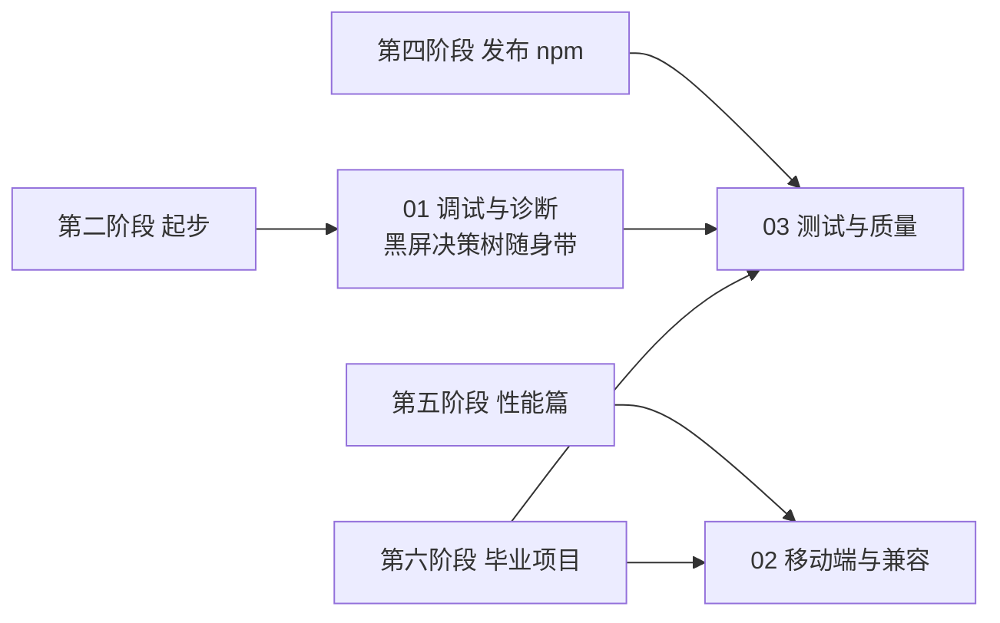

# 工程专题导览

> [返回：WebGL 与 3D 框架学习大纲](../WebGL与3D框架学习大纲.md)
> 本目录回答主线分册没空展开的三件事：出了问题怎么系统排查（调试）、换了设备还能不能跑（兼容）、改了代码怎么确认没改坏（质量）——把"能跑"变成"能上线"。

## 定位与边界

主线六个阶段教你把效果做出来、把框架写出来；本专题面向**交付**——第四阶段把库发上 npm（[04-第四阶段/08-工程化](../04-第四阶段/08-工程化.md)）之后、第六阶段毕业项目验收之前，产品要面对真实浏览器、真实手机与真实回归。三篇对应工程的三板斧：

- **调试**：出问题时不靠盯着屏幕猜，沿决策树与证据走（[01-调试与诊断](01-调试与诊断.md)）；
- **兼容**：桌面好好的，到手机上精度爆炸、内存崩溃、事件失灵——能力检测、降级与预算（[02-移动端与兼容性](02-移动端与兼容性.md)）；
- **质量**：用属性测试、golden image 与发布纪律，保证每次改动可验证、每个版本可追溯（[03-测试与质量](03-测试与质量.md)）。

与既有内容的分工（不重复，只交叉引用）：

| 既有内容 | 它管什么 | 本专题怎么接 |
|---|---|---|
| [五阶段 07 性能优化与调试](../05-第五阶段/07-性能优化与调试.md) | "画得慢"：drawcall 成本、合批、显存、Spector 四步读帧入门（6.5.1）、性能埋点（6.5.2）、性能排查决策树（6.5.3） | 本专题 1.4 只做 Spector 的**好帧/坏帧对比法**深挖；1.1 决策树针对"画不出"而非"画得慢" |
| [四阶段 08 工程化](../04-第四阶段/08-工程化.md) | "库怎么建"：TS 严格模式、模块边界、测试范围三分法（7.3）、npm 打包发布（7.4） | 本专题 3.x 是其中测试一层的**进阶武器**（fast-check、golden image）与**发布后的质量纪律**，发布流程本身不重复 |
| [三阶段 02 数学库 1.4](../03-第三阶段/02-数学库minmath.md) | 黄金值 / 性质 / 往返三思路的手写 vitest 实现 | 本专题 3.2 在其上引入 fast-check 框架化：生成器、自动收缩、种子复现 |

## 分册索引

| 篇 | 内容一句话 | 优先服务阶段 |
|---|---|---|
| [01-调试与诊断](01-调试与诊断.md) | 黑屏六步决策树、getError 包裹器与错误码速查、上下文丢失恢复模板、Spector 对比法、着色器颜色输出调试、框架调试基建 | 二阶段起随用随查 |
| [02-移动端与兼容性](02-移动端与兼容性.md) | 扩展检测与降级矩阵、mediump 精度坑、DPR 封顶与动态分辨率、中端机性能预算、触摸输入映射、兼容测试矩阵 | 五、六（上线前必读） |
| [03-测试与质量](03-测试与质量.md) | 测试金字塔与投入分配、fast-check 属性测试、golden-image 快照与 CI 产物流、统计对比、semver 与 changelog 纪律 | 四、六 |

## 阅读路线

两种用法：

1. **按需查**：遇到问题直接跳（见下方速查表），每篇自成体系，不要求顺序读；
2. **系统补**：第四阶段发布后按 01 → 03 → 02 顺读一遍（先会诊断，再会防回归，最后补移动端），再进毕业项目。

## 问题速查表

| 你遇到的问题 | 去哪 |
|---|---|
| 画面全黑 / 某个物体不出现 | 01 的 1.1 黑屏决策树 |
| 控制台有 WebGL 报错看不懂 | 01 的 1.2 错误码速查表 |
| 页面挂久了白屏、切标签页回来黑 | 01 的 1.3 上下文丢失 |
| 同一帧"好机器好好的换台机器不对" | 01 的 1.4 抓帧对比法 |
| shader 里算式怀疑出错但没 printf | 01 的 1.5 颜色输出与 NaN 可视化 |
| 桌面正常、手机上顶点抖动 / 色带 | 02 的 2.2 精度坑 |
| 手机上发热、几分钟后掉帧 | 02 的 2.4 性能预算与降频 |
| iPhone 上视频纹理黑屏 / 自动播放失败 | 02 的 2.4 iOS Safari 坑 |
| 想给渲染结果加回归测试 | 03 的 3.3 golden image / 3.4 统计对比 |
| 要发新版本了 | 03 的 3.5 发布前 checklist |

各篇末尾有常见坑与本节自测；专题不设综合实践，检验落在主线各阶段实践任务与毕业项目上。
