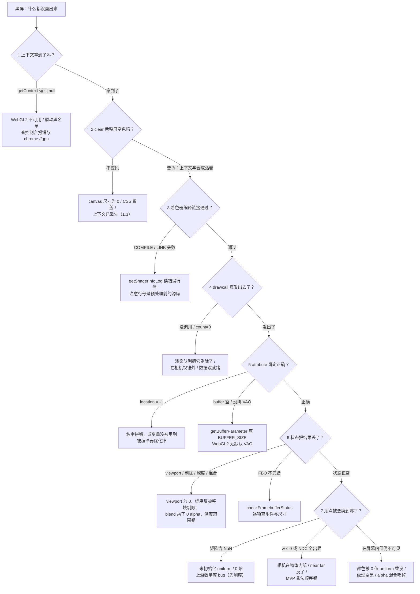

# 调试与诊断

> [返回：WebGL 与 3D 框架学习大纲](../WebGL与3D框架学习大纲.md)
> 黑屏六步决策树、getError 调试包裹器、上下文丢失恢复模板、Spector.js 抓帧对比法、着色器颜色输出调试与框架调试基建——把"盯着屏幕猜"变成"沿着证据走"。注意分工："帧率低该优化什么"的排查在 [05-第五阶段/07-性能优化与调试](../05-第五阶段/07-性能优化与调试.md) 6.5，本文专攻"画不对"。

## 1.1 黑屏排查决策树

### 概念：黑屏是链路断在某一环

一个像素从数据到屏幕要穿过整条链路：JS 数据 → buffer 上传 → attribute 绑定 → 顶点着色器 → 图元装配与裁剪 → 光栅化 → 片元着色器 → 深度/模板/混合测试 → FBO 或画布合成。"盯着代码看"之所以低效，是因为断环的位置和"你最后改的地方"往往无关。系统排查（systematic debugging）的思路是：**沿链路二分，每一步用一个只依赖这一环的自检代码确定它通没通**——先分清症状类型，再进决策树。

- **全黑**：连 clear 的纯色都看不见，或整个场景消失——从上下文开始走主干；
- **局部不对**：某个物体不出现、颜色不对、闪烁——跳到 1.1.3 的症状速查表。

### 方法：六步决策树



每步的一行自检代码与通过标准：

| 步骤 | 一行自检 | 通过标准 |
|---|---|---|
| 1 上下文 | `const gl = canvas.getContext('webgl2', { alpha: false }); console.assert(gl);` | gl 非 null |
| 2 画布链路 | `gl.clearColor(1, 0, 0, 1); gl.clear(gl.COLOR_BUFFER_BIT);` | 整屏变红——问题锁定在"绘制内容"而非"画布本身" |
| 3 着色器 | `gl.getShaderParameter(vs, gl.COMPILE_STATUS) && gl.getProgramParameter(p, gl.LINK_STATUS)` | 均为 true；失败读 `getShaderInfoLog(vs)` / `getProgramInfoLog(p)` |
| 4 绘制调用 | `console.log(count, instanceCount)`（draw 处） | count > 0 且确实执行到 |
| 5 绑定 | `gl.getAttribLocation(p, 'a_position') !== -1`；`gl.getBufferParameter(gl.ARRAY_BUFFER, gl.BUFFER_SIZE) > 0`；`gl.getVertexAttrib(loc, gl.VERTEX_ATTRIB_ARRAY_ENABLED)` | 三者同时成立 |
| 6 状态 | `gl.getParameter(gl.VIEWPORT)`；`gl.isEnabled(gl.CULL_FACE)`；`gl.checkFramebufferStatus(gl.FRAMEBUFFER) === gl.FRAMEBUFFER_COMPLETE` | viewport 非 0；FBO 完备；剔除方向与绕序匹配 |
| 7 矩阵 | `mvp.some(Number.isNaN)`；`clip = mvp × (0,0,0,1)` 后检查 `w > 0` 且 `-1 ≤ x/w,y/w,z/w ≤ 1` | 无 NaN；物体中心确实落在视锥内 |

### 完整代码：黑屏第一现场脚本

黑屏发生时，在浏览器控制台粘贴这段（不依赖任何库），30 秒走完前六步：

```javascript
// diagnose.js —— 黑屏第一现场：控制台粘贴运行
(function diagnose() {
  const gl = document.querySelector('canvas')?.getContext('webgl2');
  if (!gl) { console.error('第 1 步即失败：getContext("webgl2") 返回 null。查驱动与浏览器黑名单（chrome://gpu）。'); return; }

  const rows = [];
  const add = (item, ok, detail) => rows.push({ 检查项: item, 结果: ok ? '通过' : '异常', 详情: detail });

  // 2. 画布尺寸与视口
  add('画布尺寸', gl.canvas.width > 0 && gl.canvas.height > 0,
      `${gl.canvas.width}x${gl.canvas.height}（为 0 说明 CSS 布局没就绪就初始化了）`);
  const vp = gl.getParameter(gl.VIEWPORT);
  add('viewport', vp[2] > 0 && vp[3] > 0, JSON.stringify(Array.from(vp)));

  // 6. 状态
  add('深度测试', gl.isEnabled(gl.DEPTH_TEST), `func = ${gl.getParameter(gl.DEPTH_FUNC)}（默认 LESS）`);
  add('背面剔除', gl.isEnabled(gl.CULL_FACE),
      '默认 frontFace CCW：三角形绕序写反了会被整块剔除，这是"单个 quad 消失"的头号原因');
  const status = gl.checkFramebufferStatus(gl.FRAMEBUFFER);
  add('当前 FBO', status === gl.FRAMEBUFFER_COMPLETE,
      status === gl.FRAMEBUFFER_COMPLETE ? '完备' : '不完备：查附件存在性/格式组合/各附件尺寸一致');

  // 错误队列（对照 1.2 速查表读码）
  const errors = [];
  let e;
  while ((e = gl.getError()) !== gl.NO_ERROR) errors.push('0x' + e.toString(16));
  add('错误队列', errors.length === 0, errors.join(', ') || '空');

  console.table(rows);
})();
```

### 局部不对：症状速查表

| 症状 | 首查 |
|---|---|
| 单个物体消失，其他正常 | 剔除方向与三角形绕序（第 6 步）；该物体的视锥剔除包围盒；透明物体排到了不透明之后 |
| 整个物体"半边消失"或翻面 | 绕序（winding）不一致——生成器该统一逆时针 |
| 面片闪烁 / 前后关系随机变化 | z-fighting：共面或近共面，拉开偏移或用 polygonOffset |
| 几何在但全黑 | 法线全 0、光照 uniform 是 0、纹理还没加载完就渲染（加载是异步的） |
| 纹理上下颠倒 | `gl.pixelStorei(gl.UNPACK_FLIP_Y_WEBGL, true)` 与 UV 约定不匹配（[02-第二阶段 纹理](../02-第二阶段/01-导览.md)） |
| 一帧正确一帧黑 | 读回与呈现时序：`preserveDrawingBuffer: false` 下帧结束后画布内容不保证保留（2.4） |
| 只有第一帧正确 | 渲染循环没接上 raf；或动画更新抛错中断了循环（控制台可能有被忽略的异常） |

## 1.2 getError 的正确用法

### 概念：错误是"拉取"的，不是"推送"的

WebGL 出错不抛异常也不打日志——错误码排队等着你去拉：`gl.getError()` 返回最早的未读错误并把它清出队列。这意味着两个纪律：

1. **没人调 getError，错误就永远沉默**。开发期必须主动查；
2. **读一次清一条**。队列里可能有多个错误，要循环读到 `NO_ERROR` 为止（上面的诊断脚本就是这么写的）。

### 方法：调试包裹器（debug wrapper）

在每个 GL 调用后面手动插 getError 既啰嗦又容易漏。系统做法是用 Proxy 把整个上下文包一层：函数调用结束后自动查错、打印命令名与参数。开销必须心里有数：**getError 是少数会强制同步化命令缓冲的调用**，逐调用检查会把流水线退化成同步执行，帧率腰斩是常态——所以它只活在 debug 构建，release 里连代码都不该进包（用可被 tree-shaking 的常量分支保证）。

### 完整代码

```typescript
// src/renderer/debugGL.ts —— 可开关的 GL 调试包裹器
const GL_ERROR_NAMES: Record<number, string> = {
  0x0500: 'INVALID_ENUM',
  0x0501: 'INVALID_VALUE',
  0x0502: 'INVALID_OPERATION',
  0x0505: 'OUT_OF_MEMORY',
  0x0506: 'INVALID_FRAMEBUFFER_OPERATION',
  0x9242: 'CONTEXT_LOST_WEBGL',
};

// 这类调用的返回值本身有效、且高频，逐个包只会制造噪声
const SKIP = new Set(['getError', 'getExtension', 'getParameter', 'getContextAttributes']);

export function createDebugGL(gl: WebGL2RenderingContext): WebGL2RenderingContext {
  return new Proxy(gl, {
    get(target, prop) {
      const value = Reflect.get(target, prop, target);
      if (typeof value !== 'function' || SKIP.has(String(prop))) return value;
      return (...args: unknown[]) => {
        const result = (value as (...a: unknown[]) => unknown).apply(target, args);
        const err = target.getError();
        if (err !== target.NO_ERROR) {
          console.error(
            `[GL] ${String(prop)}(${args.map(formatArg).join(', ')}) -> ${GL_ERROR_NAMES[err] ?? '0x' + err.toString(16)}`,
          );
        }
        return result;
      };
    },
  });
}

function formatArg(a: unknown): string {
  if (typeof a === 'number') return a < 0x1000 && Number.isInteger(a) ? '0x' + a.toString(16) : String(a);
  if (a instanceof Float32Array) return `Float32Array(${a.length})`;
  return typeof a === 'object' ? String(a) : String(a);
}

// 挂接点：用构建期常量切换，生产构建整块被摇掉
// import.meta.env.DEV 是 Vite 约定；纯库场景可用自己定义的 __DEBUG__ 编译宏
declare const import.meta: { env: { DEV: boolean } };
export function getGL(canvas: HTMLCanvasElement): WebGL2RenderingContext {
  const gl = canvas.getContext('webgl2', { alpha: false });
  if (!gl) throw new Error('当前环境不支持 WebGL2');
  return import.meta.env.DEV ? createDebugGL(gl) : gl;
}
```

release 模式的折中：不是完全放弃错误监控，而是**降频**——初始化序列跑完后循环清一次错误队列，之后每帧末查一次（每帧一次 getError 的开销可以忽略）。真正的线上诊断交给 1.6 的调试基建与前端监控上报。

### 错误码速查表：十大高频原因

| # | 错误码 | 典型现场 | 高频原因 |
|---|---|---|---|
| 1 | INVALID_OPERATION | drawArrays / drawElements | 没 `useProgram` 就画；program 链接失败被忽略仍 use |
| 2 | INVALID_OPERATION | vertexAttribPointer | WebGL2 下没有绑定 VAO 就设置 attribute（WebGL2 无默认 VAO） |
| 3 | INVALID_OPERATION | draw 时 | 已 enable 的 attribute 没有绑定 buffer 的指针（绑定了 location 却忘了 buffer） |
| 4 | INVALID_OPERATION | uniformXXX | location 来自另一个 program（旧 program 的 location 过期未重取） |
| 5 | INVALID_VALUE | uniformMatrix4fv | transpose 传了 true——WebGL 强制为 false（列主序约定，与桌面 GL 不同） |
| 6 | INVALID_VALUE | vertexAttribPointer / texImage2D | stride 为负或不为类型大小倍数；attribute 序号 ≥ MAX_VERTEX_ATTRIBS；纹理宽高 ≤ 0 |
| 7 | INVALID_ENUM | texImage2D | format / type / internalFormat 组合不合法：WebGL1 用了 WebGL2 枚举；RGB 配 FLOAT 而浮点纹理扩展未启用 |
| 8 | INVALID_FRAMEBUFFER_OPERATION | draw / readPixels | 目标 FBO 不完备：附件缺失、附件尺寸不一致、mipmap 层号不对（第 6 步自检） |
| 9 | INVALID_OPERATION | draw 时 | 纹理反馈循环（feedback loop）：同一纹理既是采样器又是当前 FBO 附件 |
| 10 | OUT_OF_MEMORY / CONTEXT_LOST_WEBGL | 任何调用 | 单张纹理超限或显存耗尽（OUT_OF_MEMORY 也是驱动报不出具体错误时的兜底码）；上下文已丢失后所有调用静默变 no-op 并返回 CONTEXT_LOST_WEBGL（1.3） |

补充一个排错利器：`WEBGL_debug_shaders` 扩展的 `getTranslatedShaderSource(shader)` 能拿到驱动翻译后的着色器源（Windows 上是 ANGLE 翻成 HLSL 的结果）——当编译错误行号怎么都对不上时，看翻译后的源码常能发现是宏展开或精度限定符的问题。

## 1.3 上下文丢失

### 概念：GPU 上下文是会被收走的

浏览器随时可能收回 WebGL 上下文（context loss）：驱动崩溃恢复、系统内存压力（iOS 杀内存最凶）、GPU 进程被操作系统重启、显卡驱动更新。丢失后**所有 GL 资源句柄作废**——program、buffer、纹理、FBO 全部归零，后续调用全部静默变 no-op。不做处理的页面表现为：白屏、黑屏或永远定格的最后一帧，且控制台一片安静。这是"能跑"与"能上线"的分水岭之一：真实用户一定会遇到。

### 方法：lost → preventDefault → restored 三段式

- `webglcontextlost`：必须 `event.preventDefault()`——不阻止默认行为，浏览器认为你放弃了恢复，**不会再发 restored 事件**；
- 丢失期间：停掉渲染循环（继续 raf 只是在空转并堆积错误），给用户一个"正在恢复"的 UI；
- `webglcontextrestored`：同一个 JS 上下文对象继续可用，但**一切 GL 资源必须整体重建**。

资源重建清单——哪些会丢、要缓存什么才能重建：

| 资源 | 丢失后 | 重建需要缓存的 CPU 侧数据 |
|---|---|---|
| program / shader | 句柄作废 | 着色器源码字符串（含 #define 组合） |
| buffer / VAO | 句柄作废 | 几何的原始 TypedArray（顶点/索引） |
| texture | 句柄作废 | 源数据：HTMLImageElement / ImageBitmap / 压缩 KTX2 字节（[五阶段 6.4](../05-第五阶段/07-性能优化与调试.md)） |
| FBO / renderbuffer | 句柄作废 | 尺寸与附件格式描述（按描述重建即可） |
| uniform / attribute location | 随 program 作废 | 无需单独缓存，program 重建后重取 |
| 所有状态（viewport/blend/深度…） | 回到默认值 | **框架的状态缓存（[四阶段 1.2](../04-第四阶段/02-框架总体架构.md)）必须整体失效**，否则它以为"当前已绑定 X"而跳过重设 |
| JS 对象 / 场景图 / 参数 | 不受影响 | ——这就是"资源层不建 GPU 对象"分层的回报：CPU 描述还在，只差重新上传 |

### 完整代码：处理模板

```typescript
// src/renderer/contextGuard.ts —— 上下文丢失/恢复完整模板
export interface ContextLossHandlers {
  onLost(): void;                                      // 停渲染循环、显示恢复中 UI
  onRestored(gl: WebGL2RenderingContext): void;        // 重建所有 GPU 资源、失效状态缓存、重启循环
}

export function createContextGuard(
  canvas: HTMLCanvasElement,
  handlers: ContextLossHandlers,
): WebGL2RenderingContext {
  const gl = canvas.getContext('webgl2', { alpha: false });
  if (!gl) throw new Error('WebGL2 不可用');

  let lost = false;
  canvas.addEventListener('webglcontextlost', (e: Event) => {
    e.preventDefault();                                // 关键：不阻止默认就没有 restored
    if (lost) return;                                  // 事件可能连发，幂等处理
    lost = true;
    handlers.onLost();
  }, false);

  canvas.addEventListener('webglcontextrestored', () => {
    lost = false;
    // gl 仍是同一个 JS 对象，直接用；但所有句柄已失效，必须整体重建
    handlers.onRestored(gl);
  }, false);

  return gl;
}

// 引擎侧的 onRestored：按"CPU 描述 → GPU 句柄"重放
function makeRestored(renderer: Renderer) {
  return (gl: WebGL2RenderingContext) => {
    renderer.invalidateStateCache();          // 四阶段状态缓存整体失效
    renderer.rebuildPrograms();               // 从源码缓存重编译链接
    renderer.rebuildBuffers();                // 从几何 TypedArray 重上传
    renderer.rebuildTextures();               // 从图像/压缩数据重上传（含 mipmap）
    renderer.rebuildFramebuffers();           // 按描述重建 FBO 附件
    renderer.startLoop();                     // 最后才恢复渲染循环
  };
}
```

### 真实触发方式（测试用）

恢复逻辑不能"等天上掉上下文"，三种可控触发：

1. **扩展模拟（首选，可自动化）**：`const ext = gl.getExtension('WEBGL_lose_context'); ext.loseContext();` 触发 lost，稍后 `ext.restoreContext()` 触发 restored——单测/E2E 里固定跑一遍"丢失 → 恢复 → 画面复原"；
2. **Chrome 任务管理器**：菜单"更多工具 → 任务管理器"，找到 GPU Process 点"结束进程"——驱动级真实丢失，观察浏览器是否随后自动恢复 GPU 进程并发 restored；
3. **chrome://gpu**：查看 WebGL 状态、加速是否被禁用、历史崩溃记录——用户报"直接拿不到上下文"时先看这里。

iOS 上还有第四种最真实的：切到后台再回来、或开几个别的标签页制造内存压力，jetsam 会直接杀渲染（见 2.4）。

## 1.4 Spector.js 深入：抓帧对比法

### 概念与前置

Spector.js 是 WebGL 的抓帧器（frame debugger），安装与"四步读帧"（命令流总览 → 相邻 drawcall 状态 diff → drawcall 输入 → FBO 与纹理清单）在 [五阶段 6.5.1](../05-第五阶段/07-性能优化与调试.md) 已讲，本节不重复。这里解决 6.5 覆盖不到的两类难题：**"从什么时候开始不对"**（对比法）与**"一个 drawcall 到底该看什么、哪些结论不能下"**（读法细节与误读清单）。

### 方法：好帧 vs 坏帧 diff

当现象是"画面不对但不知道哪一步错"，单看一帧往往没有参照。抓两个帧对比：好帧（good frame）与坏帧（bad frame）。好帧的三种来源：

1. **上一个能跑的版本**：配合 git bisect，把"引入坏帧的 commit"和对比定位一起收敛；
2. **参考实现**：用 three.js 写个最小同场景，对比你的框架发的命令差在哪；
3. **同应用的不同状态**：改一个参数前/后、第一帧（正常）与第 N 帧（出错）、相机转过去之前/之后。

对比步骤：

1. **先比总数**：两帧的 drawcall 数、命令总数、program 数、纹理数。数量级差异（3000 vs 300 条命令）直接指方向——多出来的两千条是什么命令就是问题本身；
2. **命令流逐条对齐找第一条分岔**：跳过两帧都有的前缀（清屏、通用状态设置），找到"从这里开始错位"的那条命令——分岔点之前的命令语义相同，问题藏在分岔点前后；
3. **对分岔点附近的 drawcall 看 1.4.3 的证据清单**：是输入错了（顶点/纹理），还是状态错了（深度/混合/视口），还是顺序错了（透明先画了）。

### 看什么：单个 drawcall 的证据清单

点开一个 drawcall，按顺序收集证据：

| 看什么 | 异常长什么样 |
|---|---|
| 命令参数（mode / first / count / instanceCount） | count 为 0 或索引范围为空——"空 draw"；drawElementsInstanced 的 instanceCount 是 1 说明实例化没生效 |
| 当前 program 与 uniforms | 关键矩阵全 0（没上传成功）或含可疑的对称怪值（NaN 的兄弟：inf 被钳成的大数）；sampler 的 unit 映射与实际 bindTexture 不一致 |
| attribute 表 | 每个 location 的 buffer、stride/offset、类型；Spector 能预览顶点数据——位置数据全是 0 或挤成一列，一眼看出 stride/offset 上传错位 |
| 绑定纹理 | 内容缩略图全黑（没上传成功/采样错）、明显重复条纹（wrap 或 UV 越界）、mip 层数为 0（没生成 mipmap） |
| 状态快照 | viewport/scissor 是否覆盖全画布；透明物体是否忘了关 depthMask（后画的天空盒把它盖掉）；blendFunc 组合与预期 |

### 常见误读

| 误读 | 实情 |
|---|---|
| "Spector 里 CPU 耗时高，说明我的代码慢" | 抓帧会序列化整帧状态，开销巨大，抓出来的时间没有参考价值。性能一律用埋点量（[五阶段 6.5.2](../05-第五阶段/07-性能优化与调试.md)），Spector 只回答"发生了什么" |
| "纹理预览全黑，纹理一定是坏的" | 预览经过归一化显示，浮点纹理、整体偏暗的 LDR 都可能看着黑；点开看数值/直方图再下结论 |
| "命令列表里缺了 bindBuffer，我漏绑了" | 框架的状态缓存（[四阶段 1.2](../04-第四阶段/02-框架总体架构.md)）会抑制重复绑定——命令没发不等于状态不对，要看 drawcall 时刻的状态快照 |
| "capture 后画面黑了/有残影，是我的 bug" | capture 会替换并重放帧，显示路径变了；读命令流，别读 replay 画面 |
| "首帧抓出来特别慢" | Spector 对首帧注入更重；首帧性能用 Performance 面板复核 |

移动端/WebView 装不了插件时，用嵌入版：页面引 `spector.bundle.js` 后调 `Spector.displayUI()`——配套的远程调试环境见 2.6。

## 1.5 着色器调试

### 概念：没有 printf 的世界

GLSL 在 GPU 上每顶点/每片元并行执行，没有断点、没有日志。但有一个永远可用的输出通道：**颜色**。把任何中间值编码成 `gl_FragColor`，用眼睛当"打印函数"。配合两个专门技巧——NaN 可视化与二分注释——可以定位绝大多数着色器错误。

### 方法与完整代码

**技巧一：把中间值编码成颜色。**三种编码方式按需选：

```glsl
// GLSL ES 3.00，片元着色器
// 1) 向量直接当颜色：法线可视化（对得齐光照的前提）
outColor = vec4(vNormal * 0.5 + 0.5, 1.0);        // 法线应为中心对称的彩色球

// 2) 标量映射到灰度梯度：先归一化到 [0,1]，超界一眼可见
float t = clamp((vFogDepth - nearP) / (farP - nearP), 0.0, 1.0);
outColor = vec4(t, t, t, 1.0);

// 3) 布尔/分支标记：两色硬切，避免平滑过渡骗过眼睛
outColor = mix(vec3(1, 0, 0), vec3(0, 1, 0), step(0.5, flag));  // 红=假 绿=真
```

**技巧二：NaN/Inf 可视化。**黑屏/黑块十有八九是 NaN 在管线里扩散（NaN 参与任何运算结果还是 NaN，最终被驱动钳成 0）。给它一个刺眼的颜色：

```glsl
// GLSL ES 3.00：isnan/isinf 是内置函数
vec3 debugNaN(vec3 rgb, float suspect) {
  if (isnan(suspect)) return vec3(1.0, 0.0, 1.0);  // 品红 = 出现 NaN
  if (isinf(suspect)) return vec3(0.0, 1.0, 1.0);  // 青色 = 出现 Inf
  return rgb;
}
// GLSL ES 1.00（WebGL1）没有 isnan，用 NaN 的自反性：v != v 即为 NaN

// 高频 NaN/Inf 源头清单（按出现频率）：
// normalize(vec3(0))        —— 退化向量（法线未初始化、边长为 0）
// 0.0 / 0.0                 —— 除以可能为 0 的量（衰减、归一化系数）
// pow(负数, 非整数幂)         —— 如 pow(dot(N, L), shine) 当 dot < 0
// log(<= 0) / sqrt(负数)     —— 输入域没守住
// atan(0, 0)                —— 两参都为 0 的角度
// inf - inf                 —— 大数相减（2.2 的灾难性抵消）
// 未绑定的 varying/attribute —— location 没对上，读到未定义值
```

**技巧三：逐步注释二分法。**怀疑某段计算出错时，注释掉后半段、让着色器输出前半段的中间结果（配合技巧一）；画面正确则错误在后半段，继续二分。对长链 PBR/后处理着色器，几轮就能锁到具体表达式。比"注释一行跑一次"更快的变体：一次注释一半，log2(行数) 次定位。工程化做法是把可视化开关做成 `#define`，调试编译期打开、正式构建关闭，不用反复改代码。

顶点着色器同样适用：把可疑 attribute（如 morph 权重、实例偏移）通过 varying 转发到片元当颜色输出；或输出 `gl_Position.w` 看深度分布。

## 1.6 调试基建：框架里的 debug 层

### 概念：让框架自己会说话

前五节是"现场排查"，这一节是"预防性建设"：把调试能力做进框架，出问题时一键打开。三层基建——**可开关的 GL 调用日志**（复用 1.2 的 Proxy，再加环形缓冲，出错时倒出最近 N 条命令）、**资源引用计数与泄漏报告**（对照 [四阶段 1.3](../04-第四阶段/02-框架总体架构.md) 的 create/dispose 约定，报告"谁创建了但没释放"）、**每帧统计**（drawcall/三角形数/上传字节，是 [五阶段 6.5.2](../05-第五阶段/07-性能优化与调试.md) FrameStats 耗时埋点的计数版兄弟）。三层有个共同的架构前提：四阶段把所有 GL 调用收口到状态托管层，钩子只需要挂一处。

### 完整代码

```typescript
// src/renderer/RenderStats.ts —— 每帧计数统计
export class RenderStats {
  drawCalls = 0;
  triangles = 0;
  instances = 0;
  textureUploadBytes = 0;      // 每帧 texImage2D/texSubImage2D 上传量（纹理搬运是隐性大头）
  bufferUploadBytes = 0;       // 每帧 bufferData/bufferSubData 上传量
  programSwitches = 0;         // useProgram 次数（渲染队列排序质量的直接指标）
  private history: { dc: number; tri: number; upKB: number }[] = [];
  private t0 = 0;

  beginFrame(): void { this.t0 = performance.now(); }

  // 在渲染器唯一的 draw 出口调用
  addDraw(vertexCount: number, instanceCount = 1): void {
    this.drawCalls++;
    this.instances += instanceCount;
    this.triangles += (vertexCount / 3) * instanceCount;
  }
  addTextureUpload(bytes: number): void { this.textureUploadBytes += bytes; }
  addBufferUpload(bytes: number): void { this.bufferUploadBytes += bytes; }
  addProgramSwitch(): void { this.programSwitches++; }

  endFrame(): { dc: number; tri: number; upKB: number; ms: number } {
    const snap = {
      dc: this.drawCalls,
      tri: Math.round(this.triangles),
      upKB: Math.round((this.textureUploadBytes + this.bufferUploadBytes) / 1024),
      ms: +(performance.now() - this.t0).toFixed(2),
    };
    this.history.push(snap);
    if (this.history.length > 300) this.history.shift();
    this.drawCalls = this.triangles = this.instances = 0;
    this.textureUploadBytes = this.bufferUploadBytes = 0;
    this.programSwitches = 0;
    return snap;
  }
}
```

```typescript
// src/renderer/ResourceRegistry.ts —— 资源注册表与泄漏报告
const enum Kind { Texture = 'texture', Buffer = 'buffer', Program = 'program',
                  Vao = 'vao', Fbo = 'fbo', Renderbuffer = 'renderbuffer' }

interface Entry { kind: Kind; label: string; born: number; stack?: string }

export class ResourceRegistry {
  private live = new Map<WebGLObject, Entry>();
  /** Error().stack 很贵：默认关，怀疑泄漏时打开，能直接看到"谁创建的没放" */
  captureStacks = false;

  track<T extends WebGLObject>(kind: Kind, label: string, obj: T): T {
    this.live.set(obj, { kind, label, born: performance.now(),
      stack: this.captureStacks ? new Error().stack : undefined });
    return obj;
  }
  untrack(obj: WebGLObject | null): void { if (obj) this.live.delete(obj); }
  get size(): number { return this.live.size; }

  /** 页面隐藏/卸载时调用：还在表里的就是没 dispose 的 */
  reportLeaks(): void {
    if (this.live.size === 0) { console.info('[ResourceRegistry] 无泄漏'); return; }
    console.warn(`[ResourceRegistry] ${this.live.size} 个资源未释放：`);
    for (const [obj, e] of this.live) {
      console.warn(`  ${e.kind} "${e.label}" 存活 ${((performance.now() - e.born) / 1000).toFixed(0)}s`, e.stack ?? '', obj);
    }
  }
}

// 挂接：create 与 delete 成对埋点
// const tex = registry.track(Kind.Texture, url, gl.createTexture());
// gl.deleteTexture(tex); registry.untrack(tex);
// window.addEventListener('pagehide', () => registry.reportLeaks());
```

GL 调用日志的环形缓冲版在 1.2 的 Proxy 里加十几行即可：把 `[命令名, 参数, 时间戳]` 推进定长数组（保留最近 200 条），`onerror` 或手动 `dumpLog()` 时整段打印——"出错前最后发生了什么"比"哪条出错"往往更有用。这层的开启条件用查询参数（`?debug=gl`）而非编译期常量，方便在用户的生产构建里远程开关。

## 常见坑

1. **黑屏先查 shader 编译，且必须读 infoLog**——编译失败不抛异常，program 照样创建成功，只是 draw 变 no-op；只看 `console.log('shader ok')` 不看返回值是重灾区。
2. **getError 调了第一次就把错误清掉了**——"我在 A 处查了没错，为什么 B 处崩"：错误可能在 A 之前就被读走过。排查时用 1.2 包裹器保证每个调用后都查。
3. **调试包裹器进了生产包**——逐调用 getError 的同步化开销让线上帧率减半，还把控制台刷爆。用编译期常量分支，让 tree-shaking 把它从 release 里摇掉。
4. **webglcontextlost 里忘了 preventDefault**——浏览器判定你放弃恢复，永远等不来 restored，页面卡死在最后一帧。模板里它是第一行。
5. **恢复后直接续跑渲染循环**——所有句柄都是死的，第一帧 draw 全是 no-op 加错误堆积；必须先走完重建清单再 startLoop。
6. **恢复后状态缓存没失效**——框架以为"当前 program 还是 X"而跳过重设，画面继续错。invalidateStateCache 是恢复流程的第一步。
7. **拿 Spector 的耗时当性能数据**——抓帧开销巨大，它只回答"这一帧做了什么"；帧时间归因回到 6.5.2 的埋点。
8. **着色器里用 `if (x == NaN)` 找 NaN**——NaN 与任何值都不相等，包括它自己；要 isnan()（ES 3.00）或 `v != v`（ES 1.00）。
9. **泄漏报告在页面刷新前没机会跑**——`pagehide`/`visibilitychange` 里挂 reportLeaks，而不是只在单元测试里查。

## 本节自测

1. 黑屏决策树的七步各断言什么？为什么"clear 变红"通过后就可以排除上下文与合成链路，把怀疑收窄到绘制内容？
2. 写出第 5 步（attribute 绑定）的三个自检表达式，并说明 `getAttribLocation` 返回 -1 的两种可能原因。
3. 为什么 getError 不能在 release 构建里逐调用检查？release 里的降频方案是什么？
4. INVALID_OPERATION 的五个高频现场分别是什么？WebGL2 下"没绑 VAO 就 vertexAttribPointer"报哪个码？
5. webglcontextlost 处理的三段式是什么？哪一步漏掉就永远无法恢复？列出资源重建清单中"必须失效的框架内部状态"。
6. 如何在不依赖真机驱动崩溃的前提下自动化测试上下文恢复？给出扩展名与两个方法调用。
7. Spector 对比法中"第一条分岔"怎么找？为什么先比命令总数再逐条对齐？
8. 列出五个高频 NaN 源头，并写出 ES 3.00 与 ES 1.00 两种检测 NaN 的写法。
9. 每帧统计的三项核心指标（drawcall/三角形/上传字节）各自对应五阶段性能篇的哪个优化决策？
10. 框架的调试基建为什么只需要在状态托管层挂一处钩子？这依赖第四阶段的哪个架构决策？
