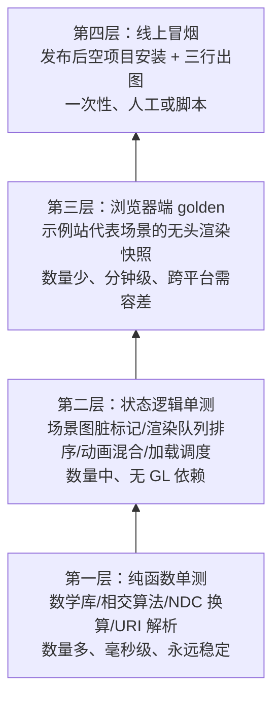

# 测试与质量

> [返回：WebGL 与 3D 框架学习大纲](../WebGL与3D框架学习大纲.md)
> 测试金字塔与投入分配、fast-check 属性测试进阶、golden-image 快照与 CI 产物流、统计对比与冒烟预算、semver 与 changelog 纪律——回答"改了代码怎么确认没改坏"。测试范围的三分法与 vitest 基础在 [04-第四阶段/08-工程化](../04-第四阶段/08-工程化.md) 7.3，数学库三思路（黄金值/性质/往返）在 [03-第三阶段 1.4](../03-第三阶段/02-数学库minmath.md)，本文在其上往深走。

## 3.1 测试策略总览

### 概念：按可测性分层，按变化频率分配投入

第四阶段 7.3 已经给出代码三分法（纯函数 / 有状态逻辑 / GPU 路径）。这里补上**金字塔视角**：越往下测试越多、越快、越稳；越往上越少、越贵、越脆。投入分配与"先测什么"都由这个形状决定。



先测什么的优先级清单（新代码到手先判断它在哪层）：

1. 数学库最优先——被所有层依赖，且错了会污染一切下游判断（[三阶段 1.4](../03-第三阶段/02-数学库minmath.md) 的教训）；
2. 加载与调度状态机——异步 bug 复现成本最高，测试锁定后一劳永逸；
3. 渲染队列与场景图——纯逻辑，mock 数据即可覆盖排序/脏标记语义；
4. shader 与渲染输出——用 3.3 的 golden 少量盖面，每个后处理效果一个代表场景即可，不要给每个示例页都配快照。

一个与 7.3 相同但值得重申的结论：**GPU 路径不可测的面积是架构画出来的**——gl 关进 renderer 一层后，剩给第三层的只是"薄薄的确定性场景 + 截图对比"，金字塔才立得住。

## 3.2 数学库属性测试进阶：fast-check

### 概念：从"手写随机"到"框架化属性测试"

三阶段 1.4 的性质测试是自己写种子随机循环（`for (let seed = 1; seed < 50; seed++)`），验证不变量。它有效，但三件事要手工做且常被省略：随机输入的**质量**（均匀性、边界覆盖）、失败后的**最小化**（shrink：把失败用例收缩到最小反例，人能一眼看懂）、**种子报告**（失败输出里带上可复现的种子）。属性测试框架（property-based testing）fast-check 把这三件事做成了基础设施：声明式生成器（arbitrary）描述输入空间，框架负责采样、收缩与复现。

### 方法：生成器设计是核心

属性测试的质量上限由生成器决定。两个设计点：

- **单位四元数生成器**：不能直接采四个数当四元数——必须归一化，且要防御全零向量；均匀性上，4D 均匀盒归一化不是球面均匀，但对不变量验证足够（要统计均匀可用高斯采样）；
- **比较四元数要处理双覆盖**：q 与 -q 是同一旋转（[三阶段 1.2](../03-第三阶段/02-数学库minmath.md)），逐分量相等断言会随机挂——比较 `|dot(q1, q2)| ≈ 1`。

### 完整代码：vitest + fast-check

```typescript
// tests/property/quaternion.spec.ts
import { describe, it, expect } from 'vitest';
import fc from 'fast-check';
import { Quat } from '../../src/math/Quat';
import { Vec3 } from '../../src/math/Vec3';
import { Mat4 } from '../../src/math/Mat4';

const arbDouble = fc.double({ min: -1, max: 1, noNaN: true, noDefaultInfinity: true });

// 生成器：随机单位四元数（归一化，防御零向量）
const arbUnitQuat = fc.tuple(arbDouble, arbDouble, arbDouble, arbDouble)
  .map(([x, y, z, w]) => {
    const q = new Quat(x, y, z, w).normalize();
    return Number.isNaN(q.w) ? new Quat(0, 0, 0, 1) : q;
  });

const arbVec3 = fc.tuple(
  fc.double({ min: -100, max: 100, noNaN: true }),
  fc.double({ min: -100, max: 100, noNaN: true }),
  fc.double({ min: -100, max: 100, noNaN: true }),
).map(([x, y, z]) => new Vec3(x, y, z));

// 双覆盖安全的等价断言：q 与 -q 是同一旋转
function expectSameRotation(a: Quat, b: Quat, ulps = 1e-5): void {
  const dot = Math.abs(a.x * b.x + a.y * b.y + a.z * b.z + a.w * b.w);
  expect(dot).toBeGreaterThan(1 - ulps);
}

describe('Quaternion 属性（fast-check）', () => {
  it('旋转保距：|q v q*| = |v|', () => {
    fc.assert(fc.property(arbUnitQuat, arbVec3, (q, v) => {
      const out = v.clone().applyQuaternion(q);
      const tol = 1e-3 * Math.max(1, v.length());   // 相对容差（浮点断言纪律，见四阶段 7.3）
      expect(Math.abs(out.length() - v.length())).toBeLessThan(tol);
    }), { numRuns: 200 });
  });

  it('乘法结合律：q1(q2 q3) = (q1 q2)q3', () => {
    fc.assert(fc.property(arbUnitQuat, arbUnitQuat, arbUnitQuat, (q1, q2, q3) => {
      const left = q2.clone().multiply(q3).premultiply(q1);
      const right = q1.clone().multiply(q2).multiply(q3);
      expectSameRotation(left, right, 1e-4);        // 乘积范数漂移用双覆盖比较兜住
    }), { numRuns: 200 });
  });

  it('与矩阵殊途同归：mat(q1 ⊗ q2) = mat(q1) · mat(q2)', () => {
    fc.assert(fc.property(arbUnitQuat, arbUnitQuat, (q1, q2) => {
      const viaQuat = new Mat4().fromQuat(q1.clone().multiply(q2));
      const viaMat = new Mat4().fromQuat(q1).multiply(new Mat4().fromQuat(q2));
      for (let i = 0; i < 16; i++) {
        expect(viaQuat.elements[i]).toBeCloseTo(viaMat.elements[i], 4);
      }
    }), { numRuns: 200 });
  });

  it('共轭即逆：q ⊗ q* = 单位四元数', () => {
    fc.assert(fc.property(arbUnitQuat, (q) => {
      const prod = q.clone().multiply(q.clone().conjugate());
      expect(Math.abs(prod.w)).toBeCloseTo(1, 5);
      expect(Math.abs(prod.x) + Math.abs(prod.y) + Math.abs(prod.z)).toBeLessThan(1e-4);
    }), { numRuns: 200 });
  });

  it('slerp 端点复原：t=0 得 q1，t=1 得 q2', () => {
    fc.assert(fc.property(arbUnitQuat, arbUnitQuat, (q1, q2) => {
      expectSameRotation(Quat.slerp(q1, q2, 0), q1, 1e-4);
      expectSameRotation(Quat.slerp(q1, q2, 1), q2, 1e-4);
    }), { numRuns: 100 });
  });
});
```

跑挂时 fast-check 的输出长这样（以 `multiply` 实现里故意互换两项为例）：

```text
Property failed after 42 tests
{ seed: -1838376242, path: "41:0:1", ... }     // 失败种子：--seed 参数即可复现
Failed with output=Quat(0, 0, 0, 1)             // 收缩后的最小反例：单位四元数！
Shrunk 14 times from initial output             // 从一团乱数收缩到一眼能看懂的输入
```

最小反例的价值：直接指出"退化输入（单位四元数/零向量）触发了实现错误"，省掉人肉分析随机数组的环节。复现方式：`vitest -- --seed=-1838376242`（或在 fc.assert 参数里固定 `{ seed }`）。与 1.4 手写版的对照结论：手写循环适合起步，属性一多就升级 fast-check——生成器组合（`fc.tuple/record/array`）、收缩、种子报告都是白捡的。

## 3.3 着色器测试：golden-image 快照

### 概念：给渲染结果拍 X 光片

着色器与渲染管线的正确性最终以像素呈现。golden-image（黄金图像）快照测试的原理：固定场景与状态 → 无头浏览器渲染 → 与仓库里的基线图逐像素比对，超过容差即失败。它补上了单测够不到的最后一层（3.1 金字塔第三层）。

坑几乎全在"**像素噪声**"上——两次渲染"逻辑相同"却像素不同：

| 噪声源 | 表现 | 对策 |
|---|---|---|
| 抗锯齿 | 边缘像素随驱动/子像素相位漂移 | 测试场景关 AA，或容差覆盖边缘（pixelmatch 的 includeAA） |
| GPU/驱动差异 | 光栅化舍入、mediump 实现不同（2.2） | CI 用软件渲染器（SwiftShader）跑，基线在固定渲染器上生成 |
| 动画时间 | 每帧内容不同 | 示例页支持 `?frame=N` 渲染到固定帧后停表 |
| dithering/浮点目标 | 低 bit 输出的抖动模式不同 | 关 dither，测试场景用 8bit 目标 |
| 字体/UI 混入 | 文本抗锯齿跨平台不可比 | 只截 canvas 元素，不截整页 |

比对的正确姿势不是逐像素相等，而是**容差 + 比例**：单像素感知容差（pixelmatch 按 YIQ 加权亮度/色度的感知差异，threshold 0~1）+ 全图差异像素占比上限（如 2%）。感知哈希（perceptual hash，pHash）适合粗筛大改（布局级回归），精细回归还是要逐像素——两者可叠用。

### 完整代码：puppeteer 无头渲染 + pixelmatch

```typescript
// e2e/golden.ts —— 无头渲染快照对比（node 运行，不走 vitest：需要真实浏览器）
import puppeteer from 'puppeteer';
import pixelmatch from 'pixelmatch';
import { PNG } from 'pngjs';
import { existsSync, mkdirSync, readFileSync, writeFileSync } from 'node:fs';

const BASE_URL = process.env.GOLDEN_URL ?? 'http://localhost:5177';
const UPDATE = process.env.UPDATE_GOLDEN === '1';     // 有意变更时重录基线
const SCENES = ['earth', 'shadow-pcf', 'bloom'];      // 每个效果一个代表场景，别贪多

async function capture(browser: puppeteer.Browser, scene: string): Promise<PNG> {
  const page = await browser.newPage();
  await page.setViewport({ width: 800, height: 600 });
  await page.goto(`${BASE_URL}/examples/${scene}.html?frame=120`, { waitUntil: 'networkidle0' });
  // 示例站约定：?frame=N 渲染到第 N 帧停表并置 window.__ready（保证确定性）
  await page.waitForFunction(() => (window as unknown as { __ready?: boolean }).__ready === true);
  const canvas = await page.$('canvas');
  const shot = (await canvas!.screenshot()) as Buffer;  // 截元素走合成器，不受 preserveDrawingBuffer 影响
  await page.close();
  return PNG.sync.read(shot);
}

async function main(): Promise<void> {
  const browser = await puppeteer.launch({
    args: [
      '--no-sandbox',
      '--use-angle=swiftshader',          // 软件渲染：跨 CI 机器确定性的关键
      '--enable-unsafe-swiftshader',      // 新版 Chrome 要求显式放开软件 WebGL
    ],
  });
  let failed = 0;
  for (const scene of SCENES) {
    const actual = await capture(browser, scene);
    const base = `e2e/golden/${scene}.png`;
    if (UPDATE || !existsSync(base)) {
      writeFileSync(base, PNG.sync.write(actual));
      console.log(`[golden] 基线写入 ${base}`);
      continue;
    }
    const expected = PNG.sync.read(readFileSync(base));
    const { width, height } = expected;
    const diff = new PNG({ width, height });
    const changed = pixelmatch(expected.data, actual.data, diff.data, width, height,
      { threshold: 0.1, includeAA: true });
    const ratio = changed / (width * height);
    if (ratio > 0.02) {
      failed++;
      mkdirSync('e2e/out', { recursive: true });
      writeFileSync(`e2e/out/${scene}.actual.png`, PNG.sync.write(actual));
      writeFileSync(`e2e/out/${scene}.diff.png`, PNG.sync.write(diff));
      console.error(`[golden] ${scene} 回归：${(ratio * 100).toFixed(2)}% 像素不同（上限 2%）`);
    }
  }
  await browser.close();
  if (failed > 0) process.exitCode = 1;
}
main();
```

### GitHub Actions 产物流：失败时上传对比图

```yaml
# .github/workflows/golden.yml
name: golden-image
on:
  push: { branches: [main] }
  pull_request: {}
jobs:
  golden:
    runs-on: ubuntu-latest
    steps:
      - uses: actions/checkout@v4
      - uses: actions/setup-node@v4
        with: { node-version: 20, cache: npm }
      - run: npm ci
      - name: 启动示例站
        run: |
          npm run dev -- --port 5177 &
          npx wait-on http://localhost:5177 --timeout 60000
      - name: golden 对比
        run: node --experimental-strip-types e2e/golden.ts   # 或经 tsx 编译后运行
        env: { GOLDEN_URL: "http://localhost:5177" }
      - name: 上传差异图（仅失败时）
        if: failure()
        uses: actions/upload-artifact@v4
        with:
          name: golden-diff
          path: e2e/out/          # actual.png 与 diff.png 叠在 diff 图上看
          retention-days: 7
```

基线管理纪律：基线图**进仓库**（体量小、可 code review）；有意变更时本地 `UPDATE_GOLDEN=1` 重录，PR 里基线 diff 与 diff 图一起给人审——"这张图变绿的的原因"和代码变更一样需要解释。

## 3.4 渲染回归的轻量替代：统计对比与冒烟预算

### 概念：当快照太脆时退一步

golden 快照的脆点在 3.3 表格里：只要噪声源压不干净（程序化内容、跨 GPU 基线、强 AA 依赖），逐像素比对就频繁误报。两条退路：**统计对比**（不比像素比分布）与**时间预算冒烟**（不比画面比"能不能在预算内画出来"）。

### 完整代码：统计对比

```typescript
// e2e/statsCompare.ts —— 直方图 + 平均误差 + 分块均值：三个统计量定位"变化多大、在哪"
export interface StatResult {
  mae: number;                 // 平均绝对误差（0~255）：整体偏离
  chi2: number;                // 灰度直方图卡方距离：分布级变化（亮度结构变了）
  worstTile: { x: number; y: number; diff: number } | null;  // 8x6 分块里偏差最大的块
}

export function compareStats(a: Uint8Array, b: Uint8Array, width: number, height: number): StatResult {
  const BINS = 32;
  const histA = new Array<number>(BINS).fill(0);
  const histB = new Array<number>(BINS).fill(0);
  let sumAbs = 0;

  for (let i = 0; i < width * height; i++) {
    const ga = (a[i * 4] * 0.299 + a[i * 4 + 1] * 0.587 + a[i * 4 + 2] * 0.114) | 0;
    const gb = (b[i * 4] * 0.299 + b[i * 4 + 1] * 0.587 + b[i * 4 + 2] * 0.114) | 0;
    histA[ga >> 3]++;   // 256 级灰度压进 32 桶：>> 3
    histB[gb >> 3]++;
    sumAbs += Math.abs(ga - gb);
  }
  const chi2 = histA.reduce((s, h, i) => s + (h - histB[i]) ** 2 / (h + 1), 0);

  // 分块均值：8 列 x 6 行，定位差异区域（"只有左上角的阴影变了"）
  const tiles = new Float64Array(8 * 6);
  const tw = (width / 8) | 0, th = (height / 6) | 0;
  for (let ty = 0; ty < 6; ty++) for (let tx = 0; tx < 8; tx++) {
    let s = 0;
    for (let y = 0; y < th; y++) for (let x = 0; x < tw; x++) {
      const i = ((ty * th + y) * width + tx * tw + x) * 4;
      s += Math.abs(a[i] - b[i]) + Math.abs(a[i + 1] - b[i + 1]) + Math.abs(a[i + 2] - b[i + 2]);
    }
    tiles[ty * 8 + tx] = s / (tw * th * 3);
  }
  let worstTile: StatResult['worstTile'] = null;
  tiles.forEach((v, idx) => {
    if (!worstTile || v > worstTile.diff) {
      worstTile = { x: idx % 8, y: (idx / 8) | 0, diff: v };
    }
  });

  return { mae: sumAbs / (width * height), chi2, worstTile };
}
```

判读：MAE 小但 chi2 大 = 结构变了（亮度重排）；MAE 集中在某个 worstTile = 局部回归（多半是某个 pass 的区域）；全面小偏差 = 色彩空间或精度级别变化（对照 [2.2](02-移动端与兼容性.md)）。

### 单帧时间预算的 smoke 测试

```typescript
// e2e/smoke.ts —— 帧时间冒烟：只抓数量级回归，不追求精确性能测量
await page.evaluate(() => new Promise<void>((resolve) => {
  const times: number[] = [];
  // 与示例站约定：window.__tickHook 暴露每帧回调（帧间隔近似帧时间，见五阶段 6.5.2 口径）
  (window as any).__tickHook = (dt: number) => { times.push(dt); };
  setTimeout(() => { (window as any).__tickHook = null; resolve(); }, 3000);
}));
const sorted = times.sort((x, y) => x - y);
const median = sorted[sorted.length >> 1];
// 软件渲染（SwiftShader）比真机慢一个量级：预算给宽，只拦"10 倍级"回归
// 时间测试天然有抖动：失败先重跑一次再报警，连续挂两次才算数
if (median > 50) throw new Error(`帧时间冒烟失败：中位数 ${median.toFixed(1)}ms > 50ms 预算`);
```

时间类断言的原则：**中位数优于平均值、宽阈值优于精确阈值、重试一次优于零容忍**。它不是基准测试，是"这版没有把渲染循环改成同步调用三千次 draw"这类灾难的烟雾报警器。

## 3.5 质量纪律：版本化、changelog 与发布前检查

### 概念：质量不止测试，还有"变化的管理"

测试拦住"坏的代码"，版本纪律管理"坏的变化"——一个 API 语义悄悄改了但版本号只加 patch，下游的破坏比 bug 更伤信任。三件工具：语义化版本（Semantic Versioning, semver）、约定式提交（Conventional Commits）与发布前 checklist。发布流程本身（npm login/pack/publish）在 [四阶段 7.4.3](../04-第四阶段/08-工程化.md)，这里只补质量视角。

### semver 对框架 API 的含义

| 变更类型 | 判定 | 例子 |
|---|---|---|
| 破坏性（major；0.x 阶段升 minor 号并显式声明） | 删除/重命名公共导出 | `OrbitCamera` 改名 `OrbitControls` |
| | 参数语义变化 | `dolly(d)` 从"移动距离"改成"倍率"，调用方结果不同 |
| | 类型收窄 | 返回值从 `Mat4` 改 `readonly Mat4`，下游不能再改 |
| | 默认行为变化 | 输出色彩空间从 linear 改 sRGB——渲染结果变了也算破坏 |
| 兼容新增（minor） | 新增导出、新增可选参数、类型放宽 | 加 `CapsuleGeometry`；options 多一个可选字段 |
| 修复（patch） | 不动公共签名与语义的 bug 修复 | slerp 短弧选择错误 |

灰色地带的裁决原则：**"下游代码不改还能编译通过"只是及格线，"渲染结果不变"才算兼容**。公共 API 的意外变化用工具拦：api-extractor 生成 API 报告文件（.md）进仓库，PR 里报告文件有 diff 就强制解释——相当于给公共接口配了 golden 快照（与 3.3 同一思想：给"不变的东西"拍基线）。

### changelog 自动化：conventional commits

提交信息结构化后，changelog 与版本号都能机器生成：

```text
feat(renderer): 粒子系统走 instanced draw
fix(math): slerp 走短弧，t>0.5 时不再绕远
perf(batch): 动态合批顶点上限提升到 8k
BREAKING CHANGE: OrbitCamera 更名为 OrbitControls，旧名保留一个 minor 版本
```

```javascript
// commitlint.config.cjs —— 拦住不合规范的提交信息
module.exports = {
  extends: ['@commitlint/config-conventional'],
  rules: {
    'scope-enum': [2, 'always', ['math', 'core', 'scene', 'renderer', 'loader', 'docs', 'examples']],
  },
};
// package.json 里挂钩子（husky）：
//   "commit-msg": "commitlint --edit $1"
// 之后：npx standard-version --dry-run 可预览将要生成的 CHANGELOG 与版本号
```

工具选型一句话：standard-version（tag 驱动、零配置，适合单包小库，已进维护模式但够用）或 changesets（monorepo/精细控制发布节奏）——选一个，不混用。自动化的意义不在省力，在**纪律的不可绕过**：不写规范的提交信息进不了主干，没有对应提交记录的变化进不了 changelog。

### 发布前 checklist（质量视角）

与 [四阶段 09 实践任务](../04-第四阶段/09-实践任务.md) 的发布 checklist 衔接——那边的条目是"发出去"，这边是"敢发"：

1. API 报告 diff 已人工审阅，每处公共接口变化都在 changelog 有对应条目；
2. 破坏性变更有过渡：`@deprecated` JSDoc 标注旧 API 并至少保留一个 minor 版本；
3. golden 基线的更新（如有）附 diff 图进 PR，被解释过；
4. 兼容矩阵（[2.6](02-移动端与兼容性.md) 必测档）全绿，含中端基准机十分钟烤机；
5. 上下文丢失恢复用例（[1.3](01-调试与诊断.md)）通过——它在发布后最容易被用户环境触发；
6. CHANGELOG 机器稿人工过一遍：破坏变更置顶、面向用户语言而非内部术语；
7. `npm pack` 干跑确认包内容（[7.4.3](../04-第四阶段/08-工程化.md)）；
8. 发布后空项目安装 + 三行出图冒烟（[7.4.3](../04-第四阶段/08-工程化.md)）。

## 常见坑

1. **给每个示例页都配 golden 快照**——维护成本爆炸，基线更新变成 PR 噪声；代表场景三五个足够（每个渲染特性一个）。
2. **golden 基线在不同 GPU 的开发机上各自重录**——基线漂移；基线只认 CI 的 SwiftShader 软件渲染。
3. **逐像素严格相等比对**——任何驱动舍入差异都误报；容差 + 差异比例上限是底线配置。
4. **动画页不固定帧就截图**——快照随机挂；`?frame=N` 停表是示例站的测试契约。
5. **属性测试的生成器没有防御退化输入**——零向量归一化出 NaN，测试自己先挂，还污染错误报告；生成器里兜底成合法值。
6. **比较四元数用逐分量相等**——双覆盖（q 与 -q）让断言随机失败；用 |dot| 判等价。
7. **fast-check 挂了只看第一个断言就改代码**——先读收缩后的最小反例和 seed，把反例固化成一条已知值单测再修。
8. **帧时间冒烟阈值定得太紧**——CI 机器性能波动天天红；它只拦数量级回归，宽阈值 + 重试一次。
9. **"改了个默认值"没升 minor 就发 patch**——渲染结果变了就是破坏性变更（3.5 表）；灰色地带按"下游观感"判。
10. **changelog 自动化装了但提交信息随手写**——feat/fix 以外的类型全进不了 changelog，自动化形同虚设；commit-msg 钩子必须拦。

## 本节自测

1. 测试金字塔四层各自的典型对象、运行成本与数量配比是什么？新代码到手你按什么顺序判断它的测法？
2. fast-check 相比三阶段 1.4 的手写随机循环，多了哪三个基础设施？各自解决什么痛点？
3. 单位四元数生成器为什么要归一化并防御零向量？"旋转保距"属性断言里为什么用相对容差？
4. golden-image 的五大噪声源与对策分别是什么？为什么 CI 基线要统一在 SwiftShader 上生成？
5. pixelmatch 的 threshold 与"差异像素占比上限"分别管什么？pHash 适合拦哪类回归、不适合哪类？
6. UPDATE_GOLDEN 重录基线后，PR 里应该同时出现什么让人审？为什么基线要进仓库？
7. 统计对比里 MAE 与直方图卡方分别异常时，各说明发生了什么？worstTile 定位到单块说明什么？
8. 帧时间冒烟为什么用中位数 + 宽阈值 + 重试？它与真正的基准测试的分工是什么？
9. "渲染默认输出从 linear 改成 sRGB"按 semver 是什么级别？为什么"能编译通过"不算兼容？
10. 发布前 checklist 里哪两条直接对应本文其他两篇的内容？发布后为什么还要做一次空项目安装冒烟？
