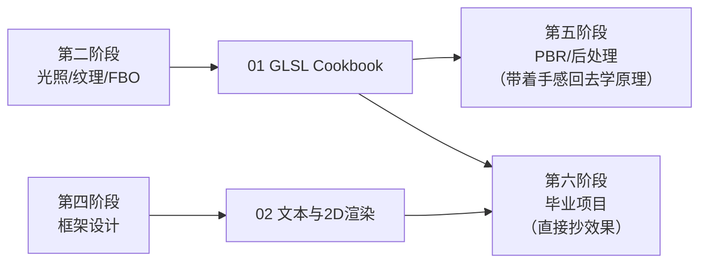

# 技术专题导览

> [返回：WebGL 与 3D 框架学习大纲](../WebGL与3D框架学习大纲.md)
> 本目录是框架实现路上的**进阶技法箱**：[数学专题](../数学专题/00-导览.md)讲"为什么"（公式从哪来），这里讲"怎么做炫、怎么做出对的效果"——每个技法给出可直接抄走的完整 GLSL，附调参表与成本账。

## 定位与边界

- 与数学专题平行互补：数学篇负责推导，本专题回答"参数怎么调、性能花多少、什么时候用"。
- 不重复主线内容：光照模型在 [02-第二阶段/05-光照](../02-第二阶段/05-光照.md)，纹理在 [02-第二阶段/03-纹理](../02-第二阶段/03-纹理.md)，菲涅尔的物理版在 [05-第五阶段/04-PBR入门](../05-第五阶段/04-PBR入门.md)，后处理在 [05-第五阶段/03-后处理管线](../05-第五阶段/03-后处理管线.md)——本文只交叉引用，不重讲原理。
- 代码边界：以 GLSL 与关键 TS 为主；createProgram、矩阵库、渲染循环等 JS 骨架直接复用主线分册，不在本专题内重复出现。
- 面向的读者：走完第二阶段（会写 Blinn-Phong、会用纹理与 FBO），想让自研框架（三、四阶段）有"效果卖相"，给毕业项目（六阶段）攒弹药。

## 分册索引

| 篇 | 内容一句话 | 优先服务阶段 |
|---|---|---|
| [01-GLSL Cookbook](01-GLSL%20Cookbook.md) | 九个即抄即用的着色器技法：菲涅尔边缘光、卡通着色、轮廓描边三法、溶解、玻璃折射、全息故障、顶点动画、水面、组合套路 | 二（光照/纹理的进阶玩法）、五（PBR/后处理的前置手感）、六（毕业项目效果） |
| [02-文本与2D渲染](02-文本与2D渲染.md) | 3D 场景里文本与精灵的全部路线：canvas 纹理、SDF/MSDF 字体、billboard 三种朝向、点精灵，落到框架 Label 系统设计 | 四（Sprite/Label API 设计）、六（毕业项目名称标签） |

## 需求速查

| 需求 | 去哪 |
|---|---|
| 角色/武器边缘发光、护盾、逆光补亮 | [01 §1.1](01-GLSL%20Cookbook.md) |
| 二次元/风格化渲染 | 01 §1.2、§1.3 |
| 死亡消失、传送、载具损毁 | 01 §1.4、§1.9 |
| 玻璃、冰块、热浪扭曲、传送门 | 01 §1.5、§1.9 |
| 科幻 UI、全息投影、损坏的屏幕 | 01 §1.6 |
| 草地、旗帜、点击涟漪、水面 | 01 §1.7、§1.8 |
| 场景名称标签、海量标注、伤害数字 | [02 全篇](02-文本与2D渲染.md) |

## 阅读路线

两种用法：

1. **按需抄**：遇到具体效果需求，按上面速查表直达小节，复制着色器改参数——每节的调参表就是为此准备的。
2. **系统练**：01 从 1.1 顺读到 1.9，前八节是递进的（菲涅尔是卡通描边与水面的零件，噪声是溶解与水面的地基，1.9 教怎么拼装）；02 从 2.1 顺读到 2.7，是一条"文本渲染路线选型 → 框架 API 落地"的完整决策链。

## 约定

- 着色器统一用 WebGL1 语法（attribute / varying / texture2D / gl_FragColor），兼容性最好；迁 WebGL2 只需三处替换：attribute→in、varying→in（顶点）/out（片元）、texture2D→texture，详见 [02-第二阶段/07-WebGL2特性](../02-第二阶段/07-WebGL2特性.md)。
- JS 侧骨架（createProgram、矩阵库、渲染循环）在 [02-第二阶段/05-光照](../02-第二阶段/05-光照.md) 已给全，本专题不再重复，专注 GLSL 与设计本身。
- 每个技法固定结构：效果描述 → 原理（链接数学专题/主线对应篇）→ 完整 GLSL → 调参表 → 使用场景与成本。

## 抄走之后怎么验证

1. 单效果开关：给每个技法留一个 uniform 总开关（强度归零即关闭），保证效果可单独下线排查。
2. 参数面板：把调参表的 uniform 挂到 dat.GUI / lil-gui 之类的面板上实时拖——本文所有推荐区间都值得亲手拖一遍建立手感。
3. 性能对比：效果叠加前后各测一次帧时间，怀疑 drawcall/状态问题时用 Spector.js 抓帧（见 [05-第五阶段/07-性能优化与调试](../05-第五阶段/07-性能优化与调试.md)）。

各篇末尾有常见坑与本节自测；专题不设综合实践，效果直接搬进主线各阶段的实践任务与毕业项目检验。
