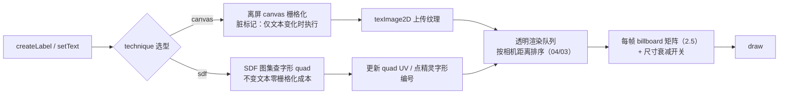

# 文本与 2D 渲染

> [返回：WebGL 与 3D 框架学习大纲](../WebGL与3D框架学习大纲.md)
> 本文是技术专题第二篇：3D 场景里"画字、画面片"的四条技术路线（DOM overlay / canvas 纹理 / SDF 与 MSDF / 点精灵），以及把它们拼成框架 Sprite/Label 系统的设计；服务第四阶段框架 API 设计与第六阶段毕业项目的名称标签需求；分册导览见 [00-导览](00-导览.md)。

## 2.1 为什么 3D 框架要自己解决文本

**概念**：浏览器本来就会画字，但 3D 场景里的文本有"和场景一致"的硬要求，DOM 叠层的三个先天缺陷都由此而来：

| 路线 | 优点 | 硬伤 |
|---|---|---|
| DOM overlay（div 绝对定位叠在 canvas 上） | 免费、清晰、可交互、无分辨率问题 | 不参与深度测试（永远盖在场景上，除非手动做遮挡剔除）；进不了后处理管线；每帧同步"投影 → 屏幕坐标"，量大时抖动与性能双杀 |
| 2D canvas 叠加层 | 文字质量好、API 全 | 同样不参与深度/后处理，且多一层合成开销 |
| WebGL 内渲染（本文路线） | 深度、后处理、变换与场景完全一致，可被遮挡、可加 bloom 光晕 | 栅格化自己解决：位图路线（canvas 纹理）或矢量路线（SDF） |

逐条展开 DOM overlay 的三个硬伤：

1. **不参与深度**：div 没有 z 概念，场景里的柱子"挡不住"标签——要么接受穿帮，要么每帧对每个标签做射线遮挡检测（成本回到 CPU）。
2. **进不了后处理**：[后处理管线](../05-第五阶段/03-后处理管线.md)操作的是 FBO 纹理，DOM 在合成器层，bloom、暗角、色调映射全都加不到标签上；科幻 UI 想让文字发光（[GLSL Cookbook 1.6](01-GLSL%20Cookbook.md)）就断了路。
3. **同步成本**：每个标签每帧要算"世界坐标 → MVP → NDC → 屏幕像素"，再改 DOM 样式触发样式重算；上百个标签时掉帧且亚像素抖动明显（DOM 坐标取整跳变）。

**适用边界**：纯 UI（菜单、tooltip）且数量少——DOM 最省事；一旦需要被遮挡、参与后处理、上千标签，进 WebGL 管线。毕业项目的行星名称标签（[06-第六阶段/04-毕业项目-需求书](../06-第六阶段/04-毕业项目-需求书.md)）是典型输入。

## 2.2 Canvas 纹理文本

**原理**：把字画在离屏 canvas 上，整块作为纹理贴到一个面向相机的面片上。文字栅格化交给浏览器 2D 引擎（抗锯齿、hinting 白拿），WebGL 只管贴图。这是动态文本的第一选择。

```typescript
// canvasText.ts —— 离屏 canvas → 纹理
export interface TextTexture { texture: WebGLTexture; width: number; height: number; }

export function createTextTexture(
  gl: WebGLRenderingContext,
  text: string,
  fontSize: number,          // 期望的"屏幕像素"字号
  family = 'sans-serif',
  color = '#ffffff',
): TextTexture {
  const dpr = Math.min(window.devicePixelRatio || 1, 2);  // 按 dpr 放大栅格化，防止糊
  const font = `500 ${fontSize * dpr}px ${family}`;
  const canvas = document.createElement('canvas');
  const ctx = canvas.getContext('2d')!;

  ctx.font = font;
  const m = ctx.measureText(text);
  const pad = 8 * dpr;
  canvas.width = Math.ceil(m.width + pad * 2);            // 文本纹理几乎都是 NPOT
  canvas.height = Math.ceil(fontSize * dpr * 1.4 + pad * 2);

  ctx.font = font;                 // 坑：改 canvas 尺寸会重置全部 2D 状态
  ctx.fillStyle = color;
  ctx.textBaseline = 'top';
  ctx.fillText(text, pad, pad);

  const texture = gl.createTexture()!;
  gl.bindTexture(gl.TEXTURE_2D, texture);
  gl.pixelStorei(gl.UNPACK_FLIP_Y_WEBGL, 1);   // canvas 的 y 向下，见 02/03 2.5
  gl.texImage2D(gl.TEXTURE_2D, 0, gl.RGBA, gl.RGBA, gl.UNSIGNED_BYTE, canvas);
  // NPOT 纹理：WebGL1 下不能 mipmap，MIN_FILTER 必须 LINEAR + CLAMP（02/03 2.2）
  gl.texParameteri(gl.TEXTURE_2D, gl.TEXTURE_MIN_FILTER, gl.LINEAR);
  gl.texParameteri(gl.TEXTURE_2D, gl.TEXTURE_MAG_FILTER, gl.LINEAR);
  gl.texParameteri(gl.TEXTURE_2D, gl.TEXTURE_WRAP_S, gl.CLAMP_TO_EDGE);
  gl.texParameteri(gl.TEXTURE_2D, gl.TEXTURE_WRAP_T, gl.CLAMP_TO_EDGE);
  return { texture, width: canvas.width / dpr, height: canvas.height / dpr };
}
```

绘制：一个单位 quad，用 2.5 的 billboard 矩阵摆到目标位置面向相机，`uModel` 直接喂该矩阵；混合开 `blendFunc(SRC_ALPHA, ONE_MINUS_SRC_ALPHA)`（预乘问题的两种解法见 [02-第二阶段/03-纹理](../02-第二阶段/03-纹理.md) 2.5）。相机与渲染循环用第三阶段的 [引擎最小核心](../03-第三阶段/03-引擎最小核心.md)。

**实时更新策略与成本**：重栅格化 + `texImage2D` 上传是 CPU/带宽大头（512x128 RGBA 约 256 KB，毫秒级），策略有三条：

1. **脏标记**：`setText` 只置脏，下一帧才重画；文本不变就零成本。
2. **字符串缓存**：伤害数字按字符串复用纹理（"999" 命中缓存），只有新字符串才栅格化。
3. **按最大显示尺寸一次性栅格化**：按"标签可能占的最大屏幕像素 x dpr"生成，之后不再重画；纹理像素少于屏幕像素时双线性放大发糊——这就是分辨率与模糊的全部秘密。

**场景与成本**：中小数量的静态/低频更新文本（名称、标题、对话）。每标签一张纹理，几百个标签就该换 SDF 图集（下一节）。

## 2.3 SDF 字体原理

**概念**：带符号距离场（Signed Distance Field, SDF）——纹理里不再存"字的像素颜色"，而是存**每个像素到字形边缘的有符号距离**：内部为正、外部为负、边缘恰好为 0（存储时归一化，边缘约定在 0.5）。

**为什么缩放不糊**：位图存的是"覆盖率"，放大后双线性插值把 0/1 的边界插成一坡灰——边缘越来越糊。SDF 存的是"距离"，双线性插值对距离插值，结果仍近似真实距离场——0.5 等值线的位置始终准确，边缘永远锐利，只有斜坡宽度（抗锯齿带）随缩放变化。这正是信号重建的差别（重建与重采样见 [数学专题/05](../数学专题/05-采样卷积与频域.md) 5.1）。

**生成方式一：从位图做距离变换（JS 版）**。栅格化一个大号字形，对 alpha 做阈值化，跑两趟倒角距离变换（chamfer distance transform）：内部场与外部场各求一次欧氏近似距离，相减得到带符号距离，再按 spread（扩散半径，像素）归一化：

```typescript
// sdf.ts —— 位图 alpha → SDF（两趟倒角距离变换）
function chamfer(d: Float32Array, w: number, h: number) {
  const D1 = 1, D2 = Math.SQRT2;
  // 正向：左上 → 右下
  for (let y = 0; y < h; y++) for (let x = 0; x < w; x++) {
    const i = y * w + x; let v = d[i];
    if (x > 0)          v = Math.min(v, d[i - 1] + D1);
    if (y > 0)          v = Math.min(v, d[i - w] + D1);
    if (x > 0 && y > 0) v = Math.min(v, d[i - w - 1] + D2);
    if (x < w - 1 && y > 0) v = Math.min(v, d[i - w + 1] + D2);
    d[i] = v;
  }
  // 反向：右下 → 左上
  for (let y = h - 1; y >= 0; y--) for (let x = w - 1; x >= 0; x--) {
    const i = y * w + x; let v = d[i];
    if (x < w - 1)      v = Math.min(v, d[i + 1] + D1);
    if (y < h - 1)      v = Math.min(v, d[i + w] + D1);
    if (x < w - 1 && y < h - 1) v = Math.min(v, d[i + w + 1] + D2);
    if (x > 0 && y < h - 1) v = Math.min(v, d[i + w - 1] + D2);
    d[i] = v;
  }
}

export function bitmapToSDF(canvas: HTMLCanvasElement, spread = 8): HTMLCanvasElement {
  const w = canvas.width, h = canvas.height;
  const alpha = canvas.getContext('2d')!.getImageData(0, 0, w, h).data;
  const INF = 1e6;
  const inside = new Float32Array(w * h).fill(INF);   // 字形内部距离场
  const outside = new Float32Array(w * h).fill(INF);  // 外部距离场
  for (let i = 0; i < w * h; i++) {
    if (alpha[i * 4 + 3] > 128) inside[i] = 0; else outside[i] = 0;
  }
  chamfer(inside, w, h); chamfer(outside, w, h);
  const out = document.createElement('canvas'); out.width = w; out.height = h;
  const img = out.getContext('2d')!.createImageData(w, h);
  for (let i = 0; i < w * h; i++) {
    const sd = (inside[i] - outside[i]) / (2 * spread);   // spread 像素对应 [-1,1]
    const v = Math.max(0, Math.min(255, (0.5 + sd * 0.5) * 255));  // 边缘落在 0.5
    img.data[i * 4] = img.data[i * 4 + 1] = img.data[i * 4 + 2] = v;
    img.data[i * 4 + 3] = 255;
  }
  out.getContext('2d')!.putImageData(img, 0, 0);
  return out;
}
```

**生成方式二：现成工具**。项目里别手写：tiny-sdf（Mapbox，npm，单字 SDF）、各在线 SDF 生成器、以及下一节的 MSDF 工具链，产出的都是"图集 + 每字形的 UV 矩形与度量"两件套。自写 DT 的价值是理解原理与离线兜底。

**fwidth 边缘平滑**：采样得到距离 d 后，`smoothstep(0.5 − w, 0.5 + w, d)` 阈值化，`w = fwidth(d)` 恰好是"一像素对应的距离宽度"——任何缩放下抗锯齿带都正好一个像素：

```glsl
// sdf-text.frag —— 描边/阴影/发光三件套：全是距离的偏移与再阈值化
#extension GL_OES_standard_derivatives : enable   // WebGL1 需要此扩展；WebGL2 删掉这行
precision highp float;
varying vec2 vUV;
uniform sampler2D uSdf;       // SDF 图集，0.5 为字形边缘
uniform vec4 uFillColor, uOutlineColor, uShadowColor, uGlowColor;
uniform float uOutlineWidth;  // 描边宽度（SDF 距离单位）
uniform vec2 uShadowOffset;   // 阴影偏移（UV 单位）
uniform float uGlowWidth;     // 发光半径（SDF 距离单位）
float sampleSdf(vec2 uv) { return texture2D(uSdf, uv).r - 0.5; }  // 以边缘为零点

void main() {
  float d = sampleSdf(vUV);
  float aa = fwidth(d);         // 一像素宽的抗锯齿带

  float fill    = smoothstep(-aa, aa, d);                         // 本体
  float outline = smoothstep(-aa, aa, d + uOutlineWidth);         // 向外推的等值面
  float shadow  = smoothstep(-aa, aa, sampleSdf(vUV - uShadowOffset)); // 偏移采样的剪影
  float glow    = 1.0 - smoothstep(0.0, uGlowWidth, max(d, 0.0)); // 从边缘向外衰减

  // 由宽到窄叠四层：发光 → 阴影 → 描边 → 本体
  vec4 color = vec4(uGlowColor.rgb, uGlowColor.a * glow);
  color = mix(color, uShadowColor, shadow);
  color = mix(color, uOutlineColor, outline);
  color = mix(color, uFillColor, fill);
  gl_FragColor = color;
}
```

三件套的本质：**描边是距离的平移阈值、阴影是 UV 偏移后重新阈值、发光是围绕 0.5 的宽 smoothstep**——零额外素材，同一张 SDF 图集全办了。顶点着色器与 2.2 的 quad 相同（UV 来自字形在图集里的矩形）。

**场景与成本**：海量小字号文本（UI、标签、伤害数字）、需要描边/发光的节目单字。成本：每片元几次插值与 smoothstep，图集一次生成终身使用（每字号不再重画，缩放旋转全部免费）。

## 2.4 MSDF 概念

**原理**：单通道 SDF 有个先天缺陷——**尖角剪切（sharp corner clipping）**。字形尖角（"M"的顶点、七的折角）附近，两条边的距离场在此交汇，每个像素只能存"到最近边的距离"一个数；双线性插值时两个方向的距离互相平均，等值线在角点附近被削圆。

```
单通道 SDF：两条边的距离场"打架"，        MSDF：R/G/B 各存一个初始方向
插值只能给折中值 → 尖角被剪圆             不同的 1D 距离分量，片元里取
                                        median(r,g,b)——角点处的中值恰好
  \                                      来自"正确的那条边" → 角保住了
   \__  ← 这里应是尖角，被削圆             \__
                                           \__  ← 角完整
```

多通道带符号距离场（Multi-channel SDF, MSDF）把三个初始方向不同的距离分量分别存进 R/G/B，采样后取中值：

```glsl
float median3(float r, float g, float b) {
  return max(min(r, g), min(max(r, g), b));
}
// d = median3(tex.r, tex.g, tex.b)，其余与 2.3 的 SDF 完全相同
```

**工具链**：msdf-atlas-gen（Chlumsky 的命令行工具，输入 ttf/otf，输出图集位图 + JSON 字形度量）、msdf-bmfont（npm，输出 BMFont 兼容格式）、若干在线生成器。运行时只需在 2.3 的着色器里把单通道采样换成三通道 median，其余代码（图集 UV、smoothstep、三件套）原样复用。本文只讲原理与接法，不做生成器实现。

## 2.5 Billboard 三种朝向

**概念**：公告牌（Billboard）= 让一个面片始终以指定方式朝向相机。三种朝向模式对应三种产品需求，矩阵推导各不相同：

```
（俯视示意，相机在上方）

spherical（球形）          cylindrical（圆柱形）      screen（屏幕对齐）
   cam ▽ 在此                cam ▽ 在此                 cam ▽ 整个屏幕
    \   面片法线指向           \   只绕 Y 轴转             所有面片与屏幕平行
     \  ↗ 相机位置             \  ↗                        （取相机 right/up）
      ▭ 可随俯仰倾斜           ─┴─ 永远立着、文字水平
```

**矩阵推导**：billboard 矩阵就是一组"现算的正交基"（构建任意正交基的一般方法见 [数学专题/01](../数学专题/01-线性代数深化.md)），列主序下模型矩阵的列 = right·半宽、up·半高、forward、position：

1. **球形（spherical）**：`forward = normalize(camPos − objPos)`（面片法线指向**相机位置**）；`right = normalize(cross(worldUp, forward))`；`up = cross(forward, right)`。相机俯仰时面片跟着倾斜；面片偏离屏幕中心时与屏幕有夹角（透视下"对着相机"不等于"平行屏幕"）。
2. **圆柱形（cylindrical）**：forward 投影到水平面 `normalize(vec3(dx, 0, dz))`；up 锁死世界 up `(0,1,0)`；`right = up × forward`。文字永远水平可读——**标签的标准选择**。
3. **屏幕对齐（screen-aligned）**：forward 取视轴反方向，right/up 直接取相机基向量——从 view 矩阵按行取出（列主序下 `view[0..2]` 是相机 right，`view[4..6]` 是相机 up）。所有面片严格平行屏幕、朝向一致，粒子和光晕的标准做法（[05-第五阶段/05-粒子系统](../05-第五阶段/05-粒子系统与Instancing实战.md) 4.3 的 billboard 正是这种）。

```typescript
// billboard.ts —— 三种朝向的模型矩阵（列主序 Float32Array(16)）
export type BillboardMode = 'spherical' | 'cylindrical' | 'screen';
type V3 = [number, number, number];
const sub = (a: V3, b: V3): V3 => [a[0]-b[0], a[1]-b[1], a[2]-b[2]];
const cross = (a: V3, b: V3): V3 =>
  [a[1]*b[2]-a[2]*b[1], a[2]*b[0]-a[0]*b[2], a[0]*b[1]-a[1]*b[0]];
const norm = (a: V3): V3 => { const l = Math.hypot(...a) || 1; return [a[0]/l, a[1]/l, a[2]/l]; };

export function billboardMatrix(
  mode: BillboardMode, pos: V3, camPos: V3, view: Float32Array,
  halfW: number, halfH: number,
): Float32Array {
  let right: V3; let up: V3; let forward: V3;
  if (mode === 'screen') {
    // 列主序 view 矩阵按行取旋转部分 = 相机基向量（世界空间）
    right = norm([view[0], view[4], view[8]]);
    up = [view[1], view[5], view[9]];
    forward = cross(right, up);
  } else if (mode === 'spherical') {
    forward = norm(sub(camPos, pos));           // 面片 → 相机
    right = norm(cross([0, 1, 0], forward));
    up = cross(forward, right);                 // 可随俯仰倾斜
  } else {                                      // cylindrical：只绕 Y 转
    const d = sub(camPos, pos);
    forward = norm([d[0], 0, d[2]]);            // 投影到水平面
    up = [0, 1, 0];
    right = cross(up, forward);                 // 已是单位向量
  }
  // 模型矩阵：列 = right·halfW, up·halfH, forward, position
  return new Float32Array([
    right[0] * halfW, right[1] * halfW, right[2] * halfW, 0,
    up[0] * halfH, up[1] * halfH, up[2] * halfH, 0,
    forward[0], forward[1], forward[2], 0,
    pos[0], pos[1], pos[2], 1,
  ]);
}
```

矩阵里 w 分量的意义（为什么第四列直接放位置）见 [数学专题/02](../数学专题/02-仿射几何与齐次坐标.md) 与 [01-第一阶段/05-图形学数学基础](../01-第一阶段/05-图形学数学基础.md)。逐实例 billboard（粒子/草海）不在 CPU 算矩阵，而是把 right/up 传进顶点着色器在 GPU 上展开——[05/05](../05-第五阶段/05-粒子系统与Instancing实战.md) 4.3 有完整 GLSL。

## 2.6 点精灵（gl.POINTS + gl_PointSize）

**概念**：点精灵（point sprite）= 一个顶点一个"自动光栅化的面片"。顶点着色器里写 `gl_PointSize`（像素直径），片元着色器里用 `gl_PointCoord`（点内 0～1 坐标，原点左上）采样字形图集。一个 drawcall 画完全部标签，是**海量标注的性能路线**。

```glsl
// label-points.vert
attribute vec3 aPosition;     // 标签锚点（世界空间）
attribute float aSize;        // 世界尺寸（直径）
attribute float aGlyph;       // 图集里的字形编号
uniform mat4 uView, uProjection;
uniform float uProjScale;     // viewportHeight / (2 * tan(fov/2))，CPU 算好
varying float vGlyph;
void main() {
  vGlyph = aGlyph;
  gl_Position = uProjection * uView * vec4(aPosition, 1.0);
  // 透视尺寸衰减：像素尺寸 = 世界尺寸 × uProjScale / 视深
  // 透视投影后 gl_Position.w 恰好等于视空间深度的相反数（数学专题/02）
  gl_PointSize = clamp(aSize * uProjScale / gl_Position.w, 1.0, 64.0);
}
```

```glsl
// label-points.frag
precision mediump float;
varying float vGlyph;
uniform sampler2D uAtlas;   // 16x16 字形图集（SDF 或位图）
uniform vec3 uColor;
uniform float uAtlasCols;   // 图集列数
void main() {
  float col = mod(vGlyph, uAtlasCols);
  float row = floor(vGlyph / uAtlasCols);
  vec2 uv = (vec2(col, row) + gl_PointCoord) / uAtlasCols;  // 点内坐标 → 图集 UV
  float alpha = texture2D(uAtlas, uv).r;
  if (alpha < 0.35) discard;
  gl_FragColor = vec4(uColor, smoothstep(0.3, 0.5, alpha));
}
```

数据侧：所有标签交错塞进一个 buffer（位置 3 + 尺寸 1 + 字形 1，stride 32 字节），`drawArrays(gl.POINTS, 0, N)` 一次画完，N 上万无压力；文字变化只 `bufferSubData` 对应区段。

**尺寸与裁剪的两个规范级限制**：

1. `gl_PointSize` 有实现相关的上限，用 `gl.getParameter(gl.ALIASED_POINT_SIZE_RANGE)` 查询——常见上限 64 或 256、个别实现甚至只有 1；大字号标签别走点精灵，回到 quad。
2. **点的中心一旦出视口，整个点被裁掉**（图元级裁剪按中心点判定）——标签不是"滑出屏幕"而是"到边缘突然消失"，产品级体验差；这是海量标签最终常回到 instancing quad（05/05）的主因。

**场景与成本**：调试可视化、地图海量的图标/单字标注（数字、字母）。成本：一个 drawcall + 顶点数据量本身，是所有文本路线里最便宜的。

## 2.7 落地设计：框架 Sprite / Label 系统

**目标**：把 2.2～2.6 的路线收进一个最小可用的 Label API，藏在框架里，让业务侧不感知技术选型。

```typescript
// label.ts —— 框架 Label 最小接口草图
export type BillboardMode = 'spherical' | 'cylindrical' | 'screen';

export interface LabelOptions {
  text: string;
  fontSize: number;                      // 世界单位高度
  color: string;
  mode?: BillboardMode;                  // 默认 cylindrical（可读性最好）
  alwaysFacing?: boolean;                // false = 当普通面片贴世界
  sizeAttenuation?: boolean;             // false = 恒定屏幕尺寸（远处也看得清）
  technique?: 'canvas' | 'sdf';          // 静态大标题用 canvas，动态海量小字用 SDF
}

export interface Label {
  setText(text: string): void;           // 脏标记，下一帧才重栅格化/换字形
  setAlwaysFacing(on: boolean): void;    // 运行时切换朝向模式
  getAnchor(): void;                     // 锚点 = 场景图上的挂点
  dispose(): void;                       // 纹理/几何的显存回收（04/02 生命周期）
}

export interface Engine {
  createLabel(options: LabelOptions): Label;
}
```

数据流（脏标记贯穿始终，文本不变时几乎零成本）：



设计要点（对应第四阶段已有机制，不重复实现）：

1. **选型策略**：默认 SDF（缩放安全、三件套免费）；仅当字形图集缺字（生僻字/emoji）或需要单标签大标题时走 canvas 纹理兜底——canvas 兜底的思路与 [02/03 纹理](../02-第二阶段/03-纹理.md) 2.1 的程序化纹理同源。
2. **渲染队列**：Label 全部透明，进透明队列按距离排序（[04-第四阶段/03-场景图](../04-第四阶段/03-场景图.md)），billboard 矩阵在渲染时现算，不污染场景图的 worldMatrix 缓存。
3. **生命周期**：纹理与 quad 几何挂到 Label 上，`dispose` 统一回收（[04-第四阶段/02-框架总体架构](../04-第四阶段/02-框架总体架构.md)）；字符串纹理缓存做引用计数，最后一个引用释放才删纹理。
4. **海量路线**：单标签 API 背后留一个批量入口（点精灵或 instancing quad），地图类场景直接走批路径——对业务侧是 `engine.createLabels(list)` 的问题，不是技术选型问题。

## 常见坑

1. **NPOT + mipmap**：文本纹理几乎全是非 2 次幂，WebGL1 下开 mipmap 直接黑图；`MIN_FILTER = LINEAR` + `CLAMP_TO_EDGE`（[02/03](../02-第二阶段/03-纹理.md) 2.2）。
2. **canvas 尺寸改动重置状态**：设置 `canvas.width/height` 后 `font`、`fillStyle` 全部清空，必须重设再画（2.2 代码里的第二次 `ctx.font` 不是笔误）。
3. **y 方向不统一**：`UNPACK_FLIP_Y`、canvas 的 y 向下、`gl_PointCoord` 的原点在左上——三处翻转逻辑要对齐，否则字是倒的或图集采错行。
4. **预乘 alpha 边缘发白/发黑**：canvas 上传自带预乘语义，混合函数要配套（两种解法见 [02/03](../02-第二阶段/03-纹理.md) 2.5）。
5. **SDF 图集字形贴边**：双线性采样会读到隔壁字形，图集每格必须留 padding（spread 至少 4～8 像素）。
6. **gl_PointSize 想当然**：不查询 `ALIASED_POINT_SIZE_RANGE` 就用大点，在部分移动端直接不显示。
7. **每帧重栅格化**：计时器/伤害数字每帧 `setText` 重画 canvas，CPU 拉满；脏标记 + 字符串缓存是底线。
8. **标签选错朝向**：spherical 模式下相机俯仰时文字跟着歪，阅读性差——场景标签默认 cylindrical。

## 【本节自测】

1. DOM overlay 的三个硬伤分别是什么？哪一条在后处理管线（[05/03](../05-第五阶段/03-后处理管线.md)）存在时最致命，为什么？
2. 同一段文字分别用 canvas 纹理与 SDF 渲染后整体放大 4 倍：两者的边缘各是什么表现？从"纹理里存的量"解释差别。
3. 写出 `median3(r, g, b)` 的表达式；MSDF 为什么能保住单通道 SDF 保不住的尖角？
4. spherical 与 screen billboard 的差别在什么相机、什么屏幕位置下肉眼可见？为什么标签场景选 cylindrical？
5. 点精灵的透视尺寸衰减为什么除以 `gl_Position.w`？w 在透视投影后等于什么（提示：[数学专题/02](../数学专题/02-仿射几何与齐次坐标.md)）？

---

上一篇：[01-GLSL Cookbook](01-GLSL%20Cookbook.md)；[返回大纲](../WebGL与3D框架学习大纲.md)。
