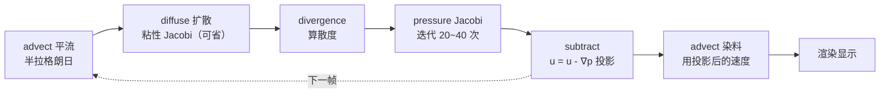

# GPGPU 与计算：把 GPU 当通用处理器

> [返回：WebGL 与 3D 框架学习大纲](../WebGL与3D框架学习大纲.md)
> 本文是技术专题第 3 篇：把第五阶段「状态纹理 ping-pong 粒子」（[05-粒子系统与Instancing实战](../05-第五阶段/05-粒子系统与Instancing实战.md) 4.4）与第二阶段「transform feedback」（[07-WebGL2特性](../02-第二阶段/07-WebGL2特性.md) 6.4）升级为一套**通用 GPGPU 方法论**——路线对比、通用封装、三个实战（湍流粒子 / boids 群集 / 2D 稳定流体）、读回与调试。主要服务第五阶段（粒子、后处理）与第六阶段（框架性能视角），并为 [04-WebGPU迁移指南](04-WebGPU迁移指南.md)的 compute 篇铺垫；已有分册不重复，只交叉引用。

## 3.1 GPGPU 是什么：GPU 本来就是一台并行计算机

### 概念

GPGPU（General-Purpose computing on GPU，通用 GPU 计算）指用图形硬件做「与画三角形无关」的计算：物理模拟、图像处理、数值求解。理由在 [第一阶段渲染管线全局观](../01-第一阶段/02-渲染管线全局观.md) 讲过——GPU 把晶体管堆在 ALU 上，靠**大规模线程级并行**而非高频取胜。写计算的思维模型是 SIMD（Single Instruction Multiple Data，单指令多数据）：同一段程序（kernel，内核函数）作用在成千上万条数据上，每条数据独立、互不等待。着色器天然就是这个形状——片元着色器对每个片元独立执行，顶点着色器对每个顶点独立执行，所以「GPU 计算」在 WebGL 里的实现思路只有一个：**把数据伪装成图形，让着色器替我们跑程序**。

WebGL2 没有计算着色器（Compute Shader，04 篇的主角），要把「每帧演进的状态」存起来，只有两条合法路线——都已在主线分册入门过，本节把它们摆上同一张桌面对比：

1. **纹理 ping-pong**（第五阶段 4.4 入门）：状态存浮点纹理，片元着色器当 kernel，每帧画一次全屏三角形，「每个纹素跑一次 FS」=「每条数据跑一次程序」，写进另一端 FBO 后交换；
2. **transform feedback**（第二阶段 6.4 入门）：状态存 VBO，顶点着色器当 kernel，`drawArrays(gl.POINTS)` 触发，「每个顶点跑一次 VS」，输出直接捕获进另一个 buffer。

### 两条路线对比表

| 维度 | 纹理 ping-pong | transform feedback |
|---|---|---|
| kernel 在哪 | 片元着色器（每纹素一次） | 顶点着色器（每顶点一次） |
| 状态存放 | 浮点纹理（纹素 = 数据） | VBO（顶点 = 数据） |
| 触发方式 | 全屏三角形 + FBO | `RASTERIZER_DISCARD` + `beginTransformFeedback` |
| **随机读输入** | 任意 `texelFetch`：能查任何粒子的状态（邻居交互的基础） | 只能读**自己的** attribute；要看别人的数据还得借纹理带进来 |
| **输出能力** | MRT 一次最多 4~8 张纹理（第二阶段 6.5） | varyings 捕获进 buffer，**必须在 link 前声明** |
| **浮点纹理的坑** | 渲染目标需 `EXT_color_buffer_float`；32F 线性过滤另需 `OES_texture_float_linear` | 无此问题：buffer 里就是原生 float attribute |
| **读回 CPU** | `readPixels`：GPU→CPU 同步停顿（3.6 专门讲） | `getBufferSubData`：同样有同步语义，fence 之后才便宜 |
| **拓扑限制** | 无：纹理尺寸任意（320×320 也行），全屏三角形覆盖即可 | 图元必须是 POINTS/TRIANGLES 等固定拓扑；顶点数随 buffer 尺寸定死，改拓扑 = 换 program 重链 |
| 与渲染的衔接 | 渲染 pass 需 `gl_InstanceID → 纹素坐标` 换算后 `texelFetch` 取状态 | 输出 buffer 直接绑成 VAO 的 attribute，**零拷贝**衔接 |
| 典型场景 | 需要邻居交互的场：流体、boids、柔体 | 纯自体积分：粒子弹道、轨迹条带（几何即数据） |

一句话选型：**要「看别人」就上纹理（随机读），要「结果直接画」且只算自己就上 TF（零拷贝）**。两者的共同宿命是都在「hack」——用光栅化硬件模拟本应存在的 compute，04 篇 4.5 会看到这些技巧在 WebGPU 里如何一一归位。边界声明：TF 的 API 细节（varyings 声明时机、反馈环）见第二阶段 6.4，粒子状态纹理的入门实现见第五阶段 4.4，ping-pong 双 FBO 的来龙去脉见 [03-后处理管线](../05-第五阶段/03-后处理管线.md) 2.1.3——本文从「通用化」开始。

## 3.2 通用 ping-pong 封装：一个 GPGPU 类

### 设计

第五阶段 4.4 的积分 pass 是「一次性代码」：FBO、纹理、swap 散落在 demo 里。任何 GPGPU 应用（3.3/3.4/3.5 三个实战）都反复同一套结构，抽象成一个类。三个设计决定：

1. **双 FBO + 双纹理 + 一个 readIndex**：读 A 写 B、翻转，读写永不落在同一张纹理（WebGL 硬规则，同后处理 2.1.3）；
2. **update 与 render 双 program 分离**：类只管 update pass 的调度，render pass 是普通绘制，由上层组装（渲染形式随应用千变万化）；着色器编译沿用第二阶段 07 分册的 `createProgram`；
3. **浮点格式检测内建**：32F 优先，失败回退半精度 16F——这是 GPGPU 可移植性的第一道坎。整体数据流：update program 读 readTexture → 画全屏三角形写另一端 → swap → render program 用 instancing + texelFetch 消费最新状态，循环往复。

### 完整 TypeScript 实现

```typescript
// gpgpu.ts —— 通用 ping-pong 状态纹理封装（WebGL2）

/** 浮点渲染目标检测：32F 优先，不行回退半精度 16F */
export function detectFloatFormat(gl: WebGL2RenderingContext) {
  // WebGL2「采样」浮点纹理是核心功能；「渲染进」浮点纹理必须靠扩展
  if (gl.getExtension('EXT_color_buffer_float')) {
    return { internalFormat: gl.RGBA32F, type: gl.FLOAT, half: false } as const;
  }
  // 部分移动端只给半精度渲染目标（移动端适配的系统做法见下方工程专题链接）
  if (gl.getExtension('EXT_color_buffer_half_float')) {
    return { internalFormat: gl.RGBA16F, type: gl.HALF_FLOAT, half: true } as const;
  }
  throw new Error('不支持浮点渲染目标：GPGPU 路线不可用（回退 CPU 或 RGBA8 编码方案）');
}

export class GPGPU {
  readonly width: number;
  readonly height: number;
  readonly half: boolean;          // 提醒上层：半精度下注意坐标尺度（见本节末尾）
  private internalFormat: number;
  private texelType: number;
  private textures: WebGLTexture[] = [];
  private fbos: WebGLFramebuffer[] = [];
  private readIndex = 0;           // 最新状态在哪家

  constructor(private gl: WebGL2RenderingContext, width: number, height: number,
              initData?: Float32Array) {
    this.width = width; this.height = height;
    this.allocate(initData);
  }

  private allocate(initData?: Float32Array): void {
    const gl = this.gl;
    const fmt = detectFloatFormat(gl);
    this.internalFormat = fmt.internalFormat;
    this.texelType = fmt.type;
    this.half = fmt.half;
    // 两端都要灌初始数据：swap 之后旧的那端也会被读，漏一边就是读垃圾
    this.textures = [this.createTexture(initData), this.createTexture(initData)];
    this.fbos = this.textures.map((t) => this.createFBO(t));
    // 立刻做完整性检查：扩展「存在」不等于该格式「能当附件」
    gl.bindFramebuffer(gl.FRAMEBUFFER, this.fbos[0]);
    const ok = gl.checkFramebufferStatus(gl.FRAMEBUFFER) === gl.FRAMEBUFFER_COMPLETE;
    gl.bindFramebuffer(gl.FRAMEBUFFER, null);
    if (!ok) throw new Error('浮点 FBO 不完整：设备声称支持扩展但拒绝此格式');
  }

  private createTexture(data?: Float32Array): WebGLTexture {
    const gl = this.gl;
    const tex = gl.createTexture()!;
    gl.bindTexture(gl.TEXTURE_2D, tex);
    gl.texImage2D(gl.TEXTURE_2D, 0, this.internalFormat,
      this.width, this.height, 0, gl.RGBA, this.texelType, data ?? null);
    // 状态是数据不是图像：NEAREST，杜绝任何过滤（第五阶段 4.4 的老坑）
    gl.texParameteri(gl.TEXTURE_2D, gl.TEXTURE_MIN_FILTER, gl.NEAREST);
    gl.texParameteri(gl.TEXTURE_2D, gl.TEXTURE_MAG_FILTER, gl.NEAREST);
    gl.texParameteri(gl.TEXTURE_2D, gl.TEXTURE_WRAP_S, gl.CLAMP_TO_EDGE);
    gl.texParameteri(gl.TEXTURE_2D, gl.TEXTURE_WRAP_T, gl.CLAMP_TO_EDGE);
    return tex;
  }

  private createFBO(tex: WebGLTexture): WebGLFramebuffer {
    const gl = this.gl;
    const fbo = gl.createFramebuffer()!;
    gl.bindFramebuffer(gl.FRAMEBUFFER, fbo);
    gl.framebufferTexture2D(gl.FRAMEBUFFER, gl.COLOR_ATTACHMENT0, gl.TEXTURE_2D, tex, 0);
    gl.bindFramebuffer(gl.FRAMEBUFFER, null);
    return fbo;
  }

  /** 当前最新状态（渲染 pass 与下一步 update 的输入都读它） */
  get readTexture(): WebGLTexture {
    return this.textures[this.readIndex];
  }

  /** 跑一步 update：updateProgram 的 VS 必须是 FULLSCREEN_VS */
  step(updateProgram: WebGLProgram,
       bindInputs: (gl: WebGL2RenderingContext, prog: WebGLProgram) => void): void {
    const gl = this.gl;
    const dst = 1 - this.readIndex;
    gl.bindFramebuffer(gl.FRAMEBUFFER, this.fbos[dst]);   // 读 A 写 B
    gl.viewport(0, 0, this.width, this.height);           // FBO 尺寸 ≠ 屏幕尺寸
    gl.disable(gl.BLEND);            // 状态是数据：混合会把数据「加权平均」掉
    gl.disable(gl.DEPTH_TEST);
    gl.useProgram(updateProgram);
    bindInputs(gl, updateProgram);   // 用户绑定输入纹理与 uniform（通常含 readTexture）
    gl.drawArrays(gl.TRIANGLES, 0, 3);  // 全屏三角形（gl_VertexID 生成，同后处理 2.1.2）
    gl.bindFramebuffer(gl.FRAMEBUFFER, null);
    this.readIndex = dst;            // swap：新写的成为最新
  }

  /** 把当前端清零（压力场的迭代初值等场景用） */
  clear(): void {
    const gl = this.gl;
    gl.bindFramebuffer(gl.FRAMEBUFFER, this.fbos[this.readIndex]);
    gl.clearColor(0, 0, 0, 0);
    gl.clear(gl.COLOR_BUFFER_BIT);
    gl.bindFramebuffer(gl.FRAMEBUFFER, null);
  }

  dispose(): void {
    const gl = this.gl;
    this.textures.forEach((t) => gl.deleteTexture(t));
    this.fbos.forEach((f) => gl.deleteFramebuffer(f));
    this.textures = []; this.fbos = []; this.readIndex = 0;
  }
}

/** 全屏三角形顶点着色器：所有 update program 共用 */
export const FULLSCREEN_VS = `#version 300 es
out vec2 vUV;
void main() {
  vec2 pos = vec2((gl_VertexID << 1) & 2, gl_VertexID & 2) * 2.0 - 1.0;
  vUV = pos * 0.5 + 0.5;
  gl_Position = vec4(pos, 0.0, 1.0);
}`;

/** 纹理绑定小工具（sampler 的单元号 uniform 在初始化时设一次即可） */
export function bindTextureUnit(gl: WebGL2RenderingContext, unit: number, tex: WebGLTexture) {
  gl.activeTexture(gl.TEXTURE0 + unit);
  gl.bindTexture(gl.TEXTURE_2D, tex);
}
```

### 半精度回退的代价

RGBA16F 的尾数只有 10 位：数值在 512 附近时量化步长已到 0.5——**世界坐标直接存 16F 会肉眼可见地抖动**。三个对策按优先级：世界缩到 [-8, 8] 量级让量化步长 < 0.06；位置仍用 32F（很多设备 32F 只是不能过滤、渲染没问题）；或对位置做「减去锚点再存」的局部化。速度、颜色等本就低频的量用 16F 完全够。检测到 `half === true` 时上层要做的第一件事就是检查坐标尺度——这正是封装把 `half` 暴露出来的原因。扩展检测与降级的系统做法（含上下文创建、mediump 精度坑）见 [工程专题 02-移动端与兼容性](../工程专题/02-移动端与兼容性.md)。

## 3.3 实战一：10 万粒子湍流

### 速度场：curl noise 概念 + 简化场

湍流感的关键是**无散度**（divergence-free，场的散度为零）的速度场：散度不为零意味着流体局部被压缩/吸入，粒子会成团消失或喷泉式聚集，视觉上就是「不像流体」。构造无散场的标准技巧是 **curl noise（旋度噪声）**：取一个向量噪声势场 ψ，令速度 v = ∇×ψ（旋度）。由恒等式 ∇·(∇×ψ) = 0，**旋度场天然无散**——不用解方程，构造即保证。

对着色器友好的简化（本文用）：不写噪声库，直接用「每个分量只依赖别的轴」的解析流构造，思路同流体力学里的 ABC 流（Arnold–Beltrami–Childress flow）。对 v = (sin y, sin z, sin x) 这类场，散度 = ∂/∂x sin y + ∂/∂y sin z + ∂/∂z sin x = 0——**对 x 求导的分量不含 x**，无散白拿。叠加多组不同频率与相位、随时间平移，就是够用的湍流。

### update 双着色器

状态两张纹理各由一个 GPGPU 实例管理：`posGpu`（xyz 位置 + w 备用）、`velGpu`（xyz 速度）。每帧两个 pass：先速度后位置（半隐式欧拉，积分次序的教训见第五阶段 4.4）。

```glsl
// turbulence-vel.frag —— 速度 pass：向无散湍流场松弛
#version 300 es
precision highp float;
uniform sampler2D uPosTex;    // 上一帧位置
uniform sampler2D uVelTex;    // 上一帧速度
uniform float uDt;
uniform float uTime;
out vec4 fragColor;
void main() {
  ivec2 tc = ivec2(gl_FragCoord.xy);        // FBO 尺寸 = 纹理尺寸，纹素即粒子编号
  vec3 pos = texelFetch(uPosTex, tc, 0).xyz;
  vec3 vel = texelFetch(uVelTex, tc, 0).xyz;
  // 简化无散场：分量只依赖「别的轴」（ABC 流思路），两组频率叠加 + 时间平移
  vec3 v1 = vec3(sin(pos.y * 1.7 + uTime * 0.60),
                 sin(pos.z * 1.3 + uTime * 0.50),
                 sin(pos.x * 1.9 + uTime * 0.40));
  vec3 v2 = 0.6 * vec3(sin(pos.z * 3.1 - uTime * 0.7) + cos(pos.y * 2.3),
                       sin(pos.x * 2.7 - uTime * 0.8) + cos(pos.z * 3.7),
                       sin(pos.y * 3.3 + uTime * 0.9) + cos(pos.x * 2.1));
  vec3 field = v1 + v2;
  // 阻尼松弛：速度逐渐「贴」上场速度，比硬加加速度稳定（大 dt 也不炸）
  vel += (field - vel) * min(1.0, uDt * 2.0);
  fragColor = vec4(vel, 0.0);
}
```

```glsl
// turbulence-pos.frag —— 位置 pass：积分 + 湍流盒回绕
#version 300 es
precision highp float;
uniform sampler2D uPosTex;
uniform sampler2D uVelTex;    // 注意：读的是「刚写完」的新速度
uniform float uDt;
out vec4 fragColor;
void main() {
  ivec2 tc = ivec2(gl_FragCoord.xy);
  vec4 pos = texelFetch(uPosTex, tc, 0);
  vec3 vel = texelFetch(uVelTex, tc, 0).xyz;
  pos.xyz += vel * uDt;
  const float R = 4.0;                        // 湍流盒半径（半精度时别超 8）
  pos.xyz = mod(pos.xyz + R, 2.0 * R) - R;    // 三轴回绕：粒子永不出境
  fragColor = pos;
}
```

### render 着色器与主循环

渲染 pass 与第五阶段 4.3 的 instancing billboard 同构，唯一新东西是「状态从纹理来」：

```glsl
// turbulence.vert —— 10 万粒子渲染：gl_InstanceID → 纹素坐标
#version 300 es
layout(location = 0) in vec2 aCorner;      // 单个小四边形角点（divisor=1，同 05 分册 4.2）
uniform sampler2D uPosTex;
uniform sampler2D uVelTex;
uniform mat4 uViewProj;
uniform vec3 uCamRight;                    // billboard 轴由 CPU 从视图矩阵取行算好传入
uniform vec3 uCamUp;
out vec3 vColor;
out vec2 vCorner;
out float vAlpha;
void main() {
  int size = textureSize(uPosTex, 0).x;
  ivec2 tc = ivec2(gl_InstanceID % size, gl_InstanceID / size);
  vec3 pos = texelFetch(uPosTex, tc, 0).xyz;
  vec3 vel = texelFetch(uVelTex, tc, 0).xyz;
  float speed = length(vel);
  float s = 0.02 + speed * 0.012;          // 速度越快粒子越大：视觉能量感
  vec3 world = pos + (uCamRight * aCorner.x + uCamUp * aCorner.y) * s;
  gl_Position = uViewProj * vec4(world, 1.0);
  vColor = mix(vec3(0.15, 0.35, 0.90), vec3(1.0, 0.75, 0.30),
               smoothstep(0.0, 4.0, speed));
  vCorner = aCorner;
  vAlpha = clamp(speed * 0.35, 0.05, 1.0);
}
```

```glsl
// turbulence.frag —— 软圆点 + 加法混合
#version 300 es
precision mediump float;
in vec3 vColor;
in vec2 vCorner;
in float vAlpha;
out vec4 fragColor;
void main() {
  float mask = smoothstep(1.0, 0.6, length(vCorner));   // 方形裁成软圆
  fragColor = vec4(vColor * vAlpha * mask, 1.0);        // 配 SRC_ALPHA/ONE 加法混合
}
```

```typescript
// 主循环：10 万粒子（320×320 纹理），每帧 2 个 update pass + 1 个渲染 pass
const SIZE = 320;                                  // 320 × 320 = 102400 粒子
const posGpu = new GPGPU(gl, SIZE, SIZE, randomPositions(4.0));
const velGpu = new GPGPU(gl, SIZE, SIZE, new Float32Array(SIZE * SIZE * 4));

function frame(dt: number, t: number) {
  dt = Math.min(dt, 1 / 30);                       // 防 tab 切回 dt 爆炸（常见坑第 6 条）
  velGpu.step(velProgram, (gl, prog) => {          // pass 1：速度
    bindTextureUnit(gl, 0, posGpu.readTexture);
    bindTextureUnit(gl, 1, velGpu.readTexture);
    gl.uniform1f(gl.getUniformLocation(prog, 'uDt'), dt);
    gl.uniform1f(gl.getUniformLocation(prog, 'uTime'), t);
  });
  posGpu.step(posProgram, (gl, prog) => {          // pass 2：位置
    bindTextureUnit(gl, 0, posGpu.readTexture);    // 旧位置
    bindTextureUnit(gl, 1, velGpu.readTexture);    // step 完自动是最新（新速度）
    gl.uniform1f(gl.getUniformLocation(prog, 'uDt'), dt);
  });
  renderParticles(posGpu.readTexture, velGpu.readTexture);  // pass 3：instancing
}
```

与第五阶段 4.4 入门版相比只差工程化程度：积分 pass 的 FBO 与交换由 GPGPU 类托管，速度场换成无散湍流场（两步拆分也可用 MRT 一次写两张，第二阶段 6.5，教学版拆开更清楚）。

## 3.4 实战二：boids 群集

### 三规则与邻居问题

boids（群集模拟，Craig Reynolds 1987）用三条局部规则涌现出鸟群行为，数学上就是「速度 += 三个转向力的加权和」：

1. **分离（separation）**：与过近的邻居保持距离，斥力随距离减小而增大；
2. **对齐（alignment）**：转向邻居们的平均速度方向；
3. **聚合（cohesion）**：转向邻居们的质心。

难点全在**邻居是谁**：真邻居 = 半径内所有个体，是 O(n²) 查询。GPGPU 里两种可行做法：

- **简化半径采样（本节实现）**：不找真邻居，每帧只看「编号相邻」的固定 K 个个体——借用纹理的随机读能力做环形窗口采样。它不是物理正确的邻居，但群集是涌现行为，对邻居列表的误差不敏感；编号相邻的个体初始位置又是随机的，等价于一个随机邻居样本；
- **网格化纹理（正解，清单在后）**：把空间切成网格，只查同格与邻格的个体。

### 完整 update 着色器（速度 pass）

```glsl
// boids-vel.frag —— 三规则 + 固定窗口邻居采样（教学简化版）
#version 300 es
precision highp float;
uniform sampler2D uPosTex;
uniform sampler2D uVelTex;
uniform float uDt;
uniform int uCount;                 // 纹理宽 × 高
out vec4 fragColor;
const int K = 8;                    // 每帧只看编号相邻的 8 个个体
const float R_SEPARATION = 0.5;     // 分离半径
const float R_NEIGHBOR = 1.5;       // 邻居判定半径
void main() {
  ivec2 tc = ivec2(gl_FragCoord.xy);
  int size = textureSize(uPosTex, 0).x;
  int self = tc.y * size + tc.x;                    // 自己的线性编号
  vec3 myPos = texelFetch(uPosTex, tc, 0).xyz;
  vec3 myVel = texelFetch(uVelTex, tc, 0).xyz;

  vec3 separation = vec3(0.0), alignment = vec3(0.0), center = vec3(0.0);
  int neighbors = 0;
  for (int j = 1; j <= K; j++) {
    int other = (self + j) % uCount;                // 环形窗口：尾部粒子绕回头部
    ivec2 otc = ivec2(other % size, other / size);
    vec3 oPos = texelFetch(uPosTex, otc, 0).xyz;
    vec3 toOther = oPos - myPos;
    vec3 oVel = texelFetch(uVelTex, otc, 0).xyz;
    float dist = length(toOther);
    if (dist < R_NEIGHBOR && dist > 1e-4) {
      alignment += oVel;                            // 对齐：收集速度
      center += oPos;                               // 聚合：收集位置
      neighbors++;
      if (dist < R_SEPARATION) {
        separation -= toOther / (dist * dist);      // 分离：越近斥力越大（平方衰减）
      }
    }
  }

  vec3 steering = separation * 0.6;                 // 分离始终生效（防穿透）
  if (neighbors > 0) {
    vec3 avgVel = alignment / float(neighbors);
    vec3 centerDir = center / float(neighbors) - myPos;
    steering += (avgVel - myVel) * 0.8;             // 对齐：靠拢平均速度
    steering += centerDir * 0.4;                    // 聚合：转向质心
  }
  myVel += steering * uDt;
  // 群集不能停也不能超速（掉到 0 群就散了）：速度钳在 [vmin, vmax]
  float speed = length(myVel);
  myVel = myVel / max(speed, 1e-4) * clamp(speed, 0.6, 2.0);
  fragColor = vec4(myVel, 0.0);
}
```

位置 pass 与 3.3 的 `turbulence-pos` 完全同构（积分 + 回绕），渲染 pass 同 3.3（颜色可按「与群体平均速度的一致性」上色观察群的形成），都不重复给出。

### 网格化纹理：正解的分步清单

固定窗口会露馅的场景：粒子按某种顺序初始化（如按位置排序后编号），相邻编号就是空间邻居，K 太小时行为退化。正解是空间网格（spatial hashing），WebGL 无原子操作与可写 buffer，只能「排序 + 前缀和」绕行，分步清单：

1. **打标签 + 排序**：pass 把每粒子所属网格编号 `cellId = floor(pos / cellSize)`（2D 编码成 float 或 RG 通道）写进纹理；再按 cellId 排序粒子索引——GPU 用双调排序（bitonic sort，O(n log²n)，纯纹理 ping-pong 可实现，代码量大），或 1 万以内直接 CPU 排序后上传索引纹理；
2. **前缀和**：算出每个 cell 在排序后数组里的起始偏移（多 pass 归约实现，同样可 CPU 代劳）；
3. **update pass**：每个粒子查自己与相邻 8 个（2D）cell 的 [起始, 结束) 区间，遍历成员——这才是真·半径邻居。要点：1~2 万个体用固定窗口；上万且要空间正确性才值得付排序的代价。WebGPU 的 compute 有 `atomicAdd`，上面几步塌缩成「一个计数 buffer 一次 dispatch」（[04 篇 4.5](04-WebGPU迁移指南.md)）——这正是「hack 的复杂度会在新范式里消失」的标本。

## 3.5 实战三：2D 稳定流体直觉版

### Navier-Stokes 拆解

不可压缩流体由 Navier-Stokes 方程支配（2D、无外力、ρ=1）：

$$\frac{\partial u}{\partial t} = -\underbrace{(u \cdot \nabla)u}_{平流} + \underbrace{\nu \nabla^2 u}_{扩散} - \underbrace{\nabla p}_{压力}, \qquad \underbrace{\nabla \cdot u = 0}_{不可压缩}$$

「稳定流体」（Stable Fluids，Jos Stam 1999）的洞见是把右端拆成独立可解的算子，每帧按序各走一步，每步都写成「读纹理算一算写纹理」的 pass：



用 3.2 的 GPGPU 类管理四份状态：`velocity`（xy 速度，RG 通道用）、`dye`（染料）、`pressure`、`divergence`，全部存 **RGBA16F**——平流需要双线性采样，而 32F 的线性过滤要另开扩展，16F 的过滤是 WebGL2 核心能力且对速度/染料的精度绰绰有余（这要求给 3.2 的 `createTexture` 加一个 filter 参数，类里默认的 NEAREST 是为「逐纹素读状态」准备的）。

### 每步一个着色器

```glsl
// fluid-advect.frag —— 半拉格朗日平流：回溯采样，无条件稳定
#version 300 es
precision highp float;
in vec2 vUV;
uniform sampler2D uVelocity;
uniform sampler2D uSource;      // 平流对象：速度场自身，或染料场
uniform vec2 uTexelSize;        // 1.0 / 模拟分辨率
uniform float uDt;
uniform float uDissipation;     // 每秒衰减率（0 = 不衰减）
out vec4 fragColor;
void main() {
  vec2 vel = texture(uVelocity, vUV).xy;
  // 「这一帧到达本格」的物质，上一帧在 vUV - vel*dt 处：回溯过去偷值
  vec2 coord = vUV - vel * uDt * uTexelSize;
  vec3 result = texture(uSource, coord).rgb;
  fragColor = vec4(result / (1.0 + uDissipation * uDt), 1.0);
}
```

回溯是整个方法的灵魂：正向「把本格物质送出去」要决定一格分给多个邻居的比例（易发散）；反向「问本格的物质从哪来」只需一次双线性采样——**不论 dt 多大，值都来自场上已有的数据，不可能爆炸**，这就是「无条件稳定」。

```glsl
// fluid-diffuse.frag —— 粘性扩散：速度场的 Jacobi 迭代（α = dx² / (ν·dt)）
#version 300 es
precision highp float;
in vec2 vUV;
uniform sampler2D uVelocity;    // 上一轮迭代值（首轮是平流后的速度）
uniform vec2 uTexelSize;
uniform float uAlpha;           // 粘度与步长决定「贴住原值」的强度
out vec4 fragColor;
void main() {
  vec2 l = texture(uVelocity, vUV - vec2(uTexelSize.x, 0.0)).xy;
  vec2 r = texture(uVelocity, vUV + vec2(uTexelSize.x, 0.0)).xy;
  vec2 b = texture(uVelocity, vUV - vec2(0.0, uTexelSize.y)).xy;
  vec2 t = texture(uVelocity, vUV + vec2(0.0, uTexelSize.y)).xy;
  vec2 v0 = texture(uVelocity, vUV).xy;                      // 方程右端 b
  fragColor = vec4((l + r + b + t + uAlpha * v0) / (4.0 + uAlpha), 0.0, 1.0);
}
```

```glsl
// fluid-divergence.frag —— 散度：每格的「净流出量」
#version 300 es
precision highp float;
in vec2 vUV;
uniform sampler2D uVelocity;
uniform vec2 uTexelSize;
out vec4 fragColor;
void main() {
  float l = texture(uVelocity, vUV - vec2(uTexelSize.x, 0.0)).x;
  float r = texture(uVelocity, vUV + vec2(uTexelSize.x, 0.0)).x;
  float b = texture(uVelocity, vUV - vec2(0.0, uTexelSize.y)).y;
  float t = texture(uVelocity, vUV + vec2(0.0, uTexelSize.y)).y;
  fragColor = vec4(0.5 * (r - l + t - b), 0.0, 0.0, 1.0);
}
```

```glsl
// fluid-pressure.frag —— Jacobi 迭代解泊松方程 ∇²p = ∇·u
#version 300 es
precision highp float;
in vec2 vUV;
uniform sampler2D uPressure;    // 上一轮迭代结果
uniform sampler2D uDivergence;
uniform vec2 uTexelSize;
out vec4 fragColor;
void main() {
  float l = texture(uPressure, vUV - vec2(uTexelSize.x, 0.0)).r;
  float r = texture(uPressure, vUV + vec2(uTexelSize.x, 0.0)).r;
  float b = texture(uPressure, vUV - vec2(0.0, uTexelSize.y)).r;
  float t = texture(uPressure, vUV + vec2(0.0, uTexelSize.y)).r;
  float div = texture(uDivergence, vUV).r;
  // 离散泊松：∇²p = div 的 Jacobi 松弛形式（网格间距取 1 的教学简化）
  fragColor = vec4((l + r + b + t - div) * 0.25, 0.0, 0.0, 1.0);
}
```

```glsl
// fluid-subtract.frag —— 投影：u' = u - ∇p
#version 300 es
precision highp float;
in vec2 vUV;
uniform sampler2D uVelocity;
uniform sampler2D uPressure;
uniform vec2 uTexelSize;
out vec4 fragColor;
void main() {
  float l = texture(uPressure, vUV - vec2(uTexelSize.x, 0.0)).r;
  float r = texture(uPressure, vUV + vec2(uTexelSize.x, 0.0)).r;
  float b = texture(uPressure, vUV - vec2(0.0, uTexelSize.y)).r;
  float t = texture(uPressure, vUV + vec2(0.0, uTexelSize.y)).r;
  vec2 vel = texture(uVelocity, vUV).xy;
  vel -= 0.5 * vec2(r - l, t - b);       // 沿压力梯度「削掉」压缩分量
  fragColor = vec4(vel, 0.0, 1.0);
}
```

（粘性扩散与压力同为 Jacobi 松弛，直觉版常直接跳过——水与空气的 ν 极小，视觉差异有限，耗散可并进平流里的 `uDissipation` 近似；边界条件教学版也省略：`CLAMP_TO_EDGE` 采样已给出「边界速度镜像」的弱化效果。）

### 为什么投影能保不可压缩

Helmholtz 分解（Helmholtz decomposition）：任何矢量场都可唯一分解为**无旋部分（某个标量场的梯度）+ 无散部分**。压力投影做的就是这一刀：

$$u' = u - \nabla p, \qquad \nabla^2 p = \nabla \cdot u$$

验证只要两行：∇·u' = ∇·u − ∇·(∇p) = ∇·u − ∇²p = ∇·u − ∇·u = **0**。直觉：u 里的「源与汇」（散度不为零的压缩/膨胀分量）恰好被 p 的梯度吃掉，剩下的场每处流入 = 流出，不再堆积也不留洞——这就是不可压缩。Jacobi 迭代是解 ∇²p = ∇·u 的松弛法：迭代次数不足 = 压力没解透 = 投影不干净，视觉表现是染料缓慢「渗漏」与体积漂移；20~40 次迭代是清晰度与成本的常用折中。数学背景（梯度/散度/拉普拉斯算子的离散化）可配合 [数学专题 05-采样卷积与频域](../数学专题/05-采样卷积与频域.md)的卷积视角读。

### 主循环顺序

```typescript
function stepFluid(dt: number) {   // 每帧按 mermaid 顺序走一遍
  velocity.step(pAdvect, bind(velocity.readTexture, velocity.readTexture)); // 平流速度（读写自动两端）
  for (let i = 0; i < 4; i++) {                                             // 扩散（可选，跳过也稳）
    velocity.step(pDiffuse, bind(velocity.readTexture));
  }
  divergence.step(pDivergence, bind(velocity.readTexture));
  pressure.clear();                                  // 迭代初值归零
  for (let i = 0; i < 32; i++) {
    pressure.step(pPressure, bind(pressure.readTexture, divergence.readTexture));
  }
  velocity.step(pSubtract, bind(velocity.readTexture, pressure.readTexture)); // 投影
  dye.step(pAdvect, bind(velocity.readTexture, dye.readTexture));            // 平流染料
}   // 鼠标交互 = 向 velocity/dye 各写一个 splat 冲量（pass 形式，略）
```

## 3.6 读回与调试：状态在显存里的代价

### readPixels 的性能悬崖

GPGPU 的状态全在显存。要看一眼数值，`gl.readPixels` 是唯一的同步通道，而它踩中三重成本：GPU 侧所有未完成命令必须**冲刷执行完**（管线停顿）、数据经总线从 GPU 拷到 CPU（1080p 的 RGBA32F 是 33 MB）、JS 侧再分配 TypedArray 接收。每帧读全屏，60 fps 必死；即便只读几十像素，「等待 GPU 追平」的固定停顿也在毫秒级。结论：**读回是调试与低频同步的工具，不是渲染循环的一部分**。

```typescript
// 同步读回：RGBA32F 的规范保证组合是 RGBA + FLOAT（半浮点目标的组合各实现不一）
const pixels = new Float32Array(4 * 4);              // 只读 2×2 个纹素
gl.bindFramebuffer(gl.FRAMEBUFFER, fbo);
gl.readPixels(x, y, 2, 2, gl.RGBA, gl.FLOAT, pixels);
```

### 慢读替代

1. **降采样读回（reduce 归约）**：不在全屏上读，先把状态归约到 1×1 再读。每次调用分辨率减半的归约着色器串 10 级（1024→1），最后 readPixels 4 个 float：

```glsl
// reduce.frag —— 2×2 归约：求平均（求最大把 + 换成 max，用于越界检测）
#version 300 es
precision highp float;
in vec2 vUV;
uniform sampler2D uSource;
uniform vec2 uTexelSize;       // = 1.0 / 源分辨率
out vec4 fragColor;
void main() {
  vec2 e = uTexelSize * 0.5;
  vec4 s = texture(uSource, vUV + vec2(-e.x, -e.y))
         + texture(uSource, vUV + vec2( e.x, -e.y))
         + texture(uSource, vUV + vec2(-e.x,  e.y))
         + texture(uSource, vUV + vec2( e.x,  e.y));
  fragColor = s * 0.25;
}
```

2. **统计纹理**：归约到头的 1×1 就是「统计纹理」——最大速度、平均位置、越界粒子数，一次读回 16 字节，够帧率 HUD 或自适应步长用；
3. **异步读回**：`PIXEL_PACK_BUFFER` + `fenceSync`，本帧发起、fence 通过后下一帧 `getBufferSubData` 取——停顿被摊到未来，逻辑立刻复杂一档，确有每帧读回需求才上。

### GPGPU 可视化调试技巧

状态在显存里，console.log 够不着，技巧全在「让错误可见」：

1. **直接画状态纹理**：写一个 10 行的调试 pass 把状态当颜色画到屏幕一角（位置 → RGB、速度 → 方向色调），比任何数值读回都快；
2. **NaN/Inf 报警色**：数值一旦 NaN 会沿计算传染（NaN 参与的运算全是 NaN），调试 pass 里加一句 `if (any(isnan(v)) || any(isinf(v))) fragColor = vec4(1,0,0,1);`——亮红即坏点，比读回后手查快得多；
3. **单位场测试 + 冻结时间**：kernel 写完先喂常量场（速度全 0、位置均匀），手算期望输出对照，比喂随机数据再猜快十倍；dt 置 0 时 update 还在跑（采样与索引逻辑照常执行）、只有积分停摆——能把「索引错」与「数值发散」两类 bug 分开；
4. **Spector.js 抓帧**：确认每帧 pass 顺序、FBO 绑定与纹理格式是否如你所以为（用法见 [05-第五阶段/07-性能优化与调试](../05-第五阶段/07-性能优化与调试.md)）。

## 常见坑

1. **读写同一张纹理**：update pass 的输入输出必须是两端不同纹理——WebGL 对「同一纹理既是附件又是采样源」定义为未定义行为，症状是黑屏或闪烁的花纹。3.2 的 `step` 用 `1 - readIndex` 从结构上杜绝。
2. **update pass 前忘了关混合/深度**：上层渲染开了 `SRC_ALPHA/ONE` 加法混合，接着跑 update——状态被混合公式污染，粒子「慢慢消失」。`step` 里显式 disable。
3. **32F 纹理开了 LINEAR 过滤**：不报错，采样结果未定义（需 `OES_texture_float_linear`）。状态纹理一律 NEAREST + `texelFetch`。
4. **半精度存大坐标**：16F 在 512 附近的量化步长 0.5，位置抖动像「果冻」。见 3.2 末尾的三个对策。
5. **只初始化了一张纹理**：swap 后另一端被读，全是垃圾——构造函数里两端都要 `texImage2D` 灌初始数据（同理 update pass 的 viewport 必须设成 FBO 尺寸，否则 `gl_FragCoord` 错位、粒子状态张冠李戴）。
6. **dt 没 clamp**：切后台回来 dt 是数百毫秒，粒子积分一步飞出宇宙。`dt = Math.min(dt, 1/30)`。
7. **readPixels 的格式组合**：RGBA32F 目标用 `RGBA/FLOAT` 是规范保证组合；半浮点目标的读回组合因实现而异，先小块试读。
8. **Jacobi 迭代次数当免费**：pressure 迭代是整套流体里最贵的循环（每帧 20+ 次全屏 pass），移动端减到 10~16 次、或降低模拟分辨率，视觉损失远小于帧率损失。
9. **boids 的邻居窗口按「空间顺序」初始化**：初始位置与编号相关时固定窗口采样退化（邻居既是空间近邻又是编号近邻，行为单一），初始化务必洗牌。

## 本节自测

1. 纹理 ping-pong 与 transform feedback 各自如何规避「读写同一资源」？两者的报错方式有什么差别（TF 的反馈环 vs 纹理的未定义行为），哪个更难排查？
2. 验证 v = (sin y, sin z, sin x) 的散度为零；再说明为什么 v = ∇×ψ 对任意 ψ 都无散（写出恒等式）。如果想造一个「有源」的场（粒子被吸入一点），该改哪一项？
3. boids 的固定窗口采样在什么初始化方式下会露馅？网格化方案的第 2、3 步（排序与前缀和）为什么在 WebGL 里这么费劲，WebGPU 的哪个特性让它们消失？
4. 用两行推导说明压力投影后散度为零；Jacobi 迭代次数从 32 降到 4，画面与数值各会出现什么症状？
5. 设计一个 1×1 统计纹理方案读回「最大粒子速度」用于自适应 dt：归约着色器用 max 还是平均、几级归约、读回发生在帧的什么位置最合适？
