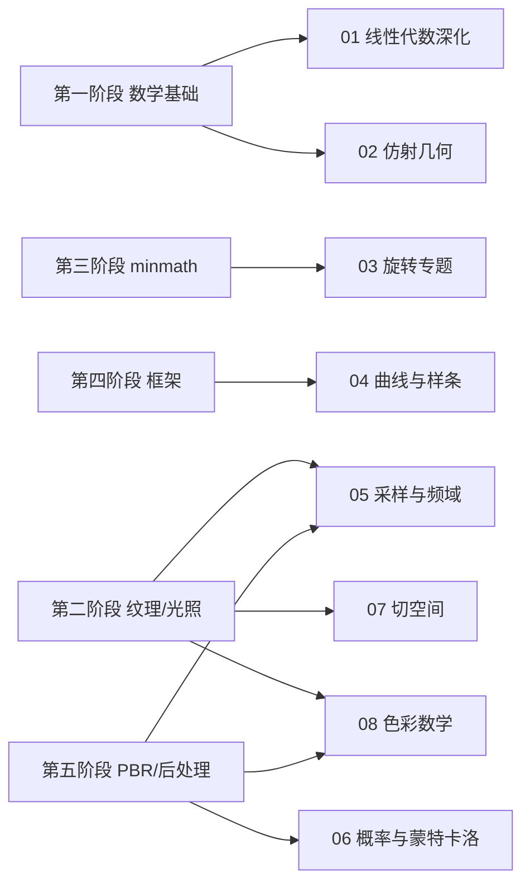

# 数学专题导览

> [返回：WebGL 与 3D 框架学习大纲](../WebGL与3D框架学习大纲.md)
> 本目录是贯穿六个阶段的数学工具箱：基础推导见 [01-第一阶段/05-图形学数学基础](../01-第一阶段/05-图形学数学基础.md)，数学库实现见 [03-第三阶段/02-数学库minmath](../03-第三阶段/02-数学库minmath.md)；这里的八篇是**深化**——讲清"为什么"，并补齐框架实现路上必须、但主线分册放不下的数学。

## 定位与边界

- **不重复**主线内容：MVP、lookAt/perspective 推导在第一阶段；四元数基础与 slerp 推导在第三阶段——本目录只交叉引用。
- **可随时查**：每篇自成体系（小节编号 N.x，N 为篇号），不要求顺序读；建议学到对应阶段时回来精读，如下表。

## 分册索引

| 篇 | 内容一句话 | 优先服务阶段 |
|---|---|---|
| [01-线性代数深化](01-线性代数深化.md) | 基变换、正交化、特征分解 PCA 最紧包围盒、极分解、最小二乘 | 三（库设计）、四（剔除/蒙皮剪切） |
| [02-仿射几何与齐次坐标](02-仿射几何与齐次坐标.md) | 点 vs 向量、w 的四种用法、法线协向量本质、视锥平面提取 | 二（光照）、四（场景图根基/剔除） |
| [03-旋转表示与转换](03-旋转表示与转换.md) | 五种旋转表示 12 条互转、内外旋对偶、dq/dt 积分、四元数平均 | 三（minmath）、四（动画） |
| [04-曲线与样条](04-曲线与样条.md) | 贝塞尔/B 样条/Catmull-Rom、弧长参数化与匀速轨迹 | 四（动画/相机轨迹） |
| [05-采样卷积与频域](05-采样卷积与频域.md) | 卷积与可分离核、傅里叶视角看走样、反走样三条路线的本质 | 二（纹理/mipmap）、五（后处理） |
| [06-概率与蒙特卡洛](06-概率与蒙特卡洛.md) | MC 积分、重要性采样四档手算、渲染方程估计器 | 五（PBR/IBL/prefilter） |
| [07-切空间与几何算法](07-切空间与几何算法.md) | TBN 完整推导与实现、高度图重建法线、最近点算法家族 | 二（法线贴图）、四（拾取/碰撞） |
| [08-色彩数学](08-色彩数学.md) | 色彩空间三要素、转换矩阵推导、HDR/色调映射数学、全链路标注 | 二（Gamma）、五（后处理/PBR） |

## 阅读路线

两种用法：

1. **随阶段查**：按上表"优先服务阶段"列，学到该阶段时读对应专题（每篇开头也有定位说明）。
2. **系统补**：按 01 → 02 → 03 → 04（几何/代数线）与 05 → 06（信号/统计线）、07 → 08（应用线）三条线各顺读一遍。

各篇末尾均有本节自测；专题不设阶段综合自测，学完直接回主线实践任务检验。
