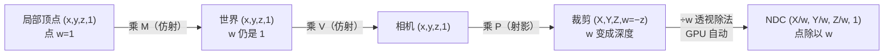

# 仿射几何与齐次坐标

> [返回：WebGL 与 3D 框架学习大纲](../WebGL与3D框架学习大纲.md)
> 一句话定位：数学专题第二册。在第一阶段 [图形学数学基础](../01-第一阶段/05-图形学数学基础.md) 4.2.4（齐次坐标的引入）与 4.5（坐标空间全链路）的基础上，把"点与向量""w 分量""仿射变换""法线""裁剪平面"五件事讲到底。服务于第二阶段 [光照](../02-第二阶段/05-光照.md) 的法线矩阵、第四阶段 [场景图](../04-第四阶段/03-场景图.md) 的变换链与 [交互系统](../04-第四阶段/05-交互系统.md) 的拾取、第五阶段 [雾效与天空盒](../05-第五阶段/06-雾效与天空盒.md) 的 xyww 技巧与 [性能优化](../05-第五阶段/07-性能优化与调试.md) 的视锥剔除。透视投影矩阵的推导不重复，见第一阶段 4.4.3。

阅读约定与全仓库一致：列向量约定 `v' = M·v`、列主序存储（第一阶段 4.2.6、minmath 1.3）。

## 2.1 点 vs 向量：一个 Vec3，两种身份

### 概念：仿射空间里哪些运算合法

数学上的**仿射空间（affine space）**把"位置"和"位移"分成两种对象：**点（point）**只有位置，**向量（vector）**只有方向与长度。哪些运算合法、哪些非法，一张表说清：

| 表达式 | 结果 | 合法性 | 原因 |
|---|---|---|---|
| `P − Q` | 向量 | 合法 | 两点的差是位移 |
| `P + v` | 点 | 合法 | 从位置出发走一段位移 |
| `v + w`、`a·v` | 向量 | 合法 | 纯向量空间运算 |
| `P + Q` | —— | **非法** | 结果依赖"原点在哪"，不是几何量 |
| `(P + Q)/2` | 点 | 合法 | 中点：系数和为 1 的**仿射组合（affine combination）** |
| `Σ aᵢ·Pᵢ`（Σaᵢ = 1） | 点 | 合法 | 仿射组合，质心、重心坐标都是它 |
| `Σ aᵢ·Pᵢ`（Σaᵢ ≠ 1） | 向量 | 合法 | 退化为"有量纲的向量"，几何意义随原点漂移 |

`P + Q` 为什么非法：把原点从 A 挪到 B，两个点的坐标各自变了，"坐标之和"跟着变——它不是几何不变的量。除以 2 之后 `(P+Q)/2` 却合法：坐标的变化恰好抵消。

### 为什么图形库把两者混在一个 Vec3 里

因为 95% 的日常运算（加减、数乘、点积、叉积、归一化）对点与向量完全相同，强行分类型收益小、噪音大。业界做法（three.js、glMatrix、本仓库 minmath）都是**一个 Vec3 + API 语义区分**：minmath 1.1 的 `Vec3.applyMat4` 注释明确"把 this 当作 w=1 的位置"，`transformDirection` 注释"把 this 当作 w=0 的方向"——类型身份记录在函数名里，不在类型系统里。

### 必须区分的四个场景

1. **平移行为**：点跟平移走、向量不跟——`w=1` 与 `w=0` 的判据（第一阶段 4.2.4）。光方向、速度、法线"平移不变"全靠它。
2. **围绕原点的运算**：缩放和旋转都以原点为锚。同一个 Vec3 表示的**点**要"绕自身旋转"，必须先平移到原点、转完再平移回去——这正是 TRS 顺序（第一阶段 4.2.5）的又一读法；**向量**则与位置无关。
3. **插值与平均**：`lerp(P, Q, t)` 是系数和为 1 的仿射组合，合法；粒子系统每帧 `position += velocity·dt` 是"点 + 向量 = 点"。
4. **法线根本不是向量**：它连"方向"都不是，而是"吃一个方向吐一个数"的函数——2.4 整节展开。

一个综合例子：射线 `ray(t) = O + t·D`（O 点、D 向量）是"点+向量=点"的参数化，t 是仿射参数——2.3 会证明仿射变换保持 t 不变，这就是拾取里能用 t 直接换算距离的原因（[交互系统 4.1](../04-第四阶段/05-交互系统.md)）。

## 2.2 齐次坐标深入：w 的四种用法与平面的表示

### 概念：w 的四种用法

第一阶段 4.2.4 引入 w 是"为了把平移装进矩阵"。这只是 w 四重身份之一：

| 用法 | w 的值 | 出现场景 | 备注 |
|---|---|---|---|
| 点 | 1 | 顶点位置、`applyMat4` | 平移生效 |
| 方向 | 0 | 法线（作为向量时）、光方向、速度、切线 | 平移失效、透视除法**不能**对它做 |
| 透视深度载体 | −z（乘投影矩阵后） | `gl_Position.w` | 第一阶段 4.4.3：w 里存的是深度的负值 |
| 射影等价 | 任意非零 k | 透视除法、消失点、天空盒 xyww 技巧 | `(x,y,z,w) ∼ (x/w, y/w, z/w)` |

第四种用法是本质，前三种都是它的实例。**同一个三维点对应 4D 空间里一整条过原点的直线**：`(x,y,z,1)`、`(2x,2y,2z,2)`、`(−x,−y,−z,−1)` 都是它——这就是射影等价。`w = 0` 的方向是"无穷远点（point at infinity）"：只谈方向、没有位置。"点除以 w"（除完 w 归 1）是从 4D 射影空间回到 3D 仿射空间的那一步，也是"近大远小"的除法本身。

w 在管线里的旅程（对照第一阶段 4.5 的链路）：



第五阶段 [雾效与天空盒](../05-第五阶段/06-雾效与天空盒.md) 5.3 的 xyww 技巧是第四种用法的花式玩法：让顶点着色器输出 `gl_Position = vec4(xy, 0, w)`，人为制造"w 等于自己"的除法，把天空盒钉在无穷远。

### 推导：齐次平面——叉积即平面方程

**平面（plane）的齐次表示是一个 4 维协向量（covector）** `π = (a, b, c, d)`，点 X 在平面上当且仅当：

```text
π · X = a·x + b·y + c·z + d·w = 0        （X = (x,y,z,1) 时就是 ax+by+cz+d=0）
```

最重要的构造：**三点定平面 = 三个 4D 齐次点的"广义叉积"**。类比"2D 里两点的叉积是过两点的直线"，3D 里三个 4D 点的叉积是过三点的平面。展开式是四阶行列式按第一行的余子式展开：

```text
        | i   j   k   l  |
π = det | x₁  y₁  z₁  w₁ |     πx = +det[y z w](1,2,3 行去掉 x 列)
        | x₂  y₂  z₂  w₂ |     πy = −det[x z w]    （其余同理，正负交替）
        | x₃  y₃  z₃  w₃ |
```

**数值手算**：`P1=(0,0,0,1)`、`P2=(1,0,0,1)`、`P3=(0,1,0,1)`（xy 平面上三点）：

```text
πx = det[[0,0,1],[0,0,1],[1,0,1]] = 0   （前两行 x、y 列成比例）
πy = −det[[0,0,1],[1,0,1],[0,0,1]] = 0
πz = det[[0,0,1],[1,0,1],[0,1,1]] = 1   （按第一行展开只剩 1·det[[1,0],[0,1]]）
πw = −det[[0,0,0],[1,0,0],[0,1,0]] = 0  （整行全零）
π = (0, 0, 1, 0)，即平面 z = 0，与边叉积法一致
```

它与"边叉积法"完全一致：`(P2−P1)×(P3−P1) = (1,0,0)×(0,1,0) = (0,0,1)` 是法线，`d = −n·P1 = 0`——同一个 `(0,0,1,0)`。区别在广义叉积**不要求点有限**：三个点里混进无穷远点（w=0，即方向）也能算，比如"过两点、平行于某方向"的平面。

两个派生事实（都由"π·X = 0"一行得出）：

- **带符号距离（signed distance）**：π 归一化后（`|(a,b,c)| = 1`），`π · X` 就是 X 到平面的带符号距离——2.5 的视锥剔除测试就是它；
- **平面的变换法则**：点用 M 变、平面用 `(M⁻¹)ᵀ·π` 变——与法线同一法则，证明在 2.4。镜像平面、斜裁剪平面都要用它。

顺带一提，直线在 3D 齐次里要两个平面的交（`π₁×π₂` 得 6 个数，即 Plücker 坐标的雏形），本仓库暂不展开，知道"平面比直线好算、能用平面就不用直线"即可。

### 完整代码：平面三件套

```typescript
// plane4.ts —— 齐次平面：构造、归一化、带符号距离（向量用元组）
export type Vec3 = [number, number, number];
export type Vec4 = [number, number, number, number]; // π = (a,b,c,d)：π·X = 0 在平面上

function det3(
  a: number, b: number, c: number,
  d: number, e: number, f: number,
  g: number, h: number, i: number,
): number {
  return a * (e * i - f * h) - b * (d * i - f * g) + c * (d * h - e * g);
}

/** 三点定平面：4D 广义叉积（行列式余子式展开）。
 *  三点共线时结果为零向量——调用方必须检查。 */
export function planeFromPoints(p1: Vec4, p2: Vec4, p3: Vec4): Vec4 {
  return [
     det3(p1[1], p1[2], p1[3], p2[1], p2[2], p2[3], p3[1], p3[2], p3[3]),
    -det3(p1[0], p1[2], p1[3], p2[0], p2[2], p2[3], p3[0], p3[2], p3[3]),
     det3(p1[0], p1[1], p1[3], p2[0], p2[1], p2[3], p3[0], p3[1], p3[3]),
    -det3(p1[0], p1[1], p1[2], p2[0], p2[1], p2[2], p3[0], p3[1], p3[2]),
  ];
}

/** 点 + 法线定平面：π = (n, −n·P) */
export function planeFromPointNormal(p: Vec3, n: Vec3): Vec4 {
  return [n[0], n[1], n[2], -(n[0] * p[0] + n[1] * p[1] + n[2] * p[2])];
}

/** 归一化：让 (a,b,c) 成为单位向量，之后 π·X 就是带符号距离（X 的 w=1） */
export function planeNormalize(pi: Vec4): Vec4 {
  const len = Math.hypot(pi[0], pi[1], pi[2]);
  return len > 1e-12
    ? [pi[0] / len, pi[1] / len, pi[2] / len, pi[3] / len]
    : [0, 0, 0, 0];
}

export function planeSignedDistance(pi: Vec4, p: Vec3): number {
  return pi[0] * p[0] + pi[1] * p[1] + pi[2] * p[2] + pi[3];
}

/* ---- 断言：对应 2.2 数值手算 ---- */
const pi = planeNormalize(planeFromPoints([0, 0, 0, 1], [1, 0, 0, 1], [0, 1, 0, 1]));
console.assert(
  Math.abs(pi[2] - 1) < 1e-12 && Math.abs(pi[0]) < 1e-12
  && Math.abs(pi[1]) < 1e-12 && Math.abs(pi[3]) < 1e-12,
  'xy 平面上三点应得 π = (0,0,1,0)',
);
console.assert(Math.abs(planeSignedDistance(pi, [5, -2, 3])) - 3 < 1e-12,
  '点 (5,−2,3) 到 z=0 的带符号距离 = 3');
console.assert(
  Math.abs(planeSignedDistance(pi, [0.3, 0.7, 0])) < 1e-12,
  '平面上的点距离为 0',
);
// 与"点法式"一致
const pj = planeFromPointNormal([1, 2, -1], [0, 0, 1]);
console.assert(
  Math.abs(pj[2] - 1) < 1e-12 && Math.abs(pj[3] - 1) < 1e-12,
  '过 (1,2,−1) 法向 z 的平面：z + 1 = 0（d = −n·P = 1）',
);
```

## 2.3 仿射变换群：场景图的数学根基

### 概念：仿射 = 线性 + 平移

**仿射变换（affine transformation）**：`f(x) = A·x + b`。写成 4x4 齐次矩阵后，特征是**最后一行恒为 (0,0,0,1)**——w=1 的点变换后 w 仍是 1，"点还是点"。

**群（group）**是"一套变换 + 乘法合成"满足四条公理的代数结构。仿射变换构成群（仿射群），四条公理每条都对应一条工程事实：

| 群公理 | 数学内容 | 工程兑现 |
|---|---|---|
| 封闭性 | 仿射 ∘ 仿射 = 仿射 | **场景图任意深度的 `worldMatrix` 仍是仿射**（[场景图 2.1](../04-第四阶段/03-场景图.md)），管线只需一套处理逻辑 |
| 结合律 | (A∘B)∘C = A∘(B∘C) | CPU 侧预乘 `P·V·M` 与逐个相乘等价（第一阶段 4.3 的性能优化合法的根据） |
| 单位元 | I∘f = f∘I = f | 单位矩阵 |
| 可逆 | f⁻¹ 存在且仍是仿射（det A ≠ 0） | 相机矩阵可逆、raycaster 用 `(P·V)⁻¹` 反推射线（[交互系统 4.1](../04-第四阶段/05-交互系统.md)） |

### 推导：仿射变换保共线、共面、比例

设 `X(t) = (1−t)·P + t·Q` 是线段 PQ 上参数 t 处的点（P、Q 是点）。代入仿射变换，三行完成证明：

```text
f(X(t)) = A·((1−t)·P + t·Q) + b
        = (1−t)·(A·P) + t·(A·Q) + b            （线性的分配律）
        = (1−t)·(A·P + b) + t·(A·Q + b)          （(1−t)+t = 1，b 被两边平分）
        = (1−t)·f(P) + t·f(Q)
```

结论一串串冒出来：

- **保共线/共面**：直线的像是直线、三角形的像是三角形——图元类型在整条 MVP 仿射段不变，光栅化始终有三角形可栅格化；
- **保比例（保重心坐标，barycentric coordinates）**：t 不变。推论一：光栅化的 varying 插值、重心拾取在仿射变换前后一致（[交互系统 4.2](../04-第四阶段/05-交互系统.md)）；推论二：拾取命中的参数 t 直接给出距离；
- **保平行**：两条平行线的方向差向量相同，线性部分 A 把它们映成仍然相同的方向差；
- **不保长度、不保角度**：除非 A 是正交矩阵（专题一 1.2）。这就是"缩放后法线要重新归一化、非一致缩放法线要逆转置"的根源（2.4）；
- **面积/体积按 det(A) 缩放**：缩放 2 倍体积变 8 倍（三重积，第一阶段 4.1.3 叉积面积的推广）。

### 群的层级：投影为什么单独一类

| 层级 | 变换 | 保什么 | 图形学用户 |
|---|---|---|---|
| 射影群 | 仿射 + 透视（÷w） | 保共线、保交比 | 投影矩阵 P（相机专属） |
| 仿射群 | 线性 + 平移 | 保共线/共面/平行/比例 | 场景图节点、model 与 view |
| 相似群 | 仿射 + 一致缩放 | 再保角度 | LOD、Billboard 缩放 |
| 刚体群（rigid） | 旋转 + 平移 | 再保长度 | 物理模拟、骨骼姿态（动画 5.3） |
| 平移群 | 只平移 | 再保方向 | 摄像机平移、UI 面板 |

透视投影最后一行是 `(0,0,−1,0)`，破坏"w 恒 1"，除以 w 后连平行都不保——它不属于仿射群。这就是架构上"**投影矩阵永远不属于任何场景节点、只挂在相机上**"（第三、四阶段的相机设计）的数学根据：节点变换链靠封闭性保持仿射，一旦混进射影变换，整条链的性质就变了。

## 2.4 法线作为协向量：逆转置的本质

### 概念：一阶量 vs 对偶量

第二阶段 [光照 4.1](../02-第二阶段/05-光照.md) 用 `diag(2,1,1)` 的数值反例演示了"法线直接乘 model 会歪"，并给出公式 `normalMatrix = transpose(inverse(mat3(model)))`；minmath 1.3 的 `Mat3.normalFromMat4` 是它的伴随法实现。本节回答更根本的问题：**为什么偏偏是逆转置？**

答案藏在法线"是什么"里。切向量是一个真正的向量——一段位移方向。法线不是：**法线是由"切向量内积法向量为零"定义的线性函数**——给它一个切向量，它返回 0（在切平面上）或非零数（偏离切平面的程度）。"吃向量吐数"的线性函数叫**余向量（covector，一形式 one-form）**，全体余向量构成向量空间的**对偶空间（dual space）**。

用计算一个曲面在相机前扫过的立体角、或判断"某方向是否背离表面"——这些用法的输入是切向量，输出是数：法线一直被当函数用，只是写成了箭头的样子。

### 推导：一行证明逆转置

设模型矩阵的线性部分为 M（4x4 时取左上 3x3，平移不影响方向）。切向量按 M 变换：`t' = M·t`。法线变换后的 `n'` 必须继续满足"与一切变换后的切向量垂直"：

```text
要求：n'ᵀ·t' = nᵀ·t = 0    对一切切向量 t
代入 t' = M·t：n'ᵀ·(M·t) = nᵀ·t
猜 n'ᵀ = nᵀ·M⁻¹，验证：(nᵀ·M⁻¹)·(M·t) = nᵀ·(M⁻¹·M)·t = nᵀ·t，恒成立
两边取转置：n' = (M⁻¹)ᵀ·n          —— 逆转置
```

**为什么叫"协变"**：基放大 2 倍时，切向量的坐标缩小为 ½（逆着基变，contravariant 逆变），而余向量的坐标放大 2 倍（跟着基变，covariant 协变）。直觉例子（与光照 4.1 的 diag(2,1,1) 反例同源）：设某曲面在缩放前法线 `n = (1,1,0)`、与之垂直的切向量 `t = (1,−1,0)`（点积为零）。x 方向拉长 2 倍后，切向量按 M 变为 `(2,−1,0)`；若法线也直接乘 M 得 `(2,1,0)`，与它点积 `4−1 = 3 ≠ 0`——不再垂直；用逆转置得 `(½,1,0)`，点积 `1−1 = 0`——垂直保持。法线被"反着拉"（x 分量减半而非加倍），这就是协变的直观动作。

三个直接推论：

1. **旋转与一致缩放下"直接乘"碰巧正确**：旋转矩阵正交，`(R⁻¹)ᵀ = R`；一致缩放 `sI` 的逆转置是 `(1/s)I`，归一化后方向不变（光照 4.1 已述，这里是原因）。
2. **det A = 0 时法线无定义**：曲面被压成平面以下维度的对象，"垂直于切平面"失去意义——`normalFromMat4` 里 det≈0 回退单位阵是唯一理性选择。
3. **平面与法线同法则**：2.2 的平面 π 本身就是余向量，所以平面也用 `(M⁻¹)ᵀ` 变换——"法线是平面方程的系数部分"，两者是同一个对象的三分量/四分量视角。

### 与实现的对接

| 量 | 数学身份 | 变换矩阵 | 仓库实现 |
|---|---|---|---|
| 点 | 仿射点（w=1） | M | minmath 1.1 `Vec3.applyMat4` |
| 方向/切向量 | 向量（w=0） | A（M 左上 3x3） | minmath 1.1 `transformDirection` |
| 法线 | 余向量 | `(A⁻¹)ᵀ` | 光照 4.1 `normalFromMat4`（JS）、minmath 1.3 `Mat3.normalFromMat4`（TS） |
| 平面 | 余向量（4 分量） | `(M⁻¹)ᵀ` | 本文 2.2/2.5 |

GLSL 侧：WebGL1 的 GLSL ES 1.00 没有 `inverse()`，法线矩阵 CPU 算好传 `uniform mat3`（光照 4.1 的做法）；WebGL2 可以在着色器里 `transpose(inverse(mat3(uModel)))`，但每顶点重算不如 CPU 每物体算一次——又一次"能在 CPU 算一次的别放 shader 里"（第二阶段 02 册的推论）。

## 2.5 平面与裁剪：从投影矩阵行提取视锥平面

### 概念：六个裁剪面就是六个齐次平面

第一阶段 4.5 说过：顶点可见的条件是裁剪空间里 `-w ≤ x,y,z ≤ w`，GPU 在**除以 w 之前**做这个测试并裁剪图元。把每个不等式改写：

```text
x ≥ −w   ⟺  x + w ≥ 0   ⟺  (row₀ + row₃)·v ≥ 0
```

其中 `v` 是世界空间的齐次点，`rowᵢ` 是组合矩阵 `M = P·V` 的第 i 行（列向量约定：`clip = M·v`，clip 的每个分量是 M 一行与 v 的点积）。**每个不等式都是世界空间里的一个齐次平面**（2.2 的 π·X ≥ 0），六个平面围出视锥体（view frustum）。直接从 M 的行加减取出六个平面（Gribb–Hartmann 方法）：

| 平面 | 行组合 | 不等式来源 |
|---|---|---|
| left | row₃ + row₀ | x ≥ −w |
| right | row₃ − row₀ | x ≤ +w |
| bottom | row₃ + row₁ | y ≥ −w |
| top | row₃ − row₁ | y ≤ +w |
| near | row₃ + row₂ | z ≥ −w |
| far | row₃ − row₂ | z ≤ +w |

**约定：本节提取的平面满足"π·x ≥ 0 表示在视锥内侧"**，归一化后 π·x 就是到平面的带符号距离。GPU 对每个顶点做的是同一个测试（这就是 WebGL 顶点裁剪的数学）；CPU 侧对**包围球**提前做同样的测试，整颗物体在锥外就跳过整个 drawcall——视锥剔除（frustum culling），第五阶段 [性能优化](../05-第五阶段/07-性能优化与调试.md) 剔除与合批权衡的主角。

### 数值手算验证

取 `P`（fovy=90°、aspect=1、near=1、far=10，此时 sx=sy=1，第一阶段 4.4.3 的矩阵）与单位 view，`M = P`。行：row₀=(1,0,0,0)、row₁=(0,1,0,0)、row₂=(0,0,−11/9,−20/9)、row₃=(0,0,−1,0)：

```text
near = row₃+row₂ = (0, 0, −20/9, −20/9) → 归一化 (0,0,−1,−1)：内侧 z ≤ −1
far  = row₃−row₂ = (0, 0,   2/9,  20/9) → 归一化 (0,0, 1, 10)：内侧 z ≥ −10

验证点 (0,0,−5)（相机前方中部）：
  near·p = 5 − 1 = 4 ≥ 0    far·p = −5 + 10 = 5 ≥ 0    —— 在锥内
验证点 (0,0,−20)（far 之后）：
  far·p = −20 + 10 = −10 < 0 —— 被 far 面剔除
验证点 (2,0,−1)（near 处右缘外，near 半宽 = tan45°·1 = 1）：
  right = row₃−row₀ = (−1,0,−1,0)/√2，right·p = (−2+1)/√2 < 0 —— 被剔除
```

### 完整代码：视锥平面提取与包围球剔除

```typescript
// frustum.ts —— 从 viewProjection 提取六个视锥平面（列主序输入，与 minmath 一致）
export type Plane = [number, number, number, number]; // (a,b,c,d)，约定 a·x+b·y+c·z+d ≥ 0 在锥内

/** Gribb–Hartmann：M = P·V（列主序 Float32Array）的行加减。
 *  提取后立即归一化，使 plane·p 成为带符号距离。顺序：
 *  [left, right, bottom, top, near, far]。 */
export function extractFrustumPlanes(vp: Float32Array): Plane[] {
  const row = (r: number): Plane =>
    [vp[r], vp[4 + r], vp[8 + r], vp[12 + r]]; // 列主序下第 r 行 = 下标 r, 4+r, 8+r, 12+r
  const r0 = row(0), r1 = row(1), r2 = row(2), r3 = row(3);
  const planes: Plane[] = [
    [r3[0] + r0[0], r3[1] + r0[1], r3[2] + r0[2], r3[3] + r0[3]], // left
    [r3[0] - r0[0], r3[1] - r0[1], r3[2] - r0[2], r3[3] - r0[3]], // right
    [r3[0] + r1[0], r3[1] + r1[1], r3[2] + r1[2], r3[3] + r1[3]], // bottom
    [r3[0] - r1[0], r3[1] - r1[1], r3[2] - r1[2], r3[3] - r1[3]], // top
    [r3[0] + r2[0], r3[1] + r2[1], r3[2] + r2[2], r3[3] + r2[3]], // near
    [r3[0] - r2[0], r3[1] - r2[1], r3[2] - r2[2], r3[3] - r2[3]], // far
  ];
  for (const p of planes) {
    const inv = 1 / Math.hypot(p[0], p[1], p[2]);
    p[0] *= inv; p[1] *= inv; p[2] *= inv; p[3] *= inv;
  }
  return planes;
}

/** 包围球（bounding sphere） vs 视锥：任一平面带符号距离 < −radius 即整球在外。 */
export function sphereIntersectsFrustum(
  planes: Plane[], cx: number, cy: number, cz: number, radius: number,
): boolean {
  for (const p of planes) {
    if (p[0] * cx + p[1] * cy + p[2] * cz + p[3] < -radius) return false;
  }
  return true;
}

/** AABB vs 视锥：正向顶点（positive vertex）法。
 *  对每个平面取盒子上"最靠内侧"的角测试，全外才剔除——保守但零误杀。 */
export function aabbIntersectsFrustum(
  planes: Plane[], min: Vec3, max: Vec3,
): boolean {
  for (const p of planes) {
    const px = p[0] >= 0 ? max[0] : min[0];
    const py = p[1] >= 0 ? max[1] : min[1];
    const pz = p[2] >= 0 ? max[2] : min[2];
    if (p[0] * px + p[1] * py + p[2] * pz + p[3] < 0) return false;
  }
  return true;
}

/* ---- 断言：对应 2.5 数值手算（P：fovy=90°, aspect=1, near=1, far=10，V = I） ---- */
function perspectiveColMajor(
  fovyRad: number, aspect: number, near: number, far: number,
): Float32Array {
  const f = 1 / Math.tan(fovyRad / 2);
  const m = new Float32Array(16);
  m[0] = f / aspect;
  m[5] = f;
  m[10] = (far + near) / (near - far);
  m[11] = -1;
  m[14] = (2 * far * near) / (near - far);
  return m;
}
const planes = extractFrustumPlanes(
  perspectiveColMajor(Math.PI / 2, 1, 1, 10),
);
const [nearP, farP] = [planes[4], planes[5]];
console.assert(
  Math.abs(nearP[2] + 1) < 1e-4 && Math.abs(nearP[3] + 1) < 1e-4,
  'near 平面应为 (0,0,−1,−1)',
);
console.assert(
  Math.abs(farP[2] - 1) < 1e-4 && Math.abs(farP[3] - 10) < 1e-4,
  'far 平面应为 (0,0,1,10)（Float32 输入，容差放宽到 1e-4）',
);
console.assert(sphereIntersectsFrustum(planes, 0, 0, -5, 0.5), '锥内球应保留');
console.assert(!sphereIntersectsFrustum(planes, 0, 0, -20, 0.5), 'far 后的球应剔除');
console.assert(sphereIntersectsFrustum(planes, 0, 0, -1.2, 1), '跨 near 面的球应保留（保守）');
console.assert(aabbIntersectsFrustum(planes, [-1, -1, -9], [1, 1, -2]), '锥内盒应保留');
console.assert(!aabbIntersectsFrustum(planes, [5, -1, -3], [8, 1, -2]), '右侧外的盒应剔除');
```

### 接入引擎的位置与两个变体

- **时机**：每帧相机矩阵更新后提取一次（六个平面是"每帧一次"的量，不是"每物体"的量），再对场景里每个可渲染对象的包围体做测试——与脏标记、渲染队列同属场景层的每帧工作（[场景图 2.2/2.3](../04-第四阶段/03-场景图.md)）。
- **在哪个空间测**：本文用 `P·V` 提取，平面在世界空间，包围球也应在世界空间（节点 worldMatrix 乘过局部包围球）。若想直接用局部空间包围盒，改用 `P·V·M_node` 提取——平面自动落到该节点局部空间，省一次变换。
- **包围体选择**：球最便宜（一次点积）；AABB 对细长物体更贴但要逐平面选顶点；OBB 最贴（求法见专题一 1.3 的 PCA 包围盒）。三者在这套平面测试下互换。

最后回到 GPU：同一套数学，CPU 对"包围球"提前整批测试，GPU 对"顶点/图元"精确裁剪——`gl_Position` 在 `-w ≤ x,y,z ≤ w` 外的图元被管线丢弃或裁剪，两道关卡互补，谁也不能替代谁。注意 WebGL 的背面剔除（`gl.cullFace`，第二阶段渲染状态）判的是**三角形绕向**，与这里的视锥裁剪是两件完全不同的事。

## 常见坑

1. **方向向量走了完整 MVP**：`vec4(dir, 1.0)` 乘 P·V 再透视除法——方向被投影扭曲且除法后长度无意义。方向只乘旋转部分（`mat3(V·M)`）或 `vec4(dir, 0.0)` 且只到仿射段为止；minmath 的 `transformDirection` 是正确示范。
2. **"点 + 点"当合法运算**：两个位置相加得到依赖原点的废数据。平均位置用 `(P₁+…+Pₙ)/n`（系数和为 1）；两点的"混合"一律走 lerp。
3. **透视除法对 w=0 的向量做**：除零得 NaN。无穷远点（方向）没有"除以 w"这步，它们本来就不可见——裁剪测试对 w=0 无意义。
4. **法线矩阵用了 model 的 4x4 全矩阵又取错位置**：法线矩阵是"左上 3x3 的逆转置"；用 4x4 直接逆转置再取左上 3x3 结果也对，但多算了一倍；用 `transpose(inverse(mat4(model)))` 的**左下角**就全错了。
5. **非一致缩放/剪切下直接 `mat3(model)·normal`**：旋转与一致缩放碰巧正确掩盖了 bug，美术一压扁模型光照就歪（光照 4.1 的反例）。判据：只要 model 含非一致缩放，必须走逆转置。
6. **视锥平面忘了归一化**：`(a,b,c)` 不是单位向量时，`plane·p` 不是距离，与 `−radius` 比较的阈值全错——剔除半径忽大忽小。
7. **平面/包围体不在同一空间**：用 `P·V` 提取的平面是世界空间，拿去测局部空间包围盒，物体"随机消失"。要么包围体先乘 worldMatrix，要么平面用 `P·V·M` 提取。
8. **把透视投影塞进场景图节点**：投影是射影变换不是仿射（2.3），会破坏"节点矩阵链恒仿射"的封闭性；它只属于相机，且 aspect/near/far 变化时才重建。
9. **共线三点喂给 planeFromPoints**：广义叉积得零向量，归一化又是除零。构造平面前先检查退化（与 Gram-Schmidt 的共线保护同理，专题一 1.2 坑 2）。

## 本节自测

1. `P + Q` 为什么非法而 `(P+Q)/2` 合法？据此说明为什么顶点混合（morph/blend）动画的权重和必须为 1（第四阶段动画系统 5.2 的约束）。
2. w 的四种用法各举一个管线中的具体位置；一个 `w = 0` 的"顶点"乘完 `P·V` 后会发生什么，为什么它永远不该出现在 gl_Position 里？
3. 用一行推导证明仿射变换保重心坐标，并说明为什么 GPU 光栅化可以在屏幕空间直接对 varying 做重心插值（提示：仿射段的合成仍是仿射；透视段需要"透视校正插值"，多除了一个 w——第五阶段天空盒之外还会遇到它）。
4. 从"切向量内积法向量为零"出发写出逆转置的证明；解释为什么旋转与一致缩放下"直接乘法线"碰巧正确，而非一致缩放必须逆转置。
5. 不看 2.5 的表格，从 `-w ≤ x ≤ w` 出发推导 left/right 平面的行组合；说明为什么裁剪必须在透视除法之前、按 w 而不是按 1 判（联系第一阶段 4.5 与专题一 1.5）。

---

上一篇：[01-线性代数深化](01-线性代数深化.md)——基变换、正交化、PCA 包围盒、极分解与最小二乘。
