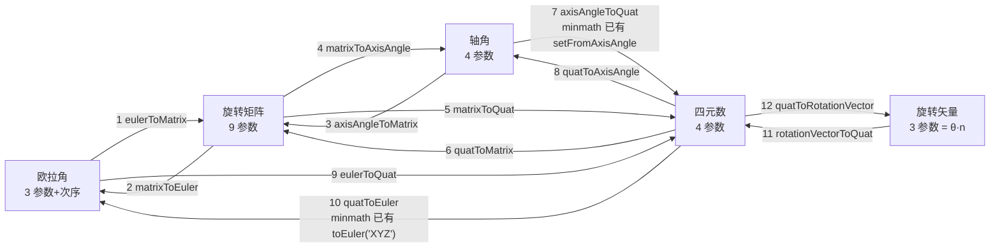

# 旋转表示与转换

> [返回：WebGL 与 3D 框架学习大纲](../WebGL与3D框架学习大纲.md)
> 一句话定位：数学专题第三册。在 [03-第三阶段/02-数学库minmath.md](../03-第三阶段/02-数学库minmath.md) 1.2 节（四元数基础、万向节锁代数推导、slerp 推导与 Quaternion 实现）之上，补齐旋转群的全景认知、五种表示的互转体系、欧拉角次序的工程坑、四元数进阶（微分与平均），服务第三阶段数学库扩展、第四阶段 [动画系统](../04-第四阶段/06-动画系统.md) 与后续骨骼/物理场景。基础推导不重复，用交叉引用衔接。

# 3. 旋转表示与转换

## 3.1 旋转群 SO(3)：先把"旋转"本身弄清楚

### 概念：保距、保定向、可复合不可交换

刚体旋转是线性变换，但不是任意线性变换。**旋转（rotation）**必须同时满足三条：

1. **保距（isometry）**：任意两点间距离在旋转后不变。代数上等价于 `Rᵀ·R = I`（正交矩阵）：

   ```text
   |R·v|² = (Rv)ᵀ(Rv) = vᵀRᵀRv = vᵀv = |v|²
   ```

2. **保定向（orientation-preserving）**：`det(R) = +1`。正交矩阵的行列式只能是 ±1：`det(RᵀR) = det(I)` 推出 `det(R)² = 1`。`det = -1` 的是镜像（reflection），例如 `diag(-1, 1, 1)` 沿 yz 平面翻转，会把右手系变成左手系——不在旋转之列。

3. **可复合（closure）**：两个旋转的复合仍是旋转。`det(A·B) = detA·detB = 1`，`(AB)ᵀ(AB) = BᵀAᵀAB = I`；单位矩阵是单位元；逆元是转置 `R⁻¹ = Rᵀ`（仍正交、仍 det=+1）。这三样凑齐，**所有 3D 旋转构成一个群（group），记号 SO(3)**：Special（det=+1）Orthogonal（正交）3 维。

但这个群有一个和数的加法、二维旋转都不同的性质：**复合不可交换（non-commutative）**。

### 手算验证：交换律在 3D 死掉

取 `e_y = (0,1,0)`，两个旋转：绕 X 转 90°、绕 Z 转 90°。右手系下：Rx(90°) 把 y 转到 z；Rz(90°) 把 x 转到 y、把 y 转到 -x。

先 Rx 后 Rz（矩阵 `Rz·Rx`，越右越先作用，约定见 [数学库 1.3](../03-第三阶段/02-数学库minmath.md)）：

```text
Rz(90°) · Rx(90°) · e_y = Rz(90°) · e_z = e_z = (0,0,1)
```

先 Rz 后 Rx：

```text
Rx(90°) · Rz(90°) · e_y = Rx(90°) · (-e_x) = (-1,0,0)
```

同一个起点、同样的两个旋转，顺序不同结果完全不同。**为什么 2D 没这个问题**：二维旋转只有一个轴（垂直平面的 z），SO(2) 中所有旋转绕同一根轴，`R(α)·R(β) = R(α+β) = R(β)·R(α)`，是交换群。3D 的轴有无穷多方向，绕不同轴的旋转互相"不认账"。这个非交换性在四元数代数里有个最小指纹：`i·j = k` 但 `j·i = -k`（Hamilton 积，见 1.2 节）。

工程含义：**3D 旋转的"乘法"必须永远关心顺序**。"先自转再公转"与"先公转再自转"是两个姿态，这正是 minmath 1.3 口诀"越右越先作用"要守住的纪律。

最后一个预告：SO(3) 的拓扑形状是实射影空间 RP³（3.4 节双重覆盖会用到）——它是一个三维流形，但**不可能**用任何三个连续参数无奇异地覆盖它（3.3 节万向节锁、旋转矢量 2π 跳变都是这个拓扑障碍的具体表现）。

## 3.2 五种表示全景与互转矩阵

### 概念：五种表示一张表

| 表示 | 参数量 | 奇异性 | 组合成本 | 插值 | 典型用途 |
|---|---|---|---|---|---|
| 欧拉角 Euler | 3 + 次序 | 中间轴 ±90° 万向节锁 | 两次三角 | 分量插值是错的 | 编辑器 UI、人机交互 |
| 轴角 Axis-Angle | 4（轴 3 + 角 1） | 轴向不唯一（θ 与 -n·(-θ) 同旋转） | 需转四元数 | 无直接定义 | 直觉描述、UI 旋钮 |
| 旋转矩阵 Matrix | 9 | 无 | 27 次乘法 | 无良好定义 | 顶点变换、法线矩阵 |
| 四元数 Quaternion | 4 | 无（q 与 -q 同姿态） | 28 次乘法 | slerp/nlerp | 姿态存储、动画轨道 |
| 旋转矢量 Rotation Vector | 3 | θ = 2π 处 log 跳变 | 需 exp/log | 直线即测地线 | 角速度积分、优化变量、IMU 融合 |

旋转矢量是轴角的紧凑形式 `v = θ·n̂`（轴乘角度），通过**指数映射（exponential map）** 与群元素互转，是李理论（Lie theory）里 SO(3) 李代数 so(3) 的坐标。工程里常再扩成**六参数**版本：旋转 3 个 + 平移 3 个，即刚体运动群 SE(3) 的李代数 se(3)（twist，运动扭），机器人与物理引擎的"螺旋运动"就用它——本节只实现 3 参数版，六参数版知道它是"旋转矢量 + 平移矢量一起过 exp"即可。

另一个相邻话题不在此展开：蒙皮混合出来的矩阵带剪切，从中"提纯"出旋转要用**极分解**，见专题一 [01-线性代数深化](01-线性代数深化.md)；本册的输入默认已是纯旋转。

### 转换关系图（12 条直接路径）



矩阵与旋转矢量之间没有直接边：走 `V -> Q -> M` 复合（各一次三角函数，不亏）。minmath 1.2 已实现的（setFromEuler/setFromAxisAngle/toEuler/Mat4.fromQuat）此处给通用版本，可整体搬进 minmath 扩展。

### 类型与约定

```typescript
// 本节代码自包含；Vec3/Quat 与 minmath 同名类型一一对应，可直接替换
export interface Vec3 { x: number; y: number; z: number }
export interface Quat { x: number; y: number; z: number; w: number } // (虚部, 实部)
/** 列主序 3x3，与 minmath Mat4 一致：m[c*3 + r] 存 R(r 行, c 列)，m[1] 即 R(1,0) */
export type Mat3 = number[]
export type EulerOrder = 'XYZ' | 'YXZ' | 'ZXY' | 'ZYX' | 'YZX' | 'XZY'
```

### 推导：任意欧拉次序的通用转换——共轭置换技巧

minmath 1.2 的 `setFromEuler`/`toEuler` 写死了 'XYZ'。六种 Tait-Bryan 次序各推一遍公式既冗长又易错，正确做法是**化归**：

记次序串 σ（如 'ZYX'），σ(k) 是第 k 个轴的下标（X→0, Y→1, Z→2）。设 Q 是把 σ 序的基映到标准序的置换矩阵：`Q·e_{σ(k)} = e_k`。绕 σ(k) 轴转 α 等价于"换到标准系绕第 k 个标准轴转、再换回来"，即 `R_{σ(k)}(α) = Q⁻¹·R_k(det(Q)·α)·Q`——`det(Q) = ±1` 是置换奇偶性（奇置换含一次反射，转角反向）。三个轴同样处理并复合（内旋读法 σ0 最先、乘积最左），中间的 Q 与 Q⁻¹ 两两相消，得到**共轭恒等式**：

```text
R_σ(α₀, α₁, α₂) = Q⁻¹ · Rx(εα₀)·Ry(εα₁)·Rz(εα₂) · Q,   ε = det(Q)
其中 αk 是次序串第 k 位那个轴的角。
元素层面（π = σ⁻¹，即 π[σ[k]] = k）：
  构造：R[i][j] = M_std[π(i)][π(j)]
  提取：M_std[i][j] = R[σ(i)][σ(j)]
```

一个必须注意的细节：**只有换位次序（'XYZ'、'YXZ'、'XZY'、'ZYX'）的 σ 是对合（σ⁻¹ = σ），正反用同一个重排；'ZXY'、'YZX' 是三循环，σ⁻¹ ≠ σ**，构造与提取要分别用 π 与 σ——把三循环也当成"换个顺序读下标"就会错。

手算验证一条：'ZYX'，角 (x=30°, y=45°, z=60°)，σ = [2,1,0]，ε = -1（奇置换）。标准系矩阵 `M_std = Rx(-60°)Ry(-45°)Rz(-30°)`。取元素 `R[2][0]`：按重排公式（ZYX 时 π = σ）`= M_std[π(2)][π(0)] = M_std[0][2] = sin(-45°) = -0.7071`。直接乘 `Rz(60°)Ry(45°)Rx(30°)`：其 `[2][0] = -sin(45°) = -0.7071`，一致。

### 完整代码：互转代码表（12 条路径）

```typescript
const ORDER_IDX: Record<EulerOrder, [number, number, number]> = {
  XYZ: [0, 1, 2], YXZ: [1, 0, 2], ZXY: [2, 0, 1],
  ZYX: [2, 1, 0], YZX: [1, 2, 0], XZY: [0, 2, 1],
}
/** 置换奇偶号：+1 偶（公式不动），-1 奇（标准系里角度取负，提取后乘回） */
function orderParity(s: [number, number, number]): 1 | -1 {
  return ((s[0] - s[1]) * (s[1] - s[2]) * (s[2] - s[0])) > 0 ? 1 : -1
}

// ---------- 路径 1、2：欧拉角 <-> 矩阵（通用次序） ----------
/** 路径 1：约定同 minmath/three.js：'XYZ' 即 R = Rx·Ry·Rz（内旋读法 X→Y'→Z''）。
 *  e 的 x/y/z 按"轴"标注（绕各轴的角度），order 决定复合次序。 */
function eulerToMatrix(e: Vec3, order: EulerOrder, out: Mat3 = new Array(9).fill(0)): Mat3 {
  const s = ORDER_IDX[order]
  const eps = orderParity(s)
  const inv = [-1, -1, -1] // π = σ⁻¹：inv[σ[k]] = k
  for (let k = 0; k < 3; k++) inv[s[k]!] = k
  const av = [e.x, e.y, e.z]
  const m = xyzToMatrix(av[s[0]]! * eps, av[s[1]]! * eps, av[s[2]]! * eps)
  for (let i = 0; i < 3; i++)
    for (let j = 0; j < 3; j++)
      out[j * 3 + i] = m[inv[j]! * 3 + inv[i]!] // R(i,j) = M_std[π(i)][π(j)]
  return out
}

/** 'XYZ' 标准式：R = Rx(x)·Ry(y)·Rz(z)，闭式展开，列主序 m[c*3+r] */
function xyzToMatrix(x: number, y: number, z: number): Mat3 {
  const cx = Math.cos(x), sx = Math.sin(x), cy = Math.cos(y), sy = Math.sin(y),
        cz = Math.cos(z), sz = Math.sin(z)
  return [
    cy * cz, sx * sy * cz + cx * sz, sx * sz - cx * sy * cz,
    -cy * sz, cx * cz - sx * sy * sz, sx * cz + cx * sy * sz,
    sy, -sx * cy, cx * cy,
  ]
}

/** 路径 2：矩阵 -> 欧拉角。奇异姿态（中间轴 ±90°）只能还原首末角之和，约定末角取 0。
 *  奇异的代数来源（万向节锁）推导见 minmath 1.2，此处只做提取。 */
function matrixToEuler(m: Mat3, order: EulerOrder, out: Vec3 = { x: 0, y: 0, z: 0 }): Vec3 {
  const s = ORDER_IDX[order]
  const eps = orderParity(s)
  const g = (i: number, j: number) => m[s[j]! * 3 + s[i]!] // 提取用 σ：M_std[i][j] = R[σ(i)][σ(j)]
  const sy = Math.min(1, Math.max(-1, g(0, 2))) // M_std[0][2] = sin(中间角)
  const ov = [out.x, out.y, out.z]
  if (Math.abs(sy) < 0.9999999) {
    ov[s[0]!] = eps * Math.atan2(-g(1, 2), g(2, 2)) // 首轴角
    ov[s[1]!] = eps * Math.asin(sy)                 // 中间轴角
    ov[s[2]!] = eps * Math.atan2(-g(0, 1), g(0, 0)) // 末轴角
  } else {
    // 万向节锁分支：只剩首末角之和可还原，末角取 0
    ov[s[0]!] = eps * Math.atan2(g(1, 0) * (sy > 0 ? 1 : -1), g(1, 1))
    ov[s[1]!] = eps * (sy > 0 ? Math.PI / 2 : -Math.PI / 2)
    ov[s[2]!] = 0
  }
  out.x = ov[0]!; out.y = ov[1]!; out.z = ov[2]!
  return out
}

// ---------- 路径 3、4：轴角 <-> 矩阵 ----------
/** 路径 3：Rodrigues 公式 R = c·I + s·[n]× + (1-c)·nnᵀ，列主序 */
function axisAngleToMatrix(n: Vec3, rad: number, out: Mat3 = new Array(9).fill(0)): Mat3 {
  const c = Math.cos(rad), s = Math.sin(rad), t = 1 - c, { x, y, z } = n
  out[0] = t * x * x + c;     out[1] = t * x * y + s * z; out[2] = t * x * z - s * y
  out[3] = t * x * y - s * z; out[4] = t * y * y + c;     out[5] = t * y * z + s * x
  out[6] = t * x * z + s * y; out[7] = t * y * z - s * x; out[8] = t * z * z + c
  return out
}

/** 路径 4：矩阵 -> (轴, 角)。cosθ = (tr-1)/2，轴 ∝ 反对称部分 R(2,1)-R(1,2) 等 */
function matrixToAxisAngle(m: Mat3, outAxis: Vec3 = { x: 0, y: 0, z: 0 }): { axis: Vec3; rad: number } {
  const cosT = Math.min(1, Math.max(-1, (m[0] + m[4] + m[8] - 1) / 2))
  const rad = Math.acos(cosT)
  if (rad < 1e-6) { outAxis.x = 1; return { axis: outAxis, rad: 0 } } // 零转角：轴无意义
  if (Math.PI - rad < 1e-4) {
    // 接近 180°：反对称部分 ∝ sinθ → 0，改用对角元 n_i = ±sqrt((m_ii+1)/2)。
    // 锚定 x 分量为正，y/z 符号由 R(1,0)=2·nx·ny、R(2,0)=2·nx·nz 读出（θ=π 时矩阵对称）；
    // nx ≈ 0 时改锚定 y 为正，由 R(2,1)=2·ny·nz 读 z（整体差一个 ±，θ=π 本就二义）
    const nx = Math.sqrt(Math.max(0, (m[0] + 1) / 2))
    const ny0 = Math.sqrt(Math.max(0, (m[4] + 1) / 2))
    const nz0 = Math.sqrt(Math.max(0, (m[8] + 1) / 2))
    const ny = nx > 1e-4 ? (m[1] >= 0 ? ny0 : -ny0) : ny0
    const nz = nx > 1e-4 ? (m[2] >= 0 ? nz0 : -nz0) : (m[5] >= 0 ? nz0 : -nz0)
    const len = Math.hypot(nx, ny, nz) || 1
    outAxis.x = nx / len; outAxis.y = ny / len; outAxis.z = nz / len
    return { axis: outAxis, rad: Math.PI }
  }
  outAxis.x = m[5] - m[7] // R(2,1) - R(1,2)
  outAxis.y = m[6] - m[2] // R(0,2) - R(2,0)
  outAxis.z = m[1] - m[3] // R(1,0) - R(0,1)
  const len = Math.hypot(outAxis.x, outAxis.y, outAxis.z) || 1
  outAxis.x /= len; outAxis.y /= len; outAxis.z /= len
  return { axis: outAxis, rad }
}

// ---------- 路径 5、6：矩阵 <-> 四元数 ----------
/** 路径 5：Shepperd 法——四个分支各以最大分量做分母，避免 180° 附近除小数 */
function matrixToQuat(m: Mat3, out: Quat = { x: 0, y: 0, z: 0, w: 1 }): Quat {
  const tr = m[0] + m[4] + m[8]
  if (tr > 0) {
    const S = Math.sqrt(tr + 1) * 2 // S = 4w
    out.w = S / 4
    out.x = (m[5] - m[7]) / S
    out.y = (m[6] - m[2]) / S
    out.z = (m[1] - m[3]) / S
  } else if (m[0] > m[4] && m[0] > m[8]) {
    const S = Math.sqrt(1 + m[0] - m[4] - m[8]) * 2 // S = 4x
    out.w = (m[5] - m[7]) / S
    out.x = S / 4
    out.y = (m[3] + m[1]) / S
    out.z = (m[6] + m[2]) / S
  } else if (m[4] > m[8]) {
    const S = Math.sqrt(1 + m[4] - m[0] - m[8]) * 2 // S = 4y
    out.w = (m[6] - m[2]) / S
    out.x = (m[3] + m[1]) / S
    out.y = S / 4
    out.z = (m[7] + m[5]) / S
  } else {
    const S = Math.sqrt(1 + m[8] - m[0] - m[4]) * 2 // S = 4z
    out.w = (m[1] - m[3]) / S
    out.x = (m[6] + m[2]) / S
    out.y = (m[7] + m[5]) / S
    out.z = S / 4
  }
  return out
}

/** 路径 6：四元数 -> 矩阵（3x3 版，即 minmath Mat4.fromQuat 的左上角，约定单位四元数） */
function quatToMatrix(q: Quat, out: Mat3 = new Array(9).fill(0)): Mat3 {
  const { x, y, z, w } = q
  const x2 = x + x, y2 = y + y, z2 = z + z
  const xx = x * x2, xy = x * y2, xz = x * z2
  const yy = y * y2, yz = y * z2, zz = z * z2
  const wx = w * x2, wy = w * y2, wz = w * z2
  out[0] = 1 - (yy + zz); out[1] = xy + wz;       out[2] = xz - wy
  out[3] = xy - wz;       out[4] = 1 - (xx + zz); out[5] = yz + wx
  out[6] = xz + wy;       out[7] = yz - wx;       out[8] = 1 - (xx + yy)
  return out
}

// ---------- 路径 7、8：轴角 <-> 四元数 ----------
/** 路径 7：q = (n·sin(θ/2), cos(θ/2))。minmath Quaternion.setFromAxisAngle 同款 */
function axisAngleToQuat(n: Vec3, rad: number, out: Quat = { x: 0, y: 0, z: 0, w: 1 }): Quat {
  const h = rad / 2, s = Math.sin(h)
  out.x = n.x * s; out.y = n.y * s; out.z = n.z * s; out.w = Math.cos(h)
  return out
}

/** 路径 8：θ = 2·acos(w)，轴 = v/|v|；先规范到 w >= 0（等价取 -q）保证短弧 */
function quatToAxisAngle(q: Quat, outAxis: Vec3 = { x: 0, y: 0, z: 0 }): { axis: Vec3; rad: number } {
  const rad = 2 * Math.acos(Math.min(1, Math.max(-1, Math.abs(q.w))))
  const s = Math.hypot(q.x, q.y, q.z)
  if (s < 1e-9) { outAxis.x = 1; return { axis: outAxis, rad: 0 } }
  const sign = q.w < 0 ? -1 : 1
  outAxis.x = q.x * sign / s; outAxis.y = q.y * sign / s; outAxis.z = q.z * sign / s
  return { axis: outAxis, rad }
}

// ---------- 路径 11、12：旋转矢量 <-> 四元数（指数映射） ----------
/** 路径 11：exp(v)。v = θ·n̂，q = (n̂·sin(θ/2), cos(θ/2))——半角来自三明治乘两次 */
function rotationVectorToQuat(v: Vec3, out: Quat = { x: 0, y: 0, z: 0, w: 1 }): Quat {
  const theta = Math.hypot(v.x, v.y, v.z)
  if (theta < 1e-9) { // 一阶泰勒 exp(v) ≈ (v/2, 1)，避免除零
    out.x = v.x / 2; out.y = v.y / 2; out.z = v.z / 2; out.w = 1
    return out
  }
  const h = theta / 2, s = Math.sin(h) / theta // sinc：θ→0 极限为 1/2
  out.x = v.x * s; out.y = v.y * s; out.z = v.z * s; out.w = Math.cos(h)
  return out
}

/** 路径 12：log(q)。返回 θ·n̂，θ ∈ [0, π]（短弧规范，2π 侧不连续是拓扑本性） */
function quatToRotationVector(q: Quat, out: Vec3 = { x: 0, y: 0, z: 0 }): Vec3 {
  const sign = q.w < 0 ? -1 : 1
  const theta = 2 * Math.acos(Math.min(1, Math.abs(q.w)))
  const s = Math.hypot(q.x, q.y, q.z)
  const k = s > 1e-9 ? (theta / s) * sign : 2 // θ→0 时 |v|≈θ/2，一阶 k=2
  out.x = q.x * k; out.y = q.y * k; out.z = q.z * k
  return out
}

// ---------- 路径 9、10：欧拉角 <-> 四元数 ----------
/** Hamilton 积 out = a ⊗ b（minmath Quaternion.multiply 同款，右者先作用） */
function quatMul(out: Quat, a: Quat, b: Quat): Quat {
  const r = {
    x: a.w * b.x + a.x * b.w + a.y * b.z - a.z * b.y,
    y: a.w * b.y - a.x * b.z + a.y * b.w + a.z * b.x,
    z: a.w * b.z + a.x * b.y - a.y * b.x + a.z * b.w,
    w: a.w * b.w - a.x * b.x - a.y * b.y - a.z * b.z,
  }
  out.x = r.x; out.y = r.y; out.z = r.z; out.w = r.w
  return out
}

/** 路径 9：q = q_{σ0} ⊗ q_{σ1} ⊗ q_{σ2}（初等四元数连乘；'XYZ' 即 minmath setFromEuler） */
function eulerToQuat(e: Vec3, order: EulerOrder, out: Quat = { x: 0, y: 0, z: 0, w: 1 }): Quat {
  const s = ORDER_IDX[order]
  const av = [e.x, e.y, e.z]
  out.x = 0; out.y = 0; out.z = 0; out.w = 1
  for (let k = 0; k < 3; k++) {
    const axis = s[k]!
    const h = av[axis]! / 2
    const t: Quat = { x: 0, y: 0, z: 0, w: Math.cos(h) }
    if (axis === 0) t.x = Math.sin(h)
    else if (axis === 1) t.y = Math.sin(h)
    else t.z = Math.sin(h)
    quatMul(out, out, t) // out ← out ⊗ q_axis：循环结束即 q_{σ0}⊗q_{σ1}⊗q_{σ2}
  }
  return out
}

/** 路径 10：四元数 -> 欧拉角（复合 6 + 2；'XYZ' 特例等价 minmath toEuler） */
function quatToEuler(q: Quat, order: EulerOrder, out: Vec3 = { x: 0, y: 0, z: 0 }): Vec3 {
  return matrixToEuler(quatToMatrix(q), order, out)
}
```

往返自检（黄金值全部可手算：90° 绕 z）：

```typescript
// z 轴 90°：矩阵 R(0,0)=0, R(1,0)=1；四元数 (0,0,√2/2,√2/2)；旋转矢量 (0,0,π/2)
const m = axisAngleToMatrix({ x: 0, y: 0, z: 1 }, Math.PI / 2)
console.log(m[0].toFixed(1), m[1].toFixed(1))          // 0.0 1.0
const q = matrixToQuat(m)
console.log(q.z.toFixed(4), q.w.toFixed(4))             // 0.7071 0.7071
console.log(quatToRotationVector(q).z.toFixed(6))       // 1.570796 = π/2，闭环
// 通用次序：'ZYX' 的 R(2,0) = -sin(y) = -0.7071，手算对照见上文推导
// eulerToQuat ↔ quatToEuler、eulerToMatrix ↔ matrixToEuler 做往返断言（除奇异姿态）
```

## 3.3 欧拉角次序的坑：intrinsic、extrinsic 与各软件默认

### 概念：两种"转三次"的方式

- **内旋（intrinsic）**：绕**自身**（随物体转动的）坐标轴转。次序 (a, b, c) 的矩阵是 `R = Ra·Rb·Rc`——每一次新旋转左乘。
- **外旋（extrinsic）**：绕**固定世界**轴转。次序 (a, b, c) 的矩阵是 `R = Rc·Rb·Ra`——先转的在最右。

**对偶律：内旋 (a,b,c) ≡ 外旋 (c,b,a)**，两者矩阵都是 `Rc·Rb·Ra`。所以"我是内旋 XYZ"和"我是外旋 ZYX"说的是同一个变换——文档只写"XYZ"不说内外旋，等于什么都没说。

### 各软件默认次序差异表

按列向量约定 `R = A·B`（右边先作用，与 minmath 一致），各引擎官方默认：

| 软件 | 默认次序 | 矩阵公式 | 等价读法 | 可配置 |
|---|---|---|---|---|
| three.js / minmath | 'XYZ' | `Rx·Ry·Rz` | 内旋 X→Y'→Z''（外旋 Z→Y→X） | 6 种 Tait-Bryan |
| Unity | 固定 | `Ry·Rx·Rz` | 官方文档"先 Z、再 X、后 Y"（外旋），等价内旋 Y→X'→Z'' | 不可配 |
| Blender | 'XYZ' Euler | `Rz·Ry·Rx` | 外旋 X→Y→Z，等价内旋 Z→Y'→X'' | 6 种 + ZXZ 等经典欧拉 |

依据：Unity 官方文档明确"绕 z 轴、再绕 x 轴、最后绕 y 轴"施加旋转（世界固定轴）；Blender 源码 `eul_to_mat3`/`eulO_to_quat` 逐分量给出的四元数等于 `qz ⊗ qy ⊗ qx`，即矩阵 `Rz·Ry·Rx`。

两个高频踩雷点：

1. **Blender 的 'XYZ' ≠ three.js 的 'XYZ'**。Blender 的 'XYZ' 与 three.js 的 **'ZYX'** 是同一个变换。从 Blender 往 three.js 导欧拉角，不换算次序姿态就是错的。
2. Unity 是左手系（Y 上 Z 前）且顺时针为正，除了次序还要做手性转换（通常 z 取反 + 次序调整），不能只抄矩阵公式。

### 万向节锁只属于欧拉角

代数推导（中间轴 90° 时首末两轴合并成一个自由度）在 [数学库 1.2](../03-第三阶段/02-数学库minmath.md)，此处不重复。要强调的是结论的边界：矩阵、四元数、轴角作为表示**没有奇异性**——四元数只是 q 与 -q 二选一，不是锁。旋转矢量在 θ = 2π 处有 log 跳变，但那是"转一整圈"这种本来就歧义的姿态，日常姿态远够用。所以"万向节锁"这个词只对三维角度参数化（欧拉角及其变体）有意义——**换次序只是把锁挪到别的中间轴角度，唯一的根治是不用欧拉角存姿态**（引擎内部四元数、边界换算，正是 1.2 与第四阶段 [动画系统 5.1.1](../04-第四阶段/06-动画系统.md) 的铁律）。

## 3.4 四元数进阶

基础（Hamilton 积、半角、slerp 五步推导、全量 TS）在 [数学库 1.2](../03-第三阶段/02-数学库minmath.md)，本节只讲"再往深一层"的五件事。

### 与 2D 复数旋转的同构类比

2D 旋转有完美表示：单位复数 `e^{iθ} = cosθ + i·sinθ`，乘一下就转：`z' = e^{iθ}·z`。一次乘法、封闭（复数乘复数还是复数）、可交换。单位复数全体是圆 S¹，与 SO(2) 一一对应。

四元数本该照抄：单位四元数全体是三维球面 S³，用乘法转 3D 向量。**但单侧乘法失效**。手算：取 `q = i`（绕 x 转 180°），转 x 轴自己：`q ⊗ v = i ⊗ i = -1`——**跑出了虚部子空间，变成实数**，不是向量。而三明治形式没事：

```text
q ⊗ v ⊗ q⁻¹ = i ⊗ i ⊗ (-i) = (-1) ⊗ (-i) = i   // x 轴绕 x 转，不动，正确
```

再验证 `v = k`（z 轴）：单侧 `i ⊗ k = -j`（错，180° 绕 x 应把 z 转到 -z）；三明治 `i ⊗ k ⊗ (-i) = -k`（正确）。

**为什么三明治能留在虚部子空间**：对单位 q 与纯虚 v，可验证 `Re(q ⊗ v ⊗ q⁻¹) = 0` 恒成立（Hamilton 展开：`Re(q⊗v) = -q⃗·v⃗`，再右乘 q⁻¹ = q* 时实部的两项 `w·(-q⃗·v⃗) + q⃗·(w·v⃗ + q⃗×v⃗)` 恰好抵消），而 `Re(q⊗v)` 一般非零。深层原因：2D 复数乘法交换且封闭；四元数乘法不交换，需要两次相乘把"实部泄漏"抵消掉。这也解释了半角：q 出现两次，各贡献一半角度。

### 除法的意义

四元数有逆：`q⁻¹ = q* / |q|²`（单位四元数即共轭 `q*`）。"除"就是乘逆，但**顺序不同含义不同**，这是天天用又最容易混的：

- `q1⁻¹ ⊗ q2`：从 q1 **局部系**看的"差旋转"——从姿态 q1 转到 q2，在 q1 自己的坐标系里转了多少；
- `q2 ⊗ q1⁻¹`：在**世界系**看的差旋转。

手算一个：q1 = 90° 绕 x，q2 = 90° 绕 z。`q1⁻¹ ⊗ q2` 展开后是 `(w,x,y,z) = (0.5, -0.5, 0.5, 0.5)`（一个 120° 旋转，可用 3.2 的函数验证），而 `q2 ⊗ q1⁻¹` 给出的是另外三个虚部分量——两个"商"不相等，根源就是 3.1 的非交换性。用途：姿态误差（控制里算 `q_err = q_target ⊗ q_current⁻¹`，把它的旋转矢量当误差信号，见本节末的姿态弹簧）、从两帧姿态恢复角速度（`ω = quatToRotationVector(q_prev⁻¹ ⊗ q_curr) / dt`）。

### 双重覆盖：q 与 -q，以及为什么全局符号选不出来

映射 `π: S³ → SO(3)`，`q ↦ (v ↦ q⊗v⊗q⁻¹)` 是**二对一**：q 与 -q 给出同一个旋转（1.2 已用 720° 性质说明）。连续转一圈 θ: 0→360°，四元数从 q 走到 -q；转两圈才回到 q。识别掉 ±q 之后，S³ 变成实射影空间 RP³——这正是 SO(3) 的拓扑形状（3.1 的预告在此兑现）。

由此有一个绕不开的工程事实：**不存在连续的"全局符号选择"**（数学上：S³ → SO(3) 没有连续截面，类比 hairy ball 定理）。任何想把所有旋转统一规范进"某个半球"的企图都会在某处撕裂。所以每个四元数库都只能在**局部操作处**做 `dot < 0 就翻转`：slerp 里、混合里（[动画系统 5.2.3](../04-第四阶段/06-动画系统.md) 的 `accumulate` 符号对齐就是同款处理）、比较时用 `|dot|`。这是散布在各工具函数里的"局部补丁"，不是可以一次性根治的初始化。

### 为什么 slerp 前要取同半球

双重覆盖的直接后果：q0 到 q1 与 q0 到 -q1 是**同一个大圆的两段互补弧**（4D 夹角 θ 与 2π-θ）。两端姿态完全相同，但路径一短一长：短弧旋转走 ≤180°，长弧绕远路。`dot(q0, q1) < 0` 说明当前在走长弧，把 q1 取负即可——公式与推导见 1.2 的 slerp 五步，实现在 minmath `Quaternion.slerp` 的翻转分支。要补的是**症状**：动画数据来自不同来源（动捕、手工 K 帧、别的引擎导出）时符号约定不一致，插值会突然"反向绕一大圈"；混合同理（5.2.3 的坑）。规则：**任何"拿两个四元数做线性组合"的代码，先检查 dot 的符号**。

### 四元数的微分：dq = 0.5·ω⊗q·dt

设 q(t) 把物体系向量旋到世界系（`v_w = q ⊗ v_b ⊗ q⁻¹`，与 minmath 约定一致），刚体角速度 ω（rad/s），写成纯四元数 `Ω = (ω⃗, 0)`。dt 内的增量旋转是绕 ω 轴转 `|ω|·dt`，指数映射（路径 11）给出一阶近似 `dq = exp(Ω·dt/2) ≈ (ω⃗·dt/2, 1)`，增量发生在世界侧：

```text
q(t+dt) = dq ⊗ q(t)   =>   dq/dt = 0.5 · Ω ⊗ q      （ω 表达在世界系）
若 ω 表达在物体系：dq/dt = 0.5 · q ⊗ Ω_body          （增量在自身坐标系）
```

验证它给出正确的刚体速度（世界系版）：`d/dt(q⊗v⊗q⁻¹) = Ω⊗v_w − v_w⊗Ω`，对纯虚四元数有恒等式 `Ω⊗x − x⊗Ω = 2·(ω⃗×x⃗)`，于是 `dv_w/dt = ω⃗ × v_w`，正是刚体公式。半角系数 0.5 的来历与轴角公式的 sin(θ/2) 同源：q 在三明治里出现两次。

手算数值例：ω = (0, 2, 0)（绕 y 每秒 2 rad），q 从单位元出发，dt = 0.005：增量四元数 ≈ (0, 0.005, 0, 1)，一步后姿态角 `2·asin(0.005) ≈ 0.01 rad = ω·dt`，一秒（200 步）后约 2 rad。

**两种积分实现**（角速度恒定时第二种精确）：

```typescript
/** 欧拉步：q(t+dt) ≈ q + dt·q̇ = q + (0.5ωdt)⊗q，O(dt²) 误差，之后必须归一化 */
function integrateQuatEuler(q: Quat, w: Vec3, dt: number): Quat {
  const r = quatMul({ x: 0, y: 0, z: 0, w: 0 },
    { x: w.x * dt / 2, y: w.y * dt / 2, z: w.z * dt / 2, w: 0 }, q) // r = dt·q̇
  q.x += r.x; q.y += r.y; q.z += r.z; q.w += r.w
  const n = Math.hypot(q.x, q.y, q.z, q.w) || 1
  q.x /= n; q.y /= n; q.z /= n; q.w /= n
  return q
}

/** 指数步（推荐）：dq = axisAngle(ω̂, |ω|dt) 精确表示该步旋转，恒定 ω 下零误差 */
function integrateQuatExp(q: Quat, w: Vec3, dt: number): Quat {
  const wLen = Math.hypot(w.x, w.y, w.z)
  const theta = wLen * dt
  if (theta > 1e-12) {
    const s = Math.sin(theta / 2) / wLen // 注意分母是 |ω| 不是 θ：n̂ = ω/|ω|
    const dq: Quat = { x: w.x * s, y: w.y * s, z: w.z * s, w: Math.cos(theta / 2) }
    quatMul(q, dq, q) // q ← dq ⊗ q（世界系；物体系则 q ← q ⊗ dq_body）
  }
  const n = Math.hypot(q.x, q.y, q.z, q.w) || 1
  q.x /= n; q.y /= n; q.z /= n; q.w /= n
  return q
}
```

应用场景：第四阶段 [动画系统 5.1](../04-第四阶段/06-动画系统.md) 的关键帧采样是"查表 + slerp"的离散路径；角速度积分是另一条路——物理与惯性驱动的姿态（陀螺仪融合、按角速度阻尼衰减的相机跟随、布料/骨骼的朝向弹簧）。典型**姿态弹簧-阻尼器**（物理阻尼、相机软跟随都用它）：

```text
每帧：err = quatToRotationVector(q_target ⊗ q⁻¹)   // 世界系误差旋转矢量（除法！）
      α = -kp·err - kd·ω                            // 角加速度，kp 刚度 / kd 阻尼
      ω += α·dt；integrateQuatExp(q, ω, dt)
```

## 3.5 旋转的平均与插值进阶

### 多四元数平均：为什么没有闭式解

"平均姿态"先要定义度量，两种候选：

- **弦平均（chordal mean）**：在 S³ 上最小化 `Σwᵢ‖q̄ − qᵢ‖²`。给定符号约定后驻点是 `q̄ ∝ Σwᵢqᵢ`（归一化即可）——看似闭式，但**符号选择本身是组合爆炸**（n 个四元数有 2ⁿ 种对齐方式，双重覆盖的账）。
- **测地平均（Fréchet/Karcher mean）**：最小化旋转角距离 `Σwᵢ·θ(q̄, qᵢ)²`（θ 是两姿态夹角）。这才是"平均旋转"的本义，驻点条件是 `Σwᵢ·log(q̄⁻¹⊗qᵢ) = 0`——q̄ 同时出现在 log 的内外，**超越方程，无代数闭式解**，只能迭代。

迭代法（流形上的不动点：每步把各样本的"相对旋转矢量"加权求和，沿它走回去）：

```typescript
/** 多四元数测地平均。weights 与 qs 等长（和不必为 1）。
 *  收敛前提：姿态散布 < 180°；散布更大的传感器融合场景用 Markley 特征向量法（见文末）。 */
function averageQuaternions(qs: Quat[], weights: number[]): Quat {
  const n = qs.length
  let sum = 0
  for (let i = 0; i < n; i++) sum += weights[i]!
  // 初值：符号对齐到 qs[0] 后做一次弦平均
  let mean: Quat = { x: 0, y: 0, z: 0, w: 0 }
  for (let i = 0; i < n; i++) {
    const qi = qs[i]!
    const s = qi.x * qs[0]!.x + qi.y * qs[0]!.y + qi.z * qs[0]!.z + qi.w * qs[0]!.w >= 0 ? 1 : -1
    mean.x += s * qi.x * weights[i]! / sum
    mean.y += s * qi.y * weights[i]! / sum
    mean.z += s * qi.z * weights[i]! / sum
    mean.w += s * qi.w * weights[i]! / sum
  }
  normalizeQuat(mean)
  for (let iter = 0; iter < 16; iter++) {
    const e: Vec3 = { x: 0, y: 0, z: 0 } // e = Σ wᵢ·log(mean⁻¹ ⊗ qᵢ)
    for (let i = 0; i < n; i++) {
      const rel = quatMul({ x: 0, y: 0, z: 0, w: 0 },
        { x: -mean.x, y: -mean.y, z: -mean.z, w: mean.w }, qs[i]!) // mean* ⊗ qᵢ
      const sign = rel.w < 0 ? -1 : 1 // 相对旋转取短弧：同半球选择，不能省
      const theta = 2 * Math.acos(Math.min(1, Math.abs(rel.w)))
      const len = Math.hypot(rel.x, rel.y, rel.z)
      const k = len > 1e-9 ? (theta / len) * sign : 2
      e.x += rel.x * k * weights[i]! / sum
      e.y += rel.y * k * weights[i]! / sum
      e.z += rel.z * k * weights[i]! / sum
    }
    if (Math.hypot(e.x, e.y, e.z) < 1e-9) break // 已是驻点
    quatMul(mean, rotationVectorToQuat(e), mean) // mean ← exp(e) ⊗ mean
    normalizeQuat(mean)
  }
  return mean
}

function normalizeQuat(q: Quat): void {
  const n = Math.hypot(q.x, q.y, q.z, q.w) || 1
  q.x /= n; q.y /= n; q.z /= n; q.w /= n
}
```

（`sign` 那一行就是 3.4 说的"同半球选择"：log 前必须把相对旋转规范到短弧，否则对来自不同来源的样本，误差矢量会互相抵消出错误均值。）

手算验证（同轴特例，测地平均有解析答案）：q1 = 60° 绕 z、q2 = 120° 绕 z，等权，答案应是 90° 绕 z。第一轮迭代：`mean⁻¹⊗q1 = -30° 绕 z`，log = (0,0,-π/6)；`mean⁻¹⊗q2 = +30° 绕 z`，log = (0,0,+π/6)；加权和 = 0，一步收敛。与弦平均交叉验证：`0.5·(sin30°+sin60°, cos30°+cos60°) = (1.366, 1.366)/2 ∝ (√2/2, √2/2)` 即 90°，一致。

**反例（为什么每轮必须符号对齐）**：q1 = 170° 绕 z，q2 存成了 -q（等价 190° 绕 z）。直接求和：虚部正负抵消、实部只剩 0.1744，归一化后得到**单位四元数**（零姿态）而不是 180° 绕 z——姿态被平均到完全无关的方向。极端情形：q 与 -q 等权平均直接得零向量，归一化除零。

**Markley 特征向量法**（补充）：弦平均的符号问题可以被漂亮地绕开——`M = Σwᵢ·qᵢqᵢᵀ`（4x4 对称矩阵）对 qᵢ 取负**不变**（`(-q)(-q)ᵀ = qqᵀ`），M 的最大特征向量就是最优弦平均。散布大、带权重的传感器融合场景用它；实现上对 M 做 20 次幂迭代（`v ← Mv; 归一化`）即可，不需要特征值库。

### nlerp 与 slerp：性能与质量的定量取舍

1.2 与 [动画系统 5.1.1](../04-第四阶段/06-动画系统.md) 已给结论，这里补上**定量推导**。设两单位四元数 4D 夹角 θ，nlerp 是"弦归一化"。在 q0、q1 张成的二维平面内取正交基（q0 与垂直方向），nlerp 轨迹的极角满足 `tanφ(t) = t·sinθ / (1 − t + t·cosθ)`，对 t 求导得角速度 `φ̇(t) = sinθ / ((1−t)² + 2t(1−t)cosθ + t²)`：

- 两端角速度 `sinθ`，中点角速度 `2·tan(θ/2)`；
- **中点/两端速率比 = 1 / cos²(θ/2)**——中间快、两头慢（与 5.1.1 的表述一致；1.2 的括注"中段偏慢、两端偏快"方向写反了，以本节推导为准）。

| 4D 夹角 θ | 对应旋转角 2θ | 速率波动 | 主观感受 |
|---|---|---|---|
| 15° | 30° | 3.5% | 无感 |
| 30° | 60° | 7.2% | 道具/粒子可接受 |
| 45° | 90° | 17.2% | 相机开始可感 |
| 90° | 180° | 100% | 明显忽快忽慢 |

（数值例：θ=90°、t=0.25 时走过的 4D 角是 `arctan(0.25/0.75) ≈ 18.4°`，均匀应走 22.5°，前四分之一路程"迟到"。中点恰好准点：φ(0.5) = θ/2，误差挤在两腰。）

性能：nlerp 只要 1 次 sqrt（点积 + 4 次 lerp + 归一化）；slerp 要 acos + sin（退化分支外至少一次三角对），三角函数通常比 sqrt 贵一个数量级。选择口径：**粒子/小姿态抖动一律 nlerp；相机与角色大角度用 slerp；介于两者之间可用"二分递归 nlerp"逼近 slerp（在 t=0.5 处切一刀、两端各做 nlerp，波动降为原来的平方量级）**。

## 常见坑

1. **四元数未归一化的累积漂移**。每帧 `multiply` 的浮点误差让 |q| 偏离 1 做随机游走；而 `fromQuat`/`q⊗v⊗q⁻¹`（q⁻¹ 取共轭）都**前提是单位四元数**，|q| ≠ 1 时缩放 |q|² 会静悄悄渗进顶点与法线，表现为模型逐渐胀缩、光照异常。补偿三选一：（a）每帧积分/连乘后 normalize（1 次 sqrt，成本可忽略，推荐）；（b）低频补偿——每 N 帧检查 `||q| − 1| > 1e-6` 才归一化；（c）语义允许时每帧从轴角重建（第三阶段地球 demo 的做法）。禁止"从不归一化"。
2. **平均/混合前不对齐符号**：3.5 的反例——两个互为 -q 的四元数平均得零向量或无关姿态。混合同款处理见 [动画系统 5.2.3](../04-第四阶段/06-动画系统.md) 的 `accumulate`。
3. **欧拉角只传三个数不传次序**：'XYZ' 与 'ZYX' 的 (30°,60°,45°) 是两个姿态；跨软件还要做内外旋换算（3.3 对偶律）与手性转换（Unity 左手系）。
4. **矩阵→四元数不分支**：只用 `w = sqrt(1+tr)/2` 一条路，在 tr 接近 -1（180° 旋转）时开根号下溢、除零。Shepperd 四分支就是为此（路径 5）。
5. **转换链精度耗损**：欧拉→矩阵→四元数→轴角来回搬，每步 ~1e-7 量级误差，链上五六步后 `|dot|` 可能掉到 0.9999。链式转换后自检 `| |q| − 1 |` 与 `RᵀR ≈ I`，别盲信。
6. **角速度乘错边**：ω 是世界系却写 `q ← q ⊗ dq`（物体系形式），姿态朝错误方向进动。口诀：**世界系左乘、物体系右乘**（与 3.1"越右越先作用"同源）。
7. **度弧度混用**：编辑器 UI 用度、引擎内弧度，`quatToRotationVector` 出来是弧度，喂给"每秒度数"的速度参数就差 57 倍。
8. **万向节锁附近 toEuler 抖动**：奇异点附近 atan2 的两个小数相除，噪声被放大。UI 显示欧拉角时对中间轴 ±90° 附近做死区；动画中间格式（关键帧数据）永远不用欧拉角（[动画系统 5.1.1](../04-第四阶段/06-动画系统.md) 铁律）。

## 本节自测

1. 写出 SO(3) 的三条定义性质并说明 det = -1 被排除的原因；用手算例子证明 Rx(90°) 与 Rz(90°) 不可交换（哪个向量、两次结果分别是什么）。
2. Blender 导出的欧拉角 (30°, 60°, 45°)（'XYZ'）要进 three.js，欧拉次序字符串应填什么？写出两个软件的矩阵公式与换算依据（对偶律）。
3. 解释共轭置换技巧如何把"任意次序的欧拉互转"化归为 XYZ 特例；'YZX' 的 ε 是多少，角度提取后要做什么修正？
4. 从 `q(t+dt) = exp(0.5·Ω·dt) ⊗ q(t)` 出发推导 `dq/dt = 0.5·Ω⊗q`，说明 0.5 的来历；ω 表达在物体系时公式怎么变？
5. nlerp 的中点/两端角速度比公式是什么？旋转角 90° 时波动百分比是多少？两个互为 -q 的单位四元数等权平均、不做符号对齐会发生什么——averageQuaternions 里哪几行防住了它？
