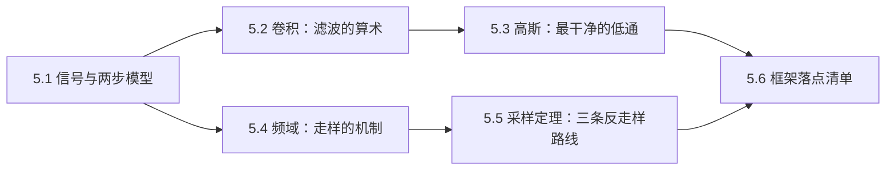
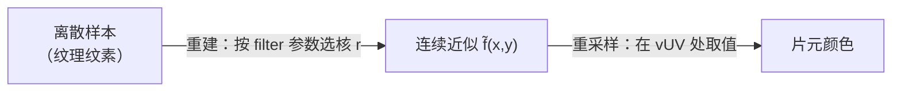
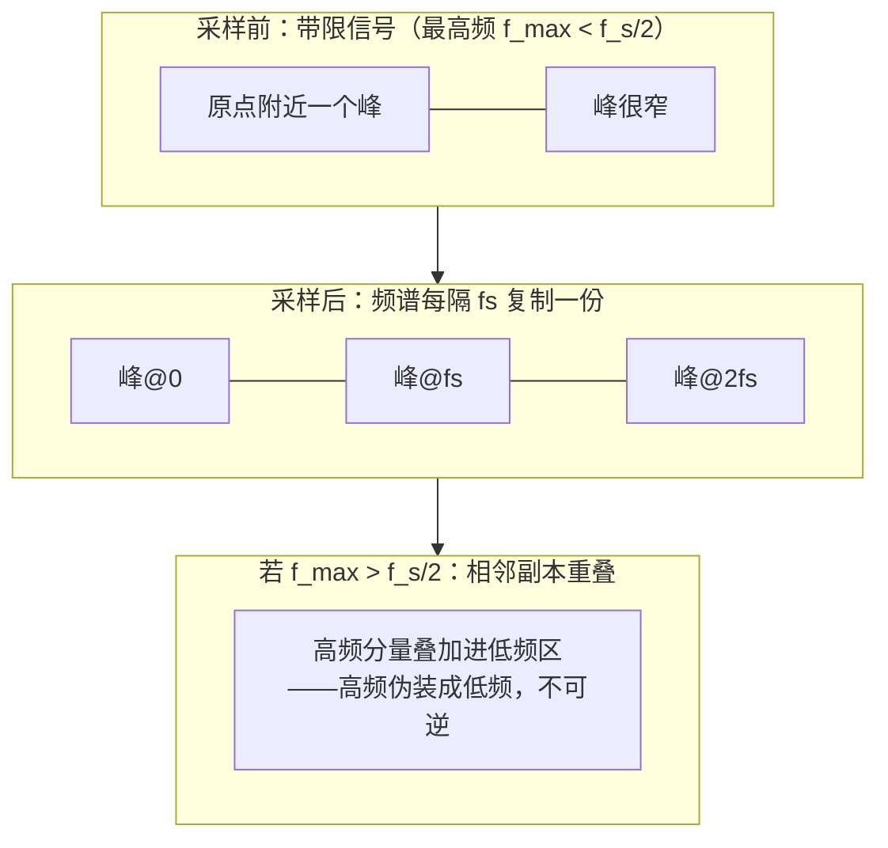
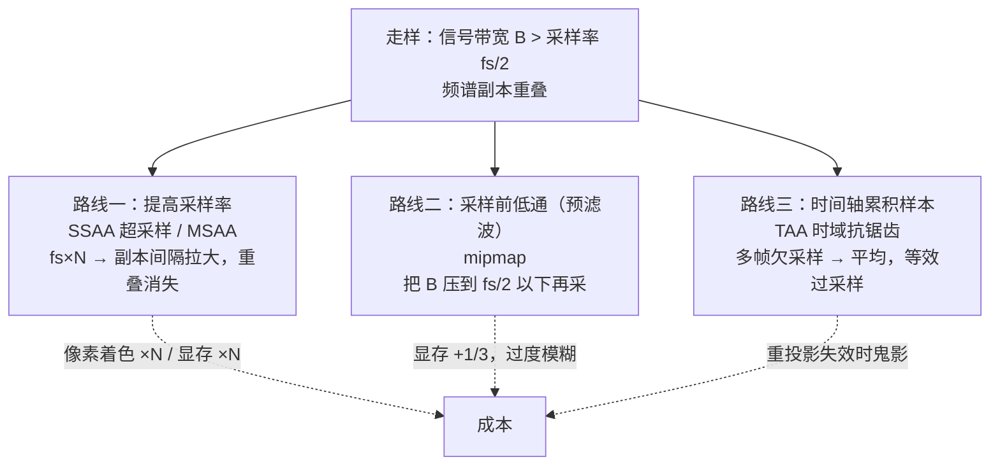

# 采样、卷积与频域

> [返回：WebGL 与 3D 框架学习大纲](../WebGL与3D框架学习大纲.md)
> 一句话定位：数学专题第五册。给第二阶段[纹理](../02-第二阶段/03-纹理.md)（mipmap/过滤参数）与第五阶段[后处理管线](../05-第五阶段/03-后处理管线.md)（bloom 两趟高斯）、[PBR 入门](../05-第五阶段/04-PBR入门.md)（IBL 预滤波）里"怎么用"的部分补上"为什么"——采样、卷积与频域的信号处理解释。

三个分册各留了一句"欠账"，本篇逐句还清：

- 纹理 2.3 说 mipmap"相当于先做了盒式滤波再采样"——为什么**先滤波再采样**是唯一正确的顺序（5.5 采样定理）；
- 后处理 2.2.2 证明了高斯可分离、横一趟竖一趟等价——本文补上离散手算验证与边界处理的完整对比（5.2）；
- 纹理 2.3 说远处棋盘闪烁是因为"采样频率低于信号频率"——频谱搬移会给出这句话的完整图像（5.4）；
- 后处理 2.2.3 说金字塔"每降一级，同样 9 点采样的模糊半径翻倍"——核尺寸与分辨率的换算在 5.6 给出公式。

约定：本文只写数学与直觉，GLSL 实现留在原分册，交叉引用处不再重复贴代码；新增代码只有两类——验证手算结果的 TypeScript 与最小的 GLSL 片段，全部可独立运行复现。全册路线：



## 5.1 信号视角：图像是二维信号

### 5.1.1 概念：采样、重建、重采样

把"图像"从"像素的网格"重新定义为"信号的样本"：

- **连续图像信号** f(x, y)：理想世界里，到达屏幕的图像是连续的二维函数——位置到颜色的映射。几何边缘、纹理细节在它上面是连续变化的（边缘再陡，也是连续函数里的陡坡）；
- **采样（sampling）**：用离散网格读取连续信号，得到样本 f[i,j] = f(x_i, y_j)。纹理就是一张采样表——第二阶段 2.1 说它是"显存里的二维数组，配一套采样规则"，信号视角下那套"采样规则"就是本节的重建核；
- **重建（reconstruction）**：从离散样本构造连续函数 f̃(x,y) = Σ f[i,j] · r(x−i, y−j)，r 是重建核（reconstruction kernel / filter）。`NEAREST` 的核是盒式（把最近样本的值平铺成方块），`LINEAR` 的核是双线性（tent 核的张量积）；
- **重采样（resampling）**：在新的位置上取重建信号的值。

三步连起来就是图形学里一切"采样"的通用模型——**两步模型**：



框架里每一次 `texture(uTex, vUV)` 都在执行这两步：GPU 按纹理的 filter 参数选好核，把纹素"摊"回连续信号，再在插值出的 vUV 处取一个值。放大、缩小、mipmap 层间插值，差别只在核的形状与宽度。filter 参数与核的对照：

| filter 参数 | 重建核 | 重建出的连续信号 |
|---|---|---|
| `NEAREST` | 盒式（零阶保持） | 一格一格的台阶 |
| `LINEAR` | tent 核的张量积（双线性） | 分片双线性连续、但折痕处不可导 |
| `*_MIPMAP_LINEAR`（三线性） | 选一层再双线性，层间再插值 | 重建核随采样率缩放的"自适应"版本 |

一个常被忽略的辨析：**像素是采样点，不是小方块**。"方块"是显示时用盒式核重建出来的样子；把像素当方块会在概念上漏掉走样——采样点之间的高频内容不会因为"方块"而消失，它们折叠进样本里（5.4）。同理，一个屏幕像素对场景的实际覆盖是一小块面积（像素足迹，pixel footprint），光栅化的点采样把这块面积压成了一个点——这个差距正是 5.5 里 SSAA/MSAA 存在的理由。

### 5.1.2 手算：双线性过滤的一次完整执行

4×4 灰度纹理，取中心 (1,2)、(2,2)、(1,3)、(2,3) 四个纹素为 20、60、40、80，求 `LINEAR` 过滤在 uv = (0.4, 0.65) 处的返回值。

纹素中心在坐标 (i+0.5)/4 处，先把 UV 换算到纹素空间再减去半纹素偏移：

- 横向：s = 0.4 × 4 = 1.6，落在纹素 1（中心 1.5）与 2（中心 2.5）之间，横向权重 f_x = 1.6 − 1.5 = 0.1（偏向纹素 2 一成）；
- 纵向：t = 0.65 × 4 = 2.6，落在纹素 2 与 3 之间，f_y = 0.1。

双线性是先横后竖（或先竖后横）两趟 tent 核重建：

$$20 \times 0.9 \times 0.9 + 60 \times 0.1 \times 0.9 + 40 \times 0.9 \times 0.1 + 80 \times 0.1 \times 0.1 = 16.2 + 5.4 + 3.6 + 0.8 = 26.0$$

同一次采样换 `NEAREST` 核：直接取 (floor(1.6), floor(2.6)) = 纹素 (1, 2) 的值 **20**。20 与 26.0 的差就是两种重建核的差别：盒式核给出"一格一格"的阶梯，tent 核给出连续过渡——放大纹理时的"马赛克 vs 平滑"从这一步就注定了。

两个观察：结果 26 落在四个邻居的最小值之上、离最近的 20 也不远——重建核是"加权平均"，只会内插不会外推；权重和恒为 (0.9+0.1)×(0.9+0.1) = 1，这是"核归一化"在两趟可分离形式下的体现（5.2.2 会看到它的一般形式）。

### 5.1.3 采样率从哪来：UV 导数与 mip 层级

两步模型里"重采样的采样率"在 3D 场景中不是常数：同一张纹理，贴在近处地面时一个屏幕像素覆盖不到一个纹素，拉远后可能覆盖成百上千个。GPU 的做法：对插值出的 vUV 在屏幕 x/y 方向做数值差分（片元着色器里就是 `dFdx(vUV)` / `dFdy(vUV)`），换算成纹素覆盖数后取对数：

$$\rho = \max\big(|\partial uv/\partial x|,\ |\partial uv/\partial y|\big), \qquad \lambda = \log_2(\rho \cdot \text{textureSize})$$

λ 就是 mipmap 的层级号——**采样率降低 2 倍，就换用截止频率低 2 倍的预滤波副本**（5.5 路线二的硬件化）。

手算：256×256 纹理贴满地面，相机拉远到一个屏幕像素覆盖 4×4 纹素，即 ρ·size = 4，λ = log₂4 = 2 → 采样 level 2（64×64），那里重新一个纹素约等于一个屏幕像素。三线性（`LINEAR_MIPMAP_LINEAR`）在 λ 带小数（如 2.6）时对 level 2 与 level 3 的结果做线性插值——两个不同截止频率的低通结果插值，得到"连续可调的低通"（5.6 表第一行）。续算一步：设 level 2 上双线性采得 60、level 3 上采得 48，λ = 2.6 → level 3 占 0.6 权重，输出 0.4×60 + 0.6×48 = **52.8**。mip 切换处不再跳变，代价是任何时候都稍微多糊一点。

```glsl
// 手动版 mip 选择（等价于 texture(uTex, vUV) 内部的自动选级）
float rho = max(length(dFdx(vUV)), length(dFdy(vUV)));
float lod = log2(rho * float(textureSize(uTex, 0).x));
vec3 color = textureLod(uTex, vUV, lod).rgb; // 非均匀控制流里必须手动给层级（常见坑 8）
```

### 5.1.4 采样丢掉的信息去哪了

采样把连续信号压成有限个点，两个频率不同的正弦可以落在同一组样本上——**采样后的信号无法区分这些"别名"**，这就是走样（aliasing）一词的字面来源。重建核不可能凭空恢复丢掉的信息，只能保证"如果原信号足够平滑（带限），采样就没有丢失"——足够平滑到什么程度，是 5.5 采样定理的内容。在那之前先把"滤波"的算术工具准备好：卷积。

## 5.2 卷积：定义、手算、可分离性与边界

### 5.2.1 定义与一维手算

连续定义 $(f * k)(x) = \int f(t)\,k(x-t)\,dt$；离散一维（图像处理实际用的形式）：

$$(f * k)[n] = \sum_{i} f[i]\; k[n-i]$$

直觉：把核 k 翻转后贴着信号滑动，每个位置算一次加权平均。注意"翻转"——后处理着色器里写的 `result += tex(uv + offset) * w` 其实是**相关（correlation）**（不翻转）；核对称时两者严格相等，图形学习惯例下不必纠结，但非对称核（有方向性的模糊）两者结果会错位，见常见坑 2。

手算：信号 x = [1, 2, 3, 4]，核 k = [1/4, 1/2, 1/4]（半径 1，权重和为 1），边界钳位（clamp，越界取最近样本）：

| 输出 | 计算 | 结果 |
|---|---|---|
| y[0] | 0.25·**x[−1]→1** + 0.5·1 + 0.25·2 | 1.25 |
| y[1] | 0.25·1 + 0.5·2 + 0.25·3 | 2.0 |
| y[2] | 0.25·2 + 0.5·3 + 0.25·4 | 3.0 |
| y[3] | 0.25·3 + 0.5·4 + 0.25·**x[4]→4** | 3.75 |

平滑了这个陡坡，且 clamp 让边界输出被边缘值"拉住"。边界策略换个做法结果立刻不同——5.2.3 展开。

二维形式只是把核换成小矩阵：$(f * k)[x,y] = \sum_j \sum_i f[i,j]\; k[x{-}i,\,y{-}j]$，3×3、5×5 的小矩阵在图像上滑动做加权平均——后处理的模糊、锐化，PCF 的采样盘，全是它。卷积还有三个代数性质，图形学全在吃红利：**线性**（两个核先相加再卷 = 分开卷再相加，"效果叠加"的合法性来源）、**平移不变**（核在哪儿都一样，全屏 pass 里每个像素算同一组式子的底气）、**交换律**（f⊛k = k⊛f，先横后竖可以换序）。

2D 手算：3×3 盒式核（每格 1/9），clamp 边界，图像 g 是 4×4 的梯度表（第一行 10,20,30,40，每行递增 40）：

- 中心 g[1][1]：邻居和 = 10+20+30+50+60+70+90+100+110 = 540，输出 540/9 = **60**——恰是中心原值，对称核卷对称数据不动；
- 左上 g[0][0]：clamp 后三行分别求和 [10,10,20]→40、[10,10,20]→40、[50,50,60]→160，共 240，输出 **26.7**——边界输出被拉向"边缘局部均值"，亮角变暗、暗角变亮。

### 5.2.2 可分离核：横一趟竖一趟为什么等价

后处理 2.2.2 已经用指数拆开证明了高斯可分离，这里给出**一般化证明**与**手算验证**，说明它不是高斯的巧合而是一类核（秩 1 核）的代数性质。

**命题**：若二维核可以写成两个一维核的乘积 h(x, y) = g(x)·v(y)，则二维卷积等于"先用 g 做水平卷积、再用 v 做垂直卷积"两趟一维卷积。

**证明**（把求和号重排即可，对任何满足该形状的核成立）：

$$\sum_j \sum_i g(i)\,v(j)\, f(x{-}i,\,y{-}j) \;=\; \sum_j v(j) \underbrace{\Big( \sum_i g(i)\, f(x{-}i,\,y{-}j) \Big)}_{\text{对第 } y{-}j \text{ 行做的水平卷积}}$$

内层对每行是纯水平的一维卷积，外层把行结果按 v 竖着卷一遍。顺序可换（先竖后横同样成立）。成本账（每像素采样次数）：

| 核宽 w | 直接二维 w² | 两趟 2w | 倍率 |
|---|---|---|---|
| 3 | 9 | 6 | 1.5× |
| 5 | 25 | 10 | 2.5× |
| 9 | 81 | 18 | 4.5× |
| 13 | 169 | 26 | 6.5× |

核越大省得越多——[后处理 2.2.2](../05-第五阶段/03-后处理管线.md#222-高斯模糊可分离性推导与两趟实现) 的 bloom 两趟正是在这个账上省钱的。

**手算验证**（3×3，免得"证明对但代码错"）：取信号 f 与核 h 都是 outer([1,2,1],[1,2,1])，h 归一化除以 16：

- 直接二维：中心输出 = (1·1+2·2+1·1 + 2·2+4·4+2·2 + 1·1+2·2+1·1)/16 = 36/16 = **2.25**；
- 两趟：先用 [1,2,1]/4 水平卷——行 [1,2,1] 中心 = (1+4+1)/4 = 1.5，行 [2,4,2] 中心 = (2+8+2)/4 = 3，行 [1,2,1] 中心 = 1.5；再用 [1,2,1]/4 竖着卷 [1.5, 3, 1.5]：中心 = (1.5 + 6 + 1.5)/4 = 9/4 = **2.25**。一致。

**哪些核不可分离**：判据是"核矩阵的秩是否为 1"。盒式核（box）、高斯都满足；双边滤波（bilateral，权重依赖像素值）、Cook-Torrance 的 GGX 分布核（含 (n·h) 项）不满足——后者正是 IBL 镜面积分只能离线慢慢卷积、不能实时两趟解决的原因之一（[PBR 入门 3.4](../05-第五阶段/04-PBR入门.md#34-ibl基于图像的光照)）。

### 5.2.3 边界处理：clamp / wrap / mirror 与丢弃归一

核滑出图像边界时，界外样本取什么？四种策略在同一手算例子（x = [1,2,3,4]，核 [1/4,1/2,1/4]）下的结果：

| 策略 | 界外取值 | y[0] | y[3] | 特性与用途 |
|---|---|---|---|---|
| clamp（钳位） | 复制最近边缘样本 | 1.25 | 3.75 | 边缘被边缘值主导；对应 `CLAMP_TO_EDGE`，全屏后处理默认 |
| wrap（周期） | x[−1]=x[3]，x[4]=x[0] | 2.0 | 3.0 | 数学上最干净（离散周期信号的卷积正是傅里叶理论的默认假设）；对应 `REPEAT`，平铺纹理。对侧内容会渗入：亮边把暗侧首像素拉亮 |
| mirror（镜像） | x[−1]=x[1]，x[4]=x[2] | 1.5 | 3.5 | 以边界为镜面反射，边界连续、无"复制"出的平坦区；`MIRRORED_REPEAT` 是它的变体（见下） |
| 丢弃+重归一 | 丢掉界外权重，剩余权重重新归一 | 1.33 | 3.67 | 手写卷积专用（硬件纹理过滤做不到）；边缘亮度最"诚实"，但要为归一化多付一次求和 |

关于 mirror 的两个约定：上表用的是"以边界为镜面、跳过边界样本"的反射（x[−1]=x[1]，x[4]=x[2]）；WebGL 的 `MIRRORED_REPEAT` 在坐标层面对应"边界样本重复"的变体（x[4]=x[3]），两者只在紧贴边界的一格里取值不同、防渗色的方向一致。

这张表与[纹理 2.2 的 wrap 参数表](../02-第二阶段/03-纹理.md#22-采样参数wrap-与-filter)是同一件事的两个视角：wrap 参数不只影响"UV 超出 [0,1] 怎么办"，它就是 GPU 在双线性/三线性重建时对边界的默认假设。[后处理管线 2.1.3](../05-第五阶段/03-后处理管线.md#213-ping-pong-双-fbo为什么必须两个) 里中间纹理统一 `CLAMP_TO_EDGE`，正是选了表里第一行的策略。

一个诚实的细节：边界策略下"两趟可分离"与"直接二维卷积"只在部分策略下严格相等。wrap（周期延拓）时先横后竖恰好等于二维周期卷积，逐格相等；clamp/mirror 时两趟的结果是一个**良好定义、但不对应任何单一二维边界约定**的混合体——第一趟的边界把边缘值"涂"进了中间缓冲，第二趟是在涂过的数据上再做边界。实用上没人看得出差别，但想用两趟复现某个严格定义的边界卷积（例如图像处理教材的结果）时要知道这一层。

完整代码：一维卷积带四种边界，供手验上表与移植到着色器：

```typescript
type Border = 'clamp' | 'wrap' | 'mirror' | 'renorm';

/** 一维卷积（相关形式，核对称时等价于卷积）。kernel 中心在 floor(len/2)。 */
function convolve1D(signal: number[], kernel: number[], border: Border): number[] {
  const n = signal.length, r = Math.floor(kernel.length / 2);
  const at = (i: number): number => {
    if (border === 'clamp')  return signal[Math.min(n - 1, Math.max(0, i))];
    if (border === 'wrap')   return signal[(i % n + n) % n];
    if (border === 'mirror') {            // 镜面反射（跳过边界样本），要求 |偏移| < 2(n-1)
      if (i < 0)  return signal[-i];
      if (i >= n) return signal[2 * (n - 1) - i];
      return signal[i];
    }
    return signal[Math.min(n - 1, Math.max(0, i))]; // renorm 也用 clamp 取值
  };
  return signal.map((_, x) => {
    let acc = 0, wsum = 0;
    for (let i = -r; i <= r; i++) {
      const w = kernel[i + r];
      const inside = x + i >= 0 && x + i < n;
      if (border === 'renorm' && !inside) continue; // 丢弃界外权重
      acc += at(x + i) * w; wsum += w;
    }
    return border === 'renorm' ? acc / wsum : acc;
  });
}

console.log(convolve1D([1, 2, 3, 4], [0.25, 0.5, 0.25], 'clamp'));  // [1.25, 2, 3, 3.75]
console.log(convolve1D([1, 2, 3, 4], [0.25, 0.5, 0.25], 'wrap'));   // [2, 2, 3, 3]
console.log(convolve1D([1, 2, 3, 4], [0.25, 0.5, 0.25], 'mirror')); // [1.5, 2, 3, 3.5]
console.log(convolve1D([1, 2, 3, 4], [0.25, 0.5, 0.25], 'renorm')); // [1.333, 2, 3, 3.667]
```

## 5.3 高斯核深入：无振铃、σ 与半径、权重表

### 5.3.1 为什么高斯是"无振铃"的低通核

模糊的目的是低通（low-pass）：保留低频、压制高频。同一个目的有很多种核，差别在**压制得不干净时会留下什么**：

- **理想低通**（频域是矩形）在空间域是 sinc 函数——无限长的正负振荡，截断后频谱出现过冲，边缘旁出现明暗相间的"光晕圈"，即振铃（ringing，Gibbs 现象）。过冲有经典数字：阶跃边缘经理想低通再截断，边缘两侧各冒出约 **9%** 的过冲——不是"可能有一点点"，而是肉眼明确的亮暗镶边；
- **盒式核**（空间域矩形，mipmap 的 2×2 平均就是它）频谱是 sinc——带大量旁瓣（sidelobe），高频压不干净，会泄漏。泄漏量级有数可查：sinc 第一个旁瓣的高度约为主瓣的 $\frac{2}{3\pi} \approx 21\%$——每五个"该滤掉"的高频里漏一个；
- **高斯核**的频谱**仍然是高斯**：处处为正、单调衰减、没有旁瓣也没有过零。任何信号的频谱乘上高斯，只会被"平滑地压扁"，不会注入新的振荡分量。

更进一步的两条数学事实（只陈述不推导）：高斯是唯一"傅里叶变换后形状不变"（仍是高斯，宽度互为倒数）的函数；它在"空间宽度 × 频带宽度"的不确定性乘积上取到理论下界。翻译成工程语言：**同样有限长的核，高斯把频谱做得最干净**——所以后处理 2.2.2 的两趟模糊、预滤波环境贴图的卷积核，都落在高斯（或它的 GGX 亲戚）上。

### 5.3.2 σ 与核半径：3σ 法则

截断的高斯不是高斯，截到多宽才"够"？各向同性二维高斯落在半径 R 圆内的能量可以一行积出来（对径向密度 $(r/\sigma^2)e^{-r^2/2\sigma^2}$ 积分）：

$$P(r > R) = e^{-R^2 / 2\sigma^2}$$

| 半径 | R = 2σ | R = 2.5σ | R = 3σ | R = 3.5σ |
|---|---|---|---|---|
| 圆外能量 | 13.5% | 4.4% | **1.1%** | 0.2% |

一维情形 ±3σ 内占 99.7%——"3σ 法则"由此得名，工程上取**半径 = ceil(3σ)**，核宽 w = 2·ceil(3σ)+1：

| σ | 0.5 | 1.0 | 1.83 | 2.0 |
|---|---|---|---|---|
| 3σ 半径 | 2 | 3 | 6 | 6 |
| 核宽 | 5 | 7 | 13 | 13 |

回头核对[后处理 2.2.2](../05-第五阶段/03-后处理管线.md#222-高斯模糊可分离性推导与两趟实现) 的表：σ≈1.83 配 9 点（半径 4），R/σ ≈ 2.19，圆外能量 e^{−4/2.19²} ≈ 9.2%——**没到 3σ，是性能妥协**。bloom 的产物本来就要糊，截断 9% 能量无妨；做严谨的重采样/降噪时按 3σ 取。反方向同样成立：固定 9 点想"加大模糊"却把 σ 从 2 加到 3，截断在 1.5σ 以下，大部分核面积浪费、模糊量几乎不涨还引入截断振铃（常见坑 3）。半径过大同样浪费：σ=1 时取 7 点已含 99.7% 能量，取 13 点多付一倍采样换不回可见差异——**半径跟着 σ 走，两个一起调**。

### 5.3.3 级联盒式核：mipmap 的"便宜低通"为什么够用

把盒式核拿去卷自己会怎样？手算：[1,2,1]/4 ⊛ [1,2,1]/4 = [1,4,6,4,1]/16；再卷一次得 [1,6,15,20,15,6,1]/64——**二项式系数**，离散高斯的形状。中心极限定理保证了这个方向：有限方差的一列核反复自卷，形状都趋向高斯。mipmap 级联到第 λ 层的 2×2 box，等效于被"高斯化"了 λ 次的低通（5.6 表第一行的数学依据）——它不如真正的高斯干净（sinc 旁瓣要好几级之后才被抹平），但每级只花一次 2×2 平均的代价，预计算金字塔选它是最便宜的。真在意低通质量的场合（bloom 的两趟、prefilter 卷积），用的仍是高斯/GGX 本尊。

### 5.3.4 权重表的生成代码

任何 σ/半径的表都是同一段代码的事（后处理分册里那张 `float weights[5]` 的来源）：

```typescript
/** 生成一维高斯对称权重表：w[0] 是中心权重，w[i] 是偏移 ±i 的权重，和为 1 */
export function gaussianWeights(sigma: number, radius: number): number[] {
  const raw: number[] = [];
  for (let i = 0; i <= radius; i++)
    raw[i] = Math.exp(-(i * i) / (2 * sigma * sigma));
  const sum = 2 * raw.reduce((a, b) => a + b, 0) - raw[0]; // 两侧各一份，中心一份
  return raw.map(v => v / sum);
}

/** 打印成 GLSL 数组字面量，直接贴进着色器 */
export function toGlslArray(weights: number[]): string {
  return `float weights[${weights.length}] = float[${weights.length}](` +
    weights.map(v => v.toFixed(7)).join(', ') + ');';
}

console.log(toGlslArray(gaussianWeights(1.83, 4)));
// float weights[5] = float[5](0.2208226, 0.1901964, 0.1215285, 0.0576065, 0.0202573);
// 与后处理 2.2.2 的表同源同量级（那边是对高斯的另一种离散化，末位略有出入）

console.log(toGlslArray(gaussianWeights(2.0, 6))); // 3σ 法则下的 13 点版
// float weights[7] = float[7](0.1996756, 0.1762131, 0.1211094, 0.0648252, 0.0270232, 0.0087731, 0.0022182);
```

对着色器侧只需记住一条：**表里的值属于"纹素单位"**，采样偏移要乘 `uTexelSize`（1/分辨率），这决定了 5.6 要讲的"核尺寸随分辨率缩放"。另一个工程量感：σ 翻倍，模糊的"视觉直径"约翻倍——所以金字塔每降一级（纹素大一倍），同 σ 的核等效模糊半径自动翻倍，正是[后处理 2.2.3](../05-第五阶段/03-后处理管线.md#223-迭代降采样工业级-bloom-的省法) 白赚大光晕的原因。

## 5.4 傅里叶视角：走样的频域解释（直觉版）

### 5.4.1 正弦叠加与频谱

傅里叶分析的核心断言：任何信号都可以拆成正弦波的叠加；**频谱（spectrum）**就是每个频率上的幅度。一个建立直觉的最小例子：方波 = 基频 + 1/3 的三次谐波 + 1/5 的五次谐波 + ……谐波无限多、幅度按 1/f 衰减——叠加的项越多边缘越陡。"边缘锐利 = 无限多频率参与"这句话的直觉来源就是它。对图像：大面积平滑色块是低频，边缘、细纹理、噪点是高频；**周期性图案（棋盘、栅栏、摩尔纹的织物）的频谱是又高又窄的峰**——记住这一点，5.4.3 的闪烁就顺理成章。图像内容的频谱速查（后面所有现象都查这张表）：

| 图像内容 | 频谱形状 | 后果 |
|---|---|---|
| 大块平滑渐变 | 能量集中在原点附近 | 采样率低也不出事 |
| 锐利边缘/阶跃 | 以 1/f 衰减的宽带 | 永远超 Nyquist，必有走样，只能压 |
| 周期图案（棋盘/栅栏/织物） | 又高又窄的尖峰 | 采样不足时尖峰折叠成"拍"：闪烁、摩尔纹 |
| 随机噪声 | 平坦宽带 | 走样后变成低频脏斑 |

两条只陈述不推导的定理（本文不用它们推导任何东西，只借它的图景）：

1. **卷积定理**：空间域卷积 = 频域逐点相乘。高斯模糊 = 频谱乘上一个高斯（高频被压扁）；mipmap 的 2×2 box = 频谱乘 sinc（高频被不干净地压）。
2. **采样定理的频域面**：以采样率 $f_s$ 采样，等效于把原频谱**每隔 $f_s$ 复制一份**。原来一个峰，采样后变成一排峰。

### 5.4.2 频谱搬移与重叠：走样的机制

把定理 2 画出来（横轴频率，画的是幅度谱的模）：



副本之间不重叠的条件恰好是 $f_{max} \le f_s/2$（奈奎斯特条件，5.5 展开）。一旦重叠，高频能量"折叠"进低频位置，**事后无法区分折叠波与真低频**——这是走样不可逆的原因，也是一切抗锯齿都必须"在采样前动手"的原因。

折叠量的算术：对频率 f（采样率 $f_s$），采样后视觉上的表观频率是 $|f - f_s \cdot \mathrm{round}(f/f_s)|$，且当 f 落在 $f_s/2 \sim f_s$ 区间时**方向反转**。

手算一枚"重叠事故"：信号含 3 Hz 与 9 Hz 两个成分，$f_s = 10$（Nyquist = 5）。3 < 5 安然无恙；9 > 5 折叠为 |9 − 10| = **1 Hz**——它伪装成一个比 3 Hz 更低的慢波，和信号里真正的低频混在一起，**任何事后处理都无法把 9 Hz 从 1 Hz 里再拆出来**。这就是"走样不可逆"最短的实例。

### 5.4.3 车轮效应与"屏幕越小越闪"

**车轮效应（wagon-wheel effect）**：视频里车轮倒转。相机 24 fps（$f_s$ = 24），轮辐每秒扫过顶端 f 根：

| 真实 f（根/秒） | 16 | 20 | 23 | 24 | 25 | 30 |
|---|---|---|---|---|---|---|
| 表观（根/秒） | 8 倒转 | 4 倒转 | 1 倒转 | **0（静止）** | 1 正转 | 6 正转 |

f = 23 落在 (12, 24) 区间：表观 24 − 23 = 1 根/秒、方向反转——车轮"慢慢倒转"。f = 24 时与采样率完全同步，每帧拍到同一根辐条，静止。

时间轴上的对照：电影 24 fps 却不觉得车轮闪，是因为真实相机**快门开启的一段时间内曝光积分**——每帧天然做了一次时间方向的 box 低通（180° 快门 ≈ 半帧积分），把 Nyquist 以上的能量先压掉再采样。游戏的 60 fps 是瞬时点采样，没有这层低通，时间走样全量暴露——帧率翻倍只能把折叠阈值推高，不能消除；TAA 的多帧累积（5.5 路线三）补的正是这层缺失的"时间低通"。

**为什么屏幕越小越闪**：屏幕上的像素数就是空间采样率。同一张棋盘纹理显示得越小，一个像素覆盖的棋盘格越多，空间采样率 $f_s$ 越低：周期图案那个又高又窄的频谱峰被折叠到极低的表观频率，形成大尺度的"拍"纹——就是[纹理 2.3](../02-第二阶段/03-纹理.md#23-mipmap-与多级采样) 里"远处的棋盘疯狂闪烁、摩尔纹蠕动"的频域本质。相机拉远（纹理缩小）等效于降低采样率，折叠不断加重，闪烁随之加剧。

同一机制换个名字就是**摩尔纹（moiré）**：图案频率 33 周期/格的栅栏以 $f_s$ = 64 采样，表观频率折成 64 − 33 = 31，与旁边真正的 31 成分叠加出差频大条纹，且随相机微动缓慢爬行——"蠕动的摩尔纹"与"闪烁的棋盘"是同一件事在不同图案上的投影。

用代码验证折叠表（对应上表逐行）：

```typescript
/** 表观频率：折叠公式 |f - fs*round(f/fs)|，落在上半区时方向反转 */
function apparentFreq(f: number, fs: number): { freq: number; reversed: boolean } {
  const k = Math.round(f / fs);
  const wrapped = ((f % fs) + fs) % fs;          // 折到 [0, fs)
  return { freq: Math.abs(f - k * fs), reversed: wrapped > fs / 2 && wrapped < fs };
}
for (const f of [16, 20, 23, 24, 25, 30])
  console.log(f, apparentFreq(f, 24)); // 16→8倒转, 20→4倒转, 23→1倒转, 24→0, 25→1, 30→6
```

## 5.5 采样定理与反走样：三条路线的数学本质

### 5.5.1 奈奎斯特条件与"渲染必然走样"

采样定理（奈奎斯特–香农）：采样率不小于信号最高频率的两倍（$f_s \ge 2 f_{max}$，临界值叫奈奎斯特率，Nyquist rate）时，样本携带全部信息，带限信号可被完美重建。

渲染的困境在于**场景信号不是带限的**。为什么？看一个阶跃（比如几何边缘）的频谱：方波只含奇次谐波、幅度按 1/f 衰减——每个更高的频率都还在贡献，只是越来越小，**要到无穷远才归零**。锐利边缘、高频纹理、硬阴影边界全是这种宽带结构。而屏幕是有限个像素的点采样——采样率封顶、带宽无限，**走样不可避免**。所以实时渲染的目标从来不是"消除走样"，而是把它换成人眼不敏感的形式（轻微模糊）。

把 Nyquist 条件换算成纹理的语言：1024×1024 的纹理显示成屏幕上 64×64 像素的区域，空间采样率只有纹素密度的 1/16——带宽必须先压掉 15 个倍频程才能安全采样，对应 mipmap 的 level 4（1024→64）。**每降一级 mip，就是削掉一个倍频程的带宽**。所有反走样手段归根结底只有三条路：



| 路线 | 数学本质 | 作用的信号 | 失效场景 |
|---|---|---|---|
| SSAA（超采样） | 全信号 ×N 采样后盒式降采样（重建+低通+重采样全做一遍） | 整幅图像 | 像素着色成本 ×N，最贵 |
| MSAA（多重采样） | 只对"几何覆盖率"这一信号 ×N 采样，着色仍 1×；锯齿主源是边缘阶跃，先把阶跃采准 | 几何边缘 | 着色器内的高频（alpha 测试边、高频纹理）不治 |
| mipmap（预滤波） | 采样前卷积低通核，逐级预计算截止频率减半的滤波器组；硬件按屏幕导数（采样率）选级 | 纹理信号 | 只治纹理走样；mip 选级偏大时过度模糊 |
| TAA（时域累积） | 帧间亚像素抖动 + 历史累积 = 把 N 帧样本平均，噪声/走样按 1/√N 收敛 | 时间轴 | 运动/遮挡变化时重投影失准 → 鬼影 |

对照既有一册：mipmap 的"先盒滤波再采样"正是路线二的实例（[纹理 2.3](../02-第二阶段/03-纹理.md#23-mipmap-与多级采样)；显存 1/3 的账在那里算过）；MSAA 为什么难进"先画进纹理再后处理"的管线、以及 FXAA 的定位——**FXAA 不是反走样，是对已走样图像的边缘再滤波**，属于"掩盖"而非"防治"——见[后处理 2.3.1](../05-第五阶段/03-后处理管线.md#23-fxaa基于亮度梯度的高速抗锯齿)。TAA 的累积数学（指数滑动平均、等效样本数）在[第 06 篇 6.5](06-概率与蒙特卡洛.md#65-落地prefilter-图与时空累积)与蒙特卡洛降噪统一处理。

两条容易漏掉的数学细节：

- **SSAA 的 resolve（N 个子样本合成一个像素）就是 5.2 的盒式卷积加降采样**——超采样不是魔法，是"先提高采样率采到干净信号、再用盒式低通回到目标分辨率"的一条完整重采样链；
- **MSAA 把信号拆成两路**：几何覆盖率（二值的边缘阶跃，走样的主源）×N 采样、着色值 1× 采样——所以它对边缘锯齿立竿见影，对着色器内部的高频（alpha 测试的镂空边、高频纹理）无能为力。

实际引擎从不单选一条路线，而是按噪声类型分工：

| 噪声类型 | 主治路线 | 辅助 |
|---|---|---|
| 几何边缘锯齿 | TAA（或 MSAA） | FXAA 事后掩盖 |
| 纹理/材质走样 | mipmap 预滤波 | 各向异性过滤 |
| 着色噪点（GI、面积光） | 重要性采样 + 时空累积（第 06 篇） | 降噪器 |

## 5.6 频域在框架里的落点清单

把全篇收拢成一张"现象 → 频域解释 → 旋钮"的清单，全部对应框架里已有的实现：

| 框架里的点 | 频域/信号解释 | 旋钮 |
|---|---|---|
| mipmap level λ | **截止频率 = 第 0 级的 1/2^λ 的低通版本**。级联 2×2 box 是最便宜的低通，多级级联后趋近高斯（中心极限定理），所以金字塔高层近似"高斯化的带限副本" | `LINEAR_MIPMAP_LINEAR` |
| 三线性过滤 | 对两个不同截止频率的低通结果做线性插值 = 近似"截止频率连续可调"的低通 | 同上 |
| 法线贴图为什么要三线性 | 法线是方向信号，频率可以很高；远处 UV 变化率大 → 纹理采样率低 → 法线高频折叠成镜面噪点闪烁。三线性让法线先低通再采。**注意**：mip 平均后的向量长度小于 1，采样后必须 `normalize`，否则远处漫反射发暗 | `LINEAR_MIPMAP_LINEAR` + 采样后 renormalize |
| 后处理核尺寸 × 分辨率缩放 | 同一 9 点核在半分辨率上 = 全分辨率 2 倍 σ 的模糊（世界空间模糊宽度 = σ_纹素 × 纹素尺寸，纹素尺寸翻倍则 σ_纹素减半）。这是[后处理 2.2.3](../05-第五阶段/03-后处理管线.md#223-迭代降采样工业级-bloom-的省法) 金字塔降采样"同样 9 点、模糊半径翻倍"的数学内容 | `uTexelSize` 必须随 FBO 尺寸更新 |
| 半分辨率渲染再放大 | 降采样前没低通 → 高频全部折叠（走样翻倍）；放大只是重建（5.1 两步模型的第一步），**不等于抗锯齿** | 降采样前先模糊，或别降 |
| 预乘 alpha 边缘发黑 | "RGB=黑、A=0"的邻居是贴在透明边上的黑阶跃（高频）；双线性把它按 alpha 权重掺进重建——[纹理 2.5 坑二](../02-第二阶段/03-纹理.md#25-像素存储参数unpack_flip_y-与预乘-alpha)的信号版解释 | `UNPACK_PREMULTIPLY_ALPHA_WEBGL` |
| PCF 软阴影 | 对阴影的阶跃信号做邻域盒式卷积 = 低通 → 硬边变软边（第五阶段[阴影与 PCF](../05-第五阶段/02-阴影与PCF软阴影.md)） | 采样盘半径 |
| 预滤波环境贴图 mip 层 | 每层 = 用更宽的 GGX 核对环境图低通的结果，粗糙度当"截止频率选择器"（数学在[第 06 篇 6.5](06-概率与蒙特卡洛.md#65-落地prefilter-图与时空累积)展开） | `textureLod(…, roughness * maxLod)` |
| FXAA 放在色调映射之后 | 边缘检测靠亮度对比定阈值，而"对比的感知单位"在（近似均匀的）LDR 域才成立；HDR 里 100:1 与 1.2:1 的边同样"陡"，检测不稳——[后处理坑 4](../05-第五阶段/03-后处理管线.md#常见坑) | 顺序：tonemap → FXAA |
| TAA 亚像素抖动 | 每帧把采样点在像素内挪 ±0.5 纹素 = 把点采样变成像素足迹上的分层采样，多帧累积后等效过采样（数学在[第 06 篇 6.2.4](06-概率与蒙特卡洛.md#624-分层采样同样-n-个样本白拿一个量级的精度)） | 抖动序列（Halton 等）+ 累积 |

法线 renormalize 的量级手算：远处一个像素的 mip 平均了 (0,1,0) 与 (1,0,0) 两个法线，得 (0.5, 0.5, 0)、长度 0.707——不归一化直接拿去点乘，`n·l` 系统性缩水约 30%，远处漫反射整体发暗。"法线贴图 mip 后必须 `normalize`"的来历就在这。

清单外还有一个"半条路线"值得点名：**各向异性过滤（anisotropic filtering）**。mipmap 的核永远是正方形的（等比缩小），但远处斜向地面的像素足迹是被压扁拉长的**椭圆**——方形核只能按长边选 mip，短边方向被过度模糊，地面纹理一到远处就糊成一片。各向异性过滤沿足迹的长轴多采几个 mip 层的样本再平均，等效于"椭圆核低通"。数学上仍是路线二（预滤波），只是把核从方形放宽到任意仿射形状。

顺带一个反例对照：**色调映射不是滤波**（[后处理 2.4](../05-第五阶段/03-后处理管线.md#24-色调映射reinhard-与-aces)）。它是逐像素的非线性函数，不满足线性、频域没有"乘个衰减"的简单对应——所以它不能搬进本篇任何一条路线，也永远只能待在链尾逐像素做。

### 5.6.1 使用这张清单的方式：给效果配滤波器的三问

拿到任何一个"画面不干净"的 bug，按顺序问三句，答案基本就落在上表某一行：

1. **信号的最高频率在哪、采样率是多少？**（差距多大决定问题严重程度）
2. **差在采样率不够，还是差在信号太尖？**（前者走提采样率/累积，后者走预滤波）
3. **允许付出什么代价？**（显存、带宽、着色次数、运动失效——对应各行的"旋钮"列）

三个例子过一遍：远处棋盘闪——周期尖峰 vs 低采样率，预滤波路线，旋钮是 mipmap；bloom 要更大更柔——信号带宽想要多低就配多宽的低通，旋钮是 σ 与金字塔层数；运动的车轮辐条闪——时间轴宽带 vs 帧率，累积路线，旋钮是 TAA。第四个例子留给读者：阴影边缘的锯齿（PCF 采样盘）——按三问归到哪条路线、哪个旋钮？

## 常见坑

1. **权重没归一化**：手写卷积的权重和 ≠ 1，整幅图偏亮/偏暗；clamp 边界下边缘处更隐蔽（边界有效权重和与内部不同）。生成表务必除以总和（5.3.4 的代码已做）。
2. **相关当卷积**：非对称核忘了翻转，结果整体偏移一格。对称核（高斯、box）无感——所以这个 bug 只在方向性核上爆发。
3. **σ 与半径不配套**：想加大模糊只改半径不改 σ（核截断在远小于 3σ 处，模糊量几乎不变），或只改 σ 不改半径（截断振铃）。成对调，参照 5.3.2 的表。
4. **分辨率切换后 `uTexelSize` 没更新**：半分辨率的 bloom pass 与全屏 pass 共用一个旧值，模糊半径错一倍——后处理坑 5/6 的数学根源。
5. **法线 mip 后忘 renormalize**：平均单位向量长度收缩，`n·l` 系统性变小，远处漫反射发暗且偏色。
6. **用全屏模糊"抗锯齿"**：低通了整幅图像而不只是边缘，细节陪葬。锯齿的正规解法在 5.5 的三条路线里选。
7. **浮点纹理开 mipmap 过滤却没 `generateMipmap`**：预滤波 mip 链不存在时采样黑色，与[后处理坑 7](../05-第五阶段/03-后处理管线.md#常见坑)、PBR 坑 7 同源——从频域看是"想要低通副本，滤波器组却没建"。
8. **在分支/非均匀控制流里用自动 mip 采样**：`dFdx/dFdy` 在"相邻片元走了不同分支"时结果未定义，mip 选级随之乱跳——分支内采样改用 `textureLod` 手动给层级（5.1.3 的手动版就是为此准备的）。
9. **用平滑渐变图测模糊/走样**：渐变是纯低频（5.4.1 速查表第一行），既看不出走样也看不出核差异；测走样要用高频棋盘/栅栏（第三行），测核质量用阶跃边缘加噪声（第二、四行）。
10. **偶数宽度的核**：核没有中心样本（如 [1/2, 1/2]），输出整体偏移半纹素——模糊没问题，但"和原图对齐做差/锐化"时就现形。可分离核务必取奇数宽度、中心对准。
11. **远处斜向地面纹理糊成一团**：方形 mip 核对椭圆足迹的过度低通（5.6 各向异性一条），不是 σ 调错——旋钮是 `TEXTURE_MAX_ANISOTROPY_EXT`（各向异性过滤扩展），不是模糊参数。

## 【本节自测】

1. 用两步模型描述 `textureLod(prefilteredEnv, R, roughness * maxLip)`（PBR 3.4 的运行时采样）里发生的事：重建核是什么？重采样点由什么决定？
2. 手算：信号 [0, 8, 0, 8] 用核 [1/2, 1/2] 做 clamp 卷积，写出结果；对照 5.4.1 说明高频的"8−0 交替"能量去了哪。
3. 固定 9 点核，把 σ 从 1.83 改成 3，模糊为什么几乎不增强？应该怎么改？依据是哪条法则？
4. 相机 24 fps：轮辐 23 根/秒、24 根/秒、25 根/秒各看到什么？哪个表观最危险（看起来完全不动）？延伸：同样 24 fps，电影里的车轮与游戏里的为什么观感不同——"快门积分"对应时间方向的哪种操作，TAA 补的正是哪一层？
5. SSAA、mipmap、TAA 三条路线分别动了"采样率、信号带宽、样本数"三个量中的哪一个？各自的失效场景为什么恰好是"没真正动到那个量"？（提示：MSAA 只对覆盖率 ×N、mipmap 只对纹理带限、TAA 依赖重投影对齐。）

下一篇：[06-概率与蒙特卡洛](06-概率与蒙特卡洛.md)——从"确定的滤波"转向"随机的积分"：渲染方程为什么要靠掷骰子来算。
