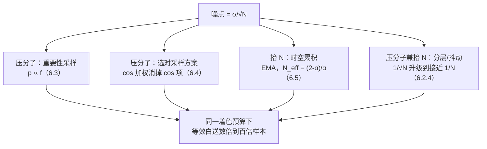

# 概率与蒙特卡洛

> [返回：WebGL 与 3D 框架学习大纲](../WebGL与3D框架学习大纲.md)
> 一句话定位：数学专题第六册。为第五阶段 [PBR 入门](../05-第五阶段/04-PBR入门.md) 的渲染方程与 IBL、以及一切"实时算不动的积分"补上数值方法——概率、蒙特卡洛积分与重要性采样的完整推导，全部配手算数值例子与可运行代码。

先回答"为什么渲染需要概率"。面积光的软阴影（对光源表面积分）、光泽表面对环境贴图的反射（对半球按 GGX 分布积分）、全局光照的多次弹射（对路径空间积分）——它们共同的形式是[渲染方程](../05-第五阶段/04-PBR入门.md#31-渲染方程直觉版逐项拆解)里的 $\int_\Omega f_r \, L_i \cos\theta \, d\omega$：被积函数由任意几何、任意贴图决定，**没有解析解**。数值积分是唯一出路，而梯形、Simpson 这类确定性求积在"每个片元、每帧、60 fps"的预算下还有第二个问题：维度诅咒（curse of dimensionality）——半光是二维、路径是多维，网格求积的样本数随维度指数爆炸。蒙特卡洛（Monte Carlo）用**随机采样**换掉了网格：误差只按样本数 N 的 $1/\sqrt{N}$ 收敛、与维度无关。这份"慢而稳"的收敛正是实时渲染噪点的来源，也是本篇的主线：期望、方差、无偏，以及怎么把方差压下去。

## 6.1 随机变量速成：期望、方差与逆变换采样

### 6.1.1 概念：PDF、CDF、期望、方差

- 随机变量（random variable）X：取值随"试验"变化的量，本篇只需连续型；
- 概率密度函数（PDF, probability density function）p(x)：$p(x)\ge 0$ 且 $\int p(x)\,dx = 1$，落在 [a,b] 的概率是 $\int_a^b p$；
- 累积分布函数（CDF, cumulative distribution function）：$F(x) = P(X \le x) = \int_{-\infty}^{x} p(t)\,dt$，单调不减、从 0 到 1；
- 期望（expectation）：$E[X] = \int x\,p(x)\,dx$，长期平均；
- 方差（variance）：$\mathrm{Var}[X] = E[(X-E[X])^2] = E[X^2] - (E[X])^2$，标准差 σ 是它的平方根。方差贯穿全篇——**噪点的大小就是估计量的标准差**。

两个手算靶子（后面反复用到）：均匀分布 Uniform[0,1] 的 $E = \int_0^1 x\,dx = \frac{1}{2}$，$E[X^2] = \frac{1}{3}$，$\mathrm{Var} = \frac{1}{3}-\frac{1}{4} = \frac{1}{12}$；骰子 $E = 3.5$，$E[X^2] = \frac{91}{6}$，$\mathrm{Var} = \frac{91}{6} - 3.5^2 = \frac{35}{12} \approx 2.92$。

### 6.1.2 逆变换采样：从均匀 u 到任意分布

**问题**：GPU/JS 只会吐均匀随机数 u ∈ [0,1)。怎么造出服从任意 p(x) 的样本？

**结论**：令 X = F⁻¹(U)，则 X 服从 p。完整推导只需三行：

$$P(X \le x) = P\big(F^{-1}(U) \le x\big) = P\big(U \le F(x)\big) = F(x)$$

第二行用 F 单调不减（不等式两边同时套 F），第三行用"均匀变量落在 [0,a] 的概率就是 a"。X 的 CDF 恰是 F，得证。

**完整例子：指数分布** $p(x) = \lambda e^{-\lambda x},\ x \ge 0$（生存时间/无记忆过程的模型，也是理解"幂律衰减"最便宜的靶子）：

1. 求 CDF：$F(x) = \int_0^x \lambda e^{-\lambda t} dt = 1 - e^{-\lambda x}$；
2. 令 u = F(x)：$u = 1 - e^{-\lambda x}$；
3. 反解：$x = -\frac{1}{\lambda}\ln(1-u)$。由于 1−U 与 U 同分布，实现里直接写 $x = -\frac{\ln u}{\lambda}$。

代码（TypeScript，含数值验证：理论期望 1/λ、方差 1/λ²）：

```typescript
/** 逆变换采样：均匀 u → 指数分布(λ)。x = -ln(u)/λ */
function sampleExponential(lambda: number): number {
  const u = Math.random();
  return u > 0 ? -Math.log(u) / lambda : 0;   // u=0 时 log 发散，护一下（常见坑 2）
}

// 验证：λ=2，期望 0.5，方差 0.25
const N = 1_000_000, lambda = 2;
let s1 = 0, s2 = 0;
for (let i = 0; i < N; i++) {
  const x = sampleExponential(lambda);
  s1 += x; s2 += x * x;
}
const mean = s1 / N, variance = s2 / N - mean * mean;
console.log(mean.toFixed(4), variance.toFixed(4)); // ≈ 0.5001 0.2503
```

渲染里"按 BRDF 采方向、按光源立体角采阴影射线"（6.4）都是逆变换采样，只是把一维换成了半球。

## 6.2 蒙特卡洛积分：把积分变成期望

### 6.2.1 大数定律与估计量

大数定律（law of large numbers）：独立同分布样本的均值随 N 增大收敛到期望。于是**只要能把积分写成某个期望，就能"抽样再平均"**。核心恒等式（对任何在 f≠0 处 p>0 的密度成立）：

$$I = \int f(x)\,dx = \int \frac{f(x)}{p(x)}\, p(x)\,dx = E\!\left[\frac{f(X)}{p(X)}\right], \quad X \sim p$$

由此得到蒙特卡洛估计量（estimator）：

$$\hat{I}_N = \frac{1}{N}\sum_{i=1}^{N} \frac{f(x_i)}{p(x_i)}$$

两边取期望：$E[\hat{I}_N] = I$，**无偏（unbiased）**——平均而言不偏不倚。除以 p(x) 的含义是加权补偿：采样落在"很少去的地方"时，那一点的样本代表了一大段没被采的区间，所以要按稀有程度放大（6.3 展开）。均匀特例下（[a,b] 上 p = 1/(b−a)），$\hat{I} = \frac{b-a}{N}\sum f(x_i)$，就是"随机挑点求平均高 × 底宽"。

### 6.2.2 方差与 1/√N：噪点的定量来源

独立样本方差可加：$\mathrm{Var}[\hat{I}_N] = \frac{1}{N}\mathrm{Var}\!\left[\frac{f}{p}\right]$，标准差（即典型误差）按

$$\sigma / \sqrt{N}$$

收敛。算术代价惨烈：误差减半要 4 倍样本，减少一个数量级要 100 倍：

| N | 16 | 64 | 256 | 1024 | 4096 |
|---|---|---|---|---|---|
| 相对误差（σ 为单位） | σ/4 | σ/8 | σ/16 | σ/32 | σ/64 |

**工程后果就是噪点**：每像素 1 spp（sample per pixel）的路径追踪，每个像素是一次（或少数几次）抽样，像素间的随机涨落直接显示为噪点。降噪的两条正路——压单样本方差（重要性采样，6.3/6.4）与攒样本数（累积，6.5）——分别作用在这条公式的分子与 N 上。

### 6.2.3 手算与代码

手算 $\int_0^1 x^2 dx = \frac{1}{3}$（均匀采样，p=1）：抽两个样本 u₁=0.3、u₂=0.7，

$$\hat{I}_2 = \frac{0.3^2 + 0.7^2}{2} = \frac{0.09+0.49}{2} = 0.29$$

误差 13%——两个样本很不准，符合 σ/√N 的预期。代码批量验证收敛规律：

```typescript
/** 蒙特卡洛估计 ∫₀¹ x² dx = 1/3，均匀采样 */
function mcX2(N: number): number {
  let sum = 0;
  for (let i = 0; i < N; i++) sum += Math.random() ** 2;   // f/p = x²（p=1）
  return sum / N;
}
for (const N of [16, 256, 4096, 262144]) {
  const err = Math.abs(mcX2(N) - 1 / 3) / (1 / 3);
  console.log(`N=${String(N).padStart(6)}  相对误差 ${(err * 100).toFixed(2)}%`);
}
// 典型输出：N=16 约 5%，N=4096 约 1%，N=262144 约 0.4% —— 16 倍 N 换 4 倍精度
```

### 6.2.4 分层采样：同样 N 个样本，白拿一个量级的精度

纯随机抽样会"扎堆"——两个样本偶然挤在同一小段，另一段没人管。分层采样（stratified sampling）先把定义域切成 N 层、每层强制抽一个：第 i 个样本取自 $\mathrm{Uniform}[\frac{i}{N}, \frac{i+1}{N}]$。期望不变，方差却变成**层内**方差的组合 $\frac{1}{N^2}\sum_i \sigma_i^2$——对光滑被积函数，层内方差远小于总体方差，收敛从 $1/\sqrt{N}$ 升级到接近 $1/N$。

手算（继续用 $\int_0^1 x^2$，N=16）：纯随机估计量方差 (4/45)/16 ≈ 5.6×10⁻³；分 16 层后层内方差合计 ≈ 6.9×10⁻³，除以 N² = 256 只剩 ≈ 2.7×10⁻⁵——**同一样本预算，方差小约 205 倍**：

```typescript
/** 分层采样：∫₀¹ x²，N 个样本各守一层 */
function stratifiedX2(N: number): number {
  let sum = 0;
  for (let i = 0; i < N; i++) sum += ((i + Math.random()) / N) ** 2; // 第 i 层内取均匀
  return sum / N;
}
// 20 万次独立试验的方差实测：纯随机 ≈ 5.6e-3，分层 ≈ 2.7e-5，比值约 200 倍
```

两个使用注意：被积函数不光滑（阶跃、高频贴图）时收益缩水——阶跃恰好横跨层边界时甚至与纯随机持平；分层的二维推广是抖动采样（jittered sampling，像素内分层），而 **TAA 的亚像素抖动 + 多帧累积正是"时间轴上的分层"**：每帧挪到一个新的层内位置，靠累积把整层采满（6.5）。

## 6.3 重要性采样：把样本投向被积函数大的地方

### 6.3.1 推导与最优分布

重要性采样（importance sampling）的思想：既然除以 p 后期望不变（6.2.1 的恒等式对任意 p 成立），**p 的选择就只影响方差**。展开方差：

$$\mathrm{Var}\!\left[\frac{f}{p}\right] = \int \frac{f(x)^2}{p(x)}\,dx - I^2$$

p(x) 出现在分母：**样本多投在 f 大的地方，f/p 更平，方差更小**。取到极限 $p(x) = f(x)/I$（正比于被积函数）时 f/p ≡ I 是常数，方差为零——每个样本都精确。反过来，f 大的地方 p 小，$f^2/p$ 爆炸。

### 6.3.2 手算：同一积分的四档采样

继续用 $\int_0^1 x^2 dx = \frac{1}{3}$，被积函数"大 x 端高"。四个分布的方差全部可以手算（$\mathrm{Var}[f/p] = \int \frac{f^2}{p} dx - I^2$，$I^2 = \frac{1}{9}$）：

| 采样分布 p(x) | 逆变换 | $\int \frac{f^2}{p} dx$ | 方差 | 单样本最大贡献（实测 200 万样本） |
|---|---|---|---|---|
| 均匀：1 | — | $\int x^4 = \frac{1}{5}$ | **4/45 ≈ 0.0889** | 1.0 |
| 偏向大 x：2x | x = √u | $\int \frac{x^4}{2x} = \frac{1}{8}$ | **1/72 ≈ 0.0139** | 0.5 |
| 正比于 f：3x² | x = ∛u | $\int \frac{x^4}{3x^2} = \frac{1}{9}$ | **0** | 1/3（恒等） |
| 偏向小 x：2(1−x) | x = 1−√(1−u) | $\int \frac{x^4}{2(1-x)} = \infty$ | **∞** | **814** |

逐行说明：

- 均匀档：$\mathrm{Var} = \frac{1}{5} - \frac{1}{9} = \frac{4}{45}$；
- p=2x 档：$\mathrm{Var} = \frac{1}{8} - \frac{1}{9} = \frac{1}{72}$，比均匀小 6.4 倍——**等效于白送 6.4 倍样本数**（标准差缩小 √6.4 ≈ 2.5 倍）；
- p=3x² 档（p ∝ f）：此时 $\frac{f}{p} = \frac{x^2}{3x^2} \equiv \frac{1}{3}$，每个样本都是精确答案——重要性采样的理论终点；
- p=2(1−x) 档（**选错了**）：被积函数大的区域（x→1）采样概率反而趋零。估计量仍无偏（$E[f/p] = \int f = I$ 成立），但 $\frac{f^2}{p} = \frac{x^4}{2(1-x)}$ 在 x→1 处发散，**方差无穷大**。手算一个坏样本：u = 0.999 → x = 1−√0.001 ≈ 0.968 → $\frac{f}{p} = \frac{0.968^2}{2 \times 0.0316} \approx 14.8$（真值才 0.33）；实测 200 万样本里单样本最大贡献冲到 814。**一颗离群亮样本毁掉整帧平均**——这就是路径追踪里"火萤"（firefly，孤立白点）的数学 anatomy。

### 6.3.3 代码：四档方差实测

```typescript
function runVariance(sampler: () => number, pdf: (x: number) => number, N: number) {
  let m = 0, m2 = 0, max = 0;
  for (let i = 0; i < N; i++) {
    const x = sampler(), g = (x * x) / pdf(x);      // f(x)/p(x)
    m += g; m2 += g * g; max = Math.max(max, g);
  }
  m /= N;
  return { variance: m2 / N - m * m, maxContribution: max };
}
const N = 2_000_000;
console.log(runVariance(Math.random, () => 1, N));
// { variance: ≈0.0889, maxContribution: ≈1.0 }   —— 理论 4/45
console.log(runVariance(() => Math.sqrt(Math.random()), x => 2 * x, N));
// { variance: ≈0.0139, maxContribution: 0.5 }    —— 理论 1/72
console.log(runVariance(() => Math.cbrt(Math.random()), x => 3 * x * x, N));
// { variance: ≈0（1e-12 量级）, maxContribution: ≈0.333 } —— p ∝ f，零方差
console.log(runVariance(() => 1 - Math.sqrt(1 - Math.random()), x => 2 * (1 - x), N));
// { variance: ≈2.5（每次不同！）, maxContribution: ≈814 } —— 方差无穷大的实证
```

对渲染的直接翻译：GGX 粗糙表面的镜面反射按 D 项采样（[PBR 入门 3.2.1](../05-第五阶段/04-PBR入门.md#321-d-项法线分布函数normal-distribution)），就是第三档"p ∝ f"；反过来高光很锐（lobe 很窄）却用均匀半球采样，就是第四档——方差爆炸、火萤遍地。

## 6.4 渲染方程的估计器：两种半球采样

### 6.4.1 从方程到估计器

把[渲染方程](../05-第五阶段/04-PBR入门.md#31-渲染方程直觉版逐项拆解)的自发光项放一边，积分项 $L_o = \int_\Omega f_r \, L_i \, \cos\theta \, d\omega$ 直接套 6.2 的模板：**在半球上按某个方向密度 p(ω) 抽一个方向**，

$$\hat{L}_o = \frac{f_r(\omega_i, \omega_o)\, L_i(\omega_i)\, \cos\theta}{p(\omega_i)}$$

一条阴影射线（shadow ray）就是一个样本；N 条射线取平均。现在的问题只剩：p(ω) 怎么选？——这正是 6.3 的思想落到半球上。漫反射（兰伯特，$f_r = \frac{\rho}{\pi}$ 为常数）有两档经典选择。

### 6.4.2 均匀半球采样：p(ω) = 1/(2π)

立体角上均匀。极角 θ、方位角 φ 的联合密度是 $p(\theta,\varphi) = \frac{\sin\theta}{2\pi}$（立体角元 dω = sinθ dθ dφ 带来的雅可比）。用 6.1 的逆变换分别解两个一维边缘：

- φ 边缘均匀：$\varphi = 2\pi \xi_2$；
- θ 的 CDF 是 $\cos\theta$ 的线性函数（$\int_0^\theta \sin t\,dt = 1-\cos\theta$），即 **cosθ 本身均匀分布于 [0,1]：cosθ = ξ₁**。

估计量：$\hat{L}_o = \frac{\rho}{\pi} L_i \cos\theta \cdot 2\pi = 2\rho\, L_i \cos\theta$。

### 6.4.3 cos 加权采样：p(ω) = cosθ/π

让采样分布的形状直接对准被积函数里的 cosθ。方向用 Malley 构造生成：先在单位圆盘上均匀取点，再抬到半球上：

- 圆盘面积 CDF ∝ r²，逆变换给 **r = √ξ₁**（不是 ξ₁——那会中心密集）、φ = 2πξ₂；
- 抬升：方向 = (x, y, √(1−r²))。圆盘上小面积 dA 投到半球对应的立体角恰好是 dω = dA/cosθ，密度换算后正是 $p(\omega) = \frac{\cos\theta}{\pi}$。

估计量：$\hat{L}_o = \frac{\rho}{\pi} L_i \cos\theta \cdot \frac{\pi}{\cos\theta} = \rho\, L_i$——**cosθ 被约掉**。

### 6.4.4 方差对比推导

玩具场景定死解析：Lambert（ρ）+ 常数环境 L。真值 $L_o = \frac{\rho}{\pi} L \int_\Omega \cos\theta\, d\omega = \frac{\rho}{\pi} L \cdot \pi = \rho L$。

- 均匀档：$g = 2\rho L \cos\theta$。用到的两个矩各是一行积分（均匀半球密度 $\frac{1}{2\pi}$，dω = sinθ dθ dφ）：

$$E[\cos\theta] = \frac{1}{2\pi}\int_0^{2\pi}\!\!\int_0^{\pi/2} \cos\theta \sin\theta \, d\theta \, d\varphi = \frac{1}{2}, \qquad E[\cos^2\theta] = \int_0^{\pi/2} \cos^2\theta \sin\theta \, d\theta = \frac{1}{3}$$

$$\mathrm{Var}[g] = 4\rho^2 L^2 \cdot \tfrac{1}{3} - \rho^2L^2 = \frac{\rho^2L^2}{3}$$

- cos 加权档：$g = \rho L$ 恒为常数，**方差为零**。cos 因子的方差被采样分布整个吸收。

真实场景 Li 随方向变化（环境贴图、面光源），cos 加权消不干净，但"cos 项的方差"这部分是免费拿掉的。数值实验（Li = 0.2 + 1.8·max(0, ω·s)，模拟"天空底光 + 一侧太阳"）：

```typescript
// 实验：漫反射 ρ=0.7 + 方向变化环境光，比较两种 1 spp 估计量的方差
const rho = 0.7, s = [0.3, 0.8, 0.5];
const norm = Math.hypot(...s); s = s.map(v => v / norm) as number[];
const Li = (w: number[]) => 0.2 + 1.8 * Math.max(0, w[0]*s[0] + w[1]*s[1] + w[2]*s[2]);

const uniformHemi = (): number[] => {          // cosθ = ξ 均匀
  const z = Math.random(), phi = 2 * Math.PI * Math.random(), r = Math.sqrt(1 - z*z);
  return [r * Math.cos(phi), r * Math.sin(phi), z];
};
const cosineHemi = (): number[] => {           // r = √ξ 圆盘抬半球
  const r = Math.sqrt(Math.random()), phi = 2 * Math.PI * Math.random();
  const x = r * Math.cos(phi), y = r * Math.sin(phi);
  return [x, y, Math.sqrt(Math.max(0, 1 - x*x - y*y))];
};

function trialVariance(sampler: () => number[], pdf: (w: number[]) => number, T: number) {
  let m = 0, m2 = 0;
  for (let t = 0; t < T; t++) {
    const w = sampler();                        // 法线取 z 轴，cosθ = w[2]
    const g = (rho / Math.PI) * Li(w) * Math.max(0, w[2]) / pdf(w);
    m += g; m2 += g * g;
  }
  m /= T; return m2 / T - m * m;
}
const PI = Math.PI, T = 200_000;
const vU = trialVariance(uniformHemi, () => 1 / (2 * PI), T);        // ≈ 0.398
const vC = trialVariance(cosineHemi, w => Math.max(0, w[2]) / PI, T); // ≈ 0.185
console.log(`方差比 uniform/cosine ≈ ${(vU / vC).toFixed(2)}`);        // ≈ 2.15
```

实测约 2.15 倍——**等效白送 2 倍样本数**，且剩余方差全部来自 Li 的方向变化。这个"剩余"指向下一层优化：把样本朝光源方向投（光源采样），与 BRDF 采样按多重重要性采样（MIS, multiple importance sampling）混合——本篇止步于指出方向。

### 6.4.5 GLSL：两个采样器与两个估计器

```glsl
// hemisphere.glsl —— 半球采样与 1 spp 漫反射估计器（GLSL ES 3.00）
precision highp float;
uniform samplerCube uEnv;    // 环境贴图（Li 来源）
uniform uint uFrame;         // 帧号：随机种子必须混入（常见坑 3）

// 像素坐标 + 帧号 → [0,1)。教学用 hash；生产换 PCG3D
float hash12(vec2 p) {
  vec3 p3 = fract(vec3(p.xyx) * 0.1031 + float(uFrame) * 0.0173);
  p3 += dot(p3, p3.yzx + 33.33);
  return fract((p3.x + p3.y) * p3.z);
}

// —— 采样器（局部坐标系：z 轴 = 法线）——
// 均匀半球：p(ω) = 1/(2π)，cosθ = ξ₁ 均匀，φ = 2πξ₂
vec3 sampleUniformHemisphere(vec2 u) {
  float z = u.x;
  float r = sqrt(max(0.0, 1.0 - z * z));
  float phi = 6.2831853 * u.y;
  return vec3(r * cos(phi), r * sin(phi), z);
}

// cos 加权半球：p(ω) = cosθ/π。Malley 构造：圆盘 r = √ξ₁，再抬到 z = √(1-r²)
vec3 sampleCosineHemisphere(vec2 u) {
  float r = sqrt(u.x);
  float phi = 6.2831853 * u.y;
  vec2 d = r * vec2(cos(phi), sin(phi));
  return vec3(d, sqrt(max(0.0, 1.0 - dot(d, d))));
}

// 局部 → 世界：以 n 为 z 轴搭正交基
vec3 toWorld(vec3 n, vec3 l) {
  vec3 t = normalize(abs(n.z) < 0.999 ? cross(vec3(0.0, 0.0, 1.0), n) : vec3(1.0, 0.0, 0.0));
  vec3 b = cross(n, t);
  return normalize(t * l.x + b * l.y + n * l.z);
}

// —— 两个 1 spp 估计器（Lambert：fr = albedo/π）——
vec3 estimateUniform(vec3 n, vec3 albedo) {
  vec2 u = vec2(hash12(gl_FragCoord.xy), hash12(gl_FragCoord.yx + 17.17));
  vec3 wi = toWorld(n, sampleUniformHemisphere(u));
  float pdf = 1.0 / 6.2831853;
  return (albedo / 3.14159265) * texture(uEnv, wi).rgb
       * max(dot(n, wi), 0.0) / pdf;            // 等价于 ×2π
}

vec3 estimateCosine(vec3 n, vec3 albedo) {
  vec2 u = vec2(hash12(gl_FragCoord.xy), hash12(gl_FragCoord.yx + 17.17));
  vec3 wi = toWorld(n, sampleCosineHemisphere(u));
  float cosT = max(dot(n, wi), 0.0);
  float pdf = cosT / 3.14159265;
  return (albedo / 3.14159265) * texture(uEnv, wi).rgb
       * cosT / pdf;                            // cosθ 约掉，等价于 ×π
}
```

单样本预算下两者代码几乎同价（一个 `sqrt` 的差别），方差却差一截——重要性采样"免费午餐"的现场。

## 6.5 落地：prefilter 图与时空累积

### 6.5.1 IBL 预计算：第五阶段的"卷积"就是蒙特卡洛

[IBL 的 split-sum](../05-第五阶段/04-PBR入门.md#34-ibl基于图像的光照) 把镜面环境积分拆成两个离线产物，当时的"卷积"现在可以给出准确的数学名字：

- **辐照度贴图**（diffuse 卷积，[实现边界](../05-第五阶段/04-PBR入门.md#343-本节的实现边界)里那个"64 方向均匀采样平均"）：就是 6.4.2 均匀半球采样、N=64 的蒙特卡洛估计，典型误差降到 σ/8。而它 32×32 就够分辨率的原因是频域的：cos 加权的半球平均是强低通，结果极低频（[第 05 篇 5.6](05-采样卷积与频域.md#56-频域在框架里的落点清单)）；
- **预过滤环境贴图**（prefilter map）：对每个 mip 层的粗糙度，镜面积分 $\int_\Omega L_i\, f_{spec}(\alpha,\omega)\, d\omega$ 用 **GGX 重要性采样**估计——按 p(h) ∝ D(h)·(h·n) 抽半程向量 h（6.1 的逆变换落在一个二维方向分布上），反射方向 ω = 2(v·h)h − v，采环境图累加、除以 pdf。这正是 6.3 第三档"p ∝ f"的工程化：lobe（GGX 分布）就是被积函数的形状。粗糙度越大 lobe 越宽 → 分布越平 → 采样越"撒网" → 结果越低频，所以存进**越低分辨率的 mip 层**——采样分布的宽窄与结果的频带宽窄恰好对偶；
- **BRDF LUT**：512×512 每格一个 (NdotV, roughness) 的小积分，同样是几十个 GGX 样本的蒙特卡洛估计，Schlick 菲涅尔对 F₀ 是线性的，所以每格只需存两个系数（F₀·A + B）。一句话：**LUT 是"把离线算好的期望缓存成纹理"，运行时查表 = 免积分**。

### 6.5.2 渐进式降噪：时空累积

6.2 说过攒 N 的代价是 4N 换 2 倍精度，实时付不起。但如果**信号本身在帧间不变**（静止场景、固定视角），N 可以在时间轴上分期付——每帧 1 spp，把历史帧加权平均起来：

$$C_t = \alpha \cdot S_t + (1-\alpha)\, C_{t-1}$$

这是指数滑动平均（EMA, exponential moving average）。对常数信号，权重平方和 $\sum (\alpha(1-\alpha)^k)^2 = \frac{\alpha}{2-\alpha}$，于是稳态方差是单帧方差的 $\frac{\alpha}{2-\alpha}$ 倍，**等效样本数**：

$$N_{\text{eff}} = \frac{2-\alpha}{\alpha} \qquad (\alpha=0.1 \to 19,\ \ \alpha=0.05 \to 39)$$

（模拟验证：α=0.05/0.1/0.2 的稳态方差比实测 0.0256/0.0529/0.1106，对上公式 0.0256/0.0526/0.1111。）α=0.1 时噪点降为约 1/√19 ≈ 23%——免费拿到 19 个等效样本。

代价是"历史"在运动中失效：上一帧同一屏幕位置装的可能是另一个物体。所以完整方案必须配**重投影（reprojection）**——用深度和运动矢量把当前像素映射回上一帧的 UV 再取历史——以及**失配检测**：历史色偏离本帧局部范围时提高 α（少信历史）、甚至夹紧（clamp）到邻域色域，防拖影。骨架代码：

```glsl
// accumulate.frag —— 时空累积（EMA + 重投影 + 失配防护）
#version 300 es
precision highp float;
in vec2 vUV;
out vec4 fragColor;
uniform sampler2D uCurrent;   // 本帧 1 spp 结果
uniform sampler2D uHistory;   // 上一帧累积（ping-pong 读写不同纹理，同后处理纪律）
uniform mat4 uReproject;      // 本帧像素 → 上一帧 UV
uniform float uAlphaMin;      // 如 0.05：N_eff ≈ 39

void main() {
  vec3 cur = texture(uCurrent, vUV).rgb;
  vec2 histUV = (uReproject * vec4(vUV * 2.0 - 1.0, 0.0, 1.0)).xy * 0.5 + 0.5;
  if (any(lessThan(histUV, vec2(0.0))) || any(greaterThan(histUV, vec2(1.0)))) {
    fragColor = vec4(cur, 1.0);                       // 出界：新像素从本帧重来
    return;
  }
  vec3 hist = texture(uHistory, histUV).rgb;
  // 失配检测（简版）：历史离本帧越远越不信，极端时退回纯当前帧
  float alpha = clamp(uAlphaMin + length(hist - cur) * 0.5, uAlphaMin, 1.0);
  fragColor = vec4(mix(hist, cur, alpha), 1.0);
}
```

这套"欠采样 + 重投影累积"正是 TAA（[第 05 篇 5.5](05-采样卷积与频域.md#55-采样定理与反走样三条路线的数学本质) 的路线三）与实时全局光照降噪器的共同骨架：几何走样用亚像素抖动累积，噪声用 EMA 累积，数学上都是"增大等效 N"。全篇的降方差手段到此收拢成一张图——sigma 分子（单样本方差）与 N（样本数）两条腿：



## 常见坑

1. **PDF 为零/过小**：重要性分布没盖住被积函数的支撑（f≠0 而 p=0），无偏性被破坏——那部分贡献永远采不到，期望就错了；p 极小则 $f/p$ 爆出火萤。GLSL 里除以 pdf 前先 `max(pdf, 1e-6)`，或用 MIS 保证任意方向至少有一套分布覆盖。
2. **float 精度**：`u→0` 时 `log(u)`、`−ln u` 发散，half float 直接 inf；GGX 掠射角、高粗糙度下 pdf 极小，`f/p` 在 `mediump`（half）下溢出。蒙特卡洛着色器一律 `precision highp float`，并对 u、pdf 双侧护零。
3. **随机数与种子**：hash 种子只含像素坐标 → 每帧同一张噪点图（静态脏图，物体动噪点不动，一眼假）；必须混入帧号。反过来每帧独立白噪声会闪烁，正确姿势是**帧间亚像素抖动 + 6.5 的累积**让噪声在时间上平均掉。JS 的 `Math.random` 进不了着色器，教学用正弦/Dave hash、生产用 PCG3D。
4. **PDF 定义域用错**：对立体角的 pdf 与对 (θ,φ) 坐标的 pdf 差一个 sinθ 雅可比；对半程向量的 pdf 换算到反射方向还要除 4(v·h)。套错一个雅可比，结果系统性偏亮/偏暗且不随 N 收敛——排查方法是单点数值积分对照。
5. **忘乘/忘除分量**：估计器里丢掉 cosθ、或者 BRDF 采样后忘了除 pdf（把"加权"当成了"免费"），都是无偏性事故，症状是整体过曝或过暗而非噪点。
6. **累积相关的坑**：无重投影直接累积 → 运动物体拖长影（鬼影）；累积缓冲用 RGBA8 存 HDR → banding 与截断，至少 RGBA16F；ping-pong 读写同一张纹理是未定义行为（[后处理 2.1.3](../05-第五阶段/03-后处理管线.md#213-ping-pong-双-fbo为什么必须两个) 的老规矩）。

## 【本节自测】

1. 写出逆变换采样的三行证明；对 p(x) = 2x（x ∈ [0,1]）求采样公式，并用 6.1 的代码骨架验证期望与方差（E=2/3，Var=1/18）。
2. N 从 64 提到 1024，噪点（标准差）降为几分之一？想再降一半，样本要加到多少？由此解释"实时路径追踪不能靠堆 spp"。
3. 对 ∫₀¹ x² dx：均匀采样方差 4/45，p=2x 时 1/72，p=3x² 时 0——用一句话概括单调改善的原因；再解释 p=2(1−x) 时"无偏但方差无穷大"与火萤的关系。
4. 推导 cos 加权采样为何消掉 Lambert + 常数环境下的全部方差（写出均匀档的 ρ²L²/3）；环境光换成"一侧亮一侧暗"后剩余方差来自哪里，对应的下一步优化是什么？
5. prefilter map 按 GGX 分布采样环境图，对应 6.3 的哪一档？roughness 很低时采样数不足会发生什么（提示：第三档的"恒等"还成立吗）？
6. α=0.05 的 EMA 等效样本数是多少？为什么相机一动就必须提高 α 或整帧丢弃历史？

---

数学专题的信号与概率两册到此收束：[第 05 册](05-采样卷积与频域.md)讲"确定的滤波"（信号、卷积、频域），本册讲"随机的积分"（概率、蒙特卡洛、方差）。它们在 IBL 处合流——预滤波是"按分布加权的卷积"，累积是"时间轴上的平均"。带着这两套语言回看第五阶段，每个"先这么写"背后都有一句"为什么"。

下一篇：[07-切空间与几何算法](07-切空间与几何算法.md)——从概率回到几何：切空间的基、法线贴图的坐标系与球面插值。
