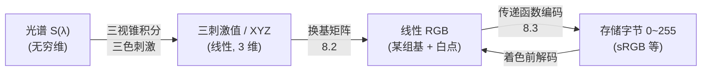
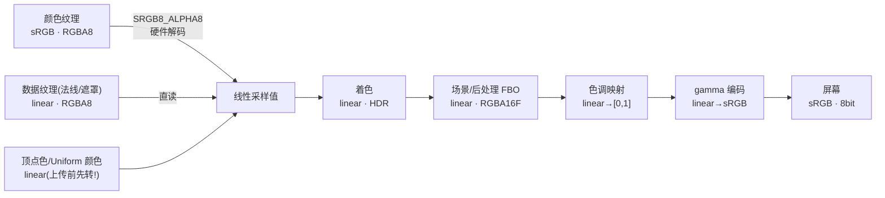

# 色彩数学

> [返回：WebGL 与 3D 框架学习大纲](../WebGL与3D框架学习大纲.md)
> 数学专题第 08 篇：把"颜色是一个三维向量"讲到底——三色刺激与色彩空间三要素、转换矩阵的推导与验证、传递函数的精确公式、HDR 与色调映射的数学、亮度与感知，最后收成一张全链路色彩空间标注表。为第二阶段 [光照](../02-第二阶段/05-光照.md)（Gamma/sRGB 数值对比在彼处 4.4，本篇不重复）、第五阶段 [后处理](../05-第五阶段/03-后处理管线.md)（色调映射 GLSL 在彼处 2.4）与 [PBR](../05-第五阶段/04-PBR入门.md) 的色彩纪律补数学底座。矩阵换基的背景见本专题 [01-线性代数深化](01-线性代数深化.md)。

## 8.1 色彩是三数向量

### 概念：三色刺激

人眼视网膜上有三种视锥细胞（cone cells），分别对长、中、短波长（L/M/S）最敏感。任意光谱分布 $S(\lambda)$ 进入眼睛，每种视锥做一个加权积分：

$$L = \int S(\lambda)\,\bar{l}(\lambda)\,d\lambda, \quad M = \int S(\lambda)\,\bar{m}(\lambda)\,d\lambda, \quad S_c = \int S(\lambda)\,\bar{s}(\lambda)\,d\lambda$$

颜色感知由这三个数决定——**光谱被压缩成三维**。推论是同色异谱（metamerism）：光谱完全不同的光，只要三个积分值相同，看起来就是同一颜色。显示器正是靠它用三种窄谱光源"骗"过眼睛，混出自然界光谱的等效色。

### 为什么 RGB 是三维

选三种基色（primaries，原色），任意颜色表示为它们的线性组合 $c = R\,\mathbf{r} + G\,\mathbf{g} + B\,\mathbf{b}$。可表示的颜色构成三维线性空间中的一个凸锥——**色域（gamut）就是"这组基的非负组合能覆盖的范围"**。这是纯线性代数：一组基张成一个空间（见 [01-线性代数深化](01-线性代数深化.md)），选不同基就是换基，颜色本身（三刺激值）不变。

实验（CIE 1931 颜色匹配实验）发现：要混出某些饱和色，需要**负系数**——这些色在所选基的正锥之外。于是 CIE 构造了三个虚拟基 XYZ，使任何可见色都有正表示，成为描述色彩空间的中立语言（下一节的转换矩阵都经它中转）。

**手算一个"色域外"**：光谱 520 nm 附近的饱和绿，色品约 (x, y) = (0.069, 0.848)，取 Y = 1 换算成 XYZ = (0.0814, 1.0, 0.0979)（换算公式见 8.2 第 2 步）。用 8.2 的逆矩阵映射到线性 sRGB：

```text
R = 3.2406×0.0814 − 1.5372×1.0 − 0.4986×0.0979 = −1.322
G = −0.9689×0.0814 + 1.8758×1.0 + 0.0415×0.0979 =  1.801
B = 0.0557×0.0814 − 0.2040×1.0 + 1.0570×0.0979 = −0.096
```

R、B 都是负的——自然界这抹绿比 sRGB 的绿原色更饱和，三基色的非负组合**永远到不了**，显示器只能退而求其次给出 clamp 后的近似。色域（gamut）的边界就是这样"负系数出现的地方"。

### 色彩空间三要素

一个色彩空间的完整定义 = **基 + 白点 + 传递函数**：

1. **基（primaries）**：三原色在 XYZ 中的位置（等价于给出 RGB↔XYZ 矩阵），决定色域与"线性部分"的几何；
2. **白点（white point）**：三通道相等（R=G=B）时对应的"白"是哪个白（如 D65 日光白），决定基的亮度缩放；
3. **传递函数（transfer function）**：线性光与存储数值之间的非线性编码（如 sRGB 分段函数），决定字节怎么花预算。

前两个定义线性空间，第三个是编码协议。**"sRGB"同时是这三件套的整体名称**——8.3 会展开它被混用的三种含义。



## 8.2 色彩空间转换矩阵：sRGB ↔ linear ↔ XYZ

### 推导路线

完整推导是色彩科学的一章，这里给路线图与结论（数值全部可手工验证）：

1. 测得三原色的色品坐标（chromaticity，$x = X/(X+Y+Z)$、$y = Y/(X+Y+Z)$，把 XYZ 压到二维平面）：sRGB 的 R(0.640, 0.330)、G(0.300, 0.600)、B(0.150, 0.060)；
2. 色品只给方向不给亮度，每个原色留一个未知亮度 $Y_i$。由色品反解：$X_i = \frac{x_i}{y_i} Y_i$、$Z_i = \frac{1-x_i-y_i}{y_i} Y_i$；
3. **白点约束**：三通道各取 1 时必须等于白点的 XYZ（sRGB 用 D65：$(0.9505, 1.0, 1.0890)$），得到关于 $Y_R, Y_G, Y_B$ 的三个线性方程，解出；

第 2、3 步值得展开手算一次（这是整个推导唯一需要解方程的地方）。由色品反解得每个原色用 $Y_i$ 表出的 XYZ 系数：

```text
R(0.640, 0.330)：X_R = 1.9394·Y_R   Z_R = 0.0909·Y_R
G(0.300, 0.600)：X_G = 0.5000·Y_G   Z_G = 0.1667·Y_G
B(0.150, 0.060)：X_B = 2.5000·Y_B   Z_B = 13.1667·Y_B
```

白点约束"R+G+B 的 XYZ = D65"排成线性方程组：

$$\begin{cases} 1.9394\,Y_R + 0.5000\,Y_G + 2.5000\,Y_B = 0.9505 \\ \phantom{1.9394}Y_R + \phantom{0.5}Y_G + \phantom{2.5}Y_B = 1.0000 \\ 0.0909\,Y_R + 0.1667\,Y_G + 13.1667\,Y_B = 1.0890 \end{cases}$$

高斯消元解得 $Y_R \approx 0.213$、$Y_G \approx 0.715$、$Y_B \approx 0.072$——**这三个解正是 Rec.709 亮度权重**（8.5 揭晓为什么）。换句话说，亮度权重不是感知实验的拟合结果，而是"用 D65 定标这组基"时白点方程组的解，色彩科学与感知生理在同一个数字上会师；
4. 归一后排成矩阵。结论（IEC 61966-2-1，保留 4 位）：

$$M_{\mathrm{sRGB}\to\mathrm{XYZ}} = \begin{bmatrix} 0.4124 & 0.3576 & 0.1805 \\ 0.2126 & 0.7152 & 0.0722 \\ 0.0193 & 0.1192 & 0.9505 \end{bmatrix}, \qquad M_{\mathrm{XYZ}\to\mathrm{sRGB}} = \begin{bmatrix} 3.2406 & -1.5372 & -0.4986 \\ -0.9689 & 1.8758 & 0.0415 \\ 0.0557 & -0.2040 & 1.0570 \end{bmatrix}$$

注意作用对象是**线性** RGB——sRGB 编码值必须先解码（8.3）才能进矩阵。

### 验证方法：白点映射到白点

矩阵对不对，两条手算就能做的检查：

**检查一（白→白）**：$M \cdot (1,1,1)^T$ 等于**每行求和**：

```text
第 1 行：0.4124 + 0.3576 + 0.1805 = 0.9505
第 2 行：0.2126 + 0.7152 + 0.0722 = 1.0000
第 3 行：0.0193 + 0.1192 + 0.9505 = 1.0890
→ (0.9505, 1.0000, 1.0890) = D65 的 XYZ。白点约束成立。
```

这不是巧合——第 3 步推导解的就是这个方程组，"每行之和等于白点"是该矩阵的固有性质，任何"基 + 白点"导出的 RGB→XYZ 矩阵都可用它自检。

**检查二（原色色度往返）**：$M \cdot (1,0,0)^T = (0.4124, 0.2126, 0.0193)$，换算色品：$X+Y+Z = 0.6443$，$x = 0.4124/0.6443 = 0.640$、$y = 0.2126/0.6443 = 0.330$——回到 R 原色的色品坐标 (0.640, 0.330)。再用逆矩阵乘回去：$M^{-1} \cdot (0.4124, 0.2126, 0.0193)^T \approx (1, 0, 0)$，往返无损。

### 与旋转矩阵的同构：都是换基

$M_{\mathrm{sRGB}\to\mathrm{XYZ}}$ 与 3D 里的旋转矩阵做的是同一件事：**同一个向量（颜色），换一组基（原色）重新给坐标**（第一阶段数学基础 4.2 的"矩阵是对空间的线性描述"，深化见 [01-线性代数深化](01-线性代数深化.md)）。差别在一条性质：

- 旋转矩阵正交，$R^{-1} = R^T$，逆免费；
- 色彩基在 XYZ 空间**不正交**（原色互相"沾染"，看矩阵的非对角项：绿里有 0.7152 的 Y 但也有 0.1500 的 X），$M^{-1} \neq M^T$，两张表都得存（或存一张 + 通用 3×3 求逆）。

顺带一个会在 8.5 用到的发现：**矩阵第二行 (0.2126, 0.7152, 0.0722) 恰是 Rec.709 亮度权重**——因为 CIE 定义的 Y 分量本身就是"亮度"，第二行就是"单位 RGB 通道各贡献多少亮度"，而 sRGB 与 Rec.709 共用同一组原色与白点。

### 完整代码（TypeScript）

```typescript
// math/colorSpace.ts —— sRGB(线性) ↔ XYZ 转换（作用对象均为线性值！）
export const SRGB_TO_XYZ = new Float32Array([
  0.4124, 0.3576, 0.1805,
  0.2126, 0.7152, 0.0722,
  0.0193, 0.1192, 0.9505,   // 行主序；上传 uniformMatrix3fv 前按引擎约定转列主序
]);
export const XYZ_TO_SRGB = new Float32Array([
  3.2406, -1.5372, -0.4986,
  -0.9689, 1.8758, 0.0415,
  0.0557, -0.2040, 1.0570,
]);

export function rgbToXyz(r: number, g: number, b: number): [number, number, number] {
  return [
    SRGB_TO_XYZ[0] * r + SRGB_TO_XYZ[1] * g + SRGB_TO_XYZ[2] * b,
    SRGB_TO_XYZ[3] * r + SRGB_TO_XYZ[4] * g + SRGB_TO_XYZ[5] * b,
    SRGB_TO_XYZ[6] * r + SRGB_TO_XYZ[7] * g + SRGB_TO_XYZ[8] * b,
  ];
}

export function xyzToRgb(x: number, y: number, z: number): [number, number, number] {
  return [
    XYZ_TO_SRGB[0] * x + XYZ_TO_SRGB[1] * y + XYZ_TO_SRGB[2] * z,
    XYZ_TO_SRGB[3] * x + XYZ_TO_SRGB[4] * y + XYZ_TO_SRGB[5] * z,
    XYZ_TO_SRGB[6] * x + XYZ_TO_SRGB[7] * y + XYZ_TO_SRGB[8] * z,
  ];
}

// 单测断言（vitest，呼应第三阶段 minmath 的测试习惯）：
// expect(rgbToXyz(1, 1, 1)).toBeCloseToArray([0.9505, 1.0, 1.0890], 3);  // 白→白
// expect(rgbToXyz(1, 0, 0)).toBeCloseToArray([0.4124, 0.2126, 0.0193], 3); // 红原色
// 往返：xyzToRgb(...rgbToXyz(r, g, b)) ≈ (r, g, b)，误差 < 1e-3
```

（要转 Display-P3、Rec.2020 等其他空间，路线相同：查该空间的原色色品与白点，走 8.2 的四步，或直接 sRGB→XYZ→目标 两个矩阵相乘。）

## 8.3 传递函数：Gamma 2.2 vs sRGB 分段

### 概念与差异表

传递函数解决"线性亮度怎么编码存储"：人眼对暗部更敏感（韦伯-费希纳定律，第二阶段光照篇 4.4 已给出感知动机与"0.5+0.5 过曝"的叠加反例，此处不重复），编码曲线应在暗部花更多码位。工程上常把"Gamma 2.2"当 sRGB 用，两者**不精确相等**：

| 维度 | 纯 Gamma 2.2 | sRGB 分段函数（标准） |
|---|---|---|
| 解码（存储→线性） | $L = c^{2.2}$ | $L \le$ 段：$c \le 0.04045$ 时 $L = c/12.92$；否则 $L = \left(\frac{c+0.055}{1.055}\right)^{2.4}$ |
| 编码（线性→存储） | $c = L^{1/2.2}$ | $L \le 0.0031308$ 时 $c = 12.92\,L$；否则 $c = 1.055\,L^{1/2.4} - 0.055$ |
| 指数 | 2.2（1/2.2 ≈ 0.4545） | 2.4（配合线性段，整体曲线"等效"约 2.2） |
| 原点行为 | 幂函数在 0 处斜率无穷大，数值不稳 | 线性段斜率 12.92，有限、可逆、噪声不被放大 |
| 与 2.2 的偏差 | —— | 暗部（c ≈ 0.06 附近）编码值最大差约 0.03；中段（c = 0.5）差 < 0.004 |

三个码值的解码手算对照（差在暗部，不在中段）：

| 存储值 c | sRGB 分段解码 | $c^{2.2}$ | 比值 |
|---|---|---|---|
| 0.02 | 0.02/12.92 = **0.00155** | 0.00018 | 约 8.5 倍 |
| 0.05 | ((0.05+0.055)/1.055)^2.4 = **0.00394** | 0.00137 | 约 2.9 倍 |
| 0.50 | ((0.5+0.055)/1.055)^2.4 = **0.21404** | 0.21764 | 1.017 倍 |

暗部 8.5 倍的线性差异意味着：阴影细节、噪声叠加、低光渲染里**两条曲线不可互换**；中段近似则足够好——这就是"日常场景 2.2 够用、专业暗部调色必须分段"的量化依据。

传递函数还有一个纯粹信息论的理由：**8 位码位预算**。把线性亮度直接存进 8 位（k/255），线性域最暗的 5%（0 ≤ L < 0.05）只分到 13 个码位（k ≤ 12）——暗部阶跃感明显、 banding 一眼可见；sRGB 编码后同一区间分到 64 个码位（编码值 c < 0.248），近 5 倍的暗部预算，而代价只是亮部码位变密（人眼在那里本来就不敏感）。感知均匀的编码让 8 位"够用"，这是 sRGB 能以 8 位统治显示生态的根本原因。

### 为什么"色彩空间"和"传递函数"常被混为一谈

"sRGB"一词至少承载三种用法：① 完整色彩空间（基 + D65 白点 + 分段传递函数）；② 只指那条分段传递函数（"把它转成 sRGB"往往只做了编码）；③ 口语里的"gamma 空间"（更含混，连指数都不指明）。混用的根源是历史：早期 CRT 的物理 gamma 让"编码曲线"先于色彩科学进入工程词汇。拆干净的问法永远是三连：**哪组基？哪个白点？哪条曲线？**——PBR 篇 3.3.2 的"颜色走 gamma、数据走线性"纪律（[05-第五阶段/04-PBR入门.md](../05-第五阶段/04-PBR入门.md)）说的只是第三件事。

### 何时必须显式转换：WebGL 的两种机制

```typescript
// 机制一：上传时标记（WebGL2），采样时硬件自动解码
gl.texImage2D(gl.TEXTURE_2D, 0, gl.SRGB8_ALPHA8, gl.RGBA, gl.UNSIGNED_BYTE, image);
// 着色器里 texture() 直接返回线性值——不许再 pow！

// 机制二：手动转换（WebGL1 唯一选择；WebGL2 需要灵活时）
gl.texImage2D(gl.TEXTURE_2D, 0, gl.RGBA, gl.RGBA, gl.UNSIGNED_BYTE, image);
```

```glsl
// 精确 sRGB 解码/编码（GLSL 300 es；近似可用 pow(c, vec3(2.2)) / pow(c, vec3(1.0/2.2))）
vec3 srgbDecode(vec3 c) {
  bvec3 low = lessThanEqual(c, vec3(0.04045));
  vec3 lin = c / 12.92;
  vec3 pow_ = pow((c + 0.055) / 1.055, vec3(2.4));
  return mix(pow_, lin, low);
}
vec3 srgbEncode(vec3 L) {
  bvec3 low = lessThanEqual(L, vec3(0.0031308));
  vec3 c = 12.92 * L;
  vec3 pow_ = 1.055 * pow(L, vec3(1.0 / 2.4)) - 0.055;
  return mix(pow_, c, low);
}
```

两种机制的取舍：

| 维度 | SRGB8_ALPHA8 硬件转换 | 着色器手动 pow |
|---|---|---|
| 滤波正确性 | **先解码后滤波**：双线性/mipmap 在线性域进行，插值正确 | 先滤波后解码：插值发生在 gamma 域，暗部过渡偏暗（第二阶段光照篇 4.4"混合发闷"的纹理版） |
| mipmap | generateMipmap 在线性域归约，各级 mip 正确 | 各级 mip 在 gamma 域平均，越往下越偏 |
| 精度 | 8 位存储 + 感知均匀量化，暗部码位利用率高 | 同样 8 位，但滤波误差叠加上来 |
| ALU 开销 | 免费 | 每次采样一个 pow（3 通道） |
| 可用性 | 仅 WebGL2（WebGL1 需 EXT_sRGB 且限制多） | 全版本 |
| 风险 | 双重转换（标记了又 pow，画面发白） | 忘记转换（画面发暗） |

还有一个格式限制：`SRGB8_ALPHA8` 只接受 `UNSIGNED_BYTE` 归一化数据，浮点纹理（RGBA16F/32F）没有 sRGB 变体——浮点本就为存线性 HDR 而生，不需要感知量化。

## 8.4 HDR 与色调映射数学

第五阶段后处理篇 2.4 给了 Reinhard 与 ACES 的 GLSL 与管线位置（[05-第五阶段/03-后处理管线.md](../05-第五阶段/03-后处理管线.md)），本节补数学。

### 曝光：EV 与 2^EV

曝光值（EV，exposure value）是摄影的"档位"协议：**每 +1 EV = 线性亮度乘 2**。光圈、快门、ISO 的组合最终都换算到同一个 EV 上。着色器里的曝光就是：

```glsl
vec3 exposed = sceneColor * exp2(uEV);   // 2^EV；等价 pow(2.0, uEV)
```

手算：EV = +1.3 → ×2.46（$2^{1.3} \approx 2.462$）；EV = −2 → ×0.25。注意不是 10^EV、更不是线性 +EV——写成 `color * (1.0 + uEV)` 是把"档"当"百分比"，暗部毫无反应、亮部瞬间过曝。

### Reinhard 的推导：为什么映射到 [0,1)

目标：把 $[0, \infty)$ 的线性 HDR 单调压进显示域，暗部保真、亮部平滑滚降。最简单的有理压缩：

$$f(L) = \frac{L}{1+L}$$

- 值域：分子永远小于分母，$0 \le f < 1$，**严格到不了 1**——值域 $[0, 1)$；
- 导数 $f'(L) = \frac{1}{(1+L)^2}$：$f'(0) = 1$，暗部斜率为 1，小信号原样通过（不人为提亮）；$L \to \infty$ 时斜率趋 0，平滑滚降。

"到不了 1"是缺陷：太阳、灯丝这类应该"纯白"的东西被压到 0.9x 一片灰。**白点修正（extended Reinhard）**：指定输入 $L = W$ 时输出**恰好为 1**，构造：

$$f_W(L) = \frac{L\,(1 + L/W^2)}{1 + L}$$

验证设计目标：$f_W(W) = \frac{W(1 + 1/W)}{1+W} = \frac{W+1}{W+1} = 1$，精确白。手算 W = 4：$f(1) = \frac{1 \times 1.0625}{2} = 0.5313$；$f(4) = 1.0$；$f(0.1) \approx 0.0915$（暗部几乎不动）。超过 W 的输入输出大于 1（随后被 clamp）——等效于"以 W 为满量程"的自适应缩放叠加 Reinhard 滚降，白不再"永远差一点"。

### ACES 拟合曲线的来历

学院色彩编码系统（ACES，Academy Color Encoding System）是影视工业的色彩管理标准，完整管线是 RRT（参考渲染变换）+ ODT（输出设备变换）的组合，含大量查表与解析段，实时渲染用不起。Narkowicz 2015 用一个五参数有理函数拟合了其 S 曲线的形状：

$$f(x) = \frac{x(ax+b)}{x(cx+d)+e}, \quad (a,b,c,d,e) = (2.51, 0.03, 2.43, 0.59, 0.14)$$

曲线三段性格：**toe（暗趾）**压暗但不发灰、**中段**对比度保持得比 Reinhard 好（Reinhard 中段斜率掉得快，画面"蒙灰"）、**shoulder（亮肩）**滚降更陡更有胶片感。GLSL 实现与前置曝光系数（拟合的舒适输入区间约 [0, 2]，先乘 0.6）见后处理篇 2.4.3，直接复用。手算一个感受中段差异：同一输入 0.78（= 1.3 × 0.6），ACES 拟合输出 0.746，扩展 Reinhard（W=4）输出 $\frac{0.78 \times 1.04875}{1.78} \approx 0.4596$——ACES 明显更亮更通透，这就是"中段对比度保持"的量化体现。

两条曲线的整条对照（ACES 已含 ×0.6 前置曝光，W = 4）：

| 输入 L | 扩展 Reinhard $f_4(L)$ | ACES(0.6L) | 性格 |
|---|---|---|---|
| 0.1 | 0.0915 | 0.0588 | 暗部：Reinhard 恒等通过，ACES 的 toe 略压暗 |
| 1.0 | 0.5313 | 0.6733 | 中段：ACES 抬得更高、对比更足 |
| 2.0 | 0.7500 | 0.8397 | 亮肩：两者都未到 1 |
| 4.0 | 1.0000（白点钉死） | 0.9342 | 高亮：Reinhard 在 W 精确到白 |
| 8.0 | 1.3333（clamp 到 1） | 0.9833 | 超白：Reinhard 越过白点被截断，ACES 滚降收尾 |

### 为什么 LDR 混合与 HDR 混合结果不同（对 bloom 的影响）

8 位 LDR 渲染目标在**写入/混合时就 clamp 到 [0,1]**，能量在那一刻丢失，之后的色调映射"无米下锅"。手算同一场景（自发光材质 0.8 + 点光贡献 0.5，白点 W=4）：

| 路径 | 存储值 | 色调映射后 | 屏显 |
|---|---|---|---|
| HDR（RGBA16F） | 1.3 | $f_4(1.3) = \frac{1.3 \times 1.08125}{2.3} = 0.6111$ | 0.61，且过曝能量还在 |
| LDR（RGBA8） | clamp(1.3) = 1.0 | $f_4(1.0) = 0.5313$ | 0.53，多出的 0.3 永久丢失 |

对 bloom 的影响是决定性的：bloom 的亮度提取靠**阈值筛出"超过 1 的能量"**（后处理篇 2.2.1 的软阈值）。HDR 里那 0.3 的过曝能量被提进光晕，亮的东西"溢光"自然；LDR 里一切最多是 1.0，阈值只能"选哪些面发光"而无法区分"多亮的光"，调出来的光晕强度恒定、像贴了一层平涂——后处理篇常见坑 3 的"平涂光晕"即此。结论：**色调映射之前的一切混合、叠加、累积（含半透明混合与 bloom 链路）都应发生在浮点 HDR 域**，浮点渲染目标需要 `EXT_color_buffer_float`（后处理篇坑 2 的配置项）。

## 8.5 亮度与色彩感知

### Rec.709 亮度权重：为什么 luma 不是平均

把彩色转灰度，正确公式在线性域：

$$Y = 0.2126\,R + 0.7152\,G + 0.0722\,B$$

三个权重就是 8.2 矩阵的**第二行**——不是拟合经验值，而是"CIE Y 分量（亮度）在 sRGB 基下的坐标"。人眼视锥对中长波（绿）最敏感、短波（蓝）几乎不贡献亮度，所以权重悬殊。手算对比"三通道平均"：

| 输入（线性） | 平均 (R+G+B)/3 | Rec.709 加权 | 视觉效果差异 |
|---|---|---|---|
| 纯红 (1,0,0) | 0.333 | **0.213** | 平均法把红转得太亮 |
| 纯绿 (0,1,0) | 0.333 | **0.715** | 平均法把绿转得太暗 |
| 纯蓝 (0,0,1) | 0.333 | **0.072** | 平均法把蓝转得太亮（近 5 倍） |

术语上还有一个精确性区分：**luminance（Y）**指线性域的加权（物理光度的亮度）；**luma（Y'）**指对 gamma 编码值直接加权（视频工程的偷懒），两者结果不同。渲染里做曝光、雾、bloom 阈值等"物理"判断用前者；只有最终给编码域做的显示用才谈得上后者。

### HSV/HSL 的坑与线性空间的正确做法

HSV/HSL 是为调色盘设计的柱坐标（色相 hue / 饱和度 saturation / 明度），拿来做渲染计算有三个坑：

1. **不是线性空间**：HSL 的 L = 0.5 在不同色相下的实际亮度差很大（8.5 的权重表就是反例），"+10% 亮度"对不同颜色不等能量；
2. **饱和度操作易出色域**：拉饱和度常把颜色推到 RGB 立方体外，通道 clamp 后色相漂移。数值走查：sRGB (200, 60, 60) 的 HSV 三元组是 H=0°、S=(200−60)/200=0.7、V=200/255≈0.784；把 S 拉到 1，按 HSV 反变换得 RGB = (V, 0, 0)，编码值 (200, 0, 0)。看似"更艳的同色相红"，但线性域里它是贴着色域边缘换的一个方向——被光照一乘立即"露馅"（漫反射色变了，能量也变了）；
3. **与物理光照模型脱节**：Lambert、PBR 全在线性空间定义，中间绕道柱坐标再回来，等于引入两次非线性换算误差。

线性空间的等价操作都更简单也更正确：

```typescript
// math/colorOps.ts —— 全部约定：输入输出为线性 RGB；sRGB 十六进制只做入口/出口
export function srgbHexToLinear(hex: string): [number, number, number] {
  const n = parseInt(hex.slice(1), 16);
  const dec = (v: number) =>
    v <= 0.04045 ? v / 12.92 : Math.pow((v + 0.055) / 1.055, 2.4);   // 8.3 分段解码
  return [dec(((n >> 16) & 255) / 255), dec(((n >> 8) & 255) / 255), dec((n & 255) / 255)];
}

/** Rec.709 亮度（线性域加权，就是 8.2 矩阵第二行） */
export function luminance(r: number, g: number, b: number): number {
  return 0.2126 * r + 0.7152 * g + 0.0722 * b;
}

/** 饱和度调整：绕亮度轴缩放，k=0 全灰、k=1 原样、k>1 增饱和（越界由调用方 clamp） */
export function saturateLinear(
  r: number, g: number, b: number, k: number,
): [number, number, number] {
  const y = luminance(r, g, b);
  return [y + k * (r - y), y + k * (g - y), y + k * (b - y)];
}

/** 拾取高亮色：在线性域向高亮色插值，t 约 0.5——hover/选中效果的正确姿势 */
export function makeHighlightColor(
  baseLinear: readonly number[], highlightLinear: readonly number[], t: number,
): [number, number, number] {
  return [
    baseLinear[0] + (highlightLinear[0] - baseLinear[0]) * t,
    baseLinear[1] + (highlightLinear[1] - baseLinear[1]) * t,
    baseLinear[2] + (highlightLinear[2] - baseLinear[2]) * t,
  ];
}

/** 描边颜色：按亮度选黑/白，保证与底色对比（与 WCAG 对比度思路同源） */
export function pickOutlineColor(baseLinear: readonly number[]): [number, number, number] {
  return luminance(baseLinear[0], baseLinear[1], baseLinear[2]) > 0.5
    ? [0.05, 0.05, 0.05]
    : [0.95, 0.95, 0.95];
}
```

框架里的落地（呼应第四阶段交互系统 4.4.5 的"高亮改材质要可恢复"）：hover 高亮 = 线性域 `mix(base, highlight, t)` 或给 emissive 加一个偏移，**绝不在 HSL 域加 L**——后者在 gamma 域+柱坐标双重非线性下，不同底色的提亮幅度忽大忽小；选中描边颜色用 `pickOutlineColor` 这类亮度阈值选择，黑白描边永远清晰。

## 8.6 工程清单：全链路色彩空间标注

"纹理进来 → 着色 → 后处理 → 输出"每一站的空间必须显式约定。一张图 + 一张表：



| # | 节点 | 空间 | 存储格式 | 谁负责转换 |
|---|---|---|---|---|
| 1 | 颜色纹理（albedo、天空、UI 底图） | sRGB | RGBA8，上传标 `SRGB8_ALPHA8` | 硬件解码 |
| 2 | 数据纹理（法线、metallic/roughness、AO、LUT） | linear | RGBA8/R8/RG8 | 无人——直读，标了 sRGB 即错 |
| 3 | 采样输出 / 顶点色 / 颜色 uniform | linear | —— | 上传前 CPU 转好（`srgbHexToLinear`） |
| 4 | 场景 FBO | linear HDR | RGBA16F（`EXT_color_buffer_float`） | 无人——保持线性 |
| 5 | bloom 中间纹理 | linear HDR | RGBA16F 半分辨率 | 无人 |
| 6 | 色调映射 | linear → [0,1] | 效果链最后 pass 内 | 这一步的着色器 |
| 7 | gamma 编码 | linear → sRGB | 输出 pass 末尾（或 WebGL2 画到 sRGB8 目标） | 着色器 `srgbEncode` |
| 8 | 屏幕 | sRGB | 8bit/通道 | 显示器按 sRGB 解释 |

检查口诀：**进(1/2/3) 与出(7) 各做一次，中间(4/5/6) 全线性**。任何一步的"谁负责"被两个人认领（双转换）或没人认领（跳过转换），画面就会发白或发暗——对应常见坑 1、2。

两个低成本验证手段，建议随框架一起做进调试开关：

1. **中灰测试纹理**：一张 (128,128,128) 的纯色纹理走完整管线。片元里临时输出采样值（不做任何光照），屏幕上应看到"比中灰明显更深的灰"（线性 0.214 编码回 sRGB 恰好又是 0.5，但输出的是线性值直接进编码，所以显示 21.4% 亮度）——如果看起来还是标准中灰，说明解码被做了两次；如果比 21% 还暗很多，说明没解码；
2. **抓帧看标记**：Spector.js 抓一帧，检查颜色纹理的 internalformat 是不是 `SRGB8_ALPHA8`、场景 FBO 是不是 `RGBA16F`——色彩空间错误几乎都能在这两处"对账"对出来（工具链见第五阶段 [性能优化与调试](../05-第五阶段/07-性能优化与调试.md)）。

## 常见坑

1. **双转换**：纹理标了 `SRGB8_ALPHA8`，着色器里又 `pow(c, 2.2)`——暗部被解码两次，画面整体发白。排查法：上传一张中灰 (128,128,128) 测试纹理，片元里直接输出采样值：线性空间下屏幕应显示约 21.4% 亮度的"更深的灰"，若看起来还是中灰，说明某处多转了一次（第二阶段光照篇 4.4 的工程注意 1 在此给出可操作的验证手段）；
2. **跳过转换**：两个方向都会发生——数据纹理被标 sRGB（法线 (128,128,255) 解码成 (0.216,0.216,1)，法线"趴"向 N，光照变平）；CSS 十六进制色（`#ff0000` 是 sRGB）未解码直接当 linear uniform 传，红色暗一截；
3. **sRGB 纹理插值错误**：手动 pow 路线下，双线性滤波与 mipmap 都发生在 gamma 域，暗色纹理放大时过渡发脏、mip 链越往下越偏。要么用硬件 `SRGB8_ALPHA8`（先解码后滤波），要么离线转成线性再上传；
4. **中间 FBO 用 RGBA8 存场景**：写入即 clamp，HDR 语义崩塌，bloom 平涂（8.4 的手算反例）——后处理篇坑 3 的数学解释；
5. **EV 换算写错**：`color * (1.0 + uEV)` 或 `pow(10.0, uEV)`，正确是 `exp2(uEV)`；一档 = 乘 2 不是加 0.1；
6. **luma 当 luminance**：在 gamma 编码值上做 Rec.709 加权（得 Y'）就当物理亮度用于曝光/雾/阈值，暗部判断整体偏差。先解码到线性再加权。

## 【本节自测】

1. 色彩空间三要素是什么，各自决定什么？"sRGB"一词至少有哪三种用法，工程上怎么把问题问清楚？
2. 手算验证转换矩阵：求 $M_{\mathrm{sRGB}\to\mathrm{XYZ}} \cdot (1,1,1)^T$（逐行求和），说明为什么"每行之和等于白点"是这类矩阵的固有性质；再算绿原色 (0,1,0) 映射到 XYZ 后的色品坐标；
3. c = 0.02 与 c = 0.5 两个码值，Gamma 2.2 与 sRGB 分段各解码到多少？据此说明"暗部不可互换、中段可以近似"的量化依据；
4. 推导扩展 Reinhard 为何 $f_W(W) = 1$（写出代入过程）；EV = +1.5 时曝光乘多少？同一输入 0.78，扩展 Reinhard（W=4）与 ACES 拟合各输出约多少？
5. 手算 LDR/HDR 混合：线性 0.8 与 0.5 相加，两条路径（RGBA16F vs RGBA8 先 clamp）经 $f_{W=4}$ 后各屏显多少？丢失的能量对 bloom 意味着什么？
6. 为什么饱和度与拾取高亮要在线性域做？给出"绕亮度轴缩放"的公式，并说明 HSL 域 +L 的两个毛病。

---

上一篇：[07-切空间与几何算法](07-切空间与几何算法.md)——法线贴图的坐标系与最近点一族算法。
