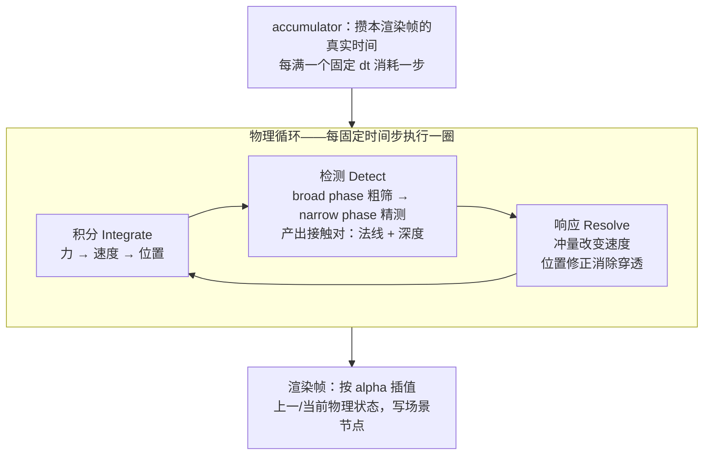

# 物理专题导览

> [返回：WebGL 与 3D 框架学习大纲](../WebGL与3D框架学习大纲.md)
> 本目录给自研框架加一个**可选的轻量物理模块**（挂在 `src/physics/`）：刚体运动、碰撞检测、碰撞响应。不追求物理引擎，把游戏物理的最小内核——"积分、检测、响应"三步循环——讲透到能写、能调、能扩展。

## 定位：三步循环的最小内核

游戏物理再复杂，内核都是每**固定时间步**执行一次的三步循环：

1. **积分（integrate）**：由合力更新速度、由速度更新位置（[01](01-数值积分与运动.md)）；
2. **检测（detect）**：broad phase 粗筛找出候选对，narrow phase 精确求交，产出接触对（法线 + 穿透深度）（[02](02-碰撞检测与响应.md) 2.1–2.2）；
3. **响应（resolve）**：冲量改变速度、位置修正消除穿透（[02](02-碰撞检测与响应.md) 2.3）。

物理状态与渲染帧率解耦：渲染帧只负责把"上一/当前两个物理状态"插值后画出来。这三步分别对应两篇的正题。

## 边界：三件事本专题不做

**一、几何查询不重造。** 点到线段/AABB/三角形的最近点、射线求交家族（射线-球/盒/三角形/OBB）已在 [数学专题/07-切空间与几何算法](../数学专题/07-切空间与几何算法.md) 7.5–7.6 推导并实现——本专题把它们当工具箱直接引用，不重复。本专题新增的是 07 没覆盖的"成对碰撞"（球-球、球-盒、盒-盒）与"接触求解"（冲量、摩擦、位置修正）。

**二、动画与物理分工。** 关键帧动画（[04-第四阶段/06-动画系统](../04-第四阶段/06-动画系统.md)）按数据重放，GPU 顶点动画（[技术专题/01-GLSL Cookbook](../技术专题/01-GLSL%20Cookbook.md) 1.7）按公式扰动——它们"动了但没有力"，不会被墙挡住。物理是场景里唯一"受力演化、被碰撞约束"的运动来源。两者可叠加（物理管位移、动画管姿态），但一个场景节点的变换只能有一个写入者（01 篇 1.4）。

**三、不替代物理引擎。** 本专题已覆盖平动/转动刚体、碰撞闭环、关节约束、CCD 与流体入门（见 [05 §5.8](05-连续碰撞检测与流体粒子.md) 的能力边界对照表），但需求超出清单（车辆、破碎、连续物理与约束求解联立、大规模并行）时不要硬造轮子。选型一句话：**cannon-es**——纯 TypeScript、源码可读可改、接入手最轻，适合学过原理后想快速上手或中小项目；**rapier**——Rust 编译到 WASM、性能与功能（连续碰撞、关节、并行调度）最强，适合重物理玩法与大规模刚体。01 篇 1.4 的 PhysicsLoop 抽象（step/interpolate 两阶段）就是为"以后换引擎只换内核"预留的缝。

## 分册索引

| 篇 | 内容一句话 | 优先服务阶段 |
|---|---|---|
| [01-数值积分与运动](01-数值积分与运动.md) | 固定时间步与 accumulator、三种积分器的推导与稳定性（弹簧为什么会数值爆炸）、距离约束与布料、PhysicsLoop 接口与力的 API | 三（RenderLoop）、四（框架 physics/ 模块） |
| [02-碰撞检测与响应](02-碰撞检测与响应.md) | broad/narrow 两阶段与空间哈希、SAT 与 MTV、冲量法与摩擦推导、弹跳球与堆叠实战、raycast 与触发器、何时换 cannon-es/rapier | 四（交互/框架）、六（毕业项目玩法） |
| [03-刚体转动动力学](03-刚体转动动力学.md) | 转动惯量与张量、力矩与角动量、四元数姿态积分、带转动项的冲量求解（偏心碰撞）、骰子投掷完整实战 | 四（框架）、六（毕业项目） |
| [04-关节与约束求解器](04-关节与约束求解器.md) | 约束建模 C(x)=0、雅可比与拉格朗日乘子、五种关节（距离/球窝/铰链/滑轨/马达）、PGS 迭代、双摆与布娃娃最小版 | 四（框架）、六（玩法） |
| [05-连续碰撞检测与流体粒子](05-连续碰撞检测与流体粒子.md) | 隧穿复现与穿越条件公式、射线法与保守推进两族 CCD、三版子弹实战、粒子碰撞与 2D SPH 流体最小版、能力边界总表 | 四（框架）、六（玩法） |

## 物理循环三步

三步的次序有讲究：先积分让物体"走进"穿透，检测才有的放矢；响应改完速度，下一圈积分带着新速度走。改次序（先响应后积分）会慢一拍修正，堆叠会越抖越大。

## 需求速查

| 需求 | 去哪 |
|---|---|
| 固定时间步、渲染插值、为什么帧率不该驱动物理 | [01 §1.1](01-数值积分与运动.md) |
| 选积分器：欧拉/半隐式/Verlet、弹簧爆炸排查 | [01 §1.2](01-数值积分与运动.md) |
| 布料、绳索、旗帜（距离约束投影） | [01 §1.3](01-数值积分与运动.md) |
| 物理模块接入框架（step/interpolate、重力/阻力/风力 API） | [01 §1.4](01-数值积分与运动.md) |
| 大量物体碰撞的加速结构（空间哈希） | [02 §2.1](02-碰撞检测与响应.md) |
| 球-球、球-盒、盒-盒精确求交（SAT 与 MTV） | [02 §2.2](02-碰撞检测与响应.md) |
| 碰撞后怎么弹开、怎么摩擦、怎么消穿透 | [02 §2.3](02-碰撞检测与响应.md) |
| 弹跳球 / 盒子堆叠完整示例 | [02 §2.4、§2.5](02-碰撞检测与响应.md) |
| 物理射线查询、拾取区域（触发器）事件 | [02 §2.6](02-碰撞检测与响应.md) |
| 高速物体穿墙（隧穿）、该不该上第三方引擎 | [02 §2.7 与常见坑](02-碰撞检测与响应.md) |
| 物体会翻滚（转动惯量、力矩、姿态积分、偏心碰撞） | [03](03-刚体转动动力学.md) |
| 摆锤/绳/门/布娃娃（关节与约束求解、PGS） | [04](04-关节与约束求解器.md) |
| 子弹穿墙修复（CCD）、粒子水池（SPH） | [05](05-连续碰撞检测与流体粒子.md) |

## 阅读建议

- **按编号顺读**：01 讲"怎么动"（动力学），02 讲"怎么碰"（检测与响应闭环），03 讲"怎么转"（转动动力学），04 讲"怎么连"（关节与约束），05 讲"怎么不穿 + 怎么流"（CCD 与粒子）；各篇自成体系（小节编号 1.x~5.x），代码可直接并入第四阶段框架的 `src/physics/` 目录。
- **前置**：第三阶段的 RenderLoop（[03-第三阶段/03-引擎最小核心](../03-第三阶段/03-引擎最小核心.md)——accumulator 的预告在那里兑现）、第四阶段的场景图与交互系统（射线拾取的实现本专题直接复用）。
- 每节固定结构：概念 → 推导（含数值手算验证）→ 完整代码 → 常见坑；各篇末尾有本节自测。
- 专题不设综合实践：物理模块的验收直接放进第六阶段毕业项目——弹跳捡拾（2.4 + 2.6 触发器）、可推倒的堆叠（2.5）都是现成的玩法零件。
