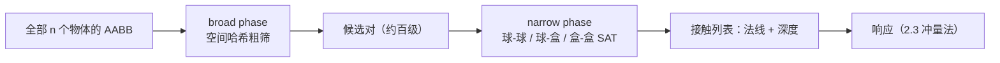
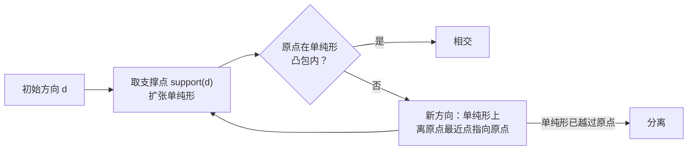

# 碰撞检测与响应

> [返回：WebGL 与 3D 框架学习大纲](../WebGL与3D框架学习大纲.md)
> 物理专题第 02 篇：三步循环的后两步。检测讲两阶段架构（broad phase 空间哈希 → narrow phase 精确求交，含盒-盒 SAT 与 MTV）；响应讲冲量法完整推导（含恢复系数、摩擦、位置修正），配弹跳球与堆叠两个完整实战，最后补 raycast/触发器与"何时换 cannon-es/rapier"的取舍。积分与 PhysicsLoop 基础在 [01-数值积分与运动](01-数值积分与运动.md)；最近点、射线求交等单形体查询直接复用 [数学专题/07](../数学专题/07-切空间与几何算法.md) 与第四阶段交互系统的实现。

上一篇结束时，小球会受力下落——然后穿过地板消失。本篇补上"被挡住"：**检测**回答"谁和谁碰了、碰多深"，**响应**回答"速度怎么改、穿透怎么消"。检测的几何部分（点到盒最近点、射线求交）已在数学专题 07 与交互系统里备好工具，本篇专注它们没覆盖的：**成对求交**（两个形状之间）与**接触求解**（冲量法）。

## 2.1 检测两阶段架构

### 概念：broad phase 与 narrow phase

朴素做法是对全部物体两两做精确求交：n 个物体 n(n−1)/2 对，100 个物体就是 4950 次——而其中绝大多数相距十万八千里。工程解法是把检测拆成两阶段：

- **broad phase（粗筛）**：用极便宜的测试（通常是 AABB 重叠）+ 空间划分，把 4950 对筛成约"实际邻近"的百来对**候选对**（candidate pairs）；
- **narrow phase（精测）**：只对候选对做精确求交，产出**接触**（contact）：接触法线（contact normal，约定从 A 指向 B）与穿透深度（penetration depth）。



### 空间划分三法速览

broad phase 的核心是空间划分（把"远处的不用比"变成数据结构性质）。三法对比：

| 方法 | 原理 | 构建/更新 | 查询成本 | 适用场景 | 主要陷阱 |
|---|---|---|---|---|---|
| 均匀网格（uniform grid / 空间哈希 spatial hash） | 空间切成等大格子，物体登记到覆盖格，查询只比邻格 | 每帧重建 O(n) | 近似 O(n + 候选数) | 动态物体多、大小相近——**游戏场景够用** | 格子尺寸难兼顾大小悬殊的物体 |
| 四叉树/八叉树（quadtree/octree） | 空间递归细分，稀疏处浅、稠密处深 | 插入删除 O(log n)，动态物体反复进出 | O(log n + 候选数) | 大而稀疏的静态混合场景 | 动态更新要再平衡，抖动物体在节点间"乒乓" |
| BVH（层次包围盒，Bounding Volume Hierarchy） | 物体为叶子，包围盒逐层合并成树 | 静态一次构建；动态要 refit/rebuild | O(log n) | 静态场景、光线追踪级查询（交互篇 4.3.1 的加速结构就是它的两级特例） | 动态场景增量维护复杂 |

本专题实现均匀网格：代码最短、无树结构、对几百个动态物体绰绰有余，这正是多数中小游戏的选择。经验参数：**格子边长取"平均物体直径"**——物体多为一格，大物体跨多格登记（可接受），太小则每格物体太少、哈希开销占主导。

### 完整代码：空间哈希（均匀网格）

```typescript
// physics/SpatialHash.ts —— 均匀网格 broad phase：每帧重建、按格找候选对
export interface BroadItem {
  id: number;   // 约定：id 即 bodies 数组下标
  minX: number; minY: number; minZ: number;
  maxX: number; maxY: number; maxZ: number;   // 世界空间 AABB
}

export class SpatialHash {
  private cells = new Map<number, number[]>();
  private candidates = new Set<number>();

  constructor(readonly cellSize: number) {}

  /** 每帧重建：清空后把每个物体登记进它覆盖的所有格 */
  rebuild(items: readonly BroadItem[]): void {
    this.cells.clear();
    const inv = 1 / this.cellSize;
    for (const it of items) {
      for (let x = Math.floor(it.minX * inv); x <= Math.floor(it.maxX * inv); x++) {
        for (let y = Math.floor(it.minY * inv); y <= Math.floor(it.maxY * inv); y++) {
          for (let z = Math.floor(it.minZ * inv); z <= Math.floor(it.maxZ * inv); z++) {
            const key = hashCell(x, y, z);
            let list = this.cells.get(key);
            if (!list) this.cells.set(key, (list = []));
            list.push(it.id);
          }
        }
      }
    }
  }

  /** 产出候选对（自动去重：只发 (小 id, 大 id)），并顺手过一遍 AABB 重叠 */
  queryPairs(items: readonly BroadItem[], out: [number, number][]): void {
    out.length = 0;
    const inv = 1 / this.cellSize;
    for (const it of items) {
      this.candidates.clear();
      for (let x = Math.floor(it.minX * inv); x <= Math.floor(it.maxX * inv); x++) {
        for (let y = Math.floor(it.minY * inv); y <= Math.floor(it.maxY * inv); y++) {
          for (let z = Math.floor(it.minZ * inv); z <= Math.floor(it.maxZ * inv); z++) {
            const list = this.cells.get(hashCell(x, y, z));
            if (list) for (const id of list) if (id !== it.id) this.candidates.add(id);
          }
        }
      }
      for (const id of this.candidates) {
        if (id <= it.id) continue;               // 每对只发一次
        if (aabbOverlap(it, items[id])) out.push([it.id, id]);
      }
    }
  }
}

/** 三轴格坐标打包成一个整数键：每轴 10 位（±511 格内安全），超出范围换字符串键 */
function hashCell(x: number, y: number, z: number): number {
  return ((x + 512) << 20) | ((y + 512) << 10) | (z + 512);
}

function aabbOverlap(a: BroadItem, b: BroadItem): boolean {
  return a.minX <= b.maxX && a.maxX >= b.minX
      && a.minY <= b.maxY && a.maxY >= b.minY
      && a.minZ <= b.maxZ && a.maxZ >= b.minZ;
}
```

候选数对比（直觉账）：物体均匀分布时每格约 k 个物体，每物体的比较次数从 n 降为约 27k（3×3×3 邻域格）——n = 500、k = 2 时，从 124750 对降到约 13500 次格内比较 + 少量 AABB 粗筛，再交给 narrow phase 的只剩真邻居。

## 2.2 narrow phase：精确求交

约定先立好：所有函数产出**接触 Contact**——法线统一**从 A 指向 B**、深度 depth > 0；不相交返回 null。方向约定不一致是本节最高频的 bug（常见坑 3）。

```typescript
export interface Contact {
  nx: number; ny: number; nz: number; // 接触法线（单位向量，A → B）
  depth: number;                      // 穿透深度（> 0）
}
```

### 球-球：距离 vs 半径和

球心距小于半径和即相交，连线方向就是接触法线。**手算**：两球心 (0,0,0) 与 (1.2, 0.5, 0)、r₁ = r₂ = 1：距离 √(1.44+0.25) = 1.3 < 2，法线 (1.2, 0.5, 0)/1.3 ≈ (0.923, 0.385, 0)，深度 0.7。

```typescript
export function sphereSphere(
  ax: number, ay: number, az: number, ar: number,
  bx: number, by: number, bz: number, br: number,
): Contact | null {
  const dx = bx - ax, dy = by - ay, dz = bz - az;
  const r = ar + br;
  const dSq = dx * dx + dy * dy + dz * dz;
  if (dSq >= r * r) return null;              // 平方比较，免开方
  const d = Math.sqrt(dSq);
  if (d < 1e-9) return { nx: 0, ny: 1, nz: 0, depth: r };  // 完全重合：法线任取
  return { nx: dx / d, ny: dy / d, nz: dz / d, depth: r - d };
}
```

### 球-盒：最近点 + 局部坐标

思路（复用 [数学专题/07](../数学专题/07-切空间与几何算法.md) 的两件工具）：**定向盒（OBB）先把球心变换到盒局部**（正交轴点乘即逆变换，与 07 7.6 射线-OBB 同一招），局部里盒就是 AABB，**最近点 = 逐轴夹回盒内**（07 7.5 的点到 AABB 最近点），球心到最近点的方向即法线。球心钻进盒内时最近点是球心自己，改走"离哪个面最近"分支。

**手算（球心在盒外）**：球心 (1.4, 0.5, 0.3)、r = 0.5，盒 [-1, 1]³：最近点 (1, 0.5, 0.3)，差向量 (0.4, 0, 0)，距离 0.4 < 0.5 → 接触，法线（盒指向球）(1, 0, 0)，深度 0.5 − 0.4 = 0.1。
**手算（球心在盒内）**：球心 (0.2, 0.1, 0)、r = 0.6：到三个面的距离 0.8 / 0.9 / 1，x 面最近 → 沿 +x 推出，深度 = r + 0.8 = 1.4。

```typescript
export interface Box {
  cx: number; cy: number; cz: number;            // 盒心
  axes: Float32Array;                            // 9 个数：三根单位轴依次排列
  hx: number; hy: number; hz: number;            // 三轴半长
}

/** 球-盒：返回法线从盒指向球；调用方按 A/B 顺序翻转（见 collidePair） */
export function sphereBox(
  sx: number, sy: number, sz: number, r: number,
  box: Box,
): Contact | null {
  // ① 球心换到盒局部（axes 是正交阵，转置即逆：逐轴点乘）
  const a = box.axes;
  const ox = sx - box.cx, oy = sy - box.cy, oz = sz - box.cz;
  const lx = a[0] * ox + a[1] * oy + a[2] * oz;
  const ly = a[3] * ox + a[4] * oy + a[5] * oz;
  const lz = a[6] * ox + a[7] * oy + a[8] * oz;
  // ② 局部最近点：逐轴夹回盒内（数学专题 07 7.5）
  const qx = Math.min(Math.max(lx, -box.hx), box.hx);
  const qy = Math.min(Math.max(ly, -box.hy), box.hy);
  const qz = Math.min(Math.max(lz, -box.hz), box.hz);
  const dx = lx - qx, dy = ly - qy, dz = lz - qz;
  const dSq = dx * dx + dy * dy + dz * dz;
  if (dSq > r * r) return null;
  if (dSq > 1e-12) {
    const d = Math.sqrt(dSq);
    return localToWorld(dx / d, dy / d, dz / d, r - d, box);  // 盒 → 球
  }
  // ③ 球心在盒内：找最近的面，沿其法线推出（深度 = r + 到面距离）
  const px = box.hx - Math.abs(lx), py = box.hy - Math.abs(ly), pz = box.hz - Math.abs(lz);
  let nx = 0, ny = 0, nz = 0, pen: number;
  if (px <= py && px <= pz)      { nx = lx >= 0 ? 1 : -1; pen = r + px; }
  else if (py <= pz)             { ny = ly >= 0 ? 1 : -1; pen = r + py; }
  else                           { nz = lz >= 0 ? 1 : -1; pen = r + pz; }
  return localToWorld(nx, ny, nz, pen, box);
}

/** 局部法线转回世界（正交变换保长度，深度不用变） */
function localToWorld(nx: number, ny: number, nz: number, depth: number, b: Box): Contact {
  const a = b.axes;
  return {
    nx: a[0] * nx + a[3] * ny + a[6] * nz,
    ny: a[1] * nx + a[4] * ny + a[7] * nz,
    nz: a[2] * nx + a[5] * ny + a[8] * nz,
    depth,
  };
}
```

### 盒-盒：分离轴定理（SAT）

**分离轴定理（Separating Axis Theorem，SAT）**：两个凸体不相交，当且仅当存在一条轴，两凸体在其上的投影区间**不重叠**。好消息是这条轴不用穷举无限方向——对两个凸多面体，若分离轴存在，它必平行于：A 的某个面、B 的某个面、或 A 与 B 各一条棱的叉积。于是两个定向盒（各 3 个面方向、3 组棱）的候选轴只有 **3 + 3 + 9 = 15 条**。

盒在轴 L 上的投影半长用"支撑距离"累加（这是支撑函数的特例，GJK 一节会再见到它）：

```text
r_A = h_Ax·|L·u_A0| + h_Ay·|L·u_A1| + h_Az·|L·u_A2|   （三根轴的投影贡献和）
r_B 同理；d = |L·(c_B − c_A)| 为两盒心在 L 上的距离
d > r_A + r_B → 找到分离轴，两盒不相交，立即返回
否则该轴重叠量 overlap = r_A + r_B − d
```

**最小平移向量（Minimum Translation Vector，MTV）**：15 条轴全部重叠才相交，其中**重叠量最小的那条轴**就是"把两个盒子分开所需的最小平移"——方向即接触法线，重叠量即穿透深度。位置修正（2.3）用的就是它。叉积轴在两轴平行时退化为零向量，跳过即可（该情形已被面法线覆盖）。

**手算（AABB 特例：候选轴只剩 x/y/z 三条）**：A 盒心 (0,0,0) 半长 (1,1,1)，B 盒心 (1.5, 0.2, 0) 半长 (1,1,1)：

```text
x 轴：d = 1.5，r_A + r_B = 2 → overlap = 0.5
y 轴：d = 0.2，r_A + r_B = 2 → overlap = 1.8
z 轴：d = 0，  r_A + r_B = 2 → overlap = 2.0
最小重叠在 x 轴 → MTV 沿 ±x（取与盒心连线同向：+x，即 A→B），深度 0.5
```

```typescript
/** 盒-盒 SAT：相交时返回接触（法线 A→B + 深度 = MTV），否则 null */
export function satBoxBox(a: Box, b: Box): Contact | null {
  const ax = b.cx - a.cx, ay = b.cy - a.cy, az = b.cz - a.cz;  // 盒心连线 A→B
  const A = a.axes, B = b.axes;
  const ah = [a.hx, a.hy, a.hz], bh = [b.hx, b.hy, b.hz];
  let bestDepth = Infinity, nx = 0, ny = 0, nz = 0;
  const EPS_SQ = 1e-10;

  // 闭包：测一条轴。lx/ly/lz 必须是单位向量（叉积轴先归一化）
  const testAxis = (lx: number, ly: number, lz: number): boolean => {
    // 两盒的投影半长
    const ra = ah[0] * Math.abs(lx * A[0] + ly * A[1] + lz * A[2])
             + ah[1] * Math.abs(lx * A[3] + ly * A[4] + lz * A[5])
             + ah[2] * Math.abs(lx * A[6] + ly * A[7] + lz * A[8]);
    const rb = bh[0] * Math.abs(lx * B[0] + ly * B[1] + lz * B[2])
             + bh[1] * Math.abs(lx * B[3] + ly * B[4] + lz * B[5])
             + bh[2] * Math.abs(lx * B[6] + ly * B[7] + lz * B[8]);
    const d = Math.abs(lx * ax + ly * ay + lz * az);   // 盒心距投影
    if (d > ra + rb) return false;                     // 分离轴：不相交
    const overlap = ra + rb - d;
    if (overlap < bestDepth) {                         // 跟踪最小重叠 → MTV
      bestDepth = overlap;
      const s = lx * ax + ly * ay + lz * az < 0 ? -1 : 1;  // 法线与连线同向（A→B）
      nx = lx * s; ny = ly * s; nz = lz * s;
    }
    return true;
  };

  for (let i = 0; i < 3; i++) {                        // 面法线：A 三条 + B 三条
    if (!testAxis(A[i * 3], A[i * 3 + 1], A[i * 3 + 2])) return null;
    if (!testAxis(B[i * 3], B[i * 3 + 1], B[i * 3 + 2])) return null;
  }
  for (let i = 0; i < 3; i++) {                        // 棱叉积轴：9 条
    for (let j = 0; j < 3; j++) {
      const ux = A[i * 3], uy = A[i * 3 + 1], uz = A[i * 3 + 2];
      const vx = B[j * 3], vy = B[j * 3 + 1], vz = B[j * 3 + 2];
      const cx = uy * vz - uz * vy, cy = uz * vx - ux * vz, cz = ux * vy - uy * vx;
      const lenSq = cx * cx + cy * cy + cz * cz;
      if (lenSq < EPS_SQ) continue;                    // 两轴平行：面法线已覆盖
      const inv = 1 / Math.sqrt(lenSq);
      if (!testAxis(cx * inv, cy * inv, cz * inv)) return null;
    }
  }
  return { nx, ny, nz, depth: bestDepth };
}
```

### 凸包与 GJK：只讲直觉

任意网格的碰撞形状常取其**凸包（convex hull）**（包含所有顶点的最小凸体）。凸包-凸包求交的工业级解法是 **GJK（Gilbert–Johnson–Keerthi 算法）**，直觉三步：

1. **闵可夫斯基差（Minkowski difference）**：把"求交"变成"点是否在区域内"——两形状 A、B 上各取一点相减，所有差点的集合 M = A ⊖ B 是一个凸体；**A 与 B 相交 ⟺ 原点落在 M 内**；
2. **支撑函数（support function）**：方向 d 上 M 的最远点不用构造 M，support_M(d) = support_A(d) − support_B(−d)——各 shape 自己答"我在 d 方向最远的顶点"，一次点积扫描顶点即得；
3. **向原点滚雪球**：从任意方向取支撑点当起点，构建单纯形（点 → 线段 → 三角形 → 四面体），每步朝原点方向取新支撑点扩张；原点进入单纯形的凸包 → 相交；单纯形越过原点再也够不着 → 分离。



GJK 只答"碰没碰"；穿透深度与法线要配 EPA（Expanding Polytope Algorithm，往 M 的面上"钻"到原点）——两者合体就是 cannon-es/rapier 内部的任意凸包求交器。本专题的球/盒组合用前面的专用代码已够，GJK 留作"形状超过球盒时的下一步"。

## 2.3 碰撞响应：冲量法

### 概念：检测产出接触，响应改两样东西

响应有两级：**速度级**消除"相互接近"的速度分量（弹开、摩擦），**位置级**消除穿透（把嵌进去的拔出来）。速度级用冲量法，位置级用修正投影。

### 推导：从动量守恒到法向冲量公式

**第一步，冲量的定义。** 牛顿第二定律两边积分：∫F dt = m·Δv。左边就是**冲量（impulse）** j——它直接改变速度，且对"改多少"按逆质量分配：Δv = j·invMass（01 篇的约定：永远用 invMass）。

**第二步，动量守恒定骨架。** 两体沿接触法线 n（A→B）碰撞，无外力时动量守恒：m_A·v_A + m_B·v_B = m_A·v_A′ + m_B·v_B′。一个方程解不出两个未知速度，还缺一个条件。

**第三步，恢复系数补条件。** 恢复系数（coefficient of restitution）e ∈ [0,1] 规定碰撞"多弹"：e = 分离速度 / 接近速度，即碰撞后相对速度沿法线分量只保留 −e 倍：

```text
记相对速度 v_rel = v_B − v_A（B 相对 A），v_n = v_rel·n
碰撞前 v_n < 0（相互接近；v_n > 0 说明已在分离，不用响应）
要求：(v_rel′ − v_rel)·n = −(1 + e)·v_n
```

**第四步，联立。** 冲量沿法线施加：Δv_A = −j·n·invMass_A、Δv_B = +j·n·invMass_B，故 Δ(v_rel·n) = j·(invMass_A + invMass_B)。代入第三步的要求：

$$j_n = \frac{-(1+e)\,v_n}{\mathrm{invMass}_A + \mathrm{invMass}_B}$$

静态体（地面）的 invMass = 0，公式自动退化为单边生效，无需特判。

**手算一（球撞地）**：m = 2 kg（invMass = 0.5）的球以 v = (0,−5,0) 落地，e = 0.8，地面静态（invMass = 0）。n = (0,1,0)（约定 A = 地面、B = 球）：v_n = v_rel·n = −5；j = (1+0.8)×5 / 0.5 = 18 N·s；v′ = v + j·n·invMass_B = −5 + 18×0.5 = **+4 m/s** 向上。验证：分离 4 / 接近 5 = 0.8 = e，自洽。
**手算二（等质量弹性对撞交换速度）**：m₁ = m₂ = 1，v₁ = +2、v₂ = −2 正碰，e = 1，n 从 1 指向 2：v_n = −4；j = 2×4/2 = 4；v₁′ = 2 − 4 = −2，v₂′ = −2 + 4 = +2——速度恰好互换，自洽。

### 切向摩擦：库仑近似

接触点的切向相对速度产生摩擦冲量，方向沿切向单位向量 t、与切向滑动相反：j_t = −(v_rel·t) / (invMass_A + invMass_B)。物理上摩擦力有上限——**库仑摩擦（Coulomb friction）**：|j_t| ≤ μ·|j_n|（μ 是摩擦系数，摩擦锥的线性近似），超出则按上限"打滑"。

**手算**：m = 1 的球以 v = (3, −5, 0) 撞地，e = 0.8、μ = 0.3、地面静态。法向：j_n = (1.8×5)/1 = 9，v 变为 (3, 4, 0)。切向：t = (1,0,0)，j_t = −3/1 = −3，但上限 μ·j_n = 2.7 → 钳到 −2.7，v′ = (3 − 2.7, 4, 0) = **(0.3, 4, 0)**——反弹之余滑动被削弱但没停（打滑），符合直觉。

### 位置修正：Baumgarte 与直接分离的取舍

冲量只改速度，穿透还在。两种消法：

- **Baumgarte 稳定化（Baumgarte stabilization）**：在求 j_n 前给 v_n 加一个"偏置速度" bias = (β/dt)·max(depth − slop, 0)，让冲量顺手多推一点把穿透顶出去。优点：速度连续、实现只加一行；缺点：**凭空注入能量**——β 大了物体轻轻接触也会弹，调参玄学；
- **直接分离（linear projection）**：沿法线按比例直接挪位置：corr = percent·(depth − slop)/(invMass_A + invMass_B)，按逆质量分给两体。优点：不碰速度、直观；缺点：多接触互相不知情，堆叠场景会"抢修"引发抖动，需配迭代（2.5）。

两者都要 **slop（松弛量，0.005–0.01 m）**：允许残余一点点穿透。没有 slop，位置修正每步都把接触顶到"恰好分离"，下一步重力又压回来——法线方向以浮点量级振荡，就是堆叠抖动的种子。**本专题取直接分离 + slop + percent = 0.2–0.4**：最小集里"稳定压过物理精确"。

### 完整代码：resolveContact

```typescript
// physics/resolve.ts —— 单个接触的求解：法向冲量 + 摩擦 + 位置修正
// 约定：法线 n 从 A 指向 B（2.2 全部按此产出），bodies 即 01 篇 1.4 的 RigidBody
export const REST_THRESHOLD = 1.0;   // m/s：低于此接近速度按 e = 0 处理（防微弹，见 2.5）
const SLOP = 0.01;                   // 允许的残余穿透（米）
const PERCENT = 0.4;                 // 每步修正的穿透比例（堆叠建议 0.2–0.4）

export function resolveContact(
  a: RigidBody, b: RigidBody,
  nx: number, ny: number, nz: number, depth: number,
  restitution: number, friction: number,
): void {
  const invSum = a.invMass + b.invMass;
  if (invSum === 0) return;                       // 两个静态体：无意义

  // —— 速度级 ① 法向冲量 ——
  let rvx = b.vx - a.vx, rvy = b.vy - a.vy, rvz = b.vz - a.vz;
  const vn = rvx * nx + rvy * ny + rvz * nz;
  if (vn > 0) return;                             // 已在分离：再施冲量 = 吸力（常见坑 3）
  const e = -vn > REST_THRESHOLD ? restitution : 0;
  const jn = -((1 + e) * vn) / invSum;
  a.vx -= jn * nx * a.invMass; a.vy -= jn * ny * a.invMass; a.vz -= jn * nz * a.invMass;
  b.vx += jn * nx * b.invMass; b.vy += jn * ny * b.invMass; b.vz += jn * nz * b.invMass;

  // —— 速度级 ② 切向摩擦（库仑锥 |jt| ≤ μ·jn）——
  rvx = b.vx - a.vx; rvy = b.vy - a.vy; rvz = b.vz - a.vz;   // 冲量后的相对速度
  const vn2 = rvx * nx + rvy * ny + rvz * nz;
  let tx = rvx - vn2 * nx, ty = rvy - vn2 * ny, tz = rvz - vn2 * nz;  // 去掉法向分量
  const tLen = Math.hypot(tx, ty, tz);
  if (tLen > 1e-9 && friction > 0) {
    tx /= tLen; ty /= tLen; tz /= tLen;
    const jt = -(rvx * tx + rvy * ty + rvz * tz) / invSum;
    const jtMax = friction * jn;
    const jtC = Math.min(Math.max(jt, -jtMax), jtMax);        // 摩擦锥钳制
    a.vx -= jtC * tx * a.invMass; a.vy -= jtC * ty * a.invMass; a.vz -= jtC * tz * a.invMass;
    b.vx += jtC * tx * b.invMass; b.vy += jtC * ty * b.invMass; b.vz += jtC * tz * b.invMass;
  }

  // —— 位置级：直接分离 ——
  const corr = (Math.max(depth - SLOP, 0) / invSum) * PERCENT;
  a.x -= corr * nx * a.invMass; a.y -= corr * ny * a.invMass; a.z -= corr * nz * a.invMass;
  b.x += corr * nx * b.invMass; b.y += corr * ny * b.invMass; b.z += corr * nz * b.invMass;
}
```

## 2.4 实战一：弹跳球 + 盒子房间

### 概念：三步闭环

把 01 的 ParticleWorld 扩成 RigidBodyWorld：step 内先 `super.step`（积分），再做检测（broad → narrow），最后响应（逐接触 resolveContact）。这是物理循环三步的第一次完整合龙。

```typescript
// physics/RigidBodyWorld.ts —— 在 01 篇 ParticleWorld 上加检测 + 响应
export type Shape =
  | { type: "sphere"; radius: number }
  | { type: "box"; hx: number; hy: number; hz: number };  // 轴对齐盒（最小集）
// RigidBody 扩展字段：shape、restitution、friction、id（SpatialHash 用下标即 id）

export class RigidBodyWorld extends ParticleWorld {
  private hash = new SpatialHash(2);          // 格子 2 m ≈ 平均物体直径
  private broad: [number, number][] = [];
  private contacts: { a: RigidBody; b: RigidBody; c: Contact }[] = [];
  iterations = 1;                             // 响应迭代遍数（堆叠开大，见 2.5）

  addSphere(radius: number, node?: RigidBody["boundNode"]): RigidBody;
  addBox(hx: number, hy: number, hz: number, node?: RigidBody["boundNode"]): RigidBody;
  // 两个 add* 设好 shape 与 boundNode 后委托 ParticleWorld.add

  protected step(dt: number): void {
    super.step(dt);                           // ① 积分（01 篇 1.4：重力/阻力/力场）
    this.detect();                            // ② 检测
    this.respond();                           // ③ 响应
  }

  private detect(): void {
    // broad：世界 AABB（球：心 ± r；盒：心 ± 半长）喂空间哈希
    const items = this.bodies.map((b, id) => aabbOf(b, id));
    this.hash.rebuild(items);
    this.hash.queryPairs(items, this.broad);
    // narrow：按形状组合分发，法线统一翻成 A→B
    this.contacts.length = 0;
    for (const [i, j] of this.broad) {
      const a = this.bodies[i], b = this.bodies[j];
      const c = collidePair(a, b);
      if (c) this.contacts.push({ a, b, c });
    }
  }

  private respond(): void {
    for (let k = 0; k < this.iterations; k++) {
      for (const { a, b, c } of this.contacts) {
        resolveContact(a, b, c.nx, c.ny, c.nz, c.depth,
                       Math.max(a.restitution, b.restitution),   // 材质组合：取大者（简化）
                       Math.min(a.friction, b.friction));        // 摩擦取小者
      }
    }
  }
}

/** narrow phase 分发：保证法线 A→B（sphereBox 返回的是盒→球，需翻转） */
function collidePair(a: RigidBody, b: RigidBody): Contact | null {
  if (a.shape.type === "sphere" && b.shape.type === "sphere") {
    return sphereSphere(a.x, a.y, a.z, a.shape.radius, b.x, b.y, b.z, b.shape.radius);
  }
  if (a.shape.type === "box" && b.shape.type === "sphere") {
    return sphereBox(b.x, b.y, b.z, b.shape.radius, boxOf(a));            // 盒→球
  }
  if (a.shape.type === "sphere" && b.shape.type === "box") {
    const c = sphereBox(a.x, a.y, a.z, a.shape.radius, boxOf(b));         // 盒→球
    return c && { ...c, nx: -c.nx, ny: -c.ny, nz: -c.nz };                // 翻成 A→B
  }
  return satBoxBox(boxOf(a), boxOf(b));                                   // SAT 自带 A→B
}
// aabbOf / boxOf：从 body 取世界 AABB / Box（轴对齐盒的 axes 为单位阵）
```

### 完整代码：几行接入框架

```typescript
// demo-bounce.ts —— 弹跳球 + 盒子房间：三步循环第一次跑通
const world = new RigidBodyWorld(1 / 60);
const nodes: Node3D[] = [];                    // 第四阶段场景图节点

// 房间：地板 + 四壁 + 天花板，共 6 个静态盒（invMass = 0 不受响应影响）
const S = 5, T = 0.5;
const walls: [number, number, number, number, number, number][] = [
  [S * 2, T, S * 2, 0, -T, 0],       // 地板：半长、位置
  [S * 2, T, S * 2, 0, 2 * S + T, 0],// 天花板
  [T, S, S * 2, -S - T, S, 0], [T, S, S * 2, S + T, S, 0],   // 左右墙
  [S * 2, S, T, 0, S, -S - T], [S * 2, S, T, 0, S, S + T],   // 前后墙
];
for (const [hx, hy, hz, x, y, z] of walls) {
  const w = world.addBox(hx, hy, hz);
  w.invMass = 0; w.x = x; w.y = y; w.z = z;
}

// 五个球，弹性各异：从"篮球"到"粘土"
for (let i = 0; i < 5; i++) {
  const ball = world.addSphere(0.3 + 0.1 * i, nodes[i]);
  ball.x = -2 + i; ball.y = 4 + i;
  ball.vx = (Math.random() - 0.5) * 6;
  ball.restitution = 0.4 + 0.12 * i;           // 0.4 → 0.88：落地反弹高度肉眼可辨
  ball.friction = 0.05;
}

new RenderLoop((delta) => {                    // 第三阶段 RenderLoop
  world.update(delta);                         // 固定 1/60：积分 → 检测 → 响应
  world.interpolate();                         // 插值写 nodes[i].position
  scene.updateMatrixWorld();
  renderer.render(scene, camera);
}).start();
```

验证要点：弹性 0.4 的球每次反弹高度约掉 84%（h′ = e²·h）；弹性 0.88 的球弹很久；最终都在 slop 内停在地上——三步闭环任何一个环节断了，症状各不相同（检测断：穿地板；响应断：贴地不弹；插值断：高刷屏微抖）。

## 2.5 实战二：简单堆叠

### 概念：顺序求解、抖动抑制、sleep

一摞盒子是压力测试：8 个盒子两两接触、接触约束互相耦合，解任何一个都会扰动邻居。三种武器：

1. **顺序求解（sequential solving）**：把 2.4 的 iterations 开到 4–8——同一组接触反复求解，后一遍读到前一遍修正后的速度，残余误差逐遍收敛。这与 01 篇 1.3 布料的约束迭代是同一个 Gauss–Seidel 思想，区别只在修正对象（速度 vs 位置）。配套调整：把 2.3 的 resolveContact 拆两半——**冲量+摩擦进迭代循环，位置修正每步只做最后一遍**（位置修正每次都做会在迭代间"搬位置"，放大抖动）；
2. **抖动抑制**：低速接触按 e = 0（2.3 的 REST_THRESHOLD，静止堆叠的接触 vn ≈ 0，绝不能让它"弹"）；PERCENT 降到 0.2–0.4；SLOP 吸掉残余穿透。固定步长提到 1/120——堆叠的接触求解频率翻倍，同样的迭代数效果更实；
3. **sleep（休眠）**：速度低于阈值持续一段时间的物体标记 sleeping，跳过积分与求解；受到冲量、或被"醒着的"高速物体撞到时唤醒。静止的一摞盒子整堆休眠后，物理开销归零——移动端省电的关键。

### 完整代码：sleep 与堆叠演示

```typescript
// physics/sleep.ts —— 休眠机制（RigidBody 增加 sleeping / sleepTimer 字段）
const LINEAR_SLEEP_TOL = 0.08;   // m/s：速度阈值
const SLEEP_AFTER = 0.5;         // s：低于阈值持续多久才睡

export function updateSleep(b: RigidBody, dt: number): void {
  const vSq = b.vx * b.vx + b.vy * b.vy + b.vz * b.vz;
  if (vSq < LINEAR_SLEEP_TOL * LINEAR_SLEEP_TOL) {
    b.sleepTimer += dt;
    if (b.sleepTimer >= SLEEP_AFTER) {
      b.sleeping = true;
      b.vx = b.vy = b.vz = 0;    // 钳掉残余微速度
    }
  } else {
    b.sleepTimer = 0;
  }
}

export function wake(b: RigidBody): void {
  if (b.sleeping) { b.sleeping = false; b.sleepTimer = 0; }
}

// RigidBodyWorld 的三处接入：
// · addImpulse 内第一行 wake(this)——外力必须唤醒；
// · detect()：a.sleeping && b.sleeping 的对跳过 narrow phase；
//   但"睡着的 + 醒着的"仍要测（新落上来的盒子需要接触）；
// · respond()：冲量 jn 超过唤醒阈值（如 2·LINEAR_SLEEP_TOL·invMass）时 wake 对方
//   ——这就是"被撞醒"的传播链：踢底下的盒子，整摞连锁醒来。
```

```typescript
// demo-stack.ts —— 8 盒堆叠：落定 → 整堆休眠 → 踢一脚连锁倒下
const world = new RigidBodyWorld(1 / 120, 8);  // 堆叠：120 Hz + 最多 8 子步
world.iterations = 8;

const ground = world.addBox(6, 0.5, 6);
ground.invMass = 0;

for (let i = 0; i < 8; i++) {
  const box = world.addBox(0.5, 0.5, 0.5, nodes[i]);
  box.y = 1 + i * 1.05;          // 留 0.05 m 空隙：避免"生成即穿透"（常见坑 5）
  box.x = (i % 2) * 0.02;        // 一点点不对称，倒得真实
  box.restitution = 0;           // 堆叠不弹
  box.friction = 0.6;
}

setInterval(() => {              // 每 4 s 踢底部盒子：冲量唤醒 → 接触唤醒传播
  const bottom = world.bodies.find((b) => b.invMass > 0)!;
  bottom.addImpulse(6, 0, 2);    // addImpulse 内部会 wake（见上）
}, 4000);
```

验收：前 1–2 秒盒子逐个落定、轻微下陷到 slop 内；之后整堆 sleep（可在控制台打印 `world.bodies.filter(b => b.sleeping).length` 验证）；被踢后连锁倒下、再次休眠。若盒子像"开水"一样持续蠕动：iterations 不够、PERCENT 过大、或忘了 REST_THRESHOLD。

## 2.6 射线与触发器

### raycast：对物理世界的查询

第四阶段的 Raycaster（[04-第四阶段/05-交互系统](../04-第四阶段/05-交互系统.md)）做的是**渲染拾取**——射线打网格三角形，回答"点了哪个可见物体"。物理世界还需要**物理射线**：打碰撞体（collider），回答"玩法层面挡住了谁"。两者并存、用途不同：

| 维度 | 渲染拾取（交互系统） | 物理射线（本节） |
|---|---|---|
| 求交对象 | 网格三角形（精确到表面） | 碰撞形状（球/盒，几个浮点运算） |
| 成本 | 包围体粗筛 + 逐三角形 | 每 body 一次，几百个 body 遍历即可 |
| 典型用途 | 鼠标点选 | 子弹命中、角色落地检测、AI 视线 |

实现完全复用既有函数——射线-球、射线-AABB 是交互篇 4.3.2 的实现，定向盒先变换到局部（[数学专题/07](../数学专题/07-切空间与几何算法.md) 7.6 的 intersectOBB 思路）：

```typescript
// physics/raycast.ts —— 物理世界的射线查询（复用第四阶段 4.3.2 的两个求交函数）
import { Vec3 } from "../math/Vec3";
import { intersectSphere, intersectAABB } from "../interaction/bounds"; // 交互篇 4.3.2

export interface PhysicsRayHit {
  body: RigidBody;
  distance: number;               // 世界距离 t
  point: Vec3;
}

export function raycastWorld(
  world: RigidBodyWorld,
  ox: number, oy: number, oz: number,   // 起点
  dx: number, dy: number, dz: number,   // 单位方向
  maxDist = Infinity,
): PhysicsRayHit[] {
  const origin = new Vec3(ox, oy, oz);
  const dir = new Vec3(dx, dy, dz);
  const hits: PhysicsRayHit[] = [];
  for (const b of world.bodies) {
    let t: number | null = null;
    if (b.shape.type === "sphere") {
      t = intersectSphere(origin, dir, new Vec3(b.x, b.y, b.z), b.shape.radius);
    } else {
      const h = b.shape;
      t = intersectAABB(origin, dir,
        new Vec3(b.x - h.hx, b.y - h.hy, b.z - h.hz),
        new Vec3(b.x + h.hx, b.y + h.hy, b.z + h.hz));
    }
    if (t !== null && t <= maxDist) {
      hits.push({ body: b, distance: t,
                  point: new Vec3(ox + dx * t, oy + dy * t, oz + dz * t) });
    }
  }
  hits.sort((p, q) => p.distance - q.distance);   // 近者优先
  return hits;
}
```

典型用法——角色落地检测：从脚底沿 (0,−1,0) 发 1.05 m（脚高 + 容差）的射线，命中静态盒即"着地"；以及技能弹道：从相机沿视线发射，取 hits[0]。

### 触发器（trigger）：只检测不响应

把 body 标记 `isTrigger = true`，它参与检测（能查出重叠）但**不参与响应**（不施冲量、不修位置）——"感应区"语义：金币的拾取范围、关卡切换区、伤害区域。实现上只动两处：narrow phase 照常产出接触；respond 阶段把含触发器的接触转交给事件簿记而不是 resolveContact。

事件语义 enter / stay / exit 与交互系统的 hover（enter/leave）同构：**每步对"当前重叠对集合"与"上一步集合"做差分**——新增的是 enter，保留的是 stay，消失的是 exit。

```typescript
// physics/triggers.ts —— 触发器事件：配对差分（pull 模型）
export interface TriggerEvent {
  type: "enter" | "stay" | "exit";
  a: RigidBody; b: RigidBody;
}

function pairKey(a: RigidBody, b: RigidBody): number {
  return a.id < b.id ? a.id * 65536 + b.id : b.id * 65536 + a.id;
}

export class TriggerBookkeeping {
  private prev = new Map<number, [RigidBody, RigidBody]>();
  readonly events: TriggerEvent[] = [];

  /** 每步检测后调用：pairs = 本步所有含触发器的重叠对 */
  update(pairs: readonly [RigidBody, RigidBody][]): void {
    this.events.length = 0;
    const curr = new Map<number, [RigidBody, RigidBody]>();
    for (const p of pairs) curr.set(pairKey(p[0], p[1]), p);
    for (const [, [a, b]] of curr) {
      this.events.push({ type: this.prev.has(pairKey(a, b)) ? "stay" : "enter", a, b });
    }
    for (const [, [a, b]] of this.prev) {
      if (!curr.has(pairKey(a, b))) this.events.push({ type: "exit", a, b });
    }
    this.prev = curr;
  }
}
```

回调设计的两条纪律：**事件在物理步外消费**（update 返回后遍历 events，不要在 step 回调里同步派发——处理器改世界状态会打断求解器，重入即坑）；要 push 模式就包一层与交互系统 4.4 相同的 Emitter（`world.on("triggerEnter", cb)`），簿记层不变。另注意触发器只与**动态体**配对（常见坑 6），否则每帧向回调灌入成百上千条无意义的"与墙 stay"。

```typescript
// 用法：金币拾取区（球触发器），角色（动态球）进入即收集
world.afterStep(() => {
  for (const e of triggers.events) {
    if (e.type === "enter" && isPlayer(e.a) && isCoin(e.b)) collectCoin(e.b);
  }
});
```

## 2.7 边界与取舍：什么时候上 cannon-es / rapier

自研最小集到此已经能支撑毕业项目的常见玩法。能力对照：

| 能力 | 本专题最小集 | cannon-es | rapier |
|---|---|---|---|
| 平动刚体（球/盒）、冲量响应、摩擦 | 有 | 有 | 有 |
| 转动动力学（力矩、惯性张量、摩擦生转） | 无 | 有 | 有 |
| 关节（铰链、球窝、弹簧、布料-刚体耦合） | 无 | 有 | 有 |
| 连续碰撞检测（CCD，防隧穿） | 无（见常见坑 1 的缓解） | 部分（speculative） | 有（swept） |
| 车辆 / 角色控制器 | 无 | 有（raycast vehicle） | 有 |
| 规模（同帧刚体数） | 数百 | 数百–千 | 万级（WASM + 并行） |
| 源码可读 / 可魔改 | 全部自己写的 | 高（纯 TS） | 低（Rust 编译产物） |
| 接入成本 | 已完成 | 低 | 中（异步加载 wasm、体积约 1 MB 级） |

**三条判据，满足任意一条就换**：需要关节链或车辆这类"约束拓扑"玩法；需要高速物体的可靠碰撞（子弹、投掷物，CCD 硬需求）；刚体数量或求解质量超出顺序求解能稳住的量级（大堆叠、破坏场景）。只是"球在地上弹"就换引擎，是用一半的调试时间去省两天的编码——不划算，而且没写过冲量法的人调不动任何引擎的 restitution/friction 参数。

**迁移成本分析**：得益于 01 篇 1.4 的 PhysicsLoop 抽象，渲染绑定层（boundNode、interpolate 写节点）原样保留；要重写的是"世界内核"——第三方世界（cannon.World / rapier World）替掉 RigidBodyWorld，物理体创建、材质、事件订阅换 API，碰撞体仍从同一份场景数据生成（mesh 的包围球/AABB）。触发器与 raycast 建议留一层自己的薄接口（isTrigger、raycastWorld 的签名），内部转发给引擎——玩法代码一行不改。

## 常见坑

1. **隧穿（tunneling）**：快速小物体一步跨过薄墙。算账：子弹 300 m/s、dt = 1/60 → 每步位移 5 m，0.2 m 的墙在两个快照之间被完整跳过——离散采样碰不上"恰好重叠"的瞬间。缓解四档（成本递增）：加厚碰撞体；按速度细分步（substeps = ⌈v·dt / minThickness⌉）；speculative contact（用上一步速度把 AABB 向运动方向扩一截，先报候选再验证）；**连续碰撞检测（CCD）**——解"运动的形状在 t ∈ (0, dt) 内首次相交"（swept test / conservative advancement），本专题不实现，rapier 内建，这是它对 cannon-es 的主要优势之一；
2. **静止堆叠的浮点抖动**：速度与深度在浮点噪声里振荡。系统性解法就是 2.5 三件套（slop、REST_THRESHOLD、sleep），另注意判据方向：分离判定用 `vn > 0` 就 return（2.3 代码），别用 `>= 1e-9` 之类的正 epsilon——那会让恰好静止的接触每步都施一个微小冲量，抖动反而更大；
3. **法线方向不一致**：sphereBox 返回盒→球、SAT 返回 A→B，混用后冲量方向反了——两体不弹开反而互相吸着加速旋转。防御：narrow phase 分发器（collidePair）是**唯一**允许碰法线的地方，下游全部假定 A→B；单测：等质量弹性球对撞必须速度互换（2.3 手算二就是现成断言）；
4. **静态体质量为零**：代码里任何 `1 / mass`、`mass === 0` 分支都是雷。约定全库只用 invMass：静态体 invMass = 0，冲量对它自动无效（j·invMass = 0），一次除法都不需要；写反了就是 Infinity → NaN 传播（回看 01 篇常见坑 2）；
5. **生成即穿透**：初始摆放重叠的物体，第一帧深度巨大，位置修正把它弹飞。摆位留缝（2.5 的 1.05 倍间距）、或前三步把 PERCENT 置 0；运行时传送（角色过门）同理：传送目标先做一次查询，落点在碰撞体内就抬出来；
6. **触发器淹没**：触发器与静态墙重叠，每帧几百条 enter/stay 刷进回调。规则：触发器只与动态体配对（bookkeeping 前过滤 `invMass > 0`），再按"层"过滤（金币区只配玩家层）——引擎的 collision layer 就是这个需求的正规化。

## 【本节自测】

1. broad/narrow 两阶段的分工与复杂度各是什么？100 个物体不做 broad phase 要测多少对？
2. 均匀网格的 cellSize 取多大合适？取太大、太小各付出什么代价？
3. SAT 为什么 15 条候选轴就够（数一数是哪 15 条）？AABB-AABB 为什么只剩 3 条？叉积轴什么时候退化、怎么处理？
4. 手算：球 r = 0.5、球心 (1.4, 0.5, 0.3) 与盒 [-1,1]³，求接触法线与深度；再用盒心 (1.5, 0.2, 0) 的等大盒与原点处的单位盒算 MTV。
5. 手算：m = 3 的球以 v = (0,−4,0)、e = 0.5 撞静态地面，求冲量大小与碰后速度（答案：j = 18、v′ = +2 m/s）。
6. 摩擦冲量为什么要钳制在 μ·j_n 内？不钳制时冰面与橡胶会表现出什么错误？
7. Baumgarte 与直接分离各自的坑是什么？slop 和 REST_THRESHOLD 分别抑制哪种抖动？
8. sleep 的唤醒条件如果漏掉"被醒着的物体撞到"，堆叠场景会表演出什么现象？
9. 什么时候该换 rapier（三条判据）？PhysicsLoop 抽象让迁移时保留了什么、重写了什么？

---

[返回物理专题导览](00-导览.md) · 回顾前置：[01-数值积分与运动](01-数值积分与运动.md)——没有积分，检测与响应都没有输入。
