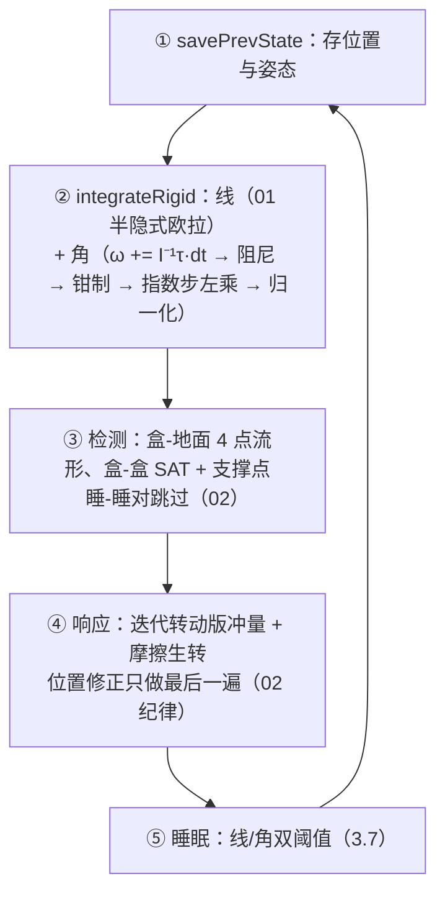

# 刚体转动动力学

> [返回：WebGL 与 3D 框架学习大纲](../WebGL与3D框架学习大纲.md)
> 物理专题第 03 篇：在 [01](01-数值积分与运动.md) 的积分与 [02](02-碰撞检测与响应.md) 的碰撞管线上补上转动——姿态四元数积分、惯性张量、力矩与角动量、带转动的冲量响应，实战是骰子投掷。四元数微分 dq/dt 与 slerp 的推导在 [数学专题/03-旋转表示与转换](../数学专题/03-旋转表示与转换.md) 3.4，本篇引用不重复；关节、车辆、CCD 等仍按 [02](02-碰撞检测与响应.md) 2.7 的判据换引擎。

01 篇 1.1 的三档表格把"全刚体"标成最贵的一档并留下了两个症状，现在可以精确诊断：**推不倒的盒子**——02 的堆叠被踢倒后像纸片一样平移滑动，因为姿态不在状态里，盒子没有"倒下"这个自由度；**不翻滚的骰子**——骰子落地只会弹跳与滑动，永远翻不出新点数，因为接触产生的力矩（让骰子绕棱翻滚的物理）无人接收。01 同时预告了贵在三处：姿态要积分四元数（3.4）、惯性张量随姿态变换（3.2）、摩擦生转与线速度耦合求解（3.6）——三个预告就是本篇的路线图。

## 3.1 从质点到刚体：状态与自由度

### 概念：刚体状态 = 位置 + 姿态 + 线速度 + 角速度

刚体（rigid body）= 无数质点被刚性约束连成一体：任意两质点距离不变。这个约束把无穷多自由度压缩成 6 个：质心平动 3 个 + 绕质心转动 3 个。状态因此是四件套：

| 状态量 | 表示 | 单位与约定 | 01 篇有没有 |
|---|---|---|---|
| 位置 | (x, y, z) | m，世界系 | 有 |
| 姿态（orientation） | 四元数 q | 单位长度，体→世界 | 无 |
| 线速度 v | (vx, vy, vz) | m/s，世界系 | 有 |
| 角速度（angular velocity）ω | (wx, wy, wz) | rad/s，世界系 | 无 |

角速度的几何意义：刚体在每个瞬间都"绕某根轴、以某速率"在转——向量方向即转轴（右手定则），模长即角速率。它给出刚体上任意一点的速度场，r 为质心指向该点的向量：

$$v_P = v + \omega \times r$$

**手算**：ω = (0, 0, 2) rad/s、r = (1, 0, 0) m、质心 v = 0：ω×r = (0·0−2·0, 2·1−0·0, 0·0−0·0) = (0, 2, 0)——+x 处的点朝 +y 动，绕 z 逆时针，正确。这个速度场是 3.5（力矩从哪来）与 3.6（接触点速度）反复使用的地基。

两条全篇约定：**ω 存世界系**——冲量、接触法线、摩擦全在世界系求解（3.6），ω 不换系；**姿态用四元数**——为什么不用欧拉角积分见 3.4，五种表示的完整对比在数学专题 03 3.2 的全景表。

### 完整代码：RigidBody 扩展

```typescript
// physics/rigid.ts —— 01 篇 1.4 RigidBody 的全刚体扩展：平动字段原样保留，新增转动状态
export interface Vec3 { x: number; y: number; z: number }
export interface Quat { x: number; y: number; z: number; w: number } // (虚部, 实部)，同 minmath

/** 渲染绑定：比 01 的 boundNode 多 quaternion 写入口 */
export interface RigidNodeBinding {
  position: { x: number; y: number; z: number };
  quaternion: { x: number; y: number; z: number; w: number };
}

export type Shape =
  | { type: "sphere"; radius: number }
  | { type: "box"; hx: number; hy: number; hz: number };  // 半长（02 篇 2.2 同款）

export class RigidBody {
  id = 0;                                  // bodies 数组下标（02 篇约定）
  // —— 平动（01 篇 1.4 原样）——
  x = 0; y = 0; z = 0;                     // 位置（世界系）
  px = 0; py = 0; pz = 0;                  // 上一物理状态位置（渲染插值）
  vx = 0; vy = 0; vz = 0;                  // 线速度
  fx = 0; fy = 0; fz = 0;                  // 力累加器（每步清零）
  invMass = 1;                             // 逆质量（静态体 0——01/02 铁律：只用逆量）
  // —— 转动（本篇新增）——
  qx = 0; qy = 0; qz = 0; qw = 1;          // 姿态四元数（恒单位长度，3.4 每步归一化）
  pqx = 0; pqy = 0; pqz = 0; pqw = 1;      // 上一物理状态姿态
  wx = 0; wy = 0; wz = 0;                  // 角速度（rad/s，世界系）
  tx = 0; ty = 0; tz = 0;                  // 力矩累加器（N·m，世界系，每步清零）
  iix = 0; iiy = 0; iiz = 0;               // 主轴系逆惯量 1/I（3.2 的 setMassData 维护）
  // —— 材质与行为（02 篇）——
  restitution = 0.3; friction = 0.4;
  linearDamping = 0; angularDamping = 0.05; // 线/角阻尼（01 篇 1.4 / 3.4 手算标定）
  sleeping = false; sleepTimer = 0;        // 02 篇 2.5
  boundNode: RigidNodeBinding | null = null;
  shape: Shape = { type: "box", hx: 0.5, hy: 0.5, hz: 0.5 };

  /** 02 篇 2.5 的 wake 原样：任何外力/冲量入口第一行调用 */
  wake(): void { if (this.sleeping) { this.sleeping = false; this.sleepTimer = 0; } }
  // 施力三接口 applyForce/applyImpulse/applyTorque 在 3.5、setMassData 在 3.2 实现
}
```

## 3.2 转动惯量

### 概念：质量的"转动版本"

力改变线速度靠质量（F = ma，m 越大越难加速）；力矩改变角速度靠**转动惯量（moment of inertia）**I——m 越大、质量分布离轴越远，越难被转起来。质点的 I = m·r²，质点系求和、连续体积分：

$$I = \sum_i m_i r_i^2 \quad\longrightarrow\quad I = \int r^2 \, dm$$

**手算**：两个 1 kg 质点固定在轻杆上、距轴 1 m：I = 1·1² + 1·1² = 2 kg·m²；收到距轴 0.5 m：I = 0.5——质量没变，惯量砍到四分之一（r² 关系）。这就是花样滑冰收臂加速的全部数学（3.3）。

### 常见形状惯量表（绕质心、绕表中所指轴）

| 形状 | 轴 | I |
|---|---|---|
| 实心球，半径 R | 任意过心轴 | (2/5)·m·R² |
| 薄壁空心球 | 任意过心轴 | (2/3)·m·R² |
| 实心盒，边长 a×b×c（x/y/z 全长） | 过心 x 轴 | m·(b² + c²)/12 |
| 实心圆柱，半径 R 高 h | 对称轴 | (1/2)·m·R² |
| 实心圆柱 | 过心横向轴 | (1/12)·m·(3R² + h²) |
| 细杆，长 L | 过心、垂直杆 | (1/12)·m·L² |
| 细杆 | 绕端点、垂直杆 | (1/3)·m·L² |

**手算**：单位立方盒 m = 1、边长 1：I = 1·(1² + 1²)/12 = 1/6 ≈ 0.167 kg·m²（立方体三主轴相同）。

### 平行轴定理

绕"偏离质心 d 的平行轴"的惯量：

$$I = I_{cm} + m \cdot d^2$$

**手算（杆绕质心 vs 绕端点）**：L = 2 m、m = 3 kg 的均匀杆。绕质心：I = 3·4/12 = 1；绕端点：查表 3·4/3 = 4。定理互证：I = 1 + 3·(L/2)² = 1 + 3·1 = 4，一致——差值正是"把质心质量挪到轴上"的那份 m·d²。

### 惯性张量与主轴

三维里 I 不止一个数：绕不同轴惯量不同，还有轴间耦合项（惯量积，products of inertia）。完整描述是 3×3 的**惯性张量（inertia tensor）**，它把角速度映射为角动量（angular momentum，3.3 正式登场）：

$$\mathbf{L} = \mathbf{I}\,\boldsymbol\omega,\qquad \mathbf{I} = \begin{pmatrix} I_{xx} & -I_{xy} & -I_{xz} \\ -I_{xy} & I_{yy} & -I_{yz} \\ -I_{xz} & -I_{yz} & I_{zz} \end{pmatrix}$$

L 与 ω 一般**不平行**（张量把 ω"掰弯"）。但任何刚体都存在一组**主轴（principal axes）**：在主轴坐标系里 I 是对角阵、惯量积为零，绕主轴转时 L 平行于 ω。对角化的几何意义就是找到刚体固有的三根正交转轴；对称物体（盒、球、圆柱）的主轴显然——对称轴即主轴。

**为什么仿真喜欢主轴坐标系**，三条工程理由：① **惯量恒定**——主轴系固连在刚体上，I_local 是常数，算一次存起来（世界系里的张量随姿态每步都在变）；② **便宜**——对角逆惯量乘向量 = 3 次乘法，要用世界系时按 01 篇 1.1 预告的 $\mathbf{I}_{world}^{-1} = \mathbf{R}\,\mathbf{I}_{local}^{-1}\,\mathbf{R}^\mathsf{T}$ 换算（3.4 给出四元数实现，不必真的构造矩阵）；③ **行为干净**——绕非主轴转动时 L 与 ω 夹角变化（进动的根源，3.3），主轴分解让数值行为可控。

### 可缩放物体的惯量更新

体积变了惯量必须重算，两条公式：

- **均匀缩放 k 倍、密度不变**：m ∝ k³、长度² ∝ k²，故 **I′ = k⁵·I**。手算：1 m 立方 m = 1、I = 1/6；放大 2 倍 → m = 8、边长 2，I = 8·(4+4)/12 = 16/3 ≈ 5.33 = 2⁵·(1/6)，一致；
- **只改形状不改质量**（技能把物体变大但质量设定不变）：按公式重算，I 只随边长² 走。改了 shape 却忘调 setMassData = 常见坑 2。

### 完整代码：惯量库与 setMassData

```typescript
// physics/inertia.ts —— 常见形状惯量 + RigidBody.setMassData（3.1 类的成员）
/** 盒三主轴惯量（半长版：全边长公式 m(b²+c²)/12 中 (2h)² 的 4/12 = 1/3） */
export function boxInertiaDiag(m: number, hx: number, hy: number, hz: number):
    [number, number, number] {
  return [
    (m * (hy * hy + hz * hz)) / 3,   // 绕 x：y、z 向质量分布的贡献
    (m * (hx * hx + hz * hz)) / 3,   // 绕 y
    (m * (hx * hx + hy * hy)) / 3,   // 绕 z
  ];
}
export function sphereInertia(m: number, r: number): number { return 0.4 * m * r * r; } // (2/5)mR²
export function solidCylinderInertia(m: number, r: number, h: number) {
  return { axis: 0.5 * m * r * r, transverse: (m * (3 * r * r + h * h)) / 12 };
}

/** setMassData：质量 + 逆惯量一次设好（缩放/换形状后必须重走这里） */
setMassData(mass: number, shape: Shape): void {
  this.shape = shape;
  if (mass <= 0) {                          // 静态体：逆量全零（02 篇铁律）
    this.invMass = 0; this.iix = this.iiy = this.iiz = 0;
    return;
  }
  this.invMass = 1 / mass;
  const s = sphereInertia;                  // 球三主轴相同
  const I: [number, number, number] = shape.type === "sphere"
    ? [s(mass, shape.radius), s(mass, shape.radius), s(mass, shape.radius)]
    : boxInertiaDiag(mass, shape.hx, shape.hy, shape.hz);
  this.iix = 1 / I[0]; this.iiy = 1 / I[1]; this.iiz = 1 / I[2];
}
```

## 3.3 力矩与角动量

### 概念：τ = r × F——开门的物理学

**力矩（torque）**度量力产生转动的能力：τ = r × F，r 是从质心（转轴）指向作用点的力臂。开门直觉：同样的推力，推把手（r 长）门转得快，推合页旁（r 短）几乎不开；且推力要垂直于门面——沿门面方向的分力不贡献力矩（|τ| = |r||F|·sinθ）。

**手算**：铰链在原点、门沿 +y 展开，把手在 r = (0, 0.8, 0)，沿 +x 推 F = (20, 0, 0) N：τ = r×F = (0.8·0−0·0, 0·20−0·0, 0·0−0.8·20) = (0, 0, −16) N·m——绕 −z 转开（俯视顺时针），与"朝 +x 推门"的直觉一致。换推在 r = (0, 0.1, 0) 处：τ_z = −2，只有八分之一。

### 角动量与守恒

L = Iω（张量版见 3.2），且 **τ = dL/dt**——力矩是角动量的变化率，这是转动版的牛顿第二定律。外力矩为零时 L 守恒：I 减小，ω 必须增大。两个日常证据：

- **花样滑冰收臂**：收臂把质量拉近转轴。**手算**：I₁ = 2.0 kg·m²、ω₁ = 2 rad/s → L = 4；收臂到 I₂ = 0.6 → ω₂ = 4/0.6 ≈ 6.67 rad/s，每秒圈数从 0.32 升到 1.06。动能从 ½·2·2² = 4 J 涨到 ½·0.6·6.67² ≈ 13.3 J——多出的能量是收臂做的功；守恒的是 L，不是动能；
- **猫转身**：坠落的猫零合外力矩却能在空中翻正——靠分段改变身体各部分绕轴的惯量（前半身收腿 I 小转快、后半身伸展 I 大转慢），整体 L 始终守恒。刚体 I 固定做不到这件事，但游戏里"空中任意转向角色"就是直接给一个假想力矩，物理上不再深究。

### 陀螺进动：为什么快速自转的自行车不倒

车轮高速自转 → 角动量 L 很大；车身稍倾斜时重力给出一个水平方向的力矩 τ。关键在于 **τ 垂直于 L**：它不改变 L 的大小，只改变 L 的方向——车轴不直接倒下，而是绕竖直轴慢慢旋转，这就是**进动（precession）**，快慢 Ω = τ/L。**手算**：车轮 I = 0.2 kg·m²、ω = 25 rad/s → L = 5；车身压在轴上 30 N、偏心 0.1 m → τ = 3 N·m；Ω = 3/5 = 0.6 rad/s——轴缓缓画圈而非倾倒。骑得越快 L 越大、Ω 越小，车越稳。

**本引擎不实现进动**：严格的欧拉方程带陀螺力矩项 ω×(Iω)，它数值刚性强、快速自转时极易不稳定，游戏引擎普遍丢弃（3.4 的决策三）；代价是模拟不出"网球拍定理"式的真实陀螺效应——对骰子这类玩法无感。

## 3.4 姿态积分

### 概念：角速度怎么变成姿态

01 篇 1.1 预告过 dq/dt = ½·ω⊗q。**推导不在此重复**——世界系/物体系两种形式、0.5 系数的来历、欧拉步与指数步两个实现，全在 [数学专题 03 3.4](../数学专题/03-旋转表示与转换.md)。本节只讲物理引擎里的用法与工程决策。

**决策一：ω 存世界系，增量左乘。** 数学专题 03 给了两种等价形式（世界系 dq/dt = ½·Ω⊗q、物体系 dq/dt = ½·q⊗Ω_body）；物理引擎选世界系，因为冲量、接触法线、摩擦全在世界系算（3.6），ω 不换系。对应的积分是**左乘**：q ← dq ⊗ q（口诀"世界系左乘、物体系右乘"，数学专题 03 常见坑 6——乘错边，姿态朝错误方向进动）。

**决策二：每步用指数步。** 一步内 ω 视为恒定（反正每步只更新一次 ω），dq = axisAngle(ω̂, |ω|·dt) 精确表示这一步的旋转；欧拉步 q += ½·Ω⊗q·dt 只是它的一阶近似（每步 O(dt²) 误差）。无论哪个都要**每步归一化**——连乘的浮点误差让 |q| 偏离 1，之后顶点跟着胀缩（数学专题 03 常见坑 1），一次 sqrt 的成本必须花。

**决策三：丢陀螺力矩。** 严格欧拉方程 ω̇ = I⁻¹(τ − ω×(Iω)) 的末项是 3.3 进动的来源；游戏引擎（cannon-es、Bullet 等）默认丢弃它——数值上刚性大，游戏量级的角速度下影响又小。我们的 I 在主轴系对角、L ∥ ω 本就不严格成立，丢掉这项反而与对角近似自洽。角阻尼与 01 的线性阻力同型（每步 ω ← ω·(1 − d·dt)），**手算标定**同 01 篇 1.4：d = 1.2、dt = 1/60 → 每秒 ×0.98⁶⁰ ≈ 0.30；骰子要"空中基本不衰减、落地靠摩擦停"就取默认 angularDamping = 0.05（每秒 ×0.95），角速度上限钳制见常见坑 3。

### 为什么姿态不用欧拉角积分

把 (yaw, pitch, roll) 各自 += ω·dt 看似更省（三个数加一加），三条理由都致命：

1. **欧拉角速率不是角速度分量**。ω 的三个分量绕的是三根不同的、已经转过一次的轴（数学专题 03 3.3 的内旋次序）；逐分量相加等于假设三次旋转可交换——数学专题 03 3.1 手算过：绕 X 与绕 Z 各转 90°，先后顺序不同结果差 180°；
2. **万向节锁在翻滚中必经**。骰子翻滚什么姿态都会路过，中间轴 ±90° 时一个自由度当场消失（数学专题 03 3.3 的代数推导），骰子在锁点附近姿态卡死；
3. **没有守恒结构**。四元数归一化把它拉回姿态空间的真身 S³（单位球面）；欧拉角没有等价约束，误差以"错误组合"的方式累积，且每步还要做欧拉→矩阵/四元数转换才能渲染（数学专题 03 3.2 的互转成本表）。

### 完整代码：四元数工具与 integrateRigid

```typescript
// physics/quatMath.ts —— 四元数工具（实现同数学专题/03，列出不推导；minmath 同名可替换）
/** v' = q ⊗ v ⊗ q*（快速式 t = 2·q⃗×v）：体系 → 世界系 */
export function quatRotate(q: Quat, v: Vec3, out: Vec3): Vec3 {
  const tx = 2 * (q.y * v.z - q.z * v.y), ty = 2 * (q.z * v.x - q.x * v.z),
        tz = 2 * (q.x * v.y - q.y * v.x);
  out.x = v.x + q.w * tx + (q.y * tz - q.z * ty);
  out.y = v.y + q.w * ty + (q.z * tx - q.x * tz);
  out.z = v.z + q.w * tz + (q.x * ty - q.y * tx);
  return out;
}
/** v' = q* ⊗ v ⊗ q：世界系 → 体系（共轭 = 转置） */
export const quatRotateInv = (q: Quat, v: Vec3, out: Vec3): Vec3 =>
  quatRotate({ x: -q.x, y: -q.y, z: -q.z, w: q.w }, v, out);
/** I_world⁻¹·v = R·(I_local⁻¹·(Rᵀ·v))——3.5/3.6 的公共原语（01 预告公式的兑现） */
export function mulInvInertiaWorld(b: RigidBody, vx: number, vy: number, vz: number): Vec3 {
  const q = { x: b.qx, y: b.qy, z: b.qz, w: b.qw };
  const l = quatRotateInv(q, { x: vx, y: vy, z: vz }, { x: 0, y: 0, z: 0 }); // Rᵀ·v
  l.x *= b.iix; l.y *= b.iiy; l.z *= b.iiz;   // 对角逆惯量，再转回世界系
  return quatRotate(q, l, l);
}
```

```typescript
// physics/integrateRigid.ts —— 全刚体积分：平动（01 半隐式欧拉）+ 转动（本篇）
export const MAX_ANGULAR_SPEED = 100;   // rad/s 角速度钳制上限（常见坑 3）

export function integrateRigid(b: RigidBody, dt: number, gravityY: number): void {
  if (b.invMass === 0) return;
  // ① 平动：先速度后位置 + 线阻尼（01 篇 1.4 原样）
  const dampL = Math.max(0, 1 - b.linearDamping * dt);
  b.vx = b.vx * dampL;
  b.vy = b.vy * dampL + gravityY * dt;  // 重力以内置加速度进入
  b.vz = b.vz * dampL;
  b.x += b.vx * dt; b.y += b.vy * dt; b.z += b.vz * dt;

  // ② 角速度：ω += dt·I_world⁻¹·τ，再角阻尼、钳制
  if (b.iix > 0 || b.iiy > 0 || b.iiz > 0) {
    const a = mulInvInertiaWorld(b, b.tx, b.ty, b.tz);
    b.wx += a.x * dt; b.wy += a.y * dt; b.wz += a.z * dt;
  }
  const dampA = Math.max(0, 1 - b.angularDamping * dt);
  b.wx *= dampA; b.wy *= dampA; b.wz *= dampA;
  const wLen = Math.hypot(b.wx, b.wy, b.wz);
  if (wLen > MAX_ANGULAR_SPEED) {                 // 钳制：防冲量链把 ω 打飞（常见坑 3）
    const s = MAX_ANGULAR_SPEED / wLen;
    b.wx *= s; b.wy *= s; b.wz *= s;
  }

  // ③ 姿态指数步：dq = axisAngle(ω̂, |ω|·dt)，世界系 → 左乘 q ← dq ⊗ q（就地展开）
  const theta = wLen * dt;
  if (theta > 1e-12) {
    const s = Math.sin(theta / 2) / wLen;         // 分母是 |ω| 不是 θ（数学专题 03 3.4）
    const dx = b.wx * s, dy = b.wy * s, dz = b.wz * s, dw = Math.cos(theta / 2);
    const { qx, qy, qz, qw } = b;
    b.qx = dw * qx + dx * qw + dy * qz - dz * qy;
    b.qy = dw * qy - dx * qz + dy * qw + dz * qx;
    b.qz = dw * qz + dx * qy - dy * qx + dz * qw;
    b.qw = dw * qw - dx * qx - dy * qy - dz * qz;
  }
  const n = Math.hypot(b.qx, b.qy, b.qz, b.qw) || 1;
  b.qx /= n; b.qy /= n; b.qz /= n; b.qw /= n;     // ④ 每步归一化

  // ⑤ 力/力矩累加器清零（01 篇约定：apply* 语义是"作用于这一步"）
  b.fx = b.fy = b.fz = 0; b.tx = b.ty = b.tz = 0;
}
```

## 3.5 力的施加 API

### 概念：三个接口一张表

| 接口 | 改什么 | 何时生效 | 典型用途 |
|---|---|---|---|
| applyForce(F, p) | 累加力；p 不在质心时再累加力矩 τ += r×F | 下一步积分（持续力） | 风推木箱、偏置的火箭推力 |
| applyImpulse(J, p) | 直接改 v 与 ω（不经累加器） | 立即 | 爆炸冲击、踢球 |
| applyTorque(τ) | 只累加力矩（力偶） | 下一步积分 | 电机、扭矩弹簧 |

设计决策：作用点传**世界系坐标 p**（玩法代码只知道"点在哪里"），内部换算 r = p − 质心；p 省略即作用于质心（r = 0，无力矩）。

### 手算：推箱子推哪边会转

1×1×1 m 均匀盒、m = 6 kg，绕 z 主轴 I = m(1² + 1²)/12 = 1 kg·m²，质心取参考原点，沿 +x 推 2 N：

```text
推中腰（作用点在质心高度）：r = (−0.5, 0, 0)
  τ = r×F = (0·0−0·0, 0·2−(−0.5)·0, (−0.5)·0−0·2) = (0, 0, 0) → 无力矩，纯平移：盒子滑走
推顶边（作用点在上边缘）：r = (−0.5, 0.5, 0)
  τ = r×F = (0.5·0−0·0, 0·2−(−0.5)·0, (−0.5)·0−0.5·2) = (0, 0, −1) N·m
  α = τ/I = −1 rad/s²，1 s 后 ω = −1 rad/s（绕 −z = 顶部向前倾）→ 盒子被推倒
```

同一个力，推哪里决定"滑动"还是"翻倒"——搬重物要推下沿、想放倒它推上沿，全部差别就在 r × F。

### 完整代码：三个接口

```typescript
// RigidBody 的三个施力接口（3.1 类的成员；applyImpulse 同时是 3.6 求解器的原语）
/** 持续力：累加进力累加器，带作用点时产生力矩。语义"作用于这一步" */
applyForce(fx: number, fy: number, fz: number, p?: Vec3): void {
  this.wake();                                    // 外力必须唤醒（02 篇 2.5）
  this.fx += fx; this.fy += fy; this.fz += fz;
  if (p === undefined) return;
  const rx = p.x - this.x, ry = p.y - this.y, rz = p.z - this.z;
  this.tx += ry * fz - rz * fy;                   // τ += r × F
  this.ty += rz * fx - rx * fz;
  this.tz += rx * fy - ry * fx;
}

/** 瞬时冲量：v += J·invMass；ω += I_world⁻¹·(r × J)。直接改状态，一步生效 */
applyImpulse(jx: number, jy: number, jz: number, p?: Vec3): void {
  this.wake();
  this.vx += jx * this.invMass; this.vy += jy * this.invMass; this.vz += jz * this.invMass;
  if (p === undefined) return;
  const rx = p.x - this.x, ry = p.y - this.y, rz = p.z - this.z;
  const dw = mulInvInertiaWorld(this,
    ry * jz - rz * jy, rz * jx - rx * jz, rx * jy - ry * jx);   // I⁻¹·(r×J)
  this.wx += dw.x; this.wy += dw.y; this.wz += dw.z;
}

/** 纯力矩：只改转动不贡献合力（电机、风对不对称物体的作用） */
applyTorque(tx: number, ty: number, tz: number): void {
  this.wake(); this.tx += tx; this.ty += ty; this.tz += tz;
}
```

## 3.6 刚体-刚体碰撞（带转动）

### 概念：接触点——冲量施加在哪里

02 的接触只有法线与深度（方向与量）；有了转动还缺"在哪里"——**接触点（contact point）**：两形状沿碰撞法线扎得最深的那对互相贴合的位置（支撑点，support point 的直觉：沿某方向最远的点，02 的 SAT 投影半长用的就是它）。接触点决定 r（质心→接触点），进而决定冲量产生多大的力矩。三种情形：球-球取两心连线上重叠段的中点；盒-地面取扎进地面最深的**顶点**——静止的盒有 4 个底顶点同时接触，全部上报，这就是**接触流形（contact manifold）**的最小版（只报单点的盒子会像独脚陀螺一样摇摆躺不稳）；盒-盒在 SAT 给出法线后取一方沿 −n 的最深顶点（顶点-面是主情形；引擎的 persistent manifold 逐帧积累接触，超出最小集，本节做顶点近似）。

### 推导：冲量公式的转动扩展（从 02 增量推出）

02 的线冲量公式：j_n = −(1+e)·v_n / (invMass_A + invMass_B)。三步扩展：

**第一步，接触点速度。** 冲量施加在接触点，"相对速度"必须用 3.1 的速度场：v_rel = (v_B + ω_B×r_B) − (v_A + ω_A×r_A)，v_n = v_rel·n。

**第二步，冲量的转动效果。** 3.5 的 applyImpulse 已写明：冲量 j·n 作用在偏心 r 处，除 Δv = j·n·invMass 外还有 Δω = j·I⁻¹(r×n)，接触点速度因此额外改变 Δω×r。对受 −j·n 的 A，其接触点速度沿 n 的变化是 −j·invMass_A − j·[n·((I_A⁻¹(r_A×n))×r_A)]，方括号即"角杠杆"项。

**第三步，联立恢复系数条件**（02 的推导原样）得 Δv_n = j·K、Δv_n = −(1+e)·v_n：

$$j_n = \frac{-(1+e)\,v_n}{K},\qquad K = \underbrace{\mathrm{invMass}_A + \mathrm{invMass}_B}_{\text{02 的分母}} + \underbrace{\vec n\!\cdot\!\big((\mathbf I_A^{-1}(\vec r_A\!\times\!\vec n))\!\times\!\vec r_A\big) + \vec n\!\cdot\!\big((\mathbf I_B^{-1}(\vec r_B\!\times\!\vec n))\!\times\!\vec r_B\big)}_{\text{本篇新增的转动项}}$$

K 的倒数叫**有效质量（effective mass）**：接触点处"感觉到的"质量。r = 0（正对质心打）时转动项为零，公式退化为 02——增量关系干净。

**手算一（打杆的端点 vs 中点）**：均匀杆 m = 2 kg、L = 2 m（I_z = mL²/12 = 2/3 kg·m²），垂直于杆打 1 N·s：

```text
打中点：K = 1/m = 0.5（有效质量 2 kg）→ Δv = 0.5 m/s，不转
打端点（r = 1 m，n ⊥ r）：转动项 = r²/I = 1.5 → K = 2（有效质量只剩 0.5 kg）
  Δv_接触点 = j·K = 2 m/s = 平动 0.5 + 转动 ωr = 1.5·1 = 1.5
  打端点"更容易打飞"不是错觉：偏得越远，接触点有效质量越小、弹开越快；
  但分给整体平动的动量不变（j·invMass）
```

**手算二（偏心打台球）**：球 m = 0.2 kg、R = 0.05 m，I = (2/5)mR² = 2×10⁻⁴ kg·m²。球杆冲量 J = 0.2 N·s 沿 +x，击在球心上方 b 处（r = (0, b, 0)，r×J = (0, 0, −bJ)）：

```text
v = J/m = 1 m/s（与 b 无关）；ω_z = −bJ/I；触点速度 = v + ω×r_c，r_c = (0, −R, 0)
b = 0（击球心）  ：ω = 0，触点速度 = (1,0,0) 向前滑 → 摩擦向后，减速并生出前滚（"滑杆"）
b = 2R/5 = 0.02  ：ω_z = −0.02·0.2/2×10⁻⁴ = −20 rad/s
  ω×r_c = (0,0,−20)×(0,−0.05,0) = (−1,0,0)，触点速度 = (1,0,0)+(−1,0,0) = 0
  → 落地即纯滚动（"跟杆"）；解 |ω|R = v 恰得 b = I/(mR) = (2/5)R——台球教材的出处
b = R/2 = 0.025  ：ω_z = −25，ωR = 1.25 > v，触点速度 = 1 − 1.25 = −0.25 向后滑
  → 摩擦向前：球加速、自旋减弱，趋于纯滚（强跟杆）
```

### 摩擦冲量的转动版本

02 的摩擦公式同款替换：n 换成切向 t，分母换 K_t（转动项结构相同），库仑锥钳制不变 |j_t| ≤ μ·j_n。新的是效果：摩擦冲量现在会改 ω——**滑动的球被摩擦"教会"滚动**。上面 b = 0 的例子就是完整闭环：触点打滑 → 摩擦冲量反向滑动方向 → 力矩 r_c×j_t 推高 ω、压低 v，直到触点速度为零进入纯滚。01 篇 1.1 说的"滚动的球会滑不会滚"在此修复。

### 完整代码：接触求解（转动版）

```typescript
// physics/resolveRot.ts —— 02 篇 resolveContact 的转动扩展（速度级）；位置修正独立（02 纪律）
import { REST_THRESHOLD } from "./resolve";   // 02 篇常量原样复用；SLOP/PERCENT 见文末位置修正说明

export interface Contact {                    // 比 02 多了接触点
  nx: number; ny: number; nz: number;         // 法线（A → B，02 约定不变）
  depth: number;
  px: number; py: number; pz: number;         // 接触点（世界系）
}
const WAKE_IMPULSE = 1;                       // 冲量唤醒阈值（02 篇 2.5"被撞醒"）

export function resolveContactRotation(
  a: RigidBody, b: RigidBody, c: Contact, restitution: number, friction: number,
): void {
  const rax = c.px - a.x, ray = c.py - a.y, raz = c.pz - a.z;   // 质心 → 接触点
  const rbx = c.px - b.x, rby = c.py - b.y, rbz = c.pz - b.z;

  const v0 = contactRelVel(a, b, rax, ray, raz, rbx, rby, rbz);  // ① 接触点相对速度
  const vn = v0.x * c.nx + v0.y * c.ny + v0.z * c.nz;
  if (vn > 0) return;                          // 已分离（02 常见坑 3）
  const e = -vn > REST_THRESHOLD ? restitution : 0;

  // ② 有效质量 K = 02 的分母 + 两个转动项 → ③ 法向冲量（addImpulseAt = 不唤醒版原语）
  const K = a.invMass + b.invMass
          + angTerm(a, rax, ray, raz, c.nx, c.ny, c.nz)
          + angTerm(b, rbx, rby, rbz, c.nx, c.ny, c.nz);
  const jn = -((1 + e) * vn) / K;
  addImpulseAt(a, -jn * c.nx, -jn * c.ny, -jn * c.nz, rax, ray, raz);
  addImpulseAt(b, +jn * c.nx, +jn * c.ny, +jn * c.nz, rbx, rby, rbz);
  if (jn * Math.min(a.invMass, b.invMass) > WAKE_IMPULSE) { a.wake(); b.wake(); }

  // ④ 摩擦（转动版）：冲量后重算相对速度，切向 t 上同款公式 + 库仑钳制
  const v = contactRelVel(a, b, rax, ray, raz, rbx, rby, rbz);
  const vn2 = v.x * c.nx + v.y * c.ny + v.z * c.nz;
  let tx = v.x - vn2 * c.nx, ty = v.y - vn2 * c.ny, tz = v.z - vn2 * c.nz;
  const tLen = Math.hypot(tx, ty, tz);
  if (tLen > 1e-9 && friction > 0) {
    tx /= tLen; ty /= tLen; tz /= tLen;
    const Kt = a.invMass + b.invMass
             + angTerm(a, rax, ray, raz, tx, ty, tz) + angTerm(b, rbx, rby, rbz, tx, ty, tz);
    const jt = -(v.x * tx + v.y * ty + v.z * tz) / Kt;
    const max = friction * jn;
    const jtC = Math.min(Math.max(jt, -max), max);
    addImpulseAt(a, -jtC * tx, -jtC * ty, -jtC * tz, rax, ray, raz);
    addImpulseAt(b, +jtC * tx, +jtC * ty, +jtC * tz, rbx, rby, rbz);
  }
}

/** 接触点相对速度：(v_B + ω_B×r_B) − (v_A + ω_A×r_A)（3.1 速度场） */
function contactRelVel(a: RigidBody, b: RigidBody,
    rax: number, ray: number, raz: number,
    rbx: number, rby: number, rbz: number): Vec3 {
  return {
    x: (b.vx + b.wy * rbz - b.wz * rby) - (a.vx + a.wy * raz - a.wz * ray),
    y: (b.vy + b.wz * rbx - b.wx * rbz) - (a.vy + a.wz * rax - a.wx * raz),
    z: (b.vz + b.wx * rby - b.wy * rbx) - (a.vz + a.wx * ray - a.wy * rax),
  };
}

/** 转动项 dir·((I⁻¹(r×dir))×r)：偏心接触的"角杠杆"贡献 */
function angTerm(b: RigidBody, rx: number, ry: number, rz: number,
    dx: number, dy: number, dz: number): number {
  if (b.invMass === 0) return 0;
  const w = mulInvInertiaWorld(b, ry * dz - rz * dy, rz * dx - rx * dz, rx * dy - ry * dx);
  return (w.y * rz - w.z * ry) * dx + (w.z * rx - w.x * rz) * dy + (w.x * ry - w.y * rx) * dz;
}

/** applyImpulse 的不唤醒版：求解器原语。无条件唤醒会让接触中的物体永远睡不着
 *  （每步的接触微冲量都重置 sleepTimer）；唤醒改按 WAKE_IMPULSE 阈值判，与 02 一致 */
function addImpulseAt(b: RigidBody, jx: number, jy: number, jz: number,
    rx: number, ry: number, rz: number): void {
  b.vx += jx * b.invMass; b.vy += jy * b.invMass; b.vz += jz * b.invMass;
  const dw = mulInvInertiaWorld(b, ry * jz - rz * jy, rz * jx - rx * jz, rx * jy - ry * jx);
  b.wx += dw.x; b.wy += dw.y; b.wz += dw.z;
}

// 位置修正 correctPosition 与 02 篇 resolveContact 尾部的线性投影逐字相同（不涉及转动，
// SLOP/PERCENT 沿用），不重复——调用点在 3.8 的 DiceWorld.step 最后一遍迭代。
```

```typescript
// physics/contacts.ts —— 接触点生成：盒-地面（4 点流形）/ 盒-盒（SAT + 支撑点）
// 球-球的接触点取两心连线上重叠段中点 p = 心_A + n·(r_A − depth/2)，代入同一求解器即可，从略

/** 盒-地面（y = 0 平面）：所有低于地面的顶点各上报一个接触（最多 4 点流形） */
export function boxPlaneContacts(b: RigidBody, out: Contact[]): void {
  // 约定 A = 地面 → 法线 +y 指向盒（A→B）
  for (const v of boxVertices(b))
    if (v.y < 0) out.push({ nx: 0, ny: 1, nz: 0, depth: -v.y, px: v.x, py: v.y, pz: v.z });
}

/** 盒-盒：02 的 satBoxBox 出法线深度，接触点取 A 沿 −n 的最深顶点（支撑点） */
export function satBoxBoxContact(a: RigidBody, b: RigidBody): Contact | null {
  const c = satBoxBox(boxOf(a), boxOf(b));     // 02 篇 2.2 原函数
  if (!c) return null;
  const p = boxSupport(a, -c.nx, -c.ny, -c.nz);
  return { ...c, px: p.x, py: p.y, pz: p.z };
}

/** 支撑点：沿 d 最深的盒顶点——局部方向 Rᵀ·d 定各轴符号，免遍历 8 顶点 */
function boxSupport(b: RigidBody, dx: number, dy: number, dz: number): Vec3 {
  const q = { x: b.qx, y: b.qy, z: b.qz, w: b.qw };
  const l = quatRotateInv(q, { x: dx, y: dy, z: dz }, { x: 0, y: 0, z: 0 });
  const s = b.shape as Extract<Shape, { type: "box" }>;
  const v = quatRotate(q, {
    x: l.x >= 0 ? s.hx : -s.hx, y: l.y >= 0 ? s.hy : -s.hy, z: l.z >= 0 ? s.hz : -s.hz,
  }, { x: 0, y: 0, z: 0 });
  return { x: v.x + b.x, y: v.y + b.y, z: v.z + b.z };
}

/** 盒的 8 个世界系顶点：局部 (±hx, ±hy, ±hz) 旋转 + 平移（4 点流形的原料） */
function boxVertices(b: RigidBody): Vec3[] {
  const q = { x: b.qx, y: b.qy, z: b.qz, w: b.qw };
  const s = b.shape as Extract<Shape, { type: "box" }>;
  const out: Vec3[] = [];
  for (let i = 0; i < 8; i++) {
    const v = quatRotate(q, {
      x: i & 1 ? s.hx : -s.hx, y: i & 2 ? s.hy : -s.hy, z: i & 4 ? s.hz : -s.hz,
    }, { x: 0, y: 0, z: 0 });
    out.push({ x: v.x + b.x, y: v.y + b.y, z: v.z + b.z });
  }
  return out;
}

/** body → 02 篇的 Box：三列轴即姿态矩阵（quatToMatrix 复用数学专题/03 3.2 路径 6，
 *  列主序与 02 的 axes 布局一致——两个专题的工具在此对齐） */
function boxOf(b: RigidBody): Box {
  const s = b.shape as Extract<Shape, { type: "box" }>;
  return { cx: b.x, cy: b.y, cz: b.z,
           axes: quatToMatrix({ x: b.qx, y: b.qy, z: b.qz, w: b.qw }),
           hx: s.hx, hy: s.hy, hz: s.hz };
}
```

## 3.7 睡眠与稳定性的转动版

### 概念：线/角双阈值

02 的 sleep 只看线速度，全刚体还必须看角速度：**原地打转的骰子线速度早已为零**，只查 v 会让它带着高速自转入睡——画面定格在一颗模糊旋转的骰子上。另一个反面：倾倒中的高盒子 v 小 ω 大，单查 v 会在"倾到一半"时睡着，定格在斜立姿态。双阈值同时满足、持续 SLEEP_AFTER 才睡：|v| < 0.08 m/s（02 原值），且 |ω| < 0.05 rad/s（约 3°/s，贴近 Box2D 的 2°/s 经验值——小到人眼不可辨，大过浮点噪声）。睡着的处理与 02 一致：v、ω 一并钳零、跳过积分；唤醒链也不变——applyForce/applyImpulse/applyTorque 入口 wake（3.5），被醒着的物体撞到按冲量阈值唤醒（3.6 的 WAKE_IMPULSE），"踢一脚整摞醒"的传播链原样工作。

```typescript
// physics/sleepRigid.ts —— 02 篇 updateSleep 的转动版
const LINEAR_SLEEP_TOL = 0.08;   // m/s（02 篇）
const ANGULAR_SLEEP_TOL = 0.05;  // rad/s ≈ 3°/s（本篇新增）
const SLEEP_AFTER = 0.5;         // s（02 篇）

export function updateSleepRigid(b: RigidBody, dt: number): void {
  const slow = b.vx * b.vx + b.vy * b.vy + b.vz * b.vz < LINEAR_SLEEP_TOL * LINEAR_SLEEP_TOL
            && b.wx * b.wx + b.wy * b.wy + b.wz * b.wz < ANGULAR_SLEEP_TOL * ANGULAR_SLEEP_TOL;
  if (slow) {
    b.sleepTimer += dt;
    if (b.sleepTimer >= SLEEP_AFTER) {
      b.sleeping = true;
      b.vx = b.vy = b.vz = 0;
      b.wx = b.wy = b.wz = 0;    // 角残余速度一并钳掉
    }
  } else {
    b.sleepTimer = 0;
  }
}
```

## 3.8 实战：骰子投掷

### 概念：全刚体的三步闭环

骰子把本篇所有零件串起来：从空中落下（3.4 积分）→ 砸到地面偏心接触（3.6 力矩）→ 弹跳、翻滚（摩擦生转 + SAT）→ 平躺停稳（4 点流形 + 迭代）→ 休眠（3.7）→ 读点数。三步循环还是 00 导览的"积分 → 检测 → 响应"，每固定步的物理清单：



### 完整代码：DiceWorld 与主循环

```typescript
// physics/DiceWorld.ts —— 01 篇 PhysicsLoop 的第二个完整子类（第一个是 02 的 RigidBodyWorld）
export class DiceWorld extends PhysicsLoop {
  readonly bodies: RigidBody[] = [];
  readonly ground = new RigidBody();      // y = 0 平面碰撞体：只当接触的 A，不入 bodies
  gravityY = -9.81;
  iterations = 8;                         // 02 篇 2.5 的堆叠纪律
  private contacts: { a: RigidBody; b: RigidBody; c: Contact }[] = [];
  private buf: Contact[] = [];

  constructor(fixedDt = 1 / 120, maxSubSteps = 8) {   // 堆叠纪律：120 Hz（02 篇 2.5）
    super(fixedDt, maxSubSteps);
    this.ground.invMass = 0;
    this.ground.restitution = 0.3; this.ground.friction = 0.6;
  }

  addDice(node?: RigidNodeBinding): RigidBody {
    const d = new RigidBody();
    // 尺度放大到肉眼可读：边长 0.2 m、0.35 kg 的"大骰子"（I = m(a²+a²)/12 ≈ 2.3×10⁻³ kg·m²）
    d.setMassData(0.35, { type: "box", hx: 0.1, hy: 0.1, hz: 0.1 });
    d.boundNode = node ?? null;
    this.bodies.push(d);
    return d;
  }

  protected savePrevState(): void {
    for (const b of this.bodies) {
      if (b.sleeping) continue;           // 睡着的不动，prev 不更新（插值输出恒为 curr）
      b.px = b.x; b.py = b.y; b.pz = b.z;
      b.pqx = b.qx; b.pqy = b.qy; b.pqz = b.qz; b.pqw = b.qw;
    }
  }

  protected step(dt: number): void {
    for (const b of this.bodies)          // ② 积分：静态体、睡着的跳过
      if (b.invMass !== 0 && !b.sleeping) integrateRigid(b, dt, this.gravityY);

    this.contacts.length = 0;             // ③ 检测：骰子少，broad 直接全对
    for (const b of this.bodies) {        // （多了换 02 的空间哈希，AABB 从 8 顶点取）
      if (b.invMass === 0) continue;
      this.buf.length = 0;
      boxPlaneContacts(b, this.buf);      // 骰子-地面：最多 4 点流形
      for (const c of this.buf) this.contacts.push({ a: this.ground, b, c });
    }
    for (let i = 0; i < this.bodies.length; i++)
      for (let j = i + 1; j < this.bodies.length; j++) {
        const A = this.bodies[i], B = this.bodies[j];
        if (A.invMass === 0 || B.invMass === 0) continue;
        if (A.sleeping && B.sleeping) continue;                    // 02 篇 2.5
        const c = satBoxBoxContact(A, B);
        if (c) this.contacts.push({ a: A, b: B, c });
      }

    for (let k = 0; k < this.iterations; k++) {   // ④ 响应：位置修正只做最后一遍
      for (const { a, b, c } of this.contacts)
        resolveContactRotation(a, b, c,
          Math.max(a.restitution, b.restitution), // 材质组合（02 篇 2.4）
          Math.min(a.friction, b.friction));
      if (k === this.iterations - 1)
        for (const { a, b, c } of this.contacts) correctPosition(a, b, c);
    }

    for (const b of this.bodies)          // ⑤ 睡眠：双阈值
      if (b.invMass !== 0 && !b.sleeping) updateSleepRigid(b, dt);
  }

  protected applyInterpolated(alpha: number): void {
    for (const b of this.bodies) {
      if (!b.boundNode) continue;
      const n = b.boundNode;
      n.position.x = b.px + (b.x - b.px) * alpha;    // 位置 lerp（01）
      n.position.y = b.py + (b.y - b.py) * alpha;
      n.position.z = b.pz + (b.z - b.pz) * alpha;
      // 姿态 nlerp：一步内转角极小，误差可忽略（取舍依据：数学专题 03 3.5 的波动表）
      const d = b.pqx * b.qx + b.pqy * b.qy + b.pqz * b.qz + b.pqw * b.qw;
      const s = d < 0 ? -1 : 1;                      // 短弧：dot < 0 翻转（双重覆盖）
      const Q = n.quaternion;
      Q.x = s * b.pqx + (b.qx - s * b.pqx) * alpha;
      Q.y = s * b.pqy + (b.qy - s * b.pqy) * alpha;
      Q.z = s * b.pqz + (b.qz - s * b.pqz) * alpha;
      Q.w = s * b.pqw + (b.qw - s * b.pqw) * alpha;
      const inv = 1 / (Math.hypot(Q.x, Q.y, Q.z, Q.w) || 1);
      Q.x *= inv; Q.y *= inv; Q.z *= inv; Q.w *= inv;
    }
  }
}
```

```typescript
// demo-dice.ts —— 骰子投掷：落下 → 弹跳翻滚 → 停稳 → 读点数
const world = new DiceWorld(1 / 120, 8);
const dice: RigidBody[] = [];
for (let i = 0; i < 5; i++) {
  const d = world.addDice(diceNodes[i]);           // diceNodes：第四阶段场景图节点（含 quaternion）
  d.qx = Math.random() * 2 - 1; d.qy = Math.random() * 2 - 1;   // 随机姿态：[−1,1]⁴
  d.qz = Math.random() * 2 - 1; d.qw = Math.random() * 2 - 1;   // 抽样再归一化（够用）
  const qn = 1 / (Math.hypot(d.qx, d.qy, d.qz, d.qw) || 1);
  d.qx *= qn; d.qy *= qn; d.qz *= qn; d.qw *= qn;
  d.x = (Math.random() - 0.5) * 2; d.z = (Math.random() - 0.5) * 2;
  d.y = 3 + i * 0.6;                               // 留空隙防"生成即穿透"（02 常见坑 5）
  d.vy = -2; d.vx = (Math.random() - 0.5) * 4; d.vz = (Math.random() - 0.5) * 4;
  d.wx = (Math.random() - 0.5) * 30; d.wy = (Math.random() - 0.5) * 30; // "掷"的手感
  d.wz = (Math.random() - 0.5) * 30;                                    // 全在初角速度
  dice.push(d);
}

new RenderLoop((delta) => {
  world.update(delta);        // accumulator：固定 1/120 消耗（01 篇 1.4）
  world.interpolate();        // 位置 lerp + 姿态 nlerp 写 diceNodes
  scene.updateMatrixWorld();  // 01 篇 1.4 的接入纪律：插值在场景图更新之前
  renderer.render(scene, camera);
}).start();

/** 读点数：世界 +y 转到骰子局部系，最大分量决定朝上的面（对面之和为 7） */
function faceUp(d: RigidBody): number {
  const up = quatRotateInv({ x: d.qx, y: d.qy, z: d.qz, w: d.qw },
                           { x: 0, y: 1, z: 0 }, { x: 0, y: 0, z: 0 });
  const ax = Math.abs(up.x), ay = Math.abs(up.y), az = Math.abs(up.z);
  if (ay >= ax && ay >= az) return up.y > 0 ? 1 : 6;
  if (az >= ax)             return up.z > 0 ? 2 : 5;
  return up.x > 0 ? 3 : 4;
}
setInterval(() => {
  if (world.bodies.every((b) => b.sleeping))       // 全部睡稳后报点数
    console.log("点数：", dice.map(faceUp));
}, 1000);
```

验收清单（症状 → 诊断 → 去处）：滑而不滚——接触点取了盒心（angTerm 恒零）或摩擦忘了改 ω（3.6）；疯狂旋转不停——惯量算错或没钳 ω（常见坑 1/3）；平躺时持续微抖——流形只报 1 点、iterations 不足或 REST_THRESHOLD 缺失（3.6、02）；永不入睡——冲量唤醒无阈值（3.6 的 addImpulseAt）；高刷屏微抖——忘了 prev 姿态或 nlerp 没做符号对齐（3.8 代码、数学专题 03 3.4）。

## 常见坑

1. **惯量太小导致疯狂旋转**：轻轻一碰转得像电风扇。三个来源——半径当直径喂公式（I 差 4 倍）；半长当全边长（又差 4 倍）；质量单位错（kg 当 g 差 1000 倍）。诊断式手算 α = τ/I：1 N·m 打在 I ≈ 2.3×10⁻³ 的骰子上 α ≈ 430 rad/s²，本来就猛——游戏里惯量常故意放大 5–10 倍换手感（cannon-es 同款实践），但先确保数量级对再谈手感；
2. **缩放后忘更新惯量**：渲染缩放或技能变大只改了 scale/shape，iix/iiy/iiz 还是旧值——大箱子转得像小方块。规则：任何 shape/mass 变更必走 setMassData（3.2）；均匀缩放同密度用 I′ = k⁵·I 互验；
3. **角速度爆炸与钳制**：大穿深 + 高 restitution 的冲量链会让 ω 逐格放大（与 01 的阻力反向发散同族），NaN 之前先表现为"骰子变模糊球"。三道防线：MAX_ANGULAR_SPEED 钳制（3.4 代码）；低速接触按 e = 0（02 的 REST_THRESHOLD）；生成留缝 + slop 防深穿（02）。另两个四元数坑（忘归一化致模型胀缩、体系角速度写成右乘致进动方向错）见数学专题 03 常见坑 1/6，3.4 代码已防；
4. **睡一半的骰子**：只查线速度，原地打转或倾倒中入睡定格；双阈值修（3.7）；
5. **接触点取质心**：angTerm 恒零、碰撞无力矩、永不翻滚——01 的"不翻滚骰子"换个姿势回来了。单测建议：3.6 手算二的 b = 2R/5 应精确给出触点速度为零。

## 【本节自测】

1. 写出全刚体的四个状态量与单位约定；用 v_P = v + ω×r 手算：ω = (1, 0, 0)、r = (0, 0, 2)、v = 0 时 P 点的速度。
2. 手算：杆 L = 3 m、m = 2 kg，绕质心与绕端点的 I 各多少？用平行轴定理互证。同密度均匀缩放 3 倍后两者各变为多少？
3. 手算：滑冰者 I 从 1.8 收臂到 0.6 kg·m²、ω₀ = 3 rad/s，ω 变多少？转动动能前后各多少、差值从哪来？
4. 为什么姿态不能用欧拉角逐分量积分？给出三条理由，各配一个指针（数学专题 03 的哪一节）。
5. 手算：m = 0.2 kg、R = 0.05 m 的台球，J = 0.2 N·s 打在球心上方 R/2 处，求 v、ω 与触点速度；相对 b = 2R/5 的自然滚动，这杆打多了还是打少了？

---

[返回物理专题导览](00-导览.md) · 前置：[01-数值积分与运动](01-数值积分与运动.md)（半隐式欧拉与 PhysicsLoop）、[02-碰撞检测与响应](02-碰撞检测与响应.md)（SAT、冲量法、sleep）——本篇在其上补转动。数学推导：[数学专题/03-旋转表示与转换](../数学专题/03-旋转表示与转换.md) 3.4（四元数微分与积分实现）、3.2（互转表）、3.3（欧拉角次序与万向节锁）。
