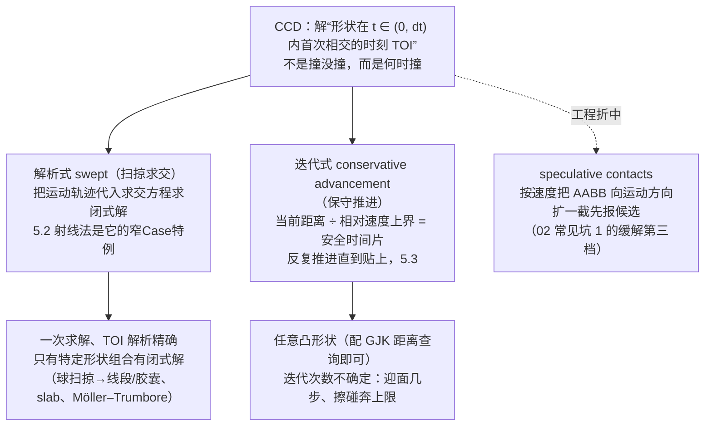

# 连续碰撞检测与流体粒子

> [返回：WebGL 与 3D 框架学习大纲](../WebGL与3D框架学习大纲.md)
> 物理专题第 05 篇：[02](02-碰撞检测与响应.md) 常见坑 1 里"隧穿与 CCD 概念"的完整展开——穿越条件的定量复现、射线法与保守推进两族 CCD、子步组合的工程账、子弹射击三版对比实战；后半把物理语义从刚体扩展到粒子：粒子碰撞、SPH 流体直觉版与刚体双向耦合。粒子的 GPU 实现层（ping-pong、compute、欧拉网格流体）在[技术专题/03-GPGPU与计算](../技术专题/03-GPGPU与计算.md)，本篇不重复，只讲物理语义。

02 篇结束时留了一个洞：子弹 300 m/s、墙 0.2 m 厚，物理步 1/60 s——每步位移 5 m，墙在两个快照之间被完整跳过。当时给了四档缓解（加厚、substep、speculative、CCD）就收住了。本篇把这个洞补完：先算清楚"为什么必然穿"，再给出 CCD（continuous collision detection，连续碰撞检测）的两条实现路线与工程组合方式；最后把"物体"的概念从刚体缩小到粒子，讲粒子碰撞与流体（SPH）的物理语义——这是自制内核的最后一站，也是"该换引擎"清单最长的一截。

## 5.1 隧穿问题：复现实验

### 概念：离散采样漏掉了"恰好重叠"的瞬间

01 篇的固定时间步把运动采成一串离散快照，02 篇的检测只对快照提问："此刻碰了吗"。隧穿（tunneling）不是 bug，而是离散采样的必然：碰撞发生在两个快照**之间**，检测器永远看不到。先把 02 常见坑 1 的算账变成可复现的公式。

### 推导：穿越条件

弹丸是半径 r 的球，墙沿运动方向厚 T，速度 v，步长 dt，每步位移 d = v·dt。球与墙"重叠"的几何条件是球心落在窗口内——窗口从墙面近侧减 r 到远侧加 r，宽度：

$$W = T + 2r$$

相邻两个采样点间距为 d。窗口宽 W、采样间距 d，两条互斥结论：

```text
d ≤ W  →  必命中：相邻采样跨不过整个窗口，至少一帧的球心落在窗口内
d > W  →  隧穿可能：存在相位使两帧都落在窗外（最坏相位必然错过）
         随机相位下的命中概率 ≈ W / d
```

即**穿越条件**：

$$v \cdot dt > T + 2r \iff \text{隧穿可能}$$

**手算（02 的子弹例子）**：v = 300 m/s、dt = 1/60 s → d = 5 m；薄墙 T = 0.2 m、r = 0.01 m → W = 0.22 m。d/W ≈ 22.7：弹丸一步跨过约 23 个窗口宽，随机相位下命中率只有 1/22.7 ≈ 4.4%；若相位固定踩在坏点（起点恰好在窗口前一步与后一步之间），命中率是 0——5.5 的实战会精确复现这个 0。

只靠缩小步长的账：要保证命中需 dt ≤ W/v = 0.22/300 ≈ 7.33e-4 s ≈ **1/1364 s**，物理步 1364 Hz——是 60 Hz 的 22.7 倍。

### 性能悬崖算账：小步长是"全民征税"

几种典型工况对照（60 Hz 基准）：

| 场景 | v (m/s) | T (m) | r (m) | W = T+2r (m) | d = v/60 (m) | 保证命中的步率 | 相对 60 Hz 成本 |
|---|---|---|---|---|---|---|---|
| 投掷物撞厚墙 | 20 | 0.4 | 0.1 | 0.6 | 0.33 | 33 Hz | 已够用 |
| 手枪子弹穿薄板 | 300 | 0.2 | 0.01 | 0.22 | 5.0 | 1364 Hz | ×22.7 |
| 步枪弹穿薄板 | 800 | 0.2 | 0.01 | 0.22 | 13.3 | 3636 Hz | ×61 |

再算总账：02 篇量级的世界（500 个物体）每步约 0.8 ms，60 Hz 时物理占帧预算 0.8 ms；切到 1364 Hz 就是 18.2 ms——**物理一项吃光整帧**（16.7 ms），还会触发 01 篇 accumulator 的补步与死亡螺旋保险丝，实际更糟。

关键的不对称：隧穿只发生在"高速 × 薄"的少数物体对上（几百个物体里通常只有个位数弹丸），缩小步长却对**全世界所有物体**征税。CCD 的思路正好相反——**步长不动，对危险对做定点清除**：求出"运动的形状在 t ∈ (0, dt) 内首次相交的时刻"（TOI，time of impact），在那个时刻处理碰撞。

### CCD 两大家族总览



解析式的代表是"球扫掠退化成线段"（5.2）；迭代式的代表是保守推进（5.3）；speculative contacts 是引擎里更便宜的工程折中——只扩包围盒先报候选，求解时再验证，rapier 的默认策略就是 speculative 加可选 swept。三条路线成本与适用面不同，5.3 末尾有对比表。

## 5.2 射线法：swept as ray

### 概念：高速小球退化为一条线段

弹丸 r = 0.01 m，一步位移 5 m——半径比位移小两个数量级，"球在这一步扫过的体积"几乎就是一条线段。于是 CCD 的第一族做法：**把运动的物体近似成它球心的运动轨迹**，一步内的碰撞 = 线段与场景求交。要保留半径时，球扫掠出的精确体积是胶囊（capsule / swept sphere）；胶囊求交的通用技巧是"线段到目标的最近点（[数学专题/07](../数学专题/07-切空间与几何算法.md) 7.5 一族）与 r 比较"——求交问题转最近点问题，工具全是现成的。

边界先划清：02 §2.6 的 raycast 是**查询**（问世界哪里被挡，为玩法服务）；本节的线段求交是**求解器内件**（求本步何时撞，为物理正确性服务）。数学同源（射线家族的推导在[数学专题/07](../数学专题/07-切空间与几何算法.md) 7.6 与交互篇 4.3.2，不重复），调用时机与 t 的语义不同。

### 推导：t-of-impact——求的不是"撞没撞"而是"何时撞"

02 的静态求交回答布尔值。时间参数化（time parameterization）把位置写成 t 的函数：P(t) = A + t·(B − A)，t ∈ [0, 1] 对应本步的起点到终点，解方程 f(t) = 0 在 [0, 1] 内的**最小根**——这就是 TOI。命中时刻 = t·dt。

**线段-球**：代入 |P(t) − C|² = R²，展开成关于 t 的一元二次：

```text
a·t² + 2b·t + c = 0，其中 a = |B−A|²，b = (B−A)·(A−C)，c = |A−C|² − R²
判别式 disc = b² − a·c < 0 → 整条线不碰球
两根取小者 t = (−b − √disc)/a，t ∈ [0, 1] 即本步命中
```

**手算**：A = (0,0,0)、B = (5,0,0)（正是 300 m/s 走一步），球心 C = (3, 0.05, 0)、R = 0.1：a = 25，b = (5,0,0)·(−3,−0.05,0) = −15，c = 9.0025 − 0.01 = 8.9925；disc = 225 − 224.8125 = 0.1875，√disc ≈ 0.433；t = (15 − 0.433)/25 ≈ **0.5827**——命中发生在帧内 58% 处，命中点 (2.913, 0.05, 0)。把球心改 C = (3, 0.4, 0)：disc = 225 − 228.75 < 0，不碰（球心离线 0.4 > 0.1，与直觉一致）。

**线段-AABB（slab 逐轴区间）**：每轴求线段进入/离开该轴平板的 t 区间，三轴区间有公共部分即穿过；tmin ∈ [0, 1] 即本步命中，TOI = tmin。与射线版的差别只有一处：t 的上限从 ∞ 换成 1（推导见交互篇 4.3.2 slab method）。

**手算**：A = (−1, 0.3, 0)、B = (4, 0.3, 0)，墙 min = (2.9, 0, −0.1)、max = (3.1, 0.5, 0.1)：

```text
x 轴：t ∈ [(2.9+1)/5, (3.1+1)/5] = [0.78, 0.82]
y 轴：平行（dy = 0），起点 0.3 ∈ [0, 0.5] —— 不排除
z 轴：平行，0 ∈ [−0.1, 0.1] —— 不排除
交集 [0.78, 0.82] ⊂ [0, 1] → 命中，TOI = 0.78，命中点 (2.9, 0.3, 0)（恰在墙面）
```

**线段-三角形**：Möller–Trumbore（交互篇 4.2 的射线版实现）把 t 上限钳到 1 即线段版，推导不重复。射击命中精确网格表面（弹孔贴墙）用它；对物理碰撞体（球/盒）用上面两个就够。

### 完整代码：线段求交器

```typescript
// physics/ccd.ts —— 射线法 CCD 的三件套：线段-球、线段-AABB、球-球 TOI
export interface SegmentHit {
  t: number;                       // TOI ∈ [0, 1]，命中时刻 = t · dt
  px: number; py: number; pz: number;  // 命中点（线段上）
  nx: number; ny: number; nz: number;  // 入射面法线（逆着运动方向）
}

/** 线段-球：解一元二次取 [0,1] 内最小根 */
export function segmentSphere(
  ax: number, ay: number, az: number, bx: number, by: number, bz: number,
  cx: number, cy: number, cz: number, r: number,
): SegmentHit | null {
  const dx = bx - ax, dy = by - ay, dz = bz - az;
  const mx = ax - cx, my = ay - cy, mz = az - cz;
  const a = dx * dx + dy * dy + dz * dz;
  if (a < 1e-18) {                            // 零长线段：退化为“起点在不在球内”
    return Math.hypot(mx, my, mz) <= r ? hit(0, ax, ay, az, 0, 0, 0) : null;
  }
  const b = dx * mx + dy * my + dz * mz;
  const c = mx * mx + my * my + mz * mz - r * r;
  const disc = b * b - a * c;
  if (disc < 0) return null;
  let t = (-b - Math.sqrt(disc)) / a;
  if (c <= 0) t = 0;                          // 起点已在球内：t = 0，交给 02 静态响应（常见坑 4）
  if (t < 0 || t > 1) return null;
  return hit(t, ax + dx * t, ay + dy * t, az + dz * t, -dx, -dy, -dz);
}

/** 线段-AABB：slab method，t 上限钳到 1；顺带记录入射面法线 */
export function segmentAABB(
  ax: number, ay: number, az: number, bx: number, by: number, bz: number,
  minX: number, minY: number, minZ: number,
  maxX: number, maxY: number, maxZ: number,
): SegmentHit | null {
  const o = [ax, ay, az], d = [bx - ax, by - ay, bz - az];
  const lo = [minX, minY, minZ], hi = [maxX, maxY, maxZ];
  let tmin = 0, tmax = 1, axis = -1;          // axis：tmin 来自哪根轴（定法线用）
  for (let i = 0; i < 3; i++) {
    if (Math.abs(d[i]) < 1e-12) {             // 平行该轴：起点在 slab 外整段 miss
      if (o[i] < lo[i] || o[i] > hi[i]) return null;
      continue;
    }
    const inv = 1 / d[i];
    let t1 = (lo[i] - o[i]) * inv, t2 = (hi[i] - o[i]) * inv;
    if (t1 > t2) { const s = t1; t1 = t2; t2 = s; }
    if (t1 > tmin) { tmin = t1; axis = i; }
    if (t2 < tmax) tmax = t2;
    if (tmin > tmax) return null;
  }
  const n = [0, 0, 0];
  if (axis >= 0) n[axis] = d[axis] > 0 ? -1 : 1;   // 入射面逆着运动方向
  return hit(tmin, ax + d[0] * tmin, ay + d[1] * tmin, az + d[2] * tmin, n[0], n[1], n[2]);
}

function hit(t: number, px: number, py: number, pz: number,
             nx: number, ny: number, nz: number): SegmentHit {
  const len = Math.hypot(nx, ny, nz);
  return len < 1e-12
    ? { t, px, py, pz, nx: 0, ny: 0, nz: 0 }
    : { t, px, py, pz, nx: nx / len, ny: ny / len, nz: nz / len };
}
```

### 把 02 的静态求交改造成时间参数化

改造模板只有一句话：**静态测试的输入坐标换成 t 的函数，布尔输出换成求根**。以 02 §2.2 的静态球-球为例——A、B 都在动时进相对系（B 当静止），A 相对 B 匀速直线（一步内加速度忽略，正是半隐式欧拉的直线假设），球心距方程又是一元二次：

```typescript
/** 球-球 TOI：02 的静态 sphereSphere 时间参数化版，返回相对时间（秒） */
export function sphereSphereTOI(
  ax: number, ay: number, az: number, avx: number, avy: number, avz: number, ar: number,
  bx: number, by: number, bz: number, bvx: number, bvy: number, bvz: number, br: number,
  dt: number,
): number | null {
  const rx = ax - bx, ry = ay - by, rz = az - bz;       // 相对位置
  const vx = avx - bvx, vy = avy - bvy, vz = avz - bvz; // 相对速度
  const a = vx * vx + vy * vy + vz * vz;
  const r = ar + br;
  const c = rx * rx + ry * ry + rz * rz - r * r;
  if (c <= 0) return 0;                  // 已接触：交给静态响应
  if (a < 1e-18) return null;            // 无相对运动
  const b = rx * vx + ry * vy + rz * vz;
  const disc = b * b - a * c;
  if (disc < 0) return null;
  const t = (-b - Math.sqrt(disc)) / a;
  return t >= 0 && t <= dt ? t : null;
}
```

**手算**：A 球心 (−5,0,0)、v_A = (10,0,0)，B 静止在原点，r_A + r_B = 0.4：相对位置 (−5,0,0)、相对速度 (10,0,0)，c = 25 − 0.16 = 24.84，b = −50，disc = 2500 − 2484 = 16 → t = (50 − 4)/100 = **0.46**（单位：dt 的比例，乘 dt 得秒）。验证：0.46·dt 时 A 心到 (−0.4, 0, 0)，距 B 心 0.4 = 半径和，恰好接触，自洽。

## 5.3 保守推进（conservative advancement）

### 概念：距离除以速度上界，得到“绝对安全”的时间片

射线法需要闭式解，形状一复杂（任意凸包、旋转中的物体）就没有了。保守推进（conservative advancement）换一个问法：**不问何时撞，只问“往前走多少时间一定不撞”**——当前最近距离 d，相对速度大小不超过 s，那么 Δt = d/s 时间内距离最多缩短 d，绝不可能穿透。推进 Δt、重算距离、再推进……距离耗尽时就是 TOI。它只依赖一个原语：两形状的最近点距离（球/盒用 [数学专题/07](../数学专题/07-切空间与几何算法.md) 7.5 的最近点家族，任意凸包用 02 §2.2 提过的 GJK 距离模式）。

### 推导：安全时间片与角速度项

安全时间片的分子是当前最近距离 d（表面到表面），分母是**相对速度的上界** s。接触点的速度是线速度加转动贡献 v_contact = v + ω × r，而 |ω × r| ≤ |ω|·|r| ≤ |ω|·R（R 是形状的包围半径上界），所以：

$$\Delta t = \frac{d}{|\vec{v}_A - \vec{v}_B| + |\omega_A| R_A + |\omega_B| R_B}$$

本专题的最小集是平动刚体（ω = 0），角速度项先记着——**手算它有多大**：半径 0.3 m 的轮子以 ω = 10 rad/s 滚动，表面点速度 ω·R = 3 m/s；一个翻转中的长棒（R = 1 m、ω = 6 rad/s）末端线速度 6 m/s，与质心平动速度同量级。转动刚体（专题 03 篇的范围）漏掉这项，"安全片"就不再安全。

**手算（迎面例，两步收敛）**：球 r = 0.1、球心 (−2, 0.3, 0)、v = (10, 0, 0)，墙 x ∈ [2.9, 3.1]、y/z 方向无限延展（AABB 演示里取大盒）。s = 10。迭代一：d = 2.9 − (−2) − 0.1 = 4.8 → Δt = 0.48，球心到 x = 2.8；迭代二：d = 2.9 − 2.8 − 0.1 = 0 ≤ ε → TOI = 0.48 s。精确解：球面贴墙时球心 x = 2.8，用时 (2.8 + 2)/10 = 0.48——**两步精确命中**，因为迎面时最近距离随 t 严格线性下降。

**收敛率与迭代上限**：迭代数由轨迹与“最近点连线”的夹角 θ 决定——迎面（θ ≈ 90°）1~2 步；45° 斜撞几步；**擦碰**（轨迹几乎平行于表面，θ → 0）每步只削掉 d·sinθ 的一小角，迭代数按 1/sinθ 量级膨胀。所以循环必须带 maxIter，且上限触发时不能默默返回"没撞"（常见坑 3）。

### 完整代码：步进循环

```typescript
// physics/ccd.ts（续）—— 保守推进：球 vs 静态 AABB（平动刚体，角速度项见上文公式）
import type { SegmentHit } from "./ccd";

/** 点到 AABB 最近点距离：数学专题 07 7.5 的三行夹取 */
function pointBoxDist(
  px: number, py: number, pz: number,
  minX: number, minY: number, minZ: number,
  maxX: number, maxY: number, maxZ: number,
): number {
  const qx = Math.min(Math.max(px, minX), maxX);
  const qy = Math.min(Math.max(py, minY), maxY);
  const qz = Math.min(Math.max(pz, minZ), maxZ);
  return Math.hypot(px - qx, py - qy, pz - qz);
}

/**
 * 球沿直线推进 dt 内对静态 AABB 的 TOI。返回 [0, dt] 内的命中时刻，未命中返回 null。
 * speedBound 传入相对速度上界：调用方算 |v_A − v_B| + |ω_A|R_A + |ω_B|R_B。
 */
export function conservativeAdvanceSphereBox(
  sx: number, sy: number, sz: number,      // 球心出发点（本步起点）
  vx: number, vy: number, vz: number,      // 球速（本步内恒速）
  r: number,
  minX: number, minY: number, minZ: number,
  maxX: number, maxY: number, maxZ: number,
  dt: number,
  speedBound: number,
  eps = 1e-4,
  maxIter = 32,
): number | null {
  if (speedBound < 1e-9) return null;      // 无相对运动
  let t = 0;
  for (let i = 0; i < maxIter; i++) {
    const cx = sx + vx * t, cy = sy + vy * t, cz = sz + vz * t;
    const d = pointBoxDist(cx, cy, cz, minX, minY, minZ, maxX, maxY, maxZ) - r;
    if (d <= eps) return t;                // 表面距离耗尽：TOI 就是 t
    t += Math.max(d, eps) / speedBound;    // 安全时间片（max 防 d→0 时的死循环小步）
    if (t > dt) return null;               // 安全片都走超了：本步碰不上
  }
  return null;                             // 迭代上限：擦碰/掠过，调用方必须降级处理（常见坑 3）
}
```

### 与 5.2 的适用场景对比

| 维度 | 射线法 / swept（5.2） | 保守推进（5.3） |
|---|---|---|
| 形状 | 有闭式解的组合：线段/胶囊 vs 球、AABB、三角形 | 任意凸形状——只要能给“最近点距离”（含 GJK） |
| TOI 精度 | 解析精确，一次求解 | 迭代逼近，精度由 eps 决定 |
| 每对成本 | O(1)（一次方程求根） | O(k) 次距离查询，k 迎面 1~2、擦碰奔上限 |
| 旋转 | 不处理（除非升级扫掠形状） | 速度上界里显式含角速度项，天然支持 |
| 失败模式 | 形状没有闭式解就得离散化 | 擦碰迭代爆炸，靠 maxIter + 降级兜底 |
| 典型用途 | 子弹、投掷物、射线弹道 | 关节链末端、任意网格体、旋转物体 |

## 5.4 子步与 CCD 的工程组合

### 优先级 CCD：只给“高速 × 薄”开

Bullet 物理引擎的实践：CCD 不全场开，按阈值报名。每步积分后对动态体做一次廉价判定——`v·dt > ccdMotionThreshold`（阈值取场景最薄碰撞体的一半左右，如 0.1 m）——只有超标的高速体进入 CCD 候选，且通常只对“高速体 vs 静态薄物/其他体”测。500 个物体的世界里 CCD 常年只有几个成员，成本被压到常数级。02 §2.5 的 sleep 顺带送了红利：睡着的物体速度为零，永远不进 CCD 名单。

### 时间分片：步内多次求解

TOI 求出来只是开始——命中之后本步还剩 (1 − t)·dt 的时间不能蒸发（常见坑 2）。正解是 **TOI 时间分片**（time-of-impact scheduling）：把一步 dt 切成“推进到最早 TOI → 响应 → 继续推进剩余时间”的循环，Box2D 的 continuous physics 就是这套：

```typescript
// toi.ts —— 时间分片骨架：一步内“推进 → 命中 → 响应 → 继续推进剩余时间”
interface ToiHit { t: number; a: RigidBody; b: RigidBody; c: Contact }

function stepWithToi(
  bodies: RigidBody[], dt: number,
  integrate: (dt: number) => void,
  detectToi: (dt: number) => ToiHit | null,     // 所有 CCD 对中最早的 TOI（升序第一个）
  resolve: (hit: ToiHit) => void,               // 02 §2.3 的 resolveContact
): void {
  let t = 0;
  for (let guard = 0; guard < 8 && t < dt; guard++) {   // 上限：连环命中防死循环
    integrate(dt - t);                                  // ① 推进剩余时间
    const hit = detectToi(dt - t);                      // ② 最早命中在多久之后？
    if (!hit) break;                                    //    本步再无命中
    // ③ 回卷到命中时刻（所有物体按各自速度倒退 hit.t）→ 响应 → 消耗掉这段
    rollbackTo(bodies, hit.t);
    resolve(hit);
    t += hit.t;
  }
}
```

每处理一个 TOI 要重算受影响物体对的后续 TOI（反弹后速度变了）——`detectToi` 内部维护按 t 升序的候选队列。守卫上限 8：正常一步命中一两次，超过说明场景在“机关枪穿糖纸”，该直接细分整个物理步。

### 成本预算表：多少物体会爆帧

60 fps、物理预算按 3 ms 计，线段法每对成本 = 线段覆盖的哈希格子数 × 格内 narrow 测试（300 m/s 一步 5 m、格子 2 m，约 3 × 3 × 3 = 27 格，多数格空）：

| CCD 启用对数 | 每对成本（量级） | 每步 CCD 总成本 | 结论 |
|---|---|---|---|
| 10 | ~1 µs | ~10 µs | 无感，弹枪游戏的标准配置 |
| 100 | ~2 µs（路径变长、缓存变差） | ~0.2 ms | 可接受，监控即可 |
| 1000 | ~2–5 µs + broad phase 压力 | 2–5 ms | 逼近预算，该换 speculative 先筛 |
| 5000+ | — | >10 ms | 爆帧；这是引擎（rapier WASM + 并行）的领地 |

speculative contacts（02 常见坑 1 第三档）在此回到视野：它用“扩 AABB 报候选”把大多数对挡在精确求解之外，与 swept CCD 是叠加关系——speculative 粗筛、swept 精算，正是 rapier 的组合拳。

## 5.5 实战：子弹射击场景

场景：0.2 m 薄墙（AABB，x ∈ [2.9, 3.1]），弹丸球 r = 0.01、v = 300 m/s 水平射出，物理步 1/60。三版对比——无 CCD（02 原样）、射线 CCD（5.2）、保守推进（5.3）。

```typescript
// demo-bullet.ts —— 薄墙 + 高速弹丸：无 CCD vs 射线 CCD vs 保守推进
// 依赖 02 的 RigidBodyWorld / resolveContact 与本篇 physics/ccd.ts
type CcdMode = "none" | "ray" | "ca";
const MODE: CcdMode = "ray";
const DT = 1 / 60;
const BULLET_R = 0.01;

const WALL = { minX: 2.9, minY: -1, minZ: -2, maxX: 3.1, maxY: 3, maxZ: 2 };

class BulletWorld extends RigidBodyWorld {
  readonly bullets: RigidBody[] = [];
  shots = 0; hits = 0;

  protected step(dt: number): void {
    super.step(dt);                        // 02 的三步循环（静态求交大概率漏掉弹丸）
    for (const b of this.bullets) {
      if (MODE === "ray") this.rayCcd(b);
      if (MODE === "ca") this.caCcd(b);
      if (b.x > 8) b.invMass = 0;          // 出界：停用（回收交给渲染层淡出）
    }
  }

  /** 版本二：射线 CCD——积分后用“上一位置 → 当前位置”的线段验证本步轨迹 */
  private rayCcd(b: RigidBody): void {
    const hit = segmentAABB(b.px, b.py, b.pz, b.x, b.y, b.z,
      WALL.minX, WALL.minY, WALL.minZ, WALL.maxX, WALL.maxY, WALL.maxZ);
    if (!hit) return;
    this.hits++;
    b.x = hit.px + hit.nx * 0.001;         // ① 回卷到命中点（留 slop 防重复命中）
    b.y = hit.py + hit.ny * 0.001;
    b.z = hit.pz + hit.nz * 0.001;
    const vn = b.vx * hit.nx + b.vy * hit.ny + b.vz * hit.nz;   // ② 法向反射 + 切向衰减
    if (vn < 0) {
      const e = 0.2;
      b.vx -= (1 + e) * vn * hit.nx;
      b.vy -= (1 + e) * vn * hit.ny;
      b.vz -= (1 + e) * vn * hit.nz;
      b.vx *= 0.7; b.vy *= 0.7; b.vz *= 0.7;
    }
  }

  /** 版本三：保守推进——从上一位置沿速度推进，TOI 处走 02 的完整接触响应 */
  private caCcd(b: RigidBody): void {
    const t = conservativeAdvanceSphereBox(
      b.px, b.py, b.pz, b.vx, b.vy, b.vz, BULLET_R,
      WALL.minX, WALL.minY, WALL.minZ, WALL.maxX, WALL.maxY, WALL.maxZ,
      DT, Math.hypot(b.vx, b.vy, b.vz));
    if (t === null) return;
    this.hits++;
    b.x = b.px + b.vx * t;                 // 推进到 TOI
    b.y = b.py + b.vy * t;
    b.z = b.pz + b.vz * t;
    // 接触法线（墙 → 弹）：球心到盒最近点的方向；深度 = r − 距离
    const qx = Math.min(Math.max(b.x, WALL.minX), WALL.maxX);
    const qy = Math.min(Math.max(b.y, WALL.minY), WALL.maxY);
    const qz = Math.min(Math.max(b.z, WALL.minZ), WALL.maxZ);
    let nx = b.x - qx, ny = b.y - qy, nz = b.z - qz;
    const dist = Math.hypot(nx, ny, nz) || 1;
    nx /= dist; ny /= dist; nz /= dist;
    resolveContact(this.wall, b, nx, ny, nz, BULLET_R - dist, 0.2, 0.3);  // 02 §2.3
  }
  readonly wall!: RigidBody;
}

const world = new BulletWorld(DT);
world.wall = world.addBox(0.1, 2, 2);      // 薄墙：半长 (0.1, 2, 2) 的静态 AABB
world.wall.invMass = 0; world.wall.x = 3; world.wall.y = 1; world.wall.z = 0;

setInterval(() => {                        // 每 0.5 s 发一发
  const bullet = world.addSphere(BULLET_R);
  bullet.x = 0; bullet.y = 1 + Math.random() * 0.5; bullet.z = 0;
  bullet.vx = 300;                         // 命中面 y ∈ [-1, 3]，弹道必中侧影
  world.bullets.push(bullet);
  world.shots++;
  if (world.shots === 10) console.log(`命中 ${world.hits} / ${world.shots}`);
}, 500);
```

三版的表现（每版打 10 发）：

- **无 CCD**：采样位置是 0、5、10……m，窗口 [2.89, 3.11] 恒被跳过——**0/10 命中**，全部穿墙消失（5.1 的公式在此精确兑现：相位固定在坏点，连 4.4% 的运气都没有）。把墙加厚到 6 m（W ≥ d）可以全命中，但弹丸每次以最大深度扎进墙体，被位置修正粗暴推出——表现成“打进半米才弹开”；
- **射线 CCD**：**10/10 命中**，弹着点精确在墙面（t = 0.58 一类的帧内时刻被回卷兑现），反弹、溅射特效挂在命中点即可。局限：半径近似为 0（真正的胶囊半径语义要配最近点距离），且命中后的剩余时间被丢弃（0.5 s 一发不在乎，连发武器见下）；
- **保守推进**：**10/10 命中**，每发 2~3 次迭代（迎面例），且能复用 02 的完整接触响应（弹性、摩擦、位置修正）——弹丸“贴着墙弹开”而不是“点一下”。代价是每发多几次距离查询；连发武器应升级成 5.4 的时间分片，把命中后的剩余 dt 继续用于反弹飞行。

弹孔贴花、弹道拖尾属于渲染层（billboard 与 instancing 的老本行，[技术专题/01-GLSL Cookbook](../技术专题/01-GLSL%20Cookbook.md)），物理层只负责交付 `hit` 事件与命中点。

## 5.6 粒子物理与流体入门

### 概念：粒子是最小的物理体

把 02 的刚体一路缩小：无旋转、半径一小截、数量一大截——就是粒子。粒子物理只有两类碰撞要处理：

- **粒子 vs 静态场景**：最常用的是地形高度场（heightfield）与盒。高度场碰撞只采样不建模：粒子 y 低于场地高度即穿透，法线由中心差分求梯度；
- **粒子 vs 粒子**：候选对来自空间哈希——**直接复用 02 §2.1 的 SpatialHash**，格子边长取粒子直径，narrow phase 是"距离 < 半径和"的位置分离（粒子太多时通常不施冲量，投影 + 阻尼就够）。

```typescript
// physics/heightfield.ts —— 粒子-高度场：采样 + 差分法线 + 法向反射
export function collideHeightfield(
  p: { x: number; y: number; z: number; vx: number; vy: number; vz: number },
  H: (x: number, z: number) => number,   // 场地高度函数
  restitution: number,
): void {
  const ground = H(p.x, p.z);
  if (p.y >= ground) return;
  // 法线 n = normalize(−∂H/∂x, 1, −∂H/∂z)，中心差分求两个偏导
  const d = 0.05;
  const sx = (H(p.x + d, p.z) - H(p.x - d, p.z)) / (2 * d);
  const sz = (H(p.x, p.z + d) - H(p.x, p.z - d)) / (2 * d);
  const len = Math.hypot(sx, 1, sz);
  const nx = -sx / len, ny = 1 / len, nz = -sz / len;
  p.y = ground;                            // 便宜的位置修正：只钳 y（陡坡会略陷，教学可接受）
  const vn = p.vx * nx + p.vy * ny + p.vz * nz;
  if (vn < 0) {                            // 法向反射 × e、切向保留
    p.vx -= (1 + restitution) * vn * nx;
    p.vy -= (1 + restitution) * vn * ny;
    p.vz -= (1 + restitution) * vn * nz;
  }
}
```

### SPH：压力与粘性的直觉版

粒子-粒子"硬推开"适合沙子，不适合水——水分子不互相接触，是**压力**在推开它们。SPH（smoothed particle hydrodynamics，光滑粒子流体动力学）把连续流体方程离散到粒子上，每步三件事：

1. **密度估计**：粒子 i 的密度 = 邻居质量按核函数加权求和。核函数 W(r, h) 紧支撑——距离超过核半径 h 贡献为零，所以邻居搜索半径就是 h：

$$\rho_i = \sum_j m_j\, W(|x_i - x_j|, h)$$

2. **状态方程**：由密度算压力。弱可压（weakly compressible）SPH 用最简单的状态方程，密度超过静止密度 ρ₀ 就"变硬"：

$$P_i = k\,(\rho_i - \rho_0)$$

3. **压力梯度力 + 粘性力**：压力差驱动粒子从高压区流向低压区（这就是"推开"的软版本）；粘性把邻居间的速度差抹平：

$$f_i = -\sum_j m_j \frac{P_i + P_j}{2\rho_j}\nabla W_{ij} \;+\; \mu \sum_j m_j \frac{v_j - v_i}{\rho_j}\nabla^2 W_{ij}$$

核函数取标准 2D 组合：密度用 poly6（W = 4/(πh⁸)·(h²−r²)³）、压力梯度用 spiky 的梯度（模长 30/(πh⁵)·(h−r)²）、粘性用 viscosity 核的拉普拉斯（40/(πh⁵)·(h−r)），归一化常数与推导在计算流体力学教材（Monaghan 1992；Bridson《Fluid Simulation for Computer Graphics》）。三步的物理直觉一句话：**挤在一起的粒子密度高 → 压力大 → 互相推开；速度不齐的邻居被粘性抹平**——水的"晃"与"荡"全从这两条冒出来。

### 完整代码：2D SPH 最小版（数百粒子水池）

```typescript
// physics/sph2d.ts —— 2D SPH 最小版：网格哈希邻居 + 密度→压力→力三步 + 半隐式欧拉
export interface SphParticle {
  x: number; y: number;      // 位置（米，物理世界 y 向上）
  vx: number; vy: number;    // 速度
  fx: number; fy: number;    // 本步累积的力
  rho: number;               // 密度（① 算出）
  p: number;                 // 压力（② 算出）
}

export class Sph2D {
  readonly particles: SphParticle[] = [];
  // —— 参数是一组“能跑”的起点（调参见常见坑 5；k 与 dt 的权衡见正文）——
  h = 0.1;                   // 核半径：邻居搜索半径 = 紧支撑边界
  rho0 = 1000;               // 静止密度（水）
  stiffness = 50;            // 状态方程刚度 k：P = k(ρ − ρ₀)，√k 即“音速”量级
  viscosity = 0.1;           // 粘性系数 μ
  mass = 2.5;                // 每粒子质量 = ρ0 × 静止间距²（0.05²），与 rho0 自洽
  gravityY = -9.81;
  restitution = 0.1;
  damping = 0.999;           // 全局微阻尼：数值保险丝
  pool = { minX: 0, maxX: 1.6, minY: 0, maxY: 1.0 };   // 水池（三面墙，顶开放）

  private cells = new Map<number, number[]>();

  /** 坝体：左半池按静止间距摆粒子，松手瞬间倒塌（dam break） */
  spawnDam(nx = 24, ny = 14): void {
    const s = this.h / 2;                 // 静止间距 = h/2：与 rho0 自洽的关键
    for (let j = 0; j < ny; j++)
      for (let i = 0; i < nx; i++)
        this.particles.push({
          x: this.pool.minX + 0.02 + i * s, y: this.pool.minY + 0.02 + j * s,
          vx: 0, vy: 0, fx: 0, fy: 0, rho: this.rho0, p: 0,
        });
  }

  step(dt: number): void {
    this.buildGrid();
    this.densityAndPressure();            // ①② 密度 → 压力
    this.forces();                        // ③ 压力梯度 + 粘性 + 重力
    this.integrate(dt);                   // 半隐式欧拉 + 边界
  }

  /** 网格哈希：cellSize = h，3×3 邻域必覆盖支撑域（同 02 §2.1 思路，2D 打包键） */
  private buildGrid(): void {
    this.cells.clear();
    const inv = 1 / this.h;
    for (let i = 0; i < this.particles.length; i++) {
      const p = this.particles[i];
      const key = this.cellKey(Math.floor(p.x * inv), Math.floor(p.y * inv));
      let list = this.cells.get(key);
      if (!list) this.cells.set(key, (list = []));
      list.push(i);
    }
  }

  private cellKey(cx: number, cy: number): number {
    return ((cx + 512) << 11) | (cy + 512);   // 每轴 11 位，±511 格内安全
  }

  private forEachNeighbor(i: number, visit: (j: number) => void): void {
    const p = this.particles[i];
    const inv = 1 / this.h;
    const cx = Math.floor(p.x * inv), cy = Math.floor(p.y * inv);
    for (let gx = cx - 1; gx <= cx + 1; gx++)
      for (let gy = cy - 1; gy <= cy + 1; gy++) {
        const list = this.cells.get(this.cellKey(gx, gy));
        if (list) for (const j of list) if (j !== i) visit(j);
      }
  }

  private densityAndPressure(): void {
    const h = this.h, h2 = h * h;
    const kPoly = 4 / (Math.PI * h ** 8);         // 2D poly6 归一化系数
    const wSelf = kPoly * h2 ** 3;                // W(0)：自身贡献（漏掉它密度系统性偏低）
    for (let i = 0; i < this.particles.length; i++) {
      const p = this.particles[i];
      let rho = this.mass * wSelf;
      this.forEachNeighbor(i, (j) => {
        const q = this.particles[j];
        const dx = p.x - q.x, dy = p.y - q.y;
        const r2 = dx * dx + dy * dy;
        if (r2 < h2) rho += this.mass * kPoly * (h2 - r2) ** 3;
      });
      p.rho = rho;
      p.p = Math.max(0, this.stiffness * (rho - this.rho0));   // 负压钳零（放弃表面聚合，换稳定）
    }
  }

  private forces(): void {
    const h = this.h, h5 = h ** 5;
    const gradK = -30 / (Math.PI * h5);           // spiky 梯度系数（负号：W 随 r 递减）
    const lapK = 40 / (Math.PI * h5);             // viscosity 拉普拉斯系数
    for (let i = 0; i < this.particles.length; i++) {
      const p = this.particles[i];
      p.fx = 0;
      p.fy = this.mass * this.gravityY;
      this.forEachNeighbor(i, (j) => {
        const q = this.particles[j];
        const dx = p.x - q.x, dy = p.y - q.y;
        const r = Math.hypot(dx, dy);
        if (r >= h || r < 1e-9) return;
        // 压力梯度力：∇W = gradK·(h−r)²·(dx/r, dy/r)，gradK < 0 → P > 0 时沿 i−j 方向推开
        const wGrad = gradK * (h - r) ** 2;
        const scale = -this.mass * (p.p + q.p) / (2 * q.rho) * wGrad / r;
        p.fx += scale * dx;
        p.fy += scale * dy;
        // 粘性力：速度差 × 拉普拉斯核——快的拖慢、慢的带快
        const visc = this.viscosity * this.mass * lapK * (h - r) / q.rho;
        p.fx += visc * (q.vx - p.vx);
        p.fy += visc * (q.vy - p.vy);
      });
    }
  }

  private integrate(dt: number): void {
    const invM = 1 / this.mass;
    const VMAX = 8;                               // 速度钳制：NaN 之前的最后一道闸
    const m = 0.01, e = this.restitution;
    for (const p of this.particles) {
      p.vx = (p.vx + p.fx * invM * dt) * this.damping;
      p.vy = (p.vy + p.fy * invM * dt) * this.damping;
      const v = Math.hypot(p.vx, p.vy);
      if (v > VMAX) { p.vx *= VMAX / v; p.vy *= VMAX / v; }
      p.x += p.vx * dt;
      p.y += p.vy * dt;
      // 三面墙：位置钳制 + 法向反弹（顶开放：粒子可以溅出再落回）
      if (p.x < this.pool.minX + m) { p.x = this.pool.minX + m; if (p.vx < 0) p.vx = -p.vx * e; }
      if (p.x > this.pool.maxX - m) { p.x = this.pool.maxX - m; if (p.vx > 0) p.vx = -p.vx * e; }
      if (p.y < this.pool.minY + m) { p.y = this.pool.minY + m; if (p.vy < 0) p.vy = -p.vy * e; }
    }
  }
}
```

渲染端 canvas 2D 画圆点（物理在 CPU，渲染不值得上 WebGL）：

```typescript
// render-sph.ts —— canvas 2D 圆点渲染：注意 y 翻转（常见坑 7）
export function renderSph(ctx: CanvasRenderingContext2D, sim: Sph2D, canvasH: number): void {
  const scale = canvasH / sim.pool.maxY;                 // 米 → 像素
  ctx.fillStyle = "#0a1929";
  ctx.fillRect(0, 0, ctx.canvas.width, canvasH);
  const rPix = sim.h * 0.25 * scale;
  ctx.fillStyle = "rgba(90, 170, 255, 0.85)";
  for (const p of sim.particles) {
    ctx.beginPath();
    ctx.arc(p.x * scale, (sim.pool.maxY - p.y) * scale, rPix, 0, Math.PI * 2);  // y 翻转
    ctx.fill();
  }
}

const sim = new Sph2D();
sim.spawnDam();                                 // 24 × 14 = 336 粒子
const FDT = 1 / 240;                            // SPH 稳定步长（CFL，见常见坑 5）
let acc = 0;
new RenderLoop((dt) => {                        // 第三阶段 RenderLoop + accumulator（01 §1.1）
  acc += Math.min(dt, 0.1);
  while (acc >= FDT) { sim.step(FDT); acc -= FDT; }
  renderSph(ctx, sim, canvas.height);
}).start();
```

验收表现：坝体先整体向右塌、拍上右墙回弹、来回晃荡几次后静成一面"斜水坡"；抽出几粒溅到池顶落回。参数的物理账：stiffness = 50 时"音速"约 √k ≈ 7 m/s，0.5 m 深水柱底部压缩约 10%（软而不假）；k 提到 200 水更硬，但稳定步长按 √k 缩短——**k 是"水硬度换步长"的旋钮**，这正是弱可压 SPH 的根本权衡（根治要换不可压求解：PCISPH/PBF，思路是 01 §1.3 位置式约束的流体版）。

与 GPU 侧的分界：本节是**拉格朗日粒子法**（粒子携带质量与速度，压力在粒子间传递）；[技术专题/03](../技术专题/03-GPGPU与计算.md) 3.5 的稳定流体是**欧拉网格法**（固定网格解 Navier-Stokes）——同一套流体物理的两种离散化，前者天然擅长自由表面与飞溅，后者不可压更稳。03 的 10 万湍流粒子与 boids 是"速度场/规则驱动"的视觉粒子（粒子间不交换动量），SPH 粒子间通过压力耦合，才是物理粒子。几百粒子 CPU 足够；上万粒子的 GPU 化路线——邻居搜索的"排序 + 前缀和"清单、纹理 ping-pong 状态管理——在[技术专题/03](../技术专题/03-GPGPU与计算.md) 3.2/3.4 原样适用，WebGPU compute 下的归位见[04-WebGPU迁移指南](../技术专题/04-WebGPU迁移指南.md)。

## 5.7 粒子与刚体双向耦合

### 单向：粒子受刚体推（“无限质量假象”）

最简耦合：刚体每步参与粒子碰撞——粒子-盒测试直接复用 02 §2.2 的 sphereBox，粒子被推出盒外并反射速度，刚体侧**什么都不做**：

```typescript
// 单向耦合：刚体推粒子，粒子不影响刚体（02 §2.2 sphereBox 复用，法线：盒 → 粒子）
for (const p of particles) {
  const c = sphereBox(p.x, p.y, p.z, p.radius, boxOf(body));
  if (!c) continue;
  p.x += c.nx * c.depth; p.y += c.ny * c.depth; p.z += c.nz * c.depth;   // 位置推出
  const vn = p.vx * c.nx + p.vy * c.ny + p.vz * c.nz;
  if (vn < 0) {                                                          // 法向反射
    p.vx -= 1.4 * vn * c.nx; p.vy -= 1.4 * vn * c.ny; p.vz -= 1.4 * vn * c.nz;
  }
}
```

这在动力学上等价于把刚体当 invMass = 0 的静态体——"无限质量假象"：水池里拖动一个盒子，水让路，盒子感受不到任何阻力，照原速滑过。特效场景（水面浮渣、船尾水花）够用；玩法上水要"托住"东西时露馅。

### 双向：粒子把冲量还回去

把粒子受到的推出/反射打包成冲量还给刚体。粒子被反射 Δv = v′ − v，刚体给粒子的冲量是 m·Δv，反作用给刚体的是 −m·Δv。工程要点是**聚合**：一步内所有粒子-盒接触的冲量先累加，步末一次性 `addImpulse` 给刚体——逐粒子施冲量会把 Gauss–Seidel 式的顺序偏差灌进刚体速度，表现成高速抖动：

```typescript
// 双向耦合骨架：冲量聚合 + 步末一次施加（01 §1.4 的 addImpulse）
let jx = 0, jy = 0, jz = 0;
for (const p of particles) {
  const c = sphereBox(p.x, p.y, p.z, p.radius, boxOf(body));
  if (!c) continue;
  const vnx = p.vx, vny = p.vy, vnz = p.vz;                  // 反射前速度
  /* …位置推出与反射同上，得到新速度 v′… */
  // jx += p.mass * (vnx − v′x) …                            // 反作用冲量 = −m·Δv
  jx += p.mass * (vnx - p.vx); jy += p.mass * (vny - p.vy); jz += p.mass * (vnz - p.vz);
}
body.addImpulse(jx, jy, jz);       // 一步一次；有力臂时还生力矩——专题 03 篇之后才能接
```

两个坑要立牌：**质量比**——单粒子质量约 ρ·h²（本节参数 2.5 kg），刚体动辄几十，冲量比天然悬殊，聚合后还要按 dt 缩放成力再限幅，否则轻刚体在水面被冲量噪声打得乱颤；**假想力**（fictitious force）——若刚体是脚本/动画驱动的 kinematic 体（位置直接设定，不受牛顿定律），它带着规定的加速度推开粒子，粒子侧看到的"力"并不来自动力学；此时把反作用冲量还回去毫无意义（刚体会被推离动画轨道，或下一帧被动画强行拉回，能量凭空增减）。正路二选一：要么刚体转成动态体（受冲量、受重力）；要么承认单向、在刚体运动数据里手工补偿"排水体积浮力"一类的宏观项。

## 5.8 边界总结：自制物理内核的能力边界

至此，"积分 → 检测 → 响应"的最小内核连同它的两个高级补丁（CCD、粒子/流体）都齐了。能力清单：

| 能力 | 状态 | 位置 / 建议 |
|---|---|---|
| 平动刚体：积分、冲量、摩擦、堆叠、sleep、raycast、触发器 | ✓ 已覆盖 | [01](01-数值积分与运动.md)、[02](02-碰撞检测与响应.md) |
| 布料与绳索（PBD 距离约束） | ✓ 已覆盖 | [01 §1.3](01-数值积分与运动.md) |
| CCD：射线法、保守推进、TOI 时间分片、优先级策略 | ✓ 已覆盖 | 本篇 5.1–5.5 |
| 粒子碰撞与流体入门（高度场、空间哈希、2D SPH、耦合思路） | ✓ 已覆盖 | 本篇 5.6–5.7 |
| 刚体转动（惯性张量、摩擦生转、四元数积分） | ✗ 概念（专题 03 篇撰写中） | 简单需求：美术旋转；真需求：cannon-es / rapier |
| 关节约束（铰链、球窝、马达、布料-刚体耦合） | ✗ 概念（专题 04 篇撰写中） | 两引擎都有，别自研 |
| 连续物理（关节限位的 CCD、TOI 与约束求解联立） | ✗ 建议用库 | rapier 的完整 TOI 管线 |
| 车辆（raycast vehicle、悬挂弹簧） | ✗ 建议用库 | 两引擎都有现成组件 |
| 破碎（Voronoi 分割 + 碎块动力学 + 碎块间 CCD） | ✗ 建议用库 | "预制碎块"可自制（02 堆叠 + 本篇 CCD），真 Voronoi 用库 |
| 大规模流体（万级粒子、3D、不可压） | 部分（语义层已入门） | GPU 化走[技术专题/03](../技术专题/03-GPGPU与计算.md)，WebGPU compute 见迁移指南 |
| 确定性回放 / 联机同步 | ✗ | 自研内核的求解次序无保证；rapier 有确定性承诺 |

**何时全面迁移 rapier**——02 §2.7 的三条判据（关节/车辆拓扑、高速物体可靠性、规模与求解质量）仍然成立，本篇再添四条信号，满足其一就该评估迁移：

1. CCD 启用对数常年超过 5.4 预算表的安全区（数百对以上），或每步 TOI 时间分片触发多次；
2. 需要"约束 + CCD"组合——高速关节链不限位会穿，TOI 与约束求解联立是另一个量级的工程；
3. 粒子/流体与刚体的**强耦合**成为玩法核心（不是点缀级水花）——本篇 5.7 只给了思路，稳定的双向耦合是论文级课题；
4. 需要确定性回放或联机同步。

迁移成本与 02 §2.7 的分析相同：01 §1.4 的 PhysicsLoop 抽象保住了渲染绑定层，换的是世界内核；raycast 与触发器留一层薄接口转发即可。写过本专题再去看引擎的 `ccdEnabled`、`speculativeMargin` 参数，每个旋钮都知道它在防什么——这正是自制内核的全部回报。

## 常见坑

1. **CCD 只对“高速体 vs 静态薄物”开**：动态对动态（两颗子弹对撞）用射线法要进相对系且双方都扫掠，成本与复杂度陡增——多数游戏直接不测（对撞概率极低），非测不可用保守推进；
2. **TOI 命中后剩余时间蒸发**：把物体钉死在命中点、丢弃本步剩余 dt——子弹时间变慢、能量凭空消失。至少把剩余时间继续积分，正解是 5.4 的时间分片；
3. **保守推进的迭代上限变成穿墙许可证**：擦碰轨迹迭代到上限仍未到 ε，直接返回 null 等于“允许穿过”。上限触发必须降级：按线段法再验证一次，或按当前 t 强制处理接触并告警；
4. **线段起点已在墙内**：02 常见坑 5“生成即穿透”在 CCD 下的形态——slab 解出 tmin = 0（起点在盒内），这不是 TOI 而是静态穿透，应交给 02 的深度推出响应；反射公式对“已在内部”的粒子会把速度越反越乱；
5. **SPH 一调参就爆**：粒子四散或 NaN 不是代码 bug，是 CFL 条件被踩爆——稳定步长经验式 dt ≲ 0.4·h/(v_max + √k)。调参顺序：先减半 dt，再减 stiffness；NaN 防御（分母、速度钳制、isFinite 抽检）回看 01 常见坑 2；
6. **邻居搜索格子小于 h**：cellSize 必须 ≥ 核半径 h 且查 3×3（2D）邻域，否则“看得见的邻居查不到”，密度场出现空洞、压力斑点噪声。另注意密度求和的自身项 m·W(0)——漏掉它所有密度系统性偏低，水面凭空多出一层“压缩”；
7. **canvas 2D 渲染忘记 y 翻转**：物理世界 y 向上、canvas y 向下，直接画水池悬在“天上”。渲染函数统一 `(maxY − y)·scale` 或开头一次 `translate/scale(1, −1)`。

## 【本节自测】

1. 手算：v = 150 m/s、dt = 1/60 s、墙厚 0.3 m、弹半径 0.05 m。每步位移多少？窗口宽度多少？是否会隧穿？只靠步长保证命中需要多少 Hz 的物理步？
2. 手算：线段 A = (0, 1, 0) → B = (10, 1, 0)，墙 min = (5.95, 0, −0.1)、max = (6.05, 2, 0.1)。求 TOI（t 参数）与命中点；若墙 y 范围改为 [2, 4]，结果如何？
3. 写出保守推进的安全时间片公式；角速度项为什么不能省（举一个 ω·R 超过线速度的例子）？擦碰轨迹为什么收敛慢，工程上怎么兜底？
4. SPH 每步的三步是什么？如果跳过密度估计、直接按“距离近就推开”的纯斥力做（02 式粒子-粒子分离），会缺哪些水的现象？
5. 单向耦合的“无限质量假象”与双向耦合的“假想力”各指什么？列出本篇新增的两条“该迁移 rapier”的信号。

---

[返回物理专题导览](00-导览.md) · 前置：[01-数值积分与运动](01-数值积分与运动.md)、[02-碰撞检测与响应](02-碰撞检测与响应.md)（隧穿概念在彼处常见坑 1） · 粒子的 GPU 实现层：[技术专题/03-GPGPU与计算](../技术专题/03-GPGPU与计算.md)
