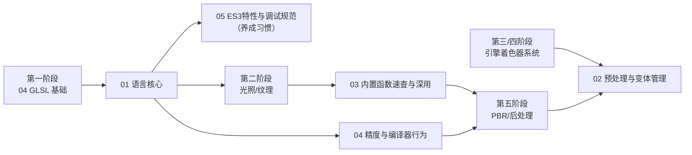

# 着色器语言专题导览

> [返回：WebGL 与 3D 框架学习大纲](../WebGL与3D框架学习大纲.md)
> 本目录是 GLSL 的**语言参考级系统课**：入门见 [01-第一阶段/04-GLSL基础](../01-第一阶段/04-GLSL基础.md)（限定符语义、内置变量、精度初识、swizzle 入门），这里把 GLSL 当一门完整的语言来讲——语法全集、函数深用、编译器行为、调试规范。

## 定位与边界

- **与入门分工**：04 册回答"写着色器要认识哪些东西"，本专题回答"这门语言的每条规则边界在哪、编译器怎么处理它、出错了怎么按语言语义排查"。入门内容只交叉引用，不重讲。
- **与技术专题分工**：[技术专题/01-GLSL Cookbook](../技术专题/01-GLSL%20Cookbook.md) 讲"用 GLSL 做效果"（菲涅尔、描边、溶解……），本专题讲"语言本身"（类型、构造器、控制流、内建函数语义、编译器行为）。写 Cookbook 的着色器遇到语义疑点时，回这里查。
- **与工程专题分工**：[工程专题/01-调试与诊断](../工程专题/01-调试与诊断.md) 讲工具链与黑屏排查流程；本专题第 05 篇讲 GLSL 语言层面的调试手法（编译错误阅读、颜色调试输出、宏断言），互为上下游。
- **语法版本**：延续全仓库"上下文双保险 + 着色器 ES 1.00 主线"的决策（[02-渲染管线全局观 1.3](../01-第一阶段/02-渲染管线全局观.md)），每个语言点标注 ES 1.00 / 3.00 差异，规范出处精确到章节号。

## 分册索引

| 篇 | 内容一句话 | 优先服务阶段 |
|---|---|---|
| [01-语言核心](01-语言核心.md) | 类型系统、构造器、运算符语义、控制流限制、函数与结构体数组的规则全集，附规范原文出处 | 一（04 册之后立即深化）、全程当参考手册 |
| [02-预处理与变体管理](02-预处理与变体管理.md) | 预处理指令全景、ES 1.00/3.00 同源双版本模板、#extension、宏设计纪律与极简宏注入器 | 三/四（引擎着色器系统、变体治理） |
| [03-内置函数速查与深用](03-内置函数速查与深用.md) | 六类内置函数速查大表 + 重点深挖：smoothstep/fract 负数/inversesqrt/导数家族/伪随机家族 | 二（光照/纹理）、五（PBR 公式落地） |
| [04-精度与编译器行为](04-精度与编译器行为.md) | 三档精度规则与截断手算、编译器优化行为（常量折叠/循环展开）、跨驱动差异与未定义行为规避 | 二（渐变色带）、五（PBR）、移动端全场景 |
| [05-ES3特性与调试规范](05-ES3特性与调试规范.md) | layout/接口块/采样器类型大全、插值限定符、颜色与数值可视化调试、十大编译错误、风格 checklist | 三/四（着色器系统）、全程 |

## 需求速查

| 需求 | 去哪 |
|---|---|
| 某个类型/构造器/运算符组合到底合不合法 | [01](01-语言核心.md) 1.1~1.3 的规则表 |
| ES 1.00 循环或数组索引编译不过 | [01 §1.4](01-语言核心.md) 附录 A 限制与放宽表 |
| 宏写法 / 变体爆炸怎么治 / #extension | [02](02-预处理与变体管理.md) |
| 两个内置函数该用哪个（mix/step/clamp……） | [03](03-内置函数速查与深用.md) |
| 着色器编译慢 / uniform 被优化掉 / 跨驱动行为不一致 | [04](04-精度与编译器行为.md) |
| 移动端色带、坐标抖动、NaN 黑屏 | [04](04-精度与编译器行为.md) |
| 着色器没报错但画面不对 / 编译报错读不懂 | [05](05-ES3特性与调试规范.md) |

## 阅读路线

两种用法：**系统学**——01 读完即建立完整语法地图，其余按路线在对应阶段回来精读；**查手册**——遇到具体语义疑问按速查表直达小节，每篇的规则表都按"能直接对号入座"的方式组织，条目附 GLSL ES 规范章节出处。

## GLSL ES 1.00 vs 3.00：怎么选

本仓库主线是 ES 1.00（WebGL2 上下文完全兼容编译 1.00 着色器），语言层的差异全景：

| 维度 | ES 1.00 | ES 3.00 |
|---|---|---|
| 数据进出 | attribute / varying / gl_FragColor | in / out 统一，自声明片元输出 |
| 类型 | int/bool/float、方阵 mat2/3/4 | 加 uint/uvec、非方阵 matCxR、更多采样器 |
| 控制流 | 附录 A 硬限制：for 常量边界、动态索引受限 | 全放开，仅越界属未定义行为 |
| 运算符 | 位运算与 % 是保留字 | int/uint 位运算、移位、取余可用 |
| 数组 | 定长、无构造器、不能 const | 构造器、长度推断、length() |
| 采样函数 | texture2D / textureCube | 统一为 texture() |

使用建议三条：

1. **教学代码与兼容优先的工程代码写 1.00**——除非用到 3.00 的独有能力（整数顶点属性、纹理数组、MRT 相关的着色器特性），见 [07-WebGL2特性](../02-第二阶段/07-WebGL2特性.md) 的完整动机。
2. **要切就整份着色器切**：`#version 300 es` 必须第一行，attribute/varying/gl_FragColor/texture2D 一次性替换（清单见 [04-GLSL基础 3.1.3](../01-第一阶段/04-GLSL基础.md)），混用必编译失败。
3. **两套语法都练**：主线 1.00 建立手感，读引擎源码（Three.js 等现代代码全是 3.00）不卡壳；本专题所有规则表并列两版，就是为这件事服务的。

## 约定

- 代码块：着色器一律 ES 1.00 语法，涉及 3.00 差异处单独标注 `#version 300 es`；与 JS/TS 对比时用 javascript 代码块并排。
- 规范出处：格式如"ES 1.00 规范 §5.4.2 / 附录 A"，均可在 [Khronos OpenGL ES Registry](https://github.com/KhronosGroup/OpenGL-Registry) 检索原文。
- 每篇固定结构：概念 → 规则表 → 代码示例 → 常见坑 → 本节自测；专题不设综合实践，语言功底直接在主线各阶段的实践任务里检验。
