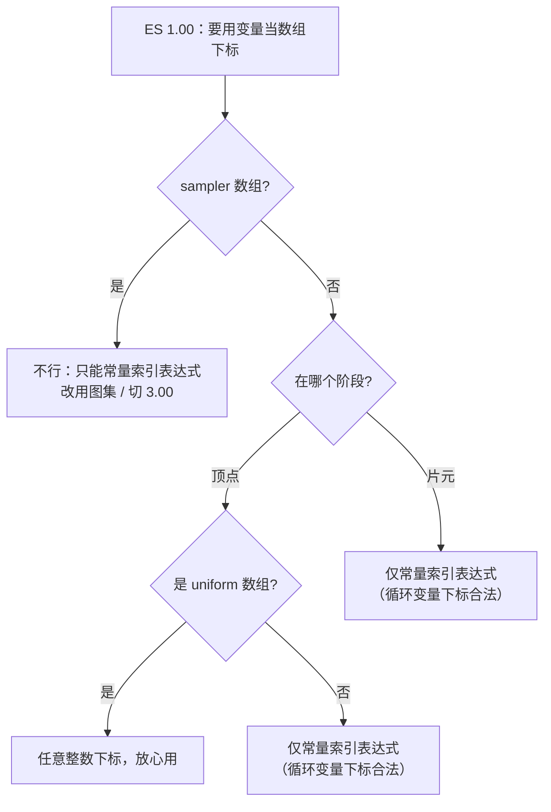

# GLSL 语言核心

> [返回：WebGL 与 3D 框架学习大纲](../WebGL与3D框架学习大纲.md)
> 本文是着色器语言专题第一篇：把 GLSL ES 当一门完整的语言系统过一遍**语法全集**——类型、构造器、运算符、控制流、函数、结构体与数组，每条规则标注版本边界与规范出处；入门篇 [01-第一阶段/04-GLSL基础](../01-第一阶段/04-GLSL基础.md) 已讲过的限定符语义、内置变量、精度初识、swizzle 入门不再重讲。

阅读约定：示例默认 ES 1.00（WebGL1 及 WebGL2 兼容编译，理由见 [02-渲染管线全局观 1.3](../01-第一阶段/02-渲染管线全局观.md)）；ES 3.00 差异处标注 `#version 300 es`。规范出处缩写：ES 1.00 规范 = 《GLSL ES Specification 1.00》，ES 3.00 规范同理，附录 A 指 ES 1.00 规范的 "Limitations for ES 2.0"。

## 1.1 类型系统全集

### 概念

GLSL 是 C 家族的强类型语言，类型系统围绕三件事设计：**硬件对标**（类型直接映射 GPU 寄存器布局：一个 vec4 恰好一个硬件向量槽）、**无隐式转换**（所有类型变化必须用构造器显式写出，编译器不做任何"好心的"提升）、**精度可选**（每类标量（scalar）有高中低三档，见 04 册 3.3.1，此处不重讲）。类型的三大件是标量、向量（vector）与矩阵（matrix），外加采样器与聚合类型。

### 规则表：类型全集

| 类别 | ES 1.00 | ES 3.00 新增 | 说明 |
|---|---|---|---|
| void | 有 | — | 函数无返回/无参数 |
| 浮点 | `float` | — | 唯一浮点类型，无 double |
| 整型 | `int` | `uint` | int 至少 16 位有符号；3.00 起 int/uint 都是 32 位 |
| 布尔 | `bool` | — | true / false |
| 浮点向量 | `vec2` `vec3` `vec4` | — | 图形学主力 |
| 整型向量 | `ivec2` `ivec3` `ivec4` | `uvec2/3/4` | 循环计数、纹理取整 |
| 布尔向量 | `bvec2` `bvec3` `bvec4` | — | lessThan 等比较函数的返回类型 |
| 矩阵 | `mat2` `mat3` `mat4`（仅方阵） | `mat2x2`~`mat4x4` 全系 | 命名是**列数 x 行数**：`mat3x2` 是 3 列 2 行（ES 3.00 规范 §4.1.6）；存储列主序（column-major），`m[列]` 取一列 |
| 采样器 | `sampler2D` `samplerCube` | `sampler3D` `sampler2DArray` `sampler2DShadow` `isampler2D` `usampler2D` 等 | 不透明类型（opaque type）：只能整只赋值、只能当 uniform（或 in 参数），不能参与运算 |

矩阵与向量的内存关系：`mat4` 就是一列一列排的 4 个 `vec4`，`m[0]` 的类型是 `vec4`——这决定了 1.2 的矩阵构造器与 1.4 的索引规则（推导细节在 [05-图形学数学基础](../01-第一阶段/05-图形学数学基础.md)）。

### 声明与初始化的所有形式

```glsl
// 全局与局部都允许：先声明后赋值（初始值未定义！）
float a;
a = 1.0;

// 一条语句声明多个同类型变量
vec3 p, q, r;

// 声明即初始化（初始化器可以是任意表达式）
float b = 1.0, c = b * 2.0;

// const：声明时必须用常量表达式初始化（ES 1.00 规范 §4.3.2）
const int MAX_LIGHTS = 8;
const vec3 UP = vec3(0.0, 1.0, 0.0);

// 接口变量禁止初始化器：attribute/varying/uniform 的值来自管线另一端
uniform vec3 u_color;          // 写 uniform vec3 u_color = ...; 是编译错误
varying vec2 v_uv;

// 数组（1.00 必须定长，详见 1.6）
uniform vec3 u_lights[4];
```

### 字面量形式

| 字面量 | 写法 | 版本与陷阱 |
|---|---|---|
| float | `1.0` `0.5` `.5` `1e3` `1.5e-3` | **必须带小数点或指数**：`1` 是 int，`1.0` 才是 float |
| int | `42` `052` `0x2A` | 两版都支持十进制/八进制/十六进制（ES 1.00 规范 §4.3.2） |
| uint | `42u` `0x2Au` | 仅 3.00：后缀 `u` 表示无符号 |
| bool | `true` `false` | 关键字，不是 0/1 |
| 不存在 | 字符串、字符、null、undefined | 着色器里没有这些概念 |

字面量的类型是精确的：`1` 参与 `*` 时按 int 算，`1 / 2` 是整除得 `0`（见 1.3）。另有一个每变量可覆盖的精度限定符机制（`highp vec3 p;`），三档精度的量级与选择策略在 04 册 3.3.1 已讲，深用在 [04-精度与编译器行为](04-精度与编译器行为.md)。

### 与 TypeScript / JS 类型系统的对比

从 JS/TS 过来的最大不适应不是"类型多"，而是**转换纪律**——GLSL 连 `1` 到 `1.0` 都不帮你做：

| 维度 | JavaScript | TypeScript | GLSL ES |
|---|---|---|---|
| 隐式转换 | 大量（`1 == "1"`、`"3" * 2`） | 沿用 JS 运行时 | **零**：`float x = 1;` 编译失败 |
| 数值类型 | number（float64 一种） | number / bigint | float / int / uint / bool 各司其职，无 double |
| 未初始化变量 | `undefined` | `undefined` | **未定义值**（不是 0，不是 null） |
| null / 指针 | null / undefined | null / undefined | 不存在 |
| 类型推断 | 无类型概念 | `let x = 1` 推断 number | 无 `auto`；`const float PI` 必须写全类型 |
| 数组 | 动态长度、异构 | 定长靠 `readonly T[]` 手搓 | 定长、同类型，1.00 不能有初始化器 |
| 结构体 | 无（对象字面量） | interface / class | `struct` 值类型，无方法、无继承 |

```javascript
// JS：一路隐式转换，全都能跑
let x = 1; x = x * 0.5;   // 0.5，int 悄悄变 number
```

```glsl
// GLSL：每一步类型都要对得上
int i = 1;
float x = float(i) * 0.5;   // 必须 float(i)；写 x = i * 0.5 直接编译失败
```

### 常见误区：接口限定符的类型白名单（ES 1.00）

`attribute` 只能是 `float/vec2/vec3/vec4/mat2/3/4`——**不能是 int**，也不能是数组或结构体（ES 1.00 规范 §4.3.3）；`varying` 只能是 `float/vec2/3/4/mat2/3/4` 或它们的数组——**不能是结构体**（§4.3.5）；`uniform` 最宽，基本类型、结构体、数组都行（§4.3.4）。ES 3.00 用 `in`/`out` 重建了这套规则，限制表在 1.6。

## 1.2 构造器语法全集

### 概念

构造器（constructor）是 GLSL 里**唯一**的类型转换与聚合初始化机制：标量转标量、任何东西拼成向量、向量拼成矩阵，全靠它。语法上像函数调用，但它不是函数——没有重载决议、没有地址，编译器按位置参数规则静态展开（ES 1.00 规范 §5.4）。

### 规则表：构造器形式全集

| 形式 | 语法示例 | 语义 | 版本 |
|---|---|---|---|
| 标量转换 | `int(3.7)` → 3 | 向零截断小数；`bool(0.0)` → false，非零 → true | 两版 |
| 标量取向量首分量 | `float(v3)` | 取第一个分量，其余丢弃（§5.4.1） | 两版 |
| 单标量广播 | `vec3(0.0)` | 每个分量都是 0.0 | 两版 |
| 单标量 → 矩阵 | `mat4(1.0)` | **对角线**全 1.0，其余 0（单位矩阵） | 两版 |
| 单向量截断 | `vec3(v4)` | 取前 3 个分量（规范原文：drops the fourth component） | 两版 |
| 多实参拼接 | `vec4(v2, v3)`、`vec3(v2, 1.0)` | 从左到右消耗分量，够了即停 | 两版 |
| 混合基本类型 | `bvec4(1, 0, 0.5, 2)` | 每个实参按标量规则单独转换 | 两版 |
| 列向量拼矩阵 | `mat4(c0, c1, c2, c3)` | 每个实参是一**列** | 两版 |
| 列主序逐标量 | `mat3(f0, f1, f2, ...f8)` | 按**列**填充（先填第 0 列） | 两版 |
| 矩阵 → 向量 | `vec4(mat2)` | 两列首尾相接摊平 | 两版 |
| 矩阵 → 矩阵 | `mat3(m4)` | 取左上角，其余位置按单位矩阵补 | 两版 |
| 结构体构造器 | `light(3.0, pos)` | 按成员声明顺序，一员一参 | 两版 |
| 数组构造器 | `float[3](1.0, 2.0, 3.0)` | 无此机制 | **仅 3.00** |

一个流传很广的误解是"截断是 ES 3.00 才有"。查规范：ES 1.00 §5.4.2 的示例里明确写着 `vec2(vec3)`、`vec3(vec4)`（drops the fourth component of a vec4），两个版本都合法。这个印象来自桌面 GLSL——1.10 确实不允许截断，1.20 才放开，而 GLSL ES 1.00 继承的正是 1.20 的宽松规则。**真正 ES 3.00 才有的是**：数组构造器、`uint`/`uvec` 相关转换（`uint(-1)` 位模式重解释）。

### 代码示例：向量构造器的消耗规则

```glsl
vec2 v2 = vec2(0.2, 0.4);
vec3 v3 = vec3(0.1, 0.2, 0.3);
vec4 v4 = vec4(1.0, 2.0, 3.0, 4.0);

vec3 a = vec3(1.0);        // (1, 1, 1)：单标量广播
vec3 b = vec3(v4);         // (1, 2, 3)：单实参截断，丢 w
vec4 c = vec4(v3, 1.0);    // (0.1, 0.2, 0.3, 1.0)：拼接升维，最常见
vec4 d = vec4(v2, v2);     // (0.2, 0.4, 0.2, 0.4)：恰好拼满
vec4 e = vec4(v3.xy, v2);  // (0.1, 0.2, 0.2, 0.4)：swizzle 与拼接组合
vec4 f = vec4(v3, v2);     // v3 填 xyz，v2 的 x 填 w——构造"够了即停"
// 但 f 这种"最后一个实参带富余分量"的写法不要依赖：
// 规范只保证"多余的实参是错误"，对"实参内富余分量"各驱动宽严不一，跨端会翻车
float g = float(v3);       // 0.1：标量构造器取向量首分量
ivec3 h = ivec3(v3);       // 逐分量 float→int 截断：(0, 0, 0)
```

### 代码示例：矩阵构造器与那个经典陷阱

```glsl
mat4 I = mat4(1.0);        // 单位矩阵：对角 1，其余 0
mat4 T = mat4(vec4(1.0));  // 陷阱！只有第 0 列是 (1,1,1,1)，其余全是 0
// mat4(1.0) 走"单标量 → 对角"规则；mat4(vec4(1.0)) 走"单实参填第 0 列"规则
// 一字之差，后者是秩 1 矩阵，任何顶点乘它都会被压到对角线上

vec4 c0 = vec4(1.0, 0.0, 0.0, 0.0);
vec4 c1 = vec4(0.0, 1.0, 0.0, tx);
vec4 c2 = vec4(0.0, 0.0, 1.0, ty);
vec4 c3 = vec4(0.0, 0.0, 0.0, 1.0);
mat4 M = mat4(c0, c1, c2, c3);   // 按"列"拼：平移矩阵——tx 在第 1 列的 w、ty 在第 2 列的 w
                                  // （平移量住各列的 w 分量 = 矩阵的最末行，别找成"第 3 列"）

mat3 N = mat3(M);          // 取 M 左上 3x3，右下角按单位矩阵补齐：常用"去平移取线性部分"
vec4 cols = vec4(mat2);    // 合法但少用：2x2 矩阵两列摊平成 4 分量

// 常用矩阵的手工构造（不依赖矩阵库时）：
mat3 scale3 = mat3(2.0);                       // 对角缩放：单标量走对角规则
mat3 scaleXY = mat3(2.0, 0.0, 0.0,             // 第 0 列
                    0.0, 3.0, 0.0,             // 第 1 列：非均匀缩放
                    0.0, 0.0, 1.0);            // 逐标量按列填充
```

矩阵按列拼是列主序的直接后果——记住口诀：**`mat4(a, b, c, d)` 里 a b c d 是从左到右的四根列向量**。完整推导见 [05-图形学数学基础](../01-第一阶段/05-图形学数学基础.md)。

布尔与无符号向量照方抓药（uvec 仅 3.00 有）：

```glsl
bvec3 mask = bvec3(true, false, x > 0.0);   // 混合 bool 与比较结果，逐参转换
bvec3 pair = bvec3(someVec3);               // 非零 → true 的分量式转换
vec3  fromB = vec3(mask);                   // true → 1.0
```

```glsl
#version 300 es
uvec2 up = uvec2(-1, 2);   // -1 按位模式重解释：0xFFFFFFFF
uint  bits = uint(-1);     // 同上：位不变、值变（ES 3.00 规范 §5.4.1）
```

ES 3.00 的非方阵同样按"列向量"拼（名字是**列数 x 行数**）：

```glsl
#version 300 es
mat3x2 m = mat3x2(vec2(1.0), vec2(0.0), vec2(3.0));  // 3 列、每列 2 行
// m * vec3 结果是 vec2；vec2 * m 结果是 vec3（见 1.3 组合表）
```

结构体构造器（两版都有，§5.4.3）三条规则：**一成员一实参**、顺序与声明一致、不允许默认参数与花括号初始化列表：

```glsl
struct Particle {
  vec3 pos;      // 实参 1
  vec3 vel;      // 实参 2
  float life;    // 实参 3
};
Particle p = Particle(vec3(0.0), vec3(0.0, 1.0, 0.0), 1.0);
// Particle(0.0) 不合法：必须三个实参齐给
```

构造器"分量恰好性"自检：数一数**实参能提供的分量总数**——单标量按"广播成任意长度"计，单向量按"截断到目标长度"计，多实参按"从左到右累加、够 N 即停、不许有整个没被碰到的实参"。写完一眼对账，绝大多数构造器编译错误当场消灭。

ES 3.00 的数组构造器（§5.4.4）与初始化器：

```glsl
#version 300 es
float w[3] = float[3](0.25, 0.5, 1.0);   // 带长度构造器
float x[] = float[](1.0, 2.0, 3.0);      // 长度由构造器推断（3）
float y[] = x;                           // 用已知数组初始化，长度随源
// 注意：float y[3]; 这种"声明不定长"是错误，长度必须能确定
```

## 1.3 运算符语义

### 概念

GLSL 运算符的总纲一句话：**除三个代数乘法外，一切都是分量式（component-wise）**；再补一句：**运算符两边类型必须精确匹配，标量例外地可以广播**（ES 1.00 规范 §5.11，ES 3.00 §5.10）。

### 规则表：全部合法组合

| 表达式 | 语义 | 结果类型 |
|---|---|---|
| `s op s` | 标量运算 | 标量 |
| `v op v`（`+ - * /`） | **逐分量**运算（`*` 不是点积！） | 同长度向量 |
| `v op s` / `s op v` | 标量广播到每个分量 | 向量 |
| `m op m`（`+ -`） | 逐分量加减 | 矩阵 |
| `m * m` | **代数**矩阵乘 | 矩阵 |
| `m * v` | 矩阵乘**列**向量（线性代数常规方向） | 向量 |
| `v * m` | **行**向量乘矩阵（转置方向的乘法） | 向量 |
| `m * s` / `m / s` | 逐分量数乘 / 数除 | 矩阵 |
| `v / v` | 逐分量相除 | 向量 |
| `< > <= >=` | **仅标量**；向量比较用 lessThan 等 | bool |
| `== !=` | 向量/矩阵/结构体也合法：**全部分量相等**才为 true | 单个 bool |
| `&& \|\| ^^` / `!` | **仅标量** bool；向量用 not()；&& 与 \|\| 短路，^^ 两边都求值 | bool |
| `& \| ^ ~ << >>`、`%` | ES 1.00 全是保留字（写了就编译错）；3.00 起 int/uint 可用 | — |
| `++ --`（前后缀） | 标量/向量/矩阵都可用，作用于左值 | 同操作数 |
| `= += -= *= /= ...` | 赋值与复合赋值；`m1 *= m2` 同样是代数乘 | 左值类型 |

规范给出的两个乘法等价式（ES 1.00 规范 §5.11），务必亲手核对一遍：

```glsl
mat3 m;
vec3 v, u;

u = v * m;   // 行向量乘法：
             // u.x = dot(v, m[0])   —— v 与第 0 列点积
             // u.y = dot(v, m[1]);  u.z = dot(v, m[2])

u = m * v;   // 列向量乘法：
             // u.x = m[0].x * v.x + m[1].x * v.y + m[2].x * v.z
             // 即新向量的第 i 个分量 = 第 i 行与 v 的点积
```

日常写 `uMVP * vec4(pos, 1.0)` 是 `m * v`（列向量，常规）；`v * m` 的存在是为了省一次 transpose——两个方向**结果不同**，混用是经典的"模型斜了"事故源。

### 补充语义：整除、优先级、求值顺序

```glsl
int a = 7, b = 2;
float q = float(a) / float(b);   // 3.5：转成 float 再除
int   r = a / b;                 // 3：整数除法向零截断（C 同款）
int   m = a % b;                 // 编译错（ES 1.00 保留字）；3.00 里得 1
```

比较运算的浮点陷阱：`<` `==` 对 NaN 永远为 false，直接比较两个"理应相等"的浮点（算出来的 0.1 与字面量 0.1）常因精度不等——用 `abs(x - y) < EPS` 的容差写法，数值健壮性全套在 [04-精度与编译器行为](04-精度与编译器行为.md)。

运算符优先级与 C 一致（§5.5），只列容易翻车的几档：`!` 与一元负号最高，其次 `* /`，再 `+ -`，然后 `< <= > >=`，再 `== !=`，然后 `&&`，再 `^^`，再 `||`，最后 `?:` 与 `=`。**括号不要省**——`a && b || c` 这类多层组合在着色器里写一次查一次，直接括号分组。另外两条例外级的规则：除列出的短路运算符（`&&` `||` `?:`）外，**操作数求值顺序未定义**（§5.9），不要写依赖顺序的表达式；赋值表达式有值（返回左值的新值），但链式赋值 `a = b = c` 在着色器里是可读性毒药。

向量逻辑没有 `&&` 版本——分量式布尔运算走内建函数族：`not(bvec)`、`lessThan(v, v)`、`equal(v, v)` 返回 bvec，再由 `any(bvec)` / `all(bvec)` 收敛成标量 bool 给 if 用。

### 三元、逗号与 swizzle 的可写性

**三元运算符 `?:`**（ES 1.00 §5.8 / ES 3.00 §5.9）三条硬规则：

1. 条件必须是**标量 bool**——`someVec3 ? a : b` 直接编译失败，向量条件要借 `all()/any()` 收敛成标量；
2. 第二、第三操作数类型必须一致，可以是向量（ES 1.00 排除数组类型），此时是**整个向量二选一**，不是逐分量挑选——逐分量的"条件混合"用 `mix(a, b, step(...))` 或 3.00 的 `mix(a, b, bvec)`；
3. 惰性求值：只有被选中的那个表达式会被求值。

```glsl
vec3 base = isLit ? litColor : darkColor;   // 合法：整体二选一
// vec3 bad = v3 ? a : b;                   // 非法：条件不是标量
vec3 branchless = mix(a, b, step(0.5, x));  // 分量式替代：GPU 更喜欢
```

**逗号运算符 `,`**（序列运算符）：从左到右依次求值，整个表达式的值取最右一个；ES 1.00 就有（§5.8）。着色器里几乎只出现在 `for` 的累加位，别拿它压缩业务逻辑，可读性极差。

**swizzle 作为左值（l-value）**：04 册 3.3.3 讲过"写不能重复分量"，这里补全规则本体（ES 3.00 规范把 1.00 的语义写得更明白）：**无重复分量的 swizzle 作用于向量左值时仍是左值**，且一次写入多个分量；有重复分量（`v.xx`）则只是右值，不能赋值——原因很物理：`v.xx = vec2(a, b)` 要求 x 同时等于 a 和 b，没有一致语义。同理，**三元运算式的结果、常量、被 `const` 修饰的变量都不是左值**。

```glsl
vec4 v = vec4(0.0);
v.xy = vec2(1.0, 2.0);      // 合法：一次写两个分量
v.zw += 0.5;                // 合法：复合赋值也认 swizzle 左值
// v.xx = vec2(1.0, 2.0);   // 非法：重复分量不可写
```

## 1.4 控制流与限制

### 概念：if 的分支发散成本

回忆 [02-渲染管线全局观 1.4](../01-第一阶段/02-渲染管线全局观.md) 的并行模型：大量片元线程成批（warp/wavefront）锁步执行同一条指令流。一个 `if` 里若不同线程走向不同分支，硬件只能**两个分支都执行**、各自掩码掉不需要的结果——这就是分支发散（branch divergence）。直觉三条：

1. 分支条件是 uniform（全绘制恒定）时几乎免费，硬件整批走同一边；
2. 分支体两边都很重时，发散的代价接近两边之和；
3. 经典优化是把小分支改写成分量式/插值式：`mix(a, b, cond)`、`step`、`min/max`、`clamp`——代价是两边都算，但省掉发散与打乱的指令流。着色器技法篇大量用了这招（[技术专题/01-GLSL Cookbook](../技术专题/01-GLSL%20Cookbook.md)）。

`if` 的条件与三元一样必须是**标量 bool**，向量条件不合法（ES 1.00 规范 §6.2 原文：Vector types are not accepted）。

### 规则表：ES 1.00 附录 A 的循环限制

附录 A §4：ES 2.0 硬件只保证"编译期可确定迭代次数"的循环，`for` 必须满足全部六条：

| 条件 | 要求 |
|---|---|
| 循环变量 | 只能有**一个**循环索引，类型 int 或 float |
| 初始化 | `int i = 常量表达式;`（不能是全局变量） |
| 条件 | 形如 `i < 常量`（> >= < <= == != 与常量比较） |
| 步进 | 只有 `i++` `i--` `i += 常量` `i -= 常量` |
| 循环体内 | 不能给 i 赋值，不能把 i 传给 out/inout 参数 |
| 其他 | `while` / `do-while` **不保证**支持；`break`/`continue`/`if` 前向分支可用 |

原因：移动 GPU 编译器要**静态展开或可界定地上界**循环，才能在有限指令槽内生成代码。写 WebGL1 着色器时"边界必须写常量（或 const 变量）"不是风格建议，是规范底线——桌面 Chrome 一切正常、老安卓机编译失败的常见根因。ES 3.00 **整体删除了附录 A**：任意条件、任意步进、while/do-while 全部合法，只有"索引越界属未定义行为"一条红线（§4.1.9）。

### 代码示例：循环的两版写法

```glsl
// 需求：实际灯光数 u_count 是 uniform，最多 8 盏

// ---- ES 1.00 的可移植写法：常量上界 + break，编译器展开仍可界定 ----
uniform int u_count;
for (int i = 0; i < 8; i++) {       // 上界必须是常量
  if (i >= u_count) break;          // 运行期提前退出：附录 A 允许 break
  total += computeLight(i);
}

// ---- ES 1.00 的反面教材（部分移动端直接编译失败） ----
// for (int i = 0; i < u_count; i++) { ... }   // 条件不是"循环变量 vs 常量"
```

```glsl
#version 300 es
// ES 3.00：动态边界、while、do-while 全都合法
uniform int u_count;
int i = 0;
while (i < u_count) {               // 没有任何附录 A 约束
  total += computeLight(i);
  i += 1;
}
```

### 跳转语句

| 语句 | 语义 | 备注 |
|---|---|---|
| `break` / `continue` | 跳出 / 进入下一轮**最内层**循环 | 两版都可用（ES 1.00 附录 A 也允许） |
| `return` | 退出当前函数 | 非 void 函数必须带值；main 例外地写 `return;` 也行 |
| `discard` | **片元着色器专用**：抛弃当前片元，不写任何缓冲 | ES 3.00 规范明确"控制流退出着色器"（§6.4）；非均匀 discard 分支后的隐式/显式导数**未定义**——别在同一分支里 discard 后再算 dFdx 类值 |

### 规则表：ES 1.00 动态索引的合法位置

数组/向量/矩阵用变量下标访问，在 ES 1.00 里是**按位置分档保证**的（附录 A §5）。先定义关键术语：**常量索引表达式（constant-index-expression）** = 常量表达式、循环变量、或它们组成的表达式——也就是"展开后能变成常量"的下标。

| 被索引对象 | 顶点着色器 | 片元着色器 |
|---|---|---|
| uniform 数组（不含 sampler） | **任意整数**（变量下标 OK） | 仅常量索引表达式 |
| sampler 数组 | 仅常量索引表达式 | 仅常量索引表达式 |
| varying 数组 | 仅常量索引表达式 | 仅常量索引表达式 |
| attribute（向量/矩阵取分量） | 仅常量索引表达式 | 不适用 |
| 局部变量数组 | 仅常量索引表达式 | 仅常量索引表达式 |
| const 数组 | **被禁止**（1.00 无法初始化 const 数组） | 同左 |
| attribute 数组 | **被禁止** | 同左 |

两个实务结论：多光源循环里 `uniform vec3 u_lightPos[8]` 用循环变量 `i` 索引，顶点着色器任意、片元着色器也合法（循环变量属常量索引表达式）；但 `sampler2D u_tex[N]` 想用运行期变量选贴图，ES 1.00 **没门**——常规解法是把索引并进 UV（图集）或上 3.00 数组纹理（[07-WebGL2特性](../02-第二阶段/07-WebGL2特性.md)）。



附录 A §6 还埋了一条容易忽略的雷：**在非均匀分支里采样 mipmap 纹理，结果未定义**（硬件无法可靠算导数）。要分支采样时，先在分支外取 `texture2D` 的结果或用 `texture2DLod`-类思路（WebGL1 无此函数，需扩展；ES 3.00 有 `textureLod`）。

## 1.5 函数

### 规则表：参数限定符与调用语义

| 限定符 | 语义 | 求值/拷贝时机 |
|---|---|---|
| `in`（默认） | 值传入：实参求值后**拷贝**给形参 | 调用时拷入 |
| `out` | 值传出：形参**不初始化**，返回时拷回实参 | 返回时拷出 |
| `inout` | 双向：先拷入，返回时拷回 | 调用时拷入，返回时拷出 |

调用语义细则（ES 1.00 规范 §6.1，ES 3.00 §6.1.1）：

- 函数内写 `in` 参数合法，但只改副本，调用方看不见——想"带回结果"必须 `out`/`inout`，忘写限定符是新手第一大函数坑；
- `out`/`inout` 实参必须是**左值**：`f(v.x)`、`f(v.xy)`（无重复 swizzle）可以，`f(vec3(0.0))` 不行；
- `out` 形参若在函数内**从未赋值**就被拷回，实参值未定义；同理非 void 函数没走到 return，返回值未定义；
- 多个 out 参数的拷回顺序未定义——不要写依赖拷回顺序的代码；
- `const` 可以修饰 `in` 参数（只读副本），但**不能**与 `out`/`inout` 组合；注意它在两个版本里都**只是"函数内只读"，不是编译期常量**——ES 3.00 规范 §4.3.3 明文把函数参数排除在常量表达式之外，别指望 const 参数去当数组长度或循环上界。

```glsl
// 经典 swap：值语义语言必须用 inout
void swap(inout float a, inout float b) {
  float t = a;
  a = b;
  b = t;
}

// out 的正确姿势：先写满再依赖；以及"多返回值"惯用法
void dirAndLen(vec3 v, out vec3 dir, out float len) {
  len = length(v);
  dir = (len > 0.0) ? v / len : vec3(0.0, 0.0, 1.0);
}
```

### 无递归

ES 1.00 规范 §6.1 原文：**静态与动态递归都不允许**——只要整个程序的静态调用图（static call graph）含环，编译直接失败。ES 3.00 同款禁令。原因回到硬件：GPU 没有给每个线程配调用栈的预算，函数一律被编译器**内联展开**，递归会让展开无法终止。工程替代：递归改循环（尾递归天然好改）、固定深度手写展开、或把算法搬到 JS 侧。

### 函数重载与原型

- 重载（overload）合法且内建函数重度使用：同名不同**参数类型表**即重载；**返回类型与参数限定符不参与**签名匹配（§6.1）；
- 决议规则是**精确匹配，无任何提升**：`dot(float, vec3)` 这种调用找不到原型就编译失败，不会替你转换——"无隐式转换"在重载决议里同样成立；数组连长度都参与匹配；
- 允许先声明原型（prototype）再定义，主流程着色器想先写 main 再补工具函数时用得上；
- 可以**重载内建函数**（如自定义 `pow`），但**不能重定义**它；同名同签名的重复定义是错误；
- `main` 是唯一入口，无参数、返回 void，两个着色器各一个。

```glsl
// 原型先行：把 main 写在文件最前面的常见组织方式
vec3 tonemap(vec3 color);            // 原型（声明）
float luminance(vec3 c);

void main() {
  gl_FragColor = vec4(tonemap(vec3(0.5)), 1.0);
}

vec3 tonemap(vec3 color) {           // 定义可以放最后
  return color / (color + 1.0);
}
float luminance(vec3 c) { return dot(c, vec3(0.2126, 0.7152, 0.0722)); }
```

```glsl
// 重载：同名不同参，调用点按实参类型精确匹配
float saturate(float x) { return clamp(x, 0.0, 1.0); }
vec3 saturate(vec3 v)    { return clamp(v, 0.0, 1.0); }

float a = saturate(1.5);      // 走标量版
vec3  b = saturate(v3);       // 走向量版
// saturate(uv) 其中 uv 是 vec2：编译错误——没有 vec2 版本，也不会"降级匹配"
```

```glsl
// 重载内建函数（合法）但重定义（同签名再写一份）非法
float pow(float x, float y) { return exp(y * log(x)); }  // 重载内建：合法但自找麻烦
```

### 作用域与遮蔽

- 层级：全局 → 函数体 → 复合语句 `{}`，内层同名声明**遮蔽（shadowing）**外层，合法但强烈不建议（着色器没有调试器帮你分辨两个 `i`）；
- 结构体类型名与变量、函数**共享同一命名空间**：`struct light {...} light;` 之后 `light` 这个名字被变量占据，不能再声明 `light` 类型的变量（ES 1.00 规范 §4.1.8 明言 "All previously visible variables, types, constructors or functions with that name are hidden"）——内建函数名（`length`、`distance`）当变量名同样是自找麻烦；
- **不允许嵌套定义函数**，所有函数平铺在全局作用域；函数内可以声明局部变量与 const。

### const 与编译期常量传播

常量表达式（constant expression）的构成（ES 1.00 规范 §5.10）：字面量、const 变量、常量之间的运算、**全常量实参的构造器**、以及**全常量实参的内建函数调用（纹理函数除外）**。不能出现：用户自定义函数调用、uniform/attribute/varying、数组变量。

把数值都收进 const 而不是散落魔数，不只是风格——编译器据此做**常量折叠（constant folding）与传播**，让 ES 1.00 的循环边界、数组长度、附录 A 的"常量"判定全部成立。`const float PI = 3.14159265;` 一行，编译器就获得了把 `PI * 0.5` 折成单常量、把 `for (i = 0; i < N; ...)` 里的 N 当编译期值的全部信息。这套编译器行为的完整分析在 [04-精度与编译器行为](04-精度与编译器行为.md)。

## 1.6 结构体与数组

### 概念

结构体（struct）与数组是 GLSL 仅有的两种聚合手段，且都是**值语义（value semantics）**：赋值即全量拷贝，没有引用也没有指针。它们能出现在哪、不能出现在哪，1.00 与 3.00 差异极大，是迁移着色器时最容易踩规范差异的区域。

### 结构体：定义与成员访问

```glsl
struct DirLight {              // 定义即获得同名构造器
  vec3 color;                  // 成员：任意已定义类型，可带精度限定符
  vec3 dir;                    // 不能有初始化器、不能有位域、不能嵌套定义新类型
  float intensity;
};
DirLight l = DirLight(vec3(1.0), normalize(vec3(0.0, -1.0, 0.0)), 2.0);
vec3 c = l.color * l.intensity;   // 成员访问；嵌套结构体一路 . 下去
```

规则（ES 1.00 §4.1.8 / ES 3.00 §4.1.8）：成员类型必须**先于**结构体定义（无前向引用）；成员可以是**定长数组**（长度是正的整型常量表达式）；每层结构体有自己的成员命名空间。ES 1.00 里**结构体作为函数返回值合法，前提是不含数组成员**；数组作参数合法、作返回值不合法（§6.1）——ES 3.00 放开为数组可进可出但**必须显式定长**。

### 规则表：结构体/数组出现在接口上的限制

| 接口位置 | ES 1.00 | ES 3.00 |
|---|---|---|
| attribute / in（顶点输入） | 仅 float/vec/mat；**禁结构体、禁数组** | 允许 int/uint 整型向量（配 vertexAttribIPointer）；仍禁 bool、采样器、数组、结构体（ES 3.00 §4.3.4） |
| varying / out（阶段间） | **禁结构体**；允许 float/vec/mat 及其数组 | 允许结构体；但顶点 out **不得**含 bool、采样器、数组的数组、结构体数组、含数组的结构体、嵌套结构体（ES 3.00 §4.3.6）；整型 out 必须 flat |
| 片元输出 | gl_FragColor（vec4） | out 不得是 bool、采样器、**矩阵、结构体**；out 数组只能常量下标索引 |
| uniform | 基本类型、结构体、数组都行（含采样器成员） | 同左，另有接口块 interface block |

这张表是"为什么我的 varying 编译不过"的速查答案：1.00 里想把一组插值数据打包成 struct 传给片元，**编译必失败**，要么平铺成多个 varying，要么整体升级 3.00（in/out 允许结构体，但注意顶点 out 的"不含数组/不含嵌套结构体"红线）。链接侧还有一条对齐规则：顶点 out 与片元 in **同名必须同类型**（插值限定符也要一致），见 [04-GLSL基础 3.1.3](../01-第一阶段/04-GLSL基础.md)。

结构体 uniform 在 GLSL 侧的写法与 JS 侧取址名的对应规则（成员用 `.` 连接进 location 名）：

```glsl
struct Light {
  vec3 color;
  vec3 dir;
  float intensity;
};
uniform Light u_light;          // GLSL 侧：u_light.color 这样访问
uniform Light u_lights[4];      // 数组版
```

```javascript
// JS 侧：location 名由"变量名.成员名[下标]"拼出来
gl.getUniformLocation(prog, 'u_light.color');        // 单个成员
gl.getUniformLocation(prog, 'u_light');              // 结构体整体没有 location！
gl.getUniformLocation(prog, 'u_lights[2].intensity'); // 数组 + 成员
```

ES 3.00 另有接口块（interface block，§4.3.7）——把一组 uniform 打包成命名块，是 UBO（统一缓冲对象）的语言侧搭档，与 WebGL2 的 `uniformBlockIndex` API 配套，完整链路在 [07-WebGL2特性](../02-第二阶段/07-WebGL2特性.md)；语言层面只需知道：块成员名默认带块名前缀（`BlockName.member`），除非用 `layout` 与匿名块改写。

### 数组：长度、初始化与循环

```glsl
// ---- ES 1.00：定长、不能初始化、不能 const ----
uniform vec3 u_lightPos[8];        // 长度必须是正整型常量
float weights[4];                  // 局部数组：成员初值未定义，先赋值再用
for (int i = 0; i < 8; i++) {      // 边界是常量：附录 A 合格循环
  total += u_lightPos[i] * w;      // 循环变量下标 = 常量索引表达式，两阶段都合法
}
float sum(float w[4]) { ... }      // 参数必须写长度；实参数组长度必须一致
// const float TAPS[4] = ...;      // 非法：1.00 没有数组初始化机制（3.00 起合法，见下）

// ---- ES 3.00：构造器、推断、length() ----
#version 300 es
float taps[] = float[](0.4, 0.3, 0.2, 0.1);   // 长度推断为 4
const float TAPS[4] = float[4](0.4, 0.3, 0.2, 0.1);  // 3.00 起 const 数组合法
for (int i = 0; i < taps.length(); ++i) { ... } // length() 返回常量表达式
float[4] merge(float a[4], float b[4]) { ... }  // 数组可作返回值（显式定长）
// float m[4][4];   // 非法：ES 3.00 仍禁"数组的数组"
```

数组下标越界的规则差异要背下来：ES 1.00 里**常量下标越界直接编译错误**（ES 3.00 同样），而**非常量下标越界是未定义行为**——不报错、不抛异常，可能读到垃圾也可能牵连邻近 uniform 槽位。写"循环 N 次访问 N+1 长度数组"这类边界差一（off-by-one）时，GLSL 不会像 JS 给你 `undefined`，它给的是**薛定谔的垃圾**。

数组在 uniform 侧的实践（多光源、级联阴影矩阵）在 [02-第二阶段/05-光照](../02-第二阶段/05-光照.md) 与 [05-第五阶段/02-阴影与PCF软阴影](../05-第五阶段/02-阴影与PCF软阴影.md) 展开；结构体 uniform 的 JS 侧取址（`u_light.color` 对应 `getUniformLocation` 的名字）在 [05-ES3特性与调试规范](05-ES3特性与调试规范.md) 讲接口块时一并给全。

## 常见坑

1. **int/float 混用三连**：`float x = 1;`、`v * 2`（v 是 vec）、`i * 0.5`（i 是 int）全部编译失败；更阴险的是 `float x = float(1/2);`——先整除得 0 再转 float，编译器毫无意见，结果是 0。修法：字面量永远带小数点，转换永远显式。
2. **`mat4(vec4(1.0))` 当单位矩阵**：它只是第一列全 1、其余全 0。单位矩阵是 `mat4(1.0)`。症状：模型被"压扁"到一条对角线上。
3. **`if (a == b)` 用于向量**：合法但语义是"全部分量相等才 true"，单个 bool；想要分量式判断用 `equal()`/`lessThan()` 配 `all()`/`any()`。同理 `if (vec)` 不合法，条件必须是标量 bool。
4. **swizzle 左值重复分量**：`v.xx = vec2(1.0, 2.0);` 编译失败；重复分量只读不可写（04 册 3.3.3 的规则本体在本文 1.3）。
5. **ES 1.00 循环边界写运行期变量**：桌面浏览器可能放过，附录 A 合格的移动驱动直接编译失败；`u_count` 这种 uniform 当上界在 1.00 是不可移植写法，要常量上界 + 提前 break。
6. **片元里动态索引 sampler 数组**：附录 A 明文只保证常量索引表达式；症状是"本地好好的，某台手机黑屏或花屏"。改图集/UV 合并，或升 3.00 数组纹理。
7. **除零与 NaN 传染**：highp 下 `x / 0.0` 按 IEEE 产生 Inf（ES 3.00 规范 §4.5.1 明文），`0.0 / 0.0` 是 NaN，且 NaN 参与任何运算继续 NaN——黑屏/全白/闪烁的经典根因是 `normalize(vec3(0.0))` 与未初始化 uv。入口处 clamp、`length` 前判零。
8. **带分号的宏**：`#define RED vec3(1.0, 0.0, 0.0);` 展开后多出的分号在函数里勉强能活，在全局作用域直接语法错误；宏不带分号，用的时候自己加（详解见 [02-预处理与变体管理](02-预处理与变体管理.md)）。
9. **忘写 out/inout，结果拿不回**：GLSL 参数默认值拷贝（in），函数内改得再热闹也只是副本；反向坑是 out 参数没赋值就拷回，读到未定义值。
10. **在 1.00 里用 3.00 运算符**：`& | ^ ~ << >>` 和 `%` 在 ES 1.00 全是保留字（写了就编译错），ES 3.00 才对 int/uint 开放；以及 `%` 就算在 3.00 也不能用于 float。反向（3.00 着色器用 attribute/varying/gl_FragColor）见 04 册 3.1.3 迁移表。

## 本节自测

1. 写出至少四种把 `int i` 的值装进 float 的合法写法，并指出 `float x = i;` 为什么在 GLSL 是错误、在 JS 里却天经地义（用本文 1.1 的对比表术语回答）。
2. `mat4(1.0)`、`mat4(vec4(1.0))`、`mat4(v4, v4, v4, v4)`（v4 = vec4(1.0)）分别构造出什么矩阵？第三个矩阵乘以向量 (1,0,0,1) 结果是什么？
3. 已知 `mat3 m` 与 `vec3 v`：写出 `v * m` 的第 x 分量等价式（用 dot 表达），并说明它与 `m * v` 为何不同；`m1 * m2` 是逐分量还是代数乘？
4. ES 1.00 附录 A 对 for 循环有哪六条限制？背后的硬件理由是什么？ES 3.00 删除附录 A 后，数组访问还剩哪条"红线"（越界行为如何规定）？
5. 判断对错并改错：`someVec3 ? a : b`（a、b 为 vec3）；`v.xy = vec2(1.0, 2.0);`；`v.xx = vec2(1.0, 2.0);`；在 ES 1.00 片元着色器里 `u_tex[i]`（i 为循环变量、u_tex 是 sampler2D 数组）；`float y = float(1/2);`。

---

下一篇：[02-预处理与变体管理](02-预处理与变体管理.md)——把 GLSL 预处理器当一门微型语言讲透：宏纪律、ES 1.00/3.00 同源双版本与变体治理。
