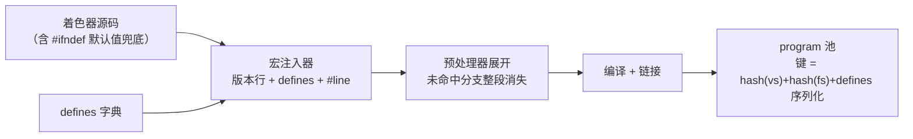

# 预处理与变体管理

> [返回：WebGL 与 3D 框架学习大纲](../WebGL与3D框架学习大纲.md)
> 本文是"着色器语言专题"第二篇：把 GLSL 预处理器（preprocessor）当成一门微型语言讲透——指令全景、宏技巧、GLSL ES 1.00/3.00 双版本同源、#extension 规则，最后落到变体（variant）爆炸的语言成因与宏设计纪律。语法与类型基础见 [01-第一阶段/04-GLSL基础](../01-第一阶段/04-GLSL基础.md)；变体的工程侧（编译缓存键、program 池、互斥组与熔断）见 [04-第四阶段/04-材质与着色器系统](../04-第四阶段/04-材质与着色器系统.md) 3.4——那边讲"怎么缓存变体"，本文讲"怎么写宏才不至于产生那么多变体"。

## 2.1 预处理器全景

GLSL 的编译在"真正的编译"之前还有一趟纯文本加工：预处理器。它不懂类型、不管作用域、不做优化，只做三件事：

1. **替换**：`#define` 的宏在源码里做纯文本展开；
2. **裁剪**：`#if`/`#ifdef` 家族决定哪些行参与后续编译，未命中的分支**整段消失**——uber shader 的运行时零开销就来自这里（对照 [04-第四阶段/04-材质与着色器系统](../04-第四阶段/04-材质与着色器系统.md) 3.4.1：运行时 `if` 两个路径都要算，宏分支只算命中的）；
3. **上报**：`#error` 主动报错、`#line` 校准行号、`#extension` 声明扩展。

理解它的心智模型：预处理器是"语言中的语言"，GLSL 的一切模块化、版本适配、变体机制都住在这层薄薄的文本加工里。它源自 C 预处理器，但是做了明确减法——**没有头文件与 `#include`**（模块化靠 CPU 侧拼接，three.js 的 ShaderChunk 体系由此而来）、**没有 `#` 字符串化与 `##` 拼接**（见 2.2.2）、**反斜杠续行不属于语言**（见 2.2.1）。

### 2.1.1 指令速查表

| 指令 | 形式 | 语义 | 高频坑 |
|---|---|---|---|
| `#define` | 对象宏 / 参数宏 | 文本替换 | 重定义、参数不加括号 |
| `#undef` | `#undef NAME` | 取消定义 | "改写"宏前先撤销，避免重定义报错 |
| `#ifdef` / `#ifndef` | `#ifdef NAME` | 只判断**定义与否**，不看值 | `#define USE_MAP 0` 时 `#ifdef USE_MAP` 仍为真 |
| `#if` / `#elif` | 整数常量表达式 | 按**值**判定分支 | 未定义标识符按 0 参与运算（拼错宏名 = 恒 0 分支） |
| `#else` / `#endif` | — | 分支与收尾 | 嵌套条件漏写 `#endif` 是最高频编译错误 |
| `#version` | `#version 100` / `#version 300 es` | 声明语言版本 | 必须出现在源码最前（见 2.1.2） |
| `#line` | `#line 行号` | 重设后续行号 | 注入 defines 后报错行号错位（见 2.1.3） |
| `#error` | `#error 任意文本` | 立即编译失败，文本进日志 | 当"配置断言"用（见 2.1.4） |
| `#pragma` | `#pragma ...` | 编译器提示，未识别则忽略 | ES 不承诺 optimize/debug 生效（见 2.1.5） |
| `#extension` | `#extension 名 : 行为` | 启用/禁用扩展 | 宏名带 `GL_` 前缀，与 JS 侧扩展名不同（见 2.4） |

写法约定：一条指令占一行、`#` 顶格（`#` 与指令名之间是否允许空白各实现口径不一）；指令行末不加分号。

### 2.1.2 #version 位置规则与版本选择

```glsl
#version 300 es   // "300 es"：WebGL2 的 GLSL ES 3.00；es 后缀不可省
```

规则清单：

1. **必须出现在源码最前**。规范字面上允许其前面仅有注释与空白，但驱动实现的检查口径参差，而工程里最常见的事故是模板字符串以换行开头、或注入器把 defines 拼在了版本行之前——实践纪律：把它当成"源码第一个非注释字符就是 #"。
2. **不写即 100**。WebGL1 着色器可以完全省略 `#version`（默认 GLSL ES 1.00）；ES 3.00 则必须显式声明。同一个 WebGL2 上下文里两种版本都能编译，但**同一 program 挂的两个 shader 必须同版本**，混挂是链接错误。
3. **版本决定词汇表**。`#version 300 es` 之后 `attribute`/`varying`/`gl_FragColor` 全部非法，对照 [01-第一阶段/04-GLSL基础](../01-第一阶段/04-GLSL基础.md) 3.1.3 的迁移表。
4. **版本前检查**。宏注入器生成版本行时的顺序铁律：版本行永远第一、defines 紧随其后——[04-第四阶段/04-材质与着色器系统](../04-第四阶段/04-材质与着色器系统.md) 3.4.3 的 `injectDefines` 就是先拼版本行再拼宏。

预定义宏（predefined macros）是预处理器的"环境变量"，条件编译全靠它们：

| 宏 | 值 | 用途 |
|---|---|---|
| `__LINE__` | 当前行号 | 报错信息、调试 |
| `__FILE__` | 源字符串编号（WebGL 单串编译，恒 0） | 多文件拼接时才有意义 |
| `__VERSION__` | 100 或 300 | **双版本同源的总开关**（2.3 的主角） |
| `GL_ES` | 1 | 区分 ES 与桌面 GLSL |
| `GL_FRAGMENT_PRECISION_HIGH` | 1（若片元 highp 可用） | 精度分支（2.3.2） |

### 2.1.3 #line 与错误行号对齐

GLSL 编译日志里的行号（形如 `ERROR: 0:57:`）基于**交给编译器的最终字符串**。一旦注入器在源码前面拼了 N 行 defines，作者视角的第 57 行就变成了编译器视角的第 57+N 行——排查报错时要在两套行号间心算减法。

`#line` 就是官方的校准器：

```glsl
#line 42        // 下一行开始按 42 计数（随后各行依次 43、44…）
```

- 两种形式：`#line N`（行号）与 `#line N S`（行号 + 源串号，影响 `__FILE__`）；
- 语义：让**紧跟的那一行**的行号变成 N，之后逐行递增；
- 工程用法：注入头部的最后一行补一句 `#line 1`，源码主体恢复"作者视角"行号，报错直接对得上编辑器（2.5.3 的注入器内置了这一步）；
- 边界认知：`#line` 同时影响 `__LINE__` 与多数驱动的日志行号，但个别实现只改前者——**用它改善报错体验，不要把程序正确性押在它上面**。报错时连同注入后源码一起打印（[04-第四阶段/04-材质与着色器系统](../04-第四阶段/04-材质与着色器系统.md) 3.1.3 的 `numberedSource`）才是最终兜底。

### 2.1.4 #error：编译期断言

`#error` 后面跟的任意文本会原样进入编译日志并导致编译失败。它是 uber shader 的"配置断言"，把非法的宏组合拦在编译期而不是渲染成奇怪的画面：

```glsl
// 宏之间有依赖时，显式断言（未定义的宏在 #if 里按 0 参与运算）
#if defined(FW_USE_SKINNING) && FW_MAX_BONES == 0
#error "FW_USE_SKINNING requires FW_MAX_BONES > 0"
#endif

#if FW_LIGHT_MODE > 2
#error "FW_LIGHT_MODE must be 0(none)/1(phong)/2(blinn)"
#endif
```

注意配套规则：`#if` 里引用一个**未定义**的标识符不会报错，它按 0 处理——所以"拼错宏名"会静默走进恒 0 分支，编译照样通过。宏词汇表越大，越需要用 `#error` 把取值边界钉死；这一步在 2.5 的注入器里会用白名单校验再做一遍（编译期 + 注入期双保险）。

### 2.1.5 #pragma：被允许忽略的提示

`#pragma` 是"编译器自定义提示"，规范只承诺**未识别的 pragma 被忽略**：

```glsl
#pragma optimize(on)    // 桌面 GLSL 的历史遗留；ES 规范不承诺效果
#pragma debug(on)       // 同上
```

两条务实结论：其一，`optimize`/`debug` 在 GLSL ES 里没有规范语义，优化与否由驱动决定，写了约等于注释；其二，GLSL ES 1.00 规范真正点名的只有 `#pragma STDGL invariant(all)`——把全部输出标记为 invariant（不变量），用于多 pass 渲染时消除同一顶点在不同 program 下裁剪坐标的微小差异（shadow map 与主 pass 的 z 对齐问题，见 [05-第五阶段/02-阴影与PCF软阴影](../05-第五阶段/02-阴影与PCF软阴影.md)），代价是禁用相关优化。

### 2.1.6 ES 预处理器的三条"减法"

相对 C 预处理器，GLSL ES 明文砍掉的能力与对策：

| C 预处理器能力 | GLSL ES 现状 | 工程对策 |
|---|---|---|
| `#` 字符串化 / `##` 记号拼接 | 1.00 与 3.00 规范均明文禁止 | CPU 侧拼好名字再上传（见 2.2.2） |
| 反斜杠 `\` 续行 | 1.00 明文"不属于语言"；3.00 支持与否实现可选 | 宏写在一行，长宏拆成多个小宏 |
| `#if` 的浮点/字符串/位运算 | 只认整数常量与宏；位运算、一元负号 1.00 不在白名单 | 只用整数与 `defined`；负数、位标志交给注入器算好 |

## 2.2 宏函数技巧

### 2.2.1 参数化宏：写法纪律

```glsl
#define PI 3.14159265358979
#define SQ(x)        ((x) * (x))                 // 参数全套括号 + 整体括号
#define SAT(x)       clamp((x), 0.0, 1.0)
#define APPLY_MVP(p) (u_projection * (u_view * (u_model * (p))))
```

三条铁律，每条都对应一类真实事故：

1. **参数每次出现都套括号**。`#define ADD(a, b) a + b` 会被 `ADD(1, 2) * 3.0` 展开成 `1 + 2 * 3.0`（得 7 不是 9）——宏是文本替换，展开后的运算符优先级由上下文决定，不由你的意图决定。
2. **整体再套一层括号**。`#define INV_X (1.0) / x` 这类以除法开头的宏，嵌进更大的表达式时会被重新切分。
3. **宏体不带分号**（分号陷阱，见 2.2.4）。

另外，宏必须写在一行：ES 1.00 明确没有续行符（部分驱动宽容，Mali 等直接报错），超长宏拆成几个短宏互相引用更安全。

### 2.2.2 字符串化与拼接：ES 的禁区与替代

C 里的 `#`（把参数变成字符串）和 `##`（把两个记号拼成一个标识符）在 GLSL ES 1.00/3.00 规范里均被明文禁止（桌面 GLSL 的 Vulkan 语义支持 `##`）。想写下面这种代码是不可能的：

```glsl
// 不可行：ES 明文禁止 # 与 ##
// #define GET_U(FIELD) u_ ## FIELD     // 想拼出 u_color / u_metalness
```

工程替代是把"拼名"职责上移到 CPU：注入器按枚举生成整个标识符，或用"值宏 + 显式分支"表达同样的结构：

```typescript
// 拼接在 JS 侧完成，GLSL 只见到拼好的结果
const uniforms = { color: "u_color", roughness: "u_roughness" };
// 或者直接生成 uniform 名序列，配合 uniform 反射上传（04-第四阶段 3.2）
```

```glsl
// 语言内的替代：值宏表达"选择"，而不是拼名字
#if FW_LIGHT_MODE == 2
  uniform vec3 u_blinnParam;
#endif
```

### 2.2.3 宏做分支调试

宏开关是着色器调试的主力手段：可视化中间量、切换调试视图，全部走 `#define`，调试代码常驻源码但发布变体零开销：

```glsl
// 调试视图开关：0 正常渲染 / 1 法线 / 2 UV / 3 深度
#ifndef FW_DEBUG_VIEW
  #define FW_DEBUG_VIEW 0
#endif

// ---- 片元着色器末尾 ----
#if FW_DEBUG_VIEW == 1
  fragColor = vec4(N * 0.5 + 0.5, 1.0);                 // 法线可视化
#elif FW_DEBUG_VIEW == 2
  fragColor = vec4(vUV, 0.0, 1.0);                      // UV 可视化
#elif FW_DEBUG_VIEW == 3
  fragColor = vec4(vec3(gl_FragCoord.z), 1.0);          // 深度可视化
#endif
```

配套技巧是"空宏"——调试关闭时代码整体消失：

```glsl
#if FW_DEBUG
  #define DEBUG_TINT(c) mix((c), vec3(1.0, 0.0, 1.0), 0.5)  // 高亮可疑区域
#else
  #define DEBUG_TINT(c) (c)                                   // 发布版直通
#endif
```

调试宏的注入入口在开发面板（[05-第五阶段/07-性能优化与调试](../05-第五阶段/07-性能优化与调试.md)），不需要改源码。

### 2.2.4 宏的三个经典坑

**坑一：双重展开（重复计算）**。GLSL 没有副作用（没有 `++`），所以 C 里"`SQ(i++)` 展开两次"的经典错误不会发生，但**重复计算**是真的——宏参数每出现一次，表达式就原样复制一次：

```glsl
#define DIST(p) length((p) - u_center)
// 展开后 worldPos - u_center 出现两次，每个片元多算一次减法与一次 length
if (DIST(worldPos) < u_radius) { ... }
```

片元着色器里这会乘以百万像素。凡是参数表达式较贵、又出现多次的宏，改成真函数——GLSL 编译器会内联小函数，没有调用开销，语义却是"求值一次、绑定到参数"。

**坑二：分号陷阱**。宏体尾部带分号，会吃掉使用处的 `if/else` 结构：

```glsl
#define CLEAR(v) (v) = vec3(0.0);     // 坏：尾部带分号
if (hit)
  CLEAR(n);                           // 展开为两条语句，下一行 else 悬空，编译错
else
  ...
```

修法：宏体不带分号，调用处自己写；多语句宏用逗号表达式或干脆写函数。

**坑三：`#ifdef` 判定的是"定义"不是"值"**：

```glsl
#define FW_USE_MAP 0        // 想表达"关"
#ifdef FW_USE_MAP           // 为真！只要定义过就为真，不看值
  vec4 texel = texture(uMap, vUV);   // 会被编译进变体，uMap 必须有效
#endif
```

布尔语义的宏只有两种安全形态：要么 `#define FW_USE_MAP` / 不定义（配 `#ifdef`），要么 `#define FW_USE_MAP 0/1`（配 `#if FW_USE_MAP`）。混用是最常见的"变体与预期不符"来源。

## 2.3 条件编译实战

### 2.3.1 GLSL ES 1.00/3.00 同源双版本模板

动机：同时支持 WebGL1 与 WebGL2 的项目（能力检测后选路径），不想维护两份 95% 相同的源码。语言给了足够的材料做"同源双版本"：`__VERSION__` 判断版本、注入的阶段宏区分顶点/片元、别名宏抹平词汇差异。

完整模板——一份源码，四种组合（2 个 GLSL 版本 × 2 个阶段）通吃：

```glsl
// common.glsl —— 同源双版本模板
// 头部：精度 + 版本适配 + 阶段适配
#ifdef GL_FRAGMENT_PRECISION_HIGH
  precision highp float;          // WebGL 已强制片元 highp，防御非 WebGL ES 环境
#else
  precision mediump float;
#endif

#if __VERSION__ >= 300
  // ---- ES 3.00：把 1.00 词汇映射过来 ----
  #ifdef FW_VERTEX_STAGE
    #define ATTRIBUTE in          // 顶点侧输入
    #define VARYING   out         // 顶点侧输出
  #else
    #define VARYING   in          // 片元侧输入
    out vec4 fw_fragColor;        // 3.00 要自己声明输出
    #define gl_FragColor fw_fragColor   // 让下面的正文继续写 gl_FragColor
  #endif
  #define TEX2D(s, uv)     texture((s), (uv))
  #define TEXCUBE(s, dir)  texture((s), (dir))
#else
  // ---- ES 1.00：词汇原样直通 ----
  #define ATTRIBUTE attribute
  #define VARYING   varying
  #define TEX2D(s, uv)     texture2D((s), (uv))
  #define TEXCUBE(s, dir)  textureCube((s), (dir))
#endif

// 正文：只使用映射后的词汇
ATTRIBUTE vec3 aPosition;
ATTRIBUTE vec3 aNormal;
ATTRIBUTE vec2 aUV;
uniform mat4 uModel, uView, uProjection;
uniform mat3 uNormalMatrix;

VARYING vec3 vWorldPos;
VARYING vec3 vNormal;
VARYING vec2 vUV;

#ifdef FW_VERTEX_STAGE
void main() {
  vec4 world = uModel * vec4(aPosition, 1.0);
  vWorldPos = world.xyz;
  vNormal   = uNormalMatrix * aNormal;
  vUV       = aUV;
  gl_Position = uProjection * uView * world;
}
#endif

#ifdef FW_FRAGMENT_STAGE
uniform sampler2D uMap;
void main() {
  vec3 N = normalize(vNormal);
  vec3 L = normalize(vec3(0.5, 1.0, 0.3));
  vec3 color = TEX2D(uMap, vUV).rgb * (0.25 + 0.75 * max(dot(N, L), 0.0));
  gl_FragColor = vec4(color, 1.0);   // 3.00 下被宏替换为 fw_fragColor
}
#endif
```

装配它的加载器（TypeScript）：

```typescript
// dualShader.ts —— 同源双版本装配器
export type Stage = "vertex" | "fragment";

export function buildSource(commonSource: string, stage: Stage, isGLSL3: boolean): string {
  const lines: string[] = [];
  if (isGLSL3) lines.push("#version 300 es");  // ES 1.00 不写版本行（默认即 100）
  lines.push(stage === "vertex" ? "#define FW_VERTEX_STAGE" : "#define FW_FRAGMENT_STAGE");
  lines.push("#line 1");                        // 报错行号对回源码（2.1.3）
  return lines.concat(commonSource).join("\n");
}

// 能力检测决定版本（检测体系见 工程专题/02-移动端与兼容性 2.1）
const isGLSL3 = !!gl2Context;
const vs = buildSource(common, "vertex", isGLSL3);
const fs = buildSource(common, "fragment", isGLSL3);
```

四个设计点：

1. **阶段必须用注入宏，不能只靠 `__VERSION__`**：`varying` 在顶点侧映射为 `out`、片元侧映射为 `in`，版本号区分不了阶段；
2. **`#define gl_FragColor fw_fragColor` 是合法且常用的兼容技巧**：3.00 里 `gl_FragColor` 这个标识符不存在，宏名遮蔽（shadow）它没有冲突；若遇到挑剔的驱动，统一改用自定义宏 `FRAG_COLOR` 即可；
3. **个别老驱动对 `#if __VERSION__` 支持不稳**，稳妥做法是注入器再加一个显式 `#define FW_GLSL3`，判断它而不是 `__VERSION__`；
4. **纹理函数差异远不止改名字**（bias、Lod、整数采样等），详见本分册 [03-内置函数速查与深用](03-内置函数速查与深用.md) 3.7 的对照表。

### 2.3.2 按精度与按平台分支

精度分支用预定义宏 `GL_FRAGMENT_PRECISION_HIGH`（模板头部已示范），这与 [工程专题/02-移动端与兼容性](../工程专题/02-移动端与兼容性.md) 2.2 的分工是：工程专题讲 JS 侧怎么检测与降级，这里讲**源码内的防御性分支**。

平台分支的总原则是"**JS 探路、宏开路**"：不要在 GLSL 里猜设备（没法猜），由 JS 做能力检测，把结论作为宏注入，GLSL 里只做条件编译：

```glsl
// JS 已检测 derivatives 可用性并注入 FW_DERIVATIVES
#if FW_DERIVATIVES
  float w = fwidth(vUv);            // 抗锯齿宽度（03 分册 3.6）
#else
  float w = 0.01;                   // 固定宽度兜底，效果降级但可跑
#endif
```

注意在 ES 1.00 上 `dFdx`/`fwidth` 属于扩展函数，`#if` 之外还要 `#extension` 声明（见 2.4），并且**扩展指令要放在它前面**——预处理指令之间的顺序也是源码顺序的一部分。

## 2.4 #extension 指令

### 2.4.1 语法与四种行为

```glsl
#extension 扩展名 : 行为     // 针对单个扩展
#extension all : 行为        // 针对"全部"（只允许 warn / disable 两种行为）
```

四种行为（behavior）的语义矩阵：

| 行为 | 扩展被支持时 | 扩展不被支持时 |
|---|---|---|
| `require` | 启用 | **编译失败**（fail-fast） |
| `enable` | 启用 | 告警并继续（扩展保持关闭） |
| `warn` | 启用，使用其特性时告警 | 使用时告警（关闭） |
| `disable` | 强制关闭，使用时报错/告警 | 关闭 |

选择依据一句话：**效果离开它就不成立用 `require`（把失败提前到编译期）；有则更优用 `enable`（优雅降级）**。`#extension all : disable` 常用来"兜底关闭"——防止第三方 chunk 里偷偷开启的扩展影响后续编译。

位置规则：必须出现在全局作用域、一切非预处理代码之前；多条 `#extension` 可叠加，后面的行为覆盖前面的同名声明。

### 2.4.2 常见扩展与名字对照

WebGL1 时代影响**着色器源码**的扩展（API 侧的扩展如纹理格式类，源码感知不到，不在此列）：

| 功能 | JS 侧 `getExtension` 名 | 着色器宏名 | 带来的能力 |
|---|---|---|---|
| 屏幕导数 | `OES_standard_derivatives` | `GL_OES_standard_derivatives` | `dFdx` / `dFdy` / `fwidth` |
| 显式 LOD | `EXT_shader_texture_lod` | `GL_EXT_shader_texture_lod` | `texture2DLodEXT` 家族 |
| 片元深度 | `EXT_frag_depth` | `GL_EXT_frag_depth` | `gl_FragDepthEXT` |
| 多渲染目标 | `EXT_draw_buffers` | `GL_EXT_draw_buffers` | `gl_FragData[n]` |

两个名字系统必须配对使用：JS 侧拿到扩展对象（决定驱动是否支持、纹理格式等），GLSL 侧再 `#extension` 声明（决定函数/变量名是否可编译），**缺一边都失败**——只写 `#extension` 没拿 JS 扩展，或宏名忘了 `GL_` 前缀，都是"明明支持却编译不过"的经典事故。

```glsl
#if __VERSION__ >= 300
  // 3.00：dFdx/fwidth 是核心功能，什么都不用声明
#elif defined(GL_OES_standard_derivatives)
  #extension GL_OES_standard_derivatives : enable
#endif
```

### 2.4.3 WebGL2 后哪些转正

ES 3.00 把上面这些"着色器语言能力"吸收为核心（转正后 `#extension` 声明不再需要，也不应再写）：

| 1.00 扩展 | 3.00 核心形态 |
|---|---|
| `OES_standard_derivatives` | `dFdx` / `dFdy` / `fwidth` 核心函数（导数家族详见本分册 03 的 3.6） |
| `EXT_shader_texture_lod` | `textureLod` / `textureProjLod` 等核心重载 |
| `EXT_frag_depth` | `gl_FragDepth`（注意：写入它仍会关闭 early-z，代价不变） |
| `EXT_draw_buffers` | 多个 `out` 变量即 MRT（对照 [02-第二阶段/07-WebGL2特性](../02-第二阶段/07-WebGL2特性.md) 6.5） |

新的语言能力也带来了新的一批扩展（如整数纹理、多重采样采样器等），判断某个扩展在目标环境的状态交给能力检测体系：[工程专题/02-移动端与兼容性](../工程专题/02-移动端与兼容性.md) 2.1 的降级策略表。

## 2.5 变体管理（语言视角）

### 2.5.1 组合爆炸的语言成因

变体（variant）= 着色器源码 + 宏组合的编译产物。n 个独立布尔宏，理论变体数是 2 的 n 次方——这不是运行时问题，是**组合学问题**，而 GLSL 预处理器只提供了"乘法"（正交的 `#ifdef`），没提供"除法"。语言层面的三个成因：

1. **`#ifdef` 天然正交**：语言没有"互斥开关"与"依赖开关"的表达式，任何宏都可以与任何宏组合，包括语义上无意义的组合；
2. **每个组合是独立编译单元**：不同 defines 序列生成不同源码文本，各自编译、各自缓存（缓存键设计见 [04-第四阶段/04-材质与着色器系统](../04-第四阶段/04-材质与着色器系统.md) 3.1.2 的方案对比）；
3. **宏值是裸文本**：编译期无法验证取值合法性（`#define FW_COUNT 999` 一样能编译），约束只能靠 `#error` 断言与注入器白名单。



治理因此分两层：**工程层**（四阶段 3.4 的互斥组、变体上限熔断、按需编译缓存）与**语言层**（本文的宏设计纪律）——两层必须同时成立，只治一层都会复发。

### 2.5.2 宏设计纪律三条

**纪律一：宏只做开关，不做数值。** 判据只有一个问题："这个量是否改变**编译路径**？"改变路径的枚举（如 `FW_LIGHT_MODE` 的 0/1/2，各自编译不同光照代码）可以当宏；连续数值（颜色、强度、半径、偏移）必须是 uniform。理由：

- 宏值进缓存键——每个新值都是新变体：一次编译卡顿 + 一份常驻显存的 program + 一条缓存条目；
- uniform 换值零成本，还能被值缓存跳过冗余上传（四阶段 3.2.3）；
- 反面案例：`#define FW_SHADOW_BIAS 0.005`——美术每调一次阴影偏移就触发一次重编译风暴。

**纪律二：命名空间前缀。** 所有宏统一 `FW_`（或项目缩写）前缀、全大写蛇形。宏共享一个全局扁平命名空间，与前缀隔离可避免三类碰撞：用户/美术自定义宏、第三方 shader chunk 的宏、驱动未来保留的宏名。前缀同时是"grep 得动"的锚点——搜索 `FW_` 即可枚举全部宏词汇。

**纪律三：默认值集中定义。** 两个层面：

```glsl
// defines_defaults.glsl —— 宏词汇表与默认值，单一事实源（source of truth）
#ifndef FW_USE_MAP
  #define FW_USE_MAP 0            // 贴图开关：0 关 1 开
#endif
#ifndef FW_LIGHT_MODE
  #define FW_LIGHT_MODE 1         // 0=无 1=Phong 2=Blinn（互斥组，见四阶段 3.4.2）
#endif
#ifndef FW_MAX_BONES
  #define FW_MAX_BONES 0
#endif
```

源码侧的 `#ifndef` 兜底让"裸源码"也能独立编译（编辑器/工具链不接注入器时不至于满屏未定义），且这份文件本身就是**宏词汇表文档**；JS 侧的 `DEFAULT_DEFINES` 常量表同样集中一处，禁止散落在各 Material 构造器里——否则"哪个宏是干嘛的"会重新变成考古工作。宏依赖（`FW_USE_SKINNING` 依赖 `FW_MAX_BONES > 0`）用 2.1.4 的 `#error` 断言钉死。

配套纪律：**给宏总数设预算**。新增一个布尔宏前自问"变体空间乘 2 值得吗"；预算（例如总数 12 个）写进 lint 或 code review 清单，超限必须走互斥组合并——这与四阶段的"变体上限熔断"首尾呼应：熔断兜住存量，预算管住增量。

### 2.5.3 一个"宏注入器"的极简实现

与四阶段 `injectDefines` 的差异在于两点强化：**白名单校验**（把 2.5.1 的"裸文本"风险拦在注入期）与 **`#line` 对齐**（2.1.3 的报错行号问题）：

```typescript
// fw/injectDefines.ts —— 极简宏注入器：校验 + 版本前置 + 行号对齐
const NAME_RE = /^[A-Z][A-Z0-9_]{2,31}$/;     // 宏名白名单：大写蛇形、带前缀由调用方保证
const VALUE_RE = /^[0-9]+(\.[0-9]+)?$/;      // 宏值白名单：只允许数值字面量（枚举值也写成数字）

export type Defines = Record<string, boolean | number | string>;

export function injectDefines(source: string, defines: Defines, glsl3: boolean): string {
  const header: string[] = [];
  if (glsl3) header.push("#version 300 es");  // 版本行永远第一（2.1.2）

  for (const key of Object.keys(defines).sort()) {   // 排序保证键稳定（四阶段 3.1.2）
    const v = defines[key];
    if (!NAME_RE.test(key)) throw new Error(`非法宏名: "${key}"`);
    if (v === false) continue;                 // false = 显式不注入（等价未定义）
    if (v === true) { header.push(`#define ${key}`); continue; }
    const val = String(v);
    if (!VALUE_RE.test(val)) {
      throw new Error(`非法宏值: ${key}=${val}（只允许数值白名单，字符串宏是注入面）`);
    }
    header.push(`#define ${key} ${val}`);
  }

  const body = source.replace(/^#version[^\n]*\n/, "");  // 源码自带版本行只保留注入的
  header.push("#line 1");                     // 主体行号对回作者视角（2.1.3）
  return header.concat(body).join("\n");
}
```

三个设计决策：

1. **值只收数字字面量**：字符串宏值既能拼出非法 GLSL，也是潜在的注入面（四阶段 3.4.4 坑 4 的根治版）；枚举宏在 JS 侧用常量表达（`LIGHT_BLINN = 2`），进 GLSL 前已是数字；
2. **`#line 1` 垫在主体前**：编译报错行号直接对应源码编辑器，排查不再心算偏移；
3. **校验发生在注入期而非渲染期**：着色器编译错误发生在运行时（页面已加载、可能已上线），注入器在构建/初始化阶段就把坏宏拦下。

## 常见坑

1. **`#version` 前有空行/换行**：模板字符串以反引号后换行开头是重灾区；注入器拼 defines 时拼在版本行前同样翻车。模板字符串 `.trimStart()` 或第一行直接写 `#version`；注入器永远先版本行（2.5.3）。
2. **`#define FW_USE_MAP 0` 配 `#ifdef FW_USE_MAP`**：判定的是"定义"不是"值"，恒真。布尔宏要么"定义/不定义"配 `#ifdef`，要么 0/1 配 `#if`（2.2.4 坑三）。
3. **宏参数没套括号**：`ADD(1, 2) * 3.0` 得 7 不得 9；参数每次出现加括号、整体再加括号（2.2.1）。
4. **`#if` 里拼错宏名不报错**：未定义标识符按 0 参与运算，恒 0 分支静默通过、功能"消失"——取值断言用 `#error`（2.1.4），注入期用白名单（2.5.3）。
5. **注入 defines 后报错行号全错位**：`ERROR: 0:57` 指的是注入后的第 57 行。注入头末尾补 `#line 1`，并保留"连源码带行号打印"的兜底（2.1.3）。
6. **扩展只声明了一边**：JS 侧没 `getExtension`，或 GLSL 宏名忘加 `GL_` 前缀，都会"明明支持却编译不过"；两个名字系统对照表见 2.4.2。
7. **用反斜杠续行写长宏**：ES 1.00 明文没有续行符，宽容的驱动掩盖问题，换平台即炸；宏写一行，长的拆短（2.1.6）。
8. **重定义宏不先 `#undef`**：与既有定义不同体的重定义是错误；注入器与源码默认值同名冲突时，靠"注入的 defines 在 `#ifndef` 兜底之前生效"的顺序天然解决——所以默认值文件永远放在源码头部之后被拼接。

## 本节自测

1. `#version 300 es` 前面出现一个空行会发生什么？列出人手写与注入器拼接两种来源各自的预防手段。
2. `#define FW_USE_MAP 0` 之后，`#ifdef FW_USE_MAP` 与 `#if FW_USE_MAP` 的判定结果分别是什么？为什么？`FW_LIGHT_MODE`（取值 0/1/2）应该用哪个家族判定？
3. 写一个参数化宏 `SAFE_DIV(a, b)`：除数为零时返回 0.0；逐个指出每层括号去掉后会出什么事故。
4. 同源双版本模板里，`VARYING` 的映射为什么必须依赖注入的阶段宏（`FW_VERTEX_STAGE`），而不能只靠 `__VERSION__` 判断？`gl_FragColor` 在 3.00 分支里是怎么被"复活"的？
5. `require` 与 `enable` 的行为差异是什么？给一个"必须用 require"的例子和一个"该用 enable"的例子。
6. 从编译耗时、显存占用、缓存条目三个角度，解释纪律一"宏只做开关不做数值"——为什么 `#define FW_SHADOW_BIAS 0.005` 是反模式，正确做法是什么？

---

下一篇：[03-内置函数速查与深用](03-内置函数速查与深用.md)——预处理器管"编译哪些代码"，内置函数管"代码怎么写得好"：六类速查表与重点函数深挖。
