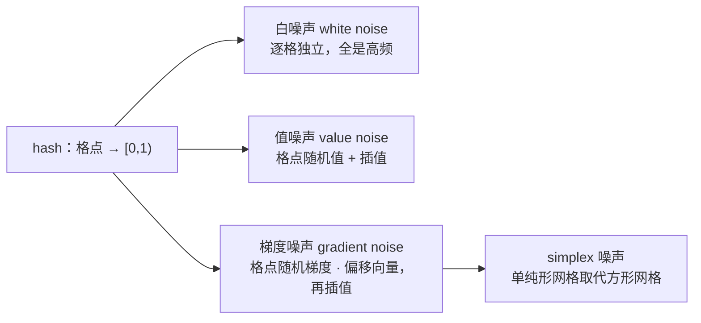

# 内置函数速查与深用

> [返回：WebGL 与 3D 框架学习大纲](../WebGL与3D框架学习大纲.md)
> 本文是"着色器语言专题"第三篇：GLSL 内置函数的六类速查表（标注 ES 1.00 / 3.00 可用性与坑位），加重点函数的深挖——讲"为什么这样设计、什么时候用哪个"，不是 API 翻译。类型系统与分量式语义见 [01-第一阶段/04-GLSL基础](../01-第一阶段/04-GLSL基础.md)；具体效果里的用法散在 [02-第二阶段/05-光照](../02-第二阶段/05-光照.md) 与 [05-第五阶段/03-后处理管线](../05-第五阶段/03-后处理管线.md)，本文把它们串成一张地图；预处理与变体见本分册 [02-预处理与变体管理](02-预处理与变体管理.md)。

约定：`genType` 代表 `float/vec2/vec3/vec4` 按分量式（component-wise）工作的重载家族；可用性列中"有"= 核心可用，"扩展"= WebGL1 需对应 `#extension`（见本分册 02 的 2.4），"—"= 不存在。

## 3.1 全景分类速查表

### 3.1.1 数学类

| 函数（主力签名） | 一句话 | 1.00 | 3.00 | 坑 |
|---|---|---|---|---|
| `radians(x)` / `degrees(x)` | 度弧互转 | 有 | 有 | |
| `sin` / `cos` / `tan(x)` | 三角主力和 | 有 | 有 | `tan` 在 ±π/2 附近爆炸 |
| `asin(x)` / `acos(x)` | 反三角 | 有 | 有 | **`|x| > 1` 未定义**，前置 clamp |
| `atan(y[, x])` | 单参 arctan / 双参方位角（atan2） | 有 | 有 | 双参版 `(0, 0)` 未定义 |
| `pow(x, y)` | 幂 | 有 | 有 | **`x < 0` 未定义**；`x=0 且 y<=0` 未定义（3.4） |
| `exp` / `log(x)` | 自然指数对数 | 有 | 有 | `log(x <= 0)` 未定义 |
| `exp2` / `log2(x)` | 以 2 为底 | 有 | 有 | 同上；硬件最友好（3.4） |
| `sqrt(x)` | 平方根 | 有 | 有 | `x < 0` 未定义 |
| `inversesqrt(x)` | `1/sqrt(x)` 单条完成 | 有 | 有 | **`x <= 0` 未定义**（0 给出 inf）（3.4） |
| `abs(x)` / `sign(x)` | 绝对值 / 符号（负一、零、正一） | 有 | 有 | |

### 3.1.2 工具类

| 函数（主力签名） | 一句话 | 1.00 | 3.00 | 坑 |
|---|---|---|---|---|
| `floor(x)` / `ceil(x)` | 向下/向上取整，**返回值仍是 float** | 有 | 有 | 要整数索引须 `int(floor(x))` |
| `fract(x)` | 取小数部分 `x - floor(x)` | 有 | 有 | 结果恒 `[0, 1)`，负数也不例外（3.3） |
| `mod(x, y)` | 模，**floor 语义** | 有 | 有 | 不是 C/JS 的 `%`（trunc 语义）（3.3） |
| `min(a, b)` / `max(a, b)` | 分量取小/大 | 有 | 有 | ES 3.00：任一操作数为 NaN **返回另一操作数**（3.3） |
| `clamp(x, lo, hi)` | `min(max(x, lo), hi)` | 有 | 有 | 由上行推论：NaN 被"吸收"成 lo（3.3） |
| `floatBitsToUint(x)` / `uintBitsToFloat(u)` | 位重解释 | — | 有 | 位运算技巧的钥匙（3.4/3.8） |
| `isnan(x)` / `isinf(x)` | 判 NaN / inf | — | 有 | ES 1.00 只能 `x != x` 判 NaN |
| `matrixCompMult(m, n)` | 矩阵逐分量乘（不是线性代数乘） | 有 | 有 | 90% 的"矩阵乘"应该用 `*` |
| `transpose` / `inverse` / `determinant` / `outerProduct` | 矩阵工具 | — | 有 | inverse 每片元都算很贵，优先 CPU 算好传 uniform |
| `lessThan` / `greaterThan` / `equal` 等向量比较 | 逐分量比较返回 `bvec` | 有 | 有 | 结果要配 `any()` / `all()` 归约成 bool |
| `any(b)` / `all(b)` / `not(b)` | bvec 归约 | 有 | 有 | |

### 3.1.3 插值类

| 函数（主力签名） | 一句话 | 1.00 | 3.00 | 坑 |
|---|---|---|---|---|
| `mix(x, y, a)` | 线性插值 `x(1-a) + ya` | 有 | 有 | **a 不被钳制**，超出 [0,1] 是外推（3.2） |
| `mix(x, y, bvec a)` | 逐分量选择（select 语义） | — | 有 | 硬件级三目替代 |
| `step(edge, x)` | 硬阈值：x < edge 得 0 否则 1 | 有 | 有 | 边界不连续，放大后锯齿（3.2/3.6） |
| `smoothstep(e0, e1, x)` | 埃尔米特平滑阶梯 | 有 | 有 | **`e0 >= e1` 未定义**（3.2） |

### 3.1.4 几何类

| 函数（主力签名） | 一句话 | 1.00 | 3.00 | 坑 |
|---|---|---|---|---|
| `dot(a, b)` | 点积：投影/夹角/强度 | 有 | 有 | |
| `cross(a, b)` | 叉积 | 有 | 有 | **仅 vec3**；正反面判定留意绕序 |
| `length(v)` / `distance(p0, p1)` | 模长 / 两点距离 | 有 | 有 | `distance` 每片元两次 sqrt 的代价感 |
| `normalize(v)` | 归一化 | 有 | 有 | **零向量得 NaN**（3.5） |
| `faceforward(N, I, Nref)` | 按入射方向翻转法线 | 有 | 有 | 判据是 `dot(Nref, I) < 0`（3.5） |
| `reflect(I, N)` | 反射向量 | 有 | 有 | I 指向表面；N 必须已归一化（3.5） |
| `refract(I, N, eta)` | 折射向量（Snell） | 有 | 有 | 全内反射时**返回零向量**（3.5） |

### 3.1.5 纹理类

| 函数（主力签名） | 一句话 | 1.00 | 3.00 | 坑 |
|---|---|---|---|---|
| `texture2D(s, uv[, bias])` | 常规 2D 采样 | 有 | — | bias 仅片元可用；3.00 改名 `texture`（3.7） |
| `textureCube(s, dir)` | 立方体采样 | 有 | — | 3.00 同上 |
| `texture(s, uv[, bias])` | 统一采样入口 | — | 有 | 采样器类型决定重载（3.7） |
| `texture2DLodEXT` / `textureLod(s, uv, lod)` | 显式 LOD | 扩展（顶点为核心） | 有 | 顶点/分支内采样必用（3.6/3.7） |
| `textureGrad(s, uv, dx, dy)` | 自带梯度的采样 | — | 有 | 手动过滤管线用 |
| `texelFetch(s, ivec, lod)` | 不过滤取整纹素 | — | 有 | **越界未定义**（texture 则有 wrap）（3.7） |
| `textureOffset(s, uv, ivec2 偏移)` | 常量纹素偏移采样 | — | 有 | 偏移必须是常量表达式 |
| `texture2DProj` / `textureProj` | 先做齐次除法再采样 | 有 | 有 | 阴影/聚光灯投影（3.7） |
| `textureSize(s, lod)` | 查询某级尺寸 | — | 有 | |

### 3.1.6 导数类

| 函数（主力签名） | 一句话 | 1.00 | 3.00 | 坑 |
|---|---|---|---|---|
| `dFdx(p)` / `dFdy(p)` | 屏幕空间偏导 | 扩展 | 有 | 顶点着色器无此函数；非均匀控制流内**结果未定义**（3.6） |
| `fwidth(p)` | `|dFdx| + |dFdy|` | 扩展 | 有 | 抗锯齿宽度的标准来源 |

## 3.2 插值与阶梯：mix / step / smoothstep

### 3.2.1 mix：插值器与选择器

```
mix(x, y, a) = x * (1 - a) + y * a
```

三个用法层次：

1. **插值**（a 在 [0,1]）：颜色渐变、参数过渡，最平凡的用法；
2. **选择**（a 为 0 或 1）：`mix(colorA, colorB, flag)` 是分支的向量级替代——flag 来自 `step`/`sign`/比较时，一条指令完成"二选一并向量化"，这是分支免除（branchless）的核心套路；
3. **外推**（a 超出 [0,1]）：mix **不钳制 a**，`mix(0.0, 1.0, 1.5)` 得 1.5。做弹性动画的过冲（overshoot）时这是特性；期待"夹住"时这是 bug——需要时自己套 `clamp`。

ES 3.00 追加了 bvec 版重载 `mix(x, y, bvec a)`：分量式三目运算，a 为 true 取 y、false 取 x，比"数值 0/1 的 mix"语义更直白，也省去构造 0/1 标量的步骤。

**嵌套 mix**：`mix(mix(a, b, tx), c, ty)` 是双线性插值的标准形态——值噪声（3.8）的格子混合、四角颜色渐变都是它；三个 mix 叠一层就是三线性。完整可运行例子见 [技术专题/01-GLSL Cookbook](../技术专题/01-GLSL%20Cookbook.md) 1.4 的 `valueNoise`。

嵌套 mix 的另一常见形态是**多段渐变（多停靠点色带）**：把 [0,1] 区间切成几段，每段一次 mix，权重套 smoothstep 后段与段的接缝处也是 C1 的（3.2.3 的论述逐段成立）：

```glsl
// 三段色带：0.0 冷蓝 → 0.45 灰绿 → 0.8 暖橙 → 1.0 亮黄
// t 是驱动量（高度、温度、噪声值……），先归一
vec3 ramp(float t) {
  vec3 c0 = vec3(0.10, 0.25, 0.60);
  vec3 c1 = vec3(0.35, 0.45, 0.35);
  vec3 c2 = vec3(0.90, 0.45, 0.15);
  vec3 c3 = vec3(1.00, 0.90, 0.40);
  float t1 = smoothstep(0.00, 0.45, t);   // 第一段权重：0→1
  float t2 = smoothstep(0.45, 0.80, t);   // 第二段权重：接着爬
  float t3 = smoothstep(0.80, 1.00, t);   // 第三段权重：收尾
  vec3 c = mix(c0, c1, t1);
  c = mix(c, c2, t2);
  return mix(c, c3, t3);
}
```

这个"链式 mix + smoothstep"是热力图、高度图着色、噪声染色的通用底座：加停靠点 = 加两行（一个颜色常量 + 一个 mix），无需 if 分段。

### 3.2.2 step 与 if 的成本直觉

`step(edge, x)` 是"比较 + 选择"：x 小于 edge 得 0，否则得 1。它存在的意义不是少打几个字符，而是**指令形态**：

- `step`/`mix`/`min`/`max` 编译为选择类指令，无分支，无相邻片元的路径分歧；
- 着色器里的 `if` 在同一个调度组（老架构 warp / 现代 SIMD 组，片元侧以 2x2 quad 为最小单位，见 3.6）内**各片元走向不同路径时，两个路径都要执行**再各自丢弃结果；即便硬件支持真动态分支，分歧分支也会阻碍编译器重排与寄存器分配。

经验法则：**表达式级二选一用 step/mix/选择指令；整段重逻辑（含纹理采样、循环、early-out）用 if**——被裁掉的整段代码 if 反而省。两态动画偏置（`x - 0.5)*step(...)`）、遮罩、量化用 step；"距离太远直接不采样"该用 if。

### 3.2.3 smoothstep：公式与"为什么是 3t²-2t³"

```
smoothstep(e0, e1, x):
  t = clamp((x - e0) / (e1 - e0), 0.0, 1.0)    // 先把区间归一到 t ∈ [0,1]
  结果 = t * t * (3.0 - 2.0 * t)               // 展开即 3t² - 2t³：先平方再三次
```

为什么是 `3t² - 2t³` 而不是线性 `t`？这条三次曲线（Hermite 插值的基）在两端 t=0、t=1 处：值分别精确落在 0 和 1，**且导数 `6t(1-t)` 在两端都为 0**。对比三个层次：

| 映射 | 值 | 端点导数 | 连续性 | 视觉 |
|---|---|---|---|---|
| `step` | 跳变 | 不存在 | 不连续 | 硬边 + 锯齿 |
| 线性 `t` | 连续 | 两端 1，与外部平坦区 (导数 0) 跳变 | C0 | 平滑但端点有"折痕" |
| `3t²-2t³` | 连续 | 两端 0，与外部平坦区衔接 | **C1** | 端点处"软着陆" |

导数跳变意味着什么：值的一阶导数不连续 = 信号里塞进了高频分量，采样与滤波时表现为振铃（ringing）与走样——这个论证在 [数学专题/05-采样卷积与频域](../数学专题/05-采样卷积与频域.md) 5.4 的频域解释与 5.3.1 的"无振铃低通核"里展开。一句话版本：**smoothstep 把阶跃的无限高频换成了一条导数连续的过渡带，过渡带宽就是一个像素宽的免费抗锯齿**。这也是值噪声用它做格子权重的原因（3.8）：折痕会变成可见的网格纹。

两个工程注意：`e0 >= e1` 时结果未定义（除噪别写出反向区间）；与 `fwidth` 组合的"一像素宽软 step"是最常用的抗锯齿阶梯，见 3.6.3。

### 3.2.4 线性到平滑的改造套路

已有线性过渡想升级成平滑过渡，不需要重写逻辑，把权重过一次 smoothstep 即可：

```glsl
// 线性版本：距离雾 / 距离淡出
float fade = clamp((uEnd - dist) / (uEnd - uStart), 0.0, 1.0);
vec3 color = mix(fogColor, baseColor, fade);

// 平滑版：一行改造，端点折痕消失
float fade = smoothstep(uStart, uEnd, dist);        // 与上式同区间，直接产 C1 权重
vec3 color = mix(fogColor, baseColor, fade);
```

三个高频落点：遮罩边缘（溶解的烧边已是这么写的，见 Cookbook 1.4）、相机距离淡出、UI 渐变端点。心法：**凡是"在 a 处等于 0、b 处等于 1"的权重，都可以用 smoothstep(a, b, x) 原地替换线性公式**，语义不变、边界质量升级。

## 3.3 取整与小数：floor / ceil / fract / mod

### 3.3.1 fract 与 mod：同源的 floor 语义

两个函数的定义式就是全部答案：

```
fract(x)   = x - floor(x)          ∈ [0, 1)
mod(x, y)  = x - y * floor(x / y)  = y * fract(x / y)
```

负数行为逐个验证：

```
fract(-0.2) = -0.2 - floor(-0.2) = -0.2 - (-1) = 0.8
mod(-0.2, 1.0) = 1.0 * fract(-0.2 / 1.0) = 0.8     // 与 fract 一致，同是 floor 语义
mod(0.2, -1.0) = -1.0 * fract(0.2 / -1.0) = -1.0 * fract(-0.2) = -0.8
```

结论三条：

1. GLSL 的 `mod` 是 **floor 语义**（结果的符号跟随除数 y），**不是** C 的 `fmod` 或 JS 的 `%`（trunc 语义，符号跟随被除数：JS 里 `-0.2 % 1` 是 `-0.2`）。从 JS 迁移过来的直觉要刻意修正；
2. `fract` 对正除数的 `mod` 是特例（`mod(x, 1.0) == fract(x)`），永远落在 [0,1)，**没有负数例外**；
3. `mod` 的符号跟随 y：`mod(0.2, -1.0)` 得 -0.8。除数永远传正值就永远不会见到负结果——工程上建议就这么约定。

### 3.3.2 周期动画与贴图平铺

锯齿、三角、ping-pong，全靠 fract 折叠时间（或 UV）：

```glsl
float saw   = fract(uTime * uRate);                  // 锯齿波：0→1 循环
float tri   = abs(saw * 2.0 - 1.0);                  // 三角波：0→1→0 往返（ping-pong）
float ping  = mix(a, b, tri);                        // 参数往返震荡
vec2  tiledUV = fract(vUV * uRepeat);                // 手工平铺：重复 N 次并折回 [0,1)
```

网格类效果的"格子坐标 + 格内坐标"切割是同一招的另一半：

```glsl
vec2 cell = floor(p);       // 格子编号：作为 hash 的输入（3.8），保证格内取同一个随机值
vec2 local = fract(p);      // 格内 0~1 坐标：做格内插值与衰减
```

溶解（Cookbook 1.4）、水面细波（1.8）、故障条带（1.6）的噪声函数内部全是这对组合。`floor` 返回 float 不是 int，喂给 `texelFetch` 时记得转 `ivec2`。

### 3.3.3 min / max / clamp 的 NaN 传播差异

NaN（Not a Number，非数）从哪来：`0/0`、`inf - inf`、`normalize(零向量)`（3.5）、`inversesqrt(0)` 之类的 inf 参与的后续运算。

ES 3.00 规范（8.3 节）对 min/max 的规定值得逐字读：**任一操作数为 NaN 时，返回另一个操作数**——不是 IEEE 的"NaN 传染"，而是"非数被丢弃"：

```glsl
max(NaN, 0.0)   // 规范结果：0.0（返回非 NaN 的那个）
min(NaN, 1.0)   // 规范结果：1.0
```

连带推论：`clamp(x, lo, hi) = min(max(x, lo), hi)`，当 x 为 NaN 时 `max(NaN, lo)` 得 lo，整条 clamp 得 lo——**NaN 被 clamp 吞掉、静默变成下界**。两面性：

- 好处：对可能产生 NaN 的中间量外套 `clamp`，能防止 NaN 扩散到全屏（黑屏/花屏的一线保险）；
- 坏处：**clamp 掩盖了第一现场**——你看到的是"数值莫名贴着下界"，真正的 NaN 产生点在更上游。排查时先把怀疑路径上的 clamp 临时拆掉，或用 `isnan`（3.00）定位。

两个限定：此规则是 ES 3.00 的规范行为，ES 1.00 未定义（别依赖）；个别驱动的实现返回 0 而非"另一个操作数"，跨平台诊断时记得这份不确定性。

## 3.4 快速数学：inversesqrt / pow / exp2 / 三角成本位次

### 3.4.1 inversesqrt 为什么快

`inversesqrt(x) = 1/sqrt(x)`，归一化的幕后功臣——`normalize(v)` 内部就是 `v * inversesqrt(dot(v, v))`。

**Quake 典故**：1999 年《雷神之锤 3》源码里的 `Q_rsqrt` 用一次"位技巧 + 一次牛顿迭代"算出 1/sqrt(x)，比当时 CPU 的除法+开方快约四倍，魔数 `0x5f3759df` 因此成为图形学文化的圣物：

```glsl
// quake 风格 fast inverse square root（ES 3.00，位运算需 floatBitsToUint）
// 教学用途：现代 GPU 上直接用内置 inversesqrt，更快也更准
float quakeInvSqrt(float x) {
  float xhalf = 0.5 * x;
  uint i = floatBitsToUint(x);          // 把 float 的位模式当作整数读出
  i = 0x5f3759dfu - (i >> 1);           // 指数域减半 + 魔数校准 ≈ x^(-1/2) 的粗糙初值
  float y = uintBitsToFloat(i);
  y = y * (1.5 - xhalf * y * y);        // 一次牛顿迭代，精度补到约 1%
  return y;
}
```

原理两句话：浮点数的位模式里，指数域近似线性于真数的对数——整数减半约等于对数减半，即"开方再取倒数"的一次初值估计；魔数负责修正指数平移与尾数偏差，牛顿迭代再收敛一次。

**硬件视角**：GPU 的特殊函数单元（SFU，Special Function Unit）原生提供倒数平方根近似指令（rsq），一条指令、若干周期、约 22 位精度；而 `1.0 / sqrt(x)` 是"SFU 开方 + 通用单元的除法"——除法是迭代算法，贵好几倍。所以图形学代码的习惯是：**能写 `x * inversesqrt(d)` 就不写 `x / sqrt(d)`**。ES 1.00 没有位运算，写不了 quake hack，但内置 `inversesqrt` 一直在（速查表 3.1.1）。

### 3.4.2 pow 的限制与替代

规范口径：`pow(x, y)` 在 `x < 0` 时**结果未定义**；`x = 0` 且 `y <= 0` 时同样未定义。硬件实现多为 `exp2(y * log2(x))`，log2 负数域直接崩。

三个修法按场景选：

```glsl
pow(max(NdotH, 0.0), shininess)          // 高光类：物理上负值无意义，max 钳底
exp2(exponent * log2(max(x, 1e-8)))      // 通用幂：显式护住 log 的定义域
x * x                                    // 小整数幂：编译器内联成乘法，最快
```

平方/立方优先直接写乘法（无 SFU 参与）；[技术专题/01-GLSL Cookbook](../技术专题/01-GLSL%20Cookbook.md) 常见坑 1 的 `max(x, 0.0)` 护栏就是这里的第一条。

### 3.4.3 exp2 / log2 与三角函数成本位次

浮点数本身就是"2 的指数 + 尾数"，所以 exp2/log2 与硬件同构（SFU 原生 ex2/lg2 指令），是**指数对数的最短路径**；自然对数只是换底常数：

```glsl
#define LN2   0.6931471805599453
#define INV_LN2 1.4426950408889634
// exp(x) = exp2(x * INV_LN2)；ln(x) = log2(x) * LN2
```

着色器成本位次表（数量级直觉，非规范——具体随架构不同）：

| 大致位次 | 运算 | 说明 |
|---|---|---|
| 1 | add / mul / mad / min / max / abs / floor | ALU 单周期；mad 融合乘加 |
| 1~2 | step / mix / clamp / select 类 | 选择指令 |
| 1/4 吞吐 | sin / cos / inversesqrt / exp2 / log2 / sqrt | SFU 通道（与 ALU 并行但更窄） |
| 多条展开 | pow / tan / exp / log | 复合：约等于 2 次 SFU 或除法 |
| 最贵一档 | asin / acos / atan | 常软件展开成十余条 ALU |

实战推论：热路径里的反三角函数要消灭。经典例子是菲涅尔的 Schlick 形式用 `pow(1 - dot(N, V), 5)` 取代显式 acos（见 [05-第五阶段/04-PBR入门](../05-第五阶段/04-PBR入门.md)）；视角相关的加权直接用 dot 的有界性设计，不去算真实角度。

## 3.5 几何函数：从 dot 到 refract

### 3.5.1 基础五件套的图形学读法

- `dot(a, b)`：**投影长度**读法最有用——`dot(N, L)` 是漫反射权重（[02-第二阶段/05-光照](../02-第二阶段/05-光照.md) 4.3）、`dot(N, V)` 是视角接近度（菲涅尔）、`dot(c, luma 权重)` 是亮度（Cookbook 1.3 的 luma）；
- `cross(a, b)`：仅支持 vec3；`cross(tangent, bitangent)` 重建法线（Gerstner 波，Cookbook 1.8）、背面判定（[02-第二阶段/04-渲染状态与测试](../02-第二阶段/04-渲染状态与测试.md) 的绕序直觉）；
- `length` / `distance`：注意 `distance` 在片元热循环里就是一次 sqrt——衰减函数常能用平方距离比较（`dot(d, d) < r * r`）避开它；
- `normalize(v)`：实现是 `v * inversesqrt(dot(v, v))`，**零向量**得 `0 * inf = NaN`（规范不保证行为）。零向量不是抬杠：插值出的边缘法线、退化的 UV 切向量、粒子初速都可能为零。防御：

```glsl
vec3 safeNormalize(vec3 v) {
  float d2 = dot(v, v);
  return d2 > 1e-8 ? v * inversesqrt(d2) : vec3(0.0, 1.0, 0.0);
}
```

另外：varying 插值会缩短向量，片元里**用前必须重新 normalize**（[02-第二阶段/05-光照](../02-第二阶段/05-光照.md) 常见坑 2，Cookbook 全篇也如此约定）。

- `faceforward(N, I, Nref)`：`dot(Nref, I) < 0` 时返回 N，否则返回 -N——"让法线迎着入射方向"一行解决，双面材质（草叶、布料背面）的标配，省掉手动 `if (dot < 0) N = -N;`。

### 3.5.2 reflect：一行的推导

入射向量 I 指向表面，法线 N（已归一化）。把 I 分解为法向分量与切向分量：法向分量是 `dot(N, I) * N`，切向分量是 `I - dot(N, I) * N`。反射 = 切向分量不变 + 法向分量取反：

```
I' = 切向 - 法向 = (I - dot(N,I)N) - dot(N,I)N = I - 2 * dot(N, I) * N
```

这正是内置 `reflect(I, N)` 的实现。Blinn-Phong 里算"光的高光反射方向"用它（`reflect(-L, N)`，注意 L 是指向光源的，所以取负，见 [02-第二阶段/05-光照](../02-第二阶段/05-光照.md) 4.3）；法线贴图扰动后的 N 记得先从切空间转回世界空间（TBN 矩阵，[数学专题/07-切空间与几何算法](../数学专题/07-切空间与几何算法.md) 7.3）。

### 3.5.3 refract：Snell 定律的向量化

斯涅尔定律（Snell's law）：两种介质折射率 n1、n2，入射角 θ1 与折射角 θ2 满足 `n1 sin θ1 = n2 sin θ2`。内置函数的参数 `eta = n1 / n2`（从空气进玻璃约 1/1.45），公式：

```
k = 1 - eta² * (1 - dot(N, I)²)          // cos²θ2 的合法性，由 sin²θ2 = eta² sin²θ1 代换而来
k < 0  → 全内反射（TIR），refract 返回 vec3(0)
k >= 0 → 结果 = eta * I - (eta * dot(N, I) + sqrt(k)) * N
```

推导骨架：折射光线 T 的切向分量是 I 的切向分量乘 eta（斯涅尔定律的切向形式），法向分量由"单位长度"约束解出——`cos θ2 = sqrt(1 - sin²θ2) = sqrt(k)`。k 小于零意味着 `sin θ2 > 1`，无解，物理上就是全内反射：光线从光密介质射向光疏介质且入射角超过临界角（水下仰望水面泛银光的来源）。

实战注意三点：

1. **I、N 必须归一化**，否则 eta 的比值语义不成立；
2. **k < 0 时返回零向量**是约定的信号——用 `dot(R, R) < 1e-6` 检测 TIR 并切换到 reflect 路径；
3. 实时管线里真实折射算得出方向、查不到场景（要沿折射线再求交），屏幕空间近似与用法见 [技术专题/01-GLSL Cookbook](../技术专题/01-GLSL%20Cookbook.md) 1.5 玻璃折射。

```glsl
// 双面玻璃片元核心（示意）：双面法线 + eta 按方向翻转 + TIR 检测
vec3 I = normalize(vWorldPos - uCameraPos);              // 指向表面
vec3 N = normalize(vNormal);
N = faceforward(N, I, N);                                // 背面片元翻转法线
float eta = gl_FrontFacing ? (1.0 / 1.45) : 1.45;        // 从外进 / 从内出，比值互为倒数
vec3 R = refract(I, N, eta);
vec3 dir = dot(R, R) < 1e-6 ? reflect(I, N) : R;         // TIR 退回反射
```

## 3.6 导数家族：dFdx / dFdy / fwidth

### 3.6.1 2x2 quad：导数的物理载体

GPU 光栅化片元时以 **2x2 像素的四象限组（quad）** 为最小调度单位——即使三角形只覆盖其中一个像素，其余"伴随片元"（helper lane）也会执行。这个设计的目的就是导数：quad 内部共享四次求值结果，差分即导数：

```text
片元值 p（每格一个片元的求值）        dFdx = 右列 − 左列（同一行内）
┌─────────┬─────────┐               dFdy = 上行 − 下行（同一列内）
│ p(x, y) │ p(x+1,y)│
├─────────┼─────────┤          例：dFdx(vUV) = 相邻像素的 UV 增量 ≈ 每像素 UV 步长
│ p(x,y+1)│p(x+1,y+1)│
└─────────┴─────────┘
```

所以导数是**局部差分近似**（不是解析导数）：步长是一个像素、精度受浮点与插值影响。为什么片元着色器有、顶点着色器没有：片元天生生活在屏幕网格上有邻居，quad 结构保证了邻居求值；顶点彼此独立、API 不提供邻接信息，没有"屏幕空间相邻"的概念。这也是 GLSL 不提供顶点导数的根本原因，而不只是"没实现"。

### 3.6.2 隐式导数与 mipmap 选级

不带 LOD 的纹理采样（`texture` / `texture2D`）内部用**隐式导数**估计"UV 每像素变化多快"，据此选择 mip 层级：

```
λ = log2(max(|dFdx(uv).x| * 宽, |dFdy(uv).y| * 高))    // 采样率的频域解释见 数学专题/05 5.1.3
```

推论三条，每条都是真实工程约束：

1. **顶点着色器采样必须显式 LOD**（`textureLod`）——没有导数，隐式 mip 无从谈起；
2. **非均匀控制流内隐式采样结果未定义**：分支导致 quad 内有的片元执行采样、有的不执行，差分对象残缺，mip 层级不可信（黑斑、闪烁、面片接缝）。规范口径：在非均匀控制流（non-uniform control flow，即 quad 内各片元可能走向不同分支的路径）中调用导数函数与依赖导数的采样，结果未定义。修法两选一：

```glsl
// 坏：分支内隐式采样
if (uShowTex) { c = texture(uMap, vUV).rgb; }

// 好一：无条件采样，分支只决定"用不用"
vec4 t = texture(uMap, vUV);
if (uShowTex) { c = t.rgb; }

// 好二：显式 LOD（连导数需求一起绕开）
if (uShowTex) { c = textureLod(uMap, vUV, 0.0).rgb; }
```

3. **自定义过滤要自带梯度**：手动双线性/自定义核采样时隐式导数已不适用，用 `textureGrad` 显式传入（3.7）：

```glsl
// 例：在"故意扭曲过的 UV"上采样，但 mip 按原始 UV 的真实导数选级
// 扭曲后的 UV 导数会把 mip 估得过粗（扭曲放大了变化率），画面糊成一块
vec2 warped = vUV + vec2(sin(vUV.y * 40.0) * 0.01, 0.0);
vec2 dx = dFdx(vUV), dy = dFdy(vUV);              // 用未扭曲 UV 的导数
vec4 c = textureGrad(uMap, warped, dx, dy);       // ES 3.00
```

典型受益者：扰动采样（热浪、玻璃、折射感 UI）、法线贴图的 UV 偏移采样——凡是"采样坐标被高频函数加工过"的地方，都该问一句 mip 想基于哪份导数。

WebGL1 使用导数家族的前提：`OES_standard_derivatives` 扩展 + `#extension` 声明（本分册 [02-预处理与变体管理](02-预处理与变体管理.md) 2.4）；WebGL2 / ES 3.00 核心可用。mipmap 的机制与"为什么缩小必须用 mip"见 [02-第二阶段/03-纹理](../02-第二阶段/03-纹理.md) 2.3。

### 3.6.3 fwidth：抗锯齿阶梯的标准件

`fwidth(p) = |dFdx(p)| + |dFdy(p)|`——p 每像素最大变化量的保守估计。最经典的用法是给硬阈值边缘垫"一像素宽"的过渡带：

```glsl
// 硬 step：放大后锯齿明显
float mask = step(uThreshold, n);

// 抗锯齿版：阈值两侧各放宽一个 fwidth，与 3.2 的 C1 论述正好衔接
float w = fwidth(n);
float mask = smoothstep(uThreshold - w, uThreshold + w, n);
```

这个 `aaStep` 套路适用于几乎所有"程序化硬边"：溶解边界、卡通色阶描边、UI 遮罩、线框渲染。距离场文字的抗锯齿同理（SDF 采样后按 fwidth 或固定宽度过 smoothstep，[技术专题/02-文本与2D渲染](../技术专题/02-文本与2D渲染.md)）。走样的完整频域解释与三条反走样路线见 [数学专题/05-采样卷积与频域](../数学专题/05-采样卷积与频域.md) 5.5。

## 3.7 纹理函数组

### 3.7.1 两代 API 的组织方式

ES 1.00 按"用途 × 维度"起名（`texture2D`、`textureCube`、`texture2DProj`、`texture2DLod`……家族爆炸）；ES 3.00 收敛成**一个 `texture` + 重载**，由采样器类型与参数形态决定行为。对照表：

| 用途 | ES 1.00 | ES 3.00 | 备注 |
|---|---|---|---|
| 常规 2D | `texture2D(s, uv)` | `texture(s, uv)` | 片元可加第三参 bias（偏置 mip） |
| 立方体 | `textureCube(s, dir)` | `texture(s, dir)` | 天空盒/环境反射（[05-第五阶段/06-雾效与天空盒](../05-第五阶段/06-雾效与天空盒.md)） |
| 显式 LOD | 顶点：`texture2DLod`（核心）；片元：`texture2DLodEXT`（扩展） | `textureLod(s, uv, lod)` | 顶点采样、分支内采样、固定层级模糊（[05-第五阶段/03-后处理管线](../05-第五阶段/03-后处理管线.md) 的降采样链） |
| 自定梯度 | — | `textureGrad(s, uv, dx, dy)` | 手动过滤/扭曲 UV 时保住 mip 选择 |
| 整数纹素 | — | `texelFetch(s, ivec, lod)` | 不过滤不 wrap，逐纹素数据访问 |
| 常量偏移 | — | `textureOffset(s, uv, ivec2)` | 邻居采样（卷积核），偏移须编译期常量 |
| 投影采样 | `texture2DProj(s, uvq)` | `textureProj(s, uvq)` | 先除以最后分量再采样 |
| 阴影比较 | （WebGL1 实际不可用） | `texture(sampler2DShadow, vec3(u, v, ref))` | 返回 [0,1] 遮挡比，PCF 链 [05-第五阶段/02-阴影与PCF软阴影](../05-第五阶段/02-阴影与PCF软阴影.md) |
| 尺寸查询 | — | `textureSize(s, lod)` | 卷积半径对齐用 |

同源双版本的抹平办法见本分册 02 的 2.3.1 模板（`TEX2D` 宏）。

### 3.7.2 各自的适用场景

- **textureLod**：三个必用点——顶点着色器（无导数）、非均匀分支内（隐式 mip 未定义，3.6.2）、刻意要某一级 mip（后处理的降采样/金字塔链）；
- **texelFetch**：按整数纹素坐标**精确**取值，不插值、不 wrap、不选 mip——数据而非图像的访问方式。GPGPU 的 ping-pong 读写（[技术专题/03-GPGPU与计算](../技术专题/03-GPGPU与计算.md)）、LUT 查表、逐像素数据贴图。两个纪律：坐标要 `ivec`（`ivec2(gl_FragCoord.xy)` 或 `int(floor(uv * size))`）；**越界结果未定义**——`texture` 有 wrap/filter 兜底，`texelFetch` 没有，边界自理；
- **textureOffset**：卷积核采样的语义化写法（Sobel、模糊），偏移是常量，编译器可合并地址计算；运行时偏移（如随机采样）只能老实用 `uv + vec2 * texelSize`；
- **textureProj**：采样前先除以 q——把投影矩阵算出的齐次坐标直接喂进来，聚光灯衰减贴图、阴影投影的专用通道。

### 3.7.3 采样器类型决定重载

ES 3.00 的 `texture` 是重载家族，采样器类型决定参数与返回：

| 采样器 | 坐标 | 返回 | 典型用途 |
|---|---|---|---|
| `sampler2D` | vec2 | vec4 | 贴图 |
| `samplerCube` | vec3 | vec4 | 环境反射 |
| `sampler3D` / `sampler2DArray` | vec3 | vec4 | 体纹理 / 图集分层 |
| `isampler2D` / `usampler2D` | vec2 | ivec4 / uvec4 | 整数纹理（GPGPU 数据，过滤模式必须 NEAREST） |
| `sampler2DShadow` | vec3（uv + 深度 ref） | **float**（比较结果） | 阴影测试 |

整数采样器必须配整数内部格式的纹理（WebGL2 的 `R32UI` 等），且不支持插值——它们是"纹理外观的缓冲"。

## 3.8 伪随机：从 hash 到噪声

### 3.8.1 为什么 GLSL ES 没有 noise

桌面 GLSL 1.10 曾内置 `noise1/2/3/4`（Perlin 式平滑噪声），但从未有硬件实现：各厂商软件实现又慢又互不一致，等于不可移植的装饰。GLSL ES 从未收录，WebGL 世界里**随机完全靠手写**。随机函数库分两层：hash（哈希，整数/格点 → [0,1) 的伪随机数）与噪声（把 hash 组织成连续场）。

### 3.8.2 hash 函数家族

**家族一：sin 大数法**（ES 1.00 可用，最流行）：

```glsl
float hash11(float p) {
  return fract(sin(p * 127.1) * 43758.5453123);
}
float hash12(vec2 p) {                                  // 二维：先压成一维
  return fract(sin(dot(p, vec2(127.1, 311.7))) * 43758.5453123);
}
```

原理：乘上大常数后的 sin，其浮点末位对输入的微小差异极度敏感——输入差 0.001，输出的低几位已经面目全非，fract 再截取小数部分即近似均匀的 [0,1)。两个坑：**必须 highp**（mediump 下末位精度不足，直接崩成条纹，Cookbook 常见坑 4）；个别移动 GPU 的 sin 近似在大参数下有可见规律，跨端项目要验。

**家族二：无 sin 的 fract 哈希**（ES 1.00 可用，快且稳）：

```glsl
float hash12(vec2 p) {
  vec3 p3 = fract(vec3(p.xyx) * 0.1031);
  p3 += dot(p3, p3.yzx + 33.33);
  return fract((p3.x + p3.y) * p3.z);
}
```

用 fract 自身的混沌性替代 sin，无三角函数、精度压力小，移动端表现显著更稳（Dave Hoskins 设计）。

**家族三：整数位运算**（ES 3.00 专属，确定性与可控性最好）：

```glsl
// 32 位 xor-乘 hash：输入输出都是 uint
uint hashU32(uint s) {
  s ^= s >> 16; s *= 0x7feb352du;
  s ^= s >> 15; s *= 0x846ca68bu;
  s ^= s >> 16;
  return s;
}
// float 输入 → [0,1)：格点先取整再哈希，保证格内取值一致
float hash12(vec2 p) {
  uint h = hashU32(uint(p.x) * 1973u + uint(p.y) * 9277u + 26699u);
  return float(h) * (1.0 / 4294967295.0);
}
```

整数哈希跨平台结果一致、无精度悬念，GPGPU 粒子初速、蒙特卡洛采样（[数学专题/06-概率与蒙特卡洛](../数学专题/06-概率与蒙特卡洛.md)）这类"随机数要可复现"的场景首选；需要打包 vec 时 3.00 还有 `packUnorm4x8` / `unpackUnorm4x8`。

三维版本同构：把第三个维度混进 dot（家族一/二）或乘进素数偏移（家族三）即可。

### 3.8.3 白噪到梯度噪：最小实现链



**白噪声**：每格独立 hash（`hash12(floor(p))` 或直接对像素坐标 hash）——频谱平坦，视觉是"沙子"。用于溶解的随机序号、dither 抖动、粒子初始散布。

**值噪声**：格点 hash 当高度，格内用 smoothstep 权重双线性插值：

```glsl
float valueNoise(vec2 p) {
  vec2 i = floor(p), f = fract(p);
  vec2 u = f * f * (3.0 - 2.0 * f);     // smoothstep 权重：格点处导数为 0，避免折痕（3.2 的 C1）
  float a = hash12(i), b = hash12(i + vec2(1, 0));
  float c = hash12(i + vec2(0, 1)), d = hash12(i + vec2(1, 1));
  return mix(mix(a, b, u.x), mix(c, d, u.x), u.y);
}
```

完整可运行版与"双频叠加"参数在 Cookbook 1.4 溶解（`uNoiseScale` 调频率）与 1.8 水面（滚动噪声法线）里，本文不重复。缺陷：格点值本身独立随机，过渡平坦，放大看有"块状灰阶"。

**梯度噪声（Perlin）**：格点放的不是随机值而是随机**方向**（由 hash 映射到一组梯度向量），格内取 `dot(梯度, 偏移向量)` 再插值。因为每个格点的贡献在其位置精确为零（偏移为零），过渡没有平台期，质量全面优于值噪声。注意它的权重函数升级成五次式 `6t⁵ - 15t⁴ + 10t³`（C2 连续，二阶导也为零）——正是 3.2 的 C1 论述再进一级：噪声要反复微分（法线重建、流体），一阶导连续不够用。

**simplex 噪声（概念）**：把方形格换成单纯形（2D 三角形、3D 四面体），角点从 4/8 个降到 3/4 个，各向同性更好、高频质量更高；代价是实现复杂、坐标取整逻辑自成一派。选择建议：值噪声够用就值噪声（溶解、雾）；要做 normals / 流场 / 长镜头大范围噪声，直接上梯度噪或 simplex；多倍频叠加（fbm，分形布朗运动）是通用的"加细节"手段，本体仍是上述任何一种。

## 常见坑

1. **pow/log2/sqrt/inversesqrt 的定义域**：底数为负、x<=0 一律"未定义"，花屏常见根因。护栏 `max(x, 0.0)`、`max(x, 1e-8)`（3.4.2）；asin/acos 记得 `clamp(x, -1.0, 1.0)`。
2. **normalize(零向量) 出 NaN**：插值边缘法线、退化切向量都可能为零向量；`safeNormalize` 防御（3.5.1）。配套陷阱：`clamp` 会把 NaN 静默吞成下界（3.3.3），掩盖第一现场——排查数值 bug 先拆 clamp。
3. **WebGL1 用 dFdx/fwidth 没声明扩展**：编译直接报 undeclared identifier。JS 侧拿扩展 + `#extension GL_OES_standard_derivatives : enable` 双动作缺一不可（本分册 02 的 2.4）。
4. **非均匀分支里隐式采样**：mip 层级基于残缺差分，黑斑/闪面/接缝。无条件采样或 `textureLod`（3.6.2）。
5. **fract/mod 的负数语义按 JS 直觉**：`fract(-0.2)` 是 0.8 不是 -0.2；`mod` 是 floor 语义，符号跟除数走（3.3.1）。负数平铺/周期动画先想清楚折叠方向。
6. **smoothstep 区间写反（e0 >= e1）**：结果未定义，个别驱动给 0、个别给噪声；参数化阈值时先 `if (a > b) swap` 或保证调用方约束。
7. **texelFetch 越界**：没有 wrap/filter 兜底，结果未定义——边界像素的邻域采样要么钳制坐标要么换 `texture`（3.7.2）。
8. **sin 大数 hash 用 mediump**：末位精度不够，白噪变条纹。片元开头 `precision highp float;`，或换家族二/三（3.8.2）。
9. **在顶点着色器用无 LOD 的采样**：没有导数，隐式 mip 不存在（ES 1.00 直接不编译 `texture2D` 在顶点的形式，ES 3.00 为未定义）；顶点采样一律 `textureLod`（3.6.2）。

## 本节自测

1. 写出 `fract` 与 `mod` 的定义式，证明 `mod(x, y) = y * fract(x / y)`；`mod(0.2, -1.0)` 等于多少？与 JS 的 `0.2 % -1` 区别在哪一层语义？
2. `smoothstep` 为什么用 `3t² - 2t³` 而不是线性 t？从值连续、导数连续、频谱三层说明"折痕"的来源，并指出这个论证在 [数学专题/05](../数学专题/05-采样卷积与频域.md) 的哪一节展开。
3. 从"分解入射向量"出发推导 `reflect` 的公式；`refract` 返回零向量的条件是什么，物理含义是什么，实战中怎么检测？
4. 画出一个 2x2 quad，说明 `dFdx`/`dFdy` 怎么从四次求值得出；顶点着色器为什么没有导数？顶点里采样纹理的正确姿势是什么？
5. `inversesqrt` 为什么比 `1.0 / sqrt(x)` 快？quake hack 与现代 GPU 的 SFU 各自解决的是什么层面的问题？
6. 按 ES 3.00 规范，`max(NaN, 0.0)` 返回什么？由此推出 `clamp(NaN, 0.0, 1.0)` 的结果，并说明这为什么既是保险又是排查障碍。

---

交叉阅读：函数的效果级用法见 [技术专题/01-GLSL Cookbook](../技术专题/01-GLSL%20Cookbook.md)（溶解、水面、描边三法）；采样与频域的数学背景见 [数学专题/05-采样卷积与频域](../数学专题/05-采样卷积与频域.md)；预处理与变体管理见本分册 [02-预处理与变体管理](02-预处理与变体管理.md)。
