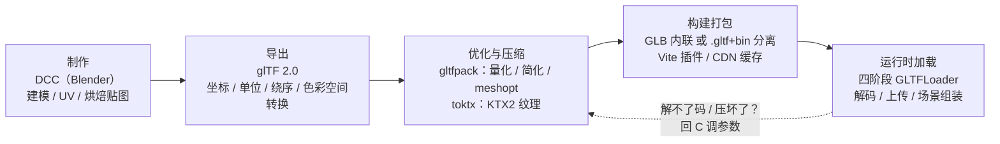

# 资产管线专题导览

> [返回：WebGL 与 3D 框架学习大纲](../WebGL与3D框架学习大纲.md)
> 本专题补齐主线没讲的一环：模型与贴图在进入浏览器**之前**的经历——DCC 制作、导出、压缩、构建打包，直到运行时加载器接手。[四阶段 07 资源管理](../04-第四阶段/07-资源管理.md)回答"拿到文件之后怎么加载"，这里回答"文件从哪来、怎么变小、怎么不变坏"。

## 定位与边界：管线侧 vs 运行时侧

主线六个阶段都在浏览器里写代码；资产管线（Asset Pipeline）的时间线大部分在浏览器之外。它与四阶段资源管理篇以"文件边界"分工：

- **那边（运行时）**：并发加载队列、URI 解析、accessor 到 TypedArray、九步加载清单；
- **这边（管线）**：Blender 导出面板怎么勾、gltfpack/toktx 怎么压、Vite 里怎么自动化、Draco/meshopt/KTX2 的解码在加载器里怎么接线。

两篇交界处各让一步：那边的简版加载器不拆 GLB、不接解码扩展，本专题 2.5 把这两个口子补上——所以这两篇合起来，才是"文件到画面"的完整链路。与其他分册的交叉点：

| 你要做的事 | 去哪 |
|---|---|
| 写加载器、解析 accessor/bufferView | [四阶段 07 资源管理](../04-第四阶段/07-资源管理.md)（6.3 九步清单） |
| 看懂 glTF 的 JSON 结构、亲手生成一个合法文件 | [01-glTF2.0深入](01-glTF2.0深入.md) |
| 模型/贴图太大、加载慢、显存爆 | [02-压缩与工具链](02-压缩与工具链.md)（体积账在 2.1） |
| KTX2/Basis 概念初次接触 | [五阶段 07 性能优化](../05-第五阶段/07-性能优化与调试.md) 6.4，再到本专题 2.3 深入实操 |
| Three.js 的 DRACOLoader/KTX2Loader 源码 | [六阶段 02 源码研读](../06-第六阶段/02-Three.js源码研读.md)，对照本专题 2.5 |

## 全景管线图

五个环节各有典型失效模式：导出环节的坐标系、单位、绕序、色彩空间四坑在 01 的 1.6；压缩环节的量化失真与扩展声明在 02 的 2.2/2.3；构建环节的缓存与自动化在 02 的 2.4；运行时环节的解码接线在 02 的 2.5。虚线是管线最容易缺的一环——出了问题要能回溯到参数，而不是在加载器里打补丁。

## 分册索引

| 篇 | 内容一句话 | 优先服务阶段 |
|---|---|---|
| [01-glTF2.0深入](01-glTF2.0深入.md) | 为什么是 glTF（对比 OBJ/FBX/USD）、JSON+bin 双段结构、accessor/bufferView 间接层、GLB 容器、mesh/蒙皮/动画/材质数据、手写最小生成器、四大导出坑 | 四（写加载器之前通读） |
| [02-压缩与工具链](02-压缩与工具链.md) | 体积账手算、量化公式与经验值、Draco vs meshopt、块压缩与 KTX2、toktx/gltfpack/gltf-pipeline 命令、Blender 导出面板逐项、Vite 插件草图、解码接线、选型决策树 | 五（性能）、六（毕业项目） |

## 问题速查表

| 你遇到的问题 | 去哪 |
|---|---|
| 不知道该选 glTF 还是 FBX/OBJ | 01 的 1.1 对比表 |
| 打开 .gltf 看不懂 JSON 里一层层索引 | 01 的 1.2（结构解剖） |
| morph target / 蒙皮 / 动画数据在文件哪里 | 01 的 1.3（核心数据） |
| 想生成一个最小 glTF 做加载器测试 | 01 的 1.5（手写生成器） |
| Blender 导出的模型躺平 90 度 / 大小差 100 倍 | 01 的 1.6（导出四坑） |
| 资产下载太大 / 显存爆 / 加载卡首屏 | 02 的 2.1（先算账）再 2.6（决策树） |
| Draco 和 meshopt 选哪个 | 02 的 2.2 对比表 |
| 贴图要不要转 KTX2、命令怎么写 | 02 的 2.3（toktx 实操） |
| gltfpack 参数一大堆看不懂 | 02 的 2.4（速查表 + 组合示例） |
| 压完的模型加载器报未知扩展 | 02 的 2.5（扩展闸门与解码接线） |
| 想把压缩搬进构建流程 | 02 的 2.4（Vite 插件草图） |

## 阅读建议

1. 四阶段动手写 glTF 加载器**之前**，先读 01 的 1.2/1.3——把 JSON 结构当数据字典查，加载器写起来就是查表；
2. 毕业项目进入性能与发布阶段时读 02——先做 2.1 的体积账建立直觉，再按 2.6 决策树选工具，别上来就压；
3. 两篇自成体系（小节编号 N.x，N 为篇号），可按问题速查；每篇末尾有常见坑与本节自测。

专题不设综合实践，检验落在两处：四阶段的加载器实践任务（01 的自测里有直接对应的设计题）、六阶段毕业项目的资产发布（02 的决策树就是它的检查单）。
