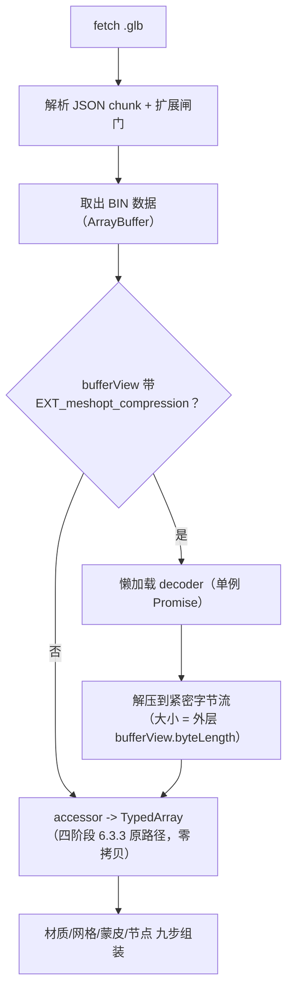
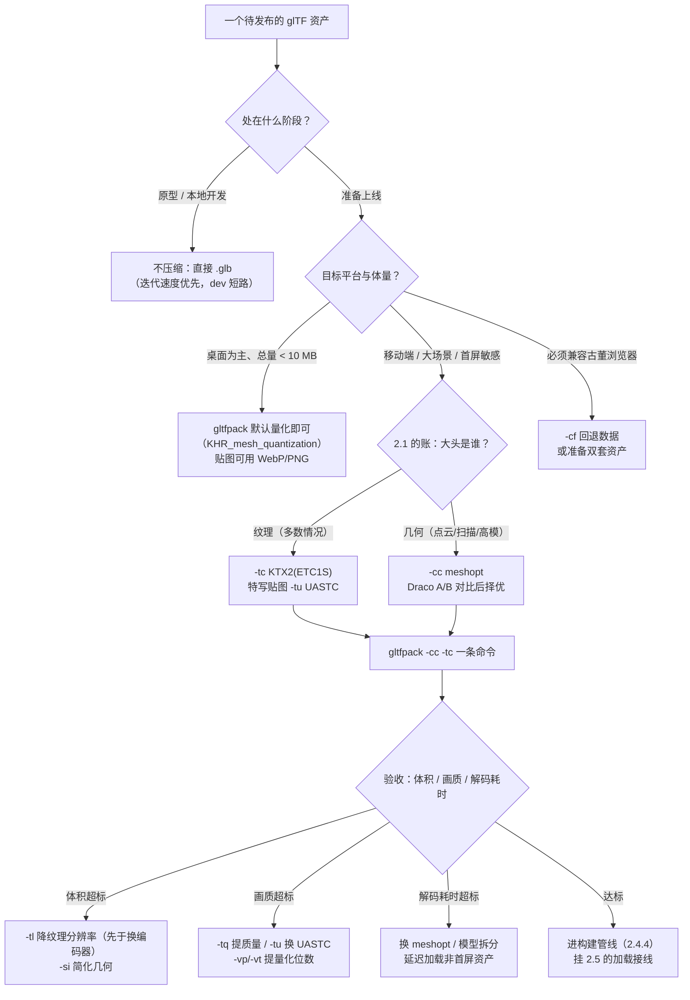

# 压缩与工具链：让资产小到能上线

> [返回：WebGL 与 3D 框架学习大纲](../WebGL与3D框架学习大纲.md)
> 本文把 [01-glTF2.0深入](01-glTF2.0深入.md)里"合法"的资产变成"能上线"的资产：先手算一笔体积账建立直觉，再过几何压缩（量化/Draco/meshopt）与纹理压缩（KTX2），然后是一键工具链（gltfpack/toktx/gltf-pipeline/Blender 面板/Vite 插件），最后回到运行时——解码在自研加载器里怎么接线。概念级的 KTX2/Basis 介绍在[五阶段 07 的 6.4](../05-第五阶段/07-性能优化与调试.md)，这里不重复原理，专注实操与决策。

## 2.1 为什么要压缩：一份模型资产的体积账

压缩之前先会算账。以一个典型游戏角色为例——3 万顶点、5 万三角形、4 张 2048×2048 贴图（baseColor / normal / ORM 打包 / emissive），属性含 POSITION/NORMAL/TEXCOORD_0/TANGENT。

### 2.1.1 原始资产：float 顶点 + PNG 纹理

**几何（下载与显存同量级）**：

- 每顶点字节 = POSITION 12 + NORMAL 12 + TEXCOORD 8 + TANGENT 16 = **48 字节**；
- 顶点缓冲 = 30,000 × 48 = 1,440,000 B ≈ **1.44 MB**；
- 索引 = 50,000 三角形 × 3 × 4 B（Uint32）= **0.6 MB**（3 万顶点 < 65536，重排后可用 Uint16 减半——但多数导出器默认 Uint32）；
- 几何合计 ≈ **2.04 MB**。

**纹理（下载是 PNG，显存是解码后的 RGBA8）**：

- 下载：照片类内容 PNG 压缩到原始的 1/4 左右，每张约 **4 MB**，4 张 ≈ **16 MB**；
- 显存：2048×2048×4 B = 16,777,216 B ≈ 16.8 MB/张；完整 mipmap 链再乘 4/3（[五阶段 07 的 6.3.1](../05-第五阶段/07-性能优化与调试.md)）≈ 22.4 MB/张；4 张 ≈ **89.5 MB**。

**合计**：下载 ≈ 18 MB，显存 ≈ 91.5 MB，另有 CPU 侧 4 张 PNG 解码 + 上传的首屏卡顿（几十到几百毫秒，且制造 GC 压力）。

### 2.1.2 压缩后：量化 + meshopt + KTX2

**几何（gltfpack 默认量化，再加 `-cc`）**：量化后每顶点约 17 字节（下一节的公式逐项算），30,000 × 17 ≈ 0.51 MB；`-cc` 的 meshopt 字节流再压、叠加 HTTP gzip 后典型 **0.2~0.4 MB**，索引经顶点缓存重排 + 索引流编码约 **0.05 MB**。几何合计 ≈ **0.35 MB**。

**纹理（KTX2 + Basis ETC1S，分辨率不变）**：块压缩每纹素 0.5 B，2048² = 2.1 MB/张，含内嵌 mip 链 ×4/3 ≈ 2.8 MB/张，4 张 ≈ **11.2 MB**——注意这份字节数下载与显存**相同**（GPU 直接采样压缩数据，不再展开成 RGBA8）。

**若再接受 1024²**（移动端标准做法，gltfpack `-tl 1024` 或 toktx 缩图）：每张 0.7 MB，4 张 ≈ **2.8 MB**。

### 2.1.3 三张账并排看

| 口径 | 原始（float+PNG） | 压缩（2048 不缩） | 压缩（缩到 1024） |
|---|---|---|---|
| 下载 | 18 MB | ~11.6 MB | ~3.2 MB |
| 显存 | ~91.5 MB | ~11.7 MB | ~3.3 MB |
| 首帧前 CPU 成本 | PNG 解码 + 全量上传 | 毫秒级块级转码 | 同左，更小 |

三条结论，直接决定后面的优先级：

1. **纹理主导一切**：原始资产里纹理占下载 89%、显存 98%——压缩顺序永远是先纹理后几何，"把网格压到极致"对这份资产只省 2 MB；
2. **KTX2 的显存收益（约 8 倍）比下载收益更关键**：PNG 的 4 MB 是"路上小"，落地后 22.4 MB/张的显存与采样带宽才是移动端帧率的敌人（2.3.1）；
3. **降分辨率是独立且最强的杠杆**（面积 1/4 即字节 1/4），与格式压缩**可叠加**——"缩一档分辨率"常常比"换更好的编码器"划算。

这笔账就是 2.6 决策树的入口：不压什么、先压什么，数字说了算。

## 2.2 几何压缩：量化、Draco 与 meshopt

### 2.2.1 共同的前置：量化（quantization）

两种压缩器都建立在同一个前提上：**把 float32 换成低位宽定点数**。人眼对顶点位置的感知精度有限，绝对坐标换成"包围盒内的均匀网格坐标"后，每分量 8~16 位就够：

```text
顶点缓冲字节 ≈ 顶点数 × Σ每属性( 分量数 × ceil(量化位数 / 8) )

例（角色模型）：
  POSITION   VEC3 × 16bit = 6 B      （量化位数 14，存储取整到 16 位归一化整数）
  NORMAL     VEC3 ×  8bit = 3 B
  TANGENT    VEC4 ×  8bit = 4 B      （w 是手性，1 字节绰绰有余）
  TEXCOORD_0 VEC2 × 16bit = 4 B      （量化位数 12）
  ────────────────────────────────
  合计 17 B/顶点 × 30,000 = 510 KB（原始 float32 是 48 B → 1440 KB）
```

**精度手算**（验收量化是否安全的依据）：场景包围盒 10 m、位置 14 bit → 网格步长 = 10 / 2^14 ≈ **0.6 mm**——低于肉眼可感知的顶点错位，所以 14 bit 在中小场景"视觉无损"。

经验值表（三家工具的默认值互相印证：gltfpack 默认 14/12/8/8，gltf-pipeline 的 Draco 默认 11/10/8/8）：

| 属性 | 推荐位数 | 何时加码 |
|---|---|---|
| POSITION | 14~16 | 大场景（百米级）取 16；与 KTX2 的量化网格联动见 2.4 |
| TEXCOORD | 10~12 | **纹理图集/平铺 UV 取 14+**，否则块间渗色（2.6 坑 2） |
| NORMAL/TANGENT | 8 | 特写镜头再上 16 |
| COLOR | 8 | 几乎永远够 |
| 动画平移/旋转/缩放 | 16/12/16 | 长距离位移动画（相机飞行）加到 24 |

量化在 glTF 里的表达是"归一化整数属性"（如 `componentType: 5123` + `normalized: true`，shader 里自动映射回 0~1），配套声明 `KHR_mesh_quantization` 扩展——这就是 gltfpack 不带任何压缩参数的默认输出也带扩展声明的原因。位置量化网格的偏移/缩放则写进节点变换（一个包裹节点的 scale/translation），模型层级会多一层。

### 2.2.2 Draco：属性预测 + 熵编码

Draco（Google）是通用几何压缩的老牌方案，直觉两步：

1. **拓扑编码**：用 Edgebreaker 类图遍历把三角网格的连接性（谁和谁连成三角形）压成符号流——网格的"结构"比看上去规律得多；
2. **属性编码**：对顶点属性做**预测编码**——下一个顶点的位置用相邻三角形的几何外推（平行四边形预测：新顶点 ≈ 对边镜像），只编码"预测残差"；相邻顶点高度相关，残差很小，再进熵编码（范围编码）就能压到极小。

代价在解码侧：**必须在 CPU 上逐条重建拓扑与属性**，输出常是 float32（或按配置保留量化）。工程事实：

- 解码器是 **WASM 约 300 KB 量级**（draco_decoder.wasm + JS wrapper），不能打进主包——加载时机只能是懒加载（遇到 `KHR_draco_mesh_compression` 才拉），并且**必须在 Worker 里跑**，主线程解一个角色模型就能掉好几帧；
- 解码吞吐比 meshopt 低一个数量级（要重建拓扑），大模型明显拖首屏；
- 对 morph target 的支持不稳（three.js 长期不支持 Draco + morph 组合），蒙皮属性的压缩收益也一般。

适合：离线内容包、点云/扫描件（拓扑不规则、预测收益最大）、对体积极限敏感且能接受加载等待的场景。

### 2.2.3 meshopt：GPU 友好的字节流

meshopt（meshoptimizer，gltfpack 的作者 Zeux 出品）的设计目标是"**解出来的数据 GPU 直接用**"而不是"压得尽量小"：

- **解码输出就是紧密排布的量化字节流**：vertexAttribPointer 指过去就能画，不需要 float32 转换，显存占用停留在量化水平（对比 Draco 常见还原为 float32）；
- **过滤器（filter）**：八面体编码（octahedral）把单位法线压进 2×8 bit 仍有高角度精度——这是"字节少精度不塌"的关键，而非简单截断；
- **索引流编码**：顶点按缓存友好重排后，索引间差分极小，编码接近每索引 1 字节；重排同时优化顶点缓存（vertex fetch cache）命中与 overdraw（[五阶段 07 的 6.1/6.2](../05-第五阶段/07-性能优化与调试.md)的 drawcall 与顶点成本直接受益）；
- **解码器形态**：单文件模块、WASM 以内嵌方式随模块走——**没有独立的解码器资源要部署、没有额外网络请求**（这点常被误传为"纯 JS 无 WASM"：它是 WASM 内嵌，且解码够快到可以在主线程同步跑小模型；真正无法用 WASM 的古董浏览器，gltfpack 提供 `-cf` 生成回退数据）。

生态位：three.js r122+（`setMeshoptDecoder`）、Babylon.js 5+ 原生支持，是 glTF 官方推荐的 Web 路线；动画轨道（1.3.4 的 sampler accessor）与 morph target 也能压。

### 2.2.4 对比与选型

| 维度 | Draco | meshopt |
|---|---|---|
| 几何压缩率 | 高（拓扑+属性熵编码，常见 8~15 倍） | 中（字节流 + gzip，常见 3~6 倍） |
| 解码器部署 | 独立 WASM ~300 KB + wrapper，需 Worker | 单文件模块（WASM 内嵌），主线程可承受 |
| 解码吞吐 | 低一个数量级（重建拓扑） | ~1 GB/s 量级 |
| 解码后数据 | 常还原 float32，上传前或再量化 | 量化字节流直接进 GPU |
| morph/蒙皮动画 | morph 支持不稳 | 支持 |
| 配套工具 | gltf-pipeline、Blender 导出器内建 | gltfpack（全功能：量化/简化/合并/纹理一站） |

选型建议：

- **Web 项目默认 meshopt**（gltfpack `-cc`）：解码部署成本最低、首屏路径最短、与 KTX2 组合顺畅；
- **以下情况评估 Draco**：点云/扫描类资产、允许后台预下载的内容包、体积比加载延迟更重要；
- 拿不准就 A/B：同一资产两条管线各压一遍，量三个数——下载体积、解码耗时（2.5 的接线做好埋点）、视觉对比（[工程专题 03](../工程专题/03-测试与质量.md)的 golden image 是验收工具）。压缩比的经验数字只用于预估，不用于决策。

## 2.3 纹理压缩：块压缩与 KTX2

### 2.3.1 为什么 GPU 原生采样省的不只是显存

块压缩（Block Compression）的直觉：把纹理切成 4×4 的块，每块不存 16×32 bit 的原始纹素，只存**两个端点色 + 每纹素 2 bit 的插值索引**（BC1 的做法）。手画一个块的字节账：

```text
一个 4×4 纹素块（BC1，共 8 字节 = 4 bit/纹素 = RGBA8 的 1/8）：
+----------------+----------------+
| 端点色 0（16bit）| 端点色 1（16bit）|  RGB 565 两个"基色"
+----------------+----------------+
| 00 01 10 11 ……（16 个 2bit 索引） |  每纹素四选一：
+----------------+----------------+  端点0 / 端点1 / 1:3 插值 / 2:3 插值
```

原理与格式家族（BCn/ETC/ASTC）的展开在[五阶段 07 的 6.4](../05-第五阶段/07-性能优化与调试.md)，这里补两条管线视角：

1. **省的是采样带宽，不只是显存**：GPU 采样压缩纹理时硬件即时"解码"单个块，显存读取量同步降 8 倍——移动端 GPU 的帧率瓶颈常常是内存带宽而非算力（[数学专题 05 的 5.1.3](../数学专题/05-采样卷积与频域.md)讲 mip 层级选择时同一根带宽链条），所以 KTX2 对移动端是帧率优化而不只是容量优化；
2. **格式分裂是它唯一的原罪**：桌面 BCn、移动 ETC2/ASTC，一份贴图要按设备分发不同文件——这正是 Basis Universal 存在的理由。

### 2.3.2 Basis/KTX2 的价值与两档编码

KTX2（Khronos Texture v2 容器）+ Basis Universal 的组合：**一次编码，处处转码**——发布物是一份 .ktx2，加载时在 CPU 上把 Basis 数据**转码（transcode）**成当前 GPU 的原生块格式（桌面 BC、移动 ETC2/ASTC），转码是轻量的块级重排，GPU 采样时才做真正的"解码"。转码与解码的区分在五阶段 07 已讲清，不重复。Basis 提供两档编码，按贴图用途选：

| 档 | 码率 | 质量 | 适用 |
|---|---|---|---|
| ETC1S | 4 bit/纹素（1/8） | 有损，平滑渐变可能出现色带 | baseColor、emissive 等颜色类，绝大多数贴图 |
| UASTC | 8 bit/纹素（1/4） | 接近 BC7 | 法线、特写贴图、渐变敏感的内容 |

按类分流是常态：gltfpack 支持 `-tc` 全 ETC1S、`-tu normal` 只给法线类换 UASTC（2.4 的组合示例）。

### 2.3.3 mipmap 内嵌

KTX2 文件本身就是 mip 链容器：编码时生成（`--genmipmap`）、文件内按层存放、上传时逐层 `compressedTexSubImage2D`。对比 PNG 路线的三个增益：

- GPU 生成 mip（`generateMipmap`）对压缩/POT 之外的输入支持有限且质量一般；编码器离线生成的链质量可控（可配滤波）；
- 1.4.1 说过 glTF 采样器默认 `LINEAR_MIPMAP_LINEAR`——内嵌 mip 链让压缩贴图也能履行这个默认约定；
- 下载的字节即显存的字节（2.1.2 的账），mip 链的 4/3 开销在编码期就摊平，不会运行时翻倍。

### 2.3.4 命令实操：KTX-Software 的 toktx

安装：[KTX-Software](https://github.com/KhronosGroup/KTX-Software) Release 页有各平台安装包，macOS 也可 `brew install ktx`。`toktx` 是其命令行工具（新版本逐步被 `ktx create` 系列取代，toktx 仍在随包发布）：

```bash
# 颜色贴图：ETC1S + 自动 mipmap（toktx 默认把 3/4 通道输入当 sRGB，正合 baseColor）
toktx --bcmp --genmipmap baseColor.ktx2 baseColor.png

# 拉高 ETC1S 质量（--qlevel 1~255，默认 128；越高越慢、越接近原图）
toktx --bcmp --qlevel 200 --genmipmap baseColor.ktx2 baseColor.png

# 法线贴图：UASTC 高质量 + 法线模式
#（--normal_map 自动按线性数据处理并调整编码参数，别再手动套 sRGB）
toktx --uastc --normal_map --genmipmap normal.ktx2 normal.png

# ORM 这类 3 通道数据贴图：必须显式 --linear，否则被默认标成 sRGB 导致粗糙度错位
toktx --bcmp --linear --genmipmap orm.ktx2 orm.png

# 高质量 + 体积优化：UASTC 产物可再被 HTTP gzip 压一轮（RDO 选项见 toktx --help）
```

三条纪律：

1. **数据贴图（normal/ORM/metallicRoughness/occlusion）永远显式 `--linear` 或 `--normal_map`**——toktx 的 sRGB 默认只对颜色内容正确（1.6 坑 4 的编码侧镜像）；
2. 法线不要走通用 ETC1S：方向被压歪、光照出块状杂斑（[五阶段 07 的常见坑 5](../05-第五阶段/07-性能优化与调试.md)），要 UASTC + 法线模式，或双通道格式；
3. 压完逐张目检：渐变天空找色带、法线找杂斑——编码质量参数（--qlevel）是连续的，别追求"一把梭"的全局配置。

单张贴图手动 toktx 只适合调试；真实管线让 gltfpack 在打包时统一转码（下一节），或由 2.4.4 的构建插件调用。

## 2.4 一键管线：gltfpack 与上下游

### 2.4.1 gltfpack 参数速查

gltfpack（[meshoptimizer 项目的 glTF 打包器](https://github.com/zeux/meshoptimizer/tree/master/gltf)）一个二进制做完量化、简化、合并、meshopt 压缩与纹理转码。注意：**纹理压缩（-tc/-tu/-tw）只有原生二进制支持**，npm 版（WASM 构建）不支持，发布机装原生版。常用参数速查（完整列表 `gltfpack -h`）：

| 参数 | 作用 | 备注 |
|---|---|---|
| `-i` / `-o` | 输入 / 输出 | 输入 .gltf/.glb/.obj/.ply，输出 .gltf/.glb |
| `-c` | meshopt 压缩 | 产出声明 EXT_meshopt_compression |
| `-cc` | 更高压缩比 | 生产默认；配合 HTTP gzip 收益最大 |
| `-cz` / `-ce khr` | 最高档 / 换 KHR 版扩展 | 特殊需求才动 |
| `-cf` | 压缩 + 未压缩回退数据 | 兼容无 WASM 的古董浏览器；与 -cc 互斥 |
| `-tc` / `-tu` / `-tw` | 纹理转 KTX2(ETC1S) / KTX2(UASTC) / WebP | 需原生版；可加类名限定（`-tu normal`） |
| `-tq N` | 纹理编码质量 1~10（默认 8） | |
| `-ts R` / `-tl N` | 纹理缩放 / 限制最大边长 | `-tl 1024` 是移动端标配 |
| `-si R` | 简化到 R 比例三角形（0~1） | `-si 0.5` 减半面；`-se E` 限误差 |
| `-vp/-vt/-vn/-vc N` | 位置/UV/法线/颜色量化位数 | 默认 14/12/8/8 |
| `-at/-ar/-as N` | 动画平移/旋转/缩放量化位数 | 默认 16/12/16 |
| `-af N` | 动画按 N Hz 重采样（默认 30） | |
| `-kn` / `-km` / `-ke` | 保留命名节点 / 材质 / extras | 运行时按名取节点时必开 -kn |
| `-mm` / `-mi` | 合并同 mesh 实例 / GPU instancing | 与 -kn 冲突（优化被禁用） |
| `-noq` | 关闭量化 | 输出不带量化扩展，体积大 |
| `-v` / `-vv` | 输出统计 / 详细统计 | `-vv` 给每属性 bits/顶点，验证 2.2.1 的账 |

组合示例（从保守到激进）：

```bash
# 基线：默认量化 + 顶点缓存优化（声明 KHR_mesh_quantization）
gltfpack -i model.gltf -o model.glb

# Web 发布典型：几何 meshopt + 纹理 KTX2（声明 EXT_meshopt_compression + KHR_texture_basisu）
gltfpack -i model.gltf -o model.glb -cc -tc

# 移动端：法线类贴图单独 UASTC，贴图限 1024，几何减面到 70%
gltfpack -i model.gltf -o model.glb -cc -tc -tu normal -tl 1024 -si 0.7

# 需要运行时按名字动画/挂点的资产：保名字、保动画精度
gltfpack -i model.gltf -o model.glb -cc -tc -kn -ar 16
```

产物必须过 [glTF Validator](01-glTF2.0深入.md)（1.5.3）并记录扩展声明——2.5 的加载器闸门照着这张声明单接线。

### 2.4.2 gltf-pipeline 与 gltf-transform

gltf-pipeline（Cesium 系，Node CLI/库）主攻容器转换与 Draco：

```bash
npm install -g gltf-pipeline

gltf-pipeline -i model.gltf -o model.glb              # .gltf 合并为 .glb（-b）
gltf-pipeline -i model.glb  -o model.gltf             # 反向拆开（-j），配合 -s 分离资源
gltf-pipeline -i model.gltf -o modelDraco.gltf -d     # Draco 压缩（-d 即 --draco.compressMeshes）
# 量化细调：--draco.quantizePositionBits 11 / TexcoordBits 10 / NormalBits 8（默认值即此）
```

定位：Draco 阵营的一键工具与 Node 库（可编程嵌进自己的管线），与 gltfpack 的 meshopt 阵营二选一或并存（不同资产走不同线）。另一个现代替代是 gltf-transform（donmccurdy 维护），`gltf-transform optimize` 子命令把同类操作组合成一条命令（--compress、--texture-compress 等参数以 `--help` 输出为准），插件化程度最高，适合做自己的批处理中枢。

### 2.4.3 Blender 导出面板逐项

Blender 的 File > Export > glTF 2.0 面板（3.x/4.x 大同小异）逐项给建议——原则：**把"制作信息"留在 .blend 里，导出只带"渲染信息"；最终压缩交给 gltfpack，不在 Blender 里做**：

| 分区 / 选项 | 建议 | 原因 |
|---|---|---|
| Transform > +Y Up | 勾（默认） | Z-up→Y-up 的官方转换；别在引擎里再转（1.6 坑 1） |
| Geometry > Apply Modifiers | 勾（留意破坏性修改器） | 导出"应用后"结果；细分/阵列在建模侧完成 |
| Geometry > UVs / Normals | 勾 | 贴图与平滑法线是渲染必需 |
| Geometry > Tangents | 用法线贴图就勾 | TANGENT 属性由导出器生成（1.3.1） |
| Geometry > Morph Targets（及 Normals/Tangents） | 做表情就勾 | shape key → targets（1.3.2）；不勾体积立减 |
| Geometry > Skinning | 蒙皮必勾 | JOINTS/WEIGHTS + skins（1.3.3） |
| Include > Cameras / Punctual Lights | 按需 | 灯光走 KHR_lights_punctual；渲染器参数自己管就别带 |
| Animation > Animations / Optimize Animation Size | 按需 | Optimize 去冗余关键帧；Limit to Playback Range 防止导出试帧 |
| Material > Image Format | Automatic 即可 | 贴图格式与压缩交给 2.3/2.4 的工具链 |
| Compression > Draco（量化滑杆） | 调试期不勾；发布可勾 | 位置 11 / 法线 8 / UV 10 默认值即 2.2.1 经验值；Blender 4.3 起另有 meshopt 选项 |
| 输出格式（glTF Separate / Embedded / GLB） | 网页交付用 GLB 或 Separate | Embedded 的 data URI 会把 JSON 撑大、难缓存（四阶段 6.2.2 的 data URI 分支也变慢） |

导出后立即做两件事：过 Validator；`gltfpack -v` 看统计基线——之后每次改导出设置都能对比数字而不是对比感觉。

### 2.4.4 构建期处理：Vite 插件思路

最终形态是"美术只交 .blend/.gltf，前端 `import` 即得压缩产物"。约定式查询参数（`?pack`）触发压缩，产物按内容哈希缓存：

```typescript
// vite-plugin-gltfpack.ts —— 思路草图（示意；真实实现补错误处理与类型）
import { execFile } from "node:child_process";
import { promisify } from "node:util";
import { createHash } from "node:crypto";
import fs from "node:fs";
import path from "node:path";

const run = promisify(execFile);

export function gltfpackPlugin(): import("vite").Plugin {
  const cacheDir = "node_modules/.cache/gltfpack";
  return {
    name: "vite:gltfpack",
    async load(id) {
      // 约定：import url from "./robot.gltf?pack" 才压缩；普通引用不动
      if (!id.endsWith("?pack")) return null;
      const src = id.slice(0, -"?pack".length);

      // 1) 内容哈希做缓存键：美术反复重新导出，构建不反复重压
      const source = await fs.promises.readFile(src);
      const hash = createHash("sha256").update(source).digest("hex").slice(0, 16);
      const outPath = path.join(cacheDir, `${hash}.glb`);
      if (!fs.existsSync(outPath)) {
        // 2) 调原生 gltfpack；参数即 2.4.1 的组合，按项目定档
        await run("gltfpack", ["-i", src, "-o", outPath, "-cc", "-tc"]);
      }
      // 3) 产物作为静态资产交给 Rollup，返回带内容哈希的公开 URL
      const ref = this.emitFile({
        type: "asset",
        name: `${path.basename(src, path.extname(src))}.glb`,
        source: await fs.promises.readFile(outPath),
      });
      return `export default import.meta.ROLLUP_FILE_URL_${ref};`;
    },
  };
}
```

```typescript
// vite.config.ts
import { gltfpackPlugin } from "./vite-plugin-gltfpack";
export default { plugins: [gltfpackPlugin()] };

// 业务代码：拿到的 URL 已是压缩 + 哈希化的产物，交给四阶段的加载器
import robotUrl from "./assets/robot.gltf?pack";
const robot = await loader.load(robotUrl);
```

设计要点三条：**缓存键是源内容而非时间戳**（重导出同内容零成本）；**参数集中在一处**（全项目一个质量档，2.6 决策树的落点）；**开发模式可短路**（dev 下直接返回原文件 URL，迭代不被压缩阻塞——构建才付钱）。社区已有同类插件可直接用，思路一致；2.1 那笔账决定这个插件值得写——它把"压缩"从每个人的手工步骤变成仓库级配置。

## 2.5 运行时加载侧：解码的接线

压缩改变了运行时的契约：`.glb` 拿到手不能直接 accessorToTypedArray，中间多一道"解压"。自研框架（四阶段）的 GLTFLoader 需要三处升级。

### 2.5.1 扩展闸门：extensionsRequired

压缩产物必然声明新扩展（量化 → KHR_mesh_quantization；meshopt → EXT_meshopt_compression；Draco → KHR_draco_mesh_compression；KTX2 → KHR_texture_basisu）。`extensionsRequired` 是硬性依赖：不支持就别开始下载，越早拒绝越省流量：

```typescript
// resource/gltf/checkExtensions.ts —— 加载的第一道闸门
const SUPPORTED = new Set([
  "KHR_mesh_quantization",   // 量化：shader 里按 normalized 属性处理即可
  "KHR_texture_transform",   // UV 变换
  "EXT_meshopt_compression", // meshopt：2.5.2 接线
  "KHR_texture_basisu",      // KTX2：2.5.3 接线
  // "KHR_draco_mesh_compression" 用到 Draco 管线时才加
]);

export function checkExtensions(gltf: { extensionsRequired?: string[] }): void {
  const missing = (gltf.extensionsRequired ?? []).filter((e) => !SUPPORTED.has(e));
  if (missing.length > 0) {
    // 报出名字而不是笼统的"加载失败"——排障时能直接对回 2.4 的声明单
    throw new Error(`不支持的必需扩展: ${missing.join(", ")}`);
  }
}
```

### 2.5.2 decoder 懒加载与就地解压：移植 three.js 的思路

three.js 的 DRACOLoader 是三条设计的组合，自研框架照抄结构：

1. **setDecoderPath 解耦部署**：解码器（wasm + wrapper）是独立静态资源，放 CDN 按需拉，不进主包；
2. **懒加载单例**：只有真的遇到压缩资产才 `import()`/fetch 解码器，Promise 缓存住，第二个模型不再重复加载；
3. **就地替换、下游不变**：解压发生在"accessor 数据从哪来"这一层——普通 accessor 读 bufferView，压缩的从解码器输出取；后面的材质/网格/蒙皮装配（四阶段 6.3.2 的步骤 5~9）完全无感。

meshopt 的接线全流程（Draco 同构，解码器换成 Worker 池）：



代码骨架（对齐 three.js 的 EXT_meshopt_compression 处理）：

```typescript
// resource/gltf/meshopt.ts —— 解码器懒加载 + 就地解压
type MeshoptDecoder = {
  ready: Promise<void>;
  decodeGltfBuffer(
    dst: Uint8Array, count: number, stride: number,
    src: Uint8Array, mode: string, filter: string,
  ): void;
};

let decoderPromise: Promise<MeshoptDecoder> | null = null;
function getDecoder(): Promise<MeshoptDecoder> {
  decoderPromise ??= import("meshopt_decoder").then((m) => {
    void m.MeshoptDecoder.ready;          // WASM 内嵌于模块，实例化即完成
    return m.MeshoptDecoder as MeshoptDecoder;
  });
  return decoderPromise;                   // 单例：第二个模型直接复用
}

// 在 accessor 实例化之前，把所有被压缩的 bufferView 展开
async function decompressViews(gltf: any, buffer: ArrayBuffer): Promise<void> {
  const jobs: Promise<void>[] = [];
  for (const view of gltf.bufferViews ?? []) {
    const ext = view.extensions?.EXT_meshopt_compression;
    if (!ext) continue;
    jobs.push(getDecoder().then((decoder) => {
      const src = new Uint8Array(buffer, ext.byteOffset, ext.byteLength);
      const dst = new Uint8Array(view.byteLength);   // 外层 byteLength 即解压后大小
      decoder.decodeGltfBuffer(dst, ext.count, ext.byteStride, src,
                               ext.mode, ext.filter ?? "NONE");
      view.resolved = dst.buffer;                    // 后续 accessor 从这里建 TypedArray
    }));
  }
  await Promise.all(jobs);
}
```

要点：解压目标是**紧密排布的字节流**（量化属性 + normalized 解释），`accessorToTypedArray` 的零拷贝分支在解压后的视图上继续成立；量化位置带的包裹节点变换（2.2.1）由场景图组装步骤自然消化，蒙皮/动画轨道与顶点走同一条 decompressViews——这就是 2.2.3 说"meshopt 全覆盖"的运行时视角。

Draco 的接线差异（对应 DRACOLoader 的两条关键设计：Worker 池 + primitive 级属性映射）：

```typescript
// draco 接线差异（示意）：压缩声明挂在 primitive 上而不是 bufferView 上
// primitive.extensions.KHR_draco_mesh_compression
//   = { bufferView: 压缩数据索引, attributes: { POSITION: 0, NORMAL: 1 } }
// 解码不是"展开视图"而是"按 primitive 产出一组属性流"：
const dracoWorker = new Worker(new URL("./dracoWorker.ts", import.meta.url), { type: "module" });

function decodeDracoPrimitive(ext: { bufferView: number; attributes: Record<string, number> },
                               bytes: ArrayBuffer): Promise<Record<string, ArrayBufferView>> {
  return new Promise((resolve) => {
    // transferable 转移所有权：字节零拷贝出主线程（Worker 侧解码不卡 UI）
    dracoWorker.postMessage({ bytes, attributes: ext.attributes }, [bytes]);
    dracoWorker.addEventListener("message", (e) => resolve(e.data.attributes), { once: true });
  });
}
// Worker 内部：加载 CDN 上的 draco_decoder.wasm + wrapper，DecodeMeshToMesh
// 后按 attributes 表把各属性流取成 TypedArray 回传。
// 接回原管线的位置：buildMesh 里 attributes 的数据源换成上面 Promise 的输出，
// 步骤 5~9（材质/蒙皮/节点组装）依旧无感——"就地替换、下游不变"的原则落地处。
```

对照实现：three.js 的 DRACOLoader（Worker 池管理、解码器路径配置、按需 fetch wasm）是最完整的参考，[六阶段 02](../06-第六阶段/02-Three.js源码研读.md)源码研读时逐行对照本节的三条设计。

### 2.5.3 KTX2 转码目标的运行时判断

Basis 数据要到"这台设备的原生块格式"才能上传，转码目标按能力检测选——思路与[工程专题 02 的 2.1 能力检测体系](../工程专题/02-移动端与兼容性.md)完全一致，不猜设备、只问能力：

```typescript
// resource/ktx2/pickTarget.ts —— 运行时选择 Basis 转码目标
export function pickBasisTargets(gl: WebGL2RenderingContext) {
  const has = (name: string) => gl.getExtension(name) !== null;
  return {
    // UASTC 档：桌面 BC7 优先，移动 ASTC 兜底
    uastc: has("EXT_texture_compression_bptc") ? "BC7"
         : has("WEBGL_compressed_texture_astc") ? "ASTC_4x4"
         : null,
    // ETC1S 档：桌面 S3TC(BC1/3/5)，移动 ETC 家族；sRGB 变体单独确认（baseColor 用）
    etc1s: has("WEBGL_compressed_texture_s3tc") ? "BC1"
         : has("WEBGL_compressed_texture_etc") ? "ETC2_RGBA"
         : null,
  };
}
```

配套事实：转码器（basis_transcoder 的 wasm）同样是**懒加载的独立静态资源**（three.js KTX2Loader 的 setTranscoderPath + detectSupport 就是这个形状）；全都不支持时按工程专题 02 的降级策略表走 RGBA 回退或换低配资产。KTX2 的取数与上传对四阶段加载器是新分支：从容器读出 mip 层数与每层块数，逐层 `gl.compressedTexSubImage2D`——TextureLoader 的 `texImage2D` 路径不适用，这也是"加载器按扩展分流"的又一个实例。

## 2.6 选型决策树、常见坑与自测

### 2.6.1 选型决策树



树的纪律与[五阶段 07 的性能决策树](../05-第五阶段/07-性能优化与调试.md)相同：每一层先测量再动手，改完回到"验收"节点复测；决策依据是 2.1 的账与 `-vv` 统计，不是感觉。

### 2.6.2 常见坑

1. **压了但加载器不认**：症状是黑屏 + "不支持的必需扩展"。检查点：文件 JSON 里的 extensionsRequired 与加载器 SUPPORTED 集合逐项对照。修法：2.5.1 的闸门提前失败并报出扩展名；缺 decoder 就补接线，而不是把压缩参数去掉。
2. **量化一刀切到底**：症状是近距离特写顶点抖动、图集贴图块间渗色。检查点：`gltfpack -vv` 看各属性实际 bits。修法：按 2.2.1 经验值表加码（UV ≥14、位置大场景 16），只给需要的属性加，别全局拉高。
3. **法线走通用 ETC1S**：症状是光照出现块状杂斑。检查点：ktx2 生成命令有没有 --normal_map。修法：2.3.4 的法线专用命令；渲染侧对照[五阶段 07 坑 5](../05-第五阶段/07-性能优化与调试.md)。
4. **数据贴图被按 sRGB 编码**：症状是粗糙度整体错位、PBR"变塑料"。检查点：toktx 默认把 3/4 通道输入当 sRGB。修法：ORM/metallicRoughness 显式 --linear（2.3.4 纪律 1）。
5. **CI 全量重压没有缓存**：症状是每次构建多等几分钟，团队开始绕开管线。修法：2.4.4 的内容哈希缓存；gltfpack 是纯函数（同输入同输出），缓存完全安全。
6. **压缩后没回归动画**：症状是发布版表情/蒙皮坏了、本地"看起来没问题"。修法：把 01 的"生成 → 读回"思想扩成管线回归——每档压缩配置固定跑一组资产 + golden image（[工程专题 03](../工程专题/03-测试与质量.md)）。
7. **以为 -cc 生效了其实没有**：症状是体积没降多少。检查点：服务器是否真的返回 gzip（Content-Encoding）——meshopt 流的设计目标是"再被 deflate 压一轮"，少这一环收益减半；响应头确认 + Brotli 更佳。
8. **-kn 忘开丢名字**：症状是运行时 getNodeByName 拿不到。检查点：gltfpack 默认裁剪命名节点（它认为是死数据）。修法：运行时要按名操作就 -kn（2.4.1 表）。

### 【本节自测】

1. 按 2.1 的方法给"8 万顶点、16 万三角形、6 张 1024×1024 PNG 贴图"的资产手算：原始下载与显存各多少？（写出算式。）
2. 同样的资产换 KTX2(ETC1S) 且分辨率不变，下载与显存变成多少？mip 链的 4/3 在哪一步进入计算？
3. 位置 16 bit、场景包围盒 50 m 时量化步长多少毫米？这个数字怎么用来回答"能不能再降 2 bit"？
4. Draco 与 meshopt 在"解码器部署形态、解码后数据形态"两个维度各是什么？这两个差异如何分别影响首屏时间与显存占用？
5. 为什么说 meshopt 解码器"没有额外网络请求"是相对 Draco 的部署优势？它对无 WASM 浏览器的官方答案是什么参数？
6. toktx 对一张 3 通道的 ORM 贴图，不加任何色彩空间参数会发生什么？为什么默认行为对 baseColor 是对的、对 ORM 是错的？
7. 写出你当前项目的 gltfpack 命令行，逐参数说明取舍；对应 2.5.1 的 SUPPORTED 集合应该长什么样？
8. 设计题：把 2.4.4 的 Vite 插件改为"桌面/移动两档产物、运行时按 2.5.3 的能力检测选 URL 加载"。画出方案草图（两份产物如何命名、业务代码写几行、决策发生在构建期还是运行期）。
9. 排查题：发布后用户反馈"角色手机上正常、桌面上更清晰但首屏多转了 2 秒圈"。列出你的排查顺序与对应工具。

回看本专题：01 讲清了文件里**是什么**，本文讲清了它**怎么变小、怎么进项目**；与[四阶段 07](../04-第四阶段/07-资源管理.md)合起来，"从 Blender 到画面"的资产链路就闭环了——毕业项目的资产发布，按 2.6 的决策树走一遍即可。
